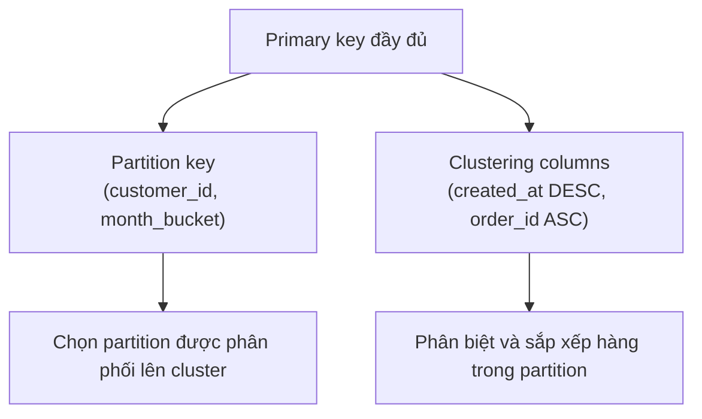

# `@PrimaryKey` cho định danh đơn hoặc đối tượng khóa

## 1. `@PrimaryKey` giải quyết vấn đề gì?

Trong **Spring Data Cassandra**, một entity Java biểu diễn hàng của bảng Apache Cassandra. Spring Data cần biết **thuộc tính nào định danh hàng** để chuyển đổi object thành dữ liệu CQL và thực hiện các thao tác như `save`, `findById` hoặc `deleteById`. Annotation `@PrimaryKey` đánh dấu thuộc tính giữ **khóa chính của entity**.

Một thuộc tính được gắn `@PrimaryKey` có thể là:

1. **Giá trị đơn**, chẳng hạn `UUID orderId`, khi bảng CQL có khóa chính chỉ gồm một cột.
2. **Đối tượng khóa**, chẳng hạn `OrderByCustomerKey`, khi CQL có primary key gồm nhiều cột và cần phân biệt **partition key** với **clustering columns**.

Ví dụ hai đường truy cập của ứng dụng quản lý đơn hàng:

```text
GET /orders/{orderId}
    -> orders_by_id
    -> PRIMARY KEY (order_id)
    -> @PrimaryKey private UUID orderId

GET /customers/{customerId}/orders?month=2026-11
    -> orders_by_customer_month
    -> PRIMARY KEY ((customer_id, month_bucket), created_at, order_id)
    -> @PrimaryKey private OrderByCustomerKey key
```

Hai bảng có thể lưu một số thông tin đơn hàng giống nhau để phục vụ hai truy vấn. Điều này phù hợp với mô hình **thiết kế bảng theo truy vấn** của Cassandra, nhưng kéo theo trách nhiệm cập nhật các bản sao dữ liệu theo yêu cầu nghiệp vụ.

**Điểm cốt lõi:** `@PrimaryKey` là chỉ dẫn ánh xạ cho Spring Data, **không tạo tính duy nhất trên toàn hệ thống** ngoài những gì schema CQL đã quy định, không tự sinh giá trị khóa và không biến Cassandra thành hệ cơ sở dữ liệu quan hệ có `JOIN` và foreign key.

## 2. Trường hợp A: `@PrimaryKey` cho một giá trị định danh

API tra cứu đơn hàng theo ID có thể dùng bảng:

```sql
CREATE KEYSPACE IF NOT EXISTS shop_app
WITH replication = {
    'class': 'SimpleStrategy',
    'replication_factor': 1
};

CREATE TABLE IF NOT EXISTS shop_app.orders_by_id (
    order_id uuid PRIMARY KEY,
    customer_id uuid,
    created_at timestamp,
    status text,
    total_amount decimal
);
```

`SimpleStrategy` với replication factor 1 ở đây **chỉ dành cho môi trường thực hành một node**. Trên cluster thực, cần xác định datacenter và replication bằng `NetworkTopologyStrategy` theo topology và yêu cầu chịu lỗi.

Trong bảng `orders_by_id`, `order_id` vừa là **partition key**, vừa là toàn bộ **primary key**. Mỗi giá trị `order_id` xác định một logical partition chứa tối đa một hàng của bảng này.

### 2.1. Entity với `@PrimaryKey` trên `UUID`

```java
import java.math.BigDecimal;
import java.time.Instant;
import java.util.UUID;

import org.springframework.data.cassandra.core.mapping.Column;
import org.springframework.data.cassandra.core.mapping.PrimaryKey;
import org.springframework.data.cassandra.core.mapping.Table;

@Table("orders_by_id")
public class OrderById {

    @PrimaryKey("order_id")
    private UUID orderId;

    @Column("customer_id")
    private UUID customerId;

    @Column("created_at")
    private Instant createdAt;

    @Column("status")
    private String status;

    @Column("total_amount")
    private BigDecimal totalAmount;

    protected OrderById() {
        // Cho cơ chế materialization/mapping của Spring Data.
    }

    public OrderById(
            UUID orderId,
            UUID customerId,
            Instant createdAt,
            String status,
            BigDecimal totalAmount) {
        this.orderId = orderId;
        this.customerId = customerId;
        this.createdAt = createdAt;
        this.status = status;
        this.totalAmount = totalAmount;
    }

    public UUID getOrderId() {
        return orderId;
    }

    public UUID getCustomerId() {
        return customerId;
    }

    public Instant getCreatedAt() {
        return createdAt;
    }

    public String getStatus() {
        return status;
    }

    public BigDecimal getTotalAmount() {
        return totalAmount;
    }
}
```

Ở đây:

| Thành phần | Ý nghĩa |
| --- | --- |
| `@Table("orders_by_id")` | Liên kết entity với bảng CQL `orders_by_id` |
| `@PrimaryKey("order_id")` | Đánh dấu thuộc tính `orderId` là khóa và ánh xạ đến cột `order_id` |
| `UUID` | Kiểu Java tương ứng với `uuid` của Cassandra |
| `@Column("customer_id")` | Ánh xạ cột dữ liệu thường, không phải khóa |
| `Instant` / `BigDecimal` | Ví dụ kiểu Java thường dùng cho `timestamp` / `decimal` |

Việc ghi rõ tên cột giúp mã dễ đối chiếu với CQL và không phụ thuộc vào quy ước chuyển `camelCase` sang `snake_case` của dự án. Với schema này, `@PrimaryKey` đặt **trên một field duy nhất** là đủ: không cần tạo lớp `@PrimaryKeyClass` chỉ để chứa một UUID.

### 2.2. Repository dùng đúng kiểu ID

```java
import java.util.UUID;

import org.springframework.data.cassandra.repository.CassandraRepository;

public interface OrderByIdRepository
        extends CassandraRepository<OrderById, UUID> {
}
```

Tham số generic thứ hai, `UUID`, **phải phù hợp với kiểu của thuộc tính gắn `@PrimaryKey`**. Ví dụ sử dụng:

```java
UUID id = UUID.randomUUID();

OrderById order = new OrderById(
    id,
    UUID.fromString("11111111-1111-1111-1111-111111111111"),
    Instant.parse("2026-11-25T03:00:00Z"),
    "PENDING",
    new BigDecimal("199000.00")
);

repository.save(order);

OrderById loaded = repository.findById(id)
    .orElseThrow(() -> new IllegalStateException("Không tìm thấy đơn hàng"));
```

Đoạn mã giả định `repository` là một dependency đã được inject từ Spring. Application phải cấp `orderId` hợp lệ trước khi gọi `save`. `@PrimaryKey` **không sinh UUID**, không tự thiết lập giá trị lúc insert và không đảm bảo hệ thống nghiệp vụ không tạo ra hai ID cho cùng một đơn.

Đặc biệt, `save` trong Cassandra về cơ bản sử dụng ngữ nghĩa ghi **upsert** theo khóa. Nếu đã tồn tại hàng có cùng primary key, thao tác ghi có thể cập nhật dữ liệu của hàng đó. Để đòi hỏi điều kiện "chỉ tạo nếu chưa tồn tại", cần một thao tác **LWT có `IF NOT EXISTS`** phù hợp với use case; chỉ gắn annotation `@PrimaryKey` không tạo điều kiện đó.

## 3. Trường hợp B: `@PrimaryKey` cho một đối tượng khóa ghép

Giả sử API thường hiển thị đơn mới nhất của **một khách trong một tháng**. Ta chọn bảng sau:

```sql
CREATE TABLE IF NOT EXISTS shop_app.orders_by_customer_month (
    customer_id uuid,
    month_bucket text,
    created_at timestamp,
    order_id uuid,
    status text,
    total_amount decimal,
    PRIMARY KEY (
        (customer_id, month_bucket),
        created_at,
        order_id
    )
) WITH CLUSTERING ORDER BY (created_at DESC, order_id ASC);
```

Trong cú pháp `PRIMARY KEY ((customer_id, month_bucket), created_at, order_id)`:

- `(customer_id, month_bucket)` là **partition key ghép**: hai cột **cùng nhau** xác định partition.
- `created_at` là **clustering column** thứ nhất, sắp xếp theo thứ tự giảm dần trong partition.
- `order_id` là **clustering column** thứ hai, sắp xếp tăng dần, giúp phân biệt nhiều đơn trùng thời điểm.
- Bốn giá trị `customer_id`, `month_bucket`, `created_at`, `order_id` tạo thành **primary key đầy đủ** của từng hàng.



Thay vì đặt `@PrimaryKey` lên từng cột như cách dễ nhầm khi mới học, ta khai báo **một đối tượng khóa** gồm đầy đủ các thành phần, rồi đặt `@PrimaryKey` lên field đối tượng đó trong entity.

### 3.1. Lớp khóa với `@PrimaryKeyClass` và `@PrimaryKeyColumn`

```java
import java.io.Serializable;
import java.time.Instant;
import java.util.Objects;
import java.util.UUID;

import org.springframework.data.cassandra.core.cql.Ordering;
import org.springframework.data.cassandra.core.mapping.PrimaryKeyClass;
import org.springframework.data.cassandra.core.mapping.PrimaryKeyColumn;
import org.springframework.data.cassandra.core.mapping.PrimaryKeyType;

@PrimaryKeyClass
public class OrderByCustomerKey implements Serializable {

    private static final long serialVersionUID = 1L;

    @PrimaryKeyColumn(
        name = "customer_id",
        ordinal = 0,
        type = PrimaryKeyType.PARTITIONED
    )
    private UUID customerId;

    @PrimaryKeyColumn(
        name = "month_bucket",
        ordinal = 1,
        type = PrimaryKeyType.PARTITIONED
    )
    private String monthBucket;

    @PrimaryKeyColumn(
        name = "created_at",
        ordinal = 2,
        type = PrimaryKeyType.CLUSTERED,
        ordering = Ordering.DESCENDING
    )
    private Instant createdAt;

    @PrimaryKeyColumn(
        name = "order_id",
        ordinal = 3,
        type = PrimaryKeyType.CLUSTERED,
        ordering = Ordering.ASCENDING
    )
    private UUID orderId;

    protected OrderByCustomerKey() {
    }

    public OrderByCustomerKey(
            UUID customerId,
            String monthBucket,
            Instant createdAt,
            UUID orderId) {
        this.customerId = customerId;
        this.monthBucket = monthBucket;
        this.createdAt = createdAt;
        this.orderId = orderId;
    }

    public UUID getCustomerId() {
        return customerId;
    }

    public String getMonthBucket() {
        return monthBucket;
    }

    public Instant getCreatedAt() {
        return createdAt;
    }

    public UUID getOrderId() {
        return orderId;
    }

    @Override
    public boolean equals(Object obj) {
        if (this == obj) {
            return true;
        }
        if (!(obj instanceof OrderByCustomerKey other)) {
            return false;
        }
        return Objects.equals(customerId, other.customerId)
            && Objects.equals(monthBucket, other.monthBucket)
            && Objects.equals(createdAt, other.createdAt)
            && Objects.equals(orderId, other.orderId);
    }

    @Override
    public int hashCode() {
        return Objects.hash(customerId, monthBucket, createdAt, orderId);
    }
}
```

**Giải thích annotation trong lớp khóa:**

| Annotation/thuộc tính | Nhiệm vụ |
| --- | --- |
| `@PrimaryKeyClass` | Đánh dấu kiểu Java biểu diễn primary key ghép của một entity |
| `@PrimaryKeyColumn(name = ...)` | Ghép field Java với đúng cột khóa trong bảng |
| `type = PrimaryKeyType.PARTITIONED` | Cột thuộc partition key |
| `type = PrimaryKeyType.CLUSTERED` | Cột thuộc clustering key |
| `ordinal` | Vị trí của cột trong thứ tự các thành phần khóa |
| `ordering = Ordering.DESCENDING/ASCENDING` | Khai báo thứ tự clustering tương ứng với schema CQL |

`ordinal` và `type` phải **khớp với schema CQL**. Không được đánh dấu `month_bucket` là `CLUSTERED` trong Java khi DDL đặt nó vào partition key. Đặc biệt, `ordering` có ý nghĩa với **clustering columns**; không dùng thuộc tính này để giả định Cassandra có thể sắp xếp toàn cục theo partition key.

Lớp khóa trong ví dụ có constructor không tham số, các getter và `equals`/`hashCode` dựa trên **toàn bộ thành phần khóa**. Đây là cách viết tường minh, tương thích với nhiều cấu hình mapping. Một số phiên bản Spring Data hỗ trợ thêm phong cách immutable hoặc constructor-based materialization; khi dùng cần tuân thủ quy tắc ánh xạ của chính phiên bản đó.

**Khuyến nghị:** coi khóa là định danh ổn định sau khi lưu. Không đổi `customerId`, `monthBucket`, `createdAt` hay `orderId` trên đối tượng khóa đang đại diện cho hàng cũ; việc đổi khóa thực chất là **một hàng mới ở vị trí mới**, kèm xử lý xóa hàng cũ nếu cần.

### 3.2. Entity sử dụng `@PrimaryKey` trên đối tượng khóa

```java
import java.math.BigDecimal;

import org.springframework.data.cassandra.core.mapping.Column;
import org.springframework.data.cassandra.core.mapping.PrimaryKey;
import org.springframework.data.cassandra.core.mapping.Table;

@Table("orders_by_customer_month")
public class OrderByCustomerMonth {

    @PrimaryKey
    private OrderByCustomerKey key;

    @Column("status")
    private String status;

    @Column("total_amount")
    private BigDecimal totalAmount;

    protected OrderByCustomerMonth() {
    }

    public OrderByCustomerMonth(
            OrderByCustomerKey key,
            String status,
            BigDecimal totalAmount) {
        this.key = key;
        this.status = status;
        this.totalAmount = totalAmount;
    }

    public OrderByCustomerKey getKey() {
        return key;
    }

    public String getStatus() {
        return status;
    }

    public BigDecimal getTotalAmount() {
        return totalAmount;
    }
}
```

Ở đây, **chỉ `key` mang `@PrimaryKey`**. Các field `customerId`, `monthBucket`, `createdAt` và `orderId` thuộc `OrderByCustomerKey`, không khai báo lại trong entity.

Điều này giúp giữ một nguồn xác định primary key trong Java. Nếu lập trình viên khai báo thêm một `@PrimaryKey` trên `orderId` của entity thì mô hình mapping sẽ trở nên mâu thuẫn với schema, vì một entity không thể có hai primary key độc lập.

### 3.3. Repository lấy đối tượng khóa làm ID

```java
import org.springframework.data.cassandra.repository.CassandraRepository;

public interface OrderByCustomerMonthRepository
        extends CassandraRepository<OrderByCustomerMonth, OrderByCustomerKey> {
}
```

`findById` cần **toàn bộ khóa**, không chỉ partition key:

```java
OrderByCustomerKey id = new OrderByCustomerKey(
    UUID.fromString("11111111-1111-1111-1111-111111111111"),
    "2026-11",
    Instant.parse("2026-11-25T03:00:00Z"),
    UUID.fromString("22222222-2222-2222-2222-222222222222")
);

OrderByCustomerMonth order = repository.findById(id)
    .orElseThrow(() -> new IllegalStateException("Không tìm thấy hàng"));
```

Nếu API muốn liệt kê tất cả đơn trong một tháng của khách thì lại là **truy vấn theo partition key**, không phải `findById`:

```java
import java.util.List;
import java.util.UUID;

import org.springframework.data.cassandra.repository.CassandraRepository;
import org.springframework.data.cassandra.repository.Query;

public interface OrderByCustomerMonthRepository
        extends CassandraRepository<OrderByCustomerMonth, OrderByCustomerKey> {

    @Query("""
        SELECT * FROM orders_by_customer_month
        WHERE customer_id = ?0 AND month_bucket = ?1
        LIMIT ?2
        """)
    List<OrderByCustomerMonth> findLatestInMonth(
            UUID customerId, String monthBucket, int limit);
}
```

Đây là phiên bản **mở rộng của cùng interface repository** để minh họa một phương thức khác. Khi đưa vào dự án, chỉ định nghĩa **một** interface `OrderByCustomerMonthRepository` chứa các phương thức cần dùng.

Với `monthBucket = "2026-11"`, Cassandra tìm partition `(customer_id, month_bucket)` rồi đọc theo clustering order đã định nghĩa. `LIMIT 20` giới hạn số hàng trả về; trong hệ thống thực tế, nên thiết kế thêm cursor/paging state khi người dùng cần đi qua nhiều trang hoặc nhiều tháng.

## 4. `@PrimaryKey`, `@PrimaryKeyClass` và `@PrimaryKeyColumn`: tránh nhầm vai trò

Ba annotation này thường đi cùng nhau trong ví dụ khóa ghép, nhưng có chức năng khác biệt:

| Trường hợp | Vị trí annotation | Dữ liệu Java | Ví dụ CQL |
| --- | --- | --- | --- |
| Khóa đơn | `@PrimaryKey` trên field của entity | `UUID orderId` | `PRIMARY KEY (order_id)` |
| Khóa ghép | `@PrimaryKey` trên field của entity | `OrderByCustomerKey key` | `PRIMARY KEY ((customer_id, month_bucket), created_at, order_id)` |
| Định nghĩa kiểu khóa ghép | `@PrimaryKeyClass` trên lớp khóa | `OrderByCustomerKey` | Toàn bộ primary key |
| Mỗi phần của khóa ghép | `@PrimaryKeyColumn` trên field của lớp khóa | `customerId`, `monthBucket`, ... | Partition/clustering columns |
| Cột dữ liệu bình thường | `@Column` trong entity | `status`, `totalAmount` | Các cột không thuộc primary key |

Không đánh đồng với JPA:

- `@PrimaryKey` của Spring Data Cassandra **khác** `@Id`, `@EmbeddedId`, `@GeneratedValue` trong Jakarta Persistence/JPA. Khi dùng Cassandra, import đúng `org.springframework.data.cassandra.core.mapping.*`.
- `@PrimaryKeyClass` không phải một entity hoặc bảng riêng; nó chỉ biểu diễn **ID của entity**.
- Không có khóa ngoại tự động giữa `orders_by_id` và `orders_by_customer_month`. Hai bảng là hai đường đọc độc lập, cần chiến lược cập nhật/đối soát dữ liệu nếu cùng mô tả một đơn hàng.

### 4.1. Khi nào dùng khóa đơn, khi nào dùng khóa ghép?

**Dùng khóa đơn** nếu truy vấn quan trọng nhất là tra cứu chính xác theo một định danh, ví dụ `orderId`, `userId` hoặc `deviceId`. Cách ánh xạ đơn giản, repository ID cũng là giá trị đơn.

**Dùng khóa ghép** nếu cần lưu nhiều hàng trong một partition và đọc theo thứ tự đã dự đoán, ví dụ lịch sử đơn theo khách và tháng, sự kiện theo thiết bị và ngày. Partition key quyết định nơi dữ liệu được phân phối; clustering columns cho phép phân biệt và sắp xếp các hàng bên trong partition.

Trong cả hai trường hợp, thiết kế CQL phải xuất phát từ truy vấn/API. Việc Spring Data cho phép khai báo một phương thức repository không có nghĩa Cassandra sẽ hỗ trợ nó hiệu quả nếu `WHERE` không khớp khóa.

## 5. Quy tắc của primary key trong Cassandra

### 5.1. Khóa không được thiếu hoặc null

Khi ghi một hàng, Cassandra cần giá trị cho **từng thành phần primary key**. Ví dụ với bảng `orders_by_customer_month`, thiếu `month_bucket` hoặc `order_id` sẽ không tạo được hàng hợp lệ.

```java
// Không hợp lệ để lưu thành một hàng đầy đủ:
new OrderByCustomerKey(
    customerId,
    null,                // Thiếu thành phần partition key.
    createdAt,
    orderId
);
```

Nên kiểm tra đầu vào ở tầng service/constructor trước khi gọi repository. Một số lỗi chỉ biểu hiện lúc mapping hoặc gửi CQL; báo lỗi sớm giúp tránh xử lý retry vô nghĩa.

### 5.2. Toàn bộ primary key xác định tính duy nhất của hàng

Xét hai hàng:

| customer_id | month_bucket | created_at | order_id |
| --- | --- | --- | --- |
| A | `2026-11` | `10:00:00Z` | O1 |
| A | `2026-11` | `10:00:00Z` | O2 |

Hai hàng có cùng partition key và cùng thời điểm, nhưng **khác `order_id`**, nên không trùng khóa chính. Nếu bỏ `order_id` khỏi primary key, hai lệnh ghi cùng timestamp cho cùng khách/tháng có thể trở thành upsert vào **cùng một hàng**, làm mất sự phân biệt giữa các đơn.

Khác với kiểu unique index trong SQL, Cassandra chỉ đảm bảo tính duy nhất dựa trên **toàn bộ primary key của một bảng**; nó không tự chứng minh `order_id` là duy nhất trên mọi partition hay mọi bảng. Muốn bảo đảm một đơn chỉ được tạo một lần theo `order_id` ở cấp nghiệp vụ cần thiết kế luồng ghi và điều kiện phù hợp (có thể dùng LWT trên bảng tra cứu ID).

### 5.3. Không thể đổi primary key bằng `UPDATE`

Ví dụ một đơn đổi tháng vì cần sửa thời gian tạo: câu `UPDATE ... SET month_bucket = '2026-12'` không hợp lệ nếu `month_bucket` là một thành phần primary key. Ứng dụng phải tạo hàng ở khóa mới và xử lý hàng cũ, đồng thời cân nhắc các bảng denormalized khác.

Tương tự, chỉnh annotation từ `PARTITIONED` sang `CLUSTERED` trong Java **không thay đổi schema Cassandra đã tồn tại**. Đổi partition key/clustering layout là migration dữ liệu, thường cần bảng mới, backfill và chuyển đường đọc có kiểm soát.

### 5.4. Chọn khóa để tránh partition quá lớn hoặc fan-out

Nếu dùng `PRIMARY KEY ((customer_id), created_at, order_id)`, toàn bộ lịch sử đơn của khách nằm trong một logical partition, có thể tăng lớn theo thời gian.

Nếu dùng `PRIMARY KEY ((customer_id, month_bucket), created_at, order_id)`, mỗi khách có nhiều partition theo tháng; truy vấn một tháng sẽ gọn hơn, nhưng API muốn lấy dữ liệu qua nhiều tháng phải truy cập nhiều partition rồi sắp xếp/ghép ở tầng service.

`@PrimaryKey` chỉ phản ánh quyết định đó trong Java. Không có annotation nào tự cân bằng kích thước partition, tối ưu fan-out, thiết lập consistency level hoặc bổ sung cursor hợp lệ cho nhiều partition.

## 6. Mở rộng truy cập bằng `CassandraTemplate` và CQL

Có thể sử dụng entity mapping với repository hoặc `CassandraTemplate`. Hai cách cùng dựa trên **cấu trúc khóa CQL**.

Với bảng lookup theo ID:

```sql
SELECT order_id, customer_id, created_at, status, total_amount
FROM shop_app.orders_by_id
WHERE order_id = ?;
```

Với bảng lịch sử:

```sql
SELECT customer_id, month_bucket, created_at, order_id, status, total_amount
FROM shop_app.orders_by_customer_month
WHERE customer_id = ?
  AND month_bucket = ?
  AND created_at >= ?
LIMIT 20;
```

Trong Java, `CassandraTemplate` là lựa chọn khi cần kiểm soát query/mapping linh hoạt hơn mức repository phù hợp. Nếu dùng CQL ở driver trực tiếp, nên sử dụng **prepared statement/bound parameters** thay vì ghép dữ liệu người dùng vào chuỗi CQL.

Về hiệu năng:

- Truy vấn `WHERE order_id = ?` đúng với partition key của bảng `orders_by_id`.
- Truy vấn lịch sử biết đủ `(customer_id, month_bucket)`, sau đó dùng clustering `created_at`.
- `WHERE order_id = ?` **không tự nhiên hiệu quả** trên bảng `orders_by_customer_month`, dù `order_id` nằm trong primary key đầy đủ, vì chưa biết partition key.
- `ALLOW FILTERING` không phải cách thay thế thiết kế bảng theo đường truy cập.
- `LIMIT` và paging state không thể sửa một truy vấn phải quét toàn cụm; cần giới hạn số partition, page size và đo p95/p99 theo dữ liệu thật.

Ngoài ra, consistency level được thiết lập ở driver hoặc request có thể ảnh hưởng thời điểm nhìn thấy dữ liệu mới ghi; nó không bảo đảm hai bảng denormalized luôn cùng trạng thái nếu quy trình ghi cập nhật chúng ở các thời điểm khác nhau.

## 7. Các lỗi mapping thường gặp

| Lỗi | Dấu hiệu | Cách sửa |
| --- | --- | --- |
| Khai báo `@PrimaryKey private UUID id` nhưng CQL khóa là `(customer_id, created_at)` | Lỗi ánh xạ/đọc ghi hoặc query không hợp lệ | Thiết kế lớp `@PrimaryKeyClass` đúng toàn bộ khóa |
| Nhầm `PrimaryKeyType.PARTITIONED` với `CLUSTERED` | Schema Java và CQL không khớp | Đối chiếu trực tiếp `PRIMARY KEY ((...), ...)` |
| Sai tên cột hoặc nhầm snake_case với camelCase | Không tìm thấy cột, mapping sai | Khai báo `@PrimaryKey("order_id")`, `@PrimaryKeyColumn(name=...)` |
| Repository dùng generic ID là `UUID` trong khi field `@PrimaryKey` là object | `findById` cần sai kiểu ID | Đổi generic ID thành lớp khóa đầy đủ |
| Một thành phần khóa là `null` | Insert/update không hợp lệ | Validate toàn bộ thành phần trước khi ghi |
| Dùng chỉ `created_at` làm clustering key khi có thể trùng timestamp | Các đơn cùng thời điểm ghi đè | Thêm thành phần định danh phù hợp như `order_id` |
| Dùng `findById` với một phần partition key | Không định danh đủ hàng | Viết truy vấn CQL theo partition key cho list; dùng `findById` cho khóa đầy đủ |
| Sửa field khóa trên đối tượng đã lưu | Có thể tạo dữ liệu ở khóa khác, bỏ sót hàng cũ | Giữ khóa ổn định; có quy trình move/delete khi thay đổi |
| Hiểu `save` là `INSERT` luôn thất bại nếu trùng ID | Dữ liệu cũ bị ghi cập nhật | Phân biệt upsert với LWT `IF NOT EXISTS` |
| Dùng annotation JPA trong entity Cassandra | Mapper không nhận đúng metadata Cassandra | Import annotation của `org.springframework.data.cassandra.core.mapping` |
| Coi `@PrimaryKey` là schema migration | App và CQL lệch nhau sau deploy | Quản lý DDL/migration riêng và kiểm tra schema agreement |

### Quy trình gỡ lỗi từng bước

1. Đọc DDL thực tế của bảng và xác định **partition key, thứ tự clustering columns, tên và kiểu cột**.
2. So sánh với `@Table`, `@PrimaryKey`, `@PrimaryKeyClass` và từng `@PrimaryKeyColumn`.
3. Kiểm tra kiểu generic ID của repository với kiểu field `@PrimaryKey` trên entity.
4. In giá trị khóa phía ứng dụng bằng cơ chế log an toàn (tránh dữ liệu nhạy cảm), xác nhận đủ thành phần và đúng bucket.
5. Chạy câu CQL tối giản theo khóa trước; sau đó kiểm tra repository và `CassandraTemplate`.
6. Nếu truy vấn hợp lệ nhưng chậm, đo partition size, hot partition, lượng dữ liệu thực đọc, tombstone, paging, tải node và consistency; đừng chỉ tăng timeout.

## 8. Bài tập thực hành

**Bài 1 – Khóa đơn:** Tạo bảng `device_by_id(device_id uuid PRIMARY KEY, name text)`. Viết entity Java dùng `@PrimaryKey("device_id")` và repository có generic ID tương ứng. Giải thích việc gọi `save` hai lần với cùng `deviceId` có tạo ra hai hàng hay không.

**Bài 2 – Khóa ghép:** Thiết kế bảng lịch sử đo cảm biến:

```sql
CREATE TABLE readings_by_device_day (
    device_id uuid,
    day_bucket date,
    captured_at timestamp,
    reading_id uuid,
    value double,
    PRIMARY KEY ((device_id, day_bucket), captured_at, reading_id)
) WITH CLUSTERING ORDER BY (captured_at DESC, reading_id ASC);
```

Hãy tạo `ReadingKey` với `@PrimaryKeyClass`, đủ bốn `@PrimaryKeyColumn`, rồi tạo `Reading` có **một** field `@PrimaryKey`. Xác định kiểu generic ID cho `CassandraRepository` và viết một CQL query lấy 50 mẫu đo mới nhất của một thiết bị trong một ngày.

**Bài 3 – Phân biệt ID với điều kiện lọc:** Với bảng `readings_by_device_day`, tại sao `repository.findById(...)` cần cả `device_id`, `day_bucket`, `captured_at`, `reading_id`, còn API danh sách chỉ cần `device_id` và `day_bucket` cùng `LIMIT`? Cách nào có thể phục vụ endpoint tra cứu chỉ theo `reading_id`?

**Bài 4 – Thay khóa:** Nếu lịch sử cảm biến tăng lên hàng triệu bản ghi mỗi ngày và hệ thống quyết định thêm `hour_bucket` vào partition key, cần sửa gì trong CQL, lớp khóa, repository và luồng migration dữ liệu? Vì sao chỉ thay đổi annotation không đủ?

### Câu hỏi tự kiểm tra

1. `@PrimaryKey` đặt ở đâu trong entity dùng khóa đơn và entity dùng đối tượng khóa?
2. `@PrimaryKeyClass` khác `@PrimaryKeyColumn` về phạm vi áp dụng như thế nào?
3. Với `PRIMARY KEY ((tenant_id, bucket), ts, id)`, những cột nào là partition key, những cột nào là clustering columns?
4. Vì sao `@PrimaryKey` không tự sinh UUID hoặc tự tạo ràng buộc uniqueness xuyên nhiều bảng?
5. Khi nào hai sự kiện cùng timestamp có thể ghi đè một hàng?
6. Khi muốn đọc toàn bộ một partition, có nên gọi `findById` với ID bị thiếu clustering columns không?
7. Tại sao thay đổi một field nằm trong khóa thực chất có thể là thao tác di chuyển hàng?

## Kết luận

**`@PrimaryKey`** là điểm nối giữa **định danh entity Java** và **primary key của bảng Cassandra**. Nếu khóa là một cột như `order_id`, đặt `@PrimaryKey` trên `UUID` và khai báo repository với ID kiểu `UUID`. Nếu khóa gồm nhiều thành phần, tạo lớp `@PrimaryKeyClass` với các field `@PrimaryKeyColumn` mô tả đúng partition/clustering, sau đó đặt `@PrimaryKey` trên **đối tượng khóa** ở entity và dùng lớp khóa làm generic ID của repository. Chọn khóa theo truy vấn, duy trì tính ổn định của khóa, đối chiếu trực tiếp với CQL DDL và kiểm thử bằng truy vấn thực tế để tránh lỗi mapping cũng như chi phí truy cập dữ liệu phân tán khó kiểm soát.
