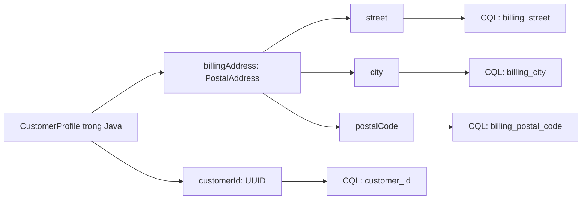

# @Embedded và làm phẳng đối tượng thành các cột

Trong Java, một đối tượng nghiệp vụ thường chứa các **value object** nhỏ để mã nguồn dễ đọc. Ví dụ, hồ sơ khách hàng có hai địa chỉ: địa chỉ thanh toán và địa chỉ giao hàng. Thay vì đặt sáu trường `billingStreet`, `billingCity`, `billingPostalCode`, `shippingStreet`, `shippingCity`, `shippingPostalCode` trực tiếp vào một Java class, chúng ta muốn biểu diễn bằng hai thuộc tính cùng kiểu `PostalAddress`.

Trong **Spring Data Cassandra**, annotation `@Embedded` giúp làm điều đó **mà không cần tạo cột dạng đối tượng trong Cassandra**: các thuộc tính của value object được **làm phẳng (flatten)** thành các cột riêng của **cùng một bảng**. Việc chuyển đổi được thực hiện bởi cơ chế ánh xạ của Spring Data Cassandra, trong đó có `MappingCassandraConverter`.

Bài này thuộc chương **Ánh xạ entity** của module **SPRING_DATA_CASSANDRA**. Ta sẽ học cú pháp và hành vi của `@Embedded`, cách dùng `prefix` để tránh xung đột tên cột, phân biệt `USE_NULL` và `USE_EMPTY`, viết entity/repository/`CassandraTemplate` phù hợp với schema CQL và nhận biết các giới hạn của việc làm phẳng khi thiết kế dữ liệu phân tán.

## 1. Mục tiêu học tập

Sau bài này, bạn có thể:

1. Giải thích vì sao `@Embedded` tổ chức code Java thành value object nhưng vẫn lưu thành **các cột thông thường** trong bảng Cassandra.
2. Viết schema CQL khớp với entity có `@Embedded.Nullable(prefix = "...")` hoặc `@Embedded.Empty(...)`.
3. Dự đoán kết quả ánh xạ khi **toàn bộ** hoặc chỉ **một phần** các cột embedded có giá trị `null`.
4. Phân biệt `@Embedded` với `@UserDefinedType` (UDT) và `@PrimaryKeyClass`.
5. Dùng `CassandraRepository` hoặc `CassandraTemplate` đọc một entity đã làm phẳng, sau đó kiểm chứng dữ liệu qua `cqlsh`.
6. Tránh những sai lầm thường gặp: trùng tên cột, lồng nhiều embedded object, schema Java/CQL không khớp, truy vấn theo regular column không có đường truy cập phù hợp.

## 2. @Embedded làm gì với dữ liệu?

Giả sử một hồ sơ khách hàng có thuộc tính `billingAddress`:

```java
public class PostalAddress {
    private String street;
    private String city;
    private String postalCode;
}

public class CustomerProfile {
    private UUID customerId;
    private PostalAddress billingAddress;
}
```

Ở tầng code, `PostalAddress` là một đối tượng có ý nghĩa nghiệp vụ. Nếu đánh dấu trường `billingAddress` bằng `@Embedded`, Spring Data Cassandra ánh xạ ba thuộc tính con thành ba cột của bảng cha, chẳng hạn:

| Đường dẫn thuộc tính Java | Cột CQL sau khi làm phẳng |
|---|---|
| `billingAddress.street` | `billing_street` |
| `billingAddress.city` | `billing_city` |
| `billingAddress.postalCode` | `billing_postal_code` |

Để đạt đúng tên như trên, ví dụ sẽ dùng `prefix = "billing_"` trên trường embedded và `@Column("postal_code")` cho thuộc tính `postalCode`. Dấu gạch dưới và quy tắc đặt tên phụ thuộc annotation/naming strategy; không nên tự giả định mọi phiên bản tự chuyển camelCase sang snake_case giống nhau.



**Điểm cốt lõi:** Cassandra không lưu một đối tượng `PostalAddress` có cấu trúc bên trong ở cột `billingAddress`. Nó lưu các cell tương ứng `billing_street`, `billing_city`, `billing_postal_code` như các cột CQL khác. Annotation chỉ hướng dẫn **mapping giữa mô hình Java và row Cassandra**.

### 2.1. @Embedded không tạo thêm bảng hay quan hệ

Không xuất hiện bảng `postal_address` riêng. Không có foreign key hoặc thao tác join. Một lần đọc row `customer_profiles` có thể được ánh xạ thành `CustomerProfile` và hai `PostalAddress` mà không cần truy vấn bảng phụ.

Điều này hữu ích vì Cassandra thường được thiết kế **theo mẫu truy vấn**, tránh các quan hệ/join kiểu SQL quan hệ. Việc gom các trường liên quan trong value object nâng khả năng bảo trì code mà vẫn giữ cấu trúc bảng phẳng phù hợp đường đọc.

### 2.2. @Embedded là annotation của Spring Data Cassandra

Trong Spring Data Cassandra 3.x/4.x, annotation nằm ở package:

```java
import org.springframework.data.cassandra.core.mapping.Embedded;
```

Không nhầm với `@Embedded` của **JPA/Jakarta Persistence** hoặc các module Spring Data khác. Cùng tên annotation không đồng nghĩa cùng cách lưu và cùng giới hạn.

Với Spring Data Cassandra, `onEmpty` là thành phần **bắt buộc** của annotation gốc `@Embedded`. Vì vậy, ví dụ:

```java
@Embedded(onEmpty = Embedded.OnEmpty.USE_NULL, prefix = "billing_")
private PostalAddress billingAddress;
```

Tương đương về mục đích ánh xạ với dạng ngắn:

```java
@Embedded.Nullable(prefix = "billing_")
private PostalAddress billingAddress;
```

Hai shortcut thường dùng là `@Embedded.Nullable` và `@Embedded.Empty`. Phần `onEmpty` sẽ được giải thích riêng ở mục 5.

## 3. Một ví dụ hoàn chỉnh: hai địa chỉ trên cùng bảng

Yêu cầu: hệ thống lưu một hồ sơ cho mỗi khách hàng, có tên hiển thị, địa chỉ thanh toán và địa chỉ giao hàng. Trong Java, hai địa chỉ cùng kiểu `PostalAddress`; trong Cassandra, chúng được lưu bằng **hai nhóm cột tách biệt**.

### 3.1. Định nghĩa bảng CQL

Giả sử keyspace `shop` đã tồn tại và `CqlSession` của ứng dụng được cấu hình sử dụng keyspace này:

```sql
CREATE TABLE IF NOT EXISTS shop.customer_profiles (
    customer_id uuid PRIMARY KEY,
    display_name text,

    billing_street text,
    billing_city text,
    billing_postal_code text,

    shipping_street text,
    shipping_city text,
    shipping_postal_code text
);
```

**Khóa chính** chỉ là `customer_id`. Các cột `billing_*` và `shipping_*` là **regular columns**. `@Embedded` không tự thêm chúng vào partition key và không tạo clustering columns.

Vì bảng này lưu một row cho mỗi `customer_id`, truy vấn mục tiêu là:

```sql
SELECT customer_id, display_name,
       billing_street, billing_city, billing_postal_code,
       shipping_street, shipping_city, shipping_postal_code
FROM shop.customer_profiles
WHERE customer_id = 11111111-1111-1111-1111-111111111111;
```

Truy vấn biết đủ partition key, nên Cassandra có thể xác định partition và replica đích. Annotation `@Embedded` **không can thiệp** vào việc định tuyến partition, consistency level hoặc paging.

### 3.2. Class PostalAddress

Tạo file `PostalAddress.java`:

```java
import org.springframework.data.cassandra.core.mapping.Column;

public class PostalAddress {

    @Column("street")
    private String street;

    @Column("city")
    private String city;

    @Column("postal_code")
    private String postalCode;

    public PostalAddress() {
    }

    public PostalAddress(String street, String city, String postalCode) {
        this.street = street;
        this.city = city;
        this.postalCode = postalCode;
    }

    public String getStreet() {
        return street;
    }

    public void setStreet(String street) {
        this.street = street;
    }

    public String getCity() {
        return city;
    }

    public void setCity(String city) {
        this.city = city;
    }

    public String getPostalCode() {
        return postalCode;
    }

    public void setPostalCode(String postalCode) {
        this.postalCode = postalCode;
    }
}
```

Class này là **value object theo mô hình Java**, không cần `@Table` hoặc `@UserDefinedType`. Các thuộc tính đang dùng kiểu đơn giản (`String`) mà converter hỗ trợ ánh xạ sang kiểu CQL `text`.

Việc khai báo `@Column` giúp minh bạch tên phần cột. Chẳng hạn `postalCode` sẽ được hiểu là `postal_code` trước khi Spring Data thêm `prefix` của trường embedded.

Constructor rỗng và setter giúp trình bày dễ hiểu cách tạo đối tượng khi đọc. Spring Data cũng có cơ chế constructor mapping cho immutable value object; nếu dùng record/constructor bất biến, phải đảm bảo tham số constructor có thể được map và quy tắc `USE_EMPTY` có thể tạo instance khi giá trị con đều null.

### 3.3. Class CustomerProfile

Tạo file `CustomerProfile.java`:

```java
import java.util.UUID;

import org.springframework.data.cassandra.core.mapping.Column;
import org.springframework.data.cassandra.core.mapping.Embedded;
import org.springframework.data.cassandra.core.mapping.PrimaryKey;
import org.springframework.data.cassandra.core.mapping.Table;

@Table("customer_profiles")
public class CustomerProfile {

    @PrimaryKey("customer_id")
    private UUID customerId;

    @Column("display_name")
    private String displayName;

    @Embedded.Nullable(prefix = "billing_")
    private PostalAddress billingAddress;

    @Embedded.Empty(prefix = "shipping_")
    private PostalAddress shippingAddress;

    public CustomerProfile() {
    }

    public CustomerProfile(
        UUID customerId,
        String displayName,
        PostalAddress billingAddress,
        PostalAddress shippingAddress
    ) {
        this.customerId = customerId;
        this.displayName = displayName;
        this.billingAddress = billingAddress;
        this.shippingAddress = shippingAddress;
    }

    public UUID getCustomerId() {
        return customerId;
    }

    public void setCustomerId(UUID customerId) {
        this.customerId = customerId;
    }

    public String getDisplayName() {
        return displayName;
    }

    public void setDisplayName(String displayName) {
        this.displayName = displayName;
    }

    public PostalAddress getBillingAddress() {
        return billingAddress;
    }

    public void setBillingAddress(PostalAddress billingAddress) {
        this.billingAddress = billingAddress;
    }

    public PostalAddress getShippingAddress() {
        return shippingAddress;
    }

    public void setShippingAddress(PostalAddress shippingAddress) {
        this.shippingAddress = shippingAddress;
    }
}
```

Phân tích:

- `@Table("customer_profiles")` ánh xạ class vào bảng `customer_profiles` trong keyspace của session.
- `@PrimaryKey("customer_id")` ánh xạ `UUID customerId` vào partition key.
- `@Column("display_name")` ánh xạ thuộc tính thông thường.
- `@Embedded.Nullable(prefix = "billing_")` làm phẳng `billingAddress` thành các cột `billing_street`, `billing_city` và `billing_postal_code`.
- `@Embedded.Empty(prefix = "shipping_")` làm phẳng `shippingAddress` thành nhóm `shipping_*` và chọn cách **tạo đối tượng rỗng** khi mọi cột con đều null lúc đọc.

Hai địa chỉ có cùng kiểu `PostalAddress` nhưng **không đè dữ liệu** lên nhau vì mỗi trường dùng tiền tố khác nhau.

### 3.4. Đối chiếu từng trường với schema

| Thuộc tính trong Java | Annotation có liên quan | Cột Cassandra |
|---|---|---|
| `customerId` | `@PrimaryKey("customer_id")` | `customer_id` |
| `displayName` | `@Column("display_name")` | `display_name` |
| `billingAddress.street` | `@Embedded.Nullable(prefix = "billing_")` + `@Column("street")` | `billing_street` |
| `billingAddress.city` | Như trên + `@Column("city")` | `billing_city` |
| `billingAddress.postalCode` | Như trên + `@Column("postal_code")` | `billing_postal_code` |
| `shippingAddress.street` | `@Embedded.Empty(prefix = "shipping_")` + `@Column("street")` | `shipping_street` |
| `shippingAddress.city` | Như trên + `@Column("city")` | `shipping_city` |
| `shippingAddress.postalCode` | Như trên + `@Column("postal_code")` | `shipping_postal_code` |

**Không có cột `billingAddress` hay `shippingAddress` trong schema.** Nếu ứng dụng cố ghi/đọc cột mang tên đối tượng thay vì những cột đã flatten, cần kiểm tra mapping hoặc converter đang thực sự dùng.

## 4. Nạp dữ liệu và kiểm chứng bằng cqlsh

### 4.1. Row có cả hai địa chỉ

Chạy trong `cqlsh` đã kết nối đến cluster có keyspace `shop`:

```sql
INSERT INTO shop.customer_profiles (
    customer_id, display_name,
    billing_street, billing_city, billing_postal_code,
    shipping_street, shipping_city, shipping_postal_code
)
VALUES (
    11111111-1111-1111-1111-111111111111,
    'Khach A',
    'So 12 Pho A', 'Ha Noi', '100000',
    'So 48 Duong B', 'Da Nang', '550000'
);
```

Khi Java đọc row này, một `CustomerProfile` sẽ có:

- `billingAddress` là `PostalAddress("So 12 Pho A", "Ha Noi", "100000")`.
- `shippingAddress` là `PostalAddress("So 48 Duong B", "Da Nang", "550000")`.

Đây là dữ liệu giả phục vụ bài tập; không dùng thông tin khách hàng thật trong seed.

### 4.2. Row không có cột địa chỉ

```sql
INSERT INTO shop.customer_profiles (customer_id, display_name)
VALUES (
    22222222-2222-2222-2222-222222222222,
    'Khach B'
);
```

Không cung cấp các cột `billing_*` và `shipping_*` nên khi đọc row mới này, các cột địa chỉ không có giá trị và được xem là `null`.

Với cách khai báo ở mục 3:

- `billingAddress` dùng `@Embedded.Nullable` ⇒ **`null`** khi **cả ba** cột `billing_*` đều null.
- `shippingAddress` dùng `@Embedded.Empty` ⇒ **một đối tượng `PostalAddress` mới** với cả ba thuộc tính con null (giả sử có constructor phù hợp).

### 4.3. Row có một phần dữ liệu embedded

```sql
INSERT INTO shop.customer_profiles (
    customer_id, display_name, billing_city
)
VALUES (
    33333333-3333-3333-3333-333333333333,
    'Khach C',
    'Hue'
);
```

Dù `billing_street` và `billing_postal_code` đều null, `billing_city` có giá trị. Vì vậy, `billingAddress` **không null** và có dạng:

```java
PostalAddress billing = profile.getBillingAddress();
// billing != null
// billing.getCity().equals("Hue")
// billing.getStreet() == null
// billing.getPostalCode() == null
```

Đây là điểm dễ hiểu nhầm nhất: `USE_NULL` **không có nghĩa** chỉ cần *một* trường con null thì cả object null. Nó chỉ cho `null` khi **tất cả** các trường con tương ứng đều null.

### 4.4. Xác nhận các cột vật lý

```sql
DESCRIBE TABLE shop.customer_profiles;

SELECT customer_id, display_name,
       billing_street, billing_city, billing_postal_code,
       shipping_street, shipping_city, shipping_postal_code
FROM shop.customer_profiles
WHERE customer_id = 33333333-3333-3333-3333-333333333333;
```

`DESCRIBE TABLE` giúp đối chiếu tên cột thật, còn `SELECT` cho thấy dữ liệu thô. Khi mapping Java trả đối tượng khác với kỳ vọng, luôn kiểm tra **dữ liệu CQL trước**, rồi mới điều tra converter và quy tắc `onEmpty`.

## 5. onEmpty: USE_NULL và USE_EMPTY khác nhau ở đâu?

Annotation `@Embedded` có thuộc tính `onEmpty` xác định việc materialize value object khi **toàn bộ các cột con trả về null**.

Hai lựa chọn:

```java
@Embedded(onEmpty = Embedded.OnEmpty.USE_NULL, prefix = "billing_")
private PostalAddress billingAddress;

@Embedded(onEmpty = Embedded.OnEmpty.USE_EMPTY, prefix = "shipping_")
private PostalAddress shippingAddress;
```

Tương đương cách dùng shortcut:

```java
@Embedded.Nullable(prefix = "billing_")
private PostalAddress billingAddress;

@Embedded.Empty(prefix = "shipping_")
private PostalAddress shippingAddress;
```

| Các cột con khi đọc | `USE_NULL` / `@Embedded.Nullable` | `USE_EMPTY` / `@Embedded.Empty` |
|---|---|---|
| Tất cả null | Thuộc tính embedded là `null` | Cố tạo object có các thuộc tính con null |
| Ít nhất một cột khác null | Tạo object, những cột null thành thuộc tính null | Tạo object, những cột null thành thuộc tính null |
| Tất cả có giá trị | Tạo object đầy đủ | Tạo object đầy đủ |

### 5.1. Khi nào chọn USE_NULL?

Chọn `USE_NULL` khi thiếu toàn bộ dữ liệu con mang nghĩa **“đối tượng này chưa được cung cấp”**. Ví dụ khách hàng chưa có địa chỉ thanh toán.

Mã ứng dụng phải xử lý khả năng `getBillingAddress() == null`, thay vì gọi `getBillingAddress().getCity()` trực tiếp.

### 5.2. Khi nào chọn USE_EMPTY?

Chọn `USE_EMPTY` khi ứng dụng muốn nhận một instance để tránh nhiều nhánh xử lý `null` ở đối tượng cha, chẳng hạn giao diện cho phép khách nhập từng phần địa chỉ.

Tuy nhiên, instance được tạo có thể chứa **toàn bộ thuộc tính null**. `USE_EMPTY` **không sinh giá trị mặc định cho `city`, `street` hay `postalCode`**, không tự bảo đảm dữ liệu hợp lệ và không tương đương một ràng buộc `NOT NULL` trong Cassandra.

Spring Data cần có thể **khởi tạo** class embedded bằng constructor mặc định hoặc constructor nhận các giá trị nullable được mapping. Nếu class có constructor không phù hợp hoặc logic constructor từ chối null, việc đọc có thể thất bại; cần kiểm tra quy tắc object creation của Spring Data.

### 5.3. onEmpty áp dụng khi đọc, không phải chiến lược viết

`onEmpty` quyết định cách tạo thuộc tính Java từ **kết quả đọc**. Nó không có nghĩa:

- Khi ghi `@Embedded.Empty`, Cassandra tự tạo các giá trị cột `""` thay cho null.
- Khi ghi `@Embedded.Nullable`, một value object null sẽ luôn có cùng mutation semantics với thao tác bỏ qua các cột.
- Ghi một embedded object sẽ tạo transaction riêng, bảng phụ hoặc JSON object.

Chi tiết sinh `INSERT`/`UPDATE` khi property null còn phụ thuộc API ghi, cách converter xử lý null và write options. Với hành vi xóa/ghi lại một phần dữ liệu, kiểm tra CQL thực tế và test các trường hợp null trong chính phiên bản Spring Data bạn dùng.

**Đặc biệt:** Nếu một query/projection chỉ lấy **một phần** cột embedded, các cột không được trả về có thể được converter xem là null khi dựng object. Điều này có thể làm khác biệt giữa `USE_NULL`/`USE_EMPTY`. Hãy truy vấn đủ các cột cần materialize hoặc thiết kế projection cụ thể, đừng suy đoán object đầy đủ từ một SELECT thiếu cột.

## 6. prefix: dùng lại value object mà không xung đột cột

### 6.1. Vì sao cần prefix?

Nếu cả hai trường đều viết:

```java
@Embedded.Nullable
private PostalAddress billingAddress;

@Embedded.Nullable
private PostalAddress shippingAddress;
```

Cả hai đều cố ánh xạ `street`, `city` và `postal_code` vào cùng bộ cột. Spring Data Cassandra cảnh báo **các property có thể ghi đè/va chạm khi sinh cùng tên cột**. Kết quả mapping có thể sai hoặc không thể xác định duy nhất nguồn dữ liệu.

Với tiền tố khác nhau:

```java
@Embedded.Nullable(prefix = "billing_")
private PostalAddress billingAddress;

@Embedded.Nullable(prefix = "shipping_")
private PostalAddress shippingAddress;
```

Hai nhóm cột được tách rõ:

```text
billing_street       shipping_street
billing_city         shipping_city
billing_postal_code  shipping_postal_code
```

**Tiền tố được thêm vào tên cột của từng thuộc tính con**, không thêm vào tên bảng, keyspace hay partition key.

### 6.2. prefix kết hợp với @Column như thế nào?

Với:

```java
public class PostalAddress {
    @Column("postal_code")
    String postalCode;
}

@Embedded.Nullable(prefix = "billing_")
PostalAddress billingAddress;
```

Tên cột cuối là `billing_postal_code`. Nếu schema thực tế có cột `billing_zip`, chỉ thêm `prefix = "billing_"` sẽ không đủ: cần đổi annotation ở trường con hoặc điều chỉnh schema theo chiến lược đặt tên đã chọn.

Đừng ghi sẵn `@Column("billing_postal_code")` bên trong class `PostalAddress` rồi cũng thêm `prefix = "billing_"`; lúc đó tên có thể thành `billing_billing_postal_code`.

**Quy ước tốt:** Value object mô tả tên cột **không tiền tố** (ví dụ `street`, `city`, `postal_code`); entity cha quyết định tiền tố cho mỗi ngữ cảnh sử dụng.

### 6.3. Nếu chỉ có một value object?

Không bắt buộc phải dùng prefix nếu các thuộc tính embedded không trùng tên cột nào trong entity. Tuy nhiên, ngay cả khi chỉ có một nhóm địa chỉ, prefix như `billing_` giúp schema rõ nghĩa và hạn chế va chạm khi thêm nhóm cột sau này.

Thay đổi prefix trên entity có nghĩa là **thay đổi tên cột mà mapping tìm và ghi**. Điều đó **không tự đổi tên các cột CQL hiện có**. Khi cần thay đổi, thực hiện migration schema và dữ liệu có kế hoạch.

## 7. Đọc bằng CassandraRepository và CassandraTemplate

Sau khi schema và entity khớp nhau, repository có thể dùng primary key thông thường. Tạo interface:

```java
import java.util.UUID;
import org.springframework.data.cassandra.repository.CassandraRepository;

public interface CustomerProfileRepository
        extends CassandraRepository<CustomerProfile, UUID> {
}
```

Một ví dụ service đọc và dùng embedded data:

```java
import java.util.Optional;
import java.util.UUID;
import org.springframework.stereotype.Service;

@Service
public class CustomerProfileService {

    private final CustomerProfileRepository repository;

    public CustomerProfileService(CustomerProfileRepository repository) {
        this.repository = repository;
    }

    public Optional<String> billingCity(UUID customerId) {
        return repository.findById(customerId)
            .map(CustomerProfile::getBillingAddress)
            .map(PostalAddress::getCity);
    }
}
```

Ở đây `Optional.map` xử lý trường hợp `billingAddress == null`. Nếu một thuộc tính con là null, kết quả `Optional` cũng rỗng. Với `@Embedded.Empty`, ta vẫn cần kiểm tra `getShippingAddress().getCity()` có thể null.

Với `CassandraTemplate`, có thể đọc theo primary key:

```java
import java.util.UUID;
import org.springframework.data.cassandra.core.CassandraTemplate;
import org.springframework.stereotype.Service;

@Service
public class CustomerProfileLookup {

    private final CassandraTemplate template;

    public CustomerProfileLookup(CassandraTemplate template) {
        this.template = template;
    }

    public CustomerProfile load(UUID customerId) {
        return template.selectOneById(customerId, CustomerProfile.class);
    }
}
```

`selectOneById` trả về một entity hoặc `null` khi không tìm thấy row. `CassandraTemplate` sử dụng mapping metadata để đọc các cột phẳng và tái tạo `PostalAddress`. Nó không đọc thêm bảng `address` và không cần join.

### 7.1. Lưu entity với embedded object

Ví dụ code minh họa:

```java
UUID id = UUID.fromString(
    "44444444-4444-4444-4444-444444444444"
);

CustomerProfile profile = new CustomerProfile(
    id,
    "Khach D",
    new PostalAddress("So 20 Duong C", "Can Tho", "900000"),
    new PostalAddress("So 8 Pho D", "Ha Noi", "100000")
);

repository.save(profile);
```

Mapping sẽ chuyển các thuộc tính con thành những cột tương ứng trong `customer_profiles`. Muốn biết chính xác mutation CQL khi có null, TTL hoặc write options, kiểm tra câu lệnh thực tế hoặc integration test.

Đây là ứng dụng có **một** primary key `UUID`. Nếu mô hình khác dùng **composite partition key** hoặc clustering columns, hãy ánh xạ khóa bằng `@PrimaryKeyClass`/`@PrimaryKeyColumn` phù hợp; `@Embedded` trên value object thông thường không thay thế cấu trúc khóa chính.

### 7.2. Truy vấn theo thuộc tính embedded không tự động nhanh

Vì `billing_city` là **regular column**, câu sau **không phải truy vấn hợp lệ thông thường** cho schema này nếu không có index/cấu trúc truy cập bổ sung:

```sql
SELECT *
FROM shop.customer_profiles
WHERE billing_city = 'Ha Noi';
```

Bảng được thiết kế để đọc theo `customer_id`. Nếu nghiệp vụ thường xuyên tìm khách theo thành phố, cần cân nhắc **bảng đọc theo thành phố**, ví dụ `customers_by_billing_city` với partition/bucket phù hợp, hoặc index được đánh giá theo phiên bản Cassandra và workload.

Một method repository có tên `findByBillingAddressCity` (nếu framework phân tích đường dẫn property) **không tự làm Cassandra có index**. Hợp lệ về mapping Java khác với hợp lệ và hiệu quả ở tầng CQL. Đừng dùng `ALLOW FILTERING` đại trà để bỏ qua thiết kế phân vùng.

## 8. @Embedded khác @UserDefinedType và @PrimaryKeyClass thế nào?

Tên “đối tượng lồng nhau” dễ gây nhầm vì Cassandra và Spring Data có nhiều cách biểu diễn.

| Cách biểu diễn | Cấu trúc trong Cassandra | Khi nên dùng |
|---|---|---|
| **`@Embedded`** | Các thuộc tính con thành **nhiều cột regular** của bảng cha | Value object nhỏ, dùng lại cùng kiểu trong Java, cần cột phẳng |
| **`@UserDefinedType` (UDT)** | Một **cột có kiểu UDT** chứa các field của UDT (thường `frozen` tùy cách sử dụng) | Muốn cấu trúc nhóm field được định nghĩa ở mức schema Cassandra |
| **`@PrimaryKeyClass`** | Một class Java biểu diễn **nhiều cột trong primary key CQL** | Bảng có composite partition key và/hoặc clustering columns |
| **`@Table` thông thường** | Một class đại diện một bảng/row | Entity gốc mà repository/template truy vấn |

Ví dụ về mặt CQL:

```sql
-- Dạng @Embedded: nhiều cột phẳng
CREATE TABLE shop.contact_flat (
    contact_id uuid PRIMARY KEY,
    home_city text,
    home_street text
);

-- Dạng UDT: một cột kiểu address_udt
CREATE TYPE shop.address_udt (
    street text,
    city text
);

CREATE TABLE shop.contact_udt (
    contact_id uuid PRIMARY KEY,
    home frozen<address_udt>
);
```

Ở ví dụ UDT, Spring Data Cassandra thường ánh xạ bằng class `@UserDefinedType` và annotation/thông tin kiểu phù hợp. Đó là một **lựa chọn thiết kế CQL khác**, không phải kết quả `@Embedded` tạo ra.

**Giới hạn được Spring Data Cassandra ghi rõ:** embedded entity chỉ nên chứa **các property thuộc kiểu đơn giản được hỗ trợ**; **không lồng một embedded entity vào một embedded entity khác**. Không kỳ vọng `@Embedded` có thể tự flatten cây đối tượng nhiều tầng tùy ý hoặc collection chứa object.

Nếu domain model cần cấu trúc nhiều cấp, collection hoặc value type phức tạp, phải xem xét UDT, mapping custom và thiết kế bảng theo kiểu truy vấn thực tế. Không giải quyết bằng việc chồng nhiều `@Embedded` mà không được framework hỗ trợ.

## 9. Thiết kế schema và hiệu năng khi dùng @Embedded

`@Embedded` giúp mô hình Java sạch hơn nhưng **không thay đổi đặc tính phân tán của Cassandra**.

### 9.1. Các cột embedded vẫn là regular columns

Trong bảng `customer_profiles`, các cột `billing_*` và `shipping_*` không tham gia token, partition placement hay clustering. Chỉ `customer_id` xác định partition.

Nếu cần giữ danh sách lịch sử địa chỉ, thêm nhiều trường `oldAddress1`, `oldAddress2` với `@Embedded` không phải cách mở rộng tốt cho số lượng không giới hạn. Cần xác định **kiểu truy vấn** rồi thiết kế bảng theo partition key và clustering columns, ví dụ lịch sử theo khách hàng và thời gian.

### 9.2. Trạng thái null là quyết định nghiệp vụ

Sự khác biệt giữa “khách chưa cung cấp địa chỉ” và “địa chỉ có object nhưng các trường chưa được nhập” có thể ảnh hưởng validation và API response:

- Với `USE_NULL`, thuộc tính vắng mặt được biểu diễn bằng `null`.
- Với `USE_EMPTY`, thuộc tính có thể là một object với các field null.
- Trên Cassandra, hai trường hợp có thể cùng xuất phát từ **các cột con đều null**; thông tin “đã tạo object rỗng” không tự lưu thành một dấu hiệu riêng.

Nếu nghiệp vụ phải phân biệt hai trạng thái **ở mức dữ liệu bền vững**, cần thêm một trạng thái tường minh, chẳng hạn `billing_address_provided boolean` hoặc quy tắc khác trong schema; không dựa riêng vào `USE_EMPTY`.

### 9.3. Đổi value object có thể đòi schema migration

Khi thêm `countryCode` vào `PostalAddress` và ánh xạ `@Column("country_code")`, entity cha sẽ có thêm kỳ vọng về **hai** cột: `billing_country_code` và `shipping_country_code`. Cần cập nhật schema tương ứng, ví dụ khi có quyền và migration đã được duyệt:

```sql
ALTER TABLE shop.customer_profiles
ADD billing_country_code text;

ALTER TABLE shop.customer_profiles
ADD shipping_country_code text;
```

Đây là ví dụ về **thay đổi schema** trên bảng có sẵn. Không chạy trên production chỉ vì Java class đã đổi; cần kiểm soát tương thích giữa các phiên bản ứng dụng và rollout.

### 9.4. Paging, consistency và query patterns vẫn theo CQL

`@Embedded` không ảnh hưởng:

- **Consistency level** của `CqlSession`/statement.
- **Paging state** của driver khi trả nhiều row.
- Bloom filter, key cache, partition key hoặc kích thước partition.
- Tối ưu CQL theo clustering columns, TTL, tombstone và compaction.

Nếu một endpoint chậm do truy vấn nhiều partition hoặc quét rộng, thay `Address` bằng `@Embedded` chỉ là đổi mapping Java; phải tối ưu **schema và truy vấn Cassandra** ở lớp phù hợp.

## 10. Các lỗi thường gặp và cách xử lý

| Hiện tượng | Nguyên nhân khả dĩ | Cách xử lý |
|---|---|---|
| Địa chỉ luôn null dù nghĩ dữ liệu có | Tên cột CQL khác prefix + tên trường con, hoặc mọi cột tương ứng null | `DESCRIBE TABLE`, `SELECT` các cột phẳng; kiểm tra `@Column`/`prefix` |
| Hai địa chỉ trả cùng giá trị hoặc bị ghi đè | Dùng cùng tên cột khi nhúng hai property | Đặt tiền tố khác nhau, kiểm tra xung đột tên |
| `billingAddress` null sau khi đọc | Tất cả `billing_*` null và chọn `USE_NULL` | Dùng đúng semantics hoặc chọn `USE_EMPTY` nếu cần instance rỗng |
| `shippingAddress` không null nhưng field null | Chọn `USE_EMPTY` | Validate từng field, không hiểu “object tồn tại” là “dữ liệu đầy đủ” |
| Exception khi tạo embedded object | Không có constructor/constructor mapping phù hợp với nullable values | Bổ sung constructor phù hợp hoặc thay thiết kế immutable object |
| `Unconfigured column` / lỗi ghi | Java mapping kỳ vọng cột chưa có trong Cassandra | Soát schema CQL, migration và naming strategy |
| Query theo `billing_city` bị từ chối | Cột regular không có đường truy cập phù hợp | Dùng primary key hoặc thiết kế read model/index có chủ đích |
| Đọc projection ra embedded object sai | SELECT thiếu các cột cần thiết để materialize value object | Chọn đủ cột hoặc tạo DTO/projection có logic null rõ ràng |
| Lồng `@Embedded` không hoạt động | Spring Data Cassandra không hỗ trợ nested embedded entities | Flatten một cấp hoặc chọn UDT/custom mapping phù hợp |
| Mong `@Embedded` tạo thêm bảng | Hiểu nhầm với quan hệ/JPA | Nhớ rằng embedded thành cột **của cùng bảng** |

### 10.1. Quy trình điều tra theo thứ tự

1. **Xác nhận schema CQL** bằng `DESCRIBE TABLE`, phân biệt primary key với regular columns.
2. **Truy vấn theo primary key** để kiểm tra giá trị thật của từng cột embedded.
3. **Đối chiếu ánh xạ**: `prefix` + `@Column` có tạo chính xác tên cột đó không?
4. **Kiểm tra `onEmpty`**: tất cả cột con null hay chỉ một phần null?
5. **Kiểm tra tạo object**: constructor, getter/setter và class value object có thể được Spring Data instantiate không?
6. **Kiểm tra đường đọc thực tế**: repository/template sử dụng đúng entity, keyspace và `CqlSession` không?
7. **Kiểm tra truy vấn/phân vùng** nếu vấn đề nằm ở latency hoặc CQL invalid.

Đừng thử sửa vấn đề mapping bằng cách thêm `ALLOW FILTERING`, đổi consistency level hoặc tăng số replica. Những thay đổi đó không sửa được tên cột và semantics `onEmpty`.

## 11. Bài tập thực hành và tự kiểm tra

### Bài 1 — Dự đoán tên cột

Cho class:

```java
public class Coordinates {
    @Column("latitude")
    private Double lat;

    @Column("longitude")
    private Double lon;
}

@Embedded.Nullable(prefix = "pickup_")
private Coordinates pickup;

@Embedded.Nullable(prefix = "dropoff_")
private Coordinates dropoff;
```

**Câu hỏi:** Có những cột CQL nào được mong đợi?

**Đáp án:** `pickup_latitude`, `pickup_longitude`, `dropoff_latitude`, `dropoff_longitude`. Chúng là cột của bảng chứa hai thuộc tính embedded, không phải bảng con.

### Bài 2 — Dự đoán null

Một row có `billing_street = null`, `billing_city = 'Hue'` và `billing_postal_code = null`. Entity dùng `@Embedded.Nullable(prefix = "billing_")`.

**Đáp án:** `billingAddress` **không null**, vì ít nhất một cột con có giá trị. Hai field còn lại null.

### Bài 3 — Sự khác nhau của USE_EMPTY

Một row không có bất kỳ cột `shipping_*` nào. Entity dùng `@Embedded.Empty(prefix = "shipping_")`.

**Đáp án:** Khi đọc, mapper cố tạo một `PostalAddress` có `street`, `city`, `postalCode` đều null; điều kiện là class có thể được instantiate tương thích.

### Bài 4 — Refactor domain mà không đổi schema

Ban đầu entity có `billingStreet`, `billingCity`, `billingPostalCode` với ba `@Column` trỏ đến các cột CQL tương ứng. Hãy thay bằng `PostalAddress billingAddress` dùng `@Embedded.Nullable(prefix = "billing_")`, giữ class con với `@Column("street")`, `@Column("city")` và `@Column("postal_code")`.

**Yêu cầu:** Sau khi refactor, chạy cùng `SELECT` theo `customer_id` và kiểm tra giá trị đọc. Nếu tên các cột không đổi, mục tiêu là **đổi cấu trúc Java**, giữ nguyên dữ liệu vật lý.

### Bài 5 — Xử lý collision

Entity chứa hai địa chỉ cùng dùng `@Embedded.Nullable` không có `prefix`. Hãy chỉ ra tên cột va chạm và sửa bằng hai prefix `home_`, `office_`. Viết CQL `CREATE TABLE` cho schema mới.

### Bài 6 — Chọn mô hình lưu

Một ứng dụng muốn lưu **lịch sử không giới hạn** các địa chỉ đã dùng, tra theo khách hàng và thời điểm cập nhật. Vì sao nhúng nhiều `@Embedded` vào một row không phù hợp?

**Gợi ý:** Số lượng địa chỉ và cách lọc theo thời gian thay đổi; cần thiết kế bảng lịch sử với partition/clustering phù hợp, hoặc mô hình khác dựa trên access patterns.

### Câu hỏi tự kiểm tra

1. **`@Embedded` tạo ra một cột kiểu object/JSON trong Cassandra?** Không. Nó flatten properties thành các cột CQL của entity cha.
2. **`@Embedded` có thể dùng nhiều lần với cùng một kiểu `PostalAddress`?** Có, dùng `prefix` phù hợp để tránh xung đột tên.
3. **`USE_NULL` biến object thành null khi chỉ `street` null nhưng `city` có giá trị?** Không. Chỉ khi tất cả các cột con đều null.
4. **`USE_EMPTY` có nghĩa mọi field của object đều có giá trị mặc định khác null?** Không. Nó chỉ cố tạo instance, field vẫn có thể null.
5. **Một method repository tìm theo `shipping_city` có tự động tối ưu partition routing?** Không. Hiệu quả đọc vẫn theo primary key/index và CQL.
6. **`@Embedded` có thay thế `@PrimaryKeyClass` không?** Không. `@PrimaryKeyClass` dùng cho khóa kết hợp; `@Embedded` tổ chức value object thành regular columns.

## Tài liệu tham khảo

- [Spring Data for Apache Cassandra — Object Mapping, Embedded Entity Support](https://docs.spring.io/spring-data/cassandra/reference/object-mapping.html): cách làm phẳng value object, giới hạn nested embedded, `prefix`, `USE_NULL` và `USE_EMPTY`.
- [Spring Data for Apache Cassandra 4.5 — @Embedded API](https://docs.spring.io/spring-data/cassandra/docs/4.5.x/api/org/springframework/data/cassandra/core/mapping/Embedded.html): thuộc tính bắt buộc `onEmpty` và tùy chọn `prefix`.
- [Spring Data for Apache Cassandra 4.5 — @Embedded.Nullable API](https://docs.spring.io/spring-data/cassandra/docs/4.5.x/api/org/springframework/data/cassandra/core/mapping/Embedded.Nullable.html): shortcut `USE_NULL` và alias của `prefix`.
- [Spring Data for Apache Cassandra 4.5 — @Embedded.Empty API](https://docs.spring.io/spring-data/cassandra/docs/4.5.x/api/org/springframework/data/cassandra/core/mapping/Embedded.Empty.html): shortcut `USE_EMPTY` và cách cấu hình prefix.
- [Spring Data for Apache Cassandra — Template Operations](https://docs.spring.io/spring-data/cassandra/reference/cassandra/template.html): các phép đọc/ghi qua `CassandraTemplate`.
- [Apache Cassandra — CQL Data Definition](https://cassandra.apache.org/doc/stable/cassandra/developing/cql/ddl.html): schema bảng, primary key và UDT.
- [Apache Cassandra — CQL Data Manipulation](https://cassandra.apache.org/doc/stable/cassandra/developing/cql/dml.html): cách dùng `INSERT` và `SELECT`.
