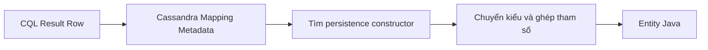
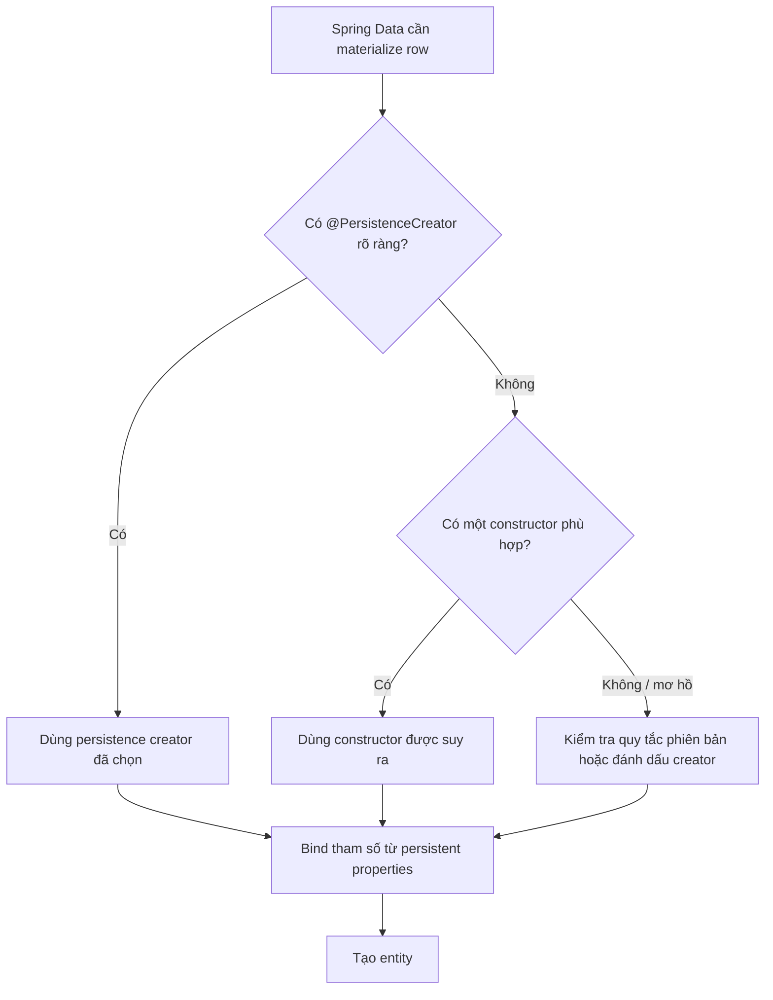

# Constructor, @PersistenceCreator và entity bất biến

Khi dùng **Spring Data Cassandra**, phần lớn ví dụ nhập môn tạo entity với constructor rỗng và các phương thức setter. Nhưng một entity hoàn toàn có thể được thiết kế **bất biến** (*immutable*): mọi trường cần thiết được nhận qua constructor, khai báo `final`, và không có setter làm thay đổi trạng thái sau khi tạo.

Cách thiết kế này có ích khi dữ liệu được đọc từ Apache Cassandra và đưa vào các lớp service, repository hoặc `CassandraTemplate`. Nó giúp một đối tượng Java giữ trạng thái nhất quán trong bộ nhớ, đồng thời làm rõ đâu là dữ liệu bắt buộc để tạo nên một thực thể hợp lệ. Tuy nhiên, framework phải biết **constructor nào cần gọi** và **tham số nào tương ứng với thuộc tính nào**. Annotation **`@PersistenceCreator`** giải quyết trường hợp cần chỉ định điểm tạo đối tượng cho cơ chế persistence.

Bài thuộc chương **Ánh xạ entity**. Ta sẽ tìm hiểu constructor binding, `@PersistenceCreator`, cách ánh xạ khóa chính Cassandra, entity bất biến, Java record, cập nhật theo kiểu tạo bản sao, kiểm thử và các ràng buộc của mô hình dữ liệu phân tán.

> **Phân biệt quan trọng:** Entity Java bất biến không có nghĩa bản ghi Cassandra không thể thay đổi. Bất biến ở đây nói về **trạng thái của object trong JVM**; database vẫn có thể nhận các lệnh `INSERT`, `UPDATE`, `DELETE` hoặc upsert theo primary key.

## 1. Khi đọc một hàng CQL, Spring Data tạo object như thế nào?

Giả sử Cassandra trả về một hàng:

```text
tenant_id     = 11111111-1111-1111-1111-111111111111
order_id      = 22222222-2222-2222-2222-222222222222
status        = "PENDING"
total_amount  = 125000.00
created_at    = 2026-11-25T03:00:00Z
```

Framework phải biến dữ liệu dạng hàng thành một `OrderDetail`. Có hai hướng tổng quát:

| Cách tạo entity | Ý tưởng | Đặc điểm |
| --- | --- | --- |
| **No-arg constructor + property population** | Tạo object rỗng rồi gán thuộc tính qua setter hoặc field access | Dễ bắt đầu, nhưng object có thể tồn tại tạm thời khi chưa đủ thuộc tính |
| **Persistence constructor + constructor binding** | Lấy dữ liệu của các property và truyền vào constructor | Cho phép các trường `final`, đặt bất biến trong cấu trúc object |

Sơ đồ luồng ánh xạ:



Khi một property có trong constructor, Spring Data cố gắng cung cấp giá trị của property đó vào đúng tham số. Những property còn lại có thể được gán qua cơ chế property population nếu metadata và kiểu entity cho phép. Với entity bất biến có mọi trường là `final`, nên đưa **toàn bộ trạng thái persistent cần thiết** vào constructor để không phụ thuộc vào việc sửa field sau khi object đã được tạo.

Cơ chế mapping này **khác với logic đọc dữ liệu của Cassandra**: partition key xác định partition; clustering columns xác định thứ tự hàng trong partition; consistency level quyết định điều kiện xác nhận từ replica. Constructor chỉ quyết định cách materialize hàng trả về thành object.

## 2. Vì sao nên cân nhắc entity bất biến?

Ví dụ entity có trạng thái đơn hàng. Với kiểu mutable:

```java
OrderDetail order = repository.findById(key).orElseThrow();

order.setStatus("PAID");
order.setTotalAmount(null); // Có thể vô tình tạo trạng thái sai.
```

Đối tượng được chia sẻ giữa các hàm có thể bị sửa ở bất kỳ điểm nào mà không cần thể hiện thao tác cập nhật qua API cụ thể.

Với kiểu immutable:

```java
OrderDetail order = repository.findById(key).orElseThrow();

OrderDetail paid = order.withStatus("PAID");
// order vẫn giữ status ban đầu; paid là object mới.
```

Một số lợi ích:

- **Trạng thái nhất quán:** constructor có thể kiểm tra các bất biến, ví dụ mã đơn không được `null`.
- **Dễ suy luận:** một reference trỏ đến đối tượng không bị thay đổi ngầm bởi các setter.
- **Thuận tiện cho xử lý bất đồng bộ:** chia sẻ object bất biến thường giảm rủi ro race do thay đổi state trong JVM, miễn là các object lồng bên trong cũng được quản lý phù hợp.
- **Rõ ý định cập nhật:** phương thức như `withStatus(...)` trả object mới và cho thấy code đang đề xuất trạng thái mới.
- **Hỗ trợ kiểm thử:** tạo object với đầu vào đầy đủ và dễ so sánh before/after.

Đổi lại:

- Constructor có thể dài nếu một hàng có quá nhiều trường.
- Khi schema thêm cột, cần xem lại constructor và backward compatibility.
- Một số thư viện hay cơ chế serialization có quy tắc riêng về constructor/accessor.
- Thao tác thay đổi một trường tạo object mới; lưu vào Cassandra vẫn là **một thao tác persistence cần thực hiện rõ ràng**.
- Bất biến Java chỉ là **bất biến nông** nếu object giữ tham chiếu tới `List`, `Map` hoặc đối tượng con còn mutable. Muốn bất biến sâu cần sao chép và bảo vệ các collection thích hợp.

**Không phải mọi entity bắt buộc bất biến.** Lựa chọn dựa trên quy mô, quy ước team và đặc điểm cập nhật. Quan trọng là hiểu cách framework dựng object và khả năng mapping thực tế.

## 3. CQL mẫu: bảng truy cập theo định danh đơn hàng

Để tập trung vào constructor, ta dùng read model đơn giản có composite partition key:

```sql
CREATE KEYSPACE IF NOT EXISTS orders_ks
WITH replication = {
    'class': 'NetworkTopologyStrategy',
    'dc_hcm': 3
};

CREATE TABLE IF NOT EXISTS orders_ks.order_details_by_id (
    tenant_id uuid,
    order_id uuid,
    status text,
    total_amount decimal,
    created_at timestamp,
    PRIMARY KEY ((tenant_id, order_id))
);
```

Tên DC, RF và keyspace chỉ là **ví dụ thiết kế**; phải phù hợp với topology thật. Lab một node không thể dùng RF 3 với cùng mức bảo đảm availability như cluster ba node. Giả định bảng đã được tạo trước ứng dụng bằng migration hoặc công cụ phù hợp.

Trong bảng trên:

- `(tenant_id, order_id)` là **composite partition key**.
- Không có clustering column vì mỗi cặp tenant–order chỉ định một hàng logic.
- `status`, `total_amount`, `created_at` là regular columns.
- Truy vấn tìm đúng đơn cần đủ cả `tenant_id` và `order_id`.

```sql
SELECT tenant_id, order_id, status, total_amount, created_at
FROM orders_ks.order_details_by_id
WHERE tenant_id = 11111111-1111-1111-1111-111111111111
  AND order_id = 22222222-2222-2222-2222-222222222222;
```

Ta sẽ ánh xạ hàng này thành một immutable entity có khóa `OrderKey` và dữ liệu `OrderDetail`.

## 4. Khóa chính bất biến với @PrimaryKeyClass

Spring Data Cassandra cho phép biểu diễn composite primary key bằng lớp có `@PrimaryKeyClass` và các trường `@PrimaryKeyColumn`.

Ví dụ:

```java
import java.io.Serializable;
import java.util.Objects;
import java.util.UUID;

import org.springframework.data.annotation.PersistenceCreator;
import org.springframework.data.cassandra.core.cql.PrimaryKeyType;
import org.springframework.data.cassandra.core.mapping.PrimaryKeyClass;
import org.springframework.data.cassandra.core.mapping.PrimaryKeyColumn;

@PrimaryKeyClass
public final class OrderKey implements Serializable {

    @PrimaryKeyColumn(
        name = "tenant_id",
        ordinal = 0,
        type = PrimaryKeyType.PARTITIONED
    )
    private final UUID tenantId;

    @PrimaryKeyColumn(
        name = "order_id",
        ordinal = 1,
        type = PrimaryKeyType.PARTITIONED
    )
    private final UUID orderId;

    @PersistenceCreator
    public OrderKey(UUID tenantId, UUID orderId) {
        this.tenantId = Objects.requireNonNull(tenantId, "tenantId");
        this.orderId = Objects.requireNonNull(orderId, "orderId");
    }

    public UUID getTenantId() {
        return tenantId;
    }

    public UUID getOrderId() {
        return orderId;
    }

    @Override
    public boolean equals(Object other) {
        if (this == other) return true;
        if (!(other instanceof OrderKey that)) return false;
        return tenantId.equals(that.tenantId)
            && orderId.equals(that.orderId);
    }

    @Override
    public int hashCode() {
        return Objects.hash(tenantId, orderId);
    }
}
```

Những điểm cần chú ý:

1. Hai thuộc tính `tenantId` và `orderId` có `type = PrimaryKeyType.PARTITIONED`, ứng với hai cột trong **cùng partition key**.
2. `ordinal` biểu thị thứ tự các thành phần khóa trong metadata mapping.
3. Tên cột CQL dạng `snake_case` được khai báo bằng `name`; tên property Java vẫn là `tenantId` và `orderId`.
4. Constructor nhận cả hai property, kiểm tra giá trị không `null` và thiết lập các trường `final`.
5. `equals` và `hashCode` dựa trên các thành phần khóa để việc dùng key làm định danh trong Java nhất quán.
6. `Serializable` thường được dùng với key object trong các ví dụ Java/Spring; nhu cầu serialization thực tế phụ thuộc cách sử dụng ứng dụng.

**Lưu ý về Java:** Cú pháp `instanceof OrderKey that` yêu cầu Java hỗ trợ pattern matching cho `instanceof` (phù hợp với Java 17 trở lên). Nếu dự án dùng Java cũ hơn, thay bằng phép ép kiểu thông thường.

### Vì sao @PersistenceCreator xuất hiện dù chỉ có một constructor?

Nếu một lớp chỉ có **một constructor phù hợp**, Spring Data thường có thể chọn nó mà không cần annotation. Ở đây ta thêm `@PersistenceCreator` để minh họa rõ constructor dùng khi đọc dữ liệu. Annotation có giá trị đặc biệt khi lớp có nhiều constructor hoặc factory method khiến việc lựa chọn trở nên mơ hồ.

Đừng hiểu `@PersistenceCreator` là chỉ thị tạo bảng trong Cassandra. Nó là **hướng dẫn materialization trong Java**, khác hoàn toàn với `SchemaAction`.

## 5. Entity bất biến với @PersistenceCreator

Một entity ánh xạ bảng `order_details_by_id`:

```java
import java.math.BigDecimal;
import java.time.Instant;
import java.util.Objects;

import org.springframework.data.annotation.PersistenceCreator;
import org.springframework.data.cassandra.core.mapping.Column;
import org.springframework.data.cassandra.core.mapping.PrimaryKey;
import org.springframework.data.cassandra.core.mapping.Table;

@Table("order_details_by_id")
public final class OrderDetail {

    @PrimaryKey
    private final OrderKey key;

    @Column("status")
    private final String status;

    @Column("total_amount")
    private final BigDecimal totalAmount;

    @Column("created_at")
    private final Instant createdAt;

    @PersistenceCreator
    public OrderDetail(
        OrderKey key,
        String status,
        BigDecimal totalAmount,
        Instant createdAt
    ) {
        this.key = Objects.requireNonNull(key, "key");
        this.status = Objects.requireNonNull(status, "status");
        this.totalAmount = totalAmount;
        this.createdAt = Objects.requireNonNull(createdAt, "createdAt");
    }

    public OrderKey getKey() {
        return key;
    }

    public String getStatus() {
        return status;
    }

    public BigDecimal getTotalAmount() {
        return totalAmount;
    }

    public Instant getCreatedAt() {
        return createdAt;
    }

    public OrderDetail withStatus(String newStatus) {
        return new OrderDetail(key, newStatus, totalAmount, createdAt);
    }
}
```

Đặc điểm của lớp:

- `@Table` khai báo tên bảng, `@PrimaryKey` biểu thị property khóa chính, `@Column` xác định các cột còn lại.
- `@PersistenceCreator` đánh dấu constructor được dùng để dựng entity từ dữ liệu Cassandra.
- Mọi trạng thái persistent đều được truyền vào constructor; các trường đều `private final`.
- Không có setter. `withStatus` tạo instance mới, giữ nguyên khóa và những trường còn lại.
- `BigDecimal` ánh xạ phù hợp với kiểu CQL `decimal`; `Instant` thường được chuyển đổi với kiểu CQL `timestamp` theo cơ chế conversion đang cấu hình.

Trong ví dụ, `totalAmount` được phép `null` để minh họa cột tùy chọn; `key`, `status` và `createdAt` được coi là bắt buộc bởi quy tắc của class. Đây là **quy tắc domain trong Java**, không có nghĩa Cassandra tự từ chối mọi giá trị null của regular column.

### Những yêu cầu tối thiểu để constructor binding hoạt động

- Spring Data phải **nhận diện đúng persistent properties** của entity.
- **Tên tham số constructor phải khớp tên property Java**: `totalAmount` tương ứng property `totalAmount`, không phải tên CQL `total_amount`.
- Kiểu tham số phải tương thích với giá trị đã được Cassandra converter chuyển đổi.
- Các property bắt buộc phải có giá trị hợp lệ trong dữ liệu đọc ra.
- Nếu một property không nằm trong constructor, phải có cơ chế gán property hợp lệ sau khi tạo; với các trường `final`, cách an toàn nhất là đưa chúng vào constructor.

Ở dự án Java, nên bật thông tin tên tham số khi biên dịch bằng tùy chọn `-parameters`, hoặc sử dụng cơ chế metadata tương thích được phiên bản Spring Data hỗ trợ. Nếu bytecode không chứa tên tham số và không có cách discover khác, constructor binding có thể không biết giá trị nào cần gán cho đối số nào.

Ví dụ với Gradle Java:

```groovy
tasks.withType(JavaCompile).configureEach {
    options.compilerArgs += ['-parameters']
}
```

Ví dụ với Maven Compiler Plugin:

```xml
<plugin>
  <groupId>org.apache.maven.plugins</groupId>
  <artifactId>maven-compiler-plugin</artifactId>
  <configuration>
    <parameters>true</parameters>
  </configuration>
</plugin>
```

Đây là **ví dụ cấu hình build**, không yêu cầu thay đổi công cụ build của mọi dự án; cần kiểm tra phiên bản Java và cấu hình build hiện có trước khi áp dụng.

## 6. Khi nào thực sự cần @PersistenceCreator?

Xét một entity có nhiều cách khởi tạo:

```java
@Table("order_details_by_id")
public final class OrderDetail {

    // Các field và annotation như ví dụ đầy đủ ở phần trước.

    @PersistenceCreator
    public OrderDetail(
        OrderKey key,
        String status,
        BigDecimal totalAmount,
        Instant createdAt
    ) {
        // Gán tất cả persistent properties.
    }

    public OrderDetail(
        OrderKey key,
        String status,
        Instant createdAt
    ) {
        this(key, status, null, createdAt);
    }
}
```

*Đoạn mã trên là bản rút gọn về lựa chọn constructor, không phải một class có thể biên dịch độc lập.*

Hai constructor đều có thể tạo object, nhưng framework cần biết **constructor nào tương ứng với dữ liệu đọc từ Cassandra**. `@PersistenceCreator` xác định constructor toàn phần.

Một cách thiết kế thường dễ bảo trì hơn là **một persistence constructor rõ ràng**, còn các cách tạo tiện lợi chuyển thành static factory method hoặc service method:

```java
public static OrderDetail pending(
    OrderKey key,
    Instant createdAt
) {
    return new OrderDetail(
        key,
        "PENDING",
        BigDecimal.ZERO,
        createdAt
    );
}
```

Static factory này phục vụ tạo object mới trong nghiệp vụ; Spring Data có thể tiếp tục dùng constructor đã đánh dấu để dựng object khi đọc. Một số cơ chế Spring Data cũng hỗ trợ chọn persistence factory method theo annotation; cách dùng và ưu tiên lựa chọn cần kiểm tra theo phiên bản framework. Với người mới học, **annotated constructor** là ví dụ đơn giản nhất để nhìn rõ cơ chế.

### Bảng phân biệt tình huống

| Tình huống | Hướng xử lý |
| --- | --- |
| Chỉ có một constructor phù hợp, mọi property được nhận đủ | Spring Data thường suy ra được; annotation có thể giúp làm rõ ý định |
| Có no-arg constructor và all-args constructor | Đánh dấu constructor muốn dùng khi materialize |
| Có nhiều constructor overload | Sử dụng `@PersistenceCreator` để loại bỏ sự mơ hồ |
| Dùng Java record với canonical constructor | Spring Data đời mới thường suy ra canonical constructor; kiểm tra hỗ trợ theo phiên bản |
| Có field `final` không được cấp giá trị trong constructor | Cần thiết kế lại binding, vì gán sau construction có thể không phù hợp |
| Entity có nhiều cơ chế tạo object ở service | Để factory/helper phục vụ nghiệp vụ, tách khỏi constructor persistence |

Annotation **`@PersistenceConstructor`** có thể xuất hiện trong code cũ hoặc tài liệu các phiên bản Spring Data trước. Với Spring Data hiện đại, `@PersistenceCreator` là tên annotation nên ưu tiên theo tài liệu của phiên bản đang sử dụng. Không cần thêm cả hai chỉ để phòng lỗi.

## 7. Tên tham số constructor và tên cột Cassandra là hai lớp khác nhau

Đây là lỗi rất thường gặp khi entity bất biến dùng tên camelCase, còn CQL dùng snake_case.

Giả sử CQL có cột:

```sql
total_amount decimal
```

Java property:

```java
@Column("total_amount")
private final BigDecimal totalAmount;
```

Constructor đúng:

```java
@PersistenceCreator
public OrderDetail(
    OrderKey key,
    String status,
    BigDecimal totalAmount,
    Instant createdAt
) {
    this.key = key;
    this.status = status;
    this.totalAmount = totalAmount;
    this.createdAt = createdAt;
}
```

Thông thường constructor binding làm việc với **tên property Java** `totalAmount`. Còn `@Column("total_amount")` giúp mapping property đó tới **tên cột CQL**.

Cách viết dễ gây lỗi:

```java
// Ví dụ minh họa lỗi đặt tên, không khuyến khích.
@PersistenceCreator
public OrderDetail(
    OrderKey key,
    String status,
    BigDecimal total_amount, // Không khớp property totalAmount.
    Instant createdAt
) {
    this.key = key;
    this.status = status;
    this.totalAmount = total_amount;
    this.createdAt = createdAt;
}
```

Trình biên dịch Java cho phép tên `total_amount`, nhưng persistence mapping có thể không tìm được property tương ứng nếu nó dựa trên tên tham số. Kết quả có thể là lỗi khởi tạo entity hoặc ánh xạ không thành công khi đọc.

Một số framework hỗ trợ alias/annotation bổ sung; **không nên tự giả định `@Column` trên field tự đổi tên tham số constructor**. Tốt nhất hãy dùng tên tham số đúng với property và kiểm chứng bằng integration test đọc hàng thật.

### Trường hợp bị mất metadata tham số

Nếu cùng một class hoạt động khi chạy từ IDE nhưng lỗi sau đóng gói production, hãy kiểm tra:

1. Bytecode có được biên dịch với `-parameters` hay không.
2. Có nhiều module, compiler settings hoặc plugin build ghi đè cấu hình không.
3. Annotation `@PersistenceCreator` có nằm đúng constructor không.
4. Tên tham số có khớp persistent property không.
5. Có converter tùy chỉnh ảnh hưởng kiểu dữ liệu CQL ↔ Java không.
6. Log exception materialization có nêu constructor parameter hoặc property thiếu không.

Không nên chữa lỗi bằng cách bỏ `final` trên toàn bộ entity trước khi biết nguyên nhân. Nhiều sự cố bắt nguồn từ metadata constructor bị thiếu hoặc mapping không nhất quán.

## 8. Thứ tự lựa chọn constructor: cần biết điều gì?

Spring Data Commons dùng quy tắc lựa chọn điểm tạo đối tượng cho các loại persistent entities. Chi tiết ưu tiên khác nhau theo phiên bản, nhưng mô hình thực hành thường là:

1. Nếu khai báo rõ **một persistence creator** phù hợp bằng annotation, dùng điểm tạo được chọn đó.
2. Với **một constructor duy nhất**, framework thường có thể dùng constructor ấy.
3. Với **Java record**, canonical constructor là ứng viên tự nhiên.
4. Với nhiều constructor hoặc có no-arg constructor, quy tắc lựa chọn phụ thuộc tổ hợp và phiên bản. Đánh dấu `@PersistenceCreator` rõ ràng nếu muốn tránh mơ hồ.

Không đánh dấu nhiều điểm tạo mâu thuẫn và mong framework tự đoán. Nếu một class có cả no-arg constructor, all-args constructor và factory method, hãy để lại **một điểm tạo persistence rõ ràng**.



Sơ đồ chỉ diễn đạt lựa chọn thực hành, không phải đặc tả đầy đủ mọi trường hợp đặc biệt của toàn bộ Spring Data Commons. Đặc biệt với record, factory method và kiểu kế thừa, cần theo tài liệu phiên bản và integration test.

## 9. Java record có phải là lựa chọn tốt hơn không?

Với Java hiện đại, `record` cung cấp một cách ngắn gọn để khai báo giá trị bất biến. Ví dụ ý tưởng cho bảng có **primary key đơn**:

```sql
CREATE TABLE IF NOT EXISTS orders_ks.customer_profiles (
    customer_id uuid PRIMARY KEY,
    display_name text,
    preferred_language text
);
```

Một cách ánh xạ theo phong cách record:

```java
import java.util.UUID;

import org.springframework.data.cassandra.core.mapping.Column;
import org.springframework.data.cassandra.core.mapping.PrimaryKey;
import org.springframework.data.cassandra.core.mapping.Table;

@Table("customer_profiles")
public record CustomerProfile(
    @PrimaryKey("customer_id") UUID customerId,
    @Column("display_name") String displayName,
    @Column("preferred_language") String preferredLanguage
) {}
```

Lưu ý quan trọng về ví dụ:

- Java record có **canonical constructor** tương ứng với các thành phần của record.
- Các component mặc định là final; record không có setter.
- Annotation được đặt trên record component; khả năng truyền annotation sang field/accessor và mapping phụ thuộc annotation target cũng như phiên bản Spring Data Cassandra.
- Cần xác minh Spring Data Cassandra của dự án **hỗ trợ materialize record** và xác nhận mapping bằng integration test. Nếu phiên bản không hỗ trợ đầy đủ hoặc metadata phức tạp, có thể dùng final class với `@PersistenceCreator` như phần trước.
- Record chỉ bất biến nông: một component kiểu mutable collection vẫn có thể bị sửa từ bên ngoài nếu không được bảo vệ.

### So sánh record và final class

| Tiêu chí | Final class + constructor | Java record |
| --- | --- | --- |
| Mã nguồn | Dài hơn, phải viết field/getter, thường cả `equals/hashCode` | Rất gọn, compiler sinh thành phần cơ bản |
| Constructor | Kiểm soát được logic, overload và factory | Canonical constructor là trung tâm |
| Validation | Dùng constructor tùy ý | Có thể dùng compact constructor |
| Kế thừa | `final class` không cho kế thừa | Record cũng không hỗ trợ extends class khác |
| Mapping Cassandra | Tùy annotation và creator | Tùy hỗ trợ record của phiên bản |
| Thêm property | Phải sửa constructor và class | Thay đổi record components và canonical constructor |
| Dữ liệu tùy chọn | Linh hoạt khi có constructor/factory | Cần quy tắc rõ ràng cho nullable component |

Nếu định dùng record cho hàng có composite primary key, nên bắt đầu bằng một integration test nhỏ với `@PrimaryKeyClass`/`@PrimaryKeyColumn` của phiên bản đang chạy. Đừng tự suy rằng mọi annotation dùng được trên field đều hoạt động hệt trên record component trong tất cả phiên bản.

## 10. Repository và CassandraTemplate làm gì với entity bất biến?

Một repository cơ bản:

```java
import org.springframework.data.cassandra.repository.CassandraRepository;

public interface OrderDetailRepository
        extends CassandraRepository<OrderDetail, OrderKey> {
}
```

Đọc và tạo bản sao:

```java
OrderKey key = new OrderKey(tenantId, orderId);

OrderDetail original = repository.findById(key)
    .orElseThrow(() -> new IllegalArgumentException("Order not found"));

OrderDetail paid = original.withStatus("PAID");

repository.save(paid);
```

Những điều xảy ra:

1. Repository đọc hàng bằng primary key và materialize entity qua constructor.
2. `withStatus("PAID")` tạo **object mới** cùng key, không sửa `original`.
3. `save(paid)` yêu cầu lưu trạng thái của object `paid` vào Cassandra theo semantics của Spring Data Cassandra/driver.

**Cassandra thường xử lý ghi theo khóa dưới dạng upsert**, và có cơ chế last-write-wins cho các ô dữ liệu theo timestamp. Gọi `save` không đồng nghĩa có optimistic locking, transaction quan hệ hay check `status` cũ trước khi đổi. Nếu hai request cùng đọc `PENDING` rồi ghi hai trạng thái khác nhau, cần cơ chế nghiệp vụ phù hợp: idempotency, điều kiện cập nhật, LWT/CAS khi thực sự cần hoặc một mô hình xử lý tranh chấp khác.

Tương tự với `CassandraTemplate`, logic cập nhật object không đổi:

```java
import org.springframework.data.cassandra.core.CassandraTemplate;

public class OrderService {

    private final CassandraTemplate template;

    public OrderService(CassandraTemplate template) {
        this.template = template;
    }

    public void markPaid(OrderKey key) {
        OrderDetail current = template.selectOneById(
            key, OrderDetail.class
        );
        if (current == null) {
            throw new IllegalArgumentException("Order not found");
        }

        OrderDetail paid = current.withStatus("PAID");
        template.update(paid);
    }
}
```

Ví dụ minh họa API phổ biến của Spring Data Cassandra; chữ ký cụ thể và kiểu cập nhật cần kiểm chứng theo phiên bản. Đối với nghiệp vụ quan trọng, nên tách các kiểm tra trạng thái và thao tác persistence thành service với chính sách concurrency rõ ràng.

### Thay đổi primary key không phải cập nhật một field thông thường

Nếu `with...` thay đổi `tenantId` hoặc `orderId`, object mới có **primary key khác**. Cassandra coi đây là **định danh hàng khác**; thao tác ghi object mới không bảo đảm xóa hàng tại key cũ.

Với những bảng có clustering key như `created_at`, việc đổi giá trị clustering key cũng tương đương đổi vị trí/định danh hàng trong partition. Quy trình di chuyển dữ liệu có thể cần ghi hàng mới, xóa hàng cũ và kiểm soát retry, nhất quán, tombstones.

Do vậy nên **không cung cấp `withKey(...)` một cách tùy tiện**. Hãy định nghĩa khóa chính là một phần của định danh nghiệp vụ mà service không thể đổi như regular property.

## 11. Cột null, projection và constructor bất biến

Bất biến đi kèm một câu hỏi: nếu CQL không trả về đủ dữ liệu để gọi constructor thì sao?

Xét entity:

```java
@PersistenceCreator
public OrderDetail(
    OrderKey key,
    String status,
    BigDecimal totalAmount,
    Instant createdAt
) {
    this.key = Objects.requireNonNull(key);
    this.status = Objects.requireNonNull(status);
    this.totalAmount = totalAmount;
    this.createdAt = Objects.requireNonNull(createdAt);
}
```

Nếu một câu query chỉ chọn:

```sql
SELECT tenant_id, order_id, status
FROM orders_ks.order_details_by_id
WHERE tenant_id = 11111111-1111-1111-1111-111111111111
  AND order_id = 22222222-2222-2222-2222-222222222222;
```

thì `created_at` và `total_amount` không có trong kết quả. Mapping một hàng **thiếu các cột cần thiết** vào entity constructor toàn phần có thể dẫn tới giá trị thiếu/null hoặc lỗi materialization, tùy converter và cơ chế mapping. Trong ví dụ, `createdAt` bị kiểm tra non-null nên càng có nguy cơ gây lỗi.

### Cách tiếp cận an toàn

- Nếu muốn materialize **đầy đủ entity**, chọn đủ những cột cần thiết cho các constructor arguments.
- Với màn hình chỉ cần vài trường, dùng **projection/DTO được thiết kế đúng cho tập cột đó**, với hỗ trợ cụ thể của phiên bản Spring Data.
- Không giả định `SELECT status` có thể tạo một aggregate bất biến đầy đủ.
- Không dùng primitive `int`/`long` cho property có thể thiếu/null nếu không xác định rõ quy tắc chuyển đổi; cân nhắc wrapper và giá trị mặc định một cách có chủ đích.
- Với cột mới thêm vào schema, lên kế hoạch compatibility: dữ liệu cũ có thể chưa có giá trị cho cột mới.

Ví dụ DTO đơn giản cho API:

```java
public record OrderSummary(
    OrderKey key,
    String status
) {}
```

Đây là **kiểu trả lời nghiệp vụ minh họa**, không tự động trở thành projection đã được Spring Data Cassandra nhận diện. Cách truy vấn và chuyển từ CQL row sang DTO phải được hiện thực và kiểm thử theo API/framework đang dùng.

### Quy tắc dữ liệu null cần dựa trên schema thực tế

Trong Cassandra, regular column có thể không tồn tại trong một hàng hoặc mang trạng thái không có giá trị; không nên giả định mọi property Java `@Column` đều non-null chỉ vì class khai báo `final`. Hãy dùng validation thích hợp ở biên dữ liệu/domain và chuẩn bị xử lý hàng lịch sử hoặc migration chưa backfill.

## 12. Field access, property access và final fields

Spring Data có thể đọc annotation trên field hoặc property, và dùng cơ chế property population sau constructor nếu cần. Với immutable entity, mục tiêu là giảm tối đa phần state phải gán sau khi object được tạo.

So sánh:

```java
// Mutable
@Table("customer_profiles")
public class CustomerMutable {
    @PrimaryKey("customer_id")
    private UUID customerId;

    @Column("display_name")
    private String displayName;

    public CustomerMutable() {}

    public void setDisplayName(String displayName) {
        this.displayName = displayName;
    }
}
```

với:

```java
// Immutable
@Table("customer_profiles")
public final class CustomerImmutable {

    @PrimaryKey("customer_id")
    private final UUID customerId;

    @Column("display_name")
    private final String displayName;

    @PersistenceCreator
    public CustomerImmutable(UUID customerId, String displayName) {
        this.customerId = customerId;
        this.displayName = displayName;
    }

    public UUID getCustomerId() { return customerId; }
    public String getDisplayName() { return displayName; }
}
```

Các class minh họa phần cốt lõi của mapping; ví dụ mutable cần hoàn thiện getter/setter và quy ước ứng dụng tùy yêu cầu. Không nhất thiết constructor binding làm hệ thống nhanh hơn trong mọi tình huống, nhưng thường tránh bước gán nhiều property sau khi dựng object.

Nếu gặp lỗi không gán được property `final`, cần xem lại:

- Constructor đã nhận đủ persistent properties chưa?
- Framework có thật sự chọn constructor đó không?
- Tên tham số có được discover đúng không?
- Mapping có các property phát sinh từ kế thừa hoặc annotation ở accessor khác với field không?
- Entity có property chỉ đọc/không lưu hoặc converter đặc biệt không?

Không nên dùng reflection tùy tiện để ép gán `final` như cách khắc phục chính thức. Điều cần sửa thường nằm ở **thiết kế persistent entity** hoặc metadata.

## 13. Thiết kế immutable entity khi có nhiều kiểu dữ liệu

### Timestamp và timezone

Cassandra `timestamp` thể hiện thời điểm tuyệt đối. `Instant` là lựa chọn tự nhiên cho timestamp Java khi converter của phiên bản dự án hỗ trợ. Nếu dùng `LocalDateTime` mà không cố định timezone, có thể gây nhầm lẫn khi serialize, hiển thị hoặc so sánh.

Không nên dùng `Instant.now()` trong persistence constructor để lấp giá trị null một cách âm thầm: nó có thể làm dữ liệu đọc lại không còn phản ánh đúng database.

### UUID và primary key

`UUID` trong Java phù hợp với kiểu CQL `uuid`. Khóa chính nên được tạo **trước khi ghi** nếu quy trình nghiệp vụ yêu cầu định danh do ứng dụng cấp. Đừng tạo ID mới mỗi lần materialize hàng: nó sẽ phá nghĩa của khóa khi đọc dữ liệu có sẵn.

### Collection

Nếu entity có:

```java
private final List<String> tags;
```

thì `final` chỉ ngăn gán lại reference `tags`, không ngăn `tags.add(...)`. Có thể dùng:

```java
this.tags = tags == null ? List.of() : List.copyOf(tags);
```

khi quy tắc domain thực sự chấp nhận việc chuyển null thành danh sách rỗng. Cần xem semantics của CQL collection, khả năng null, thứ tự phần tử và compatibility với converter. Nếu dữ liệu lớn, việc copy collection cũng có chi phí; đừng biến immutable entity thành nơi chứa collection Cassandra không giới hạn.

### Kiểu lồng nhau và UDT

Với Cassandra UDT, entity con có thể được ánh xạ thành kiểu Java riêng. Nếu muốn bất biến sâu, object UDT đó cũng cần quản lý tính bất biến; nếu không, field `final` ở entity cha không bảo vệ trạng thái lồng bên trong.

Mọi kiểu converter tùy chỉnh cần được kiểm tra ở cả hai chiều **CQL → Java** và **Java → CQL**, đặc biệt khi constructor kiểm tra non-null hoặc chuyển đổi type.

## 14. Tác động đến paging, hiệu năng và mô hình bảng

Bất biến Java không thay đổi cách Cassandra truy cập dữ liệu. Một repository đọc danh sách `OrderDetail` vẫn cần query hiệu quả theo partition key, clustering key và page size phù hợp.

| Vấn đề | Constructor/immutability có giải quyết không? | Cơ chế thực sự cần |
| --- | --- | --- |
| Query thiếu partition key, quét rộng | Không | Thiết kế bảng theo truy vấn |
| Danh sách chưa phân trang | Không | Driver paging hoặc cursor |
| Sắp xếp ngoài phạm vi clustering key | Không | Read model và clustering order phù hợp |
| Đọc từ replica chưa hội tụ | Không | Consistency policy theo nghiệp vụ |
| Hot partition | Không | Chọn partition key/bucket dựa trên phân bố tải |
| Object bị sửa ngoài ý muốn trong JVM | Có thể giảm đáng kể | Final fields, constructor, deep immutability khi cần |
| Materialization lỗi do constructor thiếu tham số | Có liên quan trực tiếp | `@PersistenceCreator`, metadata tham số và conversion |
| Ghi cạnh tranh làm mất cập nhật | Không | Kiểm soát concurrency/idempotency/LWT khi phù hợp |

Nếu query chỉ lấy 20 rows, overhead materialization thường khác đáng kể so với query lấy hàng trăm nghìn rows; cần đo thực tế nếu mapping trở thành bottleneck. Không nên tối ưu micro-performance của constructor trước khi kiểm tra phân vùng, kích thước kết quả, paging và latency của cluster.

## 15. Kiểm thử constructor mapping bằng dữ liệu thật

Unit test constructor giúp kiểm tra quy tắc domain, nhưng **không đủ** để phát hiện Spring Data có thực sự bind tham số đúng sau khi đọc CQL hay không.

### Unit test: bất biến trong JVM

Ví dụ JUnit 5:

```java
import static org.junit.jupiter.api.Assertions.*;

import java.math.BigDecimal;
import java.time.Instant;
import java.util.UUID;

import org.junit.jupiter.api.Test;

class OrderDetailTest {

    @Test
    void withStatusCreatesNewInstance() {
        OrderKey key = new OrderKey(
            UUID.randomUUID(),
            UUID.randomUUID()
        );

        OrderDetail pending = new OrderDetail(
            key, "PENDING",
            new BigDecimal("125000.00"),
            Instant.parse("2026-11-25T03:00:00Z")
        );

        OrderDetail paid = pending.withStatus("PAID");

        assertEquals("PENDING", pending.getStatus());
        assertEquals("PAID", paid.getStatus());
        assertEquals(key, paid.getKey());
        assertNotSame(pending, paid);
    }

    @Test
    void keyRequiresBothIds() {
        assertThrows(NullPointerException.class,
            () -> new OrderKey(null, UUID.randomUUID()));
    }
}
```

Unit test này xác nhận `withStatus` không sửa object ban đầu và constructor từ chối khóa thiếu. Nó **chưa kiểm tra** đọc/ghi Cassandra.

### Integration test: round trip CQL ↔ entity

Trên Cassandra test có schema đúng, một kịch bản tích hợp có thể:

1. Tạo `OrderKey` và `OrderDetail` với dữ liệu mẫu.
2. Lưu bằng repository.
3. Đọc lại bằng `findById`.
4. Kiểm tra mọi property, nhất là `totalAmount`, `createdAt` và hai thành phần key.
5. Tạo bản sao `withStatus`, ghi lại rồi đọc kiểm chứng.
6. Kiểm tra với dữ liệu có cột nullable nếu domain cho phép.
7. Thử tình huống schema thiếu cột/constructor sai tên để hiểu lỗi thực tế.

Ví dụ logic kiểm thử, giả định repository và Cassandra test đã được cấu hình:

```java
OrderKey key = new OrderKey(
    UUID.randomUUID(), UUID.randomUUID());

OrderDetail expected = new OrderDetail(
    key, "PENDING", new BigDecimal("125000.00"),
    Instant.parse("2026-11-25T03:00:00Z"));

repository.save(expected);

OrderDetail loaded = repository.findById(key).orElseThrow();

assertEquals(expected.getStatus(), loaded.getStatus());
assertEquals(expected.getTotalAmount(), loaded.getTotalAmount());
assertEquals(expected.getCreatedAt(), loaded.getCreatedAt());
assertEquals(expected.getKey(), loaded.getKey());
```

Đây là phần thân test minh họa; trong test thực tế cần chuẩn bị keyspace/table, repository injection và teardown/cleanup. Khi kiểm tra với môi trường nhiều replica, tính nhất quán đọc/ghi cũng phụ thuộc CL, không chỉ constructor mapping.

### Những assertion nên có

| Nội dung | Điều cần chứng minh |
| --- | --- |
| Khóa chính composite | Mọi thành phần mapping đúng giá trị CQL |
| Kiểu số/timestamp | Không sai conversion hoặc làm tròn ngoài ý muốn |
| Constructor được chọn | Object tạo thành công với property đã lưu |
| Nullable column | Quy tắc domain xử lý dữ liệu thiếu đúng mong đợi |
| Bản sao immutable | Object trước không thay đổi |
| Query chọn đủ cột | Không lỗi materialization khi projection |
| Schema thực tế | Tên bảng/cột và primary key khớp metadata |
| Ghi đồng thời | Có chính sách phù hợp với nghiệp vụ, không suy từ immutable Java |

## 16. Các lỗi phổ biến khi dùng @PersistenceCreator

| Biểu hiện | Nguyên nhân thường gặp | Cách kiểm tra/sửa |
| --- | --- | --- |
| Không tìm được constructor phù hợp | Có nhiều constructor, thiếu annotation hoặc creator không hợp lệ | Chỉ định một `@PersistenceCreator` rõ ràng |
| Không bind được `totalAmount` | Tham số tên `total_amount` hoặc bytecode thiếu tên tham số | Dùng tên property Java và kiểm tra `-parameters` |
| Lỗi tạo object khi cột thiếu | Constructor yêu cầu non-null cho property không được query trả về | Chọn đủ cột hoặc thiết kế projection/DTO |
| Lỗi conversion timestamp/decimal | Kiểu Java/CQL hoặc custom converter không khớp | Kiểm tra schema, converter, integration test |
| `@PersistenceCreator` được thêm nhưng bảng vẫn không tồn tại | Nhầm annotation constructor với schema creation | Kiểm tra schema migration/`SchemaAction` |
| Đọc entity được nhưng save ra hàng khác | Thay đổi các trường thuộc primary key | Giữ khóa ổn định hoặc có quy trình move |
| `withStatus` không cập nhật DB | Tạo object mới nhưng không gọi repository/template lưu | Gọi persistence operation rõ ràng |
| Hai request cùng ghi ghi đè trạng thái | Upsert/concurrent writes không có kiểm soát tranh chấp | Idempotency, điều kiện cập nhật, LWT nếu phù hợp |
| Java `final` nhưng list vẫn đổi được | Collection mutable được giữ bằng reference | Defensive copy, immutable collection |
| Lỗi chỉ xuất hiện khi build production | Khác compiler flags, phiên bản thư viện hoặc converter | So sánh `-parameters`, dependency và bytecode |

Không nên biến mọi lỗi constructor thành lý do mở rộng quyền đọc toàn bộ bảng bằng `ALLOW FILTERING` hoặc thay consistency level. Mapping là một tầng khác với query routing/replication.

## 17. Bài tập thực hành

### Bài 1 — chọn constructor persistence

Xét class giả định:

```java
@Table("customer_profiles")
public class CustomerProfile {
    @PrimaryKey("customer_id")
    private final UUID customerId;

    @Column("display_name")
    private final String displayName;

    public CustomerProfile(UUID customerId) {
        this(customerId, "Unnamed");
    }

    public CustomerProfile(UUID customerId, String displayName) {
        this.customerId = customerId;
        this.displayName = displayName;
    }
}
```

**Câu hỏi:** Nên đánh dấu constructor nào bằng `@PersistenceCreator` nếu cột `display_name` cần được phục hồi chính xác từ Cassandra?

<details>
<summary>Gợi ý đáp án</summary>

Đánh dấu constructor nhận **cả `customerId` và `displayName`**. Constructor chỉ nhận `customerId` sẽ thay giá trị đọc từ DB bằng `"Unnamed"` nếu framework dùng nó làm creator; dữ liệu trong object không còn phản ánh đúng hàng CQL.

</details>

### Bài 2 — nhận diện lỗi tên tham số

Field:

```java
@Column("created_at")
private final Instant createdAt;
```

Constructor có đối số tên `created_at`.

**Câu hỏi:** Rủi ro là gì và nên sửa thế nào?

<details>
<summary>Gợi ý đáp án</summary>

Tên tham số `created_at` có thể không khớp property Java `createdAt` khi framework bind constructor parameters theo tên persistent properties. Sửa thành `Instant createdAt`, giữ `@Column("created_at")` cho tên cột CQL và kiểm tra metadata `-parameters`/integration test.

</details>

### Bài 3 — đổi status khi entity bất biến

Service đọc `OrderDetail` có `status = 'PENDING'` và gọi:

```java
OrderDetail paid = current.withStatus("PAID");
```

**Câu hỏi:** Dữ liệu Cassandra đã đổi chưa? Nếu hai request đồng thời cập nhật thì cần xem xét điều gì?

<details>
<summary>Gợi ý đáp án</summary>

Chưa. Mới có object Java mới. Cần gọi repository/template hoặc statement CQL để lưu, và nếu có cạnh tranh cần thiết kế idempotency, concurrency policy và có thể dùng điều kiện cập nhật phù hợp. Bất biến Java không mang đến optimistic locking tự động.

</details>

### Bài 4 — projection thiếu dữ liệu

Một câu `SELECT tenant_id, order_id, status` được dùng để dựng `OrderDetail` mà constructor yêu cầu `createdAt != null`.

**Câu hỏi:** Vì sao cách dùng này có thể lỗi?

<details>
<summary>Gợi ý đáp án</summary>

Truy vấn không trả cột `created_at`, nên mapping không có giá trị hợp lệ cho argument `createdAt`. Cần chọn đủ cột để dựng entity đầy đủ hoặc dùng projection/DTO phù hợp với danh sách cột đã chọn.

</details>

### Bài 5 — thay đổi partition key

Một bảng lưu sự kiện có `PRIMARY KEY ((device_id, bucket_day), recorded_at)`. Developer làm `withBucketDay(...)` rồi gọi `save`.

**Câu hỏi:** Điều gì xảy ra về mặt định danh dữ liệu?

<details>
<summary>Gợi ý đáp án</summary>

`bucket_day` là một phần của partition key. Giá trị khác khiến Cassandra định vị **partition khác**. Ghi object mới không tự xóa hàng cũ; cần quy trình di chuyển có kiểm soát nếu nghiệp vụ thực sự yêu cầu.

</details>

## 18. Checklist triển khai entity bất biến trong Spring Data Cassandra

- [ ] Đã thiết kế bảng theo các mẫu truy vấn thật, với partition key và clustering key đúng.
- [ ] Đã phân biệt entity Java bất biến với trạng thái dữ liệu Cassandra vẫn có thể cập nhật.
- [ ] Có một persistence constructor hoặc creator được xác định rõ ràng.
- [ ] Nếu nhiều constructor, dùng `@PersistenceCreator` trên điểm tạo dự định cho materialization.
- [ ] Mọi persistent property `final` được constructor khởi tạo đầy đủ.
- [ ] Tên tham số constructor trùng tên property Java; tên CQL được ánh xạ bằng `@Column`/`@PrimaryKeyColumn`.
- [ ] Bytecode lưu tên tham số hoặc có cơ chế metadata được framework hỗ trợ.
- [ ] Các property khóa chính có kiểu và ordinal đúng schema; khóa có `equals/hashCode` thích hợp.
- [ ] Không để phương thức tạo bản sao âm thầm thay đổi partition/clustering key.
- [ ] Đã quy định cách xử lý null và dữ liệu cũ sau migration.
- [ ] Đã kiểm tra conversion của timestamp, decimal, collection hoặc UDT nếu dùng.
- [ ] Đã thử round trip CQL → entity → update → đọc lại trong integration test.
- [ ] Query trả đủ các cột cần thiết hoặc dùng projection tương thích.
- [ ] Có chính sách cập nhật đồng thời, idempotency và consistency level cho thao tác nghiệp vụ.
- [ ] Paging, sorting và hiệu năng vẫn được giải quyết ở mô hình Cassandra, không dựa vào immutability.
- [ ] Đã đối chiếu các API annotation và record support với phiên bản Spring Data Cassandra dự án sử dụng.

**Ghi nhớ:** `@PersistenceCreator` chỉ định cách Spring Data Cassandra **dựng entity từ hàng CQL**; immutable class hoặc record quyết định **cách object giữ trạng thái trong JVM**; còn khóa chính, truy vấn, replication và consistency level quyết định **dữ liệu được lưu và truy cập như thế nào trong Cassandra**. Ba lớp này cần được thiết kế ăn khớp để có code rõ ràng, mapping ổn định và hành vi đúng khi ứng dụng chạy với dữ liệu phân tán.
