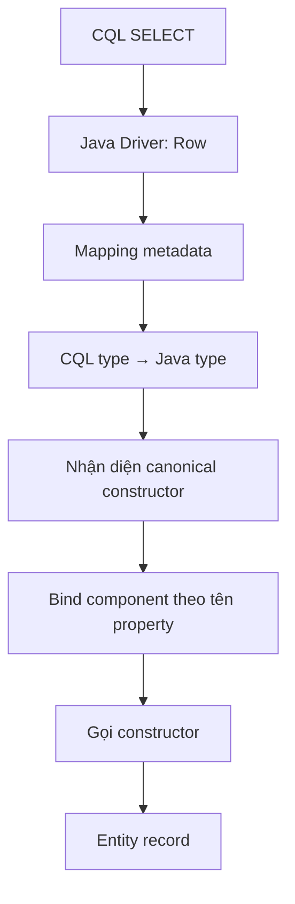

# Java record và điều kiện ánh xạ trong bộ phiên bản sử dụng

Trong Spring Data Cassandra, **Java record** giúp biểu diễn một entity bất biến bằng cú pháp gọn: Java sinh constructor, accessor, `equals()`, `hashCode()` và `toString()` dựa trên các component. Tuy nhiên, việc một record **biên dịch được** không tự chứng minh phiên bản Spring Data Cassandra, Spring Data Commons và driver đang dùng có thể **ghi rồi đọc lại** record qua bảng CQL. Khả năng ánh xạ cần được kiểm chứng với đúng bộ dependency, khóa chính, kiểu cột và những thao tác của ứng dụng.

Bài học thuộc chương **Ánh xạ entity** của module `SPRING_DATA_CASSANDRA`. Ta sẽ học điều kiện hỗ trợ record, cách dùng `@Table`, `@PrimaryKey`, `@Column`, composite key, repository và CassandraTemplate, đồng thời xem các rủi ro từ constructor binding, null, projection và nâng cấp thư viện. Java record là một lựa chọn ở tầng mô hình Java; nó **không thay đổi** quy tắc partition key, consistency level, paging và hiệu năng phân tán của Apache Cassandra.

## 1. Record trong Java và những thuộc tính quan trọng

Record được chuẩn hóa từ **Java 16**. Ví dụ:

```java
import java.math.BigDecimal;
import java.util.UUID;

public record ProductSummary(
    UUID productId,
    String name,
    BigDecimal price
) {}
```

Java sinh một **canonical constructor** nhận đủ `productId`, `name`, `price`, các accessor `productId()`, `name()`, `price()`, và phép so sánh giá trị theo component. Record không cần setter và không được kế thừa từ class ứng dụng khác.

| Tính chất | Java record | Class có getter/setter |
|---|---|---|
| Tạo instance | Canonical constructor nhận các component | Có thể có no-args, all-args hoặc factory |
| Sửa một trường | Tạo bản ghi mới | Có thể gọi setter |
| `equals`/`hashCode` | Được Java tạo theo component | Cần tự viết hoặc dùng thư viện |
| Khi Spring Data đọc row | Thường phải bind đủ persistent components qua constructor | Có thể dùng constructor và điền thêm property |
| Độ linh hoạt | Phù hợp mô hình dữ liệu cố định | Thích hợp khi cần lifecycle/mapping phức tạp |

**Record không bất biến sâu.** Component là `final`, nhưng `List`, `Map` hoặc mảng được tham chiếu có thể vẫn bị sửa. Nếu cần bất biến sâu, hãy dùng các kiểu value bất biến và sao chép phòng vệ một cách có chủ đích.

Đừng nhầm record của Java với row trong Cassandra. Cassandra chỉ hiểu bảng và kiểu CQL; chính **`MappingCassandraConverter`** và driver quyết định cách chuyển đổi CQL row thành đối tượng Java.

## 2. “Bộ phiên bản sử dụng” gồm những thành phần nào?

Không nên tuyên bố “Java record luôn chạy với Spring Data Cassandra” khi chưa biết dependency được resolve. Cần đánh giá ba lớp:

| Thành phần | Điều kiện cần xem | Rủi ro |
|---|---|---|
| **JDK compile/runtime** | Java hỗ trợ record; cấu hình `--release`, `sourceCompatibility` và runtime tương thích | Lỗi biên dịch hoặc bytecode |
| **Spring Boot / Spring Data Commons / Spring Data Cassandra** | Phiên bản thư viện thực; quy tắc chọn constructor, nhận annotation, mapping composite key | Lỗi tạo entity hoặc materialization |
| **Cassandra Driver / server** | Type codec, tên và kiểu cột CQL, keyspace và schema thực tế | Lỗi codec, bind parameter, query hoặc kiểu dữ liệu |

Tài liệu **Object Mapping** của Spring Data Cassandra các dòng hiện đại, bao gồm 4.x, mô tả việc nhận diện **canonical constructor của Java record** trong cơ chế object creation. Đây là cơ sở để dùng record như immutable entity. Tuy vậy, hỗ trợ constructor **không tự bảo đảm** mọi biến thể composite key, UDT, custom converter, projection hoặc annotation trên component đều tương thích với một release cụ thể.

**Đề bài không cung cấp số phiên bản JDK và dependency của ứng dụng.** Do đó, các đoạn mã ở đây là mẫu để áp dụng/kiểm thử, không phải tuyên bố rằng chúng đã được chạy trên một bộ phiên bản xác định. Khi làm dự án, hãy kiểm tra trực tiếp phiên bản đã resolve thay vì suy đoán theo tên starter.

### Kiểm tra dependency

Với Maven:

```bash
java -version
./mvnw dependency:tree
```

Với Gradle:

```bash
java -version
./gradlew dependencyInsight --dependency spring-data-cassandra --configuration runtimeClasspath
./gradlew dependencyInsight --dependency spring-data-commons --configuration runtimeClasspath
./gradlew dependencyInsight --dependency java-driver-core --configuration runtimeClasspath
```

Các lệnh này là **hướng dẫn tự kiểm**, không phải lệnh đã chạy để tạo bài. Cần xem cả JDK trên máy phát triển, CI và image production; nếu một starter Spring Boot dùng BOM, hãy ghi nhận phiên bản **resolved** chứ không chỉ dependency được khai báo.

## 3. Spring Data tạo một entity record bằng cách nào?

Đường đọc khái quát:



Với một class thông thường, Spring Data có thể tạo instance rồi điền các field còn lại qua field access hoặc setter. Với record, các component là `final`, nên hướng đi phù hợp là **constructor binding**. Quy tắc chọn constructor trong tài liệu Spring Data Commons đề cập rõ đến trường hợp Java record: canonical constructor được sử dụng.

Khi tên Java khác tên cột CQL, Spring Data dựa trên metadata ánh xạ:

```text
CQL:          display_name
Java:         displayName
Constructor:  displayName
Mapping:      @Column("display_name")
```

**Không nên đổi tên component tùy tiện** nếu thiếu metadata cập nhật. Đồng thời, một `SELECT` chỉ lấy một phần cột có thể không cung cấp đủ giá trị cho canonical constructor của entity đầy đủ; cần sử dụng projection/DTO phù hợp hoặc truy vấn đủ cột.

## 4. Entity record với primary key đơn

Giả sử ứng dụng cần tra cứu hồ sơ bằng `profile_id`. Bảng CQL:

```sql
CREATE TABLE profiles_by_id (
    profile_id uuid PRIMARY KEY,
    display_name text,
    email text,
    updated_at timestamp
);
```

Entity minh họa:

```java
import java.time.Instant;
import java.util.UUID;

import org.springframework.data.cassandra.core.mapping.Column;
import org.springframework.data.cassandra.core.mapping.PrimaryKey;
import org.springframework.data.cassandra.core.mapping.Table;

@Table("profiles_by_id")
public record ProfileById(
    @PrimaryKey("profile_id") UUID profileId,
    @Column("display_name") String displayName,
    @Column("email") String email,
    @Column("updated_at") Instant updatedAt
) {}
```

Các yếu tố phải đúng:

1. `@Table("profiles_by_id")` khớp chính xác tên bảng.
2. `@PrimaryKey("profile_id")` đánh dấu **primary key đơn** và liên kết với `profileId`.
3. `@Column("display_name")` ánh xạ từ Java `camelCase` sang tên CQL `snake_case`.
4. Kiểu `Instant` phải được converter/driver ánh xạ đúng từ CQL `timestamp`.
5. Phiên bản Spring Data đang dùng phải nhìn thấy annotation trên **record component** hoặc thành phần được Java lan truyền annotation đến.

Java cho phép khai báo annotation trên record component và lan truyền sang field/accessor/parameter khi `@Target` tương ứng. Nhưng không nên suy ra mọi annotation do bên thứ ba cung cấp đều được framework đọc cùng một cách ở mọi phiên bản. **Phải kiểm tra mapping bằng một integration test ghi–đọc thực tế.**

### Repository

```java
import java.util.UUID;
import org.springframework.data.cassandra.repository.CassandraRepository;

public interface ProfileRepository
        extends CassandraRepository<ProfileById, UUID> {
}
```

Đối số `UUID` đúng vì primary key chỉ có `profile_id`. Nếu bảng có composite primary key, cần kiểu ID khác phù hợp toàn bộ khóa.

Sử dụng:

```java
import java.time.Instant;
import java.util.UUID;

UUID id = UUID.randomUUID();

ProfileById profile = new ProfileById(
    id,
    "Minh",
    "minh@example.test",
    Instant.now()
);

repository.save(profile);

ProfileById loaded = repository.findById(id)
    .orElseThrow();
```

Cassandra không tự cấp ID như cột `IDENTITY` ở RDBMS; ứng dụng thường tạo `UUID` trước khi ghi. `save()` có thể ghi theo ngữ nghĩa **upsert** cùng primary key; nó không mặc nhiên từ chối khi hàng đã tồn tại. Nếu nghiệp vụ yêu cầu “chỉ tạo mới”, cần xem xét lệnh điều kiện `IF NOT EXISTS` với chi phí lightweight transaction.

### CassandraTemplate

```java
// cassandraTemplate đã được cấu hình cho keyspace phù hợp.
cassandraTemplate.insert(profile);

ProfileById found =
    cassandraTemplate.selectOneById(id, ProfileById.class);
```

Repository và CassandraTemplate đều có thể dựa vào mapping metadata, nhưng record không tự cải thiện đường truy vấn. `SELECT` theo khóa đơn ở bảng trên là đường đọc phù hợp; với bảng composite key, phải biết đầy đủ partition key và thứ tự clustering theo thiết kế.

## 5. Record bất biến không có nghĩa row Cassandra không thể cập nhật

Record không cho gọi `setDisplayName(...)`. Thay đổi dữ liệu phải tạo instance mới:

```java
ProfileById renamed = new ProfileById(
    profile.profileId(),
    "Minh Anh",
    profile.email(),
    Instant.now()
);

repository.save(renamed);
```

Có thể tạo phương thức `with...`:

```java
@Table("profiles_by_id")
public record ProfileById(
    @PrimaryKey("profile_id") UUID profileId,
    @Column("display_name") String displayName,
    @Column("email") String email,
    @Column("updated_at") Instant updatedAt
) {
    public ProfileById withDisplayName(String newName, Instant now) {
        return new ProfileById(profileId, newName, email, now);
    }
}
```

Đây là **phiên bản mở rộng của entity ở mục 4**, không phải lớp cần khai báo song song. Record cũ trong bộ nhớ vẫn giữ giá trị cũ; chỉ khi có thao tác ghi thì dữ liệu Cassandra mới thay đổi. Spring Data Cassandra không có cơ chế JPA dirty checking để tự động ghi một đối tượng chỉ vì chương trình thay đổi ý định nghiệp vụ.

Cần xét **timeout, retry, timestamp, consistency level và ghi cạnh tranh**. Tạo record mới không tự tạo optimistic locking; nếu nhiều tiến trình cập nhật cùng primary key, phải thiết kế cơ chế cạnh tranh phù hợp, ví dụ kiểm tra phiên bản nghiệp vụ hoặc LWT khi cần điều kiện.

## 6. Composite primary key và record

Các bảng thiết kế theo truy vấn Cassandra thường có khóa phức hợp. Ví dụ:

```sql
CREATE TABLE events_by_account_day (
    account_id uuid,
    bucket_day date,
    occurred_at timestamp,
    event_id uuid,
    event_type text,
    PRIMARY KEY ((account_id, bucket_day), occurred_at, event_id)
) WITH CLUSTERING ORDER BY (occurred_at DESC, event_id DESC);
```

Ở đây `(account_id, bucket_day)` là partition key tổng hợp; `occurred_at` và `event_id` là clustering columns. Một record key **có thể được thử trong bộ phiên bản đã hỗ trợ ánh xạ record và composite key đúng cách**:

```java
import java.io.Serializable;
import java.time.Instant;
import java.time.LocalDate;
import java.util.UUID;

import org.springframework.data.cassandra.core.cql.Ordering;
import org.springframework.data.cassandra.core.mapping.PrimaryKeyClass;
import org.springframework.data.cassandra.core.mapping.PrimaryKeyColumn;
import org.springframework.data.cassandra.core.mapping.PrimaryKeyType;

@PrimaryKeyClass
public record EventKey(
    @PrimaryKeyColumn(name = "account_id", ordinal = 0,
        type = PrimaryKeyType.PARTITIONED)
    UUID accountId,

    @PrimaryKeyColumn(name = "bucket_day", ordinal = 1,
        type = PrimaryKeyType.PARTITIONED)
    LocalDate bucketDay,

    @PrimaryKeyColumn(name = "occurred_at", ordinal = 2,
        type = PrimaryKeyType.CLUSTERED, ordering = Ordering.DESCENDING)
    Instant occurredAt,

    @PrimaryKeyColumn(name = "event_id", ordinal = 3,
        type = PrimaryKeyType.CLUSTERED, ordering = Ordering.DESCENDING)
    UUID eventId
) implements Serializable {}
```

Entity:

```java
import org.springframework.data.cassandra.core.mapping.Column;
import org.springframework.data.cassandra.core.mapping.PrimaryKey;
import org.springframework.data.cassandra.core.mapping.Table;

@Table("events_by_account_day")
public record EventByAccountDay(
    @PrimaryKey EventKey key,
    @Column("event_type") String eventType
) {}
```

Repository:

```java
import org.springframework.data.cassandra.repository.CassandraRepository;

public interface EventRepository
        extends CassandraRepository<EventByAccountDay, EventKey> {
}
```

**Đây là mẫu cần xác minh trên phiên bản thực tế**: tài liệu Spring Data Cassandra mô tả `@PrimaryKeyClass` chủ yếu qua ví dụ class; việc mapper bind được một **record composite key** và nhận đúng các annotation ở component không nên coi là mặc định cho mọi release.

Nếu test thất bại hoặc phiên bản cũ chưa hỗ trợ, dùng một class `@PrimaryKeyClass` truyền thống cho key:

```java
@PrimaryKeyClass
public class EventKey implements Serializable {

    @PrimaryKeyColumn(name = "account_id", ordinal = 0,
        type = PrimaryKeyType.PARTITIONED)
    private UUID accountId;

    @PrimaryKeyColumn(name = "bucket_day", ordinal = 1,
        type = PrimaryKeyType.PARTITIONED)
    private LocalDate bucketDay;

    @PrimaryKeyColumn(name = "occurred_at", ordinal = 2,
        type = PrimaryKeyType.CLUSTERED, ordering = Ordering.DESCENDING)
    private Instant occurredAt;

    @PrimaryKeyColumn(name = "event_id", ordinal = 3,
        type = PrimaryKeyType.CLUSTERED, ordering = Ordering.DESCENDING)
    private UUID eventId;

    // Constructor, getter/setter và equals/hashCode.
}
```

Các import cho class ở khối cuối giống ví dụ `EventKey` ở trên. Hai khối mô tả **hai lựa chọn cùng tên**, không khai báo đồng thời. Với class, `equals/hashCode` phải nhất quán với giá trị primary key Cassandra; record tự sinh hai phương thức nhưng vẫn cần hiểu semantics của các component.

**Tránh nhầm repository ID type:** `CassandraRepository<EventByAccountDay, UUID>` là sai cho bảng này, vì `event_id` chỉ là một thành phần của khóa. Khóa cần đủ `account_id`, `bucket_day`, `occurred_at`, `event_id`.

Truy vấn danh sách đúng mô hình bảng:

```sql
SELECT occurred_at, event_id, event_type
FROM events_by_account_day
WHERE account_id = ?
  AND bucket_day = ?
LIMIT 20;
```

Dấu `?` dùng cho bind parameter trong ứng dụng; nếu chạy trực tiếp với `cqlsh`, thay bằng literal. Đổi class thành record không làm mất yêu cầu phải lọc theo partition key và bảo đảm clustering order.

## 7. Constructor binding, nullable và dữ liệu thiếu

Đặc trưng lớn nhất của record là **canonical constructor có đủ component**. Nếu đọc một CQL row bị thiếu cột hoặc converter không tạo được giá trị Java tương ứng, quá trình materialize có thể thất bại.

### 7.1. Null và primitive

Trong Cassandra, cột không thuộc khóa có thể không có giá trị. Nếu record dùng `long quantity` nhưng cột CQL tương ứng có thể null, không thể truyền null vào tham số primitive `long`. Cần cân nhắc `Long`, kiểm tra dữ liệu hiện có và xác định rõ null có nghĩa gì. Ngược lại, primary key Cassandra không thể null, nên có thể kiểm tra trước khi ghi.

Ví dụ compact canonical constructor:

```java
import java.util.Objects;

@Table("profiles_by_id")
public record ProfileById(
    @PrimaryKey("profile_id") UUID profileId,
    @Column("display_name") String displayName,
    @Column("email") String email,
    @Column("updated_at") Instant updatedAt
) {
    public ProfileById {
        Objects.requireNonNull(profileId, "profileId");
    }
}
```

Đây là một **biến thể** khác của `ProfileById` để minh họa validation, không phải lớp thứ hai sử dụng đồng thời. Nếu một query không lấy đủ cột, validation quá chặt trên component khác có thể khiến constructor từ chối row; vì vậy cần thiết kế DTO/projection riêng khi truy vấn chỉ trả một phần dữ liệu.

### 7.2. Thành phần tính toán và `@Transient`

Không nên thêm component `displayLabel` chỉ dành cho giao diện rồi dùng `@Transient` mà không xem nó có được canonical constructor yêu cầu hay không. Spring Data không thể tự cung cấp giá trị của một constructor parameter không được ánh xạ. Một cách rõ ràng là dùng phương thức tính toán:

```java
public String displayLabel() {
    return displayName + " (" + profileId + ")";
}
```

Phương thức này có thể đặt trong thân record mà **không tăng số component persistent**. Với object phức tạp có field do framework phát sinh hoặc cần population nhiều giai đoạn, một class Java thông thường cùng persistence constructor phù hợp có thể dễ kiểm soát hơn.

### 7.3. Đặt đúng tên cột

Từ `display_name` trong CQL sang `displayName` trong Java là phép đổi tên cần metadata. Nếu viết record không có `@Column("display_name")` và naming strategy thực tế không đổi `camelCase` thành `snake_case` như mong đợi, lỗi có thể chỉ xuất hiện khi đọc/ghi dữ liệu thật. Hãy kiểm tra **CQL, mapping metadata và kết quả round-trip** thay vì chỉ quan sát ứng dụng khởi động thành công.

## 8. UDT, collection và khả năng bất biến sâu

Những ví dụ đơn giản `UUID`, `String`, `Instant` ít rủi ro hơn kiểu phức tạp:

- **UDT:** kiểu được gắn `@UserDefinedType` hoặc converter tương ứng; cần kiểm tra schema, cách xử lý `frozen`, constructor binding và `UserTypeResolver`.
- **Collection:** `list`, `set`, `map` từ CQL đòi hỏi codec Java phù hợp; record không tự làm bất biến nội dung collection.
- **Custom conversion:** `@ReadingConverter` và `@WritingConverter` cần test cả hai chiều; không suy ra record hỗ trợ một kiểu chỉ vì một POJO cũ từng hỗ trợ.
- **Embedded/projection:** quy tắc field flattening và đối tượng lồng nhau phải được kiểm tra riêng; không phải mọi phương thức mapping chỉ dùng constructor rỗng đều phù hợp record.

Ví dụ value object bảo vệ collection:

```java
import java.util.List;

public record TagSnapshot(List<String> tags) {
    public TagSnapshot {
        tags = tags == null ? List.of() : List.copyOf(tags);
    }
}
```

Đây là **value object minh họa**, chưa phải entity Cassandra. Việc thay null thành danh sách rỗng phải đúng với domain; dữ liệu thiếu và collection rỗng có thể khác nghĩa khi tương tác với Cassandra. Đừng tự động áp dụng quy tắc ấy cho mọi CQL collection.

## 9. Entity record, DTO record và projection không đồng nghĩa

Record rất phù hợp làm DTO cho API hoặc read model, ngay cả khi persistent entity là một class thông thường.

```java
import java.util.UUID;

public record ProfileResponse(
    UUID id,
    String displayName
) {
    public static ProfileResponse from(ProfileById profile) {
        return new ProfileResponse(
            profile.profileId(),
            profile.displayName()
        );
    }
}
```

| Vai trò | Ví dụ | Lưu ý |
|---|---|---|
| Entity persistent | `ProfileById` ánh xạ bảng `profiles_by_id` | Cần mapping table/primary key, hỗ trợ constructor |
| DTO API | `ProfileResponse` trả về `id`, `displayName` | Không cần `@Table`; chỉ chứa trường API cần |
| Query projection | Trả một tập cột nhỏ hơn entity | API projection/constructor binding phụ thuộc Spring Data version |

Ví dụ, `SELECT profile_id, display_name FROM profiles_by_id ...` **không đảm bảo** materialize được một `ProfileById` đầy đủ chứa cả `email`, `updatedAt`, đặc biệt khi constructor áp validation. Nếu truy vấn thường chỉ lấy vài cột, dùng DTO/projection có cấu trúc thích hợp và kiểm tra tính tương thích theo dòng thư viện.

Cách tiếp cận thận trọng: trước tiên dùng record cho DTO, sau đó dùng cho entity đơn giản có round-trip test; cuối cùng mới chuyển các trường hợp composite key, UDT và conversion phức tạp.

## 10. Những gì record không thay đổi trong Cassandra

| Hiểu nhầm | Thực tế |
|---|---|
| “Record immutable nên Cassandra không thể cập nhật row.” | Cassandra vẫn upsert/update theo primary key; immutable chỉ áp dụng object Java |
| “Ghi record là transaction ACID giống JPA.” | Cassandra có mô hình nhất quán phân tán khác; ghi nhiều bảng cần thiết kế riêng |
| “`save()` tự kiểm tra chưa có ID.” | Không mặc nhiên; cần lệnh điều kiện khi nghiệp vụ đòi hỏi |
| “Record giúp query thiếu partition key chạy nhanh.” | Truy vấn vẫn phải đi theo partition key/clustering key |
| “Record tự động phân trang hiệu quả.” | Paging dùng cơ chế driver/Spring Data, điều chỉnh page size và paging state |
| “Record tự ngăn ghi đè cạnh tranh.” | Cần thiết kế timestamp/version/LWT hoặc quy tắc nghiệp vụ phù hợp |
| “Record luôn là entity tốt nhất.” | Có trường hợp class có constructor/field lifecycle linh hoạt hơn |

Spring Data Cassandra hỗ trợ cả repository và CassandraTemplate. Chọn API theo nhu cầu truy vấn, consistency, paging và thao tác CQL; record chỉ ảnh hưởng **cách Java nhận/trả dữ liệu**.

## 11. Quy trình chứng minh tương thích trên bộ phiên bản dự án

Quy trình nên được làm trước khi chuyển toàn bộ entity sang record:

1. **Chốt version:** ghi nhận JDK, Spring Boot, Spring Data Commons, Spring Data Cassandra, Java Driver và Cassandra server.
2. **Đối chiếu tài liệu đúng dòng:** tìm mục “Object creation / Java Records”, “Mapping Annotation Overview”, “Primary Keys”.
3. **Biên dịch record:** kiểm tra imports, target annotation và Java language level.
4. **Khởi tạo mapping context:** xác nhận `@Table`, `@PrimaryKey` được phát hiện trong package scan.
5. **Ghi–đọc entity đơn:** kiểm tra khóa đơn, `@Column`, `Instant` và `equals`.
6. **Kiểm tra dữ liệu khó:** null, cột thiếu, kiểu collection, dữ liệu cũ.
7. **Kiểm tra composite key:** dùng record key nếu có hỗ trợ đã được xác minh, hoặc POJO `@PrimaryKeyClass`.
8. **Kiểm tra API sử dụng:** repository, CassandraTemplate, reactive API nếu hệ thống dùng.
9. **Lặp lại sau nâng cấp:** thêm test regression vào CI để phát hiện thay đổi conversion hoặc metadata.

Một câu khẳng định chính xác nên có dạng: **“Bản Spring Data Cassandra X với Java Y của dự án đã qua test ghi–đọc `ProfileById` và `EventKey` trên schema Z.”** Nếu chưa thực hiện test thì chỉ nên nói “ứng dụng dự kiến dùng record và cần kiểm chứng”.

## 12. Integration test ghi–đọc tối thiểu

Ví dụ khung kiểm thử JUnit 5, dùng một Cassandra test riêng với bảng `profiles_by_id` đã tạo:

```java
import static org.junit.jupiter.api.Assertions.assertEquals;
import java.time.Instant;
import java.util.UUID;
import org.junit.jupiter.api.Test;

class ProfileRecordMappingTest {
    // Inject repository và CassandraTemplate theo cấu hình test.
    private ProfileRepository repository;
    private org.springframework.data.cassandra.core.CassandraTemplate template;

    @Test
    void recordRoundTrip() {
        UUID id = UUID.randomUUID();
        ProfileById expected = new ProfileById(
            id, "Lan", "lan@example.test",
            Instant.parse("2026-01-01T00:00:00Z")
        );

        repository.save(expected);

        ProfileById fromRepository =
            repository.findById(id).orElseThrow();
        ProfileById fromTemplate =
            template.selectOneById(id, ProfileById.class);

        assertEquals(expected, fromRepository);
        assertEquals(expected, fromTemplate);
    }
}
```

Đây là **khung minh họa**, chưa chạy ngay được nếu chưa cấu hình dependency/test context và inject hai đối tượng. Đừng dùng `RECREATE` trên keyspace thật để thử record. Hãy dùng schema trong môi trường test riêng và dữ liệu riêng cho từng ca.

Các ca kiểm thử nên mở rộng:

| Trường hợp | Điều cần xác nhận |
|---|---|
| Row đầy đủ | Ghi rồi đọc có `equals()` đúng |
| Null trên cột không khóa | Không ném lỗi bất ngờ, constructor nhận đúng |
| Hai lần lưu cùng khóa | Upsert/overwrite diễn ra đúng kỳ vọng |
| Composite key | `findById`, mapping `ordinal`, key equality đúng |
| Projection thiếu cột | Có DTO/projection phù hợp, tránh tạo entity sai |
| UDT/collection | Conversion và null/empty đúng |
| Nâng Spring Data/driver | Test vẫn qua trong CI với version đã lock |

Một test chỉ gọi `save()` rồi kết luận “record được hỗ trợ” là chưa đủ: lỗi thường nằm ở **đường đọc** khi framework bind row vào canonical constructor.

## 13. Các lỗi phổ biến và cách tìm nguyên nhân

| Triệu chứng | Kiểm tra | Cách xử lý |
|---|---|---|
| Compiler không hiểu `record` | Java version và `--release` | Dùng Java/source level hỗ trợ record |
| Entity không được scan | `@Table`, base package, Spring Data version | Sửa cấu hình scan/mapping |
| Lỗi khi materialize | Constructor, tên property, null, Java/CQL type | Kiểm tra mapping, converter, row thật |
| `@PrimaryKey` không nhận | Record component annotation, metadata | Đối chiếu phiên bản; thử class tương đương |
| Composite key không hoạt động | `@PrimaryKeyClass`, `ordinal`, ID type | Test record key hoặc chuyển sang class key |
| CQL báo lỗi tìm kiếm | Thiếu partition key / sai clustering | Thiết kế lại truy vấn hoặc bảng |
| Không thể gọi setter | Record bất biến | Tạo instance mới rồi lưu |
| Kết quả ghi khác mong đợi | Upsert, timestamp, concurrency, CL | Kiểm tra CQL và quy tắc nghiệp vụ |
| UDT / collection lỗi | Codec và converter hai chiều | Test kiểu riêng, cấu hình resolver |

Khi gặp lỗi, đừng kết luận ngay “Java record không được Spring Data Cassandra hỗ trợ”. Hãy thu hẹp bằng cách **đọc metadata, kiểm tra phiên bản được resolve, test entity khóa đơn, và sau đó thêm dần kiểu phức tạp**.

## 14. Checklist lựa chọn record cho Spring Data Cassandra

1. JDK, source level, CI và runtime đều hỗ trợ Java record.
2. Spring Data Commons/Cassandra đã được kiểm tra đúng phiên bản; không override dependency chéo dòng.
3. `@Table`, `@PrimaryKey`, `@Column` gắn đúng và có test nhận metadata trên component.
4. Kiểu Java/CQL khớp: `uuid`, `timestamp`, `date`, `decimal`, UDT và collection khi dùng.
5. Canonical constructor nhận được đủ dữ liệu; xử lý null và cột thiếu rõ ràng.
6. Composite key phản ánh đúng partition/clustering; repository ID type không bị rút gọn.
7. Bất biến Java không bị hiểu nhầm thành giao dịch, khóa hoặc version của Cassandra.
8. Truy vấn vẫn tuân thủ partition key, paging, consistency và thiết kế bảng theo access pattern.
9. Test cả repository và CassandraTemplate, cả ghi và đọc, trên schema và runtime thực.
10. Sau mỗi lần nâng cấp dependency, chạy lại regression test mapping trước khi đưa vào production.

Java record hữu ích để biểu diễn **entity hoặc DTO có dữ liệu ổn định và ít trạng thái mutable**. Để sử dụng đúng, hãy bắt đầu với bảng khóa đơn và canonical constructor đơn giản, kiểm thử round-trip trong **bộ phiên bản thực tế**, rồi mới cân nhắc composite key, UDT và conversion đặc biệt. Khả năng truy vấn hiệu quả của Cassandra vẫn bắt đầu từ **thiết kế bảng theo truy vấn**, không phải từ kiểu class hay record.

## Tài liệu tham khảo

- [Spring Data Cassandra — Mapping / Object Creation](https://docs.spring.io/spring-data/cassandra/reference/object-mapping.html): canonical constructor của Java record, mapping annotation, primary key.
- [Spring Data Cassandra — Object Mapping Fundamentals](https://docs.spring.io/spring-data/cassandra/reference/data-commons/4.2/object-mapping.html): constructor binding, property population và immutable objects.
- [Spring Data Cassandra — CassandraTemplate API](https://docs.spring.io/spring-data/cassandra/docs/current/api/org/springframework/data/cassandra/core/CassandraTemplate.html): các thao tác `insert`, `selectOneById` trên entity.
- [Spring Data Cassandra — Persisting Entities](https://docs.spring.io/spring-data/cassandra/reference/cassandra/template.html): ghi entity và primary key.
