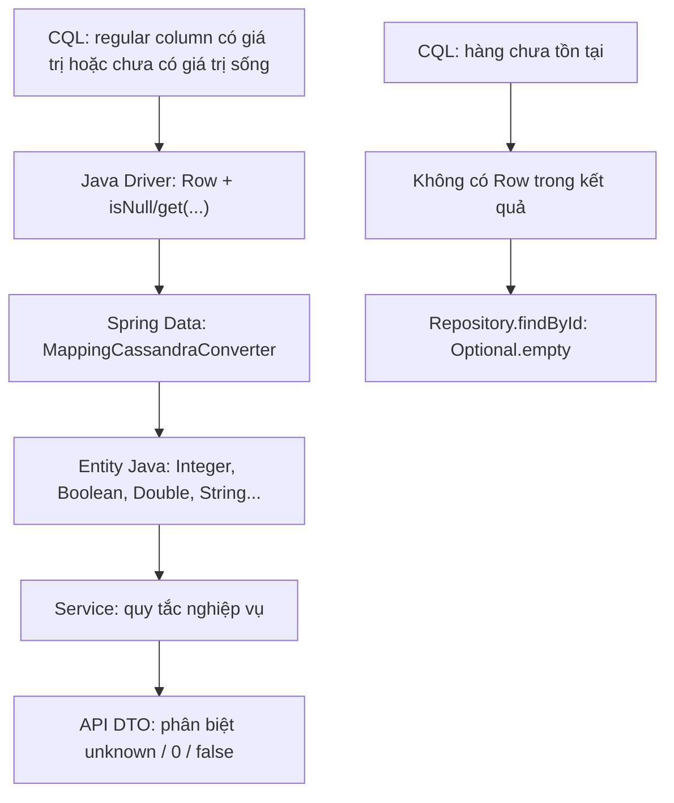

# Dữ liệu chưa có, giá trị null và giới hạn của thuộc tính nguyên thủy

Trong **Spring Data Cassandra**, một entity Java không nhất thiết có giá trị cho mọi cột của bảng Apache Cassandra. Một hàng có thể chỉ được ghi một phần các cột, một cột có thể chưa từng được ghi, đã bị xóa hoặc hết hạn bởi TTL. Khi đọc qua **CQL**, **Java Driver**, `CassandraTemplate` hay `CassandraRepository`, những trường hợp đó thường xuất hiện dưới dạng **`null`** ở phía Java.

Điều này trở nên nguy hiểm khi entity sử dụng thuộc tính nguyên thủy như `int` và `boolean`: kiểu nguyên thủy **không có trạng thái `null`**, chỉ có các giá trị như `0` và `false`. Nếu dữ liệu chưa được ghi bị biến thành `0` hoặc `false`, service có thể hiểu nhầm “chưa biết” thành một quyết định nghiệp vụ thật.

Bài học giải thích cách phân biệt **dữ liệu chưa có**, **CQL `NULL`**, **tham số `UNSET`**, **giá trị mặc định của Java**, và các giới hạn khi ánh xạ entity. Đây là kiến thức nền tảng khi dùng Spring Data Cassandra với bảng thiết kế theo truy vấn, partition key, consistency, paging và tối ưu hiệu năng của mô hình dữ liệu phân tán.

Sau bài này, bạn có thể:

- Phân biệt **hàng không tồn tại**, **cột không có giá trị** và **giá trị hợp lệ bằng `0`/`false`/chuỗi rỗng**.
- Chọn `Integer`/`Boolean`/`Long` thay cho `int`/`boolean`/`long` khi dữ liệu có thể vắng.
- Hiểu vì sao `NULL` và `UNSET` tạo hành vi ghi khác nhau, liên hệ với tombstone và cập nhật một phần.
- Đọc dữ liệu nullable an toàn bằng Spring Data Cassandra và Java Driver.
- Thiết kế API cập nhật sao cho phân biệt **không truyền trường**, **xóa trường** và **cập nhật bằng giá trị mới**.
- Xây dựng chiến lược kiểm thử cho bảng có dữ liệu cũ, cột mới, TTL, giá trị thiếu và truy vấn phân trang.

## 1. Ví dụ xuyên suốt: tiến độ học viên

Một nền tảng học tập cần API:

```text
GET /tenants/{tenantId}/students/{studentId}/progress
```

Mỗi học viên có một hàng tiến độ cho từng khóa học; hệ thống cần biết số bài học hoàn thành, trạng thái chứng nhận, điểm và ghi chú của người hướng dẫn.

Giả sử keyspace `learning` đã được tạo, bảng CQL như sau:

```sql
CREATE TABLE IF NOT EXISTS learning.course_progress_by_student (
    tenant_id uuid,
    student_id uuid,
    course_id uuid,

    completed_lessons int,
    certified boolean,
    score_percent double,
    teacher_note text,
    last_opened_at timestamp,

    PRIMARY KEY ((tenant_id, student_id), course_id)
);
```

`(tenant_id, student_id)` là **partition key ghép**, còn `course_id` là **clustering column**. Bảng được thiết kế để đọc tiến độ của một học viên trong một tenant, ví dụ:

```sql
SELECT course_id, completed_lessons, certified,
       score_percent, teacher_note, last_opened_at
FROM learning.course_progress_by_student
WHERE tenant_id = ? AND student_id = ?;
```

Dấu `?` đại diện tham số được bind bằng Java Driver; chúng không phải biến có sẵn trong `cqlsh`.

Trong thực tế, việc khởi tạo tiến độ có thể chỉ biết `tenant_id`, `student_id` và `course_id`. Số bài học hoàn thành chưa được tính, bài kiểm tra chưa được chấm, còn `certified` chưa được hệ thống quyết định. Những cột này **không nên mặc nhiên là `0` hoặc `false`** nếu nghiệp vụ muốn phân biệt “chưa xử lý”.

Để hiểu đúng, cần nhìn dữ liệu từ ba tầng khác nhau:



## 2. “Chưa có dữ liệu” có ít nhất ba nghĩa

Cassandra sử dụng mô hình lưu trữ **sparse**: hàng không bắt buộc có giá trị cho tất cả regular columns. Một cột không được ghi, bị xóa hoặc hết hạn TTL có thể đều được trả về như một giá trị `NULL` khi đọc ở mức CQL. Nhưng **hàng không tồn tại** là tình huống khác.

| Trường hợp | Trong Cassandra/CQL | Trong ứng dụng nên hiểu thế nào? |
| --- | --- | --- |
| Không tồn tại hàng với primary key cần tìm | Truy vấn theo khóa không trả về hàng | Không tìm thấy bản ghi tiến độ |
| Hàng tồn tại, chưa từng ghi `completed_lessons` | Cột không có giá trị sống; đọc được `NULL` | Chưa có số bài học hoàn thành |
| Hàng tồn tại, `completed_lessons` đã bị xóa | Giá trị hiện tại không còn; đọc được `NULL` | Không thể từ riêng kết quả đọc suy ra lý do bị xóa |
| Hàng tồn tại, `completed_lessons = 0` | Có giá trị số nguyên bằng `0` | Đã xác nhận tiến độ là 0, nếu đó là quy ước nghiệp vụ |
| Hàng tồn tại, `certified = false` | Có giá trị boolean `false` | Đã xác nhận chưa đạt chứng nhận |
| Hàng tồn tại, `certified` chưa có giá trị | `NULL` | Trạng thái chưa được quyết định hoặc chưa có dữ liệu |
| Hàng tồn tại, `teacher_note = ''` | Chuỗi rỗng có chủ đích | Đã lưu giá trị chuỗi rỗng, khác với không có ghi chú |
| Hàng tồn tại, `teacher_note` không có giá trị | `NULL` | Chưa có ghi chú hoặc đã bị xóa |

**Cassandra không ghi “`NULL` là một giá trị nghiệp vụ thứ ba” theo cách lưu riêng một cell thông thường.** Ghi `NULL` vào regular column thường có ngữ nghĩa xóa giá trị và tạo tombstone để các replica biết giá trị cũ đã bị loại bỏ. Nếu ứng dụng cần phân biệt “chưa từng gửi” với “người dùng đã chủ động xóa”, **một cột nullable là chưa đủ**; phải lưu thêm trạng thái/sự kiện hoặc quy ước nghiệp vụ.

### 2.1. Hàng không tồn tại khác với cột rỗng

Giả sử repository có:

```java
import java.util.UUID;
import org.springframework.data.cassandra.repository.CassandraRepository;

public interface CourseProgressRepository
        extends CassandraRepository<CourseProgress, StudentCourseKey> {
}
```

Nếu tìm bằng đầy đủ khóa và Cassandra không trả về hàng, `findById(key)` trả về `Optional.empty()`. Nếu hàng tồn tại nhưng `score_percent` chưa được ghi, repository có thể trả về `Optional` chứa entity với `scorePercent == null`.

Vì vậy:

- `Optional.empty()` từ `findById` mô tả **không tìm thấy entity**.
- `entity.getScorePercent() == null` mô tả **thiếu giá trị của thuộc tính đó** trong entity đã đọc.

Không dùng `orElse(new CourseProgress(...))` một cách tùy tiện rồi xem entity mặc định là bản ghi đã tồn tại. Điều đó khiến API khó phân biệt bản ghi chưa tạo với bản ghi có giá trị mặc định.

### 2.2. CQL NULL không phải SQL NULL ở mọi ngữ cảnh

Cassandra hỗ trợ thao tác với dữ liệu thiếu theo quy tắc riêng của CQL, không cung cấp đầy đủ cơ chế SQL quan hệ hay khả năng lọc tùy ý tất cả hàng thiếu một cột.

Ví dụ, không nên kỳ vọng truy vấn sau là cách hiệu quả/hợp lệ để tìm mọi học viên chưa được chứng nhận:

```sql
-- Không dùng kiểu lọc này như một truy vấn Cassandra thông thường:
SELECT *
FROM learning.course_progress_by_student
WHERE certified = null;
```

Hướng truy cập của bảng là `(tenant_id, student_id)`, không phải quét toàn bộ dữ liệu theo `certified`. Nếu sản phẩm cần danh sách học viên “chưa xử lý chứng nhận”, hãy định nghĩa **trạng thái nghiệp vụ rõ ràng** và thiết kế bảng theo truy vấn đó, hoặc xây dựng projection/luồng xử lý phù hợp.

`NULL` không tự tạo partition key, không hoạt động như index, và không biến Cassandra thành cơ sở dữ liệu quan hệ hỗ trợ `JOIN`, `IS NULL` tùy ý.

## 3. Ghi thiếu cột, ghi NULL và ghi UNSET

Ba thao tác sau nghe có vẻ giống nhau nhưng **không tương đương**.

### 3.1. Ghi hàng chỉ có một phần cột

Một hàng tiến độ có thể được tạo mà chưa biết kết quả:

```sql
INSERT INTO learning.course_progress_by_student (
    tenant_id, student_id, course_id, last_opened_at
) VALUES (
    11111111-1111-1111-1111-111111111111,
    22222222-2222-2222-2222-222222222222,
    33333333-3333-3333-3333-333333333333,
    '2026-11-25T08:00:00Z'
);
```

Vì lệnh này không có `completed_lessons`, `certified` hay `score_percent`, nó **không gán `0`, `false` hay `0.0`** cho những cột đó. Khi đọc, các cột chưa có giá trị thường được trả về `NULL`.

Nếu sau đó ghi:

```sql
UPDATE learning.course_progress_by_student
SET completed_lessons = 0, certified = false
WHERE tenant_id = 11111111-1111-1111-1111-111111111111
  AND student_id = 22222222-2222-2222-2222-222222222222
  AND course_id = 33333333-3333-3333-3333-333333333333;
```

`0` và `false` là **giá trị được ghi rõ ràng**. Chúng không đồng nghĩa với chưa có dữ liệu.

### 3.2. Ghi CQL NULL: xóa giá trị cột

Giả sử `teacher_note` đang lưu một ghi chú. Khi muốn xóa ghi chú:

```sql
UPDATE learning.course_progress_by_student
SET teacher_note = null
WHERE tenant_id = 11111111-1111-1111-1111-111111111111
  AND student_id = 22222222-2222-2222-2222-222222222222
  AND course_id = 33333333-3333-3333-3333-333333333333;
```

Với regular column, lệnh xóa giá trị kiểu này được Cassandra biểu diễn bằng **tombstone**. Một cách CQL khác để xóa riêng cột là:

```sql
DELETE teacher_note
FROM learning.course_progress_by_student
WHERE tenant_id = 11111111-1111-1111-1111-111111111111
  AND student_id = 22222222-2222-2222-2222-222222222222
  AND course_id = 33333333-3333-3333-3333-333333333333;
```

Khi đọc lại, `teacher_note` có thể là `null` ở Java. Nhưng chỉ nhìn `null` thì **không phân biệt được** ghi chú chưa từng tồn tại, đã bị xóa bằng `DELETE` hoặc đã hết hạn TTL.

### 3.3. UNSET: bỏ qua cập nhật cột đó

Ở các phiên bản Cassandra/Java Driver hiện đại hỗ trợ native protocol tương ứng, **UNSET** là trạng thái của **bind variable** dùng trong prepared statement. UNSET cho phép lệnh INSERT/UPDATE **bỏ qua** cột tương ứng, thay vì gán CQL `NULL`.

Ví dụ bảng đã có:

```text
completed_lessons = 12
teacher_note       = "Tiến bộ tốt"
```

Một cập nhật chỉ muốn thay `completed_lessons = 13`. Có hai cách quan trọng:

- **UNSET `teacher_note`:** không tác động tới ghi chú hiện tại.
- **SET TO NULL `teacher_note`:** xóa ghi chú hiện tại; ghi tạo tombstone.

Nếu dùng query đã viết sẵn có cả hai placeholder, Java Driver có thể quyết định bind variable nào là giá trị thật, `NULL` hoặc `UNSET`.

Ví dụ với **Java Driver 4.x**:

```java
import java.util.UUID;
import com.datastax.oss.driver.api.core.CqlSession;
import com.datastax.oss.driver.api.core.cql.PreparedStatement;
import com.datastax.oss.driver.api.core.cql.BoundStatement;

public class ProgressColumnWriter {
    private final CqlSession session;
    private final PreparedStatement update;

    public ProgressColumnWriter(CqlSession session) {
        this.session = session;
        this.update = session.prepare(
            "UPDATE course_progress_by_student " +
            "SET completed_lessons = ?, teacher_note = ? " +
            "WHERE tenant_id = ? AND student_id = ? AND course_id = ?");
    }

    public void updateCountWithoutChangingNote(
            UUID tenantId, UUID studentId, UUID courseId, int count) {
        BoundStatement statement = update.bind()
                .setInt("completed_lessons", count)
                .unset("teacher_note")
                .setUuid("tenant_id", tenantId)
                .setUuid("student_id", studentId)
                .setUuid("course_id", courseId);
        session.execute(statement);
    }

    public void updateCountAndClearNote(
            UUID tenantId, UUID studentId, UUID courseId, int count) {
        BoundStatement statement = update.bind()
                .setInt("completed_lessons", count)
                .setToNull("teacher_note")
                .setUuid("tenant_id", tenantId)
                .setUuid("student_id", studentId)
                .setUuid("course_id", courseId);
        session.execute(statement);
    }
}
```

Ví dụ giả định `CqlSession` có keyspace mặc định là `learning`. Nếu session không có keyspace mặc định, hãy dùng `learning.course_progress_by_student` trong câu CQL. Các `BoundStatement` của Java Driver 4 theo API immutable; phương thức setter trả về statement mới như trong chuỗi gọi trên.

**Điểm dễ nhầm:** UNSET không phải kiểu dữ liệu có thể đọc lại trong Cassandra và không phải một giá trị nghiệp vụ lưu trong cell. Nó nói với Cassandra **không thực hiện mutation tương ứng** khi xử lý statement. Không dùng UNSET cho primary key hoặc các vị trí CQL yêu cầu giá trị khóa thực.

| Đầu vào của phép ghi | Kết quả mong đợi đối với regular column đã có giá trị |
| --- | --- |
| Cột không xuất hiện trong câu INSERT/UPDATE | Giữ nguyên giá trị cũ |
| Bind variable được đánh dấu UNSET | Giữ nguyên giá trị cũ |
| Ghi giá trị cụ thể `0`, `false`, chuỗi `""` | Thay bằng đúng giá trị đó |
| Ghi CQL `NULL` | Xóa giá trị cũ, có thể tạo tombstone |
| `DELETE` riêng cột | Xóa giá trị cũ bằng mutation tạo tombstone |

### 3.4. Vì sao khác biệt này ảnh hưởng hiệu năng?

Tombstone giúp các replica nhận biết rằng giá trị cũ đã bị xóa; chúng là thành phần bình thường của cơ chế phân tán Cassandra. Nhưng nếu ứng dụng liên tục ghi `NULL` cho hàng trăm cột không có thay đổi, nó có thể sinh nhiều tombstone không cần thiết. Điều đó ảnh hưởng tới đọc, compaction và độ trễ, đặc biệt với partition lớn hoặc workload nhiều update.

**Đừng dùng NULL làm “không cập nhật”**. Khi muốn giữ giá trị cũ, hãy tạo statement chỉ chứa cột cần sửa, hoặc dùng bind variables UNSET nếu driver/protocol hỗ trợ.

## 4. Giới hạn của kiểu nguyên thủy Java

Java có hai nhóm kiểu cần phân biệt:

| CQL type | Java primitive | Giá trị khởi tạo mặc định của primitive | Java wrapper có thể null |
| --- | --- | --- | --- |
| `int` | `int` | `0` | `Integer` |
| `boolean` | `boolean` | `false` | `Boolean` |
| `bigint` | `long` | `0L` | `Long` |
| `double` | `double` | `0.0d` | `Double` |
| `float` | `float` | `0.0f` | `Float` |
| `smallint` | `short` | `0` | `Short` |
| `tinyint` | `byte` | `0` | `Byte` |

Những giá trị mặc định trên là **quy tắc khởi tạo field primitive của Java**, không phải default constraint được Cassandra tự gán. Cassandra không tự chuyển cột `completed_lessons` vắng mặt thành CQL `0`.

### 4.1. Ví dụ entity có rủi ro

```java
@Table("course_progress_by_student")
public class CourseProgressUnsafe {
    @PrimaryKey
    private StudentCourseKey key;

    private int completedLessons;
    private boolean certified;

    protected CourseProgressUnsafe() {}
    // Getters/setters...
}
```

Nếu tạo `new CourseProgressUnsafe()`, Java đặt `completedLessons = 0` và `certified = false` dù chương trình **chưa đọc Cassandra**. Khi mapping một hàng có các cột CQL `NULL` sang field primitive, hành vi còn tùy cơ chế đọc/converter: có thể gặp lỗi chuyển đổi/đặt giá trị, hoặc một đường đọc cho ra mặc định primitive. **Không nên phụ thuộc vào bất cứ hành vi ngầm nào** để suy ra ý nghĩa nghiệp vụ.

Khi sau đó service gọi `save()` lên entity chứa các giá trị mặc định, có nguy cơ biến “chưa biết số bài học” thành “đã biết bằng 0” hoặc “chưa xử lý chứng nhận” thành “đã xác nhận false”.

### 4.2. Chọn wrapper cho dữ liệu nullable

Một entity phù hợp hơn khi các cột đó có thể thiếu:

```java
import java.time.Instant;
import org.springframework.data.cassandra.core.mapping.Column;
import org.springframework.data.cassandra.core.mapping.PrimaryKey;
import org.springframework.data.cassandra.core.mapping.Table;

@Table("course_progress_by_student")
public class CourseProgress {
    @PrimaryKey
    private StudentCourseKey key;

    @Column("completed_lessons")
    private Integer completedLessons;

    @Column("certified")
    private Boolean certified;

    @Column("score_percent")
    private Double scorePercent;

    @Column("teacher_note")
    private String teacherNote;

    @Column("last_opened_at")
    private Instant lastOpenedAt;

    protected CourseProgress() {}

    public StudentCourseKey getKey() { return key; }
    public Integer getCompletedLessons() { return completedLessons; }
    public Boolean getCertified() { return certified; }
    public Double getScorePercent() { return scorePercent; }
    public String getTeacherNote() { return teacherNote; }
    public Instant getLastOpenedAt() { return lastOpenedAt; }

    // Bổ sung constructor, setter và phương thức domain cần thiết.
}
```

Khóa ghép được mapping riêng:

```java
import java.io.Serializable;
import java.util.UUID;
import org.springframework.data.cassandra.core.cql.PrimaryKeyType;
import org.springframework.data.cassandra.core.mapping.PrimaryKeyClass;
import org.springframework.data.cassandra.core.mapping.PrimaryKeyColumn;

@PrimaryKeyClass
public class StudentCourseKey implements Serializable {
    @PrimaryKeyColumn(name = "tenant_id", ordinal = 0,
                      type = PrimaryKeyType.PARTITIONED)
    private UUID tenantId;

    @PrimaryKeyColumn(name = "student_id", ordinal = 1,
                      type = PrimaryKeyType.PARTITIONED)
    private UUID studentId;

    @PrimaryKeyColumn(name = "course_id", ordinal = 2,
                      type = PrimaryKeyType.CLUSTERED)
    private UUID courseId;

    protected StudentCourseKey() {}

    public StudentCourseKey(UUID tenantId, UUID studentId, UUID courseId) {
        this.tenantId = tenantId;
        this.studentId = studentId;
        this.courseId = courseId;
    }

    // Getters/setters, equals và hashCode theo các trường khóa.
}
```

Khi sử dụng hai class Java này, bổ sung toàn bộ constructor, setter, `equals`/`hashCode` và quy tắc immutability theo nhu cầu của dự án; các đoạn được rút gọn để tập trung vào kiểu thuộc tính nullable.

Với `Integer` và `Boolean`, ứng dụng phân biệt được:

```java
Integer count = progress.getCompletedLessons();
if (count == null) {
    // Chưa có số liệu hoặc giá trị đã bị xóa/hết hạn.
} else if (count == 0) {
    // Có số liệu: học viên hoàn thành đúng 0 bài.
} else {
    // Có số liệu: đã hoàn thành nhiều hơn 0 bài.
}

Boolean certified = progress.getCertified();
if (certified == null) {
    // Chưa có quyết định.
} else if (certified) {
    // Đã được xác nhận đạt.
} else {
    // Đã được xác nhận chưa đạt.
}
```

**Không được viết** `if (progress.getCertified())` khi `getCertified()` có thể trả về null: Java sẽ tự unbox và có thể ném `NullPointerException`. Nếu nghiệp vụ chỉ cần kiểm tra điều kiện đúng, dùng `Boolean.TRUE.equals(progress.getCertified())`, nhưng nhớ rằng biểu thức đó coi cả `false` lẫn `null` là “không đúng”; không dùng khi cần phân biệt hai trạng thái.

### 4.3. Có nên mặc định 0 trong entity?

Chỉ nên dùng mặc định `0` nếu hợp đồng nghiệp vụ thực sự quy định: **hàng vừa tạo luôn có tiến độ ban đầu là 0**, và luồng ghi bảo đảm giá trị này được lưu hoặc có quy tắc tái tạo tin cậy.

Nếu trạng thái “chưa tính” phải được tách khỏi “đã tính bằng 0”, thì mặc định `0` làm mất thông tin quan trọng. Thay vào đó:

- Giữ `Integer completedLessons` nullable, hoặc
- Dùng trường trạng thái riêng như `progress_calculation_status = 'PENDING' | 'READY' | 'FAILED'`, và
- Chỉ coi `completedLessons` là hợp lệ khi trạng thái đã `READY`.

Ví dụ thêm cột trạng thái:

```sql
ALTER TABLE learning.course_progress_by_student
ADD progress_calculation_status text;
```

Khi các hàng cũ chưa có cột đó, `progress_calculation_status` cũng có thể là `NULL`. Do đó cần thiết kế **cách diễn giải dữ liệu cũ và backfill**, không mặc định đổi schema là tất cả hàng ngay lập tức có trạng thái `PENDING`.

## 5. NULL khi đọc qua Java Driver

Java Driver có các API khác nhau cho primitive và object.

Ví dụ đọc trực tiếp bằng `CqlSession`:

```java
import java.util.Optional;
import java.util.UUID;
import com.datastax.oss.driver.api.core.CqlSession;
import com.datastax.oss.driver.api.core.cql.Row;
import com.datastax.oss.driver.api.core.cql.SimpleStatement;

public class ProgressLookup {
    private final CqlSession session;

    public ProgressLookup(CqlSession session) {
        this.session = session;
    }

    public Optional<Integer> findCompletedLessons(
            UUID tenantId, UUID studentId, UUID courseId) {
        Row row = session.execute(SimpleStatement.newInstance(
                "SELECT completed_lessons FROM course_progress_by_student " +
                "WHERE tenant_id = ? AND student_id = ? AND course_id = ?",
                tenantId, studentId, courseId
        )).one();

        if (row == null) {
            return Optional.empty();  // Không tìm thấy row.
        }

        Integer count = row.get("completed_lessons", Integer.class);
        return Optional.ofNullable(count);
    }
}
```

Trong ví dụ này, `Optional.empty()` có thể xuất hiện trong **hai trường hợp**: không có hàng và có hàng nhưng `completed_lessons` là NULL. Nếu API cần phân biệt, **không nên chỉ trả về `Optional<Integer>`**; trả về kết quả chứa cờ `rowExists` hoặc một kiểu kết quả có trạng thái rõ ràng.

### 5.1. Primitive getter có thể che mất NULL

Trong Java Driver 4.x, các getter primitive có hành vi cụ thể:

- `row.getInt("completed_lessons")` trả về `0` khi CQL value là NULL.
- `row.getBoolean("certified")` trả về `false` khi CQL value là NULL.
- `row.getDouble("score_percent")` trả về `0.0` khi CQL value là NULL.

Vì vậy phải kiểm tra `row.isNull("...")` trước khi gọi getter primitive nếu cần phân biệt:

```java
Integer count = row.isNull("completed_lessons")
        ? null
        : row.getInt("completed_lessons");

Boolean certified = row.isNull("certified")
        ? null
        : row.getBoolean("certified");
```

Hoặc sử dụng getter object như `row.get("completed_lessons", Integer.class)` và `row.get("certified", Boolean.class)`. Đó là lý do wrapper Java phù hợp với dữ liệu có thể chưa được ghi.

### 5.2. Cột không được SELECT khác cột SELECT trả về NULL

Một truy vấn projection có thể chỉ chọn vài cột:

```sql
SELECT tenant_id, student_id, course_id, completed_lessons
FROM learning.course_progress_by_student
WHERE tenant_id = ? AND student_id = ?;
```

Kết quả **không bao gồm** `teacher_note` hoặc `certified` trong metadata của `Row`. Điều đó khác với việc hai cột được SELECT nhưng có giá trị NULL.

- Với cột **không được SELECT**, đọc bằng tên qua driver có thể gây lỗi “không có cột trong kết quả”.
- Với cột **đã được SELECT nhưng NULL**, `row.isNull(name)` có thể trả về true.

Khi Spring Data mapping một kết quả chỉ chứa một số cột vào entity đầy đủ, các thuộc tính không có trong result có thể giữ giá trị mặc định Java hoặc không được nạp theo cơ chế mapping. **Không xem một entity partial như bản snapshot đầy đủ có thể lưu ngược an toàn**.

Để đọc ít cột nhằm giảm payload, hãy dùng DTO/projection chỉ chứa các trường thực sự cần. Để cập nhật, dùng statement chỉ cập nhật cột được yêu cầu; tránh lấy entity thiếu cột rồi `save()` toàn bộ.

## 6. Spring Data Cassandra mapping null theo nguyên tắc nào?

Spring Data Cassandra sử dụng `MappingCassandraConverter` để ánh xạ CQL Row và các giá trị sang Java object. Nó dựa vào metadata như `@Table`, `@PrimaryKey`, `@Column` và cơ chế khởi tạo/điền thuộc tính.

### 6.1. Constructor, field và null

Spring Data có thể tạo entity qua no-args constructor, persistence constructor hoặc factory phù hợp, rồi điền giá trị của các persistent properties. Với persistence constructor, một giá trị database NULL có thể đi vào tham số `Integer` dưới dạng `null`; nhưng không thể truyền null hợp lệ vào tham số `int`.

Ví dụ constructor có kiểm tra miền giá trị:

```java
public CourseProgress(
        StudentCourseKey key,
        Integer completedLessons,
        Boolean certified) {
    this.key = java.util.Objects.requireNonNull(key);
    if (completedLessons != null && completedLessons < 0) {
        throw new IllegalArgumentException("completedLessons < 0");
    }
    this.completedLessons = completedLessons;
    this.certified = certified;
}
```

Đoạn này cho phép chưa có số liệu nhưng từ chối số âm. Nếu có nhiều constructor, cần tuân thủ quy tắc constructor selection của Spring Data và dùng `@PersistenceCreator` khi cần. Không thêm constructor overload một cách tùy tiện khiến mapping trở nên mơ hồ.

Nếu entity được định nghĩa bằng **Java record** có primitive components, record cũng chịu giới hạn primitive: không thể biểu diễn một component `int` bằng null. Dùng wrapper hoặc domain type khi dữ liệu có thể thiếu.

### 6.2. `@Column` không tạo ràng buộc NOT NULL

Ví dụ:

```java
@Column("completed_lessons")
private Integer completedLessons;
```

`@Column` xác định ánh xạ tên cột; nó không tự buộc Cassandra lưu giá trị khác NULL. Spring Data có thể có các cơ chế validation bổ sung nếu ứng dụng cấu hình, nhưng không được giả định rằng annotation Java `@NotNull` tự biến thành constraint CQL trên cluster.

Nếu dữ liệu bắt buộc sau một bước nghiệp vụ nhất định, hãy kiểm tra ở **service/command DTO**, thiết kế quy trình ghi nhất quán và có integration test. Dữ liệu lịch sử, TTL hoặc thay đổi schema vẫn có thể khiến khi đọc lại có giá trị thiếu.

### 6.3. `@Transient` và `@ReadOnlyProperty` là quyết định mapping, không phải giá trị null

- `@Transient` loại thuộc tính khỏi persistence mapping. Giá trị field này có thể null theo Java, nhưng không có cột tương ứng do Spring Data tự quản lý.
- `@ReadOnlyProperty` cho phép property được đọc từ store nhưng không được đưa vào các câu entity-bound INSERT/UPDATE. Nó hữu ích với cột chỉ hiển thị hay do luồng khác quản lý.
- `@Column` chỉ khai báo tên cột và thông tin mapping; không làm biến mất giới hạn của primitive.

Không dùng `@Transient` như một cách “xử lý null” cho trường mà nghiệp vụ thật sự cần lưu.

### 6.4. Đừng nhầm nhiều mapper khác nhau

Spring Data Cassandra có **entity mapping converter** và cả một số `RowMapper` tiện ích cho CQL. Ví dụ `BeanPropertyRowMapper` có cấu hình liên quan default primitive khi gặp NULL; hành vi của một mapper cụ thể không phải hợp đồng chung cho mọi cách truy cập dữ liệu.

Vì thế, nếu test cho thấy giá trị null làm ném lỗi hoặc bị biến thành `0`, hãy xác định **đường mapping cụ thể** (repository entity converter, `CassandraTemplate`, `CqlSession` trực tiếp hay custom RowMapper). Không kết luận mọi phương thức Spring Data đều hoạt động giống nhau.

## 7. Cập nhật một phần và bẫy của `save()`

Cassandra có ngữ nghĩa **upsert** đối với INSERT/UPDATE thông thường. Khi ứng dụng muốn sửa đúng một trường, câu hỏi quan trọng không phải chỉ là “entity đang có những giá trị gì”, mà là:

> **Statement nào thật sự được gửi tới Cassandra, cột nào có giá trị, cột nào là NULL, và cột nào được UNSET?**

### 7.1. Ví dụ gây mất dữ liệu

Giả sử hàng ban đầu:

```text
completed_lessons = 12
certified          = true
teacher_note       = "Đã phê duyệt"
```

Client gửi request chỉ muốn đổi số bài hoàn thành thành 13:

```json
{
  "completedLessons": 13
}
```

Nếu code tạo một entity mới chỉ có key và `completedLessons = 13`, để `certified` và `teacherNote` bằng null rồi gọi `repository.save(entity)`, kết quả phụ thuộc vào **câu CQL thực tế do Spring Data tạo, phiên bản và chính sách ghi null**. Một phép ghi đưa NULL vào cột không chủ định có thể **xóa dữ liệu cũ** và tạo tombstone.

Không giả định tất cả phương thức `save` là “merge mọi field không null” theo một quy tắc cố định xuyên phiên bản. Hãy kiểm tra behavior API và statement thực tế. Tránh sử dụng entity partial để đại diện cho lệnh PATCH nếu không kiểm soát được điều gì sẽ được ghi.

### 7.2. Cách rõ ràng: chỉ sửa đúng cột được yêu cầu

Nếu chỉ thay số bài học hoàn thành, CQL có thể là:

```sql
UPDATE learning.course_progress_by_student
SET completed_lessons = ?
WHERE tenant_id = ? AND student_id = ? AND course_id = ?;
```

Lệnh không đề cập `certified` hoặc `teacher_note`, nên không tác động đến các cột đó. Spring Data Cassandra có thể dùng API update linh hoạt qua `CassandraTemplate`, hoặc Java Driver trực tiếp như ví dụ trước. Lựa chọn nào cũng phải đảm bảo CQL có đầy đủ primary key và chỉ chứa mutation mong muốn.

Lưu ý: Cassandra `UPDATE` thông thường có thể **tạo row mới** nếu khóa chưa tồn tại, vì nó có ngữ nghĩa upsert. Nếu nghiệp vụ phải từ chối khi chưa có progress, cần kiểm tra/thiết kế cơ chế điều kiện thích hợp, cân nhắc chi phí và consistency; một lần đọc trước rồi UPDATE không mặc nhiên bảo đảm atomicity khi có ghi đồng thời.

### 7.3. Ba trạng thái của PATCH API

Một yêu cầu cập nhật từng phần cần định nghĩa rõ:

| Trạng thái request | Ý nghĩa | Hành động CQL |
| --- | --- | --- |
| Không có field `teacherNote` | Không thay đổi ghi chú | Không đưa cột vào statement hoặc UNSET |
| Có `"teacherNote": null` | Người dùng muốn xóa ghi chú | Ghi CQL NULL hoặc DELETE column |
| Có `"teacherNote": "Đã xem"` | Cập nhật ghi chú | Ghi chuỗi cụ thể |
| Có `"teacherNote": ""` | Cập nhật thành chuỗi rỗng | Ghi chuỗi rỗng nếu hợp đồng cho phép |

Một DTO kiểu:

```java
public record ProgressPatch(
    Integer completedLessons,
    String teacherNote
) {}
```

**Không phân biệt được** request không có `teacherNote` với request có `"teacherNote": null` nếu JSON binder map cả hai thành Java null. Do đó dùng một cơ chế biểu diễn **presence** độc lập (ví dụ `JsonNode`, tri-state wrapper, nullable-aware binding) nếu API cần cả ba hành vi.

Ví dụ kiểm tra presence ở tầng HTTP với Jackson:

```java
import com.fasterxml.jackson.databind.JsonNode;

public void inspectPatch(JsonNode payload) {
    if (!payload.has("teacherNote")) {
        // Không thay đổi cột teacher_note.
    } else if (payload.get("teacherNote").isNull()) {
        // Xóa teacher_note: CQL NULL/DELETE.
    } else if (payload.get("teacherNote").isTextual()) {
        String newNote = payload.get("teacherNote").asText();
        // Ghi giá trị newNote, kể cả chuỗi rỗng nếu được cho phép.
    } else {
        throw new IllegalArgumentException("teacherNote must be string or null");
    }
}
```

Đoạn trên mô tả ý nghĩa request; trong ứng dụng thực cần ràng buộc authorization, độ dài chuỗi, validation và chuyển request thành statement đúng primary key.

### 7.4. Null không tự biểu đạt quy tắc nghiệp vụ

Trong API, có thể cần thêm trạng thái:

```json
{
  "calculationStatus": "PENDING",
  "completedLessons": null
}
```

Đây là một hợp đồng khác với:

```json
{
  "calculationStatus": "READY",
  "completedLessons": 0
}
```

Đừng để frontend tự suy “null chắc là zero” nếu sản phẩm cần phân biệt chưa tính, lỗi tính toán và số liệu thật.

## 8. Null, TTL, tombstone và tính nhất quán

### 8.1. TTL làm giá trị biến mất theo thời gian

Cassandra hỗ trợ TTL cho dữ liệu phù hợp. Ví dụ:

```sql
UPDATE learning.course_progress_by_student
USING TTL 3600
SET teacher_note = 'Ghi chú tạm thời'
WHERE tenant_id = 11111111-1111-1111-1111-111111111111
  AND student_id = 22222222-2222-2222-2222-222222222222
  AND course_id = 33333333-3333-3333-3333-333333333333;
```

Sau khi hết hạn, cột `teacher_note` không còn giá trị sống và ứng dụng có thể đọc lại `null`. Đó không đồng nghĩa với việc client vừa gửi request xóa ghi chú. TTL và xóa dữ liệu đều tạo tombstone theo cơ chế Cassandra.

Vì vậy, nếu một API cần lý do trường bị thiếu, hãy ghi **trạng thái/vòng đời** theo một mô hình phù hợp. Đừng cố suy ra lý do từ `null` ở entity.

### 8.2. Tombstone không phải lỗi, nhưng số lượng lớn là cảnh báo

Tombstone phục vụ cơ chế xóa dữ liệu trong cluster phân tán. Tuy nhiên, việc ghi nhiều NULL không cần thiết, TTL quá ngắn hoặc xóa dữ liệu số lượng lớn có thể tạo áp lực cho truy vấn đọc và compaction.

Các dấu hiệu cần quan sát:

- Read latency tăng trên những partition có nhiều giá trị bị xóa/hết hạn.
- Tombstone warnings hoặc failure threshold theo cấu hình Cassandra.
- Partition tăng không kiểm soát và page size quá lớn.
- Mutation thừa do repository hoặc batch writer ghi NULL cho các cột không cần thay.

Giải pháp tùy nguyên nhân: dùng UNSET/partial statement, xem lại TTL, bucket cho partition lớn, hoặc thiết kế lại đường đọc. Không tăng `tombstone_warn_threshold` để che giấu một mô hình ghi không phù hợp.

### 8.3. Consistency không làm NULL thành zero hay ngược lại

Mức như `LOCAL_ONE` và `LOCAL_QUORUM` liên quan số replica tham gia đọc/ghi và mức nhất quán theo thiết kế cluster. Trong một số khoảng thời gian, các replica có thể chưa nhìn thấy cùng phiên bản dữ liệu, khiến ứng dụng đọc được kết quả khác nhau tùy consistency và thời điểm.

Nhưng dù đọc từ replica nào, **CQL NULL không mang ý nghĩa “bằng 0”**. Mapping Java có thể làm hai giá trị trông giống nhau nếu sử dụng primitive getter hoặc primitive field. Hãy xử lý đúng ranh giới dữ liệu trước khi quy lỗi cho consistency.

### 8.4. Không có transaction quan hệ cho nhiều projection

Giả sử tiến độ của một học viên được lưu ở cả `course_progress_by_student` và bảng `students_by_course` để phục vụ truy vấn khác. Một phép cập nhật có thể thành công ở bảng thứ nhất, thất bại ở bảng thứ hai. Ghi cả hai bằng Spring Data repository không tự tạo transaction ACID đa bảng giống JPA.

Nếu thuộc tính thiếu vì projection chưa đồng bộ, service phải có hợp đồng eventual consistency, retry và đối soát. Không thể dùng `Integer` wrapper để khắc phục logic đồng bộ còn thiếu; wrapper chỉ giúp **biểu diễn đúng** giá trị đọc được.

## 9. Dữ liệu cũ và thay đổi schema

Vấn đề thiếu giá trị xuất hiện nhiều khi thêm cột vào một bảng đã tồn tại.

Giả sử lúc đầu chỉ lưu:

```sql
CREATE TABLE IF NOT EXISTS learning.progress_legacy (
    tenant_id uuid,
    student_id uuid,
    course_id uuid,
    completed_lessons int,
    PRIMARY KEY ((tenant_id, student_id), course_id)
);
```

Sau vài tháng, thêm `certified`:

```sql
ALTER TABLE learning.progress_legacy
ADD certified boolean;
```

Lệnh `ALTER TABLE` **không tự backfill false** cho tất cả hàng cũ. Khi đọc dữ liệu lịch sử, `certified` có thể là NULL.

Một lộ trình nâng cấp hợp lý:

1. **Thêm cột** trước khi code mới bắt đầu đọc hoặc ghi nó.
2. **Đổi entity** sang `Boolean certified` để chấp nhận dữ liệu cũ chưa có.
3. **Xác định ý nghĩa của dữ liệu cũ**: “chưa có quyết định” hay “mặc định không đạt”?
4. **Backfill có kiểm soát** nếu nghiệp vụ thực sự cần giá trị; tránh cập nhật toàn bộ partition cùng lúc gây tải cao.
5. **Kiểm thử cả hàng cũ và mới**, rồi mới áp dụng ràng buộc ở service/API nếu cần.
6. Nếu tương lai muốn dùng `boolean`, chỉ cân nhắc khi có bảo đảm chắc chắn về mọi đường đọc và cách xử lý hàng mới chưa đầy đủ. Với môi trường phân tán có dữ liệu thiếu theo thời gian, giữ `Boolean` thường an toàn hơn.

**Không backfill `false` chỉ để tránh `NullPointerException`** khi `false` có nghĩa “đã kiểm tra và không đạt”. Đó là làm biến dạng dữ liệu nghiệp vụ.

## 10. Mapping trong kết quả phân trang và projection

Cassandra thường trả dữ liệu theo page để tránh tải một partition quá lớn. Paging state giúp tiếp tục **cùng CQL và các bind parameters**; nó không thay đổi cách Java biểu diễn các giá trị NULL.

Các trường hợp cần kiểm tra:

- Trang đầu và trang sau có cả hàng được tạo trước/sau khi thêm cột.
- Entity/projection ở trang sau không mất thông tin vì chọn thiếu cột.
- Code không dùng `getInt` rồi nhầm NULL thành `0`.
- API không tự lấy `Optional.empty()` từ một thuộc tính làm tín hiệu “không còn dữ liệu để lấy trang sau”.
- Token paging được dùng với đúng câu CQL và cùng ngữ cảnh request, không gắn cho một truy vấn khác.

Nếu chỉ cần `course_id` và `completed_lessons`, có thể tạo projection/DTO thay vì mapping vào một entity có các trường nullable khác. Điều đó vừa giảm payload vừa tránh vô tình lưu ngược bản ghi không đầy đủ.

Tuy nhiên, **chỉ select ít cột không tự bảo đảm một query hiệu quả**. Query vẫn phải khớp partition key, clustering constraints và giới hạn Cassandra; không dựa vào `ALLOW FILTERING` như giải pháp mặc định.

## 11. Kiểm thử bắt buộc cho dữ liệu có thể thiếu

Một integration test nên dùng Cassandra thật (chẳng hạn Testcontainers) và kiểm tra khác biệt giữa không có hàng, cột NULL, `0`, `false` và UNSET. Unit test chỉ mock repository không kiểm chứng được cách driver/converter xử lý CQL.

| Ca kiểm thử | Chuẩn bị | Kết quả cần xác minh |
| --- | --- | --- |
| Không có hàng | Truy vấn primary key chưa được ghi | `findById` trả `Optional.empty()` |
| Có hàng, chưa ghi `completed_lessons` | INSERT key + cột khác | `Integer completedLessons == null` |
| Đã ghi số 0 | UPDATE `completed_lessons = 0` | `Integer.valueOf(0)`, không phải null |
| Có hàng, chưa ghi `certified` | INSERT không chứa `certified` | `Boolean certified == null` |
| Đã ghi `certified = false` | UPDATE boolean | `Boolean.FALSE`, không phải null |
| Xóa riêng cột | `DELETE teacher_note` hoặc SET NULL | Thuộc tính về null |
| UNSET một placeholder | Có giá trị cũ, UPDATE cột khác với placeholder UNSET | Giá trị cũ được giữ |
| Java primitive getter trên NULL | Row có column NULL | `getInt` trả 0/`getBoolean` trả false; `isNull` là true |
| Partial SELECT | Chỉ lấy key + count | Không tự lưu lại như full entity |
| Cột mới trên dữ liệu cũ | ALTER TABLE ADD certified | Hàng cũ có thể null |
| TTL hết hạn | Ghi cột có TTL trong test được kiểm soát | Cột không còn giá trị sống |
| Phân trang nhiều hàng | Hơn một page, có null và non-null | Giữ nguyên phân biệt qua các page |

### 11.1. Ví dụ assertion qua repository

Đoạn sau chỉ minh họa cách kiểm tra giá trị nullable sau khi test đã tạo keyspace/table, có entity `CourseProgress` cùng constructor/accessor cần thiết:

```java
import static org.assertj.core.api.Assertions.assertThat;

CourseProgress progress = repository.findById(key).orElseThrow();

assertThat(progress.getCompletedLessons()).isNull();
assertThat(progress.getCertified()).isNull();

// Sau khi UPDATE đúng hàng:
// completed_lessons = 0, certified = false
CourseProgress updated = repository.findById(key).orElseThrow();

assertThat(updated.getCompletedLessons()).isEqualTo(0);
assertThat(updated.getCertified()).isFalse();
```

Đừng viết test kiểu `assertThat(progress.getCompletedLessons() == 0)` cho trường nullable: nó có thể gây unboxing `NullPointerException` và không diễn tả được tình huống dữ liệu chưa có.

### 11.2. Tránh test làm lệch hành vi

Test nên có:

- Schema CQL được tạo rõ ràng, không phụ thuộc phiên bản entity vô tình auto-create.
- Khóa thử nghiệm riêng và fixture có cả trường hợp “không ghi cột”, “ghi NULL”, “ghi 0/false”.
- Truy vấn kiểm tra **cùng primary key**; không scan bảng để tìm dữ liệu test.
- Kiểm chứng Spring Data mapping **và** Java Driver trực tiếp nếu ứng dụng sử dụng cả hai.
- Không dùng chung cluster production hoặc dữ liệu của người khác.
- Cleanup chỉ tác động tới dữ liệu do test sở hữu.

Việc khởi tạo một entity mới `new CourseProgress()` rồi kiểm tra mặc định Java **không đủ** để xác minh mapper đọc cột NULL từ Cassandra.

## 12. Quy tắc thiết kế thực tế

Trước khi chọn kiểu field Java, hãy trả lời ba câu hỏi:

1. **Giá trị có thể thiếu hợp lệ không?** Nếu có, ưu tiên wrapper hoặc kiểu miền biểu diễn presence/trạng thái.
2. **`0`/`false` có ý nghĩa khác “chưa biết” không?** Nếu khác, tuyệt đối không dùng primitive để biểu diễn cả hai.
3. **Ứng dụng cần giữ, xóa hay cập nhật khi request không gửi field?** Nếu có cả ba hành vi, thiết kế tri-state PATCH và CQL tương ứng.

Một bảng quyết định ngắn:

| Nhu cầu | Thiết kế gợi ý |
| --- | --- |
| Tiến độ luôn được ghi `0` ngay lúc tạo, coi `0` là giá trị hợp lệ | Có thể dùng `int` sau khi đã kiểm chứng mọi đường đọc/ghi và data migration |
| Tiến độ có thể “chưa tính” | `Integer` + trạng thái tính toán nếu cần |
| Chứng nhận có ba trạng thái pending/pass/fail | `Boolean` nullable hoặc enum trạng thái rõ ràng |
| Ghi chú có thể trống | `String`, làm rõ null khác chuỗi rỗng |
| PATCH không chứa field thì giữ nguyên | CQL chỉ cập nhật cột được chỉ định hoặc UNSET bind variable |
| PATCH gửi field null thì xóa | CQL NULL/DELETE với chính sách cho phép |
| Dữ liệu có TTL | Mapping nullable và logic vòng đời theo yêu cầu |
| Đọc từ projection có thiếu cột | DTO/projection riêng; không save như full entity |
| Dữ liệu nullable nhưng API muốn trả default | Chỉ quyết định default ở DTO/service, không âm thầm thay đổi giá trị lưu |
| Cần truy vấn các bản ghi pending theo trạng thái | Trường trạng thái và bảng theo truy vấn; tránh lọc NULL trên toàn cluster |

## 13. Bài tập tự thực hành

Hãy giả sử bảng `course_progress_by_student` có ba hàng:

| course_id | completed_lessons | certified | teacher_note |
| --- | --- | --- | --- |
| C1 | NULL (chưa tính) | NULL (chưa quyết định) | NULL |
| C2 | 0 | false | Chuỗi rỗng |
| C3 | 12 | true | `"Đã hoàn thành"` |

Trả lời:

1. Nếu Java entity dùng `int completedLessons` và `boolean certified`, những hàng nào có thể bị diễn giải sai? Vì sao?
2. Nếu dùng `Integer` và `Boolean`, biểu diễn Java của C1, C2 có khác nhau không?
3. Với `CqlSession`, tại sao `row.getInt("completed_lessons")` không đủ để phân biệt C1 và C2?
4. Gửi PATCH `{"teacherNote": null}` cho C3 phải làm gì? Nếu không gửi field `teacherNote` thì sao?
5. Sau khi đổi `completed_lessons` của C3 thành 13, làm sao bảo đảm `teacher_note` vẫn giữ nguyên?
6. Nếu thêm cột `score_percent` vào bảng đang có dữ liệu, tại sao các hàng cũ không tự có `0.0`?
7. Nếu `certified` bị xóa hoặc TTL hết hạn, kết quả `NULL` có nói được lý do bị thiếu không?
8. Tại sao `Optional.empty()` của `findById` khác với `getCertified() == null` ở một entity tồn tại?
9. Khi một service cập nhật hai bảng phi chuẩn hóa, việc dùng `Boolean` có giúp hai bản sao tự đồng bộ không?
10. Muốn liệt kê tất cả khóa học chưa được chứng nhận của mọi học viên, chỉ thêm method `findByCertifiedNull()` có giải quyết được bài toán partition không?

**Gợi ý trả lời:**

- C1 cần được biểu diễn bằng nullable wrappers hoặc trạng thái riêng, vì `0` và `false` ở C2 là giá trị thật.
- Java Driver primitive getters cho giá trị mặc định khi NULL; dùng `isNull` hoặc object getter.
- PATCH gửi null chủ động xóa; thiếu field nghĩa là giữ nguyên, sử dụng partial CQL/UNSET phù hợp.
- `ALTER TABLE ADD` không backfill các hàng lịch sử. NULL không mang thông tin nguyên nhân bị thiếu.
- Không tìm thấy row khác với có row nhưng thiếu một thuộc tính.
- Nullable mapping không thay thế việc thiết kế bảng theo truy vấn, cập nhật projection hay chính sách consistency.

## 14. Ghi nhớ

**Dữ liệu chưa có không đồng nghĩa với số 0 hoặc `false`.** Cassandra cho phép hàng thiếu nhiều regular columns; khi đọc, các cột không có giá trị sống được biểu diễn là `NULL`. Java primitive không thể giữ `null`, vì vậy dễ làm mất sự khác biệt nghiệp vụ quan trọng.

**Khi ghi, hãy phân biệt rõ `NULL` và `UNSET`.** CQL NULL/DELETE loại bỏ giá trị cũ và có thể tạo tombstone; UNSET bỏ qua cập nhật bind variable tương ứng. Tránh vô tình biến một PATCH thành thao tác xóa cột thông qua entity partial và `save()`.

**Spring Data Cassandra hỗ trợ entity mapping, repository và template, nhưng lựa chọn kiểu Java, hợp đồng API và chiến lược cập nhật vẫn thuộc trách nhiệm ứng dụng.** Đối với trường có thể thiếu, wrapper types, trạng thái nghiệp vụ và truy vấn CQL rõ ràng là cách bảo vệ ý nghĩa dữ liệu xuyên suốt từ Cassandra đến API.

### Tài liệu tham khảo

- [Apache Cassandra — CQL Data Manipulation](https://cassandra.apache.org/doc/stable/cassandra/developing/cql/dml.html)
- [Apache Cassandra — JSON, DEFAULT NULL và DEFAULT UNSET](https://cassandra.apache.org/doc/stable/cassandra/developing/cql/json.html)
- [Spring Data Cassandra — Object Mapping](https://docs.spring.io/spring-data/cassandra/reference/object-mapping.html)
- [Apache Cassandra Java Driver — Prepared Statements và UNSET](https://docs.datastax.com/en/developer/java-driver/4.14/manual/core/statements/prepared/)
- [Apache Cassandra Java Driver — GettableByIndex](https://docs.datastax.com/en/drivers/java/latest/com/datastax/oss/driver/api/core/data/GettableByIndex.html)
