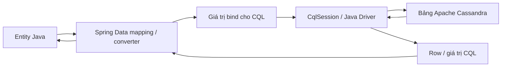

# Ánh xạ kiểu số, boolean, văn bản và dữ liệu nhị phân

## Mục tiêu học tập

Trong **Spring Data Cassandra**, một entity Java được ánh xạ vào các cột của bảng **Apache Cassandra** thông qua metadata và cơ chế chuyển đổi dữ liệu. Nếu chọn sai kiểu, dữ liệu có thể bị tràn số, mất độ chính xác, đọc sai văn bản hoặc không thể giải mã payload nhị phân. Điều này xảy ra ngay cả khi câu truy vấn CQL đã xác định đúng partition key.

Sau bài học thuộc chương **Kiểu dữ liệu** của module `SPRING_DATA_CASSANDRA`, bạn có thể:

- Đối chiếu các kiểu số `tinyint`, `smallint`, `int`, `bigint`, `varint`, `float`, `double`, `decimal` với kiểu Java thường dùng.
- Chọn kiểu phù hợp cho số đếm, giá tiền, đại lượng đo lường và các giá trị có thể vượt giới hạn số nguyên cố định.
- Phân biệt `boolean` với các biểu diễn “có/không” bằng số hoặc văn bản; xử lý khác biệt giữa `Boolean` và `boolean` trong Java.
- Hiểu `ascii`, `text`, `varchar` và cách ánh xạ sang `String` mà không đánh mất dữ liệu tiếng Việt.
- Hiểu `blob`, `ByteBuffer`, cú pháp hex trong CQL và cách xử lý byte an toàn.
- Xây dựng entity, repository và câu lệnh prepared CQL đúng kiểu, đồng thời đánh giá tác động đến partition, paging và hiệu năng.

## 1. Kiểu CQL được ánh xạ thành Java như thế nào?

Một cột Cassandra có **kiểu CQL** được định nghĩa ở schema. Java Driver biết cách mã hóa/giải mã các kiểu CQL chuẩn sang những kiểu Java tương ứng. Spring Data Cassandra sử dụng các cơ chế mapping để chuyển dữ liệu giữa hàng CQL và thuộc tính trong entity.



Hai lớp trách nhiệm cần phân biệt:

1. **Schema và Java Driver:** cột có kiểu gì; kiểu Java nào được codec hỗ trợ; giá trị được truyền đến Cassandra theo protocol như thế nào.
2. **Spring Data mapping:** thuộc tính Java tương ứng với cột nào; entity được tạo từ kết quả đọc ra sao; có custom conversions nào tham gia hay không.

`CassandraMappingContext` quản lý metadata entity (tên bảng, tên cột, khóa chính). `MappingCassandraConverter` hỗ trợ chuyển giữa entity và biểu diễn dữ liệu Cassandra. Repository và `CassandraTemplate` sử dụng các thành phần này, nhưng **không tự biến một kiểu CQL không tương thích thành kiểu hợp lệ**.

Ví dụ, nếu cột là `int` mà chương trình cố ghi một số vượt dải của số nguyên 32 bit, thêm `@Column` không sửa được giới hạn ấy. Phải chọn lại kiểu cột, kiểu Java hoặc mô hình dữ liệu.

## 2. Bảng đối chiếu các kiểu cơ bản

Bảng sau mô tả các ánh xạ thông dụng trong Java Driver 4.x và Spring Data Cassandra tương thích. Các kiểu Java ở dạng **wrapper/reference** được ưu tiên khi giá trị cột có thể thiếu.

| Kiểu CQL | Kiểu Java thông dụng | Ý nghĩa và lưu ý |
| --- | --- | --- |
| `tinyint` | `Byte` / `byte` | Số nguyên có dấu 8 bit; từ −128 đến 127. |
| `smallint` | `Short` / `short` | Số nguyên có dấu 16 bit; từ −32.768 đến 32.767. |
| `int` | `Integer` / `int` | Số nguyên có dấu 32 bit; phù hợp số lượng vừa phải. |
| `bigint` | `Long` / `long` | Số nguyên có dấu 64 bit; phù hợp bộ đếm/số thứ tự lớn nhưng vẫn hữu hạn. |
| `varint` | `BigInteger` | Số nguyên độ chính xác tùy ý trong giới hạn tài nguyên thực tế. |
| `float` | `Float` / `float` | Dấu phẩy động IEEE 754 32 bit; có sai số biểu diễn. |
| `double` | `Double` / `double` | Dấu phẩy động IEEE 754 64 bit; độ chính xác tốt hơn `float` nhưng vẫn có sai số. |
| `decimal` | `BigDecimal` | Số thập phân độ chính xác tùy ý; phù hợp giá trị cần tính thập phân chính xác. |
| `boolean` | `Boolean` / `boolean` | Hai giá trị logic `true` và `false`; cần cân nhắc trạng thái thiếu. |
| `ascii` | `String` | Văn bản giới hạn ở ký tự ASCII. |
| `text` | `String` | Văn bản Unicode theo UTF-8. |
| `varchar` | `String` | Trong Cassandra, tương đương `text`. |
| `blob` | `ByteBuffer` | Dãy byte; có thể dùng `byte[]` qua xử lý/chuyển đổi phù hợp. |
| `counter` | `Long` / `long` khi đọc | **Kiểu đặc biệt**, tăng/giảm bằng phép toán counter; không dùng như `bigint` thông thường. |

Đây là bảng **ánh xạ phổ biến**, không phải lời bảo đảm mọi phiên bản Spring Data sẽ tự chuyển mọi biến thể Java tương đương. Khi dùng kiểu tùy chỉnh hoặc `byte[]` trong entity, hãy xác minh codec, conversions và khả năng đọc–ghi khứ hồi của phiên bản đang chạy.

### Phân biệt kích thước lưu trữ và kích thước biểu diễn

- `tinyint`, `smallint`, `int` và `bigint` là số nguyên với giới hạn dải giá trị xác định.
- `varint` và `decimal` dùng biểu diễn có độ dài/độ chính xác linh hoạt hơn, hữu ích cho giá trị lớn nhưng có thể tăng chi phí lưu trữ và xử lý.
- `float` và `double` là **nhị phân dấu phẩy động**, không phải số thập phân chính xác.
- `blob` lưu **nội dung byte**, không có khái niệm văn bản, ảnh, PDF hay JSON tự thân; ứng dụng phải hiểu định dạng của payload.

Một giá trị `null` khác với số 0, `false`, chuỗi rỗng và blob rỗng. Trong các cột dữ liệu thường, Cassandra không nên được xem là nơi tự gán default cho mọi trường bị bỏ qua; ứng dụng phải quy định ý nghĩa của dữ liệu thiếu.

## 3. Ánh xạ các kiểu số nguyên

### 3.1. Chọn theo dải giá trị, không chỉ theo kích thước hôm nay

Xem các tình huống:

| Dữ liệu | Kiểu cân nhắc | Vì sao |
| --- | --- | --- |
| Mức đánh giá nguyên 0–5 | `tinyint` / `Byte` | Dải giá trị nhỏ và có ràng buộc rõ. |
| Số lượng sản phẩm trong một kiện dưới 30.000 | `smallint` / `Short` | Có thể phù hợp nếu giới hạn được kiểm chứng. |
| Số lượng tồn kho của một SKU | `int` / `Integer` hoặc `bigint` / `Long` | Tùy mức tăng trưởng tối đa và thao tác nghiệp vụ. |
| Tổng đơn vị đã bán trong nhiều năm | `bigint` / `Long` | Tránh tràn `int` khi dữ liệu tăng lâu dài. |
| Mã/chuỗi số nguyên ngoài dải 64 bit | `varint` / `BigInteger` | Khi thực sự cần số nguyên rất lớn; không thay thế cho UUID/string định danh một cách tùy tiện. |

Giới hạn cụ thể:

```text
tinyint   -> -128 .. 127
smallint  -> -32,768 .. 32,767
int       -> -2,147,483,648 .. 2,147,483,647
bigint    -> -9,223,372,036,854,775,808 .. 9,223,372,036,854,775,807
varint    -> số nguyên lớn tùy ý, bị giới hạn thực tế bởi bộ nhớ, protocol và tài nguyên
```

Khi một cột `int` đã lưu dữ liệu và nghiệp vụ có thể vượt giới hạn, **không thể chỉ thay `Integer` thành `Long` ở entity rồi coi như dữ liệu đã là `bigint`**. Schema CQL và mã đọc/ghi phải được di chuyển đồng bộ theo một quy trình migration phù hợp.

### 3.2. Không nhầm bigint với varint

Hai kiểu đều hỗ trợ số nguyên, nhưng:

- `bigint` là số nguyên 64 bit, ánh xạ tự nhiên với `Long`.
- `varint` hỗ trợ giá trị vượt dải 64 bit, ánh xạ với `BigInteger`.

Ví dụ Java:

```java
import java.math.BigInteger;

Long unitsSold = 15_000_000_000L;
BigInteger externalSequence =
        new BigInteger("123456789012345678901234567890");
```

Đừng dùng `long` cho giá trị `varint` lớn hơn `Long.MAX_VALUE` hoặc gọi `BigInteger.longValue()` mà không kiểm tra dải: phép chuyển có thể làm mất phần giá trị. Nếu thật sự cần chuyển về `long`, `longValueExact()` giúp phát hiện số vượt phạm vi bằng exception.

### 3.3. Counter là kiểu số có quy tắc ghi riêng

Kiểu `counter` trong Cassandra không phải `bigint` bình thường. Nó dùng cho tăng/giảm bộ đếm:

```sql
CREATE TABLE page_views_counter (
    page_id uuid PRIMARY KEY,
    view_count counter
);

UPDATE page_views_counter
SET view_count = view_count + 1
WHERE page_id = 11111111-1111-4111-8111-111111111111;

SELECT view_count
FROM page_views_counter
WHERE page_id = 11111111-1111-4111-8111-111111111111;
```

Lưu ý:

- Không ghi cột `counter` bằng `INSERT ... VALUES (..., 100)` như số thông thường.
- Không trộn các cột counter với regular columns không phải counter trong cùng bảng counter.
- Tăng/giảm counter **không phải thao tác có thể lặp lại an toàn** khi client timeout: gửi lại `+1` có thể cộng thêm lần nữa. Không dùng chiến lược retry giống một phép gán giá trị idempotent.
- Nếu nghiệp vụ cần tính đúng tuyệt đối cho thanh toán hoặc tồn kho, một counter Cassandra đơn lẻ chưa đủ để tạo toàn bộ ràng buộc nghiệp vụ.

Trong Spring Data Cassandra, tránh gọi `save()` trên một entity chứa counter với kỳ vọng nó hoạt động như cập nhật `Long` thông thường. Thao tác counter cần câu lệnh/ API hỗ trợ đúng ngữ nghĩa counter.

## 4. Số thực: float, double và decimal

### 4.1. Dấu phẩy động không bảo đảm biểu diễn chính xác mọi số thập phân

Java `Float` và `Double` dùng biểu diễn nhị phân dấu phẩy động. Chúng thích hợp cho cảm biến, đo lường, hệ số xấp xỉ và tính toán chấp nhận sai số nhỏ.

```java
double measured = 0.1 + 0.2;
System.out.println(measured); // Thường in: 0.30000000000000004
```

Nếu ghi `measured` vào cột `double`, Cassandra lưu giá trị dấu phẩy động mà chương trình đã tính, **không tự làm tròn thành 0.3 thập phân chính xác**.

So sánh:

| Nhu cầu | Nên cân nhắc | Tránh |
| --- | --- | --- |
| Nhiệt độ cảm biến, tỉ lệ xấp xỉ | `double` / `Double` | Kỳ vọng so sánh thập phân tuyệt đối không sai số. |
| Điểm số tính toán mà độ chính xác 32 bit đủ dùng | `float` / `Float` | Dùng cho tiền chỉ để tiết kiệm vài byte. |
| Đơn giá, số tiền, giá trị cần làm tròn theo quy tắc tài chính | `decimal` / `BigDecimal` | `double` cộng/trừ trực tiếp cho tiền. |
| Tiền ở đơn vị nhỏ nhất đã quy ước cố định | `bigint` / `Long` | Bỏ qua currency/scale hoặc nguy cơ tràn số. |

### 4.2. Decimal và BigDecimal

Với cột CQL:

```sql
-- Một cột được khai báo trong CREATE TABLE:
unit_price decimal
```

Java:

```java
import java.math.BigDecimal;
import java.math.RoundingMode;

BigDecimal unitPrice = new BigDecimal("149.90");
BigDecimal vatRate = new BigDecimal("0.08");
BigDecimal total = unitPrice
        .multiply(BigDecimal.ONE.add(vatRate))
        .setScale(2, RoundingMode.HALF_UP);
```

Hãy tạo `BigDecimal` từ **chuỗi thập phân** hoặc giá trị nguyên có scale được xác định. `new BigDecimal(0.1)` có thể mang theo sai số từ `double` đã được tạo trước đó. Khi cộng, nhân, chia, cần thống nhất scale, rounding mode và quy tắc tiền tệ tại tầng nghiệp vụ.

Chú ý sự khác nhau giữa:

```java
new BigDecimal("1.0").compareTo(new BigDecimal("1.00")) == 0; // true
new BigDecimal("1.0").equals(new BigDecimal("1.00"));         // false
```

Hai giá trị bằng nhau về số học nhưng khác **scale**. Nếu dùng `BigDecimal` trong so sánh, bộ nhớ đệm hoặc logic idempotency, cần xác định rõ trường hợp nào dùng `compareTo()`, trường hợp nào cần chuẩn hóa scale. Đồng thời, không giả định cột `decimal` tự áp đặt scale tiền tệ theo mọi quy ước doanh nghiệp.

### 4.3. Decimal hay bigint để lưu tiền?

Cả hai có thể phù hợp trong những mô hình khác nhau:

- Dùng `decimal` khi nghiệp vụ cần số chữ số thập phân linh hoạt, tính toán chính xác với `BigDecimal`.
- Dùng `bigint` lưu **đơn vị nhỏ nhất** (ví dụ xu) khi toàn hệ thống quy định rõ đơn vị, currency và giới hạn số lượng. Cần chuyển đổi ở biên API để tránh hiểu `14990` là `14990` đơn vị tiền chính.

Không dùng `float`/`double` chỉ vì giá bán có dấu thập phân; sai số có thể tích lũy ở các phép tính tổng, thuế và chiết khấu.

## 5. Boolean: true, false và trạng thái chưa biết

CQL `boolean` biểu diễn giá trị logic `true` hoặc `false`. Java có hai lựa chọn:

```java
private boolean active;  // Java primitive: mặc định false
private Boolean verified; // Có thể null khi chưa biết/chưa ghi
```

| Tình huống | Ý nghĩa có thể cần |
| --- | --- |
| `active = true` | Đang hoạt động. |
| `active = false` | Đã xác định là không hoạt động. |
| `verified = null` | Chưa có thông tin xác minh; không đồng nghĩa `false`. |

Nếu entity dùng `boolean` nguyên thủy, việc một cột chưa có giá trị sẽ khó biểu diễn phân biệt với `false` ở tầng Java. Với cột có thể thiếu, dùng `Boolean` và quy ước rõ cách service xử lý `null`.

Trong CQL:

```sql
-- Giá trị boolean viết trực tiếp là true hoặc false
INSERT INTO product_snapshot_by_id (product_id, available)
VALUES (
    11111111-1111-4111-8111-111111111111,
    true
);
```

Đoạn lệnh giả định bảng ví dụ `product_snapshot_by_id` được tạo ở phần sau. `'true'` là chuỗi văn bản trong CQL, không phải cách biểu diễn nên dùng khi bind giá trị boolean; với prepared statements hãy truyền `Boolean`.

Không nên lưu cột `status text` thành boolean nếu nghiệp vụ thực sự có nhiều trạng thái như `PENDING`, `SUSPENDED`, `ARCHIVED`. Khi ấy, kiểu văn bản có tập giá trị hợp lệ được kiểm soát ở tầng nghiệp vụ có thể phù hợp hơn.

### Boolean không tự biến thành một truy vấn hiệu quả

Mặc dù có thể đọc hoặc ghi giá trị `available`, truy vấn:

```sql
-- Không nên kỳ vọng được phép/hiệu quả chỉ vì cột là boolean:
-- SELECT * FROM product_snapshot_by_id WHERE available = true;
```

không được định tuyến theo `product_id` nếu bảng có partition key là `product_id`. Muốn liệt kê sản phẩm còn hàng, phải thiết kế bảng hoặc cơ chế truy vấn phù hợp; vì `boolean` chỉ có hai giá trị, dùng một mình nó làm partition key cho bảng lớn có thể gây **hot partition**.

## 6. Văn bản: ascii, text và varchar

### 6.1. String trong Java, nhưng phạm vi ký tự khác nhau

Ba kiểu CQL đều thường ánh xạ sang `String`, song cách dùng khác nhau:

| Kiểu CQL | Dữ liệu có thể chứa | Gợi ý |
| --- | --- | --- |
| `ascii` | Ký tự ASCII | Dùng khi giao thức hoặc nghiệp vụ bảo đảm giá trị chỉ có ASCII, chẳng hạn một mã kỹ thuật được chuẩn hóa. |
| `text` | Văn bản Unicode qua UTF-8 | Phù hợp tên người, mô tả, nội dung tiếng Việt và đa ngôn ngữ. |
| `varchar` | Cùng ngữ nghĩa với `text` trong Cassandra | Có thể gặp trong schema cũ hoặc để tương thích cách gọi SQL. |

Ví dụ:

```sql
CREATE TABLE localized_label_by_id (
    id uuid PRIMARY KEY,
    sku ascii,
    display_name text,
    description varchar
);

INSERT INTO localized_label_by_id (
    id, sku, display_name, description
) VALUES (
    11111111-1111-4111-8111-111111111111,
    'SKU-001',
    'Cà phê rang xay',
    'Sản phẩm dành cho khách hàng Việt Nam'
);
```

Ký tự có dấu như “à”, “ê”, “ệ” **không thuộc ASCII**. Nếu đổi `display_name` thành `ascii`, giá trị có dấu có thể bị codec/driver từ chối hoặc không tương thích. Đừng dùng `ascii` chỉ vì chuỗi thường ngắn.

### 6.2. Text không đồng nghĩa với tìm kiếm toàn văn

Một cột `text` không tự tạo khả năng:

- `LIKE '%keyword%'` trên mọi hàng như một hệ thống tìm kiếm tự do.
- Tìm không phân biệt hoa/thường hoặc không dấu tiếng Việt.
- Sắp xếp theo ngôn ngữ, dấu câu và quy tắc locale theo ý nghiệp vụ.

Cassandra sử dụng khóa và các cơ chế index/truy vấn được hỗ trợ bởi phiên bản cụ thể; khả năng tìm văn bản phụ thuộc thiết kế dữ liệu và công cụ tìm kiếm phù hợp. Spring Data repository không tự biến `String` thành full-text index.

### 6.3. Chuẩn hóa và giới hạn văn bản

Nếu một mã như `sku` được dùng trong khóa hoặc truy vấn chính xác, hãy chuẩn hóa trước khi ghi:

- Quy định có phân biệt chữ hoa/thường hay không.
- Quy định có chấp nhận khoảng trắng đầu/cuối hay không.
- Với Unicode, cân nhắc **normalization** nhất quán khi so sánh hoặc dùng làm khóa.
- Giới hạn độ dài theo yêu cầu sản phẩm và khả năng vận hành; `text` không phải lý do để gửi tài liệu khổng lồ trong mỗi row.

Ví dụ `"café"` có thể được tạo từ các chuỗi mã Unicode khác nhau nhưng trông giống nhau. Nếu dùng làm khóa partition, những chuỗi byte khác nhau có thể tương ứng các khóa khác nhau. Quy tắc chuẩn hóa cần được áp dụng ổn định tại mọi service ghi dữ liệu.

Khi viết CQL trực tiếp, một dấu nháy đơn trong nội dung phải được escape theo cú pháp CQL. Trong ứng dụng, ưu tiên **prepared statements và bind values** thay vì ghép chuỗi, vừa giảm lỗi cú pháp vừa tránh đưa dữ liệu đầu vào vào cấu trúc câu lệnh.

## 7. Dữ liệu nhị phân: blob và ByteBuffer

### 7.1. blob là dãy byte, không phải chuỗi hex ở tầng ứng dụng

Kiểu CQL `blob` lưu một chuỗi byte. Trong câu lệnh CQL dạng text, có thể viết literal hex với tiền tố `0x`:

```sql
-- Ba byte: 01, 23, FE
-- Giá trị này được lưu ở cột BLOB, không phải chuỗi ký tự "0x0123FE".
UPDATE product_snapshot_by_id
SET thumbnail = 0x0123FE
WHERE product_id = 11111111-1111-4111-8111-111111111111;
```

Còn ở Java Driver, kiểu mặc định cho CQL `blob` là `java.nio.ByteBuffer`:

```java
import java.nio.ByteBuffer;

byte[] thumbnailBytes = new byte[] {
        0x01, 0x23, (byte) 0xFE
};
ByteBuffer thumbnail = ByteBuffer.wrap(thumbnailBytes);
```

`ByteBuffer` chỉ là cách Java biểu diễn dữ liệu byte để driver mã hóa; nội dung blob **không được Cassandra tự giải nén, nhận diện MIME hoặc kiểm tra cấu trúc ảnh**.

### 7.2. Cẩn thận với position, limit và dữ liệu chia sẻ

`ByteBuffer` có `position` và `limit`. Một đoạn mã gọi `get()` trên chính buffer sẽ dịch chuyển `position`, ảnh hưởng lượng byte có thể đọc ở lần sau. Buffer còn có thể dùng chung bộ nhớ với mảng byte ban đầu.

Để đọc buffer thành mảng byte mới mà không làm thay đổi vị trí buffer gốc:

```java
import java.nio.ByteBuffer;

public static byte[] copyRemainingBytes(ByteBuffer source) {
    if (source == null) {
        return null;
    }

    ByteBuffer view = source.asReadOnlyBuffer();
    byte[] result = new byte[view.remaining()];
    view.get(result);
    return result;
}
```

Hàm sao chép đúng các byte thuộc khoảng `position..limit` hiện tại; nó không giả định buffer có mảng `array()` phía sau. Đây là điểm cần lưu ý với direct buffer hoặc read-only buffer do driver trả về.

### 7.3. Có nên dùng byte[] trực tiếp trong entity?

Bạn có thể muốn khai báo:

```java
private byte[] thumbnail;
```

Tuy nhiên, ánh xạ mặc định của Java Driver cho `blob` là `ByteBuffer`. Khả năng Spring Data tự chuyển `byte[]` tùy phiên bản và cấu hình conversions. Với bài học cơ bản, dùng `ByteBuffer` làm kiểu entity rõ ràng nhất; nếu API nghiệp vụ cần `byte[]`, hãy chuyển đổi tại biên service hoặc đăng ký custom conversions được kiểm thử.

Khi dùng custom conversion:

1. Xác minh **cả chiều đọc lẫn chiều ghi**.
2. Không làm thay đổi `position/limit` ngoài ý muốn.
3. Xác định cách xử lý `null` và mảng byte rỗng.
4. Kiểm tra round-trip bằng byte chứa giá trị `0x00` và byte lớn hơn `0x7F`, vì Java `byte` là số có dấu còn dữ liệu blob chỉ là byte.

### 7.4. Hạn chế blob lớn trong các truy vấn nóng

Lưu thumbnail nhỏ hoặc payload nhị phân có kích thước giới hạn có thể hợp lý. Nhưng nếu mỗi hàng chứa file lớn, mọi truy vấn trả `SELECT *` có thể kéo theo network, heap và paging tốn kém.

Đối với ảnh hoặc tài liệu rất lớn, thường nên cân nhắc lưu nội dung vào object storage và chỉ để **metadata/định danh đối tượng** trong Cassandra. Đây là quyết định kiến trúc tùy yêu cầu, không phải quy tắc cấm mọi blob.

Nếu cùng một màn hình chỉ cần tên và giá, hãy chỉ `SELECT` các cột đó thay vì luôn tải cả thumbnail. Tổng kích thước kết quả, page size, số hàng mỗi partition và tần suất truy vấn đều ảnh hưởng hiệu năng.

## 8. Ví dụ đầy đủ: bảng CQL và entity Spring Data Cassandra

Giả sử ứng dụng quản lý một bản tóm tắt sản phẩm theo mã. API chính **đọc một sản phẩm theo `product_id`**, vì vậy khóa chính đơn là đủ cho ví dụ tập trung vào mapping. Khi triển khai thực tế, các màn hình cần liệt kê theo danh mục hoặc trạng thái sẽ cần thiết kế truy vấn/bảng khác phù hợp.

### 8.1. Định nghĩa bảng

```sql
CREATE TABLE product_snapshot_by_id (
    product_id uuid PRIMARY KEY,
    display_name text,
    sku ascii,
    available boolean,
    stock_qty int,
    pack_size smallint,
    quality_grade tinyint,
    units_sold bigint,
    external_sequence varint,
    unit_price decimal,
    weight_kg double,
    ranking_score float,
    thumbnail blob
);
```

Câu lệnh tạo bảng có thể thực thi trong một keyspace đã được chọn. Bảng thể hiện rõ các kiểu CQL, nhưng **không khẳng định mỗi hệ thống đều nên lưu tất cả dữ liệu sản phẩm vào một bảng duy nhất**.

### 8.2. Ghi một sản phẩm bằng CQL

```sql
INSERT INTO product_snapshot_by_id (
    product_id,
    display_name, sku, available,
    stock_qty, pack_size, quality_grade,
    units_sold, external_sequence,
    unit_price, weight_kg, ranking_score, thumbnail
) VALUES (
    11111111-1111-4111-8111-111111111111,
    'Cà phê rang xay', 'SKU-001', true,
    1200, 12, 5,
    15000000000, 123456789012345678901234567890,
    149.90, 0.275, 4.25, 0x0123FE
);

SELECT product_id, display_name, sku, available,
       stock_qty, pack_size, quality_grade,
       units_sold, external_sequence, unit_price,
       weight_kg, ranking_score, thumbnail
FROM product_snapshot_by_id
WHERE product_id = 11111111-1111-4111-8111-111111111111;
```

Trong câu lệnh:

- `'Cà phê rang xay'` vào `text`, còn `'SKU-001'` vào `ascii`.
- `true` là boolean, khác `'true'` dưới dạng chuỗi.
- `149.90` vào `decimal` nên Java nên nhận bằng `BigDecimal`.
- Giá trị `external_sequence` lớn hơn dải 64 bit nên Java dùng `BigInteger`.
- `0x0123FE` vào `blob` tương ứng ba byte.
- `product_id` xác định một partition/hàng trong bảng này; câu `SELECT` dùng đủ khóa chính.

### 8.3. Entity Java tương ứng

```java
import java.math.BigDecimal;
import java.math.BigInteger;
import java.nio.ByteBuffer;
import java.util.UUID;

import org.springframework.data.cassandra.core.mapping.Column;
import org.springframework.data.cassandra.core.mapping.PrimaryKey;
import org.springframework.data.cassandra.core.mapping.Table;

@Table("product_snapshot_by_id")
public class ProductSnapshot {

    @PrimaryKey("product_id")
    private UUID productId;

    @Column("display_name")
    private String displayName;

    @Column("sku")
    private String sku;

    @Column("available")
    private Boolean available;

    @Column("stock_qty")
    private Integer stockQty;

    @Column("pack_size")
    private Short packSize;

    @Column("quality_grade")
    private Byte qualityGrade;

    @Column("units_sold")
    private Long unitsSold;

    @Column("external_sequence")
    private BigInteger externalSequence;

    @Column("unit_price")
    private BigDecimal unitPrice;

    @Column("weight_kg")
    private Double weightKg;

    @Column("ranking_score")
    private Float rankingScore;

    @Column("thumbnail")
    private ByteBuffer thumbnail;

    // Bổ sung constructor, getter/setter và logic nghiệp vụ theo dự án.
}
```

Đây là **khung entity để học cách ánh xạ**. Trong dự án thực, cần bổ sung phần khởi tạo/khả năng truy cập thuộc tính phù hợp với cơ chế mapping và các yêu cầu của ứng dụng.

Điểm cần ghi nhớ: `@Column("unit_price")` khai báo **tên cột**, không thay thế việc chọn đúng kiểu Java `BigDecimal` cho CQL `decimal`. Tương tự, `@Column("thumbnail")` không tự biến `byte[]` thành `ByteBuffer` trong mọi cấu hình.

### 8.4. Repository đọc theo khóa

```java
import java.util.UUID;

import org.springframework.data.cassandra.repository.CassandraRepository;

public interface ProductSnapshotRepository
        extends CassandraRepository<ProductSnapshot, UUID> {
    // findById(UUID) và save(ProductSnapshot) kế thừa từ repository.
}
```

Ví dụ sử dụng:

```java
UUID id = UUID.fromString("11111111-1111-4111-8111-111111111111");
ProductSnapshot product = repository.findById(id).orElseThrow();
BigDecimal price = product.getUnitPrice();
```

Đoạn mã cuối giả định đã có biến `repository` và getter `getUnitPrice()` được bổ sung trong entity.

Không nên tự động viết `findByAvailable(true)` hoặc `findByDisplayNameContaining(...)` rồi kỳ vọng Spring Data Cassandra thực hiện truy vấn hiệu quả trên bảng khóa `product_id`. API repository vẫn tuân thủ các giới hạn partition key, clustering columns và index của CQL.

### 8.5. Prepared statement: truyền đúng kiểu vào driver

Khi cần CQL rõ ràng hoặc đang thao tác trực tiếp với `CqlSession`:

```java
import java.math.BigDecimal;
import java.nio.ByteBuffer;
import java.util.UUID;

import com.datastax.oss.driver.api.core.CqlSession;
import com.datastax.oss.driver.api.core.cql.PreparedStatement;
import com.datastax.oss.driver.api.core.cql.BoundStatement;

public static void updatePriceAndThumbnail(
        CqlSession session, UUID productId, byte[] bytes) {

    PreparedStatement prepared = session.prepare("""
        UPDATE product_snapshot_by_id
        SET unit_price = ?, thumbnail = ?
        WHERE product_id = ?
        """);

    BoundStatement bound = prepared.bind(
        new BigDecimal("149.90"),
        ByteBuffer.wrap(bytes),
        productId
    );

    session.execute(bound);
}
```

Đây là ví dụ đặt trong một class Java phù hợp, với keyspace mặc định chứa bảng. Trong ứng dụng thực, **reuse prepared statement** thay vì prepare lại cho mỗi lần gọi; phần quản lý `CqlSession` nên do Spring/container đảm nhiệm.

`BigDecimal` được bind cho cột `decimal`, `ByteBuffer` cho `blob` và `UUID` cho khóa. **Bind tham số** giúp driver áp dụng codec phù hợp và tránh ghép trực tiếp đầu vào người dùng vào CQL.

`CassandraTemplate` cung cấp cách thao tác ở tầng Spring Data với mapping tương tự; khi cần thay đổi timeout, consistency hoặc paging, cần lựa chọn API và cấu hình tương thích với phiên bản đang dùng. Chúng không thay thế yêu cầu chọn đúng kiểu dữ liệu.

## 9. Null, giá trị mặc định và cập nhật từng cột

Đây là nhóm lỗi thường khó phát hiện khi schema CQL, entity và nghiệp vụ không thống nhất.

### 9.1. Giá trị thiếu không bằng giá trị mặc định

| Kiểu Java | Khi chưa được gán trong object mới | Nguy cơ |
| --- | --- | --- |
| `int`, `long`, `float`, `double` | Mặc định 0/0.0 | Không phân biệt “chưa có dữ liệu” với giá trị 0. |
| `boolean` | Mặc định `false` | Không phân biệt “chưa xác minh” với “đã xác minh là sai”. |
| `Integer`, `Long`, `BigDecimal`, `Boolean` | Mặc định `null` | Phải xác định cách lưu, đọc và xử lý giá trị không có. |
| `String`, `ByteBuffer` | Mặc định `null` | `null` không tương đương chuỗi rỗng hoặc blob 0 byte. |

Các cột thuộc **primary key** phải có giá trị phù hợp để định danh partition/hàng; không dùng `null` làm khóa. Đối với regular columns, cần chủ động quyết định xử lý trường bị bỏ trống, chẳng hạn mặc định ở service, bỏ qua khi cập nhật hoặc xóa giá trị theo ngữ nghĩa nghiệp vụ.

### 9.2. Cassandra có ngữ nghĩa cập nhật khác RDBMS

Trong Cassandra, `INSERT` và `UPDATE` có tính chất *upsert* theo primary key. Việc ghi `null` vào cột dữ liệu có thể liên quan đến **xóa giá trị/tombstone**, tùy câu lệnh và tầng framework đang dùng; không nên coi `null` là cách “giữ nguyên cột cũ” một cách mặc định.

Ví dụ, nếu API chỉ muốn đổi `unit_price`, hãy sử dụng thao tác cập nhật có mục tiêu:

```sql
UPDATE product_snapshot_by_id
SET unit_price = 159.90
WHERE product_id = 11111111-1111-4111-8111-111111111111;
```

Khi ánh xạ một object chứa nhiều thuộc tính `null` rồi gọi `save()`, hãy hiểu hành vi ghi của phiên bản Spring Data đang dùng và cách ứng dụng cấu hình. Tránh vô tình ghi mất dữ liệu ở những trường không được gửi từ request.

### 9.3. Quy tắc validation thuộc trách nhiệm nghiệp vụ

Cassandra không tự hiểu các điều kiện như “số lượng phải không âm”, “đơn giá phải có hai chữ số thập phân”, “SKU phải theo mẫu hợp lệ” hoặc “nội dung thumbnail không quá N KiB”. Những ràng buộc này cần được xử lý ở tầng ứng dụng, schema/dữ liệu phụ trợ hoặc quy trình kiểm thử phù hợp.

**Đúng kiểu** là điều kiện cơ bản; **đúng ngữ nghĩa nghiệp vụ** là yêu cầu bổ sung.

## 10. Ảnh hưởng đến hiệu năng và thiết kế theo truy vấn

Chọn kiểu phù hợp còn ảnh hưởng lượng dữ liệu truyền và tài nguyên tiêu thụ:

| Lựa chọn | Tác động có thể có |
| --- | --- |
| Dùng `varint` cho mọi số đếm nhỏ | Tăng độ phức tạp và chi phí xử lý không cần thiết. |
| Dùng `decimal` với độ chính xác rất lớn | Cần đánh giá kích thước giá trị và chi phí tính toán so với nhu cầu. |
| Lưu blob lớn trong hàng được đọc thường xuyên | Tăng network, memory và độ trễ; ảnh hưởng trải nghiệm paging. |
| Lưu text dài trong bảng tóm tắt | Một truy vấn danh sách có thể truyền nhiều dữ liệu không sử dụng. |
| Dùng boolean ít giá trị làm partition key duy nhất | Có nguy cơ partition lớn/nóng khi lượng dữ liệu hoặc truy cập cao. |
| Chọn khóa chính đúng với cách đọc | Cho phép truy vấn định vị partition; không phải do tên kiểu Java quyết định. |

Ví dụ:

```sql
-- Trả về các trường UI cần, tránh lấy blob nếu không sử dụng.
SELECT product_id, display_name, unit_price, available
FROM product_snapshot_by_id
WHERE product_id = 11111111-1111-4111-8111-111111111111;
```

Nếu màn hình phải liệt kê 100 sản phẩm của một danh mục, bảng hiện tại không hỗ trợ tốt truy vấn đó chỉ vì đã có `display_name text` hay `available boolean`. Phải thiết kế bảng theo **mẫu truy vấn**, chọn partition key và clustering columns phù hợp, đồng thời tính toán kích thước mỗi partition.

Spring Data Cassandra cung cấp repository, `CassandraTemplate` và CQL mapping, nhưng **không làm thay đổi đặc điểm phân tán của Cassandra**. Consistency level kiểm soát mức phản hồi của replica cho từng thao tác; paging giúp đọc kết quả từng phần; cả hai không thay thế thiết kế kiểu dữ liệu và khóa.

## 11. Lỗi thường gặp và cách kiểm tra

| Triệu chứng | Nguyên nhân nên kiểm tra | Cách xử lý |
| --- | --- | --- |
| Không ghi được giá trị số lớn | Cột `int`/`bigint` hoặc kiểu Java không đủ dải | Xác định giá trị tối đa thực tế; chọn `Long`/`BigInteger` và kế hoạch đổi schema nếu cần. |
| Tổng tiền đôi khi sai vài chữ số cuối | Sử dụng `double` hoặc xây `BigDecimal` từ `double` | Dùng `decimal`/`BigDecimal` và quy tắc làm tròn rõ ràng. |
| Giá trị `false` xuất hiện khi chưa từng xác minh | Dùng `boolean` primitive | Cân nhắc `Boolean` và quy ước xử lý `null`. |
| Tên tiếng Việt không ghi/đọc được | Lưu vào cột `ascii` | Dùng `text` hoặc `varchar`, kiểm tra charset và codec. |
| Hai chuỗi trông giống nhau nhưng tìm theo khóa không khớp | Unicode normalization/case khác nhau | Chuẩn hóa nhất quán ở biên ứng dụng. |
| Payload nhị phân bị thiếu byte khi chuyển đổi | Dùng `ByteBuffer.get()` làm thay đổi position hoặc đọc sai `remaining()` | Tạo view/copy phù hợp trước khi xử lý. |
| `byte[]` không tự ánh xạ vào `blob` | Khác biệt phiên bản/conversion | Kiểm tra mapping; dùng `ByteBuffer` hoặc custom conversions có test round-trip. |
| Đọc theo `available` chậm hoặc bị từ chối | Regular column không định tuyến được partition | Thiết kế bảng/index theo truy vấn, không dùng `ALLOW FILTERING` như cách sửa mặc định. |
| Counter bị tăng hai lần sau timeout | Retry phép cộng không idempotent | Xác định ngữ nghĩa nghiệp vụ và chiến lược đếm phù hợp. |

Khi một câu truy vấn thất bại, hãy tách:

1. **Schema:** cột CQL có đúng kiểu mong muốn không?
2. **Mapping:** tên bảng/cột và Java property có tương ứng không?
3. **Conversion:** codec/converter có hỗ trợ kiểu đích không?
4. **Query:** điều kiện `WHERE` có hợp lệ với partition key/clustering columns không?
5. **Vận hành:** request có quá lớn, nhiều tombstone, quá nhiều row hoặc mức consistency/timeout chưa phù hợp không?

## 12. Bài tập vận dụng

**Câu 1.** Cột `unit_price` được khai báo `double`, Java dùng `Double`. Hệ thống cần tính tổng chính xác đến hai chữ số thập phân. Nên thay đổi gì?

**Gợi ý:** Xem xét chuyển sang `decimal`/`BigDecimal` hoặc số nguyên đơn vị nhỏ nhất với scale/currency xác định. Phải xử lý migration dữ liệu, quy tắc làm tròn và kiểm tra dữ liệu cũ; thay kiểu Java đơn thuần không chuyển đổi schema hiện tại.

**Câu 2.** Cột `sku ascii` nhận chuỗi `"CÀ-PHÊ-01"`. Vì sao có thể gặp lỗi?

**Gợi ý:** Ký tự có dấu ngoài ASCII. Nếu nghiệp vụ cho phép mã Unicode, đổi thiết kế sang `text`; nếu mã được quy định ASCII, chuẩn hóa/validate input trước khi ghi.

**Câu 3.** Với `boolean`, làm sao phân biệt khách đã từ chối xác minh với khách chưa từng được hỏi?

**Gợi ý:** Dùng `Boolean` có thể `null` hoặc một mô hình trạng thái rõ ràng; không mặc định `false` mang cả hai nghĩa.

**Câu 4.** Khi đọc `blob`, vì sao không nên luôn gọi `buffer.array()`?

**Gợi ý:** Buffer có thể là direct/read-only và không có backing array truy cập được. Có thể dùng `asReadOnlyBuffer()`/`duplicate()` rồi đọc đúng `remaining()` byte.

**Câu 5.** Một bảng có partition key `is_active boolean` và chứa hàng triệu sản phẩm. Thêm `quality_grade tinyint` vào clustering key có giúp phân tán dữ liệu sang nhiều partition không?

**Gợi ý:** Không. Clustering key chỉ sắp xếp/phân biệt hàng trong partition; số partition theo `is_active` vẫn rất ít. Cần thiết kế lại partition key theo mẫu truy vấn.

**Câu 6.** CQL `counter` được ánh xạ khi đọc thành `Long`. Có thể xử lý tăng counter bằng `save()` một entity với `count = count + 1` rồi retry tự do không?

**Gợi ý:** Không. Counter dùng phép tăng/giảm riêng và retry có thể tăng lặp. Cần API/câu CQL đúng ngữ nghĩa và xác định mức chính xác mà nghiệp vụ yêu cầu.

## Tổng kết

Ánh xạ kiểu cơ bản trong Spring Data Cassandra bắt đầu từ việc chọn **kiểu CQL đúng ngữ nghĩa dữ liệu**: số nguyên cố định hoặc `varint` cho số đếm, `decimal`/`BigDecimal` cho số thập phân cần chính xác, `boolean`/`Boolean` cho trạng thái logic, `text`/`String` cho Unicode và `blob`/`ByteBuffer` cho byte.

Một mapping đúng cần thống nhất **schema CQL, kiểu Java, codec/converter, giá trị null và quy tắc nghiệp vụ**. Sau đó mới cân nhắc đường truy vấn qua repository hoặc `CassandraTemplate`, thiết kế partition key, consistency, paging và hiệu năng. Khi các tầng này đồng nhất, ứng dụng có thể đọc–ghi dữ liệu Cassandra ổn định và tránh lỗi tinh vi do sai kiểu, mất độ chính xác hoặc xử lý byte không chính xác.
