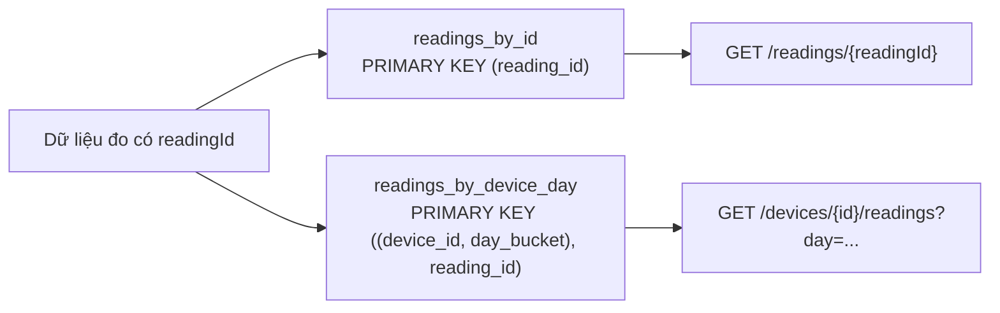

# UUID, timeuuid và các kiểu định danh

## 1. Vì sao kiểu định danh ảnh hưởng đến thiết kế Cassandra?

Trong hệ thống sử dụng **Spring Data Cassandra**, một định danh không chỉ dùng để phân biệt đối tượng nghiệp vụ. Khi định danh tham gia **partition key** hoặc **clustering key** của bảng Apache Cassandra, kiểu dữ liệu và cách sinh giá trị sẽ ảnh hưởng trực tiếp đến phân bố tải, khả năng tra cứu, thứ tự hiển thị và cách phân trang API.

Chẳng hạn, ứng dụng ghi nhận dữ liệu đo từ thiết bị có hai nhu cầu:

- Tra cứu một bản ghi cụ thể bằng `readingId`.
- Liệt kê các bản ghi của một thiết bị trong một ngày, mới nhất trước.

Hai nhu cầu này có thể dẫn tới **hai bảng theo truy vấn** dù cùng sử dụng một định danh:



Chọn `uuid`, `timeuuid`, `text` hay `bigint` phải xuất phát từ **ý nghĩa định danh**, **quy tắc tạo ID** và **đường truy cập dữ liệu**, không chỉ vì một kiểu có thể lưu được giá trị.

## 2. So sánh các kiểu định danh thông dụng

| Kiểu CQL | Kiểu Java thường dùng | Tính chất | Trường hợp phù hợp |
| --- | --- | --- | --- |
| `uuid` | `java.util.UUID` | Giá trị UUID 128 bit, không bắt buộc mang thông tin thời gian | ID đối tượng, tenant, customer, order; tra cứu chính xác |
| `timeuuid` | `java.util.UUID` | UUID **phiên bản 1**, chứa thành phần thời gian; Cassandra có thứ tự so sánh theo thời gian | Sự kiện được sắp xếp theo thời điểm tạo trong một partition |
| `text` / `varchar` | `String` | Định danh do nghiệp vụ hoặc hệ ngoài quy định; linh hoạt nhưng cần chuẩn hóa | SKU, mã quốc gia, external ID, mã đơn có định dạng |
| `ascii` | `String` | Chuỗi ASCII, không dùng cho ký tự Unicode | ID kỹ thuật chỉ có ký tự ASCII theo hợp đồng cố định |
| `bigint` | `Long` | Số nguyên có dấu 64 bit | ID số đã được cấp từ hệ thống khác, sequence/distributed ID được quản lý ngoài Cassandra |
| `int` | `Integer` | Số nguyên có dấu 32 bit | Khóa phân loại/tập giá trị nhỏ đã biết; tránh cho bộ đếm ID tăng liên tục |
| `varint` | `BigInteger` | Số nguyên độ dài biến đổi | Định danh số lớn đặc thù, không phổ biến làm khóa ứng dụng |

**Không có kiểu định danh tốt nhất cho mọi API.** `uuid` và `timeuuid` thường là lựa chọn thuận tiện khi hệ thống cần sinh ID phân tán; `text` phù hợp khi ID có cấu trúc nghiệp vụ ổn định; `bigint` thích hợp khi đã có hệ cấp ID riêng. Các ràng buộc về unique, thứ tự và khả năng truy vấn của Cassandra vẫn phụ thuộc vào **toàn bộ primary key**.

Đặc biệt, `timestamp` biểu diễn một mốc thời gian, **không tự tạo tính duy nhất**. Nhiều sự kiện có thể xảy ra ở cùng một timestamp. Khi cần vừa thứ tự thời gian vừa một ID phân biệt, có thể dùng `timeuuid` làm clustering column hoặc kết hợp `timestamp` với một `uuid` riêng.

## 3. Kiểu `uuid`: định danh 128 bit không phụ thuộc thời gian

### 3.1. UUID và các phiên bản UUID

UUID có độ dài 128 bit, thường hiển thị thành chuỗi gồm các nhóm ký tự hex:

```text
550e8400-e29b-41d4-a716-446655440000
```

Java biểu diễn UUID bằng `java.util.UUID`; CQL có kiểu `uuid`. Một trường hợp phổ biến là **UUID phiên bản 4 (UUIDv4)**, được tạo từ nguồn ngẫu nhiên phù hợp, giúp các tiến trình độc lập tạo ID với xác suất trùng rất thấp mà không cần gọi bộ cấp sequence tập trung.

```java
import java.util.UUID;

UUID orderId = UUID.randomUUID();
System.out.println(orderId);
System.out.println(orderId.version()); // Thông thường là 4
```

`UUID.randomUUID()` trong Java tạo UUID phiên bản 4. Không có bảo đảm toán học tuyệt đối rằng mọi UUID tạo ở mọi hệ thống đều không bao giờ trùng; nếu nghiệp vụ cần **kiểm tra điều kiện khi tạo**, có thể kết hợp thao tác ghi điều kiện của Cassandra (LWT) và cơ chế idempotency thích hợp.

**Không suy ra UUID nào cũng có thứ tự thời gian.** UUIDv4 không mang timestamp tạo đối tượng; sắp xếp theo giá trị UUIDv4 không đồng nghĩa sắp xếp theo thời gian. Các thế hệ UUID có thông tin thời gian khác, chẳng hạn UUIDv7, cũng không tự biến thành kiểu CQL `timeuuid` (vốn có quy tắc dành riêng cho UUID phiên bản 1).

### 3.2. Lưu và tra cứu UUID bằng CQL

```sql
CREATE TABLE IF NOT EXISTS orders_by_id (
    order_id uuid PRIMARY KEY,
    customer_id uuid,
    created_at timestamp,
    status text
);

INSERT INTO orders_by_id (order_id, customer_id, created_at, status)
VALUES (
    550e8400-e29b-41d4-a716-446655440000,
    11111111-1111-4111-8111-111111111111,
    '2026-11-25T08:00:00Z',
    'PENDING'
);

SELECT order_id, customer_id, created_at, status
FROM orders_by_id
WHERE order_id = 550e8400-e29b-41d4-a716-446655440000;
```

Trong bảng trên, `order_id` là **partition key duy nhất**; truy vấn biết `order_id` có thể định vị partition trực tiếp. Cassandra cũng có hàm CQL `uuid()` để sinh một UUID ngẫu nhiên; ứng dụng thường **tự tạo ID trước khi ghi** nếu cần trả ID đó cho người gọi hoặc thực hiện nhiều thao tác cùng một định danh.

```sql
-- Hợp lệ cho cột kiểu uuid; ID được tạo trong lúc thực thi CQL.
INSERT INTO orders_by_id (order_id, customer_id, status)
VALUES (uuid(), 11111111-1111-4111-8111-111111111111, 'PENDING');
```

Nhược điểm của việc tạo ID ngay trong `INSERT` là ứng dụng không sẵn biết giá trị vừa sinh để trả về trong response hoặc cập nhật các bảng đọc khác. Với API `POST /orders`, lựa chọn rõ ràng hơn thường là sinh `orderId` ở tầng service, dùng cùng ID trong các câu ghi và trả nó cho client.

### 3.3. UUIDv4 trong partition key: lợi ích và giới hạn

Nếu mỗi đơn có UUIDv4 làm partition key của bảng `orders_by_id`, các khóa ngẫu nhiên giúp tránh tình huống toàn bộ đơn mới cùng đổ về một giá trị partition key. Tuy nhiên:

- Điều đó không có nghĩa **mọi** truy vấn sẽ được phân tán đều: bảng `orders_by_customer` với partition key `customer_id` vẫn có thể bị hot partition nếu một khách tạo quá nhiều đơn.
- Chỉ có `orderId` thì đọc chính xác được một đơn trong bảng lookup, nhưng không thể tự động lấy "20 đơn mới nhất của một khách". Cần bảng có partition/clustering key phục vụ truy vấn danh sách.
- UUID khó đoán **không phải cơ chế phân quyền**. API vẫn phải xác thực và kiểm tra quyền truy cập đối tượng theo tenant/user.

## 4. Kiểu `timeuuid`: UUID phiên bản 1 có thông tin thời gian

### 4.1. Điểm khác biệt quan trọng

Trong Cassandra, `timeuuid` là kiểu dành cho **UUID phiên bản 1 (version 1)**. UUIDv1 chứa thành phần timestamp với độ phân giải biểu diễn 100 nano giây, cùng các thành phần dùng để phân biệt các ID được tạo ra. Vì vậy Cassandra có thể **sắp xếp và so sánh `timeuuid` theo thời gian UUID**.

```text
uuid (ví dụ UUIDv4):
  order_id = 550e8400-e29b-41d4-a716-446655440000
  Không suy ra thứ tự thời gian tạo từ ID.

timeuuid (UUIDv1):
  reading_id = UUID phiên bản 1 được sinh tại thời điểm ghi
  Có thể ORDER BY / so sánh dải thời gian khi là clustering column.
```

`timeuuid` có thể được ánh xạ thành **cùng kiểu Java `UUID`** như `uuid`, nhưng sự khác biệt là **kiểu CQL và phiên bản UUID**. Một `UUID.randomUUID()` từ Java là v4, nên **không được dùng làm giá trị `timeuuid`**: nó không thỏa quy tắc phiên bản mà Cassandra yêu cầu cho cột `timeuuid`.

| Tiêu chí | `uuid` chứa UUIDv4 | `timeuuid` chứa UUIDv1 |
| --- | --- | --- |
| Java object | `UUID` | `UUID` |
| ID mang timestamp? | Không | Có, theo thời điểm sinh UUIDv1 |
| CQL tạo ID | `uuid()` | `now()` |
| Java tạo ID | `UUID.randomUUID()` | Generator **time-based UUIDv1**, ví dụ tiện ích của Cassandra Java Driver |
| Dùng làm ID tra cứu chính xác | Có | Có |
| Hỗ trợ lọc khoảng thời gian trên clustering column | Không dựa vào thời gian của UUIDv4 | Có, bằng phép so sánh và hàm `minTimeuuid`/`maxTimeuuid` |
| Có đảm bảo thứ tự sự kiện thực tế tuyệt đối giữa nhiều máy? | Không | **Không**; clock skew và thời điểm cấp ID vẫn quan trọng |

Số bit thể hiện thời gian của UUIDv1 không đồng nghĩa Cassandra biết chính xác **thời điểm nghiệp vụ xảy ra**. Nếu sự kiện phát sinh lúc 08:00 nhưng đến server lúc 10:00 và được tạo `timeuuid` lúc 10:00, ID phản ánh thời điểm tạo **10:00**, không phải mốc sự kiện 08:00. Khi cần thời gian sự kiện gốc, hãy lưu thêm cột `occurred_at timestamp` và thiết kế đường đọc tương ứng.

### 4.2. Tạo `timeuuid`

Cassandra hỗ trợ hàm CQL `now()` trả về một `timeuuid` tại thời điểm sinh ID:

```sql
CREATE TABLE IF NOT EXISTS readings_by_device_day (
    device_id uuid,
    day_bucket date,
    reading_id timeuuid,
    temperature double,
    PRIMARY KEY ((device_id, day_bucket), reading_id)
) WITH CLUSTERING ORDER BY (reading_id DESC);

INSERT INTO readings_by_device_day (
    device_id, day_bucket, reading_id, temperature
)
VALUES (
    11111111-1111-4111-8111-111111111111,
    '2026-11-25',
    now(),
    26.4
);
```

**`now()` ở đây khác với thời điểm hệ thống tự đánh dấu `WRITETIME` của dữ liệu.** Hàm `now()` tạo một UUIDv1 để lưu trong chính cột `reading_id`; write timestamp của Cassandra là một cơ chế khác liên quan đến giải quyết xung đột theo từng giá trị ghi.

Khi cần biết `readingId` **trước khi** ghi, nên tạo UUIDv1 ở phía ứng dụng. Ví dụ với tiện ích của Cassandra Java Driver 4.x:

```java
import java.util.UUID;
import com.datastax.oss.driver.api.core.uuid.Uuids;

UUID readingId = Uuids.timeBased();
if (readingId.version() != 1) {
    throw new IllegalStateException("readingId phải là UUID phiên bản 1");
}
```

Ví dụ dùng **`Uuids.timeBased()`** minh họa bộ sinh UUIDv1 của Java Driver; khi dự án chọn phiên bản driver cụ thể, cần đối chiếu package/API thực có trong dependency đang dùng. Dù client hay server sinh ID, cần thống nhất quy ước thời gian với `day_bucket` và xử lý clock skew giữa các bên tạo dữ liệu.

### 4.3. `timeuuid` phù hợp nhất ở vị trí clustering key

Với bảng `readings_by_device_day`, hàng được nhóm theo:

```text
Partition key = (device_id, day_bucket)
Clustering key = reading_id timeuuid DESC
```

Ứng dụng có thể đọc **50 bản ghi mới nhất trong một ngày của một thiết bị**:

```sql
SELECT reading_id, temperature
FROM readings_by_device_day
WHERE device_id = 11111111-1111-4111-8111-111111111111
  AND day_bucket = '2026-11-25'
LIMIT 50;
```

Thứ tự trả về theo clustering order đã định nghĩa, mới nhất theo thời gian trong UUIDv1 trước. Không cần thêm `ORDER BY` nếu thứ tự mặc định của bảng đã đúng nhu cầu.

Ngược lại, nếu dùng bảng:

```sql
CREATE TABLE readings_by_id (
    reading_id timeuuid PRIMARY KEY,
    device_id uuid,
    temperature double
);
```

thì việc tra cứu **theo một `reading_id` đầy đủ** vẫn hiệu quả. Tuy nhiên, `timeuuid` là **partition key đơn** nên không thể chỉ dựa vào khoảng timestamp của ID để đọc "mọi bản ghi trong một giờ" như một truy vấn clustering range. Muốn truy vấn theo thiết bị và thời gian, cần thiết kế partition key tương ứng và đưa `timeuuid` vào vị trí clustering column phù hợp.

## 5. Truy vấn khoảng thời gian bằng `minTimeuuid` và `maxTimeuuid`

Cassandra cung cấp các hàm `minTimeuuid(timestamp)` và `maxTimeuuid(timestamp)` để tạo **mốc biên dùng khi so sánh** với cột `timeuuid`. Các giá trị biên này không phải ID sự kiện thật và **không nên lưu vào cột như một định danh**.

Ví dụ đọc dữ liệu từ 09:00 (bao gồm) đến 10:00 (không bao gồm) UTC của một thiết bị:

```sql
SELECT reading_id, temperature
FROM readings_by_device_day
WHERE device_id = 11111111-1111-4111-8111-111111111111
  AND day_bucket = '2026-11-25'
  AND reading_id >= minTimeuuid('2026-11-25T09:00:00Z')
  AND reading_id < minTimeuuid('2026-11-25T10:00:00Z')
LIMIT 100;
```

Điều kiện này định vị **một partition** trước bằng `(device_id, day_bucket)`, sau đó truy vấn khoảng trên clustering column `reading_id`. Phạm vi thời gian sử dụng quy ước khoảng nửa mở **`[from, to)`** nên kết quả từ hai cửa sổ liền nhau có ranh giới rõ ràng.

Một số mẫu biên thường gặp:

| Ý định | Điều kiện trên `reading_id` |
| --- | --- |
| Từ mốc T, bao gồm mọi ID có thời gian T | `reading_id >= minTimeuuid(T)` |
| Sau T, loại mọi ID có thời gian chính xác T | `reading_id > maxTimeuuid(T)` |
| Trước T, loại mọi ID có thời gian chính xác T | `reading_id < minTimeuuid(T)` |
| Đến T, gồm mọi ID có thời gian T | `reading_id <= maxTimeuuid(T)` |

Các hàm mốc biên chỉ nên dùng cho **điều kiện so sánh**. Không dùng `minTimeuuid(...)` hoặc `maxTimeuuid(...)` để tạo ID cho một sự kiện mới. Độ chính xác của timestamp đầu vào, độ phân giải biểu diễn và phiên bản Cassandra cũng cần được kiểm thử với dữ liệu ranh giới.

Nếu cần lấy timestamp từ `timeuuid`, có thể dùng:

```sql
SELECT reading_id,
       toTimestamp(reading_id) AS generated_at,
       temperature
FROM readings_by_device_day
WHERE device_id = 11111111-1111-4111-8111-111111111111
  AND day_bucket = '2026-11-25'
LIMIT 50;
```

`toTimestamp` chuyển phần thời gian trong UUIDv1 thành kiểu CQL `timestamp`. Nó **không tạo timestamp nghiệp vụ mới** và không có nghĩa `generated_at` luôn bằng thời gian cảm biến ghi nhận sự kiện. Nếu cần giữ cả thời điểm phát sinh và thời điểm ingest, lưu chúng thành các cột `timestamp` riêng.

### Giới hạn quan trọng khi truy vấn thời gian

Một điều kiện `timeuuid` chỉ phát huy lợi ích khi **đường truy cập chính hợp lệ**. Nếu `reading_id` là clustering column thì câu `WHERE` vẫn phải biết đủ partition key theo schema. Cassandra không tự cung cấp một chỉ mục thời gian toàn cụm chỉ vì cột mang kiểu `timeuuid`.

Với dữ liệu trải qua nhiều ngày, service phải truy vấn các partition tương ứng rồi gộp kết quả. Cursor cấp API cho nhiều partition cần theo dõi ngày/bucket và trạng thái paging tương ứng, không thể giả định paging state của một CQL query là offset toàn bộ lịch sử.

## 6. Hai cách mô hình hóa thời gian và định danh: `timeuuid` hoặc `timestamp + uuid`

Cùng một use case lịch sử sự kiện có thể dùng hai schema:

**Phương án A: một `timeuuid` làm clustering key**

```sql
CREATE TABLE events_by_device_day_timeuuid (
    device_id uuid,
    day_bucket date,
    event_id timeuuid,
    payload text,
    PRIMARY KEY ((device_id, day_bucket), event_id)
) WITH CLUSTERING ORDER BY (event_id DESC);
```

**Phương án B: thời gian tách riêng khỏi UUID**

```sql
CREATE TABLE events_by_device_day_timestamp (
    device_id uuid,
    day_bucket date,
    occurred_at timestamp,
    event_id uuid,
    payload text,
    PRIMARY KEY ((device_id, day_bucket), occurred_at, event_id)
) WITH CLUSTERING ORDER BY (occurred_at DESC, event_id ASC);
```

| Tiêu chí | Phương án A: `timeuuid` | Phương án B: `timestamp + uuid` |
| --- | --- | --- |
| Nơi chứa thứ tự thời gian | Nằm trong UUIDv1 | Cột `occurred_at` riêng |
| Kiểu ID | Phải dùng UUIDv1 khi ghi | Có thể dùng UUIDv4 cho `event_id` |
| Truy vấn khoảng thời gian | So sánh `timeuuid`, dùng `minTimeuuid`/`maxTimeuuid` | Điều kiện trên clustering `occurred_at` |
| Sự kiện được xử lý đến muộn | ID phản ánh thời điểm tạo UUIDv1 nếu cấp tại ingest | Có thể lưu thời điểm phát sinh thực tế |
| Khi nhiều sự kiện cùng timestamp | Thành phần khác của UUIDv1 hỗ trợ phân biệt ID | `event_id` phân biệt các hàng trùng timestamp |
| Cách sinh ID trước khi ghi | Cần generator UUIDv1 | `UUID.randomUUID()` thường đủ cho ID |

**Chọn A** khi thời điểm cấp ID chính là thời điểm có ý nghĩa cho thứ tự sự kiện và ứng dụng muốn dùng một khóa clustering duy nhất. **Chọn B** khi phải phân biệt rõ thời điểm nghiệp vụ với thời điểm ingest, cần nhận sự kiện quá khứ hoặc đã có UUIDv4 làm ID chuẩn trong hệ thống.

Trong cả hai schema, **`day_bucket` cần nhất quán với mốc thời gian được dùng để truy vấn**. Nếu bucket tính theo `occurred_at` nhưng `event_id` cấp tại thời điểm ingest muộn hơn nhiều ngày, thứ tự trong một partition không còn đại diện cho thứ tự phát sinh nghiệp vụ. Hãy ghi rõ quy tắc tính bucket ở tầng service và kiểm thử sự kiện đến muộn.

## 7. Ánh xạ `uuid` và `timeuuid` với Spring Data Cassandra

### 7.1. Entity có khóa `uuid` đơn

```java
import java.util.UUID;

import org.springframework.data.cassandra.core.mapping.Column;
import org.springframework.data.cassandra.core.mapping.PrimaryKey;
import org.springframework.data.cassandra.core.mapping.Table;

@Table("orders_by_id")
public class OrderById {

    @PrimaryKey("order_id")
    private UUID orderId;

    @Column("status")
    private String status;

    protected OrderById() {
    }

    public OrderById(UUID orderId, String status) {
        this.orderId = orderId;
        this.status = status;
    }

    public UUID getOrderId() {
        return orderId;
    }

    public String getStatus() {
        return status;
    }
}
```

Repository:

```java
import java.util.UUID;
import org.springframework.data.cassandra.repository.CassandraRepository;

public interface OrderByIdRepository
        extends CassandraRepository<OrderById, UUID> {
}
```

Trường ID có `@PrimaryKey` kiểu `UUID`; generic ID của repository **cũng là `UUID`**. Spring Data không tự gọi `UUID.randomUUID()` khi lưu. Ứng dụng phải cấp ID hợp lệ trước khi `save`.

### 7.2. Khóa ghép chứa một clustering column `timeuuid`

Với bảng `readings_by_device_day`, dùng `@PrimaryKeyClass` và `@PrimaryKeyColumn`:

```java
import java.io.Serializable;
import java.time.LocalDate;
import java.util.Objects;
import java.util.UUID;

import org.springframework.data.cassandra.core.cql.Ordering;
import org.springframework.data.cassandra.core.mapping.PrimaryKeyClass;
import org.springframework.data.cassandra.core.mapping.PrimaryKeyColumn;
import org.springframework.data.cassandra.core.mapping.PrimaryKeyType;

@PrimaryKeyClass
public class ReadingKey implements Serializable {

    private static final long serialVersionUID = 1L;

    @PrimaryKeyColumn(
        name = "device_id", ordinal = 0,
        type = PrimaryKeyType.PARTITIONED)
    private UUID deviceId;

    @PrimaryKeyColumn(
        name = "day_bucket", ordinal = 1,
        type = PrimaryKeyType.PARTITIONED)
    private LocalDate dayBucket;

    @PrimaryKeyColumn(
        name = "reading_id", ordinal = 2,
        type = PrimaryKeyType.CLUSTERED,
        ordering = Ordering.DESCENDING)
    private UUID readingId; // CQL timeuuid, phải truyền UUID phiên bản 1.

    protected ReadingKey() {
    }

    public ReadingKey(UUID deviceId, LocalDate dayBucket, UUID readingId) {
        this.deviceId = Objects.requireNonNull(deviceId);
        this.dayBucket = Objects.requireNonNull(dayBucket);
        this.readingId = Objects.requireNonNull(readingId);

        if (readingId.version() != 1) {
            throw new IllegalArgumentException("readingId phải là UUIDv1");
        }
    }

    public UUID getDeviceId() {
        return deviceId;
    }

    public LocalDate getDayBucket() {
        return dayBucket;
    }

    public UUID getReadingId() {
        return readingId;
    }

    @Override
    public boolean equals(Object value) {
        if (this == value) {
            return true;
        }
        if (!(value instanceof ReadingKey other)) {
            return false;
        }
        return deviceId.equals(other.deviceId)
            && dayBucket.equals(other.dayBucket)
            && readingId.equals(other.readingId);
    }

    @Override
    public int hashCode() {
        return Objects.hash(deviceId, dayBucket, readingId);
    }
}
```

Entity dùng **một** field `@PrimaryKey` chứa đối tượng khóa:

```java
import org.springframework.data.cassandra.core.mapping.Column;
import org.springframework.data.cassandra.core.mapping.PrimaryKey;
import org.springframework.data.cassandra.core.mapping.Table;

@Table("readings_by_device_day")
public class ReadingByDeviceDay {

    @PrimaryKey
    private ReadingKey key;

    @Column("temperature")
    private Double temperature;

    protected ReadingByDeviceDay() {
    }

    public ReadingByDeviceDay(ReadingKey key, Double temperature) {
        this.key = key;
        this.temperature = temperature;
    }

    public ReadingKey getKey() {
        return key;
    }

    public Double getTemperature() {
        return temperature;
    }
}
```

Repository có ID là **toàn bộ lớp khóa**, không chỉ `UUID readingId`:

```java
import java.time.LocalDate;
import java.util.List;
import java.util.UUID;

import org.springframework.data.cassandra.repository.CassandraRepository;
import org.springframework.data.cassandra.repository.Query;

public interface ReadingRepository
        extends CassandraRepository<ReadingByDeviceDay, ReadingKey> {

    @Query("""
        SELECT * FROM readings_by_device_day
        WHERE device_id = ?0 AND day_bucket = ?1
        LIMIT ?2
        """)
    List<ReadingByDeviceDay> findLatest(
            UUID deviceId, LocalDate dayBucket, int limit);
}
```

`findById(new ReadingKey(...))` tra cứu đúng **một hàng** bằng đầy đủ primary key. `findLatest(deviceId, day, limit)` là truy vấn **nhiều hàng trong một partition**. Không thể thay `findLatest` bằng `findById(readingId)` khi bảng có khóa ghép như trên.

Mặc dù field `readingId` trong Java là `UUID`, kiểu dữ liệu thật vẫn được xác định bởi **cột CQL `reading_id timeuuid`**. Spring Data mapping **không tự biến UUIDv4 thành UUIDv1** và cũng không tự suy ra phiên bản UUID chỉ từ tên field.

### 7.3. Dùng `CassandraTemplate` hoặc CQL trực tiếp

Spring Data Cassandra có thể ánh xạ cùng entity thông qua `CassandraTemplate`, bên cạnh repository. Khi cần câu CQL tùy chỉnh, dùng **bind parameters / prepared statements**, không nối chuỗi ID/timestamp do client gửi vào CQL.

Ví dụ CQL cần bind:

```sql
SELECT reading_id, temperature
FROM readings_by_device_day
WHERE device_id = ?
  AND day_bucket = ?
  AND reading_id >= minTimeuuid(?)
  AND reading_id < minTimeuuid(?)
LIMIT 100;
```

Nếu driver/phiên bản CQL được chọn không hỗ trợ đúng cách truyền timestamp vào hàm qua bind marker, có thể tạo giá trị biên bằng API hỗ trợ của driver rồi bind các giá trị `timeuuid` tương ứng. Nên kiểm thử tính hợp lệ của prepared statement và kiểu giá trị bind trên đúng phiên bản Cassandra sử dụng; **không nối thẳng timestamp đầu vào để né lỗi bind**.

## 8. Thiết kế API và phân trang khi dùng ID có thời gian

Ví dụ endpoint:

```http
GET /devices/11111111-1111-4111-8111-111111111111/readings?day=2026-11-25&limit=50
```

Kết quả trả về có thể gồm ID và thời gian đã chuyển đổi:

```json
{
  "items": [
    {
      "readingId": "<timeuuid-v1>",
      "generatedAt": "2026-11-25T09:30:00Z",
      "temperature": 26.4
    }
  ],
  "nextCursor": "<opaque-token>"
}
```

Trong ví dụ JSON, `"<timeuuid-v1>"` và `"<opaque-token>"` chỉ là ký hiệu minh họa, **không phải UUID hoặc cursor hợp lệ**.

Khi thiết kế API:

1. **Parse và validate:** nhận chuỗi UUID theo định dạng chuẩn, chuyển thành `UUID` ở tầng Java; nếu trường CQL yêu cầu `timeuuid`, kiểm tra `.version() == 1` trước khi ghi.
2. **Giới hạn phân vùng:** yêu cầu `deviceId`, ngày hoặc khoảng thời gian hợp lý để xác định partition. Chỉ có `readingId` thì dùng bảng lookup theo ID hoặc metadata đã thiết kế, không quét bảng lịch sử.
3. **Thứ tự:** ghi rõ "mới nhất theo thời điểm sinh `timeuuid`", không mặc nhiên đồng nghĩa "mới nhất theo thời điểm nghiệp vụ" trong trường hợp dữ liệu đến muộn.
4. **Paging:** dùng `Slice`/paging state của Cassandra trong một đường đọc phù hợp; cursor trả cho API nên là giá trị opaque, ràng buộc với tenant, thiết bị, bucket, bộ lọc và thứ tự.
5. **Nhiều bucket:** API đọc nhiều ngày phải gộp kết quả đúng thứ tự và duy trì trạng thái các partition; không có một offset rẻ để nhảy tới trang bất kỳ.
6. **Phân quyền:** ID khó đoán không loại bỏ yêu cầu xác thực và kiểm tra quyền truy cập tài nguyên.

### `timeuuid` và độ nhất quán của thứ tự

Một UUIDv1 thường được cấp dựa trên đồng hồ của bên sinh ID. Nếu nhiều máy lệch đồng hồ, giá trị `timeuuid` không nhất thiết phản ánh thứ tự **request được Cassandra nhận**, thời điểm dữ liệu được commit hay thứ tự nghiệp vụ.

Ngoài ra, khi API đang duyệt nhiều trang và dữ liệu được thêm/xóa đồng thời, paging state không đảm bảo một snapshot tĩnh của toàn bộ bảng. Phải xác định quy tắc hiển thị khi có bản ghi mới, đặc biệt ở giao điểm hai ngày hoặc nhiều bucket.

## 9. Các lỗi thường gặp và cách phát hiện

| Lỗi | Hiện tượng | Cách sửa |
| --- | --- | --- |
| Ghi `UUID.randomUUID()` vào cột `timeuuid` | UUIDv4 không hợp lệ cho cột yêu cầu UUIDv1 | Dùng generator UUIDv1 hoặc đổi schema về `uuid` nếu không cần thời gian trong ID |
| Coi `uuid` luôn sắp xếp theo thời gian | Danh sách sai thứ tự tạo | Dùng clustering `timestamp` hoặc `timeuuid` phù hợp |
| Dùng `timeuuid` làm partition key rồi lọc khoảng timestamp toàn bảng | Truy vấn không có đường truy cập theo partition | Thiết kế partition theo thiết bị/tenant + bucket, `timeuuid` ở clustering |
| Dùng `now()` nhưng nghiệp vụ cần giờ phát sinh gốc | Thứ tự sự kiện đến muộn bị sai | Lưu `occurred_at` và chọn khóa theo thời điểm nghiệp vụ |
| Lưu kết quả `minTimeuuid()` làm ID thật | ID biên không được sinh để định danh sự kiện | Chỉ dùng `minTimeuuid`/`maxTimeuuid` trong điều kiện so sánh |
| Quên `day_bucket` trong query | Thiếu một phần partition key | Tính bucket và truyền đủ partition key |
| Dùng `findById(readingId)` trên repository có khóa ghép | ID repository sai kiểu và thiếu thành phần khóa | Dùng `ReadingKey` đầy đủ hoặc thêm bảng lookup theo ID |
| Đồng nhất `uuid`, `timeuuid` vì cùng map sang Java `UUID` | Lỗi phiên bản UUID khi ghi | Dựa vào DDL thực tế và validate ID theo kiểu CQL |
| Dùng UUID như token bảo mật | Người có ID có thể truy cập đối tượng không thuộc quyền | Xác thực và phân quyền độc lập |
| Dựa vào `timeuuid` để phân trang qua nhiều partition | Thiếu/thừa bản ghi hoặc thứ tự tổng hợp sai | Thiết kế merge và cursor cấp API có state phù hợp |
| Tin rằng mọi node có đồng hồ tuyệt đối đồng bộ | Thứ tự toàn cục sai kỳ vọng | Đo clock skew, xác định nguồn thời gian và lưu thời điểm nghiệp vụ |

### Kiểm tra đúng kiểu ngay từ dữ liệu thật

Trước khi sửa repository, kiểm tra DDL của bảng và chạy CQL:

```sql
-- Trong cqlsh:
DESCRIBE TABLE readings_by_device_day;

SELECT reading_id, toTimestamp(reading_id) AS generated_at
FROM readings_by_device_day
WHERE device_id = 11111111-1111-4111-8111-111111111111
  AND day_bucket = '2026-11-25'
LIMIT 10;
```

`DESCRIBE TABLE` là lệnh của **cqlsh**, không phải CQL chuẩn gửi trực tiếp qua Java Driver. Sau khi xác nhận schema và dữ liệu, kiểm thử tiếp bằng repository/`CassandraTemplate`, đặc biệt với dữ liệu tại ranh giới thời gian và nhiều bản ghi gần như đồng thời.

## 10. Thực hành: chọn kiểu ID cho ba yêu cầu

### Tình huống A: tra cứu đơn hàng theo ID

Ứng dụng nhận `GET /orders/{orderId}`, không cần suy ra thời gian từ ID. Có thể dùng `uuid` với UUIDv4 làm `PRIMARY KEY` cho bảng `orders_by_id`. Giải thích vì sao không thể chỉ dựa vào bảng này để tìm mọi đơn gần đây của khách.

### Tình huống B: lịch sử sự kiện theo thiết bị

API hiển thị 50 sự kiện mới nhất của một thiết bị trong ngày. Thiết kế bảng có partition key `(device_id, day_bucket)` và clustering column `event_id timeuuid DESC`; viết CQL lấy sự kiện trong khoảng 08:00–09:00 UTC với ranh giới `[from, to)`.

Sau đó thử trả lời: khi thiết bị gửi dữ liệu phát sinh lúc 08:00 nhưng hệ thống đến 09:30 mới nhận, nếu tạo `timeuuid` ở 09:30 thì API đang sắp xếp theo thời gian nào? Nếu cần theo thời gian thực tế của thiết bị, sẽ sửa schema ra sao?

### Tình huống C: ID do hệ thống khác cấp

Hệ thống thanh toán ngoài cấp mã `"PAY-2026-000123"` hoặc `1234567890123`. Xem xét `text` hoặc `bigint` tùy hợp đồng dữ liệu. Không cố ép mã có ký tự `PAY-` thành UUID; nếu cần đồng thời ID nội bộ và ID ngoại, hãy lưu hai cột và thiết kế đường lookup riêng khi truy vấn theo external ID là thường xuyên.

### Câu hỏi tự kiểm tra

1. `uuid` và `timeuuid` khác nhau ở đâu khi cả hai cùng ánh xạ thành `java.util.UUID`?
2. Vì sao `UUID.randomUUID()` không phù hợp cho cột CQL `timeuuid`?
3. Tại sao `timeuuid` có thể phục vụ truy vấn thời gian tốt khi là clustering key nhưng không tự cho phép range scan hiệu quả nếu là partition key?
4. `minTimeuuid` và `maxTimeuuid` dùng để làm gì, có nên lưu kết quả của chúng như ID thật không?
5. Khi nào nên chọn `(occurred_at timestamp, event_id uuid)` thay cho một `event_id timeuuid`?
6. Với entity có primary key ghép, generic ID của `CassandraRepository` phải là kiểu gì?
7. Nếu dữ liệu trải nhiều ngày, cursor phân trang phải chứa hoặc liên kết với những thông tin nào?
8. Vì sao UUID khó đoán vẫn không thể thay thế cơ chế phân quyền?

## Kết luận

Trong **Spring Data Cassandra**, `uuid` phù hợp với định danh 128 bit để tra cứu chính xác, còn `timeuuid` là UUID phiên bản 1 mang thành phần thời gian và đặc biệt hữu ích làm **clustering key** của dữ liệu sự kiện được chia partition hợp lý. Dù cùng được ánh xạ thành `java.util.UUID` trong Java, chúng có quy tắc sinh ID và khả năng truy vấn khác nhau. Chọn kiểu ID cùng với partition key, clustering order, cách tính bucket và hợp đồng API; kiểm soát thời điểm cấp ID, paging, consistency và hiệu năng trên dữ liệu phân tán thực tế thay vì dựa vào tên kiểu dữ liệu.
