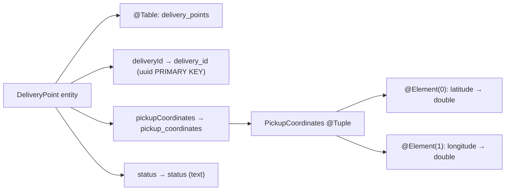

# Tuple với @Tuple và @Element

Apache Cassandra hỗ trợ kiểu dữ liệu **tuple** để lưu một nhóm giá trị **có thứ tự và có thể khác kiểu** trong cùng một cột. Chẳng hạn, một điểm giao hàng có hai tọa độ `(latitude, longitude)`; một khoảng thời gian có thể chứa `(start_time, end_time)`. Khi dùng **Spring Data Cassandra**, hai annotation **`@Tuple`** và **`@Element`** giúp ánh xạ một giá trị tuple CQL thành **một lớp Java có thuộc tính rõ nghĩa**, thay vì luôn thao tác thủ công với `TupleValue` của Java Driver.

Đây là bài học trong chương **Kiểu dữ liệu** của module **`SPRING_DATA_CASSANDRA`**. Module hướng đến việc truy cập Apache Cassandra qua entity mapping, repository, `CassandraTemplate` và truy vấn CQL; thiết kế bảng theo truy vấn, partition key, tính nhất quán, paging và kiểm soát hiệu năng trong hệ phân tán vẫn là những yếu tố cần xét ngay cả khi chọn một kiểu dữ liệu nhỏ như tuple.

Sau bài này, bạn có thể:

1. Viết đúng cú pháp CQL của `tuple<...>` và hiểu đặc tính **frozen ngầm định**.
2. Tạo lớp Java `@Tuple` với các thuộc tính `@Element(0)`, `@Element(1)`… theo đúng thứ tự.
3. Ánh xạ tuple thành một trường của entity `@Table`, đọc/ghi bằng repository hoặc `CassandraTemplate`.
4. Phân biệt mapped tuple với `TupleValue` của Java Driver và với user-defined type (UDT).
5. Xử lý null, thứ tự, thay đổi schema và chi phí cập nhật tuple mà không làm sai ý nghĩa dữ liệu.

## 1. Tuple trong CQL là gì?

**Tuple** là một dãy phần tử có vị trí cố định. Kiểu của từng vị trí được định nghĩa trong CQL schema, không lấy từ tên field Java.

```sql
-- Kiểu cột có hai phần tử, lần lượt là double và double:
pickup_coordinates tuple<double, double>

-- Kiểu cột có ba phần tử khác kiểu:
status_snapshot tuple<text, timestamp, int>
```

Một giá trị cụ thể của `tuple<double, double>` có thể là `(10.8231, 106.6297)`. Trong bài này, ta thống nhất:

- Phần tử thứ **0** là **vĩ độ** (`latitude`).
- Phần tử thứ **1** là **kinh độ** (`longitude`).

Đổi thứ tự hai phần tử khiến giá trị mang **nghĩa khác** dù CQL vẫn xem đó là hai số `double` hợp lệ. Đây là rủi ro chính của tuple: schema chỉ bảo đảm **kiểu và vị trí**, không lưu tên nghiệp vụ cho từng vị trí.

| Thuộc tính | Tuple CQL |
| --- | --- |
| Cách khai báo | `tuple<T1, T2, ..., Tn>` |
| Cách viết literal | `(value1, value2, ..., valueN)` |
| Kiểu phần tử | Có thể khác nhau ở từng vị trí |
| Tên phần tử trong schema | Không có; ý nghĩa do thứ tự quy định |
| Thứ tự | Cố định theo khai báo type |
| Cập nhật một phần tử | Không hỗ trợ cập nhật độc lập từng vị trí; cần ghi lại cả tuple |
| Trạng thái frozen | Tuple luôn có ngữ nghĩa frozen, không phải thêm `frozen<tuple<...>>` mới được xem như một giá trị nguyên khối |
| Phù hợp | Nhóm nhỏ, cố định, ít thay đổi cấu trúc, có ý nghĩa gắn liền |

### Ví dụ bảng CQL

Giả sử hệ thống ghi nhận tọa độ điểm lấy hàng:

```sql
CREATE TABLE IF NOT EXISTS delivery_points (
    delivery_id uuid PRIMARY KEY,
    pickup_coordinates tuple<double, double>,
    status text
);
```

Ở đây `delivery_id` là partition key, còn `pickup_coordinates` là **một cột mang giá trị tuple**. Các vị trí bên trong tuple **không phải clustering columns**, không được hash riêng để phân phối dữ liệu và không làm thay đổi token của `delivery_id`.

Thêm bản ghi:

```sql
INSERT INTO delivery_points (
    delivery_id, pickup_coordinates, status
) VALUES (
    8d21c0b9-62e4-4e61-9898-d6a7a0190c12,
    (10.8231, 106.6297),
    'CREATED'
);
```

Đọc một partition theo khóa:

```sql
SELECT delivery_id, pickup_coordinates, status
FROM delivery_points
WHERE delivery_id = 8d21c0b9-62e4-4e61-9898-d6a7a0190c12;
```

Kết quả `pickup_coordinates` là một giá trị tuple gồm hai số theo đúng thứ tự cột đã định nghĩa. Không nên giả định CQL cho phép truy vấn mọi phần tử bằng cú pháp kiểu `pickup_coordinates.latitude`: tuple **không có field name** để truy cập như UDT.

## 2. @Tuple và @Element có nhiệm vụ gì?

Spring Data Cassandra cung cấp hai annotation trong package `org.springframework.data.cassandra.core.mapping`:

```java
import org.springframework.data.cassandra.core.mapping.Tuple;
import org.springframework.data.cassandra.core.mapping.Element;
```

- **`@Tuple`** đặt trên lớp Java để chỉ ra đối tượng được ánh xạ đến một tuple CQL.
- **`@Element(index)`** đặt trên thuộc tính, accessor hoặc tham số constructor được hỗ trợ để chỉ ra vị trí phần tử trong tuple. Chỉ số **bắt đầu từ 0**, phải **duy nhất** và **liên tiếp**.

Ví dụ:

```java
@Tuple
public class PickupCoordinates {
    @Element(0)
    private Double latitude;

    @Element(1)
    private Double longitude;
}
```

Lớp Java này mô tả tuple `tuple<double, double>` theo thứ tự:

| Chỉ số tuple | CQL type | Java field | Annotation |
| ---: | --- | --- | --- |
| 0 | `double` | `latitude` | `@Element(0)` |
| 1 | `double` | `longitude` | `@Element(1)` |

**Tên thuộc tính Java không quyết định thứ tự**. Nếu bạn đổi vị trí khai báo hai field trong file Java nhưng giữ `@Element(0)` trên `latitude` và `@Element(1)` trên `longitude`, ý nghĩa mapping không đổi. Nếu bạn đảo chính các **chỉ số annotation**, dữ liệu được ghi/đọc theo thứ tự mới và có thể sai nghiệp vụ.

### Không phải @Element của thư viện khác

Một số hệ thống mapping khác cũng có annotation liên quan “element”. Với Spring Data Cassandra, dùng chính xác:

```java
import org.springframework.data.cassandra.core.mapping.Element;
```

Đừng nhầm `@Element` này với `@ElementCollection` của JPA hoặc các annotation dành cho tài liệu XML. `@Element(0)` không có ý nghĩa đặt tên cột CQL; nó chỉ gán **ordinal index** của phần tử trong tuple.

## 3. Ví dụ ánh xạ hoàn chỉnh từ CQL đến Java

Giả sử Spring Boot đã cấu hình `CqlSession` trỏ đến keyspace chứa bảng `delivery_points`. Entity chính lưu một trường kiểu tuple.

### 3.1. Lớp mapped tuple

```java
package example.delivery.data;

import org.springframework.data.cassandra.core.mapping.Element;
import org.springframework.data.cassandra.core.mapping.Tuple;

@Tuple
public class PickupCoordinates {

    @Element(0)
    private Double latitude;

    @Element(1)
    private Double longitude;

    public PickupCoordinates() {
    }

    public PickupCoordinates(Double latitude, Double longitude) {
        this.latitude = latitude;
        this.longitude = longitude;
    }

    public Double getLatitude() {
        return latitude;
    }

    public void setLatitude(Double latitude) {
        this.latitude = latitude;
    }

    public Double getLongitude() {
        return longitude;
    }

    public void setLongitude(Double longitude) {
        this.longitude = longitude;
    }
}
```

**Vì sao dùng `Double` thay vì `double`?** Kiểu wrapper cho phép biểu diễn phần tử thiếu/`null` nếu dữ liệu nguồn có trạng thái đó. Với tọa độ thực tế, ứng dụng nên xác thực **cả hai tọa độ phải có giá trị hợp lệ** trước khi ghi; khả năng biểu diễn null của Java không đồng nghĩa null hợp lệ về nghiệp vụ. Nếu đặt primitive `double`, không thể trực tiếp biểu diễn null và cần quy tắc chuyển đổi rõ ràng.

Đây là một **value object**: không có `@Table`, không có `@PrimaryKey` và cũng không tồn tại bảng `pickup_coordinates` riêng. Nó được lưu **bên trong một cột** của entity khác.

### 3.2. Lớp entity chứa tuple

```java
package example.delivery.data;

import java.util.UUID;
import org.springframework.data.cassandra.core.mapping.Column;
import org.springframework.data.cassandra.core.mapping.PrimaryKey;
import org.springframework.data.cassandra.core.mapping.Table;

@Table("delivery_points")
public class DeliveryPoint {

    @PrimaryKey("delivery_id")
    private UUID deliveryId;

    @Column("pickup_coordinates")
    private PickupCoordinates pickupCoordinates;

    @Column("status")
    private String status;

    public DeliveryPoint() {
    }

    public DeliveryPoint(
            UUID deliveryId,
            PickupCoordinates pickupCoordinates,
            String status) {
        this.deliveryId = deliveryId;
        this.pickupCoordinates = pickupCoordinates;
        this.status = status;
    }

    public UUID getDeliveryId() {
        return deliveryId;
    }

    public void setDeliveryId(UUID deliveryId) {
        this.deliveryId = deliveryId;
    }

    public PickupCoordinates getPickupCoordinates() {
        return pickupCoordinates;
    }

    public void setPickupCoordinates(PickupCoordinates pickupCoordinates) {
        this.pickupCoordinates = pickupCoordinates;
    }

    public String getStatus() {
        return status;
    }

    public void setStatus(String status) {
        this.status = status;
    }
}
```

Trong ví dụ:

1. `@Table("delivery_points")` ánh xạ **entity** sang bảng CQL.
2. `@PrimaryKey("delivery_id")` xác định property khóa ứng với cột `delivery_id`.
3. `@Column("pickup_coordinates")` xác định cột CQL có kiểu `tuple<double, double>`.
4. `@Tuple` và `@Element` bên trong `PickupCoordinates` ánh xạ các **phần tử của giá trị cột**, không ánh xạ thêm hai cột vật lý `latitude` và `longitude`.
5. `@Column("status")` là một cột CQL thông thường, độc lập với tuple.

### 3.3. Sơ đồ mapping



Điểm cần phân biệt: **một giá trị tuple có nhiều phần tử nhưng vẫn chỉ là một giá trị cột**, còn một primary key tổng hợp của bảng là tập các **cột khóa riêng**. Hai cấu trúc đều có “nhiều thành phần” nhưng phục vụ mục đích khác nhau.

## 4. Dùng repository đọc và ghi mapped tuple

Với `DeliveryPoint` đã ánh xạ, có thể khai báo repository:

```java
package example.delivery.data;

import java.util.UUID;
import org.springframework.data.cassandra.repository.CassandraRepository;

public interface DeliveryPointRepository
        extends CassandraRepository<DeliveryPoint, UUID> {
}
```

Ví dụ service sử dụng repository:

```java
import java.util.UUID;

UUID deliveryId =
        UUID.fromString("8d21c0b9-62e4-4e61-9898-d6a7a0190c12");

PickupCoordinates pickup =
        new PickupCoordinates(10.8231, 106.6297);

DeliveryPoint point =
        new DeliveryPoint(deliveryId, pickup, "CREATED");

repository.save(point);

DeliveryPoint loaded = repository.findById(deliveryId)
        .orElseThrow();

System.out.println(loaded.getPickupCoordinates().getLatitude());
System.out.println(loaded.getPickupCoordinates().getLongitude());
```

Ở đây Spring Data Cassandra dùng metadata `@Table` và `@Column` để xác định bảng/cột, sau đó dùng converter và `@Tuple`/`@Element` để chuyển giữa `PickupCoordinates` với giá trị tuple của driver.

**Điều kiện tiên quyết:** session kết nối đúng keyspace, bảng đã tồn tại, entity và repository được Spring quản lý, và kiểu CQL đúng `tuple<double, double>`. Annotation mapping không đảm bảo tự tạo/migrate schema nếu ứng dụng chưa cấu hình quy trình schema phù hợp.

Nếu trường `pickupCoordinates` là null, thao tác save/update có thể có ngữ nghĩa ghi giá trị null hoặc bỏ qua tùy API và tùy chọn ghi; đừng xem đây là cách cập nhật một phần tử tuple. Khi cần xóa tuple một cách có chủ đích, hãy xác định thao tác CQL tương ứng và ảnh hưởng tombstone thay vì trông chờ hành vi null mặc định của mọi API.

## 5. Dùng CassandraTemplate và query theo partition key

`CassandraTemplate` cũng sử dụng cùng metadata mapping nếu bạn truy vấn theo entity class:

```java
import java.util.UUID;
import org.springframework.data.cassandra.core.CassandraTemplate;
import org.springframework.data.cassandra.core.query.Criteria;
import org.springframework.data.cassandra.core.query.Query;

UUID id =
        UUID.fromString("8d21c0b9-62e4-4e61-9898-d6a7a0190c12");

Query byId = Query.query(Criteria.where("delivery_id").is(id));

DeliveryPoint point =
        cassandraTemplate.selectOne(byId, DeliveryPoint.class);

if (point != null && point.getPickupCoordinates() != null) {
    Double latitude = point.getPickupCoordinates().getLatitude();
    Double longitude = point.getPickupCoordinates().getLongitude();
}
```

Đây là ví dụ **đọc theo đầy đủ partition key `delivery_id`**, phù hợp bảng `delivery_points`. Nếu hệ thống cần tra cứu theo bán kính tọa độ, biểu diễn tọa độ bằng tuple **không tự tạo index địa lý** hoặc cho phép Cassandra thực thi truy vấn không có partition key một cách hiệu quả. Truy vấn đó cần thiết kế dữ liệu/index/dịch vụ phù hợp riêng.

### 5.1. Cập nhật toàn bộ tuple qua CQL

Khi thay đổi địa điểm lấy hàng:

```sql
UPDATE delivery_points
SET pickup_coordinates = (10.8250, 106.6301)
WHERE delivery_id = 8d21c0b9-62e4-4e61-9898-d6a7a0190c12;
```

Tương tự trong Java, tạo một `PickupCoordinates` mới đầy đủ hai vị trí rồi lưu cập nhật theo API và semantics thích hợp của dự án. Ví dụ có chủ đích ghi **chỉ cột tuple** qua `CassandraTemplate` có thể xây `Update` theo tên cột:

```java
import org.springframework.data.cassandra.core.query.Criteria;
import org.springframework.data.cassandra.core.query.Query;
import org.springframework.data.cassandra.core.query.Update;

Query byId = Query.query(Criteria.where("delivery_id").is(deliveryId));
Update change = Update.update(
        "pickup_coordinates", new PickupCoordinates(10.8250, 106.6301));

cassandraTemplate.update(byId, change, DeliveryPoint.class);
```

Đoạn ví dụ dùng converter của Spring Data Cassandra để ánh xạ đối tượng tuple khi tạo update. Với ứng dụng cụ thể, hãy kiểm tra API và custom conversion đang được dùng theo phiên bản Spring Data, cũng như hành vi null/TTL/write timestamp. Cập nhật cả cột tuple là yêu cầu của CQL; không có thao tác CQL phổ quát kiểu `SET pickup_coordinates[0] = ...` để thay riêng vĩ độ.

## 6. Tuple luôn có ngữ nghĩa frozen

Đối với Cassandra, tuple là một **giá trị tổng hợp bất biến theo từng lần ghi**: muốn thay một thành phần, bạn ghi lại **toàn bộ giá trị tuple**. Khác với một số collection hoặc UDT có thể hỗ trợ các thao tác cập nhật thành phần tùy cách khai báo, tuple luôn có ngữ nghĩa frozen.

Ví dụ giá trị hiện tại:

```text
pickup_coordinates = (10.8231, 106.6297)
```

Muốn đổi vĩ độ thành `10.8250` và giữ nguyên kinh độ, phải ghi:

```sql
UPDATE delivery_points
SET pickup_coordinates = (10.8250, 106.6297)
WHERE delivery_id = 8d21c0b9-62e4-4e61-9898-d6a7a0190c12;
```

**Không thể** giả định rằng Cassandra hỗ trợ:

```sql
-- Sai ý tưởng: tuple không cho cập nhật từng phần tử theo chỉ số.
-- UPDATE delivery_points
-- SET pickup_coordinates[0] = 10.8250
-- WHERE delivery_id = ...;
```

### Tác động khi có hai writer cùng sửa

Giả sử bản ghi tuple đang là `(10.8231, 106.6297)`:

1. Request A đọc tuple, muốn đổi vĩ độ.
2. Request B đọc tuple cũ, muốn đổi kinh độ.
3. A ghi cả tuple mới `(10.8250, 106.6297)`.
4. B ghi cả tuple `(10.8231, 106.6400)` dựa trên dữ liệu đọc cũ.

Theo cơ chế hòa giải write timestamp của Cassandra, giá trị ghi cuối cùng được chấp nhận theo timestamp/rules có thể che thay đổi của request còn lại. Tuple **không có merge từng field**. Nếu cần tránh mất cập nhật, hãy thiết kế bảo đảm nghiệp vụ bằng cơ chế phù hợp (ví dụ lightweight transaction với điều kiện `IF` khi đáp ứng mô hình, hoặc tuần tự hóa cập nhật ở tầng ứng dụng), và đánh giá chi phí của các lựa chọn đó.

Tuple phù hợp cho dữ liệu vốn **được tạo, đọc và thay thế như một đơn vị**. Nếu hai thuộc tính thường xuyên bị sửa độc lập, nhiều khi nên cân nhắc hai cột thông thường hoặc một mô hình khác ngay khi thiết kế bảng.

## 7. Null, số phần tử và thứ tự phải nhất quán

### 7.1. Số vị trí cố định

CQL type `tuple<double, double>` có **hai vị trí**. Khi viết tuple literal, phải cung cấp số giá trị tương ứng, kể cả khi một phần tử là `null`:

```sql
-- Đúng về cú pháp kiểu: hai vị trí.
UPDATE delivery_points
SET pickup_coordinates = (null, 106.6297)
WHERE delivery_id = 8d21c0b9-62e4-4e61-9898-d6a7a0190c12;
```

Cú pháp trên minh họa khả năng có null trong tuple, **không phải giá trị tọa độ nên dùng trong production**. Hãy kiểm tra cả vĩ độ và kinh độ trước khi ghi nếu nghiệp vụ yêu cầu một cặp tọa độ đầy đủ.

### 7.2. Chỉ số @Element duy nhất và liên tiếp

Đúng:

```java
@Tuple
public class GeoPoint {
    @Element(0) private Double latitude;
    @Element(1) private Double longitude;
}
```

Không đúng:

```java
@Tuple
public class BrokenGeoPoint {
    @Element(0) private Double latitude;
    @Element(2) private Double longitude; // Bỏ trống index 1.
}
```

Các chỉ số bắt đầu từ 0 và liên tiếp; không được trùng lặp chỉ số cho các field khác nhau. Spring Data dùng chỉ số đó để ánh xạ vào thứ tự CQL. Nếu mapping không khớp schema, việc đọc/ghi có thể thất bại hoặc trả dữ liệu sai nghĩa.

### 7.3. Primitive và wrapper

| Java | CQL | Khi nào phù hợp? |
| --- | --- | --- |
| `Double` | `double` | Phần tử có thể null; cần validation trước khi dùng |
| `double` | `double` | Bảo đảm không có null trên dữ liệu thực; cần thận trọng khi đọc dữ liệu cũ |
| `Integer` | `int` | Tương tự, có thể null |
| `String` | `text` | Nhãn hoặc mã kiểu text |
| `Instant` | `timestamp` | Giá trị thời điểm tuyệt đối |

Không dùng giá trị **0** làm mặc định cho phần tử không biết nếu `0` là giá trị hợp lệ. Với tọa độ, cần xác thực biên: vĩ độ từ **-90 đến 90**, kinh độ từ **-180 đến 180**, loại bỏ `NaN` hoặc vô cực trong luồng dữ liệu trước khi ghi.

## 8. @CassandraType khi cần chỉ định kiểu CQL rõ ràng

Spring Data Cassandra thường suy ra kiểu CQL từ khai báo Java. Khi cần chỉ định rõ kiểu, có thể kết hợp `@CassandraType` với `@Element`. Tài liệu Spring Data có ví dụ mapped tuple chứa `@CassandraType` trên field:

```java
import org.springframework.data.cassandra.core.mapping.CassandraType;
import org.springframework.data.cassandra.core.mapping.Element;
import org.springframework.data.cassandra.core.mapping.Tuple;

@Tuple
public class StatusSnapshot {
    @Element(0)
    @CassandraType(type = CassandraType.Name.VARCHAR)
    private String status;

    @Element(1)
    private Instant observedAt;

    @Element(2)
    private Integer revision;

    // Constructor, getters/setters hoặc cơ chế tạo object phù hợp.
}
```

Kiểu CQL tương ứng cho ví dụ này có thể là:

```sql
status_snapshot tuple<text, timestamp, int>
```

Trong CQL, `text` và `varchar` là những tên kiểu chuỗi tương thích; `@CassandraType` còn hữu ích với những kiểu cần xác định tường minh hoặc khi custom conversion. Nếu dùng nhiều converter, đừng đoán kiểu từ tên Java mà hãy xác nhận metadata schema, thứ tự phần tử và khả năng serialize/deserialize của phiên bản Spring Data/driver đang dùng.

## 9. Mapped tuple khác TupleValue của Java Driver thế nào?

Java Driver cung cấp `TupleValue`, là biểu diễn ở mức driver của giá trị tuple. Nó cho phép truy cập theo **chỉ số** mà không cần tạo một domain class. Spring Data Cassandra cung cấp mapped tuple để code nghiệp vụ làm việc bằng **tên thuộc tính Java**.

| Tiêu chí | `@Tuple` + `@Element` | `TupleValue` |
| --- | --- | --- |
| Mức trừu tượng | Domain/value object | Driver data type |
| Cách đọc phần tử | `coordinates.getLatitude()` | `tupleValue.getDouble(0)` |
| Nơi thích hợp | Entity/repository/template của Spring Data | CQL trực tiếp, truy vấn chẩn đoán, mapping tùy biến |
| Rủi ro | Sai ordinal ở annotation; constructor/converter không tương thích | Nhầm index hoặc CQL type khi thao tác trực tiếp |
| Nhu cầu converter | Spring Data chuyển giữa object và driver value | Code tự đọc/ghi theo API driver |

Ví dụ truy vấn trực tiếp:

```java
import com.datastax.oss.driver.api.core.CqlSession;
import com.datastax.oss.driver.api.core.cql.Row;
import com.datastax.oss.driver.api.core.data.TupleValue;

Row row = session.execute(
        "SELECT pickup_coordinates FROM delivery_points " +
        "WHERE delivery_id = 8d21c0b9-62e4-4e61-9898-d6a7a0190c12"
).one();

if (row != null) {
    TupleValue value = row.getTupleValue("pickup_coordinates");
    if (value != null) {
        double latitude = value.getDouble(0);
        double longitude = value.getDouble(1);
    }
}
```

Đây là ví dụ mã tập trung vào đọc giá trị. Trong production, dùng prepared statement và bind `delivery_id`, thay vì lắp chuỗi CQL từ dữ liệu đầu vào.

Nếu phần tử có thể null, cần gọi API kiểm tra null (ví dụ `value.isNull(0)`) trước khi dùng getter kiểu primitive. Nếu không, cách đọc có thể thất bại hoặc xử lý sai giá trị thiếu. Mapped tuple cũng cần validation tương tự ở domain layer.

## 10. Phân biệt tuple, UDT, collection và các cột độc lập

Tuple không phải cách gom mọi dữ liệu có quan hệ thành một cột. Hãy so sánh:

| Phương án | Ví dụ | Lợi thế | Giới hạn |
| --- | --- | --- | --- |
| **Tuple** | `tuple<double, double>` | Gọn; biểu diễn một nhóm nhỏ có thứ tự cố định | Không có tên field trong CQL; thay đổi schema khó; ghi lại cả giá trị |
| **UDT** | `address_type` với `street`, `city` | Cấu trúc có **tên trường**; dễ tự mô tả hơn | Cần `CREATE TYPE`/quản lý schema; hành vi cập nhật còn phụ thuộc frozen |
| **Collection** | `list<text>`, `set<uuid>`, `map<text, int>` | Nhiều phần tử có cùng dạng hoặc quan hệ key/value | Không thay tuple nhiều kiểu có số vị trí cố định; có chi phí kích thước và thao tác riêng |
| **Các cột riêng** | `latitude double, longitude double` | Có thể đọc và cập nhật theo cột, dễ dùng một số chiến lược truy vấn | Không được đóng gói thành một value object vật lý duy nhất |
| **Bảng được thiết kế theo truy vấn** | `deliveries_by_region` | Hỗ trợ các hướng truy vấn/partition key khác | Cần đồng bộ dữ liệu và vận hành thêm bảng |

### Ví dụ UDT để thấy khác biệt

```sql
CREATE TYPE address_type (
    street text,
    city text
);

-- Cột UDT là một kiểu khác với tuple<text, text>.
-- Tùy thiết kế có thể khai báo cột frozen<address_type>.
```

Một UDT định nghĩa trường bằng tên `street` và `city`, còn `tuple<text, text>` chỉ biết phần tử 0 và 1. Nếu schema dễ mở rộng hoặc cần truyền nhiều trường nghiệp vụ tự mô tả, UDT thường phù hợp hơn tuple.

### Khi nào tuple là lựa chọn hợp lý?

Tuple phù hợp khi **mọi phần tử luôn đi cùng nhau** và cấu trúc ít thay đổi: cặp tọa độ, một khoảng thời gian gồm hai mốc, hoặc cặp đơn vị/giá trị có định dạng cố định. Tránh dùng tuple như một cách nhét nhiều trường vào cột rồi kỳ vọng query linh hoạt theo từng trường.

## 11. Thay đổi schema tuple cần kế hoạch migration

Giả sử ban đầu:

```sql
pickup_coordinates tuple<double, double>
```

Sau đó ứng dụng muốn thêm **độ cao** thành phần tử thứ 2:

```sql
pickup_coordinates tuple<double, double, double>
```

Đây là **một kiểu tuple khác** so với type ban đầu. Không thể giả định chỉ thêm `@Element(2)` vào lớp Java là Cassandra sẽ tự đổi CQL schema hoặc tự bổ sung phần tử vào dữ liệu đã lưu.

Phương án chuyển đổi thường cần:

1. Định nghĩa schema mới tương thích, chẳng hạn tạo cột `pickup_coordinates_v2 tuple<double, double, double>` hoặc bảng mới theo kế hoạch.
2. Xây `@Tuple` tương ứng với đủ ba ordinal `0`, `1`, `2`.
3. Xác định giá trị mặc định/cách suy ra phần tử mới từ dữ liệu cũ.
4. Backfill có giới hạn tải, đọc/ghi song song trong giai đoạn chuyển đổi khi cần.
5. Kiểm thử ứng dụng đọc cả dữ liệu cũ/mới, kiểm tra TTL, write timestamp, tombstone và consistency trước khi ngừng dùng kiểu cũ.

Thay đổi schema Cassandra phải được chuẩn bị trong quy trình migration của hệ thống. Việc đổi Java class **không tự chuyển các byte tuple đã được ghi trên SSTable**. Cũng không nên dựa vào việc `ALTER TABLE` có thể đổi tùy ý kiểu một cột đang có dữ liệu.

## 12. Thiết kế bảng theo truy vấn: tuple không thay partition key

Trong ví dụ `delivery_points`:

```sql
PRIMARY KEY (delivery_id)
```

Cassandra dùng `delivery_id` để xác định partition và các replica. `pickup_coordinates` là dữ liệu **bên trong partition**; nó không giúp Cassandra tìm tất cả delivery gần một tọa độ. Các câu hỏi như:

- “Lấy chi tiết delivery theo ID” phù hợp bảng `delivery_points`.
- “Lấy 30 delivery mới nhất trong một khu vực” có thể đòi hỏi **bảng riêng theo region/time bucket** với partition key được thiết kế từ hướng truy vấn.
- “Tìm các delivery trong bán kính 3 km” cần xem xét chiến lược chỉ mục/truy vấn địa lý phù hợp thay vì chỉ vì cột là tuple mà dùng `ALLOW FILTERING`.

Khi dùng repository hoặc `CassandraTemplate`, hãy kiểm tra từng truy vấn CQL sinh ra có **đủ partition key** không. Việc mapping `@Tuple` đúng sẽ bảo đảm giá trị cột được chuyển đổi đúng; nó không bảo đảm truy vấn có hiệu năng tốt nếu mô hình dữ liệu bị lệch.

### Consistency và paging

Tuple không thay đổi cách chọn **consistency level**. Với RF và topology nhất định, các mức như `LOCAL_QUORUM` vẫn được áp dụng theo quy tắc replica như với các cột khác. Khi paging danh sách hàng, paging state gắn với **câu truy vấn các hàng**, không phải với từng phần tử của một tuple. Không nên nhầm việc đọc tuple có hai phần tử với việc phân trang hai bản ghi.

### Hiệu năng và dung lượng

Một tuple lớn bị ghi lại thường xuyên có thể tăng write amplification, chi phí I/O và lượng phiên bản dữ liệu cần compaction. Tuple **nhỏ, ổn định** thường là lựa chọn hợp lý hơn tuple chứa hàng chục hoặc hàng trăm phần tử thay đổi độc lập.

Nếu mỗi lần chỉ đổi một thuộc tính, cân nhắc chuyển các giá trị thành cột riêng/UDT được thiết kế đúng hoặc điều chỉnh model. Quan sát partition size, tỷ lệ update/delete, compaction backlog, latency p95/p99 và tải replica; không đánh giá hiệu năng chỉ từ kích thước Java object.

## 13. Lỗi thường gặp khi dùng @Tuple và @Element

| Triệu chứng | Nguyên nhân thường gặp | Hướng kiểm tra |
| --- | --- | --- |
| Giá trị vĩ độ/kinh độ bị đảo | `@Element(0)` và `@Element(1)` gắn sai field | Đối chiếu thứ tự với CQL tuple type và sample data |
| Converter báo lỗi mapping | Field Java không khớp CQL type/ordinal hoặc constructor/property không ánh xạ được | Xem schema, package annotation và conversion config |
| Hai field cùng `@Element(0)` | Ordinal bị trùng | Dùng index duy nhất, liên tiếp từ 0 |
| Có `@Element(0)` và `@Element(2)` | Bỏ trống index 1 | Sửa index theo schema, không bỏ khoảng |
| Khi ghi tuple mới mất cập nhật của writer khác | Tuple ghi lại toàn bộ giá trị | Kiểm soát cạnh tranh ghi, xem xét CAS/LWT hoặc thiết kế cột khác |
| Đọc trực tiếp bị lỗi khi phần tử null | Gọi getter primitive của `TupleValue` khi giá trị thiếu | Kiểm tra `isNull(index)` và validate domain |
| Entity không ánh xạ tuple | Import nhầm annotation hoặc field entity không đúng type/mapping | Kiểm tra `@Tuple`, `@Column`, conversion setup |
| Đổi Java class ba field nhưng dữ liệu cũ không đọc đúng | Schema CQL vẫn là tuple hai phần tử | Lập migration/versioned column, test dữ liệu cũ |
| Truy vấn theo latitude/longitude bị chậm | Tuple không tạo partition/index địa lý | Thiết kế bảng/index theo query shape, tránh quét rộng |
| Dữ liệu lưu đúng nhưng giá trị nghiệp vụ sai | Hai phần tử cùng kiểu nên Cassandra không thể phát hiện đảo nghĩa | Test round-trip và validation cả hai chiều |

### Chẩn đoán theo thứ tự

1. Xác minh schema CQL có đúng `tuple<T1, ..., Tn>` với số lượng và thứ tự kiểu dự kiến.
2. Kiểm tra import `@Tuple` và `@Element` từ Spring Data Cassandra.
3. Kiểm tra index liên tiếp `0..n-1`, Java type và các converter nếu có.
4. Đọc một hàng bằng CQL rồi so kết quả qua repository/template.
5. Nếu chỉ đường Spring thất bại, soát constructor/getter/setter, naming mapping và phiên bản thư viện.
6. Nếu chỉ xảy ra lúc cao điểm, xem lại các update nguyên tuple, concurrency, kích thước partition và tải replica.

## 14. Bài thực hành: ghi, đọc và cập nhật tọa độ

**Bước 1 — Tạo bảng** (trong keyspace thực hành đã chọn):

```sql
CREATE TABLE IF NOT EXISTS delivery_points (
    delivery_id uuid PRIMARY KEY,
    pickup_coordinates tuple<double, double>,
    status text
);
```

**Bước 2 — Ghi tuple bằng CQL:**

```sql
INSERT INTO delivery_points (
    delivery_id, pickup_coordinates, status
) VALUES (
    8d21c0b9-62e4-4e61-9898-d6a7a0190c12,
    (10.8231, 106.6297),
    'CREATED'
);
```

**Bước 3 — Đọc lại và xác nhận thứ tự:**

```sql
SELECT pickup_coordinates
FROM delivery_points
WHERE delivery_id = 8d21c0b9-62e4-4e61-9898-d6a7a0190c12;
```

Kết quả mong đợi là `(10.8231, 106.6297)`, phần tử 0 là vĩ độ và phần tử 1 là kinh độ.

**Bước 4 — Dùng mapped tuple với repository:**

```java
UUID id = UUID.fromString("8d21c0b9-62e4-4e61-9898-d6a7a0190c12");
PickupCoordinates coordinates =
        new PickupCoordinates(10.8231, 106.6297);

repository.save(new DeliveryPoint(id, coordinates, "CREATED"));

DeliveryPoint result = repository.findById(id).orElseThrow();
System.out.println(result.getPickupCoordinates().getLatitude());
```

**Bước 5 — Thay toàn bộ tuple và đọc lại:**

```sql
UPDATE delivery_points
SET pickup_coordinates = (10.8250, 106.6301)
WHERE delivery_id = 8d21c0b9-62e4-4e61-9898-d6a7a0190c12;
```

Quan sát rằng API đọc trả về hai giá trị mới; không có bước chỉ cập nhật riêng phần tử 0 bằng cách đánh index trong CQL.

**Bước 6 — Thử lỗi có kiểm soát:** trong một lớp thử nghiệm riêng, cố tình đảo hai ordinal `@Element` và so kết quả round-trip. Cả hai phần tử đều là `double` nên chương trình có thể không ném lỗi kiểu, nhưng **tọa độ bị đảo về mặt ngữ nghĩa**. Hoàn nguyên mapping và thêm kiểm tra giá trị kỳ vọng.

## 15. Tự kiểm tra

**Câu 1.** Với `tuple<double, double>`, lớp `@Tuple` có `@Element(0) latitude` và `@Element(1) longitude`. Đổi thứ tự khai báo field trong mã Java nhưng giữ annotation có làm đổi mapping không?

<details>
<summary>Gợi ý trả lời</summary>

Không. Mapping phụ thuộc **ordinal trong `@Element`**, không phụ thuộc thứ tự xuất hiện của field trong file Java. Đảo chỉ số annotation mới làm đổi thứ tự ý nghĩa.
</details>

**Câu 2.** Có thể dùng `UPDATE ... SET pickup_coordinates[0] = 11.0` để chỉ đổi vĩ độ không?

<details>
<summary>Gợi ý trả lời</summary>

Không. Tuple có ngữ nghĩa frozen, cần cập nhật **toàn bộ** cột tuple bằng một giá trị mới đủ phần tử, ví dụ `(11.0, 106.6297)`.
</details>

**Câu 3.** Hai request cùng đọc một tuple cũ; request A đổi phần tử đầu, B đổi phần tử sau. Rủi ro nào có thể xảy ra?

<details>
<summary>Gợi ý trả lời</summary>

Vì mỗi request ghi lại cả tuple, một giá trị mới có thể che giá trị của request còn lại theo cơ chế xử lý timestamp/xung đột. Cần kiểm soát cập nhật đồng thời hoặc mô hình dữ liệu phù hợp hơn.
</details>

**Câu 4.** Vì sao một lớp `@Tuple` không cần `@Table`?

<details>
<summary>Gợi ý trả lời</summary>

Vì lớp `@Tuple` ánh xạ một **giá trị của cột tuple**, còn `@Table` ánh xạ một entity/hàng đến bảng CQL. Lớp tuple không phải bảng riêng.
</details>

**Câu 5.** Nếu muốn thêm phần tử altitude vào tuple đã lưu hai giá trị, chỉ thêm `@Element(2)` trong Java có đủ không?

<details>
<summary>Gợi ý trả lời</summary>

Không. CQL type phải tương thích; dữ liệu cũ không tự đổi định dạng. Cần kế hoạch schema migration/phiên bản cột mới, backfill và tương thích đọc ghi.
</details>

**Câu 6.** Một repository ánh xạ tuple tọa độ đúng nhưng truy vấn “tìm mọi điểm trong bán kính 2 km” rất chậm. Annotation nào cần thêm?

<details>
<summary>Gợi ý trả lời</summary>

Không có annotation tuple nào tự tạo đường truy vấn địa lý. Cần thiết kế partition/index/dịch vụ truy vấn theo yêu cầu, không dựa vào `@Tuple` hoặc quét `ALLOW FILTERING` để tìm trên toàn bộ cluster.
</details>

## 16. Ghi nhớ khi dùng Spring Data Cassandra

- **Tuple CQL** là một dãy **có kiểu và có thứ tự cố định**, ví dụ `tuple<double, double>`; các phần tử không có tên trong schema.
- **`@Tuple`** đánh dấu Java value object; **`@Element(index)`** ánh xạ từng field vào **ordinal từ 0, duy nhất và liên tiếp**.
- **`@Table` và `@Column`** xác định bảng/cột của entity; **`@Tuple` không tạo bảng riêng** và không thay đổi partition key.
- Tuple luôn có **ngữ nghĩa frozen**: muốn sửa một thành phần phải ghi lại **toàn bộ tuple**, cần lưu ý concurrency.
- Kiểm tra **null, kiểu dữ liệu và thứ tự**; hai vị trí cùng kiểu có thể bị đảo mà không gây lỗi serialization.
- **Mapped tuple** giúp dùng thuộc tính Java có tên; **`TupleValue`** phù hợp khi thao tác trực tiếp qua Java Driver.
- Khi cần thay đổi schema hoặc truy vấn theo phần tử, hãy cân nhắc **UDT, các cột riêng hoặc bảng theo truy vấn** thay vì cố kéo dài một tuple vốn nên nhỏ và ổn định.
- Dù dùng repository, `CassandraTemplate` hay CQL trực tiếp, vẫn phải thiết kế **partition key, consistency, paging và hiệu năng** theo mô hình phân tán của Cassandra.

### Tài liệu tham khảo

- [Spring Data Cassandra – Object Mapping: Mapped Tuple](https://docs.spring.io/spring-data/cassandra/reference/object-mapping.html)
- [Spring Data Cassandra – API `@Tuple`](https://docs.spring.io/spring-data/cassandra/docs/4.5.x/api/org/springframework/data/cassandra/core/mapping/Tuple.html)
- [Spring Data Cassandra – API `@Element`](https://docs.spring.io/spring-data/cassandra/docs/4.5.x/api/org/springframework/data/cassandra/core/mapping/Element.html)
- [Spring Data Cassandra – CassandraTemplate](https://docs.spring.io/spring-data/cassandra/reference/cassandra/template.html)
- [Apache Cassandra – CQL Data Types: Tuples](https://cassandra.apache.org/doc/stable/cassandra/developing/cql/types.html)
