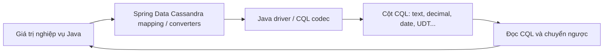

# Enum, kiểu giá trị nghiệp vụ và biểu diễn lưu trữ trong Spring Data Cassandra

Trong mô hình nghiệp vụ Java, chúng ta thường dùng `enum`, `Money`, `CurrencyCode`, `OrderStatus` hoặc `ShippingAddress` để diễn đạt dữ liệu có ý nghĩa. Nhưng **Apache Cassandra không có kiểu CQL `ENUM` riêng** và không tự hiểu các bất biến của những kiểu Java này. Trước khi Spring Data Cassandra ghi một entity, mỗi giá trị nghiệp vụ phải được chuyển thành **biểu diễn lưu trữ phù hợp schema CQL**.

Bài thuộc chương **Kiểu dữ liệu** của module **SPRING_DATA_CASSANDRA**. Trọng tâm là cách chọn kiểu CQL cho enum và value object, chuyển đổi dữ liệu bằng Spring Data, bảo đảm tương thích khi nghiệp vụ thay đổi và tránh để lựa chọn kiểu dữ liệu làm hỏng truy vấn theo partition key. Ví dụ áp dụng cho Java 17+, Spring Data Cassandra hiện đại và Apache Cassandra thông dụng; chi tiết API có thể thay đổi giữa các phiên bản.

## 1. Từ mô hình nghiệp vụ đến dữ liệu được Cassandra lưu

Một hệ thống đơn hàng có các khái niệm:

- **Trạng thái**: `PENDING`, `PAID`, `CANCELLED` là tập giá trị có tên, thích hợp cho `enum` trong Java.
- **Số tiền**: giá trị thập phân chính xác, không nên dùng `double` để đại diện tiền tệ.
- **Đơn vị tiền**: mã như `VND` hoặc `USD`, cần kiểm tra tính hợp lệ.
- **Địa chỉ giao hàng**: nhóm trường có quan hệ với nhau, có thể đặt trong nhiều cột hoặc một user-defined type (UDT).

Luồng dữ liệu khi dùng `CassandraRepository` hay `CassandraTemplate`:



Bốn quyết định cần tách biệt:

| Quyết định | Ví dụ | Ảnh hưởng |
| --- | --- | --- |
| Kiểu Java | `OrderStatus`, `CurrencyCode`, `BigDecimal` | Tính rõ ràng và bất biến ở tầng nghiệp vụ. |
| Biểu diễn CQL | `text`, `int`, `decimal`, `frozen<shipping_address>` | Khả năng tương thích và giới hạn do Cassandra áp dụng. |
| Cách chuyển đổi | Converter hoặc ánh xạ UDT | Ghi/đọc hai chiều, xử lý giá trị không nhận diện được. |
| Mô hình bảng | `orders_by_id`, `orders_by_status_day` | Truy vấn nào hiệu quả, partition nào bị nóng, cách paging. |

Một bộ converter tốt không thể sửa một schema có partition key sai. Ngược lại, chọn partition key đúng không bảo đảm enum hoặc số tiền được chuyển đổi đúng khi Java và CQL có kiểu khác nhau.

## 2. CQL không có ENUM: chọn `text` hay `int`?

Giả sử Java định nghĩa:

```java
public enum OrderStatus {
    PENDING,
    PAID,
    CANCELLED
}
```

Ta có thể lưu trạng thái bằng nhiều cách:

| Biểu diễn CQL | Ví dụ lưu | Ưu điểm | Rủi ro |
| --- | --- | --- | --- |
| `text` hoặc `varchar` chứa tên Java enum | `"PENDING"`, `"PAID"` | Dễ đọc, dễ quan sát CQL. | Đổi tên hằng enum có thể làm dữ liệu cũ không ánh xạ được. |
| `text` chứa mã nghiệp vụ ổn định | `"pending"`, `"paid"` | Tách mã lưu trữ khỏi tên trong source; phù hợp hệ thống có nhiều client. | Cần quy tắc mapping và quản lý mã. |
| `int` chứa mã nghiệp vụ định trước | `10`, `20`, `30` | Biểu diễn ngắn, có thể dùng khi hợp đồng dữ liệu định nghĩa mã số. | Khó đọc trực tiếp; không được nhầm với ordinal của enum. |
| `int` chứa `ordinal()` | `0`, `1`, `2` | Ít code ban đầu. | **Rất dễ sai:** sắp xếp/chèn enum làm thay đổi nghĩa của số đã lưu. |

Đặc biệt, không nên lưu `OrderStatus.ordinal()`. Nếu mã `1` ban đầu là `PAID`, nhưng sau đó lập trình viên chèn thêm một enum ở vị trí trước nó, dữ liệu cũ có thể bị hiểu thành trạng thái khác mà không có lỗi cú pháp.

Cassandra **không tự giới hạn** nội dung của cột `text` theo tập giá trị trong enum Java. Một client CQL khác vẫn có thể ghi `"refunded_later"` hay `"Piad"` nếu có quyền `MODIFY`. Cần kiểm tra hợp lệ ở tầng ứng dụng và quản lý hợp đồng dữ liệu giữa các client.

### Khuyến nghị mặc định

Đối với trường trạng thái nghiệp vụ có thể thay đổi theo thời gian, hãy cân nhắc **`text` chứa một mã ổn định** như `"pending"` hoặc `"paid"`. Mã là hợp đồng dữ liệu; tên hằng Java chỉ là chi tiết triển khai. Khi hệ thống đã quy định mã `int` ổn định và các bên cùng tuân thủ, `int` vẫn hợp lệ.

## 3. Thiết kế enum với mã lưu trữ ổn định

Không để tên `enum.name()` vô tình trở thành giao thức lưu trữ nếu nghiệp vụ muốn quyền đổi tên hằng trong Java.

```java
import java.util.Arrays;

public enum OrderStatus {
    PENDING("pending"),
    PAID("paid"),
    CANCELLED("cancelled");

    private final String storageCode;

    OrderStatus(String storageCode) {
        this.storageCode = storageCode;
    }

    public String storageCode() {
        return storageCode;
    }

    public static OrderStatus fromStorageCode(String code) {
        return Arrays.stream(values())
            .filter(status -> status.storageCode.equals(code))
            .findFirst()
            .orElseThrow(() -> new IllegalArgumentException(
                "Unknown order status code: " + code));
    }
}
```

Ở đây:

- `PENDING` là tên hằng dành cho Java; `"pending"` là biểu diễn được ghi trong Cassandra.
- Có thể đổi tên hằng Java trong một lần refactor mà vẫn giữ nguyên `storageCode` và dữ liệu đã lưu.
- `fromStorageCode` xử lý chiều đọc và **báo lỗi có chủ đích** khi gặp mã lạ, thay vì âm thầm gán sang một trạng thái sai.

Ví dụ bảng:

```sql
-- Giả sử keyspace commerce đã tồn tại.
CREATE TABLE commerce.orders_by_id (
    order_id uuid PRIMARY KEY,
    customer_id uuid,
    status text,
    total_amount decimal,
    currency_code text,
    created_at timestamp
);

INSERT INTO commerce.orders_by_id (
    order_id, customer_id, status, total_amount,
    currency_code, created_at
) VALUES (
    11111111-1111-1111-1111-111111111111,
    22222222-2222-2222-2222-222222222222,
    'pending',
    125000.00,
    'VND',
    '2026-11-25T09:00:00Z'
);
```

Trong CQL, `status` là `text` còn giá trị `'pending'` là string literal. Cột `total_amount` dùng `decimal` để lưu thập phân với độ chính xác không cố định kiểu số thực dấu phẩy động. `currency_code` là cột riêng, vì **một số tiền không xác định đầy đủ nếu thiếu đơn vị tiền tệ**.

## 4. Mapping enum bằng Spring Data Cassandra

Trong ứng dụng Spring Data Cassandra, ta có thể chủ động chuyển `OrderStatus` thành `String` khi ghi, và đổi ngược khi đọc. Cách này tránh phụ thuộc vào hành vi mặc định của từng phiên bản mapping framework khi hợp đồng lưu trữ đòi hỏi mã ổn định.

### 4.1. Converter cho hai chiều

```java
import org.springframework.core.convert.converter.Converter;
import org.springframework.data.convert.WritingConverter;

@WritingConverter
public final class OrderStatusWriteConverter
        implements Converter<OrderStatus, String> {

    @Override
    public String convert(OrderStatus source) {
        return source.storageCode();
    }
}
```

```java
import org.springframework.core.convert.converter.Converter;
import org.springframework.data.convert.ReadingConverter;

@ReadingConverter
public final class OrderStatusReadConverter
        implements Converter<String, OrderStatus> {

    @Override
    public OrderStatus convert(String source) {
        return OrderStatus.fromStorageCode(source);
    }
}
```

`@WritingConverter` và `@ReadingConverter` chỉ rõ hướng chuyển đổi, giúp Spring Data không nhầm một converter đọc với converter ghi. Các class trên có thể để trong những file Java riêng trong ứng dụng thật.

### 4.2. Đăng ký `CassandraCustomConversions`

```java
import java.util.List;
import org.springframework.context.annotation.Bean;
import org.springframework.context.annotation.Configuration;
import org.springframework.data.cassandra.core.convert.CassandraCustomConversions;

@Configuration(proxyBeanMethods = false)
public class CassandraValueConversionConfig {

    @Bean
    public CassandraCustomConversions cassandraCustomConversions() {
        return new CassandraCustomConversions(List.of(
            new OrderStatusWriteConverter(),
            new OrderStatusReadConverter()
        ));
    }
}
```

Đây là cấu hình minh họa cho ứng dụng có Spring Data Cassandra phù hợp. Nếu dự án đã khai báo `CassandraCustomConversions` hoặc dùng cấu hình dựa trên `AbstractCassandraConfiguration`, **gộp các converter vào cấu hình hiện hành** thay vì tạo nhiều bean chồng chéo. Với phiên bản Spring Data cụ thể, kiểm tra cơ chế đăng ký converter và các converter đã có của dự án.

### 4.3. Ánh xạ entity

```java
import java.math.BigDecimal;
import java.time.Instant;
import java.util.UUID;
import org.springframework.data.cassandra.core.mapping.Column;
import org.springframework.data.cassandra.core.mapping.PrimaryKey;
import org.springframework.data.cassandra.core.mapping.Table;

@Table("orders_by_id")
public class OrderEntity {

    @PrimaryKey("order_id")
    private UUID orderId;

    @Column("customer_id")
    private UUID customerId;

    @Column("status")
    private OrderStatus status;

    @Column("total_amount")
    private BigDecimal totalAmount;

    @Column("currency_code")
    private String currencyCode;

    @Column("created_at")
    private Instant createdAt;

    public OrderEntity() {}

    public UUID getOrderId() { return orderId; }
    public void setOrderId(UUID orderId) { this.orderId = orderId; }
    public UUID getCustomerId() { return customerId; }
    public void setCustomerId(UUID customerId) { this.customerId = customerId; }
    public OrderStatus getStatus() { return status; }
    public void setStatus(OrderStatus status) { this.status = status; }
    public BigDecimal getTotalAmount() { return totalAmount; }
    public void setTotalAmount(BigDecimal amount) { this.totalAmount = amount; }
    public String getCurrencyCode() { return currencyCode; }
    public void setCurrencyCode(String code) { this.currencyCode = code; }
    public Instant getCreatedAt() { return createdAt; }
    public void setCreatedAt(Instant time) { this.createdAt = time; }
}
```

```java
import java.util.UUID;
import org.springframework.data.cassandra.repository.CassandraRepository;

public interface OrderRepository
        extends CassandraRepository<OrderEntity, UUID> {
}
```

Đường đi dữ liệu:

```text
Java:   OrderStatus.PAID
           |
           v
Spring: OrderStatusWriteConverter
           |
           v
CQL:    text 'paid'
           |
           v
Spring: OrderStatusReadConverter
           |
           v
Java:   OrderStatus.PAID
```

Khi gọi `repository.save(order)`, mapper dùng converter ghi cho thuộc tính trạng thái; khi gọi `repository.findById(id)`, mapper dùng converter đọc. `CassandraTemplate` hoạt động với cùng metadata entity/conversion service đã cấu hình.

**Chú ý:** `@Column("status")` chỉ chọn **tên cột**, không khai báo enum hợp lệ hay quyết định `text`/`int`. CQL schema và converter mới quyết định dạng dữ liệu được gửi tới driver.

## 5. Value object: kiểu nghiệp vụ mang bất biến

Value object biểu diễn một giá trị qua **ý nghĩa và bất biến**, thường không có định danh độc lập như entity. Ví dụ `CurrencyCode` luôn phải có đúng ba chữ cái in hoa; `Money` gồm số lượng và mã tiền.

Java 17 có thể viết:

```java
import java.util.Locale;

public record CurrencyCode(String value) {

    public CurrencyCode {
        if (value == null || !value.matches("[A-Z]{3}")) {
            throw new IllegalArgumentException(
                "Currency code must have three uppercase letters");
        }
    }

    public static CurrencyCode of(String raw) {
        if (raw == null) {
            throw new IllegalArgumentException("Currency code is required");
        }
        return new CurrencyCode(raw.toUpperCase(Locale.ROOT));
    }
}
```

Điều kiện trên chỉ kiểm tra **định dạng**; không chứng minh mã có thực sự nằm trong danh mục tiền tệ được doanh nghiệp chấp nhận. Nếu cần, hãy kiểm tra thêm bằng bộ mã chuẩn hoặc danh sách tiền tệ được hỗ trợ.

Converter cho một value object lưu trong **một cột `text`**:

```java
import org.springframework.core.convert.converter.Converter;
import org.springframework.data.convert.WritingConverter;
import org.springframework.data.convert.ReadingConverter;

// Có thể đặt mỗi public type trong file riêng.
@WritingConverter
public final class CurrencyWriteConverter
        implements Converter<CurrencyCode, String> {

    @Override
    public String convert(CurrencyCode source) {
        return source.value();
    }
}

@ReadingConverter
public final class CurrencyReadConverter
        implements Converter<String, CurrencyCode> {

    @Override
    public CurrencyCode convert(String source) {
        return new CurrencyCode(source);
    }
}
```

Khi sử dụng `CurrencyCode` thay cho `String` trong entity, bổ sung **cả hai converter** vào bean `CassandraCustomConversions` đang có. Một converter từ `CurrencyCode` sang `String` không thể tự tạo thêm cột lưu số tiền; điều đó là bài toán mô hình dữ liệu.

### Value object nhiều thuộc tính không thể ép tùy tiện vào một cột

Giả sử:

```java
import java.math.BigDecimal;
import java.util.Objects;

public record Money(BigDecimal amount, CurrencyCode currency) {
    public Money {
        Objects.requireNonNull(amount, "amount");
        Objects.requireNonNull(currency, "currency");
        if (amount.signum() < 0) {
            throw new IllegalArgumentException("Amount must be non-negative");
        }
    }
}
```

Có hai cách biểu diễn thường gặp:

1. **Tách thành các cột** `total_amount decimal` và `currency_code text`. Rất dễ đọc qua CQL, linh hoạt cho các bảng được thiết kế theo truy vấn. Dịch vụ có thể dựng lại `Money` từ hai cột khi đi từ persistence model sang domain model.
2. **Dùng UDT** có các trường `amount` và `currency_code` nếu cần đóng gói một cấu trúc được lưu như một giá trị Cassandra. Cách này cần schema UDT, ánh xạ/codec thích hợp và kế hoạch thay đổi cấu trúc.

Không lưu tiền bằng `double` hoặc `float` nếu nghiệp vụ yêu cầu tính toán thập phân chính xác. `decimal` trong CQL phù hợp với Java `BigDecimal`, nhưng quy tắc **làm tròn, số chữ số thập phân, giới hạn tiền và quy đổi đơn vị** vẫn thuộc tầng nghiệp vụ.

## 6. Khi nào dùng UDT để lưu một nhóm giá trị?

Apache Cassandra hỗ trợ **user-defined type (UDT)**: một cấu trúc đặt tên chứa các trường CQL xác định trước. UDT phù hợp với một nhóm giá trị gắn chặt với bản ghi, ví dụ địa chỉ giao hàng.

```sql
-- Giả sử đang dùng keyspace commerce.
CREATE TYPE commerce.shipping_address (
    line1 text,
    city text,
    country_code text
);

CREATE TABLE commerce.orders_with_shipping (
    order_id uuid PRIMARY KEY,
    status text,
    shipping_address frozen<shipping_address>
);

INSERT INTO commerce.orders_with_shipping (
    order_id, status, shipping_address
) VALUES (
    33333333-3333-3333-3333-333333333333,
    'pending',
    {line1: '12 Nguyen Hue', city: 'HCM', country_code: 'VN'}
);
```

`frozen<shipping_address>` lưu nhóm trường như một giá trị được xử lý nguyên khối cho thao tác cập nhật: khi muốn đổi một thành phần, ứng dụng thường phải cung cấp **giá trị UDT mới hoàn chỉnh**. Bản chất atomicity và thao tác riêng lẻ của non-frozen UDT còn tùy phiên bản và schema, vì vậy cần phân biệt rõ hai mô hình khi thiết kế.

Trong Spring Data Cassandra có thể ánh xạ kiểu này bằng `@UserDefinedType` và `@Field`:

```java
import org.springframework.data.cassandra.core.mapping.Field;
import org.springframework.data.cassandra.core.mapping.UserDefinedType;

@UserDefinedType("shipping_address")
public class ShippingAddress {

    @Field("line1")
    private String line1;

    @Field("city")
    private String city;

    @Field("country_code")
    private String countryCode;

    public ShippingAddress() {}

    public String getLine1() { return line1; }
    public void setLine1(String line1) { this.line1 = line1; }
    public String getCity() { return city; }
    public void setCity(String city) { this.city = city; }
    public String getCountryCode() { return countryCode; }
    public void setCountryCode(String countryCode) {
        this.countryCode = countryCode;
    }
}
```

```java
import java.util.UUID;
import org.springframework.data.cassandra.core.mapping.Column;
import org.springframework.data.cassandra.core.mapping.PrimaryKey;
import org.springframework.data.cassandra.core.mapping.Table;

@Table("orders_with_shipping")
public class OrderWithShipping {

    @PrimaryKey("order_id")
    private UUID orderId;

    @Column("status")
    private OrderStatus status;

    @Column("shipping_address")
    private ShippingAddress shippingAddress;

    public OrderWithShipping() {}

    public UUID getOrderId() { return orderId; }
    public void setOrderId(UUID orderId) { this.orderId = orderId; }
    public OrderStatus getStatus() { return status; }
    public void setStatus(OrderStatus status) { this.status = status; }
    public ShippingAddress getShippingAddress() { return shippingAddress; }
    public void setShippingAddress(ShippingAddress address) {
        this.shippingAddress = address;
    }
}
```

Trong ví dụ này, mã enum `status` tiếp tục được xử lý qua converter của phần trước, còn `shipping_address` đi theo đường mapping UDT. Không cần viết một converter `ShippingAddress -> String` để serialize toàn bộ địa chỉ thành JSON nếu schema đã chọn UDT.

### UDT hay nhiều cột?

| Tiêu chí | Nhiều cột phẳng | UDT |
| --- | --- | --- |
| Truy vấn | Dễ chọn riêng từng cột và thiết kế access pattern. | Thể hiện cấu trúc lồng nhau; thao tác theo field phụ thuộc frozen/non-frozen. |
| Mapping Java | Entity chứa các thuộc tính trực tiếp. | Có thể dùng `@UserDefinedType` cho kiểu con. |
| Thay đổi schema | Thêm cột mới tương đối đơn giản, vẫn cần xét tương thích. | Thay đổi UDT cần xem giới hạn `ALTER TYPE`, client/driver và version. |
| Cập nhật | Có thể cập nhật các cột độc lập. | Với `frozen`, thường thay cả giá trị. |
| Phù hợp | Thuộc tính cần thao tác/đọc riêng, ưu tiên đơn giản. | Nhóm giá trị có cấu trúc chung và vòng đời gắn với bản ghi. |

Không chọn UDT chỉ để mô phỏng entity quan hệ hoặc giảm số file Java. Mô hình dữ liệu Cassandra vẫn phải xuất phát từ truy vấn và partition key.

## 7. Cẩn thận với trạng thái trong partition key và truy vấn theo enum

Một lỗi phổ biến là lưu `status text` rồi mong có thể tìm mọi đơn hàng đang `paid` bằng:

```sql
-- Với orders_by_id có PRIMARY KEY (order_id), câu này không phải
-- đường truy vấn một partition hiệu quả.
SELECT * FROM commerce.orders_by_id
WHERE status = 'paid';
```

Không có index hoặc mô hình truy cập bổ sung phù hợp, Cassandra không thể định tuyến câu truy vấn này như một truy vấn theo `order_id`. Spring Data repository và converter enum **không tự tạo index hay thay đổi partition key**.

Nếu nghiệp vụ cần “50 đơn hàng mới nhất có trạng thái `paid` trong một tenant/ngày”, có thể thiết kế bảng đọc chuyên biệt:

```sql
CREATE TABLE commerce.orders_by_tenant_status_day (
    tenant_id text,
    status text,
    order_day date,
    created_at timestamp,
    order_id uuid,
    customer_id uuid,
    total_amount decimal,
    PRIMARY KEY ((tenant_id, status, order_day), created_at, order_id)
) WITH CLUSTERING ORDER BY (created_at DESC, order_id ASC);
```

Đường đọc:

```sql
SELECT created_at, order_id, customer_id, total_amount
FROM commerce.orders_by_tenant_status_day
WHERE tenant_id = 'store-42'
  AND status = 'paid'
  AND order_day = '2026-11-25'
LIMIT 50;
```

**Đánh đổi rất quan trọng:** khi `status` nằm trong partition key, việc chuyển đơn từ `pending` sang `paid` là **chuyển vị trí dữ liệu sang partition khác**, không thể chỉ `UPDATE` primary key tại chỗ. Ứng dụng phải duy trì bảng đọc bằng các thao tác ghi/xóa theo khóa phù hợp, xử lý thử lại và sai lệch tạm thời nếu cần nhiều bảng. Ngoài ra, tổ hợp trạng thái/ngày ít phân tán có thể tạo **hot partition** nếu một tenant có lưu lượng quá lớn; cân nhắc bucket khi số liệu thực tế yêu cầu.

Do đó, quyết định mã enum và vị trí cột trong primary key phải được chốt cùng **thiết kế bảng theo truy vấn**, không chỉ trong class Java.

## 8. Thay đổi enum an toàn khi hệ thống đã có dữ liệu

Giả sử phiên bản v1 của ứng dụng chỉ có `pending` và `paid`. Phiên bản v2 bổ sung `refunded`. Trong một đợt triển khai cuốn chiếu, các instance v1 và v2 có thể cùng đọc chung bảng. Nếu v1 dùng converter **ném exception với mã lạ**, những bản ghi do v2 tạo có thể khiến v1 lỗi khi đọc.

Một chiến lược triển khai theo giai đoạn:

1. **Mở rộng bộ đọc trước:** triển khai code hiểu mã mới hoặc có chính sách xử lý unknown value cho toàn bộ reader.
2. **Bật ghi giá trị mới sau:** chỉ cho producer tạo `refunded` khi các reader đã hỗ trợ.
3. **Giám sát compatibility:** theo dõi số lần đọc mã lạ, tỉ lệ lỗi mapping và các phiên bản đang chạy.
4. **Dọn code cũ:** sau khi mọi client đã chuyển đổi, mới bỏ đường tương thích hoặc dữ liệu legacy theo kế hoạch.

### Nên ném lỗi hay dùng trạng thái `UNKNOWN`?

| Chiến lược | Khi thích hợp | Rủi ro |
| --- | --- | --- |
| **Fail fast** với ngoại lệ | Dữ liệu thuộc miền trạng thái đóng, gặp mã lạ là lỗi hệ thống nghiêm trọng. | Trong rolling deployment, reader cũ có thể không đọc được bản ghi mới. |
| **UNKNOWN sentinel** | Giao diện có thể hiển thị “chưa nhận diện trạng thái” và tiếp tục hoạt động. | Dễ mất **mã gốc** nếu ghi ngược lại thành `unknown`. |
| **Kiểu giá trị mở** giữ raw code | Tích hợp nhiều phiên bản/client, cần round-trip mã chưa biết. | Domain phức tạp hơn; mỗi business action phải quyết định xử lý mã lạ. |

Khi cần giữ nguyên mã chưa biết, `enum` thuần có thể không đáp ứng tốt. Có thể dùng một value object như `OrderStatusCode(String raw)`, kèm logic nhận diện các mã chuẩn ở tầng domain. Nếu bắt buộc trả `UNKNOWN`, đừng cho nó bị ghi lại vào Cassandra thay cho mã nguyên gốc khi chưa có chủ đích.

### Migration khi đang lưu `enum.name()` hoặc ordinal

Ví dụ hệ thống cũ ghi `"PENDING"` vào `text`, muốn chuyển sang `"pending"`:

1. Cập nhật reader để chấp nhận cả `"PENDING"` và `"pending"`.
2. Khi toàn bộ reader đã tương thích, đổi writer sang `"pending"`.
3. Backfill dữ liệu cũ theo phạm vi và tốc độ kiểm soát, chú ý TTL/timestamp, consistency và chi phí I/O.
4. Giám sát để chắc chắn không còn record dùng mã cũ trước khi bỏ nhánh đọc legacy.

Nếu dùng ordinal `0`, `1`, `2`, cần chốt rõ ánh xạ lịch sử và không suy đoán theo vị trí enum **hiện tại**. Việc đổi cột từ `int` sang `text` không phải luôn có thể thực hiện bằng một lệnh `ALTER TABLE` đơn giản; nhiều trường hợp cần cột/bảng mới và quy trình chuyển dữ liệu.

## 9. Null, TTL và dữ liệu không hợp lệ

Chuyển đổi enum/value object phải xử lý rõ việc một thuộc tính không có giá trị:

- **Cột không có giá trị** trong Cassandra thường được biểu diễn như `null` ở tầng Java khi đọc. Converter không nhất thiết nhận một chuỗi `null` như đầu vào; cần kiểm tra luồng mapping và ràng buộc nghiệp vụ.
- Việc ghi `null` vào một cột có thể tạo cơ chế xóa/tombstone tùy thao tác; không đồng nghĩa với chuỗi `"null"`.
- Với **TTL**, dữ liệu có thể hết hạn và trở nên vắng mặt; kiểu Java có `@NotNull` hoặc constructor bắt buộc không khiến TTL vô hiệu.
- `BigDecimal` và `decimal` giữ giá trị thập phân, nhưng không xác nhận đơn hàng có loại tiền hợp lệ, số tiền dương hoặc số chữ số thập phân đúng quy định.
- Các kiểu ngày/giờ như `Instant` và CQL `timestamp` cần quy tắc múi giờ/độ chính xác rõ ràng; thời điểm và ngày kinh doanh không phải một khái niệm.

Khi đọc một record cũ thiếu `currency_code`, thay vì mặc định nó là `USD` chỉ vì dễ code, cần xác định hợp đồng dữ liệu: giá trị mặc định hợp lệ, dữ liệu lỗi phải từ chối, hay quy trình backfill. Điều này ngăn silent data corruption ở tầng nghiệp vụ.

## 10. Kiểm tra mapping và vận hành

Không nên kết luận mapping đã đúng chỉ vì ứng dụng khởi động thành công. Hãy kiểm tra đủ chiều ghi, đọc và trường hợp không hợp lệ.

| Kiểm tra | Thao tác | Điều mong đợi |
| --- | --- | --- |
| Round-trip enum | `OrderStatus.PAID` → ghi → đọc | Giá trị là `PAID`; CQL chứa `'paid'`. |
| Đổi tên hằng Java | Giữ `storageCode`, refactor tên hằng | Dữ liệu lịch sử vẫn đọc được khi converter được cập nhật đúng. |
| Mã lạ | Đọc `'refunded'` bằng reader chưa hỗ trợ | Có hành vi được thiết kế rõ: lỗi hoặc giữ raw code. |
| Value object hợp lệ | `CurrencyCode.of("vnd")` | Lưu `'VND'` khi quy tắc chuyển đổi cho phép. |
| Value object không hợp lệ | Đọc `'V-N'` | Báo lỗi validation thay vì âm thầm đổi mã. |
| Tiền tệ | Ghi `BigDecimal("125000.00")` | Đọc giá trị đúng với quy tắc tính toán nghiệp vụ. |
| UDT | Ghi và đọc `ShippingAddress` | Đúng các field, đúng chiến lược frozen/non-frozen. |
| CQL trực tiếp | Truy vấn theo khóa `order_id` | Kết quả khớp repository và schema. |

Ví dụ bài kiểm tra mức converter **không cần Cassandra chạy**:

```java
import static org.junit.jupiter.api.Assertions.*;
import org.junit.jupiter.api.Test;

class OrderStatusConverterTest {

    private final OrderStatusWriteConverter writer =
        new OrderStatusWriteConverter();

    private final OrderStatusReadConverter reader =
        new OrderStatusReadConverter();

    @Test
    void preservesStableCodeAcrossRoundTrip() {
        assertEquals("paid", writer.convert(OrderStatus.PAID));
        assertEquals(OrderStatus.PAID, reader.convert("paid"));
    }

    @Test
    void rejectsUnknownPersistedCode() {
        assertThrows(IllegalArgumentException.class,
            () -> reader.convert("unrecognized"));
    }
}
```

Bài test trên xác minh **converter do ứng dụng viết**, chưa kiểm chứng chính Spring Data đã đăng ký converter và Java driver ghi đúng cột. Bước xác minh đầy đủ cần **integration test** với một Cassandra tương ứng phiên bản dự án: tạo schema, ghi qua repository/template, kiểm tra CQL thực tế rồi đọc ngược.

### Checklist trước khi đưa kiểu mới vào hệ thống

1. Kiểu nghiệp vụ cần bất biến nào (ví dụ trạng thái hợp lệ, currency code, số tiền không âm)?
2. Kiểu CQL nào biểu diễn đúng dữ liệu (`text`, `int`, `decimal`, UDT)?
3. Bộ converter có đầy đủ **hai chiều**, đăng ký vào đúng context và xử lý mã lạ/`null` không?
4. Các bảng hiện có hoặc ứng dụng phiên bản cũ có đọc được dữ liệu do writer mới tạo không?
5. Trạng thái hay loại tiền có nằm trong **partition key** hoặc điều kiện truy vấn cần thiết kế lại không?
6. Có cần migration, backfill, đo tải, cơ chế retry hoặc đảm bảo tính nhất quán giữa nhiều bảng không?
7. Có kiểm tra schema, bài test round-trip và số liệu lỗi mapping sau triển khai không?

## 11. Bài tập tình huống

**Tình huống A — Trạng thái đơn hàng:** Nhóm A đang lưu `OrderStatus.ordinal()` vào CQL `int`. Họ muốn thêm trạng thái `ON_HOLD` giữa `PENDING` và `PAID` trong enum Java. Điều gì có thể xảy ra với dữ liệu đã lưu? Hãy đề xuất phương án tránh lỗi này cho dữ liệu mới và kế hoạch đọc dữ liệu cũ.

**Tình huống B — Giá trị tiền:** Nhóm B tạo `Money(BigDecimal amount, CurrencyCode currency)` nhưng chỉ lưu `amount decimal`. Dữ liệu thiếu gì? Khi nào nên dùng hai cột riêng, khi nào có thể cân nhắc UDT?

**Tình huống C — Truy vấn theo trạng thái:** Endpoint tìm tất cả đơn có trạng thái `paid` nhưng bảng chỉ có `PRIMARY KEY (order_id)`. Vì sao thêm converter `OrderStatus -> String` không khiến truy vấn này hiệu quả? Thiết kế bảng phục vụ truy vấn như thế nào nếu bắt buộc lấy 50 đơn của một tenant/ngày?

**Tình huống D — Rolling deployment:** Reader v1 chỉ hiểu mã `pending`/`paid`; writer v2 bắt đầu ghi `refunded`. Vì sao có thể xuất hiện lỗi ở v1, và nên triển khai theo thứ tự nào?

**Gợi ý trả lời:**

1. `ordinal()` thay đổi ý nghĩa khi thứ tự enum đổi; nên dùng mã ổn định, và migration cần ánh xạ số cũ theo lịch sử chứ không theo enum mới.
2. Thiếu currency; hai cột phù hợp khi cần thao tác độc lập, UDT phù hợp khi nhóm giá trị có cấu trúc/vòng đời chung. Với tiền luôn cần quy tắc làm tròn, độ chính xác và kiểm tra đơn vị.
3. Converter chỉ thay biểu diễn một ô; nó không tạo partition key/index. Cần bảng `orders_by_tenant_status_day` hoặc mô hình khác khớp truy vấn, đồng thời kiểm soát sự thay đổi status giữa các partition.
4. Reader v1 gặp mã không biết sẽ lỗi nếu converter strict. Mở rộng reader trước, bật writer mới sau, cuối cùng mới loại bỏ tương thích.

**Ghi nhớ:** Enum và value object giúp biểu diễn **ý nghĩa nghiệp vụ trong Java**, còn Cassandra lưu **kiểu CQL đã chọn**. Hãy dùng mã lưu trữ ổn định thay cho ordinal, chuyển đổi dữ liệu hai chiều có chủ đích, giữ các bất biến của domain, và đánh giá tính tương thích lâu dài cùng mô hình bảng theo truy vấn. Dù dùng `CassandraRepository` hay `CassandraTemplate`, dữ liệu chính xác phụ thuộc vào cả converter, schema, partition key và quy trình triển khai.
