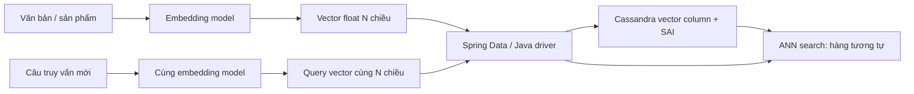

# Kiểu vector và điều kiện hỗ trợ theo phiên bản Server, Driver và Spring Data

**Vector** là kiểu dữ liệu CQL cho phép lưu một dãy giá trị có **số chiều cố định** trong Apache Cassandra. Đây là nền tảng của các ứng dụng tìm kiếm tương tự theo embedding, chẳng hạn tìm tài liệu có nội dung gần nghĩa với câu hỏi hoặc tìm sản phẩm có đặc trưng tương tự.

Trong module **SPRING_DATA_CASSANDRA**, cần phân biệt ba lớp: **Cassandra Server** phải hiểu kiểu `vector` và khả năng truy vấn tương ứng; **Java driver** phải mã hóa/giải mã giá trị vector qua giao thức CQL; **Spring Data Cassandra** phải ánh xạ kiểu Java, metadata entity và truy vấn sang những khả năng đã được hai lớp dưới hỗ trợ.

Ba lớp này có **lộ trình phát hành khác nhau**. Cài Spring Data mới chưa biến một Cassandra Server cũ thành server có vector; ngược lại, chạy Cassandra 5.0 không bảo đảm bản Java driver hoặc Spring Data Cassandra đang dùng đã có API ánh xạ vector.

> **Phạm vi phiên bản của ví dụ:** Các ví dụ CQL giả định **Apache Cassandra 5.0** với Storage-Attached Indexing (SAI). Ví dụ Java driver dùng **4.17+** và phần entity Spring Data dùng **Spring Data Cassandra 4.5+**. Một số API repository vector chuyên biệt được mô tả riêng cho **Spring Data Cassandra 5.0+**. Trước khi áp dụng, cần kiểm tra phiên bản thực tế của toàn bộ ứng dụng và cluster.

## 1. Vector khác list, tuple và cột thông thường như thế nào?

### 1.1. Cú pháp CQL

Cassandra 5.0 bổ sung kiểu:

```sql
vector<float, 3>
```

Trong đó:

- `vector`: một giá trị dạng dãy cố định (fixed length).
- `float`: kiểu phần tử, thường dùng cho embedding và tìm kiếm ANN.
- `3`: **số chiều**; mọi giá trị hợp lệ của cột phải có đúng ba phần tử.

Ví dụ tạo bảng chứa vector ba chiều:

```sql
CREATE TABLE sdc_vector_lab.documents_by_id (
    id uuid PRIMARY KEY,
    title text,
    embedding vector<float, 3>
);
```

Dữ liệu ví dụ:

```sql
INSERT INTO sdc_vector_lab.documents_by_id (id, title, embedding)
VALUES (
    11111111-1111-1111-1111-111111111111,
    'Spring Data Cassandra',
    [0.90, 0.10, 0.00]
);
```

Dấu `[...]` là **cú pháp literal CQL dùng chung hình thức với list**, nhưng cột vẫn có kiểu **`vector<float, 3>`**, không phải `list<float>`.

### 1.2. So sánh các kiểu chứa nhiều giá trị

| Kiểu CQL | Đặc điểm | Ví dụ ứng dụng |
|---|---|---|
| `vector<float, 3>` | Đúng ba phần tử; không có phần tử null; được lưu như một giá trị không chia cell | Embedding, điểm trong không gian vector |
| `list<float>` | Collection có độ dài thay đổi theo các quy tắc CQL | Danh sách điểm số hoặc giá trị có thể thêm/bớt |
| `tuple<float, float, float>` | Tập phần tử theo vị trí, có thể khác kiểu và có ngữ nghĩa khác vector | Một bộ giá trị có cấu trúc cố định |
| `blob` | Dữ liệu byte không có ý nghĩa vector đối với CQL | Định dạng nhị phân tự quản lý |

Các tính chất quan trọng của `vector` theo tài liệu Cassandra 5.0:

1. **Fixed length:** kích thước của vector là một phần của kiểu cột. Với `vector<float, 3>`, giá trị hai hoặc bốn phần tử không hợp lệ.
2. **Phần tử không được null:** `[0.1, null, 0.3]` không hợp lệ. Cần phân biệt với việc **toàn bộ cột** `embedding` có thể vắng mặt hoặc null nếu schema và thao tác ghi cho phép.
3. **Thay thế toàn bộ giá trị:** không cập nhật hoặc đọc riêng `embedding[1]` như thao tác phần tử collection. Ghi vector mới là cập nhật cả vector.
4. **Một giá trị CQL duy nhất:** không xem mỗi phần tử là một cell có TTL hoặc timestamp độc lập.
5. **Giới hạn số chiều:** tài liệu Cassandra 5.0 quy định tối đa **8.192 chiều** cho kiểu vector. Tránh suy ra cấu hình tối đa thực tế của ứng dụng chỉ từ giới hạn cú pháp: bộ nhớ, kích thước row và chi phí index vẫn cần được đo.

Vector CQL còn có thể sử dụng những kiểu phần tử khác (ví dụ `vector<int, 3>`), nhưng **vector search/ANN trong Cassandra 5.0 hướng tới `vector<float, N>`**. Có thể lưu một vector số nguyên không đồng nghĩa có thể tạo SAI ANN và tìm kiếm tương tự trên vector số nguyên theo cùng cách.

### 1.3. Embedding không do Cassandra tự tạo

Embedding là dãy số được tạo từ một mô hình hoặc thuật toán ở phía ứng dụng/dịch vụ. Cassandra lưu, tìm và xếp hạng tương tự giữa các vector, **không tự suy ra nội dung văn bản thành embedding** chỉ vì bảng có cột `vector`.

Ví dụ minh họa:



Nếu lưu vector từ mô hình A có 768 chiều và truy vấn vector từ mô hình B có 1.536 chiều, dữ liệu không còn tương thích với cột cố định về số chiều. Ngay cả khi cùng 768 chiều, hai mô hình khác nhau chưa chắc dùng cùng không gian embedding; kết quả tương tự có thể vô nghĩa.

## 2. Điều kiện hỗ trợ theo Server, Java driver và Spring Data

### 2.1. Bảng tương thích theo năng lực

| Thành phần | Mốc phiên bản | Năng lực liên quan và giới hạn |
|---|---|---|
| **Apache Cassandra Server** | **3.x / 4.0 / 4.1** | Không có kiểu CQL `vector` gốc của Cassandra 5.0; `CREATE TABLE ... vector<...>` không được hỗ trợ |
| **Apache Cassandra Server** | **5.0** | Có `vector`, vector search dùng SAI và cú pháp `ORDER BY ... ANN OF ...` |
| **Java Driver 4.x** | **4.11–4.15** | Có thể kết nối các phiên bản Cassandra phù hợp cho các tính năng thông thường, nhưng **chưa hỗ trợ codec/type cho vector** |
| **Java Driver 4.x** | **4.16** | Bắt đầu có kiểu, codec và phân tích CQL `vector`; API `CqlVector` ban đầu |
| **Java Driver 4.x** | **4.17–4.18** | `CqlVector` cải tiến, gồm factory `CqlVector.newInstance(...)` và `Row.getVector(...)`; trọng tâm hỗ trợ subtype `float` |
| **Java Driver 4.x** | **4.19+** | Codec vector được mở rộng theo subtype, như API `TypeCodecs.vectorOf(...)`; cần đối chiếu bản driver cụ thể |
| **Spring Data Cassandra** | **Trước 4.5** | Không có bộ API `@VectorType` / `CassandraVector` được giới thiệu từ 4.5; không mặc định entity mapping vector sẽ hoạt động |
| **Spring Data Cassandra** | **4.5+** | Có mapping `Vector` / `CqlVector`; annotation `@VectorType(dimensions = ...)` cho vector metadata và schema generation |
| **Spring Data Cassandra** | **5.0+** | Bổ sung tài liệu và API **repository vector search** như `SearchResults<T>`, `Vector`, truy vấn tìm gần theo vector |

**Cách đọc bảng:** một tính năng chỉ chạy được khi **đủ cả các lớp liên quan**. Chẳng hạn Cassandra 5.0 có vector, nhưng ứng dụng giữ driver 4.15 sẽ gặp khó khăn khi bind/đọc kiểu `vector` theo codec của driver. Spring Data 4.5 có `@VectorType`, nhưng nếu server vẫn là 4.1 thì câu lệnh tạo schema vector không hợp lệ.

Các mốc trong bảng dựa trên tài liệu Cassandra 5.0, changelog/upgrade guide của Java driver và JavaDoc Spring Data Cassandra. Với **stack phát hành sau những mốc này**, luôn đọc release notes và dependency tree; không nên suy ra mức tương thích từ số major của một thư viện riêng lẻ.

### 2.2. Kiểm tra ba phiên bản thực tế

**Server:** Trong `cqlsh`, có thể chạy:

```sql
SELECT release_version FROM system.local;
```

Trên cluster nhiều node, `system.local` phản ánh **node hiện kết nối**, không tự chứng minh tất cả replica đang cùng phiên bản. Trong quá trình rolling upgrade, cần xác nhận trạng thái từng node, schema agreement và khả năng hỗ trợ tính năng trước khi triển khai `vector` cho ứng dụng.

**Driver:** Kiểm tra dependency thực sự có ở runtime, không chỉ version khai báo trong một file build. Với dự án Maven/Gradle, xem cây dependency và những ràng buộc do Spring Boot BOM quản lý. Các bản driver 4.x có thể đến từ nhóm artifact khác nhau tùy giai đoạn quản lý (ví dụ `com.datastax.oss` so với `org.apache.cassandra`), vì vậy xem **groupId, artifactId và version thực** trong dependency tree.

**Spring Data:** Kiểm tra version của `spring-data-cassandra` và `spring-data-commons`. `org.springframework.data.domain.Vector` có trong Spring Data Commons 3.5, còn `@VectorType` ở Spring Data Cassandra có mốc **since 4.5**. Không ép nâng một mình driver hoặc Spring Data trong ứng dụng Spring Boot nếu chưa đối chiếu ma trận dependency của framework.

Một checklist trước khi viết code:

1. Server hỗ trợ `vector<float, N>` trong schema thực.
2. Driver thực sự có `CqlVector` và codec tương thích.
3. Spring Data version có mapper/annotation cần dùng, hoặc ứng dụng chọn dùng `CqlSession` trực tiếp.
4. Mọi vector có **cùng số chiều và kiểu phần tử** với schema.
5. Nếu muốn ANN search, đã có **SAI index thích hợp** và cú pháp truy vấn được hỗ trợ.
6. Cấu hình kết nối, keyspace, datacenter, authentication và consistency level vẫn đúng.

## 3. Phân biệt lưu vector với tìm kiếm ANN

**Lưu vector** chỉ cần Cassandra hiểu kiểu `vector` và client có khả năng ghi/đọc đúng giá trị. **Tìm kiếm tương tự** còn cần cơ chế index, thuật toán tìm kiếm và cú pháp CQL riêng.

| Nhu cầu | Điều kiện cần | Ví dụ |
|---|---|---|
| Ghi vector cho một ID | Bảng có cột `vector<float, N>` | `INSERT ... embedding = [0.1, 0.2, 0.3]` |
| Đọc vector theo ID | Truy vấn có `PRIMARY KEY` phù hợp | `SELECT embedding WHERE id = ...` |
| Tìm các hàng có embedding gần một vector | SAI vector index và ANN query | `ORDER BY embedding ANN OF [...] LIMIT 3` |
| Tính điểm tương tự trong kết quả | Hàm similarity được Server hỗ trợ | `similarity_cosine(embedding, [...])` |
| Lọc theo thuộc tính khác đồng thời ANN | Điều kiện CQL/index tương ứng | Phải kiểm tra khả năng kết hợp predicate và ANN cho schema |

**Không có SAI index** không làm `SELECT ... WHERE id = ...` sai, nhưng ANN search có thể bị Cassandra từ chối vì thiếu đường truy cập. Một chỉ mục SAI trên regular column dạng `text` không tự thay thế SAI index dành cho vector.

Cassandra 5.0 dùng **Approximate Nearest Neighbor (ANN)**: kết quả gần đúng theo index và cấu hình, có thể không trùng tuyệt đối với thuật toán tìm láng giềng gần nhất chính xác trên toàn dữ liệu. Không nên khẳng định thứ tự ANN luôn cố định trong mọi thời điểm khi dữ liệu/index/tải thay đổi.

## 4. Thực hành CQL trên Cassandra 5.0

### 4.1. Tạo keyspace riêng cho bài lab

Đây là ví dụ **một node** để học cú pháp, không dùng replication strategy này cho production nhiều datacenter:

```sql
CREATE KEYSPACE IF NOT EXISTS sdc_vector_lab
WITH replication = {
    'class': 'SimpleStrategy',
    'replication_factor': 1
};
```

Với cluster thực tế, chọn `NetworkTopologyStrategy` và replication factor theo kiến trúc vận hành. Bài này giả định `cqlsh` đã kết nối thành công, tài khoản có quyền tạo schema, và Server hỗ trợ vector.

### 4.2. Tạo bảng vector ba chiều

```sql
CREATE TABLE IF NOT EXISTS sdc_vector_lab.documents_by_id (
    id uuid PRIMARY KEY,
    title text,
    embedding vector<float, 3>
);
```

`id` là **partition key**. `embedding` chỉ là regular column chứa vector; nó **không tự thay đổi phân bố token** hay trở thành clustering column. Chọn `id` làm partition key vì ta còn muốn đọc/chỉnh sửa từng tài liệu theo ID.

Bảng ba chiều phục vụ bài lab. Embedding sản phẩm thật thường có hàng trăm đến hàng nghìn chiều; số chiều phải tương ứng với model đã chọn và ngân sách tài nguyên.

### 4.3. Nạp ba bản ghi

```sql
INSERT INTO sdc_vector_lab.documents_by_id (id, title, embedding)
VALUES (
    11111111-1111-1111-1111-111111111111,
    'Java va Spring Data',
    [0.90, 0.10, 0.00]
);

INSERT INTO sdc_vector_lab.documents_by_id (id, title, embedding)
VALUES (
    22222222-2222-2222-2222-222222222222,
    'CQL va Cassandra',
    [0.10, 0.90, 0.00]
);

INSERT INTO sdc_vector_lab.documents_by_id (id, title, embedding)
VALUES (
    33333333-3333-3333-3333-333333333333,
    'Repository va Driver',
    [0.80, 0.20, 0.00]
);
```

Các vector này là số ví dụ **tự đặt**, không phải embedding từ mô hình AI. Không nên suy ra chúng phản ánh ngữ nghĩa của tiêu đề thật.

Xác minh lưu và đọc bằng primary key:

```sql
SELECT id, title, embedding
FROM sdc_vector_lab.documents_by_id
WHERE id = 11111111-1111-1111-1111-111111111111;
```

Giá trị `embedding` trả về có ba phần tử tương ứng với lệnh `INSERT`.

### 4.4. Thử một lỗi số chiều có kiểm soát

Câu sau **không hợp lệ** vì giá trị chỉ có hai phần tử nhưng schema đòi ba:

```sql
-- Ví dụ minh họa lỗi: KHÔNG chạy trong bước seed thành công.
INSERT INTO sdc_vector_lab.documents_by_id (id, title, embedding)
VALUES (
    44444444-4444-4444-4444-444444444444,
    'Sai so chieu',
    [0.10, 0.20]
);
```

Tương tự, `[0.10, null, 0.20]` không phải giá trị vector hợp lệ. Ở tầng API, kiểm tra số chiều, từng phần tử và mô hình embedding trước khi bind vào driver để trả thông báo nghiệp vụ rõ ràng.

### 4.5. Tạo SAI index phục vụ ANN

```sql
CREATE INDEX IF NOT EXISTS documents_embedding_ann
ON sdc_vector_lab.documents_by_id (embedding)
USING 'sai';
```

Index SAI có chi phí build, lưu trữ, tài nguyên ghi/compaction riêng. Với bảng production có nhiều dữ liệu, việc tạo index có thể tốn thời gian và I/O; thực hiện qua quy trình schema migration được kiểm soát thay vì tự tạo mỗi lần ứng dụng khởi động.

### 4.6. Truy vấn gần nhất bằng ANN

```sql
SELECT id, title
FROM sdc_vector_lab.documents_by_id
ORDER BY embedding ANN OF [1.00, 0.00, 0.00]
LIMIT 2;
```

Cassandra dùng ANN để tìm **hai ứng viên gần** vector truy vấn theo cấu hình index. Với các số minh họa, hàng thứ nhất và thứ ba có xu hướng gần hướng `[1, 0, 0]` hơn hàng thứ hai; nhưng không nên biến điều này thành cam kết về thứ tự tuyệt đối cho mọi ANN index hay cluster.

Các giới hạn thực tế của vector search Cassandra 5.0 gồm:

- Query vector phải có **đúng số chiều** phù hợp cột được index.
- `ORDER BY ... ANN OF ...` là cơ chế tìm gần, không phải `ORDER BY` thông thường trên clustering columns.
- Tài liệu Cassandra giới hạn `LIMIT` của ANN query ở **tối đa 1.000**; vẫn nên yêu cầu top-K nhỏ, phù hợp màn hình hoặc nghiệp vụ.
- Không hỗ trợ một câu “lấy **xa nhất**” đối xứng với ANN gần nhất theo cùng cú pháp.
- Việc ghi đè/xóa thường xuyên các vector đã index có thể ảnh hưởng chi phí và hiệu năng của vector search.

### 4.7. Lựa chọn hàm tương tự

SAI vector index có các lựa chọn similarity function như:

| Hàm | Ý tưởng | Chú ý |
|---|---|---|
| `COSINE` | So sánh hướng giữa các vector | Thường phù hợp embedding khi hướng quan trọng |
| `DOT_PRODUCT` | Tích vô hướng | Độ lớn vector cũng có thể ảnh hưởng; cần hiểu chuẩn hóa |
| `EUCLIDEAN` | Khoảng cách L2 | Xem độ lớn và khoảng cách hình học |

Ví dụ chỉ định similarity function khi tạo index:

```sql
CREATE INDEX IF NOT EXISTS documents_embedding_dot
ON sdc_vector_lab.documents_by_id (embedding)
USING 'sai'
WITH OPTIONS = { 'similarity_function': 'DOT_PRODUCT' };
```

Đây là **một cấu hình index thay thế để minh họa**, không phải yêu cầu tạo đồng thời với index `documents_embedding_ann` ở trên. Trên bảng thực tế, hãy chọn một thiết kế index đáp ứng truy vấn và kiểm tra chính sách của Cassandra đối với việc lập chỉ mục cùng cột trước khi thay đổi.

Có thể lấy điểm tương tự kèm kết quả, ví dụ:

```sql
SELECT id, title,
       similarity_cosine(embedding, [1.00, 0.00, 0.00]) AS score
FROM sdc_vector_lab.documents_by_id
ORDER BY embedding ANN OF [1.00, 0.00, 0.00]
LIMIT 2;
```

Kết quả xếp hạng do ANN/index quyết định. Cột `score` ở đây là **giá trị của hàm cosine được chọn**, không nên suy diễn mọi loại score đều có cùng miền giá trị hay ý nghĩa. Độ chính xác cần được đánh giá bằng bộ truy vấn/nhãn nghiệp vụ thật.

## 5. Java driver: làm việc với CqlVector

Từ **Java driver 4.16**, driver bắt đầu hiểu CQL `vector`. Từ **4.17**, API `CqlVector` được cải tiến, hỗ trợ factory `newInstance` và đọc qua `Row.getVector`. Những ví dụ sau chọn **driver 4.17+** để tránh khác biệt API của 4.16.

### 5.1. Tạo và bind vector với prepared statement

Giả sử đã có `CqlSession` kết nối đúng cluster/keyspace:

```java
import java.util.UUID;

import com.datastax.oss.driver.api.core.CqlSession;
import com.datastax.oss.driver.api.core.cql.PreparedStatement;
import com.datastax.oss.driver.api.core.data.CqlVector;

public class DocumentVectorWriter {

    private final CqlSession session;
    private final PreparedStatement insert;

    public DocumentVectorWriter(CqlSession session) {
        this.session = session;
        this.insert = session.prepare("""
            INSERT INTO sdc_vector_lab.documents_by_id (id, title, embedding)
            VALUES (?, ?, ?)
            """);
    }

    public void save(UUID id, String title) {
        CqlVector<Float> embedding = CqlVector.newInstance(
            0.90f, 0.10f, 0.00f
        );

        session.execute(insert.bind(id, title, embedding));
    }
}
```

Ví dụ tập trung vào cú pháp codec và bind parameter; ứng dụng thật nên nhận vector từ embedding service sau khi kiểm tra số chiều thay vì gán hằng số.

**Không dùng `List<Float>` như thể nó đương nhiên tương đương `CqlVector<Float>` ở mọi bản driver.** Kiểu Java được bind phải phù hợp codec của cột `vector<float, N>`. Driver mặc định ánh xạ CQL vector thành `CqlVector`; các cách dùng `float[]` cần codec bổ sung hoặc chuyển đổi phù hợp.

### 5.2. Đọc vector từ row

```java
import java.util.UUID;

import com.datastax.oss.driver.api.core.CqlSession;
import com.datastax.oss.driver.api.core.cql.PreparedStatement;
import com.datastax.oss.driver.api.core.cql.Row;
import com.datastax.oss.driver.api.core.data.CqlVector;

public class DocumentVectorReader {

    private final CqlSession session;
    private final PreparedStatement select;

    public DocumentVectorReader(CqlSession session) {
        this.session = session;
        this.select = session.prepare("""
            SELECT embedding
            FROM sdc_vector_lab.documents_by_id
            WHERE id = ?
            """);
    }

    public CqlVector<Float> findEmbedding(UUID id) {
        Row row = session.execute(select.bind(id)).one();

        if (row == null) {
            return null;
        }

        return row.getVector("embedding", Float.class);
    }
}
```

Hai tình huống phải phân biệt:

- `row == null`: không có row cho ID.
- `row != null` nhưng cột `embedding` là null: row có thể tồn tại nhưng chưa có embedding; kết quả đọc vector có thể là null theo API/codec.

Đừng gọi các thao tác số học lên vector khi chưa kiểm tra null và số chiều.

### 5.3. Prepared ANN query

Khi đã có SAI index, có thể gửi CQL ANN qua `CqlSession`. Ví dụ:

```java
import java.util.List;
import java.util.stream.Collectors;

import com.datastax.oss.driver.api.core.CqlSession;
import com.datastax.oss.driver.api.core.cql.PreparedStatement;
import com.datastax.oss.driver.api.core.data.CqlVector;

public class DocumentVectorSearch {

    private final CqlSession session;
    private final PreparedStatement search;

    public DocumentVectorSearch(CqlSession session) {
        this.session = session;
        this.search = session.prepare("""
            SELECT title FROM sdc_vector_lab.documents_by_id
            ORDER BY embedding ANN OF ?
            LIMIT 2
            """);
    }

    public List<String> near(float x, float y, float z) {
        CqlVector<Float> query = CqlVector.newInstance(x, y, z);

        return session.execute(search.bind(query))
                .all()
                .stream()
                .map(row -> row.getString("title"))
                .collect(Collectors.toList());
    }
}
```

Lệnh `all()` chỉ hợp lý cho **ví dụ LIMIT 2**. Với truy vấn nhiều kết quả, xem xét paging, giới hạn K và cách xử lý streaming phù hợp. Query vector là dữ liệu bind, không nối số thực hay nội dung người dùng trực tiếp vào chuỗi CQL.

### 5.4. Driver 4.19 và subtype khác float

Ở Java driver 4.19, API codec có `TypeCodecs.vectorOf(int dimensions, TypeCodec<T> subtypeCodec)` / `vectorOf(VectorType, TypeCodec<T>)` để làm việc với các subtype mà driver và Server hỗ trợ.

Dù vậy, **khả năng lưu `vector<int, N>` và khả năng tìm ANN trên nó không giống nhau**. Với bài toán semantic search Cassandra 5.0, nên bắt đầu từ `vector<float, N>` và kiểm tra rõ giới hạn sản phẩm trước khi áp dụng subtype khác.

## 6. Spring Data Cassandra 4.5+: ánh xạ entity vector

### 6.1. Dùng kiểu Vector của Spring Data

Spring Data Cassandra 4.5 hỗ trợ ánh xạ kiểu `org.springframework.data.domain.Vector` và `CqlVector`. `@VectorType` ở package `org.springframework.data.cassandra.core.mapping` cho phép khai báo số chiều và subtype; tài liệu Spring Data nhấn mạnh annotation **cần thiết khi dùng schema generation**.

Entity bên dưới tương ứng với bảng `documents_by_id` đã tạo bằng CQL:

```java
import java.util.UUID;

import org.springframework.data.cassandra.core.mapping.Column;
import org.springframework.data.cassandra.core.mapping.PrimaryKey;
import org.springframework.data.cassandra.core.mapping.Table;
import org.springframework.data.cassandra.core.mapping.VectorType;
import org.springframework.data.domain.Vector;

@Table("documents_by_id")
public class DocumentVector {

    @PrimaryKey("id")
    private UUID id;

    @Column("title")
    private String title;

    @Column("embedding")
    @VectorType(dimensions = 3)
    private Vector embedding;

    public DocumentVector() {
    }

    public DocumentVector(UUID id, String title, Vector embedding) {
        this.id = id;
        this.title = title;
        this.embedding = embedding;
    }

    public UUID getId() {
        return id;
    }

    public void setId(UUID id) {
        this.id = id;
    }

    public String getTitle() {
        return title;
    }

    public void setTitle(String title) {
        this.title = title;
    }

    public Vector getEmbedding() {
        return embedding;
    }

    public void setEmbedding(Vector embedding) {
        this.embedding = embedding;
    }
}
```

Lưu ý:

- `@PrimaryKey("id")` vẫn định tuyến partition bình thường.
- `@VectorType(dimensions = 3)` diễn tả kiểu vector và số chiều trong metadata Spring Data, **không thay đổi bảng Cassandra hiện có**.
- `Vector.of(...)` là factory của **Spring Data Commons**, khác `CqlVector.newInstance(...)` của Java driver.
- Nếu dùng `@VectorType(dimensions = 1536)` thì schema phải là `vector<float, 1536>`; không thể map entity kích thước 1.536 vào cột ba chiều của ví dụ.
- `@SaiIndexed` có thể dùng để mô tả index phục vụ schema generation trong dự án tương thích. Với database production, ưu tiên migration CQL có kiểm soát và không mặc định để ứng dụng tự tạo index khi startup.

### 6.2. Repository dùng cho ghi và đọc theo ID

```java
import java.util.UUID;

import org.springframework.data.cassandra.repository.CassandraRepository;

public interface DocumentVectorRepository
        extends CassandraRepository<DocumentVector, UUID> {
}
```

Ví dụ sử dụng:

```java
import java.util.UUID;
import org.springframework.data.domain.Vector;

UUID documentId = UUID.fromString(
    "55555555-5555-5555-5555-555555555555"
);

DocumentVector document = new DocumentVector(
    documentId,
    "Tim kiem bang vector",
    Vector.of(0.75f, 0.20f, 0.05f)
);

repository.save(document);
DocumentVector loaded = repository.findById(documentId).orElseThrow();
Vector loadedEmbedding = loaded.getEmbedding();
```

Những dòng trên minh họa việc **ghi và đọc theo primary key**. Đây là trường hợp khác với ANN: một phương thức `findById` không phải vector search.

Nếu Java class ánh xạ sai hoặc converter không nhận `Vector`, trước tiên kiểm tra bản `spring-data-cassandra`/`spring-data-commons` thực sự được nạp. Đừng thay `Vector` bằng `List<Float>` chỉ để Java compile, vì CQL `vector` không có nghĩa là CQL `list`.

### 6.3. CassandraTemplate và CqlSession

`CassandraTemplate` sử dụng `MappingCassandraConverter` để ánh xạ các cột sang entity. Nó thuận tiện cho các thao tác CRUD và truy vấn theo khóa đã thiết kế. Với ANN query có cú pháp đặc thù `ORDER BY ... ANN OF ...`, bạn có thể dùng **`CqlSession` trực tiếp** như mục 5.3 để không phụ thuộc vào việc Spring Data version hiện tại có DSL/định nghĩa repository ANN chuyên biệt.

Hệ thống thực tế có thể kết hợp:

- `CassandraRepository<DocumentVector, UUID>`: CRUD/đọc theo partition key.
- `CassandraTemplate`: thao tác entity/query mà Spring Data version hỗ trợ.
- `CqlSession`: prepared CQL dùng ANN và các khả năng Server-specific khi abstraction tầng cao chưa có.

Điều này không phải “bỏ Spring Data”: cả ba vẫn chia sẻ kết nối Java driver, consistency options và thiết kế bảng Cassandra.

### 6.4. Spring Data Cassandra 5.0+: API tìm kiếm vector

Trong tài liệu **Spring Data Cassandra 5.0**, repository có phần **Vector Search** với các abstraction như:

- `org.springframework.data.domain.Vector`.
- `SearchResult<T>` / `SearchResults<T>` và score.
- Derived hoặc annotated repository methods cho truy vấn tìm gần, và các tham số giới hạn kết quả như `Limit`.

Ví dụ tài liệu Spring Data mô tả method tìm embedding gần và có thể kết hợp điều kiện lọc trên field khác, cùng `@Query` chứa cú pháp `ORDER BY embedding ANN OF :embedding`.

**Không sao chép nguyên API repository vector 5.0 vào dự án 4.5** rồi kỳ vọng compile. Với ứng dụng 4.5, dùng `CqlSession`/prepared CQL hoặc kiểm tra chính xác API version đang có. Với 5.0, cần tiếp tục kiểm tra Server 5.0, SAI index, kiểu/số chiều vector và quy tắc filter của CQL; API repository không tự tạo tính năng ANN trên một server không hỗ trợ.

## 7. Những sai lầm thường xảy ra khi nâng phiên bản

| Triệu chứng | Nguyên nhân thường gặp | Hướng xử lý |
|---|---|---|
| `Unknown type vector` hoặc syntax error ở `CREATE TABLE` | Cassandra Server cũ hơn 5.0 hoặc endpoint khác với dự kiến | Kiểm tra `release_version` và node/cluster thực |
| `CodecNotFoundException` / không bind được `List<Float>` | Driver thiếu vector codec hoặc Java type không phù hợp `vector` | Dùng driver hỗ trợ và `CqlVector<Float>` / mapping Spring Data đúng |
| Không tìm thấy `CqlVector.newInstance` | Driver quá cũ hoặc API từ 4.16 khác 4.17 | Kiểm tra version; dùng cú pháp phù hợp hoặc nâng theo dependency matrix |
| `@VectorType` không tồn tại | Spring Data Cassandra trước 4.5 | Kiểm tra dependency thực; dùng driver trực tiếp hoặc nâng đồng bộ |
| `Vector` Java được đọc nhưng schema generation không đúng | Thiếu `@VectorType(dimensions = N)` hoặc cấu hình schema không được áp dụng | Khai báo số chiều và kiểm chứng CQL schema thực |
| Error kiểu “invalid vector length” | Mismatch số chiều hoặc dữ liệu model khác | Validate kích thước vector ở API/ingestion và đồng bộ schema |
| ANN query bị từ chối | Thiếu SAI vector index, CQL sai, Server không hỗ trợ | Kiểm tra `DESCRIBE TABLE`, index, server version và cú pháp `ANN OF` |
| ANN trả kết quả khác kỳ vọng | ANN là xấp xỉ; index metric, model hoặc dữ liệu không phù hợp | Kiểm tra embedding, metric, bộ đánh giá top-K và dữ liệu thật |
| Chạy được CQL trong cqlsh nhưng Spring Boot lỗi | Client có driver/Spring Data khác hoặc mapping sai | So sánh phiên bản và codec/schema với `cqlsh` |
| Sau nâng model embedding, ghi dữ liệu lỗi | Model mới thay số chiều hoặc không gian embedding | Quản lý version model; tạo read model/index mới và backfill có kiểm soát |

### 7.1. Một số trường hợp cần tư duy riêng

**Cùng kiểu Java nhưng khác số chiều:** `Vector.of(1f, 2f, 3f)` và `Vector.of(1f, 2f)` cùng là `Vector` ở tầng Java, nhưng không cùng hợp lệ cho cột CQL `vector<float, 3>`. Java generic type không tự kiểm tra số chiều tĩnh.

**Cùng số chiều nhưng khác model:** Hai embedding 768 chiều từ hai model khác nhau không nên trộn chung chỉ vì Cassandra chấp nhận cùng kiểu cột. Cần version hóa model, quy tắc chuẩn hóa và re-embedding.

**Dùng nhiều index:** Mỗi vector index có chi phí riêng. Nếu cần thử similarity function khác, lập kế hoạch schema/index và đo chất lượng trước khi thay đổi production.

**Chỉ dùng vector để lưu:** Không nhất thiết phải tạo index nếu ứng dụng chỉ lưu vector rồi đọc theo ID. Tránh chi phí index khi chưa có yêu cầu ANN search.

## 8. Hiệu năng, paging và tính nhất quán của vector search

### 8.1. Dung lượng và chi phí lưu trữ

Với `vector<float, N>`, mỗi thành phần `float` có độ rộng 4 byte ở biểu diễn số thực 32-bit. Ví dụ một embedding **1.536 chiều** chứa khoảng **6 KiB giá trị float thô**; con số này **chưa bao gồm** overhead của row/SSTable, index SAI, compression, replication, commit log và bộ nhớ runtime.

Nếu có hàng triệu embedding, chi phí index và ghi/đọc là đáng kể. Cần ước lượng cả:

- Kích thước dữ liệu thô nhân replication factor.
- Không gian xây dựng và duy trì SAI index.
- Số lần cập nhật/xóa vector và ảnh hưởng đến index/compaction.
- Lưu lượng ANN queries, top-K, concurrency và độ trễ theo percentile.
- Khả năng lọc theo tenant/danh mục trong CQL, tránh tìm rộng thiếu kiểm soát.

### 8.2. Partition key vẫn quan trọng

Ngay cả khi bảng có ANN index, Cassandra vẫn là hệ thống phân tán theo partition key. Cần phân biệt:

- Đọc một document theo `id`: đường đọc theo **partition key**, không cần ANN.
- Tìm các document tương tự theo `embedding`: sử dụng vector index, có đặc tính phân tán và chi phí query khác.
- Tìm tương tự **chỉ trong một tenant**: cân nhắc mô hình dữ liệu, khóa và hỗ trợ kết hợp filter/index theo phiên bản Cassandra; không giả định mọi `WHERE tenant_id = ...` đều tối ưu chỉ vì có ANN index.

**`LIMIT 10` không tự bảo đảm hiệu năng** nếu số node/index segment tham gia lớn hoặc hệ thống đang compaction mạnh.

### 8.3. Consistency level và kết quả gần đúng

Consistency level (ví dụ `LOCAL_QUORUM`) quyết định điều kiện phản hồi đọc/ghi từ replica theo chính sách Cassandra. Nó **không biến ANN thành thuật toán chính xác** và không bảo đảm ranking tuyệt đối bất biến.

Nếu dữ liệu vừa ghi chưa xuất hiện như mong đợi trong vector search, hãy điều tra thời điểm ghi, consistency, trạng thái index, replication và đường truy vấn; không suy ra ngay lỗi do codec vector.

### 8.4. Paging và top-K

Cassandra ANN query dùng `LIMIT` cho số láng giềng gần cần trả. Giới hạn documented là **1.000** cho ANN search trên Cassandra 5.0. Trong ứng dụng, nên chọn top-K phục vụ use case, ví dụ 10 hoặc 20, sau đó lọc/rerank nếu cần.

Driver paging state dùng để chia trang kết quả truy vấn CQL thông thường, nhưng **không tương đương** phân trang offset ổn định trên toàn bộ không gian vector với xếp hạng ANN. Khi thiết kế API “trang 10 của kết quả gần nhất”, phải kiểm tra cụ thể khả năng phân trang của loại truy vấn ANN và tính ổn định thứ hạng, thay vì dùng `OFFSET` như RDBMS.

### 8.5. Đánh giá chất lượng và hiệu năng

Với ứng dụng production, lập bộ câu hỏi và kết quả phù hợp làm ground truth để đánh giá:

- **Recall@K**: trong K kết quả ANN, bao nhiêu kết quả phù hợp theo chuẩn tham chiếu.
- **Latency p50/p95/p99**: cả server, driver và endpoint ứng dụng.
- **Throughput** và độ trễ khi index đang xây/compaction hoặc khi có ghi.
- **Filter correctness** theo tenant và quyền truy cập, nhất là khi kết quả tìm kiếm có dữ liệu đa khách hàng.
- **Model/version consistency**: cùng mô hình, chuẩn hóa, kích thước và preprocessing giữa document/query vectors.

Không chọn similarity function chỉ vì tên “cosine” hay “dot product” quen thuộc; hãy đánh giá với dữ liệu embedding thực tế, ràng buộc top-K và ngân sách latency.

## 9. Quy trình chẩn đoán theo tầng

Khi gặp sự cố, đi từ server đến ứng dụng theo thứ tự:

1. **Server:** Cassandra có phải 5.0+ không? Bảng có cột `embedding vector<float, N>` không? Index SAI đã tồn tại và sẵn sàng không?
2. **CQL:** Chạy `SELECT embedding ... WHERE id = ...` trong `cqlsh` có được không? Truy vấn `ORDER BY embedding ANN OF [...] LIMIT ...` có hợp lệ không?
3. **Java driver:** Phiên bản runtime có `CqlVector` / codec phù hợp? Prepared bind đúng `CqlVector<Float>` hay đã nhầm `List<Float>`?
4. **Spring Data:** Phiên bản có `@VectorType` và mapping `Vector` không? Entity trỏ đúng keyspace/table/column và số chiều?
5. **Đường ứng dụng:** Có validate embedding length/giá trị null? Query vector từ cùng model với document vectors không?
6. **Hiệu năng:** Kiểm tra index build, compaction, replica, consistency, top-K, độ trễ mạng và số query đồng thời.
7. **Phát hành:** Nếu model đổi chiều, đã có kế hoạch backfill và chuyển đổi bảng/index/client không?

Các lệnh đọc hữu ích ở cqlsh:

```sql
SELECT release_version FROM system.local;
DESCRIBE TABLE sdc_vector_lab.documents_by_id;
DESCRIBE INDEX sdc_vector_lab.documents_embedding_ann;

SELECT id, title, embedding
FROM sdc_vector_lab.documents_by_id
WHERE id = 11111111-1111-1111-1111-111111111111;
```

`DESCRIBE INDEX` là lệnh hỗ trợ của `cqlsh`; cú pháp có thể thay đổi theo phiên bản. Nếu công cụ không hỗ trợ, xem `DESCRIBE TABLE` hoặc schema metadata phù hợp. Không chạy `DROP INDEX`, `TRUNCATE` hay thay schema production chỉ để chẩn đoán một lỗi đọc.

## 10. Bài tập thực hành

### Bài 1 — Đọc bảng tương thích

Một ứng dụng dùng Cassandra **4.1**, Java driver **4.19** và Spring Data Cassandra **4.5**. Có thể tạo cột `vector<float, 3>` bằng CQL ngay không?

**Gợi ý:** Không. Server 4.1 không có kiểu vector gốc của Cassandra 5.0. Nâng thư viện client không bổ sung kiểu dữ liệu cho server.

### Bài 2 — Phát hiện sai số chiều

Schema `vector<float, 4>` nhưng ứng dụng bind `CqlVector.newInstance(0.2f, 0.3f, 0.4f)`.

**Đáp án:** Vector chỉ có ba phần tử, không đúng bốn chiều. Cần tạo đúng bốn giá trị hoặc điều chỉnh **thiết kế schema/model** một cách có kiểm soát.

### Bài 3 — Phân biệt vector và list

Tạo một bảng có `list<float>` và một bảng có `vector<float, 3>`. Hãy giải thích vì sao gọi `List<Float>` trong Java không chứng minh có thể dùng ANN search với cột `list<float>`.

**Gợi ý:** CQL type, codec và cơ chế index là những điều kiện riêng; ANN được thiết kế cho cột vector được index phù hợp.

### Bài 4 — Ghi và đọc qua driver

Tạo `CqlVector<Float>` với ba giá trị `0.3f, 0.5f, 0.2f`. Bind vào prepared `INSERT`, đọc lại bằng `Row.getVector("embedding", Float.class)` và kiểm tra có đúng ba phần tử.

### Bài 5 — Mapping Spring Data

Tạo entity `DocumentVector` với `@VectorType(dimensions = 3)` và repository `CassandraRepository<DocumentVector, UUID>`. Ghi và đọc lại theo `id`. Hãy phân biệt thao tác đó với ANN search theo `embedding`.

### Bài 6 — Thiết kế thay đổi model

Hệ thống đang lưu embedding 768 chiều, cần chuyển sang model mới có 1.536 chiều. Hãy đề xuất kế hoạch với cột/bảng/index mới, backfill, chạy song song kiểm chứng và chuyển traffic theo từng giai đoạn.

**Đáp án định hướng:** Không đổi annotation thành 1.536 rồi ghi vào cột `vector<float, 768>`. Cần chuẩn bị schema và read model mới, sinh lại embedding, đánh giá ranking và chuyển đổi ứng dụng có kiểm soát.

## 11. Câu hỏi tự kiểm tra

1. **Cassandra bắt đầu hỗ trợ `vector` từ bản nào?** Apache Cassandra **5.0**.
2. **Java driver hỗ trợ kiểu CQL vector từ bản nào?** **4.16**; ví dụ `CqlVector.newInstance(...)` sử dụng API được cải tiến từ **4.17**.
3. **`@VectorType` có từ bản Spring Data Cassandra nào?** **4.5**.
4. **`vector<int, 3>` và `vector<float, 3>` có giống khả năng ANN search không?** Không. Vector CQL có thể có nhiều subtype, nhưng ANN vector search Cassandra 5.0 dựa trên kiểu float.
5. **Có cần SAI index để đọc vector bằng `WHERE id = ...` không?** Không. Đọc bằng primary key không cần vector index.
6. **Có cần SAI index cho `ORDER BY embedding ANN OF ...` không?** Có, cần vector index thích hợp và server hỗ trợ.
7. **Có thể sửa riêng phần tử `embedding[1]` không?** Không; vector được cập nhật như một giá trị nguyên khối.
8. **Spring Data Repository có tự tạo embedding từ văn bản không?** Không; application/model phải tạo embedding, rồi lưu và truy vấn.
9. **`LIMIT 20` có biến ANN thành nearest neighbor chính xác không?** Không. ANN là tìm gần xấp xỉ, `LIMIT` xác định số kết quả muốn lấy.
10. **Khi code Spring Data 5.0 không compile trên 4.5, cần kiểm tra gì?** API/version của Spring Data Cassandra và Commons, Java driver và những dependency do Spring Boot quản lý.

## Tài liệu tham khảo

- [Apache Cassandra 5.0 — Vector CQL data type](https://cassandra.apache.org/doc/stable/cassandra/reference/vector-data-type.html): kiểu `vector`, fixed length, null elements, giới hạn số chiều và CQL ví dụ.
- [Apache Cassandra — CQL Data Types](https://cassandra.apache.org/doc/stable/cassandra/developing/cql/types.html): vector, list/tuple và thao tác thay thế toàn bộ vector.
- [Apache Cassandra — Vector Search Quickstart](https://cassandra.apache.org/doc/stable/cassandra/getting-started/vector-search-quickstart.html): tạo SAI vector index và `ANN OF`.
- [Apache Cassandra — Working with Vector Search](https://cassandra.apache.org/doc/stable/cassandra/vector-search/vector-search-working-with.html): similarity functions, giới hạn top-K và đặc điểm ANN.
- [Apache Cassandra Java Driver 4.19 — Upgrade Guide](https://apache.github.io/cassandra-java-driver/4.19.0/upgrade-README/): mốc driver 4.16/4.17 và ví dụ `CqlVector`.
- [Apache Cassandra Java Driver 4.19 — TypeCodecs](https://apache.github.io/cassandra-java-driver/4.19.0/api/com/datastax/oss/driver/api/core/type/codec/TypeCodecs.html): `vectorOf` và codec subtype.
- [Spring Data Cassandra 4.5 — Object Mapping](https://docs.spring.io/spring-data/cassandra/reference/4.5/object-mapping.html): `Vector`, `CqlVector`, `@VectorType` và `@SaiIndexed`.
- [Spring Data Cassandra 4.5 — @VectorType JavaDoc](https://docs.spring.io/spring-data/cassandra/docs/4.5.x/api/org/springframework/data/cassandra/core/mapping/VectorType.html): thuộc tính `dimensions`/`subtype` và mốc since 4.5.
- [Spring Data Cassandra 5.0 — Repository Vector Search](https://docs.spring.io/spring-data/cassandra/reference/5.0/cassandra/repositories/vector-search.html): repository search, `Vector`, `SearchResults` và score.
- [Spring Data Commons — Vector API](https://docs.spring.io/spring-data/commons/docs/3.5.5/api/org/springframework/data/domain/Vector.html): `Vector.of` và cách chuyển sang float/double arrays.
