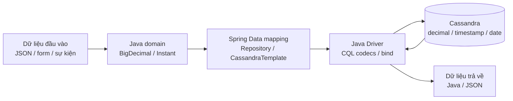

# Độ chính xác số, múi giờ và tương thích dữ liệu khi chuyển đổi

## 1. Vì sao cùng một giá trị có thể thay đổi khi đi qua Cassandra và Java?

Trong **Spring Data Cassandra**, dữ liệu đi qua nhiều lớp: giá trị nghiệp vụ trong Java, entity mapping, `CassandraTemplate` hoặc repository, **Java Driver**, kiểu dữ liệu CQL của **Apache Cassandra**, rồi trở lại Java và thường được chuyển tiếp thành JSON cho API. Mỗi lớp có thể thực hiện chuyển đổi, cắt độ chính xác hoặc diễn giải giá trị theo múi giờ.

Ba nhóm lỗi rất thường gặp là:

1. **Số học:** giá tiền `0.1` được xử lý bằng `double`, rồi cộng hoặc so sánh bằng số thập phân chính xác; hoặc một `varint` bị ép về `int` và tràn miền giá trị.
2. **Thời gian:** client gửi “08:30” theo giờ địa phương nhưng backend ghi như UTC, hoặc một `Instant` có nano giây được lưu bằng `timestamp` chỉ có độ chính xác mili giây.
3. **Tương thích:** thay kiểu cột hoặc kiểu field Java mà không kiểm tra dữ liệu cũ, scale, timezone, serializer và thứ tự rolling deployment, làm bản ứng dụng cũ và mới đọc khác nhau.

Mục tiêu của bài là biết **kiểu nào giữ được ý nghĩa nghiệp vụ** và kiểm tra được một giá trị qua chuỗi:



**Nguyên tắc:** *Chọn kiểu và quy tắc chuyển đổi từ yêu cầu nghiệp vụ trước*, rồi mới ánh xạ sang CQL và Java. Entity mapping không tự bảo đảm độ chính xác và ý nghĩa timezone nếu dữ liệu nguồn hoặc ràng buộc nghiệp vụ mơ hồ.

## 2. Bảng ánh xạ nhanh các kiểu CQL quan trọng

Bảng dưới đây mô tả những ánh xạ phổ biến khi sử dụng **Java Driver 4.x** và Spring Data Cassandra tương thích. Spring Data có thể áp dụng conversion bổ sung; hãy kiểm tra phiên bản và các custom converter nếu dự án có cấu hình riêng.

| Kiểu CQL | Java phù hợp thường dùng | Độ chính xác và miền giá trị | Khi nào chọn / cần tránh |
| --- | --- | --- | --- |
| `tinyint` | `Byte` / `byte` | Số nguyên có dấu 8 bit, −128 đến 127. | Giá trị nguyên rất nhỏ; kiểm tra range khi parse. |
| `smallint` | `Short` / `short` | Số nguyên có dấu 16 bit. | Mã số/phạm vi nhỏ được định nghĩa rõ. |
| `int` | `Integer` / `int` | Số nguyên có dấu 32 bit. | Bộ đếm thông thường trong giới hạn 32 bit. |
| `bigint` | `Long` / `long` | Số nguyên có dấu 64 bit. | Epoch milliseconds nếu hợp đồng lưu dạng số, định danh số lớn, số lượng lớn. |
| `varint` | `BigInteger` | Số nguyên độ dài biến thiên. | Số nguyên vượt 64 bit; cần tính đến chi phí lưu trữ, truyền và xử lý. |
| `decimal` | `BigDecimal` | Thập phân dựa trên số nguyên không giới hạn 32/64 bit kèm scale. | Tiền, tỷ giá và phép tính cần thập phân chính xác; vẫn phải quy định scale/rule ở nghiệp vụ. |
| `float` | `Float` / `float` | Số chấm động nhị phân IEEE 754, 32 bit. | Đo lường chấp nhận sai số; không dùng cho tiền cần đúng đến từng đơn vị nhỏ. |
| `double` | `Double` / `double` | Số chấm động nhị phân IEEE 754, 64 bit. | Tính toán khoa học/đo đạc chấp nhận sai số; không mặc định là “decimal chính xác hơn”. |
| `counter` | Giá trị đọc thường là `long` | Counter có cơ chế cập nhật riêng, không phải cột `bigint` thông thường. | Chỉ dùng khi semantics của Cassandra counter thật sự phù hợp; retry có thể ảnh hưởng kết quả. |
| `timestamp` | `Instant` | Thời điểm tuyệt đối, thường lưu theo mili giây tính từ Unix epoch. | Log, sự kiện, thời điểm thanh toán; không lưu tên múi giờ gốc. |
| `date` | `LocalDate` | Ngày dương lịch, **không chứa giờ hay múi giờ**. | Ngày sinh, ngày báo cáo, bucket theo ngày nghiệp vụ. |
| `time` | `LocalTime` | Thời gian trong ngày ở độ phân giải nano giây; **không chứa ngày hay múi giờ**. | Giờ mở cửa hoặc thời gian trong ngày theo quy ước cụ thể. |
| `duration` | `CqlDuration` của Java Driver | Gồm tháng, ngày và nanosecond; không phải lúc nào cũng có số giây cố định. | Khoảng thời gian lịch; cần quy tắc riêng trước khi đổi sang `Duration`. |
| `uuid` | `UUID` | Giá trị UUID 128 bit. | Khóa định danh không phụ thuộc timezone hoặc số thập phân. |
| `timeuuid` | `UUID` (UUID phiên bản 1) | UUID chứa yếu tố thời gian theo định dạng riêng. | Khi cần semantics của timeuuid; **không** thay thế một trường timestamp độc lập nếu cần logic múi giờ. |

**Chọn kiểu có chủ đích:** CQL `decimal` là số thập phân chính xác theo biểu diễn, nhưng không giới hạn “hai chữ số sau dấu phẩy” thay cho ứng dụng. CQL `timestamp` lưu một mốc thời gian, nhưng không tự nhớ người dùng chọn `Asia/Ho_Chi_Minh` hay `America/New_York`.

### Nullable và primitive trong entity

Nếu một cột Cassandra có thể không có giá trị, nên cân nhắc `Integer`, `Long`, `Double` thay vì primitive `int`, `long`, `double` để diễn đạt sự khác biệt giữa **chưa có dữ liệu** và **giá trị bằng 0**. Lựa chọn constructor/default của entity cần nhất quán với mapping và API.

Đặc biệt, primary key của một hàng Cassandra không chấp nhận `null`. Không dùng giá trị mặc định như `0` hoặc epoch để “vá” một thành phần khóa còn thiếu; điều đó có thể tạo hoặc đọc **một partition khác**.

## 3. Độ chính xác thập phân: decimal và BigDecimal

### 3.1. Vì sao double không đại diện chính xác cho mọi số thập phân?

Hệ nhị phân không thể biểu diễn hữu hạn tất cả phân số thập phân. Ví dụ rất quen thuộc:

```java
double a = 0.1;
double b = 0.2;
System.out.println(a + b == 0.3);  // thường là false
System.out.println(a + b);         // 0.30000000000000004
```

Kết quả này không phải lỗi của Cassandra; nó xuất phát từ biểu diễn `double`. Nếu nghiệp vụ tính giá thanh toán, thuế hoặc tổng tiền, hãy dùng `BigDecimal` và một chính sách scale/rounding đã được định nghĩa.

```java
import java.math.BigDecimal;
import java.math.RoundingMode;

BigDecimal price = new BigDecimal("0.10");
BigDecimal tax = new BigDecimal("0.20");
BigDecimal result = price.add(tax);

System.out.println(result);                    // 0.30
System.out.println(result.compareTo(new BigDecimal("0.30")) == 0); // true

BigDecimal ratio = BigDecimal.ONE
    .divide(new BigDecimal("3"), 4, RoundingMode.HALF_EVEN);
System.out.println(ratio);                     // 0.3333
```

**Khởi tạo từ chuỗi** như `new BigDecimal("0.10")` giúp giữ chính xác giá trị ở đầu vào. `new BigDecimal(0.1)` nhận giá trị nhị phân đã xấp xỉ nên có thể tạo một số thập phân rất dài. `BigDecimal.valueOf(0.1)` dùng biểu diễn chuỗi của số `double` nên thường cho `0.1`, nhưng cũng **không cứu được** độ chính xác đã mất trong các phép tính `double` trước đó.

### 3.2. Precision, scale và rounding là ba khái niệm khác nhau

- **Precision** của `BigDecimal` là số chữ số trong hệ số thập phân (unscaled value), không phải số byte lưu trên đĩa.
- **Scale** là số chữ số sau dấu phẩy theo biểu diễn thập phân, có thể bằng 0, dương hoặc âm.
- **Rounding mode** quyết định giá trị nào được chọn nếu kết quả không thể biểu diễn ở scale mong muốn.

Ví dụ:

| Giá trị Java | Precision | Scale | Ý nghĩa |
| --- | ---: | ---: | --- |
| `new BigDecimal("12.30")` | 4 | 2 | Hai chữ số sau dấu phẩy; giữ số 0 ở cuối biểu diễn. |
| `new BigDecimal("12.3")` | 3 | 1 | Cùng giá trị số với `12.30`, khác scale Java. |
| `new BigDecimal("1230")` | 4 | 0 | Số nguyên theo biểu diễn thập phân. |
| `new BigDecimal("1.235").setScale(2, HALF_EVEN)` | 3 sau làm tròn | 2 | Kết quả `1.24`; quy tắc làm tròn phải công bố. |

**Điểm dễ quên:** `new BigDecimal("12.30").equals(new BigDecimal("12.3"))` trả `false` vì Java xét cả value/scale; `compareTo(...) == 0` trả `true` khi xét giá trị số. Khi đối chiếu giá tiền từ Cassandra với DTO hoặc hệ thống khác, phải xác định cần so **giá trị** hay **định dạng/scale**.

```java
import java.math.BigDecimal;
import java.math.RoundingMode;

BigDecimal source = new BigDecimal("1250.755");
BigDecimal persisted = source.setScale(2, RoundingMode.HALF_EVEN);
// persisted = 1250.76

BigDecimal valueFromDatabase = new BigDecimal("1250.760");
boolean sameAmount = persisted.compareTo(valueFromDatabase) == 0; // true
boolean sameRepresentation = persisted.equals(valueFromDatabase); // false
```

Chọn `RoundingMode.HALF_EVEN` trong ví dụ để minh họa cú pháp, **không mặc định áp dụng cho mọi loại tiền, thuế hoặc luật kế toán**. Scale và quy tắc làm tròn phải thống nhất với hợp đồng nghiệp vụ, đơn vị tiền tệ và các bước tính toán.

### 3.3. CQL decimal giữ giá trị thập phân, ứng dụng vẫn phải đặt quy tắc

Ví dụ bảng:

```sql
CREATE TABLE IF NOT EXISTS learning.invoice_by_id (
    invoice_id uuid PRIMARY KEY,
    subtotal decimal,
    tax_rate decimal,
    total decimal
);

INSERT INTO learning.invoice_by_id
    (invoice_id, subtotal, tax_rate, total)
VALUES (
    11111111-1111-1111-1111-111111111111,
    1000.00,
    0.075,
    1075.00
);
```

Java mapping thường dùng `BigDecimal` cho cả ba cột. CQL `decimal` **không tự làm tròn về hai số lẻ**; nếu muốn giá tiền có hai chữ số thập phân, hãy chuẩn hóa/validate trước khi ghi hoặc tại tầng domain.

Trong dịch vụ tính toán, nên kiểm tra số âm, giới hạn độ lớn, scale và biểu thức nghiệp vụ; tránh truyền giá trị `Double` vào trường `decimal` rồi coi chuyển đổi tự động là bảo đảm chính xác.

## 4. float, double, varint và chuyển đổi số có giới hạn

### 4.1. Khi nào chấp nhận số chấm động?

`float` và `double` thích hợp cho số đo cảm biến, mô phỏng hoặc thuật toán mà **sai số làm tròn có thể chấp nhận**. `double` có nhiều bit hơn `float`, nhưng cả hai vẫn là **xấp xỉ nhị phân**.

```java
float f = 0.1f;
double d = 0.1d;

System.out.println(f == d); // false: hai biểu diễn xấp xỉ khác nhau
```

Nếu giá trị đầu vào được đo với sai số thiết bị ±0,1°C, sử dụng `double` có thể hợp lý. Nếu giá trị là **số tiền phải đối soát chính xác từng xu**, dùng `decimal`/`BigDecimal` hoặc đơn vị nguyên nhỏ nhất với giới hạn được định nghĩa.

Không chỉ vì `double` có 64 bit mà chuyển từ CQL `decimal` sang `double` là vô hại: có những giá trị hoặc chữ số thập phân không thể biểu diễn chính xác sau khi đổi. Khi xuất sang JSON, phía JavaScript cũng thường dùng số chấm động nhị phân, nên cần thiết kế hợp đồng JSON thận trọng.

### 4.2. Chuyển số nguyên: tràn và mất phần lẻ

CQL `int` chỉ có miền 32 bit, còn `bigint` có miền 64 bit. CQL `varint` cho phép số nguyên lớn hơn nữa. Ví dụ Java:

```java
import java.math.BigDecimal;
import java.math.BigInteger;

long total = 3_000_000_000L;

// Sai nếu coi ép kiểu này là chuyển đổi không mất dữ liệu:
int truncated = (int) total;

// Đúng hơn: phát hiện tràn ngay tại ranh giới:
int checked = Math.toIntExact(total); // ném ArithmeticException

BigInteger huge = new BigInteger("123456789012345678901234567890");
long exactLong = huge.longValueExact(); // ném ArithmeticException nếu vượt long

BigDecimal unitCount = new BigDecimal("42.50");
int exactCount = unitCount.intValueExact(); // ném ArithmeticException vì có phần lẻ
```

Ba lời gọi `...Exact()` trong đoạn ví dụ thể hiện **những tình huống kiểm tra lỗi**; chúng có chủ đích gây exception với dữ liệu minh họa. Nếu chạy thực, hãy bắt exception và trả lỗi validation phù hợp thay vì để giá trị bị cắt ngầm.

Đối với `varint` trong JSON, số nguyên lớn hơn `2^53 - 1` có thể không được biểu diễn chính xác bằng `Number` của JavaScript. Nếu API cần truyền nguyên vẹn ID hoặc số lượng lớn, có thể serialize số dưới dạng **chuỗi thập phân** và công bố rõ schema API.

### 4.3. Counter không phải bigint để đặt giá trị tùy ý

CQL `counter` có cú pháp và semantics cập nhật riêng, thường thao tác bằng cộng/trừ thay vì `INSERT` đặt giá trị như cột số bình thường. Tính đúng đắn khi retry phụ thuộc tính chất thao tác và điều kiện hệ thống: nếu client nhận timeout, việc cộng lại có thể làm kết quả tăng thêm lần nữa.

Vì vậy, không đổi field `Long` của một entity để thao tác `counter` như cột `bigint` thông thường mà không nghiên cứu các giới hạn của Cassandra counter và cơ chế idempotency của ứng dụng.

## 5. timestamp là thời điểm tuyệt đối, không phải múi giờ

Cassandra `timestamp` đại diện cho **mốc thời gian trên dòng thời gian**, thông thường bằng số mili giây từ Unix epoch. Nó không lưu `ZoneId` hoặc tên vùng địa lý. Với Java Driver 4.x, kiểu tương ứng thường là `java.time.Instant`.

Ví dụ:

```text
2026-11-25T08:30:00+07:00
                   |
                   | cùng một thời điểm
                   v
2026-11-25T01:30:00Z
                   |
                   v
Cassandra timestamp -> số milliseconds từ Unix epoch
```

Hai chuỗi có offset khác nhau ở trên chỉ **một instant**. Khi đọc từ Cassandra, bạn biết thời điểm xảy ra, **không biết** ban đầu người dùng nhập múi giờ nào. Muốn hiển thị lại theo múi giờ người dùng, ứng dụng phải biết `ZoneId` từ profile hoặc một trường lưu riêng.

```java
import java.time.Instant;
import java.time.ZoneId;
import java.time.ZonedDateTime;

Instant stored = Instant.parse("2026-11-25T01:30:00Z");
ZonedDateTime hcmTime =
    stored.atZone(ZoneId.of("Asia/Ho_Chi_Minh"));
ZonedDateTime utcTime = stored.atZone(ZoneId.of("UTC"));

// Cùng một Instant, hiển thị giờ địa phương khác nhau.
System.out.println(hcmTime); // 2026-11-25T08:30+07:00[Asia/Ho_Chi_Minh]
System.out.println(utcTime); // 2026-11-25T01:30Z[UTC]
```

**UTC là lựa chọn tốt cho biểu diễn và trao đổi instant**, nhưng không có nghĩa mọi quy tắc nghiệp vụ đều phải tính theo ngày UTC. Ví dụ báo cáo “doanh thu ngày 25/11 tại Việt Nam” cần định nghĩa ngày theo `Asia/Ho_Chi_Minh`; timestamp vẫn lưu một instant không phụ thuộc zone.

### 5.1. Mất độ chính xác dưới mili giây

Java `Instant` có thể giữ phần nano giây, trong khi CQL `timestamp` thông thường chỉ lưu đến **mili giây**. Ví dụ:

```java
import java.time.Instant;

Instant original = Instant.parse("2026-11-25T01:30:00.123456789Z");
Instant persistedPrecision =
    Instant.ofEpochMilli(original.toEpochMilli());

System.out.println(original);           // ...00.123456789Z
System.out.println(persistedPrecision); // ...00.123Z
```

Khi driver lưu một `Instant` vào `timestamp`, dữ liệu nhỏ hơn mili giây không thể được giữ nguyên. Nếu `timestamp` là một **clustering column**, hai sự kiện có thời điểm khác nhau chỉ vài microsecond có thể bị đưa về **cùng giá trị mili giây**. Nếu primary key chỉ dựa trên timestamp, chúng có thể trở thành cùng một hàng và ghi đè lẫn nhau.

**Giải pháp thiết kế:** thêm một thành phần khóa đủ phân biệt (ví dụ `event_id uuid`) hoặc chọn một mô hình phù hợp với yêu cầu độ phân giải. Đừng kỳ vọng `Instant` trong Java đảm bảo nano giây được giữ nguyên bởi CQL `timestamp`.

### 5.2. Timestamp literal và offset

Khi ghi CQL bằng chuỗi, nên dùng timestamp ISO 8601 **có offset rõ ràng**, ví dụ:

```sql
-- Hai giá trị dưới đây cùng chỉ một thời điểm.
-- Chạy như hai giá trị thay thế, không phải hai hàng độc lập.
'2026-11-25T08:30:00.123+07:00'
'2026-11-25T01:30:00.123Z'
```

Các giá trị trên là **minh họa literal**, không phải câu lệnh SQL/CQL độc lập. Trong thực tế hãy bind `Instant` bằng prepared statement, thay vì tự ghép chuỗi timestamp vào CQL. Nếu chuỗi timestamp **không có offset**, công cụ/client có thể diễn giải theo múi giờ mặc định và tạo instant khác; tránh nhập không rõ nguồn gốc timezone.

## 6. date, time và duration không thể thay thế timestamp

| Kiểu CQL | Điều nó giữ | Điều nó không giữ | Ví dụ Java |
| --- | --- | --- | --- |
| `date` | Một ngày lịch (năm-tháng-ngày) | Giờ, offset, zone | `LocalDate.of(2026, 11, 25)` |
| `time` | Giờ/phút/giây và phần nano giây trong **một ngày** | Ngày, zone, instant | `LocalTime.parse("08:30:00.123456789")` |
| `timestamp` | Mốc thời gian tuyệt đối đến mili giây | Zone IANA và precision nano đầy đủ | `Instant.parse("2026-11-25T01:30:00Z")` |
| `duration` | Khoảng lịch gồm tháng/ngày/nanosecond | Một instant bắt đầu/kết thúc cụ thể | `CqlDuration` trong Java Driver |

**`LocalDate` không phải instant lúc 00:00 UTC.** Nếu cột `date` dùng cho ngày kinh doanh tại thành phố Hồ Chí Minh, giá trị `2026-11-25` chính là ngày đó, không có offset +07:00 lưu bên trong. Khi muốn chuyển thành mốc thời gian, phải chỉ định zone.

```java
import java.time.Instant;
import java.time.LocalDate;
import java.time.LocalTime;
import java.time.ZoneId;

LocalDate day = LocalDate.of(2026, 11, 25);
LocalTime officeOpens = LocalTime.of(8, 30);
ZoneId zone = ZoneId.of("Asia/Ho_Chi_Minh");

Instant openingInstant =
    day.atTime(officeOpens).atZone(zone).toInstant();
// openingInstant = 2026-11-25T01:30:00Z
```

CQL `time` có thể giữ độ chính xác nano của **giờ trong ngày**, nhưng không vì thế mà CQL `timestamp` cũng có độ chính xác nano. Nếu cần kết hợp `date` và `time` thành một instant, còn phải có **zone/offset** và chính sách xử lý DST.

CQL `duration` khác `java.time.Duration` ở trường hợp có **tháng**: “thêm 1 tháng” có thể là 28, 29, 30 hoặc 31 ngày tùy điểm bắt đầu. Không tự chuyển mọi `CqlDuration` thành số mili giây cố định nếu thiếu ngày/zone tham chiếu.

## 7. Timezone, DST và ngày nghiệp vụ

### 7.1. LocalDateTime không có timezone

`LocalDateTime` chỉ giữ năm-tháng-ngày-giờ-phút-giây; nó không xác định được một instant nếu chưa có zone hoặc offset. Tránh tự gọi `atZone(ZoneId.systemDefault())` chỉ vì máy chủ đang có timezone mặc định nào đó: điều này có thể thay đổi khi deploy sang container, region hoặc máy khác.

Khi client gửi một thời điểm, hợp đồng API nên yêu cầu:

- **Instant hoặc timestamp có offset**, ví dụ `2026-11-25T08:30:00+07:00`; hoặc
- **Giờ địa phương và ZoneId IANA** (ví dụ `America/New_York`), kèm quy tắc cho thời điểm DST không tồn tại hoặc xuất hiện hai lần.

Trường hợp DST kết thúc ở một số vùng có thể làm “01:30” xuất hiện **hai lần**, mỗi lần với offset khác nhau. Trường hợp DST bắt đầu có thể làm một số giờ địa phương **không tồn tại**. Muốn phát hiện mơ hồ, không chỉ dựa vào `LocalDateTime.atZone(...)` rồi mặc định chấp nhận kết quả.

```java
import java.time.Instant;
import java.time.LocalDateTime;
import java.time.ZoneId;
import java.time.ZoneOffset;
import java.util.List;

LocalDateTime input =
    LocalDateTime.parse("2026-11-01T01:30:00");
ZoneId zone = ZoneId.of("America/New_York");

List<ZoneOffset> validOffsets =
    zone.getRules().getValidOffsets(input);

if (validOffsets.size() != 1) {
    throw new IllegalArgumentException(
        "Giờ địa phương mơ hồ hoặc không tồn tại; yêu cầu offset cụ thể");
}

Instant instant = input.toInstant(validOffsets.get(0));
```

Ngày `2026-11-01` ở `America/New_York` là ví dụ thích hợp để nghiên cứu sự lặp giờ khi kết thúc daylight saving time. Trong ví dụ trên, exception là **chủ đích** nhằm minh họa validation; một ứng dụng thật có thể đưa ra lựa chọn offset cho người dùng.

### 7.2. Tính ngày bucket từ cùng một ZoneId đã thỏa thuận

Giả sử truy vấn là **“lấy các bản ghi của thiết bị X trong ngày 25/11 theo giờ Việt Nam”**. Bảng được thiết kế theo cặp partition key `(device_id, local_day)`.

Từ một `Instant`, ứng dụng phải tính `local_day` bằng cùng `ZoneId` được dùng cho quy tắc bucket:

```java
import java.time.Instant;
import java.time.LocalDate;
import java.time.ZoneId;

ZoneId businessZone = ZoneId.of("Asia/Ho_Chi_Minh");
Instant observedAt = Instant.parse("2026-11-25T01:30:00.123Z");

LocalDate localDay =
    observedAt.atZone(businessZone).toLocalDate();
// 2026-11-25
```

Nếu ghi tính `local_day` theo UTC nhưng đọc lại query bằng ngày Việt Nam, một số bản ghi gần nửa đêm sẽ nằm ở **sai partition**. Đây là lỗi mô hình dữ liệu, không phải lỗi mà Spring Data repository có thể tự khắc phục.

Để lập ranh giới đọc một ngày theo zone, tạo khoảng `[start, end)`: bắt đầu bao gồm, kết thúc không bao gồm.

```java
import java.time.Instant;
import java.time.LocalDate;
import java.time.ZoneId;

ZoneId zone = ZoneId.of("Asia/Ho_Chi_Minh");
LocalDate day = LocalDate.of(2026, 11, 25);

Instant start = day.atStartOfDay(zone).toInstant();
Instant end = day.plusDays(1).atStartOfDay(zone).toInstant();

// start = 2026-11-24T17:00:00Z
// end   = 2026-11-25T17:00:00Z
```

**Không cộng cố định 24 giờ để tính ngày tiếp theo cho mọi zone.** Những ngày có chuyển DST có thể kéo dài 23 hoặc 25 giờ; `day.plusDays(1).atStartOfDay(zone)` dùng quy tắc lịch/zone, còn `start.plus(24, HOURS)` có thể đi vào ngày lịch khác kỳ vọng.

## 8. Ví dụ CQL: kết hợp số chính xác và ngày theo múi giờ

Cùng thiết kế một bảng phục vụ truy vấn “50 số đo mới nhất của thiết bị theo ngày nghiệp vụ” và một bản ghi có giá tiền phải bảo toàn chữ số thập phân.

Ví dụ keyspace lab:

```sql
CREATE KEYSPACE IF NOT EXISTS learning
WITH replication = {
    'class': 'NetworkTopologyStrategy',
    'dc1': 1
};
```

Bảng:

```sql
CREATE TABLE IF NOT EXISTS learning.readings_by_device_day (
    device_id uuid,
    local_day date,
    observed_at timestamp,
    reading_id uuid,
    billable_amount decimal,
    sensor_value double,
    sample_count int,
    local_time time,
    business_zone text,
    PRIMARY KEY ((device_id, local_day), observed_at, reading_id)
) WITH CLUSTERING ORDER BY (observed_at DESC, reading_id ASC);
```

Trong schema:

- `(device_id, local_day)` là **composite partition key**, cho phép truy vấn một thiết bị trong một ngày đã định nghĩa theo zone.
- `(observed_at, reading_id)` là clustering key: thời điểm mới trước, và UUID phân biệt các hàng có cùng mili giây.
- `billable_amount decimal` dùng cho số tiền chính xác, còn `sensor_value double` dùng cho số đo có sai số chấp nhận được.
- `local_time time` diễn đạt giờ địa phương của bản ghi; `business_zone text` ghi quy tắc vùng thời gian áp dụng khi lập bucket. Chỉ lưu giờ địa phương khi nghiệp vụ thật sự cần; `observed_at` là nguồn thời điểm tuyệt đối.
- `sample_count int` phải nằm trong miền 32 bit; nếu có thể lớn hơn, chọn `bigint` từ đầu.

Ghi một hàng với thời điểm UTC và ngày/giờ Việt Nam tương ứng:

```sql
INSERT INTO learning.readings_by_device_day (
    device_id, local_day, observed_at, reading_id,
    billable_amount, sensor_value, sample_count,
    local_time, business_zone
) VALUES (
    11111111-1111-1111-1111-111111111111,
    '2026-11-25',
    '2026-11-25T01:30:00.123Z',
    22222222-2222-2222-2222-222222222222,
    125000.75,
    23.7,
    3,
    '08:30:00.123000000',
    'Asia/Ho_Chi_Minh'
);
```

Truy vấn theo **đúng composite partition key**:

```sql
SELECT device_id, local_day, observed_at, reading_id,
       billable_amount, sensor_value, sample_count,
       local_time, business_zone
FROM learning.readings_by_device_day
WHERE device_id = 11111111-1111-1111-1111-111111111111
  AND local_day = '2026-11-25'
LIMIT 50;
```

Không cần thêm `ALLOW FILTERING` vì đã xác định đủ partition. Nếu cần đọc nhiều ngày, ứng dụng phải truy vấn các partition tương ứng rồi tổng hợp theo yêu cầu; Cassandra không tự ghép một chuỗi ngày liên tục trong một partition. Khi lượng số đo tăng lớn, phải đo kích thước/hot partition, dùng fetch page size và paging state phù hợp.

## 9. Entity mapping với Spring Data Cassandra

Với **Spring Boot 3.x** và starter Spring Data Cassandra, cấu hình ứng dụng có thể là:

```yaml
spring:
  cassandra:
    contact-points: 127.0.0.1
    port: 9042
    local-datacenter: dc1
    keyspace-name: learning
    schema-action: NONE
```

`schema-action: NONE` giữ cho ứng dụng dùng schema đã chuẩn bị bằng CQL/migration. Khi ứng dụng chạy trong Docker network, `contact-points` phải là địa chỉ service phù hợp; `127.0.0.1` trong ví dụ dành cho ứng dụng chạy trên máy host có ánh xạ cổng.

### 9.1. Composite key chứa LocalDate và Instant

Đoạn minh họa sau tập trung vào **ánh xạ kiểu** và **thứ tự khóa**:

```java
import java.io.Serializable;
import java.time.Instant;
import java.time.LocalDate;
import java.util.UUID;

import org.springframework.data.cassandra.core.cql.Ordering;
import org.springframework.data.cassandra.core.mapping.PrimaryKeyClass;
import org.springframework.data.cassandra.core.mapping.PrimaryKeyColumn;
import org.springframework.data.cassandra.core.mapping.PrimaryKeyType;

@PrimaryKeyClass
public class ReadingKey implements Serializable {

    @PrimaryKeyColumn(
        name = "device_id", ordinal = 0,
        type = PrimaryKeyType.PARTITIONED)
    private UUID deviceId;

    @PrimaryKeyColumn(
        name = "local_day", ordinal = 1,
        type = PrimaryKeyType.PARTITIONED)
    private LocalDate localDay;

    @PrimaryKeyColumn(
        name = "observed_at", ordinal = 0,
        type = PrimaryKeyType.CLUSTERED,
        ordering = Ordering.DESCENDING)
    private Instant observedAt;

    @PrimaryKeyColumn(
        name = "reading_id", ordinal = 1,
        type = PrimaryKeyType.CLUSTERED,
        ordering = Ordering.ASCENDING)
    private UUID readingId;

    // Bổ sung constructor, getters/setters, equals và hashCode.
    // Khi tạo key, chuẩn hóa observedAt theo độ chính xác mili giây
    // nếu nghiệp vụ dùng giá trị đó để tìm lại một hàng.
}
```

Entity:

```java
import java.math.BigDecimal;
import java.time.LocalTime;
import org.springframework.data.cassandra.core.mapping.Column;
import org.springframework.data.cassandra.core.mapping.PrimaryKey;
import org.springframework.data.cassandra.core.mapping.Table;

@Table("readings_by_device_day")
public class ReadingEntity {

    @PrimaryKey
    private ReadingKey key;

    @Column("billable_amount")
    private BigDecimal billableAmount;

    @Column("sensor_value")
    private Double sensorValue;

    @Column("sample_count")
    private Integer sampleCount;

    @Column("local_time")
    private LocalTime localTime;

    @Column("business_zone")
    private String businessZone;

    // Bổ sung constructor và getters/setters phù hợp.
}
```

Đây là **minh họa mapping**, chưa phải class hoàn chỉnh dùng ngay trong production. Khi hoàn thiện phải bảo đảm constructor/accessor, equality của khóa, validation, quy tắc tính `localDay` và `billableAmount`. Repository phù hợp sẽ có dạng `CassandraRepository<ReadingEntity, ReadingKey>`.

Tại sao kiểu Java này hợp lý?

| Field Java | CQL | Ý nghĩa |
| --- | --- | --- |
| `UUID deviceId` | `uuid` | ID thiết bị. |
| `LocalDate localDay` | `date` | Ngày báo cáo đã tính theo business zone. |
| `Instant observedAt` | `timestamp` | Instant UTC, nhưng lưu chỉ đến mili giây. |
| `UUID readingId` | `uuid` | Phân biệt các lần đọc có cùng timestamp mili giây. |
| `BigDecimal billableAmount` | `decimal` | Số tiền cần độ chính xác thập phân. |
| `Double sensorValue` | `double` | Số đo chấp nhận sai số nhị phân. |
| `LocalTime localTime` | `time` | Giờ trong ngày, không tự chỉ ra zone. |
| `String businessZone` | `text` | ID vùng thời gian IANA theo hợp đồng nghiệp vụ. |

**Quan trọng:** Nếu `LocalDate` hoặc `Instant` cần custom converter trong phiên bản/framework cụ thể, hãy kiểm thử trên phiên bản đang dùng. Không đổi sang `java.util.Date` hoặc `String` một cách máy móc để “sửa” mapping; điều đó có thể làm mất ý nghĩa timezone và validation.

### 9.2. Dùng CqlSession và prepared statement để kiểm tra dữ liệu

Ví dụ trực tiếp qua Java Driver; cùng session này có thể được Spring Data sử dụng bên dưới repository và `CassandraTemplate`:

```java
import java.time.Instant;
import java.time.LocalDate;
import java.time.ZoneId;
import java.util.UUID;

import com.datastax.oss.driver.api.core.CqlSession;
import com.datastax.oss.driver.api.core.cql.PreparedStatement;
import com.datastax.oss.driver.api.core.cql.ResultSet;

public final class DeviceReadingQuery {

    private final CqlSession session;
    private final PreparedStatement query;

    public DeviceReadingQuery(CqlSession session) {
        this.session = session;
        this.query = session.prepare(
            "SELECT device_id, local_day, observed_at, reading_id, " +
            "billable_amount, sensor_value " +
            "FROM learning.readings_by_device_day " +
            "WHERE device_id = ? AND local_day = ? " +
            "AND observed_at >= ? AND observed_at < ? LIMIT 50"
        );
    }

    public ResultSet readBusinessDay(UUID deviceId, LocalDate day) {
        ZoneId zone = ZoneId.of("Asia/Ho_Chi_Minh");
        Instant start = day.atStartOfDay(zone).toInstant();
        Instant end = day.plusDays(1).atStartOfDay(zone).toInstant();

        return session.execute(
            query.bind(deviceId, day, start, end)
                 .setPageSize(50)
        );
    }
}
```

Ở đây `day` phải được tính bằng **cùng business zone** khi ghi. Prepared statement bind `UUID`, `LocalDate` và `Instant` theo kiểu, tránh diễn giải timestamp từ chuỗi không có offset. Với request lớn hơn, phải hiểu rằng `LIMIT 50` giới hạn tổng số hàng query, còn `setPageSize(50)` là kích thước trang fetch; không thay chúng bằng `OFFSET` kiểu RDBMS.

Nếu truy vấn chỉ cần 50 hàng mới nhất **trong cả ngày**, có thể bỏ khoảng `observed_at` để dựa vào clustering order. Đặt khoảng chỉ khi nghiệp vụ cần lọc theo mốc thời gian; filter nhiều trên clustering key vẫn phải phù hợp thứ tự khóa và chiến lược partition.

## 10. Chuyển đổi qua API và các boundary khác

Một giá trị có thể đúng trong Cassandra và Java nhưng sai khi truyền qua API hoặc hệ thống khác. Vì vậy cần định nghĩa hợp đồng **end-to-end**.

### 10.1. JSON, số tiền và số nguyên lớn

Ví dụ payload ưu tiên giữ ý nghĩa:

```json
{
  "deviceId": "11111111-1111-1111-1111-111111111111",
  "localDay": "2026-11-25",
  "observedAt": "2026-11-25T01:30:00.123Z",
  "businessZone": "Asia/Ho_Chi_Minh",
  "billableAmount": "125000.75",
  "sensorValue": 23.7,
  "sampleCount": 3
}
```

Trong ví dụ API này, `billableAmount` được chuyển thành **chuỗi thập phân** để tránh việc client dùng `Number` IEEE 754 rồi thực hiện tính toán tiền sai. Một API khác có thể dùng JSON number nếu đã xác nhận toàn bộ hệ thống hỗ trợ decimal chính xác hoặc ràng buộc rõ số chữ số/giá trị; điều quan trọng là **hợp đồng thống nhất và có test**.

Nếu Java dùng `BigInteger` vượt `2^53 - 1`, cũng cần tránh để client JavaScript parse nó như một `Number` thông thường. Với timestamp, định dạng có `Z`/offset rõ ràng để không phụ thuộc timezone mặc định của trình duyệt.

### 10.2. Chuyển đổi DTO sang domain ở đâu?

Thường nên có **một bước chuẩn hóa tại ranh giới API/domain**:

1. Parse giá trị thập phân từ chuỗi bằng `BigDecimal`, kiểm tra scale, phạm vi và quy tắc làm tròn.
2. Parse timestamp từ ISO 8601 có offset hoặc từ một `Instant` do hệ thống nguồn cung cấp.
3. Nếu nguồn chỉ có giờ địa phương, yêu cầu `ZoneId`/offset đủ thông tin; xử lý rõ DST gap/overlap.
4. Tính `localDay` nhất quán theo zone của nghiệp vụ.
5. Chuẩn hóa `observedAt` xuống mili giây **trước khi tạo primary key** nếu cần đọc lại bằng khóa đó; giữ `readingId` để tránh trùng sự kiện cùng mili giây.
6. Persist qua repository/template với kiểu Java phù hợp; đối chiếu readback sau khi chuyển đổi.

Không nên phân tán logic rounding và timezone sang nhiều controller, listener và mapper có các mặc định khác nhau. Một service hoặc converter theo domain, được kiểm thử, sẽ giảm lỗi khó tái hiện.

### 10.3. Không phải phép đổi kiểu nào cũng bảo toàn thông tin

| Chuyển đổi | Rủi ro | Lựa chọn an toàn hơn |
| --- | --- | --- |
| `decimal -> double` | Mất chữ số thập phân chính xác. | Giữ `BigDecimal`/chuỗi decimal ở ranh giới cần chính xác. |
| `double -> decimal` | Biểu diễn giá trị nhị phân đã xấp xỉ; không khôi phục số gốc. | Parse decimal từ nguồn gốc chưa bị chuyển sang double, nếu có. |
| `varint -> bigint/int` | Tràn miền giá trị. | Dùng `longValueExact`/`intValueExact` hoặc kiểm tra range. |
| `decimal -> int/long` | Mất phần lẻ, có thể tràn. | Chỉ chuyển với `...ValueExact()` sau khi validate nghiệp vụ. |
| `Instant nanos -> CQL timestamp` | Mất phần nhỏ hơn mili giây. | Chuẩn hóa và dùng ID bổ sung nếu cần phân biệt sự kiện. |
| `LocalDateTime -> Instant` | Thiếu zone/offset, có thể mơ hồ ở DST. | Yêu cầu `OffsetDateTime` hoặc `LocalDateTime + ZoneId` và chính sách DST. |
| `CQL date/time -> Instant` | Thiếu ngày hoặc zone. | Kết hợp các thành phần cần thiết và xác nhận múi giờ. |
| `CqlDuration có tháng -> java.time.Duration` | Không có số giây cố định khi chưa biết ngày bắt đầu. | Giữ `CqlDuration` hoặc xác định ngữ cảnh lịch cụ thể. |
| `decimal -> JSON number -> JavaScript` | Client có thể tính toán bằng binary float. | Hợp đồng JSON string/minor unit integer với kiểm thử liên nền tảng. |

## 11. Tương thích dữ liệu khi thay đổi schema hoặc framework

### 11.1. Đổi kiểu Java không đồng nghĩa đổi kiểu cột

Ví dụ cột hiện có là `sensor_value double`, ứng dụng muốn dùng `BigDecimal`. Chỉ đổi field từ `Double` sang `BigDecimal` **không biến dữ liệu cũ thành thập phân chính xác**, và driver/converter có thể từ chối đọc nếu kiểu Java không tương thích CQL. Đồng thời, dữ liệu gốc lưu bằng double đã mất chính xác theo biểu diễn nhị phân.

Cassandra có các giới hạn với thay đổi kiểu cột qua `ALTER TABLE`; **không giả định** mọi chuyển đổi sẽ được phép hoặc bảo toàn giá trị. Một phương án migration có kiểm soát là:

1. Xác định ý nghĩa chính xác của cột mới, scale và dữ liệu nguồn thật có thể dùng để khôi phục hay không.
2. Tạo **cột mới hoặc bảng mới** với CQL type đích phù hợp, thay vì đổi kiểu trực tiếp có nguy cơ không hỗ trợ.
3. Triển khai code có thể đọc cả dữ liệu cũ và mới trong giai đoạn chuyển.
4. Backfill dữ liệu theo quy tắc đã duyệt, có kiểm soát batch, tải và đối soát.
5. Chuyển đường ghi, đọc và giám sát khi dữ liệu đã đạt tiêu chí.
6. Sau khi loại bỏ dependency cũ và có phương án phục hồi, mới xóa cấu trúc cũ nếu phù hợp.

**Nếu nguồn chỉ còn một số float/double đã làm tròn, không có phép chuyển kiểu nào khôi phục chính xác số thập phân gốc.** Khi nghiệp vụ yêu cầu tính đúng đắn tuyệt đối, cần dữ liệu nguồn, quy tắc bù sai số hoặc quyết định nghiệp vụ rõ ràng.

### 11.2. Thay đổi timezone của bucket có thể đổi partition key

Giả sử trước đây ứng dụng tính `local_day` theo UTC; giờ muốn chuyển sang `Asia/Ho_Chi_Minh`. Cùng một instant:

```text
2026-11-24T18:30:00Z
  -> ngày UTC:             2026-11-24
  -> ngày Asia/Ho_Chi_Minh: 2026-11-25
```

Nếu `local_day` nằm trong **partition key**, đây là thay đổi định danh partition, **không chỉ là thay cách hiển thị**. Chỉnh logic Java mà không chuyển dữ liệu cũ sẽ khiến truy vấn ngày mới không tìm thấy một phần bản ghi.

Phương án đúng thường gồm: xác định zone quy chuẩn theo thiết bị/nghiệp vụ, tính bucket mới, ghi lại dữ liệu theo primary key mới (và xử lý hàng cũ), triển khai đọc/ghi tương thích trong thời gian chuyển, đối soát số lượng và kiểm tra vùng quanh nửa đêm/DST. Việc chuyển partition key phải xem như **data migration**.

### 11.3. Rolling deployment và nhiều phiên bản ứng dụng

Nếu phiên bản A ghi số tiền với scale 4 còn phiên bản B ép về scale 2, hai phiên bản có thể ghi giá trị khác nhau dưới cùng primary key. Nếu một bản ghi timestamp không offset, phiên bản A dùng `UTC` còn B dùng timezone máy chủ, kết quả cũng khác.

Trước rolling deployment, cần một hợp đồng chung:

- Kiểu dữ liệu CQL và Java DTO/domain tương ứng.
- Quy tắc rounding/scale và cách so sánh giá trị.
- Mốc thời gian truyền dưới dạng instant/offset, zone dùng cho ngày nghiệp vụ.
- Giá trị mặc định/null và giới hạn số nguyên.
- Thứ tự triển khai schema trước code, khả năng đọc dữ liệu cũ, và thời điểm chuyển writer.
- Tiêu chí readback, so sánh checksum/giá trị và kế hoạch phục hồi.

Không dùng `SchemaAction` tự cập nhật bảng trên từng instance để giải quyết migration số và timezone. Schema cần được quản lý bằng migration có thứ tự, nhất là khi nhiều phiên bản ứng dụng cùng chạy.

## 12. Hiệu năng, paging và consistency có liên quan thế nào?

Độ chính xác không đứng riêng khỏi mô hình dữ liệu phân tán:

- **Partition key:** nếu dùng `date` bucket theo business zone, mọi writer/reader phải tính cùng zone; sai ngày là **sai partition**, làm query lệch hoặc không tìm thấy dữ liệu.
- **Clustering key:** `timestamp` có độ phân giải mili giây; thêm `reading_id` để không ghi đè sự kiện cùng millisecond. Chọn clustering order phù hợp truy vấn “mới nhất”.
- **Kích thước dữ liệu:** `varint` và `decimal` có thể lớn hơn kiểu fixed-width; biểu diễn quá nhiều chữ số không cần thiết làm tăng chi phí lưu trữ/truyền và tính toán.
- **Paging:** query theo partition và `LIMIT`/page size làm giảm lượng dữ liệu cần lấy mỗi đợt; không có tác dụng chữa lỗi chuyển đổi sai precision hoặc timezone.
- **Consistency level:** `LOCAL_ONE`, `LOCAL_QUORUM`... chi phối số replica phản hồi, **không** thay đổi quy tắc chuyển `Instant` sang `timestamp` hay `BigDecimal` sang `decimal`.
- **Retry:** write timeout có thể xuất hiện sau khi một số replica đã ghi; dùng ID ổn định, idempotency và quy tắc timestamp khi retry. Một phép cộng `counter` không tự idempotent.
- **Truy vấn theo khoảng thời gian:** chuyển ranh giới từ ngày/zone sang instant trước khi bind; dùng khoảng `[start, end)` để không mất hoặc lặp bản ghi ở ranh giới ngày.
- **Đồng nhất converter:** nếu dự án có custom converter, phải kiểm tra converter có được repository, `CassandraTemplate` và đường CQL trực tiếp dùng nhất quán hay không.

Mỗi khi đổi kiểu dữ liệu hoặc quy tắc thời gian, hãy đánh giá cả **kết quả nghiệp vụ**, **vị trí dữ liệu** và **hiệu năng truy vấn**, thay vì chỉ đảm bảo chương trình Java biên dịch thành công.

## 13. Tình huống kiểm thử và xử lý lỗi

### 13.1. Ma trận kiểm thử tối thiểu

| Tình huống | Dữ liệu kiểm thử | Kỳ vọng |
| --- | --- | --- |
| Số decimal có số 0 cuối | `12.30` và `12.3` | Giá trị số bằng nhau theo `compareTo`; quyết định rõ có cần giữ scale không. |
| Làm tròn | `1.235` với scale 2 và `HALF_EVEN` | `1.24`; test thêm midpoint khác, số âm và quy tắc tiền thực tế. |
| Số vượt giới hạn int | `3_000_000_000L` | `Math.toIntExact` ném exception thay vì âm thầm tràn. |
| BigInteger quá lớn cho long | `123456789012345678901234567890` | `longValueExact` ném exception. |
| Instant nano sang timestamp | `2026-11-25T01:30:00.123456789Z` | Sau ghi/đọc timestamp chỉ còn độ chính xác mili giây. |
| Cùng một instant, hai offset | `08:30+07:00` và `01:30Z` | Cùng epoch milliseconds trong Cassandra. |
| UTC sát nửa đêm so với giờ Việt Nam | `2026-11-24T18:30Z` | Business day ở Việt Nam là `2026-11-25`. |
| DST overlap | `2026-11-01T01:30` tại New York | Yêu cầu offset cụ thể; không tự đoán một instant. |
| DST gap | Một local time trong khoảng giờ nhảy DST | Phát hiện giờ không tồn tại; áp dụng chính sách đã định. |
| Giá trị nullable | `sensor_value` không có dữ liệu | Phân biệt `null` với `0.0` trong DTO và entity. |
| JSON số nguyên lớn | Giá trị vượt `2^53 - 1` | Client không bị mất chữ số khi gửi/nhận. |
| Writer/reader khác zone cho bucket | Một instant gần ranh giới ngày | Bắt được sai partition trong integration test. |

### 13.2. Lỗi thường gặp

| Triệu chứng | Nguyên nhân khả dĩ | Cách xử lý |
| --- | --- | --- |
| Giá tiền khác vài phần nhỏ sau tính toán | Dùng float/double hoặc đổi qua JSON number. | Theo dấu dữ liệu đến điểm đầu tiên dùng binary float; giữ decimal/BigDecimal theo hợp đồng. |
| `BigDecimal.equals` trả `false` dù nhìn cùng giá trị | Khác scale, ví dụ `12.30` và `12.3`. | Dùng `compareTo` khi so **giá trị**, hoặc chuẩn hóa scale khi cần so biểu diễn. |
| Giá trị âm sau khi chuyển số lớn sang int | Tràn miền do cast thu hẹp. | Dùng `Math.toIntExact` và kiểm tra range. |
| Không tìm thấy bản ghi theo timestamp key | Nano giây bị cắt khi lưu, hoặc dựng lại timestamp có offset/zone sai. | Đối chiếu epoch milliseconds; ổn định primary key và thêm ID phân biệt. |
| Bản ghi ở ngày hôm trước/hôm sau | Tính `local_day` bằng UTC thay vì business zone. | Thống nhất zone để ghi/đọc và migration nếu partition key đã sai. |
| Giờ bị lệch sau deploy sang container | Dùng timezone mặc định của JVM/OS để parse local time. | Parse offset/zone rõ ràng, lưu instant, không phụ thuộc host timezone. |
| Dữ liệu tháng/ngày DST thiếu hoặc trùng | Cộng 24 giờ cố định hoặc xử lý local time mơ hồ. | Lập khoảng theo `LocalDate.atStartOfDay(zone)` và kiểm tra DST. |
| Mapping exception khi đổi field Java | CQL type không tương thích với Java type/codec. | Kiểm tra schema và converter, triển khai migration phù hợp. |
| Số tiền trả API bị đổi chữ số | Client JavaScript parse JSON number bằng double. | Dùng decimal string/minor units và kiểm thử tích hợp client. |
| CL cao hơn nhưng giá trị vẫn sai | Sai giá trị **trước khi ghi** hoặc lỗi conversion/partition key. | Kiểm tra dữ liệu nguồn, binder/converter; CL không sửa precision/timezone. |

### 13.3. Bài tập hoàn chỉnh

1. Tạo `learning.readings_by_device_day` bằng CQL; chèn bản ghi mẫu, đọc lại bằng `cqlsh` và kiểm tra `billable_amount`, `local_day`, `observed_at`.
2. Ánh xạ `ReadingKey`/`ReadingEntity`, dùng repository hoặc `CassandraTemplate` ghi lại số tiền `new BigDecimal("125000.75")`.
3. Ghi một `Instant` có 9 chữ số phần nano, đọc lại từ Cassandra và so sánh với `Instant.ofEpochMilli(original.toEpochMilli())`.
4. Tạo hai `reading_id` khác nhau nhưng `observed_at` có cùng mili giây sau chuẩn hóa; xác nhận cả hai hàng vẫn có thể tồn tại trong cùng partition.
5. Tính ngày và ranh giới ngày Việt Nam của `2026-11-24T18:30:00Z`; xác nhận thuộc partition `2026-11-25`.
6. Thử parse `LocalDateTime` ở giờ chuyển DST tại New York; kiểm tra `getValidOffsets` trả 0, 1 hoặc 2 phần tử tùy thời điểm.
7. Kiểm tra JSON round-trip của một số `BigInteger` lớn và một `BigDecimal` có phần thập phân dài khi client dùng JavaScript.
8. Mô tả kế hoạch migration nếu hệ thống trước đây ghi bucket theo UTC nhưng API nay sử dụng ngày địa phương: bảng mới/ghi lại khóa/đối soát/trạng thái rollout.
9. Thử chuyển một `BigDecimal` có phần lẻ sang `long` bằng `longValueExact`, xử lý lỗi validation thay vì âm thầm cắt.
10. Quan sát read/write CL nhưng khẳng định nó không điều khiển quy tắc rounding và timezone của giá trị được bind.

## 14. Checklist dành cho code review

- [ ] Các số tiền và giá trị phải chính xác dùng `decimal`/`BigDecimal`, được xây dựng từ nguồn decimal phù hợp.
- [ ] Scale, precision/domain và rounding mode có quy tắc nghiệp vụ; đã test ca sát ranh giới.
- [ ] `float`/`double` chỉ dùng cho đại lượng chấp nhận sai số; không chuyển ngầm decimal chính xác sang float.
- [ ] Chuyển số nguyên thu hẹp dùng kiểm tra range hoặc các hàm `...Exact()`.
- [ ] `timestamp` được hiểu là instant độ chính xác mili giây; không lưu timezone hoặc nano đầy đủ.
- [ ] `date`/`time` không bị nhầm với instant; quy tắc timezone được chỉ định rõ khi kết hợp.
- [ ] Dữ liệu local datetime có offset hoặc ZoneId và quy tắc xử lý DST gap/overlap.
- [ ] Bucket ngày trong partition key được tính **nhất quán** giữa writer, reader, backfill và query.
- [ ] Primary key chứa thành phần chống trùng nếu có nhiều sự kiện trong cùng mili giây.
- [ ] Spring Data entity converter và CQL type đã được test bằng đọc/ghi thực tế; có phân biệt `null` với giá trị mặc định.
- [ ] Hợp đồng JSON cho decimal/BigInteger/Instant không làm client mất thông tin.
- [ ] Migration kiểu số hoặc quy tắc timezone có kế hoạch dữ liệu, kiểm tra tương thích code cũ/mới và kiểm thử hoàn nguyên.
- [ ] Kiểm tra paging, CL, latency và partition size nhưng không nhầm những yếu tố này với phép chuyển kiểu.

**Kết luận:** Khi xây dựng ứng dụng bằng Spring Data Cassandra, đúng kiểu Java thôi là chưa đủ. Cần giữ nguyên **ý nghĩa và độ chính xác** khi giá trị đi qua CQL, driver, entity và API: dùng `BigDecimal` cho thập phân cần chính xác, coi `timestamp` là instant tới mili giây, định nghĩa zone rõ ràng cho ngày nghiệp vụ, và chủ động kiểm soát mọi phép chuyển đổi có thể làm mất dữ liệu.
