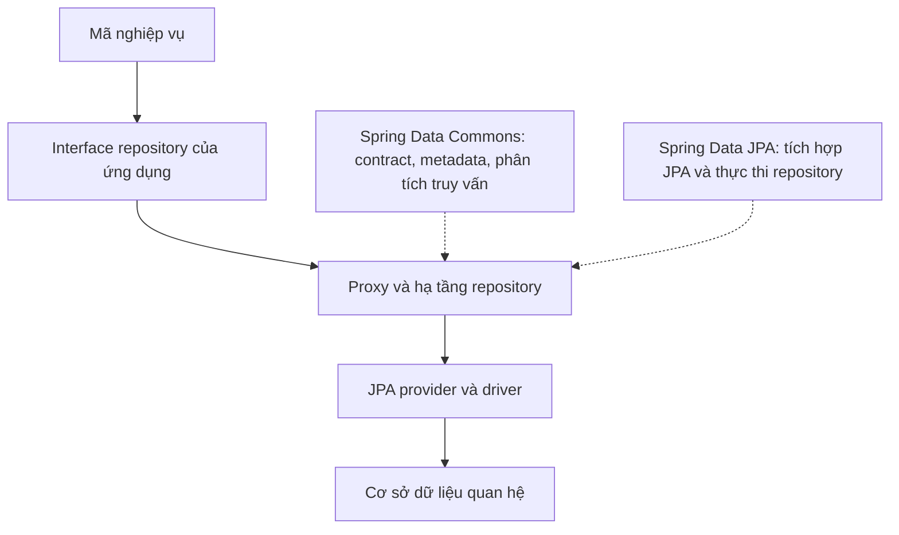

# Spring Data Commons là gì và vì sao các mô-đun Spring Data cần nó?

Khi dùng Spring Data JPA để truy cập cơ sở dữ liệu quan hệ hoặc Spring Data MongoDB để làm việc với tài liệu, bạn thường gặp những tên quen thuộc như `Repository`, `CrudRepository`, `Pageable` và `Sort`. Các API này thuộc một nền tảng chung: **Spring Data Commons**.

Spring Data Commons cung cấp các abstraction và hạ tầng dùng chung cho hệ sinh thái Spring Data. Các mô-đun dành cho từng loại kho dữ liệu sử dụng nền tảng đó để xây dựng repository và các tính năng truy cập dữ liệu phù hợp với công nghệ của mình.

Bài học thuộc chương **Tổng quan** của mô-đun **SPRING_DATA_COMMONS**. Sau bài này, bạn cần giải thích được Commons giải quyết vấn đề gì, phân biệt nó với mô-đun dành cho kho dữ liệu cụ thể và nhận biết trách nhiệm của từng lớp khi một repository được gọi.

## 1. Vấn đề: nhiều kho dữ liệu, nhiều nhu cầu lập trình lặp lại

Giả sử một hệ thống bán hàng lưu đơn hàng trong cơ sở dữ liệu quan hệ và danh mục tìm kiếm trong một kho tài liệu. Cách lưu trữ, ngôn ngữ truy vấn và khả năng giao dịch của hai nơi khác nhau. Tuy vậy, mã ứng dụng vẫn thường có những nhu cầu tương tự:

- Khai báo một đối tượng miền và kiểu định danh của nó.
- Lưu, tìm theo định danh, kiểm tra sự tồn tại và xóa dữ liệu.
- Diễn đạt truy vấn từ tên thuộc tính của mô hình.
- Truyền yêu cầu phân trang và sắp xếp.
- Chỉ lấy một phần dữ liệu qua projection.
- Ghi nhận người tạo, thời điểm tạo, người sửa và thời điểm sửa.
- Tái sử dụng một số hành vi repository hoặc cách đọc metadata.

Nếu từng mô-đun tự xây dựng toàn bộ những cơ chế này, hệ sinh thái sẽ có nhiều API gần giống nhau nhưng không tương thích. Người học phải làm quen lại với cách mô tả trang, khai báo repository và biểu diễn kết quả khi đổi công nghệ. Nhóm phát triển Spring Data cũng phải duy trì nhiều phần hạ tầng trùng lặp.

Commons tách những khái niệm có thể dùng chung thành nền tảng chung. Mỗi mô-đun vẫn chịu trách nhiệm chuyển các khái niệm đó thành thao tác thực tế của kho dữ liệu.

> Commons giúp thống nhất cách diễn đạt nhu cầu truy cập dữ liệu. Khả năng thực hiện nhu cầu đó vẫn phụ thuộc mô-đun và kho dữ liệu đang dùng.

## 2. Spring Data Commons nằm ở đâu trong hệ sinh thái?

Cần phân biệt ba khái niệm:

| Khái niệm | Vai trò | Ví dụ |
| --- | --- | --- |
| Spring Data | Họ dự án cung cấp các cách truy cập dữ liệu theo nhiều công nghệ | Spring Data JPA, Spring Data MongoDB |
| Spring Data Commons | Thư viện chứa abstraction và hạ tầng dùng chung | Repository, phân trang, sắp xếp, metadata |
| Mô-đun dành cho kho dữ liệu | Tích hợp abstraction với một công nghệ cụ thể | JPA repository dùng JPA; MongoDB repository dùng MongoDB |

Artifact thường gặp của Commons là `org.springframework.data:spring-data-commons`. Đây là một thư viện Java; bản thân nó không phải máy chủ cơ sở dữ liệu hay một kho lưu trữ trong bộ nhớ.

Commons không cung cấp driver để kết nối mọi cơ sở dữ liệu. Nó cũng không tự triển khai JPA, không thay thế một JPA provider như Hibernate và không tự chuyển mọi truy vấn thành SQL.

Trong một ứng dụng JPA, có thể hình dung các lớp trách nhiệm như sau:



Đây là sơ đồ trách nhiệm khái niệm. Commons và mô-đun cụ thể phối hợp trong cùng hạ tầng; không nên hiểu rằng mọi lời gọi đều đi qua hai dịch vụ độc lập theo thứ tự cố định.

Với MongoDB, lớp tích hợp JPA được thay bằng Spring Data MongoDB và công nghệ truy cập MongoDB tương ứng. Các khái niệm repository, phân trang và sắp xếp vẫn có thể quen thuộc, nhưng mapping và cách thực thi thay đổi.

## 3. Những thành phần nào thường đến từ Commons?

| Thành phần | Ý nghĩa | Giới hạn cần nhớ |
| --- | --- | --- |
| `Repository<T, ID>` | Marker interface mô tả kiểu đối tượng miền và định danh | Bản thân interface này không khai báo các phương thức CRUD |
| `CrudRepository<T, ID>` | Contract cho các thao tác CRUD thông dụng | Cách lưu, xóa và quản lý trạng thái do mô-đun cụ thể quyết định |
| `PagingAndSortingRepository<T, ID>` | Contract nhận yêu cầu phân trang và sắp xếp | Không nên mặc định rằng mọi phiên bản đều kế thừa CRUD |
| `Pageable`, `PageRequest`, `Sort` | Mô tả yêu cầu trang và thứ tự kết quả | Không chứa SQL, chỉ mục hoặc kế hoạch thực thi |
| `Page<T>`, `Slice<T>` | Biểu diễn kết quả theo trang hoặc lát dữ liệu | Chúng cung cấp mức thông tin khác nhau |
| Hạ tầng derived query | Phân tích tên phương thức thành cấu trúc điều kiện | Tập từ khóa và khả năng thực thi phụ thuộc mô-đun |
| Hạ tầng projection | Hỗ trợ mô tả góc nhìn chỉ gồm một phần dữ liệu | Khả năng tối ưu truy vấn phụ thuộc dạng projection và mô-đun |
| `Example<T>`, `ExampleMatcher` | Mô tả truy vấn theo một đối tượng mẫu | Không phải mọi điều kiện truy vấn đều biểu diễn được |
| Hạ tầng auditing | Mô tả thông tin người tạo, người sửa và thời điểm | Cần được bật và tích hợp với vòng đời lưu trữ của mô-đun |
| Mapping và repository metadata | Đọc, mô tả kiểu miền, thuộc tính và cấu trúc repository | Quy tắc mapping thực tế vẫn có phần riêng theo kho dữ liệu |

Các dòng API hiện đại còn có những biến thể như `ListCrudRepository` để trả về `List` ở một số phương thức. Hãy xem interface bạn thực sự kế thừa khi cần một contract cụ thể, thay vì suy ra toàn bộ hành vi chỉ từ tên repository.

Phần lớn lập trình viên bắt đầu bằng các abstraction công khai. Những thành phần hạ tầng như repository factory, metadata và phân tích tên truy vấn trở nên quan trọng hơn khi cần mở rộng hoặc chẩn đoán hành vi.

## 4. Ví dụ: một contract repository quen thuộc

Giả sử ứng dụng có đối tượng miền `Product` với các thuộc tính:

| Thuộc tính | Kiểu Java | Ý nghĩa |
| --- | --- | --- |
| `id` | `Long` | Định danh sản phẩm |
| `name` | `String` | Tên sản phẩm |
| `price` | `BigDecimal` | Giá bán |
| `active` | `boolean` | Sản phẩm đang được mở bán |

Ví dụ sau minh họa **contract** của repository. Nó giả định `Product` đã có mapping hợp lệ và ứng dụng đã cấu hình một mô-đun Spring Data có hỗ trợ truy vấn này. Chỉ thêm Commons và khai báo interface chưa đủ để chạy ứng dụng.

```java
import java.math.BigDecimal;

import org.springframework.data.domain.Page;
import org.springframework.data.domain.Pageable;
import org.springframework.data.repository.CrudRepository;

public interface ProductRepository extends CrudRepository<Product, Long> {

    Page<Product> findByActiveTrueAndPriceLessThanEqual(
        BigDecimal maxPrice,
        Pageable pageable
    );
}
```

Interface này thể hiện hai nhóm hành vi:

1. `CrudRepository<Product, Long>` cung cấp contract CRUD cho `Product`, chẳng hạn `save`, `findById` và `deleteById`.
2. Phương thức do ứng dụng khai báo diễn đạt điều kiện lọc sản phẩm đang bán, có giá không vượt quá giới hạn và trả kết quả theo trang.

Tên phương thức có thể đọc thành:

| Đoạn tên | Ý nghĩa dự kiến |
| --- | --- |
| `findBy` | Bắt đầu phần điều kiện truy vấn |
| `ActiveTrue` | Thuộc tính `active` có giá trị đúng |
| `And` | Kết hợp hai điều kiện bằng phép AND |
| `PriceLessThanEqual` | Thuộc tính `price` nhỏ hơn hoặc bằng tham số giá |

Commons cung cấp hạ tầng để phân tích cấu trúc đó. Mô-đun cụ thể kiểm tra điều kiện có được hỗ trợ hay không và xây dựng truy vấn tương ứng. Không có một chuỗi SQL chung nằm sẵn trong interface này.

Trong một phương thức nghiệp vụ đã được inject `productRepository`, lời gọi có thể là:

```java
import java.math.BigDecimal;

import org.springframework.data.domain.Page;
import org.springframework.data.domain.PageRequest;
import org.springframework.data.domain.Pageable;
import org.springframework.data.domain.Sort;

// Đoạn mã nằm trong thân một phương thức nghiệp vụ.
Pageable request = PageRequest.of(
    0,
    20,
    Sort.by("price").ascending()
        .and(Sort.by("id").ascending())
);

Page<Product> result = productRepository
    .findByActiveTrueAndPriceLessThanEqual(
        new BigDecimal("500000"),
        request
    );
```

Ở đây:

- Số trang `0` biểu thị trang đầu tiên theo quy ước của `PageRequest`.
- Kích thước trang là 20 phần tử.
- Kết quả được sắp xếp tăng dần theo giá, sau đó theo định danh.
- `price` và `id` là tên thuộc tính của mô hình Java trong contract này; không nên tự thay bằng tên cột của cơ sở dữ liệu.
- Khóa sắp xếp bổ sung giúp xác định thứ tự khi nhiều sản phẩm có cùng giá. Nó không tạo ra một snapshot nhất quán nếu dữ liệu đang thay đổi giữa các lần lấy trang.

API truyền yêu cầu phân trang đến mô-đun; chất lượng chỉ mục, chi phí truy vấn và mức nhất quán vẫn là những vấn đề cần xử lý ở lớp lưu trữ.

## 5. Ai thực sự thực thi phương thức repository?

Một câu hỏi thường gặp là: “Tôi chỉ viết interface, vậy ai viết phần triển khai?”

Trong ứng dụng Spring Data được cấu hình đầy đủ, hạ tầng repository tạo một đối tượng triển khai/proxy và đăng ký nó làm bean. Proxy biết cách chuyển lời gọi đến phần thực thi phù hợp.

Với ví dụ JPA, quá trình có thể hiểu theo các bước:

1. **Phát hiện repository:** cấu hình của mô-đun quét và nhận diện interface thuộc phạm vi quản lý.
2. **Đọc metadata:** xác định kiểu miền `Product`, kiểu định danh `Long`, các phương thức và thông tin mapping liên quan.
3. **Phân loại phương thức:** phân biệt phương thức CRUD, phương thức truy vấn, phương thức mặc định và hành vi tùy chỉnh.
4. **Chuẩn bị đường thực thi:** dùng phần triển khai CRUD, cơ chế tạo truy vấn hoặc repository fragment phù hợp.
5. **Thực thi trên kho dữ liệu:** mô-đun chuyển thao tác xuống công nghệ truy cập dữ liệu tương ứng.
6. **Thích nghi kết quả:** trả về dạng kết quả mà contract khai báo, ví dụ `Optional<Product>` hoặc `Page<Product>`.

Thời điểm phân tích và xác thực một phương thức có thể phụ thuộc cấu hình khởi tạo repository. Không nên dựa vào giả định rằng mọi lỗi đều phải xuất hiện ngay ở cùng một thời điểm khởi động.

Commons đóng góp những cơ chế chung trong quy trình này. Mô-đun JPA, MongoDB hoặc mô-đun khác cung cấp factory, phần thực thi và tích hợp riêng. **Commons đứng một mình không tạo ra repository có thể tự lưu dữ liệu vào bất kỳ kho nào.**

## 6. Vì sao các mô-đun Spring Data cần nền tảng chung?

### 6.1. Giảm phần hạ tầng phải xây dựng lại

Việc phân tích một interface repository, quản lý metadata, nhận diện phương thức truy vấn hoặc biểu diễn một trang dữ liệu là những công việc có thể dùng chung ở nhiều mức độ.

Tách chúng vào Commons giúp các mô-đun tập trung vào những việc gắn với công nghệ lưu trữ: mapping, tạo truy vấn, thực thi, chuyển đổi dữ liệu và tích hợp vòng đời.

Điều này không có nghĩa mọi mô-đun dùng toàn bộ tính năng của Commons. Một mô-đun chỉ có thể cung cấp những phần phù hợp với mô hình và khả năng của nó.

### 6.2. Tạo vốn kiến thức có thể tái sử dụng

Sau khi hiểu `Pageable`, bạn không phải học một kiểu biểu diễn trang hoàn toàn mới chỉ vì chuyển từ một mô-đun Spring Data sang mô-đun khác có hỗ trợ phân trang.

Tương tự, hiểu generic `<T, ID>`, derived query, projection và repository fragment giúp bạn đọc nhiều dự án nhanh hơn. Phần kiến thức cần học thêm là cách các abstraction đó được áp dụng cho kho dữ liệu cụ thể.

### 6.3. Cho phép cải tiến ở lớp chung

Một cơ chế chung được duy trì ở Commons có thể phục vụ nhiều mô-đun. Điều này hỗ trợ sự nhất quán của API và giảm việc mỗi mô-đun phải giải quyết lại cùng một bài toán.

Các mô-đun vẫn cần phiên bản tương thích với nhau. API chung không làm cho việc ghép tùy ý nhiều phiên bản Spring Data trở nên an toàn.

### 6.4. Tạo điểm mở rộng có cấu trúc

Ứng dụng có thể tổ chức repository cơ sở, bổ sung hành vi bằng fragment hoặc tùy chỉnh hạ tầng ở mức sâu hơn. Những cách mở rộng này dựa trên một mô hình repository và metadata chung, thay vì phải thiết kế lại hoàn toàn khi thêm mô-đun mới.

Lợi ích lớn nhất là tái sử dụng cách tổ chức và contract ở nơi phù hợp. Việc dùng lại một implementation vẫn phải xét công nghệ truy cập dữ liệu mà implementation đó phụ thuộc.

## 7. API chung không xóa bỏ khác biệt giữa các kho dữ liệu

So sánh hai hướng repository:

```java
import org.springframework.data.jpa.repository.JpaRepository;

// Product ở đây là một entity đã được mapping cho JPA.
public interface JpaProductRepository
        extends JpaRepository<Product, Long> {
}
```

```java
import org.springframework.data.mongodb.repository.MongoRepository;

// ProductDocument ở đây được mapping cho MongoDB,
// với kiểu định danh String trong ví dụ.
public interface MongoProductRepository
        extends MongoRepository<ProductDocument, String> {
}
```

Các đoạn mã minh họa hai hướng tích hợp riêng; chúng không yêu cầu một đối tượng miền phải đồng thời dùng cả hai mô hình mapping.

Cả hai repository có thể cung cấp những thao tác quen thuộc, nhưng cần kiểm tra các khác biệt sau:

| Khía cạnh | Điều Commons giúp thống nhất | Điều phải xét theo mô-đun và kho dữ liệu |
| --- | --- | --- |
| Kiểu miền và định danh | Cách biểu diễn generic của repository | Cách ánh xạ ID, sinh ID và nhận diện đối tượng mới |
| CRUD | Tên và contract phương thức phổ biến | Cơ chế lưu, cập nhật, quản lý trạng thái và tính nguyên tử |
| Derived query | Cấu trúc phân tích tên phương thức | Từ khóa được hỗ trợ, cách dịch và giới hạn truy vấn |
| Phân trang, sắp xếp | Kiểu tham số và dạng kết quả | Chi phí count, offset, chỉ mục và giới hạn thao tác |
| Projection | Cách khai báo góc nhìn dữ liệu | Cách lấy trường, chuyển đổi và tối ưu dữ liệu trả về |
| Mapping | Hạ tầng mô tả mô hình và thuộc tính | Annotation, quan hệ, tài liệu lồng nhau, chuyển đổi kiểu |
| Giao dịch | Không có một bảo đảm chung chỉ từ `Repository` | Transaction manager, cấu hình và phạm vi giao dịch |
| Đồng thời | Không tự giải quyết chỉ nhờ contract chung | Locking, versioning và bảo đảm nhất quán thực tế |

Ví dụ, một thao tác `save` trong JPA có liên hệ với vòng đời entity và persistence context. Một thao tác lưu tài liệu ở MongoDB có cơ chế khác. Cùng tên phương thức không đủ để suy ra số câu lệnh, thời điểm ghi dữ liệu hoặc cách xử lý mọi đối tượng liên quan.

Do đó, thay `JpaRepository` bằng `MongoRepository` không phải một chiến lược chuyển đổi cơ sở dữ liệu hoàn chỉnh. Bạn vẫn cần xem lại mô hình dữ liệu, truy vấn, ràng buộc, giao dịch và hiệu năng.

## 8. Nhìn trước các abstraction sẽ học trong mô-đun

### 8.1. Repository, CRUD và mở rộng repository

`Repository<T, ID>` là điểm bắt đầu để mô tả một repository. `CrudRepository<T, ID>` bổ sung các contract CRUD. Interface theo kho dữ liệu, như `JpaRepository`, bổ sung hoặc kết hợp các khả năng phù hợp với mô-đun đó.

Không nên cho rằng mọi interface có chữ “repository” đều cung cấp mọi thao tác. Chẳng hạn, ở các dòng API hiện đại, contract phân trang/sắp xếp và contract CRUD có thể cần được kế thừa riêng nếu bạn dùng trực tiếp các interface chung.

Khi tạo interface trung gian dùng chung cho nhiều repository, `@NoRepositoryBean` giúp biểu thị rằng hạ tầng không nên tạo một repository bean trực tiếp từ interface cơ sở đó:

```java
import org.springframework.data.repository.CrudRepository;
import org.springframework.data.repository.NoRepositoryBean;

@NoRepositoryBean
public interface BaseRepository<T, ID>
        extends CrudRepository<T, ID> {
}
```

Đây mới là ví dụ về tổ chức contract. Khi thêm phương thức tùy chỉnh, bạn vẫn cần một đường thực thi hợp lệ: derived query được hỗ trợ, khai báo truy vấn phù hợp, default method hoặc một implementation/fragment tương ứng. Chỉ thêm một chữ ký phương thức không khiến hệ thống tự hiểu mọi thuật toán nghiệp vụ.

### 8.2. Derived query

Derived query dùng quy ước tên phương thức để mô tả điều kiện. Nó phù hợp khi điều kiện rõ ràng và tên phương thức vẫn dễ đọc.

Tên phương thức dựa trên thuộc tính miền. Đổi tên thuộc tính có thể làm truy vấn không còn hợp lệ dù phương thức Java vẫn biên dịch. Khi truy vấn có nhiều nhánh logic hoặc đặc thù của kho dữ liệu, nên xem xét cơ chế truy vấn khác mà mô-đun cung cấp.

### 8.3. Phân trang và sắp xếp

`Pageable` mô tả yêu cầu trang. `Sort` mô tả thứ tự. `Page<T>` thường phục vụ giao diện cần biết tổng số phần tử và tổng số trang; việc có các tổng này có thể cần truy vấn đếm, tùy cách thực thi và tối ưu.

`Slice<T>` phù hợp khi chỉ cần dữ liệu của lát hiện tại và thông tin còn lát tiếp theo hay không. Không nên hứa rằng đổi sang `Slice` sẽ giải quyết mọi vấn đề hiệu năng; cách lấy dữ liệu và chỉ mục vẫn cần được đánh giá.

### 8.4. Projection

Projection biểu diễn một góc nhìn dữ liệu, chẳng hạn danh sách sản phẩm chỉ có tên và giá. Điều này giúp contract phản ánh nhu cầu đọc dữ liệu của ứng dụng.

Một số dạng projection và mô-đun có thể tối ưu phần dữ liệu được truy vấn. Tuy nhiên, chỉ nhìn kiểu trả về dạng projection chưa đủ để kết luận kho dữ liệu luôn chỉ đọc đúng vài trường hoặc không cần tải đối tượng khác.

### 8.5. Query by Example

Query by Example diễn đạt điều kiện từ một đối tượng mẫu, thường kết hợp `Example` và `ExampleMatcher`. Nó có thể phù hợp với biểu mẫu tìm kiếm có nhiều trường tùy chọn.

Bạn cần kiểm soát cách xử lý `null`, thuộc tính cần bỏ qua và các giá trị mặc định. Một trường kiểu nguyên thủy như `boolean` không có trạng thái `null`; giá trị mặc định của nó có thể vô tình tham gia điều kiện nếu không được xử lý phù hợp.

QBE không thay thế mọi truy vấn phức tạp. Mức hỗ trợ, phép so sánh và cách thực thi phải được kiểm tra ở mô-đun đang dùng.

### 8.6. Auditing và metadata

Auditing tập trung vào thông tin như thời điểm tạo/sửa và chủ thể tạo/sửa. Commons có các abstraction như `@CreatedDate`, `@LastModifiedDate`, `@CreatedBy`, `@LastModifiedBy` và `AuditorAware`.

Annotation chỉ mô tả ý định. Để dữ liệu được điền, ứng dụng cần bật auditing theo mô-đun, có tích hợp vòng đời phù hợp và cung cấp nguồn xác định người dùng nếu cần ghi nhận chủ thể. Auditing cũng không tự tạo một lịch sử đầy đủ của mọi phiên bản đối tượng.

Metadata giúp hạ tầng hiểu repository quản lý kiểu miền nào, định danh là gì và các thuộc tính được tổ chức ra sao. Các API metadata đặc biệt hữu ích khi viết công cụ hoặc mở rộng framework; mã nghiệp vụ thông thường thường chỉ cần dùng contract repository.

## 9. Ứng dụng cần gì ngoài Commons?

Một ứng dụng lưu trữ dữ liệu thường cần các thành phần sau:

1. **Mô-đun phù hợp:** ví dụ Spring Data JPA hoặc Spring Data MongoDB.
2. **Công nghệ truy cập dữ liệu bên dưới:** JPA provider, driver hoặc client tương ứng.
3. **Cấu hình kết nối:** địa chỉ, thông tin xác thực và các tùy chọn cần thiết.
4. **Mapping của mô hình:** phù hợp với công nghệ lưu trữ.
5. **Cấu hình repository:** bật và giới hạn phạm vi repository đúng mô-đun.
6. **Các cấu hình bổ sung khi dùng tính năng tương ứng:** chẳng hạn giao dịch hoặc auditing.

Trong ứng dụng Spring Boot, starter dành cho công nghệ lưu trữ thường đưa Commons vào thông qua dependency bắc cầu và cung cấp auto-configuration khi đủ điều kiện. Điều này giải thích vì sao bạn dùng các lớp của Commons dù không khai báo dependency trực tiếp.

Nếu dùng dependency management hoặc BOM, hãy để cơ chế đó quản lý bộ phiên bản tương thích. Việc tự ép riêng một phiên bản Commons cần có lý do và kiểm tra tương thích với các mô-đun khác.

Khi nhiều mô-đun repository cùng có mặt, cần tổ chức package, kiểu repository và mapping rõ ràng để xác định repository nào thuộc mô-đun nào. Một interface chỉ kế thừa generic `CrudRepository` có thể không đủ để hạ tầng phân biệt trong mọi tình huống nhiều mô-đun.

## 10. Những hiểu lầm cần tránh

| Hiểu lầm | Cách hiểu đúng |
| --- | --- |
| “Commons là một cơ sở dữ liệu dùng chung.” | Commons cung cấp thư viện abstraction và hạ tầng. Dữ liệu nằm trong kho do ứng dụng lựa chọn. |
| “Có `CrudRepository` thì chỉ cần thêm Commons.” | Cần mô-đun cụ thể và cấu hình phù hợp để có repository thực thi được. |
| “`Repository` đã có sẵn mọi hàm CRUD.” | `Repository` là marker interface; cần chọn contract có các phương thức mong muốn. |
| “Tên phương thức nào cũng chuyển thành truy vấn được.” | Tên phải đúng thuộc tính, cấu trúc và khả năng mà mô-đun hỗ trợ. |
| “API chung nghĩa là ngữ nghĩa và hiệu năng giống nhau.” | Mapping, giao dịch, truy vấn và chi phí thực thi vẫn khác theo kho dữ liệu. |
| “`Page` chỉ là một `List` có số trang.” | `Page` còn cung cấp thông tin tổng; việc có thông tin đó có thể phát sinh chi phí. |
| “Dùng projection luôn bảo đảm truy vấn ít cột hơn.” | Khả năng tối ưu phụ thuộc loại projection và mô-đun thực thi. |
| “Gắn annotation auditing là mọi thứ tự chạy.” | Cần cấu hình và tích hợp auditing phù hợp; chủ thể thực hiện phải có nguồn cung cấp nếu dùng. |
| “Commons biến repository đồng bộ thành reactive.” | Reactive repository có contract và yêu cầu tích hợp riêng; không tự xuất hiện từ một interface đồng bộ. |

## 11. Tình huống tự kiểm tra

Một nhóm phát triển tạo interface sau và chỉ thêm dependency `spring-data-commons`:

```java
import org.springframework.data.repository.CrudRepository;

public interface OrderRepository
        extends CrudRepository<Order, Long> {
}
```

Nhóm kỳ vọng Spring sẽ tự biết lưu `Order` vào một cơ sở dữ liệu.

**Điều gì còn thiếu?**

Contract đã mô tả kiểu miền và các thao tác mong muốn, nhưng chưa chỉ ra cơ chế truy cập dữ liệu thực tế. Nhóm cần chọn mô-đun, cấu hình kho dữ liệu, mapping `Order` và bật hạ tầng repository phù hợp. Đăng ký quét component thông thường không tự thay thế các bước đó.

Tiếp theo, nhóm muốn chuyển từ cơ sở dữ liệu quan hệ sang MongoDB và giữ nguyên mọi hành vi vì “cùng là Spring Data”.

**Phần nào có thể tái sử dụng và phần nào cần xem lại?**

Kiến thức về repository, định danh, phân trang, sắp xếp và nhiều quy ước truy vấn có thể tái sử dụng. Những contract ứng dụng đủ độc lập cũng có thể tiếp tục phù hợp. Tuy vậy, nhóm phải xem lại mapping, kiểu định danh, cấu trúc dữ liệu, điều kiện truy vấn được hỗ trợ, giao dịch và yêu cầu hiệu năng trước khi khẳng định hành vi tương đương.

Bạn đã nắm được bài học khi trả lời được ba câu hỏi:

1. **Commons cung cấp gì?** Các abstraction và hạ tầng dùng chung cho nhiều mô-đun Spring Data.
2. **Ai biến contract thành thao tác lưu trữ?** Mô-đun cụ thể phối hợp với hạ tầng Commons và công nghệ truy cập dữ liệu bên dưới.
3. **Vì sao cần học cả Commons lẫn mô-đun đang dùng?** Commons giúp hiểu mô hình chung; mô-đun cụ thể quyết định khả năng, quy tắc mapping và hành vi thực tế.

## 12. Điểm cần ghi nhớ

Spring Data Commons là nền tảng giúp các mô-đun Spring Data chia sẻ mô hình repository cùng các abstraction như CRUD, derived query, phân trang, sắp xếp, projection, QBE và auditing. Nó giảm phần hạ tầng lặp lại và tạo vốn kiến thức có thể áp dụng ở nhiều công nghệ.

Khi sử dụng một API chung, luôn phân biệt **contract đang yêu cầu điều gì** với **mô-đun và kho dữ liệu thực hiện yêu cầu đó như thế nào**. Phân biệt này là cơ sở để mở rộng repository đúng cách, đọc metadata khi cần và áp dụng đúng khả năng của từng loại kho dữ liệu.
