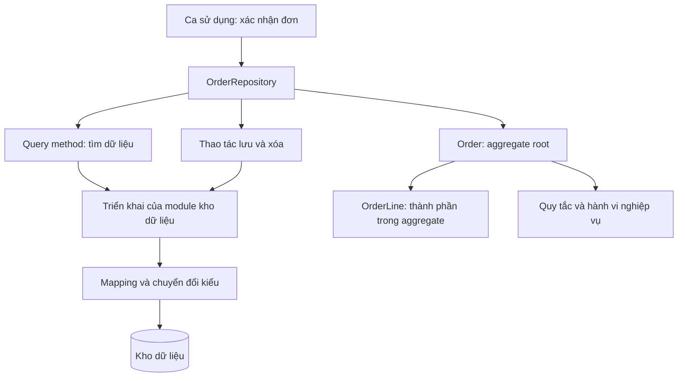

# Bản đồ khái niệm: entity, aggregate, repository, query method và mapping

Khi bắt đầu dùng Spring Data, ta thường thấy một lớp Java có `@Id`, một interface kế thừa `CrudRepository`, rồi một phương thức như `findByStatus`. Những thành phần này cùng xuất hiện trong một tính năng lưu dữ liệu, nhưng giải quyết các vấn đề khác nhau. Nếu xem tất cả là thao tác với bảng, ta dễ tạo repository cho từng lớp, đưa quy tắc nghiệp vụ vào truy vấn hoặc cho rằng đổi kho dữ liệu chỉ cần đổi dependency.

Trong phạm vi Spring Data Commons (`SPRING_DATA_COMMONS`), bài này xây dựng bản đồ nối năm khái niệm: **entity, aggregate, repository, query method và mapping**. Commons cung cấp nhiều abstraction và hạ tầng dùng chung; module dành cho từng kho dữ liệu hiện thực hóa chúng theo khả năng riêng. Vì vậy, ta cần phân biệt mô hình miền, hợp đồng truy cập dữ liệu và cách hợp đồng ấy được thực thi.

Ví dụ xuyên suốt là một hệ thống đặt hàng: khách hàng tạo đơn, thêm các dòng sản phẩm, xem danh sách đơn và xác nhận đơn. Các đoạn mã minh họa từng khía cạnh, không tạo thành một ứng dụng có thể chạy độc lập; một ứng dụng thực tế còn cần module Spring Data phù hợp, cấu hình kết nối và mapping hoàn chỉnh.

## 1. Bản đồ tổng thể

Có thể đọc năm khái niệm bằng năm câu hỏi:

| Khái niệm | Câu hỏi chính | Ví dụ trong hệ thống đặt hàng |
| --- | --- | --- |
| Entity | Đối tượng nào cần được nhận diện liên tục qua các thay đổi? | Đơn hàng có `orderId`; dòng hàng có thể có `lineId` nếu nghiệp vụ cần nhận diện riêng. |
| Aggregate | Những đối tượng nào cùng chịu một ranh giới bảo vệ quy tắc nhất quán? | Đơn hàng và các dòng hàng của nó. |
| Repository | Ứng dụng lấy và lưu aggregate hoặc đối tượng miền được quản lý qua hợp đồng nào? | `OrderRepository`. |
| Query method | Hợp đồng tìm dữ liệu diễn đạt điều kiện, kết quả và cách phân trang ra sao? | `findByCustomerIdAndStatus(...)`. |
| Mapping | Trạng thái đối tượng, định danh và quan hệ được biểu diễn trong kho dữ liệu thế nào? | `Order.customerId` được lưu vào cột hoặc trường `customer_id`. |



Sơ đồ thể hiện các trách nhiệm và quan hệ, không khẳng định mọi lệnh luôn đi qua đúng một chuỗi đối tượng nội bộ. Mapping tham gia cả khi ghi lẫn khi đọc; một số phép đếm, truy vấn vô hướng hoặc cập nhật trực tiếp không cần dựng toàn bộ aggregate.

Hai quan hệ cần nhớ:

- **Entity và aggregate thuộc cách nhìn về miền nghiệp vụ.** Một aggregate có thể gồm nhiều đối tượng, trong đó có entity và value object.
- **Repository, query method và mapping thuộc cách đưa mô hình vào hoạt động lưu trữ.** Spring Data cung cấp abstraction cho phần này, nhưng abstraction không tự xác định aggregate đúng cho nghiệp vụ.

## 2. Entity: danh tính tồn tại qua thay đổi

### 2.1. Danh tính khác trạng thái

Giả sử đơn `O-105` chuyển từ `DRAFT` sang `CONFIRMED`. Đây vẫn là cùng một đơn, dù trạng thái đã đổi. Ta nhận diện nó bằng danh tính, không bằng toàn bộ giá trị các thuộc tính.

```text
Trước: Order(id=O-105, status=DRAFT, total=350000)
Sau:   Order(id=O-105, status=CONFIRMED, total=350000)

Danh tính giữ nguyên; trạng thái đã thay đổi.
```

Một entity thường có:

- Định danh dùng để phân biệt với các entity cùng loại.
- Trạng thái có thể thay đổi theo thời gian.
- Hành vi hoặc quy tắc quyết định những thay đổi hợp lệ.

Trong Spring Data, repository cần biết kiểu miền và kiểu định danh, chẳng hạn `CrudRepository<Order, UUID>`. Điều đó giúp mô tả hợp đồng CRUD, nhưng chưa đủ để kết luận `Order` đã được mapping hợp lệ cho mọi kho dữ liệu.

### 2.2. Entity trong mô hình miền và persistence entity

Từ “entity” có hai cách dùng thường gặp:

| Ngữ cảnh | Ý nghĩa |
| --- | --- |
| Mô hình miền | Đối tượng được phân biệt chủ yếu bằng danh tính và có vòng đời nghiệp vụ. |
| Jakarta Persistence/JPA | Kiểu được persistence provider quản lý theo quy tắc JPA, thường khai báo bằng `@Entity` và có mapping tương ứng. |

Một lớp có `@Entity` không tự động có thiết kế nghiệp vụ tốt. Ngược lại, entity theo nghĩa miền không bắt buộc phải dùng JPA: nó có thể được lưu qua MongoDB, JDBC hoặc cơ chế khác.

Spring Data Commons không yêu cầu mọi kiểu miền đều gắn `jakarta.persistence.Entity`. Annotation và yêu cầu mapping phụ thuộc module lưu trữ được chọn.

### 2.3. Phân biệt entity với value object

Giả sử đơn hàng có địa chỉ giao hàng. Nếu hai địa chỉ có cùng nội dung và nghiệp vụ xem chúng có thể thay thế cho nhau, địa chỉ ấy phù hợp với vai trò value object. Nếu hệ thống quản lý từng địa chỉ trong sổ địa chỉ bằng một mã riêng, đối tượng địa chỉ trong ngữ cảnh đó có thể là entity.

```text
Order                  -> entity, được nhận diện bằng orderId
ShippingAddress        -> có thể là value object trong đơn hàng
OrderLine              -> có thể là entity nếu cần lineId và vòng đời riêng trong đơn
Money                  -> thường là value object gồm số tiền và đơn vị tiền tệ
```

Vai trò phụ thuộc ngữ cảnh. Không nên thêm ID cho mọi đối tượng chỉ vì công cụ lưu trữ có thể yêu cầu một khóa kỹ thuật. Khóa kỹ thuật và danh tính có ý nghĩa nghiệp vụ cần được phân biệt khi thiết kế.

Một bẫy khác là xây dựng `equals` và `hashCode` từ tất cả thuộc tính thay đổi của entity. Khi thuộc tính đổi, đối tượng có thể hoạt động bất ngờ trong `HashSet` hoặc làm khóa của `HashMap`. Cách xử lý danh tính, ID chưa được cấp và đối tượng do persistence provider quản lý cần được chọn phù hợp với mô hình và công nghệ, không sao chép máy móc cách so sánh của value object.

## 3. Aggregate: ranh giới bảo vệ quy tắc nghiệp vụ

### 3.1. Aggregate root là cửa vào của thay đổi

Một đơn hàng có nhiều dòng hàng. Các quy tắc có thể là:

- Chỉ đơn ở trạng thái `DRAFT` mới được thêm hoặc sửa dòng hàng.
- Số lượng của một dòng phải lớn hơn không.
- Không được xác nhận đơn rỗng.
- Tổng tiền phải tương ứng với các dòng hàng và quy tắc tính tiền đang áp dụng.

Ta nhóm các đối tượng cần cùng bảo vệ những quy tắc này thành một aggregate. `Order` là **aggregate root**, đối tượng đại diện cho aggregate và cung cấp các hành vi thay đổi được phép.

```text
Order aggregate
├── Order: aggregate root, có orderId
├── OrderLine: các dòng hàng thuộc đơn
└── ShippingAddress: địa chỉ chụp lại cho đơn

Product aggregate
└── Product: sản phẩm trong danh mục, có productId
```

`OrderLine` có thể giữ `productId` và giá bán được chốt tại lúc đặt hàng. Việc giữ tham chiếu đến sản phẩm không có nghĩa toàn bộ `Product` nằm trong aggregate của đơn.

Ví dụ hành vi miền, được rút gọn để tập trung vào ranh giới:

```java
// Phần thân bên trong lớp Order; chưa thể hiện mapping lưu trữ.
public void confirm() {
    if (status != OrderStatus.DRAFT) {
        throw new IllegalStateException("Chỉ xác nhận đơn nháp");
    }
    if (lines.isEmpty()) {
        throw new IllegalStateException("Không xác nhận đơn rỗng");
    }
    status = OrderStatus.CONFIRMED;
}
```

Nếu ứng dụng có thể lấy danh sách `lines` rồi tùy ý sửa sau khi đơn đã xác nhận, quy tắc đầu tiên vẫn có thể bị vượt qua. Thiết kế root cần kiểm soát cả những đường thay đổi đó, chẳng hạn chỉ cung cấp thao tác nghiệp vụ và trả ra collection không cho sửa trực tiếp.

### 3.2. Aggregate không đồng nghĩa một bảng hay một đối tượng Java

Một aggregate có thể được lưu trên nhiều bảng, một document có cấu trúc lồng nhau hoặc những cấu trúc khác. Ranh giới lưu trữ và ranh giới nghiệp vụ có liên hệ, nhưng không phải cùng một khái niệm.

| Quyết định | Căn cứ chủ yếu |
| --- | --- |
| Đối tượng nào cùng aggregate? | Quy tắc cần nhất quán và cách nghiệp vụ cho phép thay đổi. |
| Dữ liệu nằm ở bao nhiêu bảng hoặc document? | Khả năng kho dữ liệu, mapping và yêu cầu vận hành. |
| Có tải toàn bộ dữ liệu hay tải theo nhu cầu? | Cơ chế truy cập, hình dạng truy vấn và lựa chọn của module. |
| Có thể ghi nhiều đối tượng nguyên tử không? | Giao dịch, cấu hình và khả năng thực tế của kho dữ liệu. |

Một quan hệ khóa ngoại hoặc annotation quan hệ không tự động xác lập ranh giới aggregate. Chẳng hạn JPA có thể mapping quan hệ từ đơn đến khách hàng, nhưng điều đó không có nghĩa sửa đơn phải kéo toàn bộ khách hàng vào cùng aggregate.

### 3.3. Ranh giới thiết kế chưa phải bảo đảm giao dịch

Aggregate là nơi ta dự định bảo vệ tính nhất quán. Để giữ được tính nhất quán khi nhiều yêu cầu chạy đồng thời, còn cần cơ chế lưu trữ phù hợp.

Ví dụ hai yêu cầu cùng đọc một đơn nháp rồi cùng sửa nó. Kiểm tra `status` trong bộ nhớ không phát hiện được mọi xung đột. Ứng dụng có thể cần giao dịch, kiểm soát phiên bản hoặc điều kiện cập nhật nguyên tử, tùy kho dữ liệu và tình huống.

Không suy ra rằng một lần `save(order)` luôn mang cùng mức nguyên tử, cùng chiến lược khóa hoặc cùng thời điểm ghi trong JPA, JDBC, MongoDB và các module khác. Commons cung cấp hợp đồng dùng chung; bảo đảm cụ thể phải được hiểu ở module triển khai.

## 4. Repository: hợp đồng lấy và lưu đối tượng miền

### 4.1. Hai góc nhìn bổ sung cho nhau

Trong thiết kế hướng miền, repository thường đại diện cho tập aggregate root có thể lấy và lưu. Một nguyên tắc hữu ích là cung cấp repository cho root, để các thay đổi đi qua root và giữ quy tắc nghiệp vụ.

Trong Spring Data, repository đồng thời là một mô hình lập trình bằng interface. Hạ tầng repository tạo proxy và nối hợp đồng ấy với triển khai dành cho kho dữ liệu. Framework không tự kiểm tra rằng kiểu `T` mà ta chọn đã là aggregate root đúng về mặt nghiệp vụ.

```java
import java.util.UUID;
import org.springframework.data.repository.CrudRepository;

public interface OrderRepository extends CrudRepository<Order, UUID> {
}
```

Ở đây:

- `Order` là kiểu miền mà repository quản lý.
- `UUID` là kiểu định danh mà hợp đồng dùng.
- `CrudRepository` cung cấp các thao tác như `save`, `findById`, `findAll`, `count` và `deleteById`.
- Module kho dữ liệu cung cấp cách thực thi phù hợp; chỉ thêm Spring Data Commons không tự tạo kết nối đến một cơ sở dữ liệu.

Không phải viết lớp triển khai cho mọi phương thức CRUD. Tuy nhiên, framework vẫn cần biết repository thuộc module nào, mapping kiểu miền ra sao và phải kết nối đến đâu.

### 4.2. Một số abstraction thường gặp

| Abstraction | Vai trò chính | Lưu ý khi chọn |
| --- | --- | --- |
| `Repository<T, ID>` | Interface đánh dấu kiểu miền và ID. | Tự nó không khai báo đầy đủ các thao tác CRUD. |
| `CrudRepository<T, ID>` | Hợp đồng CRUD đồng bộ. | Nhiều kết quả dạng tập được biểu diễn bằng `Iterable`. |
| `ListCrudRepository<T, ID>` | Biến thể CRUD trả `List` ở những thao tác trả nhiều phần tử tương ứng. | Chọn theo API và phiên bản đang dùng. |
| `PagingAndSortingRepository<T, ID>` | Hợp đồng phân trang và sắp xếp. | Không mặc định mọi phiên bản hoặc mọi interface phân trang đều kế thừa CRUD; kiểm tra quan hệ kế thừa khi ghép hợp đồng. |
| `ReactiveCrudRepository<T, ID>` | Hợp đồng CRUD theo mô hình reactive. | Cần module và driver có hỗ trợ; không chỉ đổi kiểu trả về của repository đồng bộ. |
| Interface chuyên biệt của module | Bổ sung thao tác cho một công nghệ cụ thể. | Ví dụ `JpaRepository` hoặc `MongoRepository`; các tính năng bổ sung không trở thành cam kết chung của Commons. |

Đây là bản đồ lựa chọn, không phải lời khuyên kế thừa tất cả interface. Chỉ mở các thao tác ứng dụng thực sự cần và phù hợp với module đã chọn.

### 4.3. `save` có hợp đồng chung, nhưng cơ chế thực thi khác nhau

Không nên hiểu `save` đơn giản là một câu SQL `INSERT` hoặc `UPDATE` có cùng hành vi ở mọi nơi. Việc xác định đối tượng mới, xử lý ID, chuyển đổi trạng thái và thời điểm tương tác với kho dữ liệu tùy triển khai.

Hợp đồng `save` trả lại đối tượng đã lưu. Khi cần tiếp tục dùng kết quả, hãy sử dụng giá trị trả về:

```java
Order saved = orderRepository.save(order);
```

Giá trị trả về có thể chứa ID, phiên bản hoặc trạng thái đã được xử lý; một số mô hình có thể trả về một instance khác. Không mặc định tham chiếu truyền vào luôn chứa đủ kết quả sau lưu.

Riêng trong một giao dịch JPA có persistence context, entity đang được quản lý có thể được đồng bộ bằng cơ chế theo dõi thay đổi. Không suy rộng cơ chế đó cho mọi Spring Data repository. Với từng module, cần biết đối tượng đọc ra có còn được quản lý hay chỉ là dữ liệu đã được ánh xạ thành một đối tượng Java.

### 4.4. Repository cho root và truy vấn phục vụ đọc

Nếu nghiệp vụ chỉ cho phép thay đổi `OrderLine` qua `Order`, việc tạo `OrderLineRepository` rồi sửa dòng trực tiếp có thể làm hỏng ranh giới đã thiết kế.

Tuy vậy, màn hình báo cáo có thể cần danh sách dòng hàng mà không tải đầy đủ từng đơn. Có thể thiết kế truy vấn hoặc mô hình đọc riêng cho nhu cầu ấy. Cần phân biệt quyền **đọc một lát dữ liệu** với quyền **thay đổi thành phần bên trong aggregate**.

## 5. Query method: mô tả truy vấn trong hợp đồng repository

### 5.1. Derived query liên kết với thuộc tính của mô hình

Giả sử kiểu `Order` có các thuộc tính `customerId`, `status` và `createdAt`:

```java
import java.util.List;
import java.util.UUID;
import org.springframework.data.domain.Page;
import org.springframework.data.domain.Pageable;
import org.springframework.data.domain.Slice;
import org.springframework.data.repository.CrudRepository;

public interface OrderRepository extends CrudRepository<Order, UUID> {

    List<Order> findByCustomerIdAndStatusOrderByCreatedAtDesc(
        UUID customerId,
        OrderStatus status
    );

    Page<Order> findByCustomerId(UUID customerId, Pageable pageable);

    Slice<Order> findByStatus(OrderStatus status, Pageable pageable);
}
```

Tên phương thức đầu tiên diễn đạt:

```text
findBy
  CustomerId       -> điều kiện trên thuộc tính customerId
  AndStatus        -> kết hợp thêm điều kiện trên status
  OrderByCreatedAtDesc -> sắp xếp createdAt giảm dần
```

Hạ tầng Spring Data phân tích cấu trúc tên phương thức; module kho dữ liệu chuyển cấu trúc được hỗ trợ thành truy vấn cụ thể. Không phải Commons tự tạo một câu SQL phổ quát cho mọi database.

Các từ khóa, kiểu trả về và phép toán được hỗ trợ có thể khác giữa các module. Một tên phương thức nhìn có vẻ hợp lệ về mặt Java chưa đủ để chứng minh truy vấn chạy được trong kho dữ liệu đang dùng.

### 5.2. Thuộc tính Java khác tên cột hoặc tên trường lưu trữ

Giả sử:

```text
Thuộc tính Java: customerId
Cột SQL:        customer_id
Trường MongoDB: customer_id
```

Derived query vẫn thường được viết theo thuộc tính mô hình:

```java
findByCustomerId(...)
```

Không đổi thành tên dựa trên `customer_id` chỉ vì schema dùng snake case. Hạ tầng phân giải đường dẫn thuộc tính trước; mapping của module xử lý tên được lưu trong kho dữ liệu.

Ngược lại, khi viết truy vấn khai báo trực tiếp, quy tắc tên phụ thuộc ngôn ngữ truy vấn. JPQL thường làm việc với entity và thuộc tính; SQL làm việc với bảng và cột; cú pháp truy vấn MongoDB có quy tắc riêng của module. Annotation trùng tên như `@Query` ở các module khác nhau không có nghĩa chúng nhận cùng một ngôn ngữ.

### 5.3. Query method không chỉ là derived query

Có nhiều cách hiện thực hóa nhu cầu tìm dữ liệu:

| Cách tiếp cận | Khi thường phù hợp | Điều cần xác minh |
| --- | --- | --- |
| Derived query | Điều kiện tương đối ngắn, dễ đọc từ tên phương thức. | Thuộc tính, từ khóa và kiểu trả về được module hỗ trợ. |
| Truy vấn khai báo trực tiếp | Cần kiểm soát rõ truy vấn hoặc tên phương thức đã quá dài. | Annotation, ngôn ngữ và quy tắc bind tham số của module. |
| Repository fragment tùy biến | Thuật toán truy vấn, tích hợp hoặc tối ưu không phù hợp với khai báo đơn giản. | Cách ghép fragment và triển khai truy cập dữ liệu. |
| Query by Example | Tìm theo các giá trị trong một đối tượng mẫu và matcher. | Module có hỗ trợ executor tương ứng và giới hạn biểu đạt nào. |

`Example`, `ExampleMatcher` và hạ tầng repository có thể là abstraction dùng chung, nhưng không biến mọi loại kho dữ liệu thành cùng một công cụ truy vấn. Một nghiệp vụ có nhiều nhánh điều kiện hoặc yêu cầu đặc thù không nhất thiết phù hợp với Query by Example.

### 5.4. Quy tắc nghiệp vụ không biến mất vì đã có điều kiện truy vấn

Phương thức sau có thể hữu ích để đọc những đơn đang chờ xử lý:

```java
List<Order> findByStatus(OrderStatus status);
```

Nhưng việc một đơn xuất hiện trong kết quả `status = DRAFT` không bảo đảm nó vẫn là đơn nháp ở thời điểm ghi sau đó. Query method trả lời điều kiện tìm tại thời điểm truy vấn; root kiểm tra quy tắc thay đổi; cơ chế giao dịch và kiểm soát đồng thời xử lý xung đột thích hợp.

Ba trách nhiệm đó bổ sung cho nhau. Chỉ lọc đơn nháp trong truy vấn rồi bỏ kiểm tra trong `confirm()` sẽ tạo lỗ hổng ở những luồng gọi khác.

## 6. Phân trang, sắp xếp và hình dạng kết quả

Spring Data Commons cung cấp các kiểu thường gặp như `Sort`, `Pageable`, `Page` và `Slice`. Chúng mô tả yêu cầu hoặc kết quả truy vấn, không thay thế mapping của entity.

```java
import org.springframework.data.domain.Page;
import org.springframework.data.domain.PageRequest;
import org.springframework.data.domain.Pageable;
import org.springframework.data.domain.Sort;

Pageable firstPage = PageRequest.of(
    0,
    20,
    Sort.by(Sort.Order.desc("createdAt"), Sort.Order.desc("id"))
);

Page<Order> orders = orderRepository.findByCustomerId(customerId, firstPage);
```

Trong ví dụ này, các thuộc tính sắp xếp là thuộc tính Java của `Order`; khả năng sắp xếp theo kiểu dữ liệu của chúng phải phù hợp với kho dữ liệu. Chỉ số trang bắt đầu từ `0`.

| Kết quả | Thông tin đi kèm | Ý nghĩa khi chọn |
| --- | --- | --- |
| `List<Order>` | Danh sách phần tử. | Không tự mang metadata tổng số trang hoặc cờ còn trang sau. |
| `Slice<Order>` | Một lát dữ liệu và thông tin điều hướng như có lát tiếp theo hay không. | Phù hợp khi giao diện chỉ cần tiếp tục tải, không cần tổng số bản ghi. |
| `Page<Order>` | Nội dung trang cùng thông tin tổng số phần tử và tổng số trang. | Có thể cần thêm phép đếm; chi phí tùy truy vấn và module. |

Không khẳng định rằng mỗi lần trả `Page` luôn chạy đúng hai truy vấn: triển khai có thể suy ra hoặc tối ưu phần đếm trong một số trường hợp. Điều cần nhớ là yêu cầu biết tổng số có thể tạo thêm chi phí.

Sắp xếp ổn định cũng quan trọng. Nếu nhiều đơn cùng `createdAt`, chỉ sắp theo thời điểm có thể không đủ để xác định thứ tự giữa chúng. Có thể thêm thuộc tính phân định duy nhất như `id` nếu kho dữ liệu hỗ trợ. Dù vậy, thêm hoặc xóa dữ liệu giữa hai lần lấy trang vẫn có thể làm kết quả phân trang theo offset dịch chuyển; thứ tự ổn định không biến nhiều truy vấn thành một ảnh chụp nhất quán.

## 7. Mapping: cầu nối từ mô hình đến biểu diễn lưu trữ

### 7.1. Mapping trả lời những gì?

Mapping thường cần xác định:

- Đâu là định danh, đâu là thuộc tính dữ liệu và đâu là dữ liệu không lưu.
- Tên bảng, collection, cột hoặc trường tương ứng.
- Cách biểu diễn đối tượng lồng nhau và tham chiếu.
- Cách chuyển đổi kiểu Java sang kiểu lưu trữ và chiều ngược lại.
- Cách tạo đối tượng khi đọc, bao gồm constructor hoặc cơ chế khởi tạo được hỗ trợ.
- Những thuộc tính đặc biệt như phiên bản và dữ liệu auditing, khi module hỗ trợ và được cấu hình.

Spring Data Commons có hạ tầng metadata và chuyển đổi dùng chung cho các module sử dụng nó. Điều này không có nghĩa mọi module đều dùng một bộ annotation hay cùng một chiến lược mapping. Với Spring Data JPA, JPA provider đảm nhiệm phần mapping ORM theo cơ chế JPA.

### 7.2. Cùng mô hình khái niệm, annotation khác nhau

Một phần mapping cho JPA có thể trông như sau:

```java
import java.util.UUID;
import jakarta.persistence.Column;
import jakarta.persistence.Entity;
import jakarta.persistence.Id;
import jakarta.persistence.Table;

@Entity
@Table(name = "purchase_orders")
class Order {

    @Id
    private UUID id;

    @Column(name = "customer_id")
    private UUID customerId;

    protected Order() {
    }

    // Các thuộc tính, hành vi và mapping còn lại được lược bỏ.
}
```

Một phần mapping cho MongoDB, trong phương án triển khai khác, có thể là:

```java
import java.util.UUID;
import org.springframework.data.annotation.Id;
import org.springframework.data.mongodb.core.mapping.Document;
import org.springframework.data.mongodb.core.mapping.Field;

@Document(collection = "orders")
class Order {

    @Id
    private UUID id;

    @Field("customer_id")
    private UUID customerId;

    // Các thuộc tính, hành vi và cấu hình còn lại được lược bỏ.
}
```

Đây là hai phương án riêng, không phải hai lớp cùng tên đặt chung một package. Những đoạn trích này chỉ minh họa định danh và tên lưu trữ; chưa mô tả đầy đủ cách cấp ID, biểu diễn UUID, lưu dòng hàng hoặc dựng đối tượng.

Hai annotation `@Id` có tên ngắn giống nhau nhưng đến từ package khác nhau. `jakarta.persistence.Id` thuộc JPA; `org.springframework.data.annotation.Id` thuộc Spring Data và được những module phù hợp sử dụng. Import đúng là một phần của mapping đúng.

### 7.3. Khác biệt giữa các kho dữ liệu ảnh hưởng thiết kế

| Phương án | Cách nhìn hữu ích khi thiết kế | Không nên mặc định |
| --- | --- | --- |
| Spring Data JPA | Mapping entity và quan hệ dựa trên JPA provider; có persistence context. | Mọi quan hệ đều cần tải ngay hoặc mọi bảng là một aggregate độc lập. |
| Spring Data JDBC | Mô hình truy cập nhấn mạnh aggregate và mapping quan hệ của Spring Data Relational. | Có cùng cơ chế lazy loading và theo dõi thay đổi của JPA. |
| Spring Data MongoDB | Mapping sang document, có thể nhúng dữ liệu hoặc biểu diễn tham chiếu theo thiết kế. | Mọi tham chiếu đều tự nạp hoặc mọi thay đổi qua nhiều document đều nguyên tử. |
| Module reactive phù hợp | Truy cập theo hợp đồng reactive và khả năng driver. | Bọc repository đồng bộ trong `Mono` đã tạo ra đường truy cập không chặn. |

Bảng này giúp đặt câu hỏi thiết kế, không thay thế tài liệu cho từng module. Việc chọn nhúng hay tham chiếu, cách tải dữ liệu và giao dịch cần được quyết định theo nhu cầu và khả năng thực tế của công nghệ.

## 8. Projection và metadata nằm ở đâu trong bản đồ?

### 8.1. Projection thay đổi góc nhìn đọc

Màn hình danh sách đơn có thể chỉ cần mã đơn, trạng thái và thời điểm tạo. Có thể mô tả hình dạng đọc hẹp hơn:

```java
import java.time.Instant;
import java.util.UUID;

public interface OrderSummary {
    UUID getId();
    OrderStatus getStatus();
    Instant getCreatedAt();
}
```

Repository đọc tương ứng, khi module hỗ trợ dạng projection này:

```java
import java.util.List;
import java.util.UUID;
import org.springframework.data.repository.Repository;

public interface OrderReadRepository extends Repository<Order, UUID> {
    List<OrderSummary> findByCustomerId(UUID customerId);
}
```

Ở đây `Order` vẫn là kiểu miền mà repository gắn với; `OrderSummary` là hình dạng kết quả của query method. Projection không tự trở thành entity hay aggregate root mới. Nó cũng không phải lời hứa rằng truy vấn luôn chỉ lấy đúng ba trường: khả năng tối ưu phụ thuộc kiểu projection, truy vấn và module.

Khi cần xác nhận đơn, ứng dụng thường phải làm việc với trạng thái và hành vi của aggregate hoặc một cơ chế ghi có kiểm soát tương đương. Không dùng projection chỉ phục vụ hiển thị như thể nó luôn chứa đủ thông tin để kiểm tra mọi quy tắc ghi.

### 8.2. Metadata giúp hạ tầng hiểu hợp đồng và mô hình

Có thể hình dung hai nhóm metadata:

| Nhóm | Ví dụ | Hạ tầng dùng để làm gì? |
| --- | --- | --- |
| Metadata repository | Kiểu miền, kiểu ID, chữ ký phương thức, kiểu kết quả. | Chọn cách xử lý phương thức, tham số và kết quả. |
| Metadata mapping | Thuộc tính ID, tên lưu trữ, converter, cách khởi tạo đối tượng. | Chuyển giữa đối tượng và biểu diễn trong kho dữ liệu. |

Một phương thức `findByCustomerId` kết nối cả hai: hợp đồng repository khai báo điều kiện và kết quả; mô hình cho biết `customerId` là thuộc tính nào; mapping quyết định nó nằm ở đâu và biểu diễn thế nào trong kho dữ liệu.

### 8.3. Auditing bổ sung dữ liệu lịch sử thao tác

Các thông tin như thời điểm tạo, thời điểm sửa hoặc người sửa có thể được hỗ trợ bằng auditing khi đã cấu hình đúng module và nguồn thông tin cần thiết. Auditing liên quan đến metadata và vòng đời lưu dữ liệu.

Tuy nhiên, `createdAt` không phải danh tính; `lastModifiedAt` không tự thay thế kiểm soát đồng thời; và biết ai sửa không bảo đảm thao tác sửa tuân thủ quy tắc của aggregate. Các vai trò này cần được giữ rõ ngay cả khi nằm chung trong một lớp Java.

## 9. Theo dõi một ca sử dụng từ đầu đến cuối

Xét yêu cầu: “Khách hàng xác nhận một đơn hàng của mình”. Giả sử hệ thống dùng repository đồng bộ và đã cấu hình cơ chế giao dịch phù hợp.

```java
import java.util.UUID;

public final class ConfirmOrderService {

    private final OrderRepository orders;

    public ConfirmOrderService(OrderRepository orders) {
        this.orders = orders;
    }

    public Order confirm(UUID orderId, UUID customerId) {
        Order order = orders.findById(orderId)
            .orElseThrow(() -> new IllegalArgumentException("Không tìm thấy đơn"));

        if (!order.belongsTo(customerId)) {
            throw new IllegalStateException("Không được xác nhận đơn này");
        }

        order.confirm();
        return orders.save(order);
    }
}
```

Đây là luồng điều phối minh họa; lớp `Order` cần hiện thực `belongsTo` và `confirm`. Đoạn mã không tự cấu hình giao dịch hay xử lý đầy đủ các cuộc đua cập nhật. Trong ứng dụng thực tế, ranh giới giao dịch và chính sách xử lý xung đột phải được thiết lập bằng cơ chế của module đã chọn.

Có thể đọc từng bước qua năm khái niệm:

1. **Repository** nhận `orderId` và trả về đơn hoặc kết quả rỗng.
2. **Mapping** dựng trạng thái đối tượng từ biểu diễn trong kho dữ liệu, theo cách tải được module hỗ trợ.
3. **Entity** được nhận diện bằng `orderId`; việc thay đổi trạng thái không làm nó thành đơn khác.
4. **Aggregate root** kiểm tra hành vi xác nhận và bảo vệ quy tắc của đơn.
5. **Repository** lưu lại kết quả; mapping và triển khai kho dữ liệu quyết định cơ chế ghi cụ thể.

Trong ví dụ, `findById` là phương thức CRUD đã có sẵn, không cần đặt tên một derived query mới. Nếu chuyển sang tìm bằng `findByIdAndCustomerId`, đó là lựa chọn diễn đạt điều kiện truy vấn; kiểm soát truy cập vẫn cần được bảo đảm nhất quán trong toàn bộ luồng ứng dụng.

## 10. Những nhầm lẫn làm bản đồ bị lệch

| Nhầm lẫn | Hệ quả | Cách hiểu phù hợp |
| --- | --- | --- |
| Mỗi bảng phải có một repository. | Có thể tạo đường sửa trực tiếp vào thành phần bên trong aggregate. | Xác định root và đường thay đổi trước; tổ chức repository ghi theo ranh giới đó. |
| Một aggregate phải nằm trong một bảng. | Ép thiết kế nghiệp vụ theo schema hoặc chia nhỏ ranh giới sai. | Aggregate là ranh giới nhất quán; mapping quyết định biểu diễn lưu trữ. |
| Có `@Entity` là đã thiết kế xong entity nghiệp vụ. | Lớp chỉ còn getter/setter và các quy tắc bị phân tán. | Danh tính, hành vi và bất biến vẫn cần được mô hình hóa. |
| Derived query dùng tên cột database. | Không tìm được thuộc tính hoặc diễn đạt sai đường dẫn. | Dùng thuộc tính mô hình; để mapping xử lý tên lưu trữ. |
| Commons hỗ trợ một abstraction thì mọi store có đủ khả năng tương ứng. | Chọn API hoặc truy vấn không chạy được với module hiện tại. | Xác minh hỗ trợ ở module và driver đang dùng. |
| `save` có hành vi nội bộ giống nhau ở mọi repository. | Dựa nhầm vào dirty checking, thời điểm ghi hoặc nhận diện đối tượng mới. | Hiểu hợp đồng chung và cơ chế riêng của công nghệ. |
| Projection chính là aggregate nhẹ hơn. | Dùng dữ liệu thiếu để quyết định thay đổi nghiệp vụ. | Projection là hình dạng đọc; aggregate là ranh giới quy tắc. |
| Có trường phiên bản hoặc annotation là tự có mọi bảo đảm đồng thời. | Tưởng xung đột đã được xử lý trong mọi đường ghi. | Kiểm tra hỗ trợ thực tế, đường cập nhật và cách xử lý lỗi xung đột. |

Một tên query method dài đến mức khó đọc cũng là dấu hiệu nên xem lại cách diễn đạt. Có thể tách nhu cầu đọc, dùng truy vấn khai báo hoặc fragment tùy biến, thay vì buộc toàn bộ nghiệp vụ vào một tên phương thức.

## 11. Bài tập nối khái niệm

### Tình huống

Một hệ thống có các yêu cầu sau:

- Mỗi đơn có một mã duy nhất và nhiều dòng hàng.
- Mỗi dòng ghi mã sản phẩm, số lượng và giá bán tại lúc đặt.
- Đơn đã xác nhận không được sửa dòng.
- Khách hàng cần xem danh sách đơn theo trạng thái, mỗi lần 20 đơn.
- Giao diện danh sách chỉ cần mã đơn, trạng thái và thời điểm tạo.
- Một công cụ hiện tại lưu dữ liệu trong SQL; nhóm đang cân nhắc dùng document cho một dịch vụ khác.

Hãy xác định entity, aggregate root, repository, query method, projection và trách nhiệm mapping.

### Gợi ý trả lời

1. `Order` là entity vì có danh tính qua các thay đổi. `OrderLine` cần được cân nhắc theo nghiệp vụ: nếu có thao tác nhận diện một dòng riêng qua thời gian, có thể mô hình hóa nó là entity bên trong aggregate.
2. `Order` là aggregate root hợp lý cho các quy tắc sửa và xác nhận đơn. Các thao tác sửa dòng đi qua root, để trạng thái đã xác nhận không bị vượt qua bằng đường ghi khác.
3. `OrderRepository` là hợp đồng lấy và lưu đơn. Không tự suy ra phải có repository ghi riêng cho từng dòng hàng.
4. Query method có thể lọc đồng thời theo `customerId` và `status`, nhận `Pageable`. Dùng `Slice` nếu chỉ cần biết có trang tiếp; dùng `Page` nếu sản phẩm cần tổng số.
5. `OrderSummary` là projection cho danh sách. Việc chọn projection không thay thế thiết kế aggregate cho luồng sửa hoặc xác nhận.
6. Mapping xác định ID, tên lưu trữ, cách biểu diễn dòng hàng, tiền tệ và thời điểm. Khi đổi từ SQL sang document, phải xem lại mapping, giao dịch, truy vấn và chỉ mục; không chỉ đổi interface cha.

Giá bán được chụp lại trong dòng hàng cũng cho thấy một quyết định miền: tổng tiền đơn cũ không được tự đổi chỉ vì giá hiện tại của `Product` thay đổi. Quyết định này phải được phản ánh nhất quán trong cả mô hình và dữ liệu lưu.

## 12. Cách đọc một repository từ nay về sau

Khi gặp một interface repository mới, hãy đi theo thứ tự:

1. Nhìn kiểu miền và kiểu ID: đối tượng nào đang được quản lý, danh tính của nó là gì?
2. Xác định ranh giới aggregate: đối tượng nào chịu trách nhiệm giữ quy tắc khi trạng thái đổi?
3. Đọc hợp đồng truy cập: CRUD nào được mở, query method nào phục vụ từng ca sử dụng?
4. Đọc hình dạng kết quả: entity, collection, `Page`, `Slice` hay projection?
5. Đối chiếu mapping và module: dữ liệu được biểu diễn thế nào, tính năng nào thật sự được hỗ trợ, cơ chế giao dịch và đồng thời ra sao?

Năm khái niệm ghép lại thành một đường hiểu rõ ràng: **entity cung cấp danh tính; aggregate đặt ranh giới quy tắc; repository cung cấp hợp đồng truy cập; query method diễn đạt nhu cầu tìm; mapping nối mô hình với kho dữ liệu**. Spring Data Commons giúp chia sẻ nhiều phần của hợp đồng và hạ tầng ấy, còn tính đúng đắn của mô hình và khả năng của từng store vẫn cần được xác định trong thiết kế ứng dụng.
