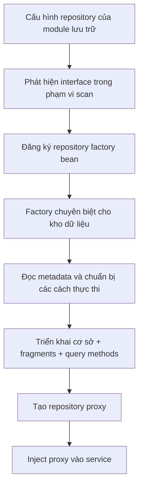
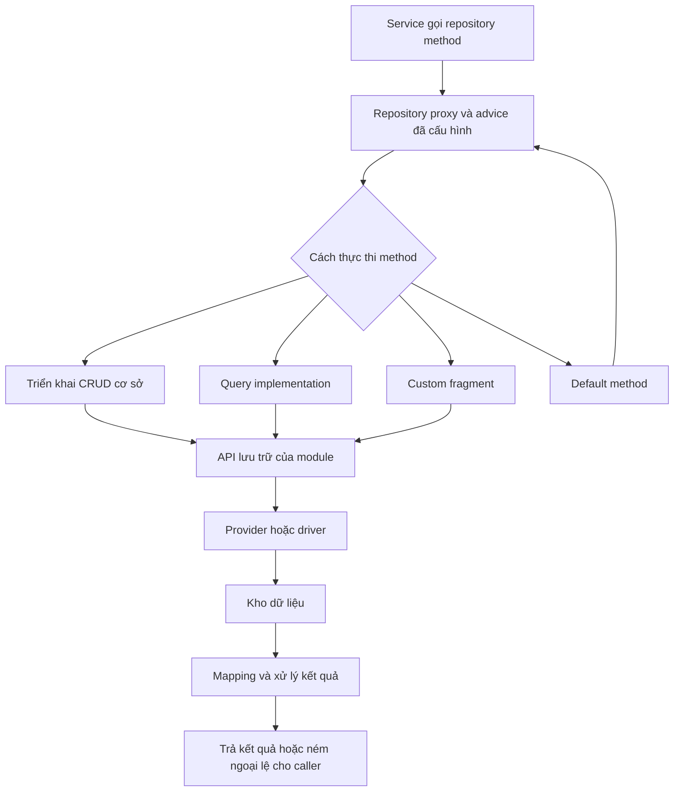

# Luồng xử lý từ giao diện repository đến triển khai truy cập dữ liệu

Khi một service gọi `customerRepository.findById(id)`, đối tượng nhận lời gọi thường là một proxy do hạ tầng Spring Data tạo ra. Từ proxy đó, method được chuyển đến triển khai CRUD, cơ chế thực thi query hoặc phần mở rộng do ứng dụng cung cấp. Cuối đường đi mới là API truy cập dữ liệu của công nghệ lưu trữ.

Trong module `SPRING_DATA_COMMONS`, việc hiểu đường đi này giúp giải thích vì sao chỉ khai báo interface vẫn có thể truy cập dữ liệu, vì sao các method trong cùng repository có thể có cách thực thi khác nhau, và vì sao cùng một abstraction chưa bảo đảm các kho dữ liệu hỗ trợ cùng tính năng.

Sau bài này, bạn có thể:

- Phân biệt việc tạo repository bean với việc thực thi một lời gọi repository.
- Nhận diện đường đi của CRUD, derived query, declared query và custom fragment.
- Xác định vai trò của metadata, phân trang, sắp xếp và kiểu kết quả trong luồng xử lý.
- Khoanh vùng lỗi ở tầng cấu hình, tạo truy vấn, thực thi hay ánh xạ dữ liệu.

## 1. Phân chia trách nhiệm trước khi theo dõi lời gọi

Spring Data Commons cung cấp các hợp đồng và hạ tầng dùng chung như `Repository`, `CrudRepository`, metadata của repository, cơ chế tạo proxy, mô hình query method, `Pageable`, `Sort` và `Page`. Module cho từng loại kho dữ liệu bổ sung cách tạo và thực thi repository phù hợp.

| Thành phần | Trách nhiệm trong luồng |
| --- | --- |
| Service của ứng dụng | Điều phối nghiệp vụ, kiểm tra đầu vào và xác định ranh giới giao dịch phù hợp |
| Interface repository | Khai báo domain type, kiểu ID và các thao tác mà ứng dụng được gọi |
| Hạ tầng Commons | Phân tích hợp đồng repository, tạo proxy và cung cấp cơ chế định tuyến method |
| Module lưu trữ | Cung cấp factory, triển khai cơ sở, query implementation và tích hợp mapping của công nghệ cụ thể |
| API lưu trữ, provider, driver | Thực thi thao tác theo công nghệ và giao tiếp với hệ thống dữ liệu |
| Kho dữ liệu | Xử lý yêu cầu đọc hoặc ghi và trả về kết quả hoặc lỗi |

Ví dụ, JPA sử dụng `EntityManager` và JPA provider; MongoDB sử dụng hạ tầng MongoDB của Spring Data cùng driver tương ứng. Commons không tự lựa chọn một cơ sở dữ liệu chỉ từ lời gọi `save`, và riêng dependency Commons chưa đủ tạo ra một ứng dụng truy cập JPA hoặc MongoDB.

Interface repository cũng không tự tạo HTTP endpoint. Nếu một controller gọi service rồi service gọi repository, đó là các tầng do ứng dụng tổ chức; HTTP không phải một chặng bắt buộc của repository abstraction.

## 2. Ví dụ xuyên suốt

Giả sử ứng dụng quản lý khách hàng bằng Spring Data JPA. Các đoạn Java dưới đây minh họa từng thành phần trong cùng package. Mỗi kiểu public đặt trong file riêng. Ứng dụng được giả định đã có Spring Data JPA, entity scanning, `EntityManagerFactory`, transaction manager và kết nối cơ sở dữ liệu.

JPA được dùng làm ví dụ để nhìn thấy điểm nối với công nghệ lưu trữ. Những chi tiết như `@Entity`, JPQL hay `EntityManager` thuộc JPA, không phải yêu cầu chung cho mọi module Spring Data.

### 2.1. Domain type

```java
import jakarta.persistence.Entity;
import jakarta.persistence.GeneratedValue;
import jakarta.persistence.Id;

@Entity
public class Customer {

    @Id
    @GeneratedValue
    private Long id;

    private String email;
    private boolean active;

    protected Customer() {
    }

    public Customer(String email, boolean active) {
        this.email = email;
        this.active = active;
    }

    public Long getId() {
        return id;
    }
}
```

Các tên `email` và `active` là tên thuộc tính Java mà derived query sẽ tham chiếu. Việc ánh xạ chúng thành cột nào do cấu hình JPA và provider quyết định.

### 2.2. Một repository chứa nhiều loại method

Trước hết, khai báo hợp đồng cho một phần mở rộng:

```java
public interface ActiveCustomerLookup {

    long countActiveCustomers();
}
```

Repository kết hợp hợp đồng CRUD, các query method và phần mở rộng đó:

```java
import java.util.List;

import org.springframework.data.domain.Page;
import org.springframework.data.domain.Pageable;
import org.springframework.data.jpa.repository.Query;
import org.springframework.data.repository.CrudRepository;
import org.springframework.data.repository.query.Param;

public interface CustomerRepository
        extends CrudRepository<Customer, Long>, ActiveCustomerLookup {

    List<Customer> findByEmailAndActiveTrue(String email);

    Page<Customer> findByActiveTrue(Pageable pageable);

    @Query("select c from Customer c where c.email = :email")
    List<Customer> lookupByEmail(@Param("email") String email);

    default List<Customer> findActiveByEmail(String email) {
        return findByEmailAndActiveTrue(email);
    }
}
```

Đoạn khai báo này chưa cho thấy một lớp duy nhất chứa thân của mọi method:

- `save` và `findById` đã có hợp đồng từ `CrudRepository`.
- `findByEmailAndActiveTrue` mô tả điều kiện truy vấn bằng tên method.
- `lookupByEmail` có truy vấn khai báo bằng annotation `@Query` của module JPA.
- `countActiveCustomers` cần triển khai fragment.
- `findActiveByEmail` có thân `default` ngay trên interface.

Triển khai của `ActiveCustomerLookup` sẽ được bổ sung ở phần 7. Nếu fragment chưa được nhận diện đúng, việc chỉ thêm interface này không làm cho phần mở rộng tự có thân thực thi.

## 3. Giai đoạn khởi tạo: từ interface đến repository bean

Trước khi service có thể gọi repository, Spring phải đăng ký và khởi tạo hạ tầng liên quan. Sơ đồ sau mô tả các trách nhiệm chính, không phải thứ tự chi tiết của mọi callback nội bộ.



### 3.1. Phát hiện interface thuộc phạm vi cấu hình

Với JPA, ứng dụng có thể kích hoạt repository bằng cấu hình tương tự:

```java
import org.springframework.context.annotation.Configuration;
import org.springframework.data.jpa.repository.config.EnableJpaRepositories;

@Configuration
@EnableJpaRepositories(basePackageClasses = CustomerRepository.class)
class RepositoryConfiguration {
}
```

Cấu hình trên xác định phạm vi repository; nó chưa tự khai báo toàn bộ datasource, JPA provider và transaction manager. Nếu ứng dụng dùng Spring Boot và auto-configuration đã đáp ứng yêu cầu, không cần thêm cấu hình trùng chỉ để có annotation này.

Annotation kích hoạt và tài nguyên hạ tầng phải phù hợp với module lưu trữ. Tài liệu Commons dùng `@EnableJpaRepositories` như một ví dụ cho cơ chế cấu hình theo từng module. [Creating Repository Instances](https://docs.spring.io/spring-data/commons/reference/repositories/create-instances.html)

Khi có nhiều module Spring Data trong cùng ứng dụng, phạm vi scan và dấu hiệu nhận diện domain/repository cần rõ ràng. Một interface generic không nên bị mặc định hiểu là thuộc mọi kho dữ liệu.

### 3.2. Đăng ký factory bean và sử dụng factory chuyên biệt

Với JPA, các tên lớp thường gặp là:

- `JpaRepositoryFactoryBean`: tham gia vòng đời bean của Spring để tạo repository.
- `JpaRepositoryFactory`: bổ sung cách xây dựng repository theo JPA.
- `RepositoryFactorySupport`: hạ tầng factory dùng chung ở Commons.

Factory bean và repository được inject là hai đối tượng có vai trò khác nhau. Service nhận đối tượng thực hiện hợp đồng `CustomerRepository`; service không cần tự gọi factory hay tự khởi tạo `SimpleJpaRepository`.

`RepositoryFactorySupport` cung cấp cơ chế tạo proxy thực hiện interface repository. Các method truy vấn được hỗ trợ bởi interceptor và chiến lược tra cứu query. Tên các lớp này hữu ích khi đọc stack trace; ứng dụng thông thường sử dụng repository qua interface. [RepositoryFactorySupport API](https://docs.spring.io/spring-data/commons/docs/current/api/org/springframework/data/repository/core/support/RepositoryFactorySupport.html)

### 3.3. Đọc metadata để hiểu hợp đồng

Generic type và chữ ký method là dữ liệu đầu vào để framework quyết định cách xử lý.

| Metadata cần biết | Ví dụ | Ý nghĩa |
| --- | --- | --- |
| Domain type | `Customer` | Đối tượng mà repository quản lý |
| Kiểu ID | `Long` | Kiểu định danh của thao tác theo ID |
| Method cơ sở | `findById(Long)` | Có thể chuyển đến triển khai CRUD của module |
| Query method | `findByEmailAndActiveTrue(String)` | Cần xác định điều kiện và cách thực thi truy vấn |
| Tham số đặc biệt | `Pageable` | Mang yêu cầu phân trang và sắp xếp |
| Kiểu trả về | `List<Customer>` hoặc `Page<Customer>` | Ảnh hưởng cách lấy và đóng gói kết quả |
| Fragment | `ActiveCustomerLookup` | Cần ghép một triển khai phần mở rộng |

Cần phân biệt metadata của repository với metadata ánh xạ đối tượng. Domain type và kiểu ID chưa đủ để suy ra tên bảng, quan hệ hay converter. Module lưu trữ kết hợp các thông tin này với mô hình mapping tương ứng.

Với JPA, thông tin về trạng thái entity còn giúp quyết định cách `save` xử lý đối tượng mới. Với kho tài liệu, metadata ánh xạ có thể liên quan đến collection, tên field và chuyển đổi kiểu. Không nên đồng nhất tất cả metadata với việc đọc annotation trên interface.

### 3.4. Chuẩn bị các thành phần thực thi và tạo proxy

Factory tổ chức các method thành những đường xử lý thích hợp:

- Triển khai cơ sở cho các thao tác có sẵn của module.
- Query implementation cho các method được nhận diện là truy vấn.
- Fragment được ứng dụng hoặc module bổ sung.
- Cơ chế gọi các default method trên interface.
- Advice liên quan đến các chức năng được cấu hình, chẳng hạn giao dịch và dịch ngoại lệ.

Repository được chuẩn bị lúc nào phụ thuộc cấu hình bootstrap. Nhiều lỗi xuất hiện khi khởi tạo bean; chế độ lazy hoặc deferred có thể làm thời điểm quan sát lỗi thay đổi. Không nên dùng quy tắc “ứng dụng khởi động được thì mọi query đều chạy được”.

## 4. Giai đoạn chạy: proxy chuyển lời gọi đi đâu?

Khi service đã nhận repository bean, mỗi lời gọi đi qua cơ chế của proxy và được chuyển đến phần có khả năng xử lý method đó.

| Method được gọi | Nhóm xử lý trong ví dụ | Điểm thực thi chính |
| --- | --- | --- |
| `save(customer)` | CRUD cơ sở | Triển khai JPA như `SimpleJpaRepository` |
| `findById(id)` | CRUD cơ sở theo định danh | Triển khai JPA theo metadata định danh |
| `findByEmailAndActiveTrue(email)` | Derived query | Query implementation của Spring Data JPA |
| `lookupByEmail(email)` | Declared query | Query implementation xử lý JPQL đã khai báo |
| `countActiveCustomers()` | Custom fragment | `ActiveCustomerLookupImpl` |
| `findActiveByEmail(email)` | Default method | Thân method trên interface, rồi gọi derived query |

Bảng mô tả việc định tuyến theo vai trò, không mô tả một chuỗi `if/else` cố định cho mọi phiên bản. Fragment có thể cung cấp chữ ký trùng với thao tác cơ sở để tùy biến hành vi; khi đó cần xét composition và độ ưu tiên của fragment.

`findById` của hợp đồng CRUD là thao tác dành riêng để tìm theo định danh. Không nên phân tích nó như một derived query thông thường rồi cho rằng nó luôn tìm một thuộc tính bất kỳ có tên `id`.

Luồng chạy có thể hình dung như sau:



Nhánh default quay lại proxy trong ví dụ vì thân `findActiveByEmail` gọi một method repository khác. Một default method chỉ tính toán cục bộ có thể trả kết quả mà không truy cập kho dữ liệu. Custom fragment cũng có thể gọi API hoặc nguồn dữ liệu khác thay vì đi qua API lưu trữ của repository chính.

Sơ đồ không khẳng định mọi lời gọi đều phát sinh network I/O: cache, persistence context hoặc logic cục bộ có thể làm đường đi thực tế ngắn hơn.

## 5. Theo dõi nhánh CRUD với `save`

Service có thể đặt ranh giới giao dịch cho một thao tác nghiệp vụ:

```java
import org.springframework.stereotype.Service;
import org.springframework.transaction.annotation.Transactional;

@Service
public class CustomerService {

    private final CustomerRepository customers;

    public CustomerService(CustomerRepository customers) {
        this.customers = customers;
    }

    @Transactional
    public Customer register(String email) {
        Customer customer = new Customer(email, true);
        return customers.save(customer);
    }
}
```

Giả sử lời gọi `register` đi vào qua Spring service proxy và hạ tầng giao dịch đã được cấu hình, đường đi khái niệm là:

1. Advice giao dịch mở hoặc tham gia giao dịch phù hợp.
2. Service tạo `Customer` rồi gọi repository proxy.
3. Repository chuyển `save` đến triển khai cơ sở của JPA, nếu không có phần tùy biến ghi đè.
4. Triển khai sử dụng thông tin entity để xác định trạng thái mới.
5. `EntityManager` tiếp nhận thao tác lưu theo ngữ nghĩa JPA.
6. Kết quả quay lại service; giao dịch kết thúc theo ranh giới đã thiết lập.

Spring Data JPA sử dụng `persist` cho entity được xác định là mới và `merge` trong trường hợp còn lại. Việc xác định mới mặc định xét thuộc tính version phù hợp rồi đến ID; có thể tùy biến bằng `Persistable`. Vì vậy, “ID có giá trị thì chắc chắn đã tồn tại trong database” không phải một quy tắc đúng cho mọi mô hình. [Persisting Entities](https://docs.spring.io/spring-data/jpa/reference/jpa/entity-persistence.html)

Trong ví dụ, entity dùng ID sinh tự động và không khai báo version. Đối tượng mới tạo có ID `null`, phù hợp đường lưu entity mới theo cơ chế mặc định.

Ba điểm giúp đọc đúng log và kết quả:

- Dùng đối tượng trả về từ `save` khi cần làm việc với trạng thái sau lưu; đặc biệt, `merge` có thể trả về một instance được quản lý khác với instance đầu vào.
- `save` không cam kết một câu `INSERT` hoặc `UPDATE` đã hoàn tất ngay tại dòng gọi. Thời điểm SQL, flush và commit phụ thuộc JPA, provider, chiến lược ID và giao dịch.
- Lỗi ghi dữ liệu có thể xuất hiện khi flush hoặc commit. Log “đã gọi save” chưa chứng minh giao dịch đã commit thành công.

Đây là ngữ nghĩa của nhánh JPA minh họa. Không áp đặt persistence context, `persist` và `merge` lên MongoDB hoặc mọi module khác chỉ vì chúng cũng có method `save`.

## 6. Theo dõi nhánh query method

### 6.1. Derived query: từ tên method đến truy vấn theo kho dữ liệu

Xét lời gọi:

```java
List<Customer> matches =
        customers.findByEmailAndActiveTrue("an@example.com");
```

Tên method mô tả các ý nghĩa sau:

| Phần tên | Ý nghĩa |
| --- | --- |
| `find…By` | Yêu cầu tìm dữ liệu theo điều kiện |
| `Email` | Thuộc tính `email` của `Customer` |
| `And` | Kết hợp điều kiện bằng phép AND |
| `ActiveTrue` | Thuộc tính `active` phải có giá trị true |

Luồng xử lý gồm hai loại công việc:

- **Chuẩn bị cấu trúc truy vấn:** đọc method, xác định đường dẫn thuộc tính, toán tử và kiểu kết quả.
- **Thực thi một lần gọi:** tiếp nhận giá trị tham số, tạo hoặc sử dụng đối tượng query phù hợp, bind giá trị và gọi API lưu trữ.

Không nên hình dung rằng mỗi lần gọi đều phải phân tích lại toàn bộ tên method từ đầu; cũng không nên suy ra mọi câu SQL cuối cùng đã được tạo sẵn và giữ nguyên từ lúc khởi động.

Trong JPA, truy vấn có ý nghĩa tương đương:

```sql
-- JPQL minh họa ý nghĩa; không phải SQL thực tế của database.
select c
from Customer c
where c.email = :email and c.active = true
```

JPA provider quyết định SQL và chi tiết thực thi dựa trên mapping, dialect và ngữ cảnh. Tên thuộc tính trong derived query thuộc mô hình Java; dùng tên cột vật lý thay cho tên thuộc tính có thể làm việc tạo query thất bại.

### 6.2. Declared query: thay nguồn định nghĩa điều kiện

Với `lookupByEmail`, điều kiện truy vấn đến từ `@Query` đã khai báo. Tên `lookupByEmail` không cần được diễn giải thành điều kiện nếu truy vấn khai báo hợp lệ đã được chọn.

Hạ tầng query lookup hỗ trợ các chiến lược như:

- `CREATE`: tạo truy vấn từ tên method.
- `USE_DECLARED_QUERY`: yêu cầu tìm được truy vấn khai báo.
- `CREATE_IF_NOT_FOUND`: ưu tiên truy vấn khai báo, sau đó mới thử tạo theo tên.

Mức hỗ trợ phụ thuộc module. Trong cơ chế mặc định được tài liệu mô tả, `CREATE_IF_NOT_FOUND` là chiến lược kết hợp. Việc chọn chiến lược này liên quan đến query method, không biến mọi method CRUD hoặc fragment thành derived query. [Defining Query Methods](https://docs.spring.io/spring-data/commons/reference/repositories/query-methods-details.html)

Annotation `org.springframework.data.jpa.repository.Query` trong ví dụ thuộc module JPA. Mặc định chuỗi ví dụ là JPQL, tham chiếu entity và thuộc tính; native query cần cấu hình tương ứng. Tài liệu JPA mô tả cả query theo tên method lẫn query khai báo. [JPA Query Methods](https://docs.spring.io/spring-data/jpa/reference/jpa/query-methods.html)

### 6.3. Tham số và kiểu trả về tham gia điều khiển thực thi

Ví dụ lấy khách hàng đang hoạt động theo trang:

```java
import org.springframework.data.domain.Page;
import org.springframework.data.domain.PageRequest;
import org.springframework.data.domain.Sort;

Sort sort = Sort.by("email").ascending()
        .and(Sort.by("id").ascending());

Page<Customer> page = customers.findByActiveTrue(
        PageRequest.of(0, 20, sort));
```

Đoạn gọi này giả định đang nằm trong một phương thức service có ranh giới giao dịch đọc phù hợp. `PageRequest.of(0, 20, …)` yêu cầu trang đầu tiên, tối đa 20 phần tử, kèm thứ tự theo thuộc tính Java.

`Pageable` là tham số đặc biệt để điều khiển query; nó không phải một thuộc tính của entity được so sánh trong điều kiện WHERE.

| Yêu cầu | Tác động có thể quan sát |
| --- | --- |
| `List<Customer>` | Trả tập kết quả theo hợp đồng method, không kèm tổng số trang |
| `Page<Customer>` | Cần nội dung trang và thông tin tổng; có thể phát sinh count query |
| `Slice<Customer>` | Phù hợp khi chỉ cần nội dung và thông tin còn lát tiếp theo |
| `Sort` | Truyền yêu cầu sắp xếp để module chuyển sang cơ chế tương ứng |
| Projection | Kiểu trả về định hướng cách xử lý hoặc tạo biểu diễn kết quả |

Không nên đồng nhất “một lời gọi repository” với “một truy vấn database”. Count query có thể được bỏ qua khi framework suy ra được tổng từ kết quả; quan hệ và chiến lược fetch cũng có thể làm số lần truy cập tăng lên.

Thêm `id` làm tiêu chí phụ giúp thứ tự rõ ràng khi nhiều khách hàng cùng email. Tuy nhiên, phân trang theo offset vẫn có thể dịch chuyển nếu dữ liệu thay đổi giữa các lần đọc.

Projection không tự bảo đảm mọi trường hợp chỉ đọc đúng vài cột; hiệu quả phụ thuộc dạng projection, truy vấn và module. Tương tự, Query by Example yêu cầu hợp đồng như `QueryByExampleExecutor` cùng hỗ trợ của module; chỉ mở rộng `CrudRepository` chưa tự bổ sung mọi khả năng tìm kiếm.

## 7. Theo dõi nhánh custom fragment

Để hiện thực `countActiveCustomers`, bổ sung triển khai tương ứng với interface fragment:

```java
import jakarta.persistence.EntityManager;
import jakarta.persistence.PersistenceContext;

public class ActiveCustomerLookupImpl implements ActiveCustomerLookup {

    @PersistenceContext
    private EntityManager entityManager;

    @Override
    public long countActiveCustomers() {
        return entityManager.createQuery(
                "select count(c) from Customer c where c.active = true",
                Long.class
        ).getSingleResult();
    }
}
```

Đặt lớp trong phạm vi mà hạ tầng repository có thể phát hiện và giữ quy ước tên fragment `ActiveCustomerLookup` cộng hậu tố mặc định `Impl`. Đây là cách ghép một hành vi có thân triển khai vào repository composition.

Đường đi lúc gọi:

```text
service, trong giao dịch đọc phù hợp
  -> CustomerRepository proxy
  -> fragment ActiveCustomerLookupImpl
  -> EntityManager
  -> JPA provider và cơ sở dữ liệu
  -> Long được trả thành long cho caller
```

Tên `countActiveCustomers` không được dùng để tự suy ra thân method trong ví dụ này. Hạ tầng đã có fragment chịu trách nhiệm xử lý chữ ký đó.

Fragments có thể được dùng lại và có thể ghi đè chữ ký của triển khai cơ sở; độ ưu tiên và thứ tự ghép cần được xét nếu có trùng method. Vì vậy, khi một method CRUD chạy khác mong đợi, cần kiểm tra cả fragment thay vì chỉ đọc tên method. [Custom Repository Implementations](https://docs.spring.io/spring-data/commons/reference/repositories/custom-implementations.html)

Fragment phù hợp khi cần thuật toán truy vấn đặc thù hoặc phối hợp API khó diễn đạt qua derived query. Với nhu cầu đếm đơn giản của ví dụ, một derived query như `countByActiveTrue` cũng có thể đủ; fragment ở đây giúp nhìn rõ nhánh thực thi do ứng dụng sở hữu.

Thêm một tên method chưa đủ tạo ra nghiệp vụ tùy ý. Chẳng hạn, khai báo `rebuildCustomerIndex()` mà không có fragment hoặc cơ chế hỗ trợ tương ứng không làm Spring Data tự biết cách dựng lại chỉ mục.

## 8. Giao dịch, kết quả và ngoại lệ nằm ở đâu?

### 8.1. Ranh giới giao dịch có thể bao trùm nhiều lời gọi

Một nghiệp vụ có thể gọi nhiều repository trong cùng service method. Ranh giới giao dịch ở service cho phép diễn tả đơn vị công việc này.

Với JPA, các thao tác CRUD được kế thừa thường nhận cấu hình giao dịch từ triển khai cơ sở. Query method tự khai báo, kể cả default method, không tự nhận cấu hình giao dịch mặc định theo cùng cách. Có thể thiết lập giao dịch ở service hoặc khai báo phù hợp trên repository; đoạn fragment phía trên cũng cần được gọi trong ngữ cảnh giao dịch đã chủ động lựa chọn. [Transactionality](https://docs.spring.io/spring-data/jpa/reference/jpa/transactions.html)

Các annotation giao dịch chỉ có hiệu lực khi hạ tầng tương ứng được kích hoạt và lời gọi đi qua cơ chế áp dụng advice. Trong mô hình proxy thông thường, tự gọi một method khác trong cùng service không tự tạo thêm một lần đi qua service proxy.

Việc này khác với default method repository gọi query method trên repository proxy ở ví dụ trước. Khi phân tích hành vi, cần xác định chính xác đối tượng và proxy nào đang nhận lời gọi.

`readOnly = true` mô tả ý định và có thể được hạ tầng tối ưu hóa; không nên dùng nó thay cho việc thiết kế quyền truy cập hoặc kiểm soát nghiệp vụ ghi.

### 8.2. Kết quả đi ngược qua các tầng

Khi kho dữ liệu trả kết quả, việc chuyển dữ liệu thành đối tượng phụ thuộc công nghệ:

- JPA provider tham gia materialize entity và quản lý persistence context.
- Module dùng template/converter có thể chuyển tài liệu hoặc bản ghi thành domain object.
- Hạ tầng repository xử lý kết quả theo chữ ký, chẳng hạn collection, wrapper hoặc projection.

Có thể gặp các lỗi dù việc gửi query đã thành công: không chuyển được kiểu, constructor projection không phù hợp hoặc dữ liệu vi phạm giả định của kiểu trả về.

Nếu một method có hợp đồng một kết quả mà dữ liệu trả nhiều kết quả, lỗi cardinality khác với trường hợp query không tìm thấy dữ liệu. Cần đọc cả chữ ký method lẫn dữ liệu thực tế để hiểu lỗi.

### 8.3. Ngoại lệ có thể được dịch nhưng không mất ý nghĩa nguyên nhân

Hạ tầng Spring có cơ chế chuyển ngoại lệ persistence sang hệ thống `DataAccessException` khi tích hợp phù hợp. Phần cause vẫn quan trọng để xác định lỗi ràng buộc, kết nối, cú pháp hoặc timeout.

Không nên bắt mọi ngoại lệ rồi trả danh sách rỗng:

```java
// Không dùng kết quả "không có dữ liệu" để che lỗi truy cập dữ liệu.
try {
    return customers.findByEmailAndActiveTrue(email);
} catch (RuntimeException ex) {
    return java.util.Collections.emptyList();
}
```

Đoạn trên làm lỗi database có cùng biểu hiện với truy vấn hợp lệ nhưng không có khách hàng. Một ứng dụng cần chọn cách truyền hoặc chuyển lỗi có chủ đích, đồng thời giữ thông tin phục vụ chẩn đoán.

## 9. Cùng abstraction, đường thực thi theo từng kho dữ liệu

| Khía cạnh | Ví dụ Spring Data JPA | Ví dụ Spring Data MongoDB |
| --- | --- | --- |
| Hợp đồng dùng chung | `CrudRepository<T, ID>` và các kiểu liên quan | Có thể sử dụng các hợp đồng dùng chung phù hợp |
| Triển khai cơ sở thường gặp | `SimpleJpaRepository` | `SimpleMongoRepository` |
| API truy cập dữ liệu | `EntityManager` | `MongoOperations`, thường qua `MongoTemplate` |
| Hạ tầng thấp hơn | JPA provider, JDBC driver | MongoDB driver |
| Biểu diễn truy vấn | JPQL, Criteria hoặc SQL tùy đường gọi | Cấu trúc query theo MongoDB |
| Ngữ nghĩa lưu và giao dịch | Theo JPA và cơ sở dữ liệu quan hệ | Theo module, cấu hình và khả năng MongoDB |

Điểm tái sử dụng là cách mô tả hợp đồng và các thành phần hạ tầng chung. Khi chuyển kho dữ liệu, vẫn phải đánh giá từ khóa truy vấn, mapping, tính nhất quán, transaction và kiểu kết quả được hỗ trợ.

Với repository reactive, giá trị trả về như `Mono` hoặc `Flux` còn thể hiện một pipeline. Công việc truy cập dữ liệu thường được kích hoạt khi có subscription; không áp nguyên mô hình “method trả về là I/O đã xong” của ví dụ đồng bộ. Bài này dùng repository đồng bộ để tập trung vào định tuyến method.

Auditing cũng cần được tích hợp theo module. Khai báo annotation ngày tạo hoặc người cập nhật chưa tự bảo đảm mọi đường ghi đều được auditing; cần cấu hình và cơ chế callback/listener phù hợp. Đặc biệt, một thao tác ghi trực tiếp trong fragment phải được đánh giá theo đường thực thi thực tế của nó.

## 10. Dùng đường đi để khoanh vùng lỗi

Thay vì xem repository là một hộp đen, hãy xác định lỗi xuất hiện trước hay sau khi method thực sự đi đến API lưu trữ.

| Biểu hiện | Điểm cần xem trước | Câu hỏi chẩn đoán |
| --- | --- | --- |
| Không inject được repository | Scan, đăng ký bean, cấu hình module | Interface có nằm trong phạm vi được kích hoạt không? |
| Domain không được nhận diện | Entity/domain mapping | Module có nhận diện và quản lý đúng domain type không? |
| Lỗi thuộc tính trong query method | Chuẩn bị derived query | Tên method có khớp thuộc tính Java và đường dẫn lồng nhau không? |
| Không tìm thấy triển khai custom | Ghép fragment | Interface, lớp triển khai và quy ước phát hiện có khớp không? |
| `save` lỗi khi commit | Provider, transaction và database | Có vi phạm ràng buộc hoặc lỗi phát sinh lúc flush không? |
| Trả sai số phần tử hoặc lỗi một kết quả | Query, dữ liệu và kiểu trả về | Hợp đồng một kết quả có phù hợp cardinality thực tế không? |
| Nhiều query hơn dự kiến | Pagination, mapping và fetch | Có count query hoặc truy cập thêm quan hệ không? |
| Giao dịch không có hiệu lực như dự kiến | Proxy và ranh giới giao dịch | Lời gọi có đi qua proxy đúng tầng và transaction manager đúng không? |

Một derived query sai tên có thể bị phát hiện trước khi database nhận query. Ngược lại, cấu trúc repository hợp lệ vẫn có thể gặp lỗi kết nối hoặc ràng buộc lúc chạy. Thời điểm phát hiện là một manh mối, không thay thế cho việc đọc nguyên nhân gốc.

### Bài tập đọc luồng

Dùng các khai báo trong bài và tự mô tả đường đi của bốn lời gọi:

1. `customers.findById(10L)`: xác định nhánh CRUD và điểm dùng metadata ID.
2. `customers.findActiveByEmail("an@example.com")`: xác định thân default method rồi query method được gọi tiếp.
3. `customers.findByActiveTrue(PageRequest.of(0, 20))`: chỉ ra vai trò của `Pageable`, `Page` và khả năng có count query.
4. `customers.countActiveCustomers()`: xác định fragment và API JPA được fragment gọi.

Với mỗi lời gọi, trả lời thêm: giao dịch bắt đầu ở đâu, kết quả được ánh xạ bởi thành phần nào, và lỗi có thể xuất hiện ở giai đoạn nào? Không cần giả định rằng cả bốn lời gọi đi qua cùng một triển khai cơ sở.

Khi đọc một repository bất kỳ, hãy bắt đầu từ chữ ký method, tìm thành phần thực thi, rồi lần xuống API lưu trữ và đường xử lý kết quả. Đó là cách nối các abstraction của Commons với hành vi truy cập dữ liệu thực tế mà vẫn giữ rõ ranh giới của từng module.
