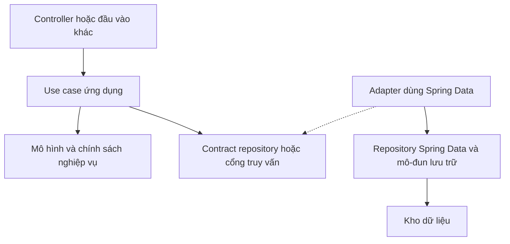

# Lựa chọn API dùng chung mà vẫn giữ đúng ranh giới nghiệp vụ

Spring Data Commons cung cấp các abstraction dùng chung như `Repository`, CRUD, derived query, phân trang, sắp xếp, projection, Query by Example và auditing. Nhờ đó, ứng dụng có thể dùng những contract quen thuộc khi làm việc với các mô-đun Spring Data khác nhau.

Tuy nhiên, tính tiện dụng của một API truy cập dữ liệu không quyết định API đó nên xuất hiện ở đâu trong ứng dụng. Một repository có khả năng xóa bản ghi không có nghĩa nghiệp vụ cho phép xóa đơn hàng. Một phương thức có thể nhận mọi `Sort` không có nghĩa người dùng được sắp xếp theo mọi thuộc tính nội bộ.

Bài học thuộc chương **Tổng quan** của mô-đun **SPRING_DATA_COMMONS**, tập trung vào câu hỏi: **nên chọn và đặt API dùng chung như thế nào để tận dụng Spring Data mà vẫn giữ được ý nghĩa, quy tắc và quyền thay đổi dữ liệu của nghiệp vụ?**

## 1. Phân biệt khả năng lưu trữ với hành động nghiệp vụ

Xét một hệ thống bán hàng:

- Kho dữ liệu có thể cập nhật trường trạng thái của đơn hàng.
- Nghiệp vụ chỉ cho hủy đơn khi đơn đang ở trạng thái được phép.
- Người dùng phải có quyền tác động lên đơn.
- Một đơn đã giao không thể được coi là chưa từng tồn tại chỉ vì repository hỗ trợ xóa.

Như vậy, có hai loại câu hỏi khác nhau:

| Câu hỏi | Lớp chịu trách nhiệm chính |
| --- | --- |
| Đối tượng được lưu và tìm lại bằng cách nào? | Repository và hạ tầng lưu trữ |
| Người dùng nào được thực hiện hành động này? | Chính sách phân quyền và lớp điều phối ứng dụng |
| Trạng thái nào được phép chuyển sang trạng thái nào? | Mô hình hoặc dịch vụ nghiệp vụ |
| Phải thay đổi những dữ liệu nào trong cùng một giao dịch? | Thiết kế use case và cấu hình giao dịch |
| Truy vấn cần projection, phân trang hoặc chỉ mục nào? | Thiết kế luồng đọc và hạ tầng truy vấn |

Spring Data Commons hỗ trợ tốt việc mô tả các thao tác dữ liệu. Nó không biết đầy đủ quy tắc kinh doanh của ứng dụng để tự biến một thao tác `save` thành một hành động nghiệp vụ hợp lệ.

**Ranh giới nghiệp vụ** là nơi xác định ai được yêu cầu một hành động, hành động đó có ý nghĩa gì và những điều kiện nào phải được giữ đúng khi dữ liệu thay đổi.

## 2. Bắt đầu từ use case trước khi chọn interface

Một cách dễ dẫn đến API quá rộng là bắt đầu bằng câu hỏi: “Interface nào có nhiều phương thức tiện nhất?”

Cách làm có cơ sở hơn là mô tả nhu cầu trước:

| Use case | Nhu cầu dữ liệu thực tế | Quy tắc cần giữ |
| --- | --- | --- |
| Hủy đơn hàng | Tìm một đơn, lưu trạng thái mới | Kiểm tra quyền, trạng thái cho phép và xung đột cập nhật |
| Xem đơn hàng của tôi | Đọc các trường tóm tắt theo trang | Giới hạn phạm vi chủ sở hữu, kích thước trang và cách sắp xếp |
| Tìm sản phẩm quản trị | Lọc theo các tiêu chí được hỗ trợ | Kiểm soát tiêu chí tìm kiếm và quyền truy cập |
| Ghi nhận người chỉnh sửa | Lấy chủ thể và thời gian khi lưu | Nguồn danh tính phải đáng tin cậy; auditing phải được cấu hình |

Sau đó mới quyết định dùng `CrudRepository`, một interface `Repository` hẹp hơn, projection, `Slice`, QBE hoặc cơ chế mở rộng repository.

Trình tự này giúp tránh việc thiết kế nghiệp vụ theo đúng những nút mà một API CRUD tình cờ cung cấp.

## 3. Một mô hình trách nhiệm dễ kiểm soát

Có thể tổ chức ứng dụng theo hướng sau:



Trong sơ đồ:

- Đầu vào nhận yêu cầu, chuyển đổi dữ liệu và lấy thông tin danh tính từ nguồn phù hợp.
- Use case điều phối kiểm tra quyền, tải dữ liệu, thực hiện hành vi nghiệp vụ và lưu kết quả.
- Mô hình nghiệp vụ giữ các quy tắc như điều kiện hủy đơn.
- Contract repository hoặc cổng truy vấn mô tả nhu cầu dữ liệu mà ứng dụng cần.
- Adapter tích hợp nhu cầu đó với Spring Data và công nghệ lưu trữ.

Đây là một lựa chọn kiến trúc, không phải yêu cầu bắt buộc của Spring Data Commons. Với ứng dụng nhỏ, application service có thể dùng trực tiếp một repository Spring Data đã được giới hạn hợp lý. Với miền nghiệp vụ phức tạp hoặc yêu cầu cách ly framework rõ ràng, một contract riêng và adapter thường giúp quản lý sự phụ thuộc tốt hơn.

Điều quan trọng là biết mình đang đặt sự phụ thuộc ở đâu và vì sao, thay vì thêm lớp trung gian chỉ để chuyển tiếp mọi phương thức một cách máy móc.

## 4. Chọn contract repository nhỏ nhất đáp ứng nhu cầu

### 4.1. Dùng `CrudRepository` khi phạm vi CRUD thực sự phù hợp

`CrudRepository<T, ID>` thuận tiện khi thành phần sử dụng cần phần lớn các thao tác CRUD chung. Nó cung cấp contract cho những phương thức như lưu, tìm theo định danh, liệt kê hoặc xóa.

Nhưng khi một service chỉ cần đọc một đơn và lưu thay đổi hợp lệ, việc cho service đó thấy cả `deleteAll` không giúp mô tả nghiệp vụ rõ hơn.

Interface rộng không tự làm dữ liệu sai. Vấn đề là phạm vi hành động có thể được gọi lớn hơn nhu cầu của thành phần, khiến những đường ghi dữ liệu ngoài quy tắc dễ xuất hiện hơn.

### 4.2. Chọn lọc phương thức trên `Repository`

`Repository<T, ID>` là marker interface, không tự khai báo toàn bộ CRUD. Bạn có thể chọn những chữ ký phù hợp với phần triển khai repository cơ sở mà mô-đun hỗ trợ:

```java
import java.util.Optional;
import java.util.UUID;

import org.springframework.data.repository.Repository;

public interface OrderDataRepository
        extends Repository<OrderEntity, UUID> {

    Optional<OrderEntity> findById(UUID id);

    <S extends OrderEntity> S save(S entity);
}
```

Trong ví dụ, `OrderEntity` là kiểu đã được mapping cho mô-đun lưu trữ đang dùng. Interface không công bố thao tác xóa hoặc liệt kê toàn bộ.

Các chữ ký trên có chủ đích khớp với contract CRUD tương ứng. Khi tự thiết kế một tên phương thức khác, không nên mặc định hạ tầng sẽ tự nhận ra đó là phương thức CRUD có sẵn.

Chẳng hạn, khai báo `cancelOrder(UUID id)` trong một repository không tự làm Spring Data hiểu quy tắc hủy đơn. Phương thức đó cần một implementation phù hợp nếu được đặt trong repository; trong nhiều thiết kế, hành vi hủy nên nằm ở use case và mô hình nghiệp vụ.

### 4.3. Hiểu đúng giới hạn của interface hẹp

Một interface hẹp giúp giảm thao tác ngoài ý định và làm rõ nhu cầu của bên sử dụng. Nó không thay thế:

- Kiểm tra quyền theo người dùng hoặc tenant.
- Ràng buộc dữ liệu trong cơ sở dữ liệu.
- Kiểm soát xung đột cập nhật.
- Quy tắc chuyển trạng thái của đối tượng.
- Cấu hình giao dịch phù hợp.

Tương tự, một repository chỉ có `findById` vẫn có thể làm lộ dữ liệu nếu bên gọi được phép truyền định danh của người khác mà không có kiểm tra phạm vi truy cập.

## 5. Ví dụ: hủy đơn hàng thay vì sửa trường trạng thái tùy ý

Giả sử quy tắc của ứng dụng là:

1. Chỉ đơn ở trạng thái `CREATED` mới được hủy.
2. Gọi hủy lại một đơn đã `CANCELLED` được coi là không làm thay đổi thêm.
3. Chủ thể thực hiện phải được chính sách phân quyền cho phép.
4. Khi có cập nhật đồng thời, ứng dụng phải phát hiện và xử lý xung đột theo thiết kế lưu trữ.

Các đoạn Java trong phần này minh họa cách phân chia trách nhiệm; các kiểu miền, mapping, wiring và cơ chế xử lý lỗi cần được hoàn thiện trong ứng dụng cụ thể.

### 5.1. Quy tắc chuyển trạng thái thuộc mô hình nghiệp vụ

Phương thức bên trong đối tượng `Order` có thể diễn đạt hành vi:

```java
public void cancel() {
    if (status == OrderStatus.CANCELLED) {
        return;
    }

    if (status != OrderStatus.CREATED) {
        throw new IllegalStateException(
            "Chỉ đơn hàng mới tạo được phép hủy"
        );
    }

    status = OrderStatus.CANCELLED;
}
```

Phương thức không cần biết `Pageable`, tên bảng hay cách Spring Data tạo proxy. Nó kiểm tra một quy tắc cụ thể và đưa đối tượng sang trạng thái hợp lệ.

Nếu cho mọi bên sử dụng gọi một setter như `setStatus`, quy tắc trên có thể bị bỏ qua. Vì vậy, API của đối tượng nên phản ánh những hành vi được phép, đặc biệt khi thay đổi trạng thái có ý nghĩa nghiệp vụ.

### 5.2. Contract ứng dụng có thể độc lập với Spring Data

Nếu cần cách ly framework, ứng dụng có thể định nghĩa contract riêng:

```java
import java.util.Optional;
import java.util.UUID;

public interface OrderRepository {

    Optional<Order> findById(UUID id);

    Order save(Order order);
}
```

Đây là interface do ứng dụng sở hữu. Nó không kế thừa `org.springframework.data.repository.Repository`, nên Spring Data không tự tạo implementation chỉ từ hai chữ ký này.

Một adapter sẽ dùng `OrderDataRepository` để thực thi contract. Adapter cũng chịu trách nhiệm chuyển đổi giữa `Order` và `OrderEntity` nếu thiết kế tách mô hình nghiệp vụ khỏi mô hình lưu trữ.

Việc mapping cần bảo toàn những dữ liệu cần thiết, bao gồm metadata kiểm soát phiên bản khi có sử dụng. Tạo mới một entity từ domain object mà làm mất phiên bản có thể làm sai cơ chế nhận diện đối tượng mới hoặc kiểm soát đồng thời.

Contract trả về `Order` sau khi lưu để bên gọi có thể nhận trạng thái do cơ chế lưu trữ cung cấp. Không nên mặc định đối tượng đầu vào luôn là kết quả cuối cùng của mọi cách thực thi `save`.

### 5.3. Use case điều phối hành động

Trong một ứng dụng Spring dùng giao dịch đồng bộ, use case có thể được tổ chức như sau:

```java
import java.util.UUID;

import org.springframework.stereotype.Service;
import org.springframework.transaction.annotation.Transactional;

@Service
public class CancelOrderService {

    private final OrderRepository orders;
    private final CancelOrderPolicy cancelPolicy;

    public CancelOrderService(
            OrderRepository orders,
            CancelOrderPolicy cancelPolicy) {
        this.orders = orders;
        this.cancelPolicy = cancelPolicy;
    }

    @Transactional
    public UUID cancel(UUID orderId, Actor actor) {
        Order order = orders.findById(orderId)
            .orElseThrow(() ->
                new IllegalArgumentException("Không tìm thấy đơn hàng")
            );

        cancelPolicy.checkAllowed(actor, order);

        order.cancel();

        Order saved = orders.save(order);
        return saved.id();
    }
}
```

`Actor` và `CancelOrderPolicy` là các kiểu của ứng dụng, không phải API của Commons. Chủ thể phải được tạo từ ngữ cảnh xác thực đáng tin cậy. Chính sách có thể xét chủ sở hữu, vai trò và tenant theo yêu cầu thực tế.

`@Transactional` thuộc hạ tầng giao dịch của Spring, không phải bảo đảm tự có từ Commons. Nó chỉ có hiệu lực khi ứng dụng đã cấu hình cơ chế giao dịch phù hợp và lời gọi đi qua hạ tầng áp dụng giao dịch. Phạm vi giao dịch cũng phụ thuộc transaction manager và công nghệ lưu trữ đang dùng.

Trong ứng dụng nhiều tenant, nên cân nhắc giới hạn ngay truy vấn tải đơn theo tenant đáng tin cậy, rồi tiếp tục áp dụng chính sách nghiệp vụ cần thiết. Một lần tải bằng ID toàn cục không tự mang theo ranh giới tenant.

### 5.4. Giao dịch không tự giải quyết mọi xung đột

Hai yêu cầu có thể cùng đọc một đơn ở trạng thái `CREATED`; một yêu cầu hủy, yêu cầu còn lại xác nhận thanh toán. Cả hai đều có thể vượt qua kiểm tra trên dữ liệu đã đọc nếu thiếu cơ chế phối hợp phù hợp.

Tùy kho dữ liệu, thiết kế có thể dùng optimistic locking, điều kiện cập nhật nguyên tử hoặc cơ chế khác mà mô-đun hỗ trợ. Ứng dụng phải quyết định cách phản hồi xung đột; không nên tự động thử lại mọi hành động có tác dụng phụ.

Interface repository chung và lời gọi `save` không tự chứng minh rằng quy tắc nghiệp vụ vẫn đúng khi có truy cập đồng thời.

## 6. Ranh giới aggregate quyết định nơi thay đổi dữ liệu

Aggregate là một nhóm đối tượng được quản lý qua một đối tượng gốc để giữ các quy tắc nhất quán của nhóm đó. Ví dụ, `Order` có thể quản lý các dòng hàng và quy tắc tính tổng.

Nếu tổng tiền phải luôn khớp với các dòng hàng, một API cho phép sửa trực tiếp từng dòng mà bỏ qua `Order` có thể phá vỡ quy tắc.

Với thiết kế theo aggregate:

- Repository phục vụ thay đổi nghiệp vụ thường hướng tới aggregate root.
- Thay đổi các thành phần bên trong được thực hiện qua hành vi của root.
- Không tạo một generic CRUD công khai cho mọi kiểu con chỉ vì mỗi kiểu có một bảng hoặc một document tương ứng.

Điều này không cấm truy vấn đọc trực tiếp dữ liệu của nhiều aggregate. Một màn hình báo cáo có thể cần phép kết hợp hoặc read model riêng. Ranh giới ghi để giữ nhất quán và nhu cầu đọc để hiển thị không nhất thiết có cùng hình dạng.

Commons không tự nhận diện toàn bộ ranh giới nghiệp vụ chỉ từ generic `<T, ID>`. Đây là quyết định thiết kế của ứng dụng, cần phù hợp với khả năng giao dịch của kho dữ liệu.

## 7. Đặt phân trang và sắp xếp ở ranh giới phù hợp

### 7.1. Khi dùng trực tiếp `Pageable` là hợp lý

Trong ứng dụng Spring mà application service chủ đích phụ thuộc Spring Data, nhận `Pageable` hoặc trả `Page` ở lớp ứng dụng có thể là lựa chọn thực dụng.

Cần làm rõ các giới hạn:

- Trang bắt đầu từ đâu và kích thước tối đa là bao nhiêu.
- Những thuộc tính nào được phép sắp xếp.
- Có thật sự cần tổng số phần tử hay không.
- Cách biểu diễn kết quả ra API bên ngoài.

Một controller không nên chuyển mọi chuỗi tên thuộc tính do client gửi thẳng xuống repository mà không kiểm tra. Giới hạn này giúp giữ ổn định contract, tránh vô tình mở quyền sắp xếp theo trường nội bộ và kiểm soát truy vấn tốn kém.

### 7.2. Khi cần contract độc lập

Nếu muốn phần lõi ứng dụng không phụ thuộc Spring Data, có thể mô tả một yêu cầu có ý nghĩa ứng dụng:

```java
public enum OrderListSort {
    NEWEST,
    OLDEST
}
```

```java
public record OrderListRequest(
        int page,
        int size,
        OrderListSort sort) {

    public OrderListRequest {
        if (page < 0) {
            throw new IllegalArgumentException("Trang phải không âm");
        }

        if (size < 1 || size > 100) {
            throw new IllegalArgumentException(
                "Kích thước trang phải từ 1 đến 100"
            );
        }

        if (sort == null) {
            throw new IllegalArgumentException("Thiếu cách sắp xếp");
        }
    }
}
```

Giới hạn 100 là lựa chọn của ví dụ, không phải giới hạn mặc định của Spring Data Commons.

Adapter ánh xạ lựa chọn đã được kiểm soát sang API chung:

```java
import org.springframework.data.domain.PageRequest;
import org.springframework.data.domain.Pageable;
import org.springframework.data.domain.Sort;

Sort sort = switch (request.sort()) {
    case NEWEST -> Sort.by(
        Sort.Order.desc("createdAt"),
        Sort.Order.desc("id")
    );
    case OLDEST -> Sort.by(
        Sort.Order.asc("createdAt"),
        Sort.Order.asc("id")
    );
};

Pageable pageable = PageRequest.of(
    request.page(),
    request.size(),
    sort
);
```

Đoạn mã nằm trong thân một phương thức của adapter, với `request` là `OrderListRequest`. `createdAt` và `id` phải là các thuộc tính được mapping và sắp xếp hợp lệ trong mô-đun đang dùng.

Cách ánh xạ này giúp contract bên ngoài nói “mới nhất” thay vì phụ thuộc tên một thuộc tính lưu trữ cụ thể. Khóa phụ hỗ trợ thứ tự ổn định khi thời điểm trùng nhau; phân trang vẫn cần xem xét dữ liệu thay đổi giữa các lần đọc.

### 7.3. Chọn `Page` hay `Slice` theo nhu cầu giao diện

| Nhu cầu | Lựa chọn có thể phù hợp |
| --- | --- |
| Hiển thị tổng số trang và tổng số kết quả | `Page<T>` |
| Chỉ cần biết còn dữ liệu để tải tiếp hay không | `Slice<T>` |
| Chỉ cần một danh sách nhỏ có giới hạn, không có metadata trang | Một contract danh sách với giới hạn rõ ràng |

Việc tạo `Page` có thể cần truy vấn đếm. `Slice` không yêu cầu tổng số phần tử theo contract, nhưng vẫn có chi phí truy vấn thực tế. Hỗ trợ và cách tối ưu phải xét theo mô-đun, truy vấn và chỉ mục.

Không cần bắt mô hình nghiệp vụ như `Order.cancel()` biết số trang hoặc tổng số bản ghi. Đây là nhu cầu của luồng đọc và lớp phục vụ ứng dụng.

## 8. Projection cho luồng đọc, aggregate cho hành vi thay đổi

Một màn hình danh sách đơn hàng có thể chỉ cần định danh, trạng thái và tổng tiền:

```java
import java.math.BigDecimal;
import java.util.UUID;

public interface OrderSummaryView {

    UUID getId();

    OrderStatus getStatus();

    BigDecimal getTotal();
}
```

Với một mô-đun hỗ trợ interface projection và truy vấn tương ứng, repository đọc có thể khai báo:

```java
import java.util.UUID;

import org.springframework.data.domain.Pageable;
import org.springframework.data.domain.Slice;
import org.springframework.data.repository.Repository;

public interface OrderSummaryDataRepository
        extends Repository<OrderEntity, UUID> {

    Slice<OrderSummaryView> findByTenantIdAndCustomerId(
        UUID tenantId,
        UUID customerId,
        Pageable pageable
    );
}
```

Ví dụ giả định `OrderEntity` có các thuộc tính `tenantId`, `customerId`, `id`, `status` và `total`. Tên phương thức và getter projection phải khớp mô hình và khả năng của mô-đun cụ thể.

Các định danh dùng để giới hạn phạm vi phải được lấy hoặc xác thực theo ngữ cảnh truy cập; client không được tự chọn tenant bất kỳ chỉ vì phương thức có tham số `tenantId`.

Một adapter có thể chuyển projection sang DTO thuộc contract ứng dụng trước khi trả kết quả. Việc này hữu ích khi không muốn public API phụ thuộc interface projection hoặc cách Spring Data tạo đối tượng kết quả.

Projection giúp diễn đạt nhu cầu đọc. Nó không đại diện đầy đủ cho aggregate để thực hiện mọi hành vi ghi. Không nên lấy vài trường tóm tắt, dựng lại một đối tượng thiếu dữ liệu rồi lưu như thể đã tải đầy đủ trạng thái cần cho quy tắc nghiệp vụ.

Ngoài ra, projection không tự bảo đảm truy vấn luôn chỉ đọc đúng các cột hoặc trường đã khai báo. Mức tối ưu phụ thuộc loại projection và mô-đun thực thi.

## 9. Derived query và QBE phải nằm trong phạm vi truy vấn được phép

### 9.1. Derived query phù hợp với điều kiện dễ diễn đạt

Một tên như `findByTenantIdAndCustomerId` làm rõ điều kiện lọc. Nhưng tên phương thức không tự thực hiện kiểm tra quyền và không tự biết tham số có đáng tin cậy hay không.

Khi tên truy vấn trở nên quá dài hoặc có nhiều nhánh điều kiện khó đọc, hãy xem xét cơ chế truy vấn hoặc implementation khác mà mô-đun hỗ trợ. Không cần ép mọi quy tắc tìm kiếm vào một tên phương thức.

### 9.2. QBE không nên biến entity thành biểu mẫu tìm kiếm công khai

Một cách làm dễ gây khó kiểm soát là nhận toàn bộ entity từ HTTP request rồi dùng nó làm probe cho Query by Example.

Khi đó, những trường lưu trữ nội bộ có thể vô tình trở thành tiêu chí tìm kiếm công khai. Giá trị mặc định của kiểu nguyên thủy cũng có thể tham gia điều kiện dù người dùng không chủ ý nhập.

Hướng có chủ đích hơn là:

1. Định nghĩa DTO tiêu chí tìm kiếm với các trường được phép.
2. Kiểm tra giá trị, quyền và phạm vi truy cập.
3. Ánh xạ các trường được chấp nhận sang probe hoặc cơ chế truy vấn phù hợp.
4. Cấu hình `ExampleMatcher` theo đúng ngữ nghĩa cần dùng.
5. Bảo đảm điều kiện phạm vi bắt buộc luôn được áp dụng.

Không giả định mọi tổ hợp điều kiện đều có thể biểu diễn bằng QBE. Nếu cần điều kiện phức tạp hoặc bảo đảm phạm vi truy cập mà cách QBE đã chọn không thể hiện rõ, hãy chọn một API truy vấn khác được mô-đun hỗ trợ.

Commons cung cấp `Example` và `ExampleMatcher`; nó không tự xác định các tiêu chí nghiệp vụ nào được phép công bố.

## 10. Auditing, metadata và mở rộng repository có vai trò riêng

### 10.1. Auditing ghi nhận thay đổi, chính sách quyết định quyền thay đổi

Các abstraction như `@CreatedDate`, `@LastModifiedDate`, `@CreatedBy`, `@LastModifiedBy` và `AuditorAware` hỗ trợ ghi nhận thông tin tạo/sửa khi mô-đun được cấu hình phù hợp.

Biết ai sửa dữ liệu không có nghĩa người đó được phép sửa. Auditing không thay thế kiểm tra quyền trước khi thay đổi.

Nguồn auditor cũng cần đến từ ngữ cảnh đáng tin cậy. Không nên lấy một trường `modifiedBy` do client tự gửi rồi coi đó là danh tính đã được xác thực.

Nếu nghiệp vụ yêu cầu lưu đầy đủ lịch sử hủy đơn, lý do hủy hoặc các phiên bản trước, những trường “người sửa cuối cùng” và “thời điểm sửa cuối cùng” chưa đủ để đáp ứng yêu cầu đó.

### 10.2. Metadata phục vụ hạ tầng

Repository metadata và mapping metadata giúp hạ tầng nhận diện kiểu miền, định danh và các thuộc tính. Chúng hữu ích khi xây dựng adapter tổng quát hoặc mở rộng framework.

Không nên dựa vào việc thấy một thuộc tính tên `status` trong metadata để suy ra thuộc tính đó được phép thay đổi. Ý nghĩa chuyển trạng thái phải đến từ quy tắc nghiệp vụ, không phải suy đoán theo cấu trúc dữ liệu.

Cũng không nên dùng khả năng liệt kê thuộc tính để tự công bố mọi trường thành bộ lọc, sort hoặc trường có thể cập nhật từ client.

### 10.3. Mở rộng repository khi cần hành vi truy cập dữ liệu tùy chỉnh

Repository fragment hoặc implementation tùy chỉnh phù hợp khi cần đóng gói một thao tác truy vấn/lưu trữ mà phương thức chuẩn không đáp ứng tốt.

Chẳng hạn, một thao tác cập nhật có điều kiện để phát hiện xung đột có thể cần implementation riêng theo kho dữ liệu. Contract nên diễn đạt kết quả rõ ràng, như cập nhật thành công hoặc trạng thái đã thay đổi.

Tuy nhiên, không nên giấu toàn bộ điều phối nghiệp vụ, gọi dịch vụ thanh toán và gửi thông báo trong một phương thức repository chỉ vì fragment cho phép viết mã Java tùy ý. Use case vẫn cần một nơi rõ ràng để điều phối các trách nhiệm đó.

## 11. Tránh xây một repository chung cho mọi kho và mọi nghiệp vụ

Một generic base repository có thể có ích nếu nó thực sự chia sẻ một contract nhỏ giữa các aggregate. Nhưng một interface kiểu “lưu bất kỳ thứ gì, tìm theo mọi trường, xóa mọi đối tượng” thường tạo ra nhiều vấn đề:

- Mất ý nghĩa kiểu miền và định danh cụ thể.
- Công bố các hành động mà một số aggregate không cho phép.
- Giả định mọi mô-đun hỗ trợ cùng kiểu truy vấn.
- Che giấu khác biệt về giao dịch, mapping và cơ chế cập nhật.
- Khiến thay đổi một phương thức chung ảnh hưởng nhiều miền không liên quan.

Nếu dùng interface repository cơ sở trong Spring Data, `@NoRepositoryBean` giúp hạ tầng bỏ qua việc tạo bean trực tiếp cho interface trung gian. Annotation đó không biến một contract quá rộng thành một contract có ranh giới tốt.

Một quy tắc hữu ích là: **chỉ dùng chung phần có cùng ý nghĩa và cùng yêu cầu hành vi**. Hai phương thức trùng tên `save` chưa đủ chứng minh hai nghiệp vụ nên chia sẻ mọi thao tác.

Ví dụ, `JpaRepository` có những khả năng gắn với JPA; repository của MongoDB hoặc một kho khác có đặc điểm riêng. Không ép chúng vào một abstraction hứa hẹn những khả năng mà một bên không có.

## 12. Bảng lựa chọn API theo nhu cầu

| Tình huống | Hướng lựa chọn | Điều cần kiểm soát |
| --- | --- | --- |
| Service cần nhiều thao tác CRUD thông thường | `CrudRepository` hoặc interface theo mô-đun phù hợp | Không dùng CRUD để bỏ qua hành vi nghiệp vụ |
| Service chỉ cần tìm và lưu một aggregate | Interface chọn lọc trên `Repository`, hoặc contract ứng dụng riêng | Đường thực thi, quy tắc aggregate và quyền truy cập |
| Miền nghiệp vụ cần độc lập với Spring Data | Contract do ứng dụng sở hữu, adapter triển khai | Mapping, ID, metadata phiên bản và lỗi lưu trữ |
| Danh sách chỉ đọc một số trường | Projection và DTO phù hợp | Phạm vi dữ liệu, thông tin được công bố và hỗ trợ của mô-đun |
| Giao diện cần tổng số trang | `Page` | Chi phí đếm và tính nhất quán của kết quả |
| Giao diện tải tiếp mà không cần tổng | `Slice` | Cách truy vấn, thứ tự và chi phí thực tế |
| Tìm kiếm từ một số trường tùy chọn | QBE khi biểu đạt được điều kiện | Whitelist tiêu chí và các điều kiện phạm vi bắt buộc |
| Truy vấn hoặc cập nhật đặc thù | Fragment hoặc cơ chế riêng của mô-đun | Ngữ nghĩa trả về, giao dịch và xử lý xung đột |
| Ghi nhận người tạo/sửa | Auditing được cấu hình đúng | Nguồn auditor và yêu cầu lịch sử nghiệp vụ riêng |

Không có một interface duy nhất tối ưu cho mọi hàng trong bảng. Lựa chọn nên xuất phát từ nhu cầu của bên sử dụng, mức phụ thuộc framework chấp nhận được và khả năng thực tế của mô-đun lưu trữ.

## 13. Tình huống thực hành thiết kế

Giả sử bạn được giao hai chức năng:

- Khách hàng hủy đơn vừa tạo.
- Khách hàng xem danh sách đơn của mình theo thứ tự mới nhất.

Một đề xuất ban đầu là đưa một repository công bố toàn bộ CRUD và phân trang vào controller, nhận entity từ request, gọi `save` để đổi trạng thái và dùng `findAll(Pageable)` để hiển thị danh sách.

Hãy đánh giá đề xuất theo bốn câu hỏi:

1. Ai kiểm tra đơn có được hủy và người gọi có quyền hủy không?
2. Cách nào ngăn request ghi đè các trường như tổng tiền hoặc chủ sở hữu?
3. Điều kiện nào bảo đảm danh sách chỉ chứa đơn của người đang đăng nhập?
4. Cơ chế nào phát hiện việc đơn đã được thanh toán trong lúc yêu cầu hủy đang xử lý?

Một hướng thiết kế phù hợp với yêu cầu đã nêu là:

- Controller nhận lệnh hủy chỉ gồm dữ liệu cần thiết, lấy chủ thể từ ngữ cảnh xác thực và gọi use case.
- Use case áp dụng chính sách truy cập, tải aggregate trong phạm vi phù hợp và gọi hành vi `cancel`.
- Repository lưu kết quả bằng cơ chế giao dịch và kiểm soát đồng thời đã chọn.
- Luồng danh sách dùng truy vấn có phạm vi chủ sở hữu/tenant, projection và lựa chọn sort được kiểm soát.
- Kết quả trả ra API được biểu diễn bằng DTO phù hợp với nhu cầu của client.

Bạn không bắt buộc phải tách hai mô hình lưu trữ hoặc tạo một kiến trúc đọc/ghi phức tạp cho ví dụ này. Việc phân biệt trách nhiệm đã giúp làm rõ nơi giữ quy tắc và nơi sử dụng API chung.

## 14. Điểm cần ghi nhớ

Spring Data Commons giúp tái sử dụng các contract truy cập dữ liệu. Việc giữ đúng ranh giới nghiệp vụ đòi hỏi ứng dụng lựa chọn contract theo use case, đặt hành vi thay đổi ở nơi giữ được quy tắc và giới hạn dữ liệu theo quyền truy cập thực tế.

Dùng `Repository`, CRUD, derived query, phân trang, projection, QBE, auditing hoặc metadata khi chúng phục vụ một nhu cầu rõ ràng. Khi cần mở rộng, chỉ chia sẻ phần có cùng ý nghĩa và kiểm tra khả năng của mô-đun đang dùng. Một API chung có giá trị nhất khi sự tiện dụng của nó đi cùng một contract nghiệp vụ rõ ràng.
