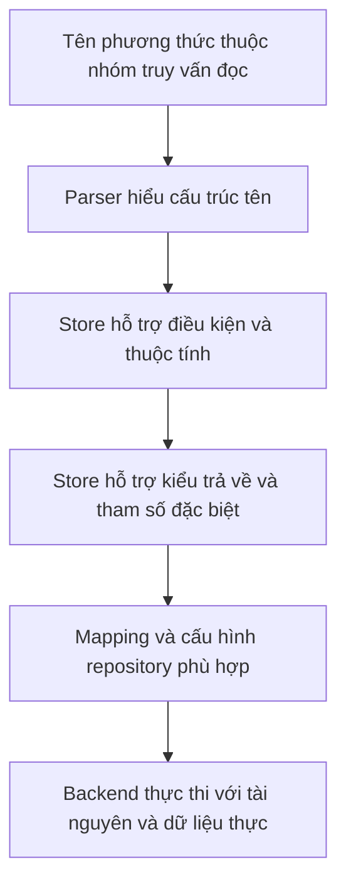

# `find`, `read`, `get`, `query`, `search` và `stream` theo hỗ trợ

## Mục tiêu bài học

Một repository có thể dùng các tên như `findByEmail`, `readByEmail` hoặc `searchByEmail`. Các tên này trông gợi ra những hành vi khác nhau, nhưng trong cơ chế suy diễn tên phương thức, chúng thuộc nhóm tiền tố truy vấn đọc. Để hiểu chính xác một phương thức, cần đọc cả phần điều kiện, kiểu trả về và khả năng của module lưu trữ.

Sau bài học, bạn có thể:

- Nhận diện sáu tiền tố truy vấn đọc thường gặp trong Spring Data.
- Tách tiền tố, phần mô tả, điều kiện và thứ tự trong tên phương thức.
- Giải thích vì sao `get` không tự bảo đảm có kết quả và `search` không tự kích hoạt tìm kiếm toàn văn.
- Phân biệt tiền tố `stream` với kiểu trả về `Stream<T>` và với luồng dữ liệu reactive.
- Sử dụng truy vấn trả `Stream<T>` có quản lý tài nguyên khi store hỗ trợ.

## 1. Tiền tố là một phần của tên được phân tích

Spring Data Commons cung cấp hạ tầng chung để phân tích tên query method. Với nhóm truy vấn đọc, các tiền tố được nhận diện gồm:

```text
find…By
read…By
get…By
query…By
search…By
stream…By
```

Dấu `…` biểu thị phần có thể xuất hiện giữa tiền tố và `By`, chẳng hạn một từ mô tả hoặc keyword giới hạn kết quả. Nó không phải ký tự cần viết trong tên Java.

Ví dụ:

```java
List<Customer> findByTenantId(String tenantId);

List<Customer> readCustomersByTenantId(String tenantId);

List<Customer> searchTop10ByTenantIdOrderByCreatedAtDesc(String tenantId);
```

Cấu trúc khái quát:

```text
[tiền tố và phần chủ thể] By [điều kiện] [OrderBy và thứ tự]
```

Với tên:

```text
searchTop10ByTenantIdAndActiveTrueOrderByCreatedAtDescIdDesc
```

có thể đọc thành:

| Thành phần | Vai trò |
| --- | --- |
| `search` | Tiền tố truy vấn đọc |
| `Top10` | Yêu cầu giới hạn tối đa mười kết quả, khi store hỗ trợ |
| `By` | Bắt đầu phần điều kiện |
| `TenantId` | Điều kiện trên thuộc tính `tenantId` |
| `AndActiveTrue` | Kết hợp điều kiện `active = true` |
| `OrderByCreatedAtDescIdDesc` | Giảm dần theo `createdAt`, sau đó theo `id` |

Đổi `search` thành `find` trong ví dụ này không tự đổi điều kiện tenant, trạng thái hoạt động, giới hạn hay thứ tự.

### Phạm vi của bài học

Các quy tắc dưới đây áp dụng khi phương thức thực sự được triển khai bằng cơ chế suy diễn tên. Repository còn có phương thức CRUD từ lớp cơ sở, phương thức `default`, fragment tùy biến hoặc truy vấn khai báo bằng cơ chế của store. Với các trường hợp đó, cần xác định nguồn implementation trước khi diễn giải tên như một derived query.

## 2. Sáu tiền tố cùng thuộc nhóm truy vấn đọc

Giả sử domain `Customer` có mô hình:

```text
Customer
├── id: Long
├── tenantId: String
├── email: String
├── lastName: String
├── active: boolean
└── createdAt: Instant
```

Ví dụ sau minh họa sáu cách đặt tên cho cùng một điều kiện:

```java
import java.util.List;

import org.springframework.data.repository.Repository;

interface CustomerRepository extends Repository<Customer, Long> {

    List<Customer> findByTenantIdAndActiveTrue(String tenantId);

    List<Customer> readByTenantIdAndActiveTrue(String tenantId);

    List<Customer> getByTenantIdAndActiveTrue(String tenantId);

    List<Customer> queryByTenantIdAndActiveTrue(String tenantId);

    List<Customer> searchByTenantIdAndActiveTrue(String tenantId);

    List<Customer> streamByTenantIdAndActiveTrue(String tenantId);
}
```

Đây là các biến thể để so sánh tên; trong mã ứng dụng thường chỉ cần chọn một tên đáp ứng cùng hợp đồng. Domain phải được mapping và repository phải được một module lưu trữ phù hợp kích hoạt.

Với store hỗ trợ các derived query trên, phần điều kiện của cả sáu phương thức đều là:

```text
 tenantId bằng đối số được truyền vào
 AND active bằng true
```

Phương thức cuối vẫn khai báo `List<Customer>`. Tiền tố `stream` không tự biến kiểu trả về thành Java `Stream`. Tương tự, `get` không tự đổi một danh sách thành một đối tượng duy nhất.

| Tiền tố | Ý nghĩa trong nhóm derived query đọc | Cách hiểu cần tránh |
| --- | --- | --- |
| `find` | Đọc kết quả theo điều kiện | Luôn chỉ tìm một đối tượng |
| `read` | Đọc kết quả theo điều kiện | Tự mở transaction chỉ đọc hoặc tự dùng bản sao dữ liệu |
| `get` | Đọc kết quả theo điều kiện | Bắt buộc phải có dữ liệu hoặc tự tạo proxy tham chiếu |
| `query` | Đọc kết quả theo điều kiện | Tự cho phép truyền SQL hay JPQL tùy ý |
| `search` | Đọc kết quả theo điều kiện | Tự dùng full-text search hoặc xếp hạng độ liên quan |
| `stream` | Đọc kết quả theo điều kiện | Tự bảo đảm cursor, xử lý lazy hoặc bộ nhớ cố định |

Các tiền tố này giúp diễn đạt tên theo quy ước của nhóm phát triển. Những đặc tính như phân trang, kiểu kết quả, transaction và khả năng streaming phải đến từ hợp đồng và implementation thực tế.

## 3. Đọc phần sau `By` để biết điều kiện

Xét hai phương thức:

```java
List<Customer> findByEmail(String email);

List<Customer> searchByEmail(String email);
```

Khi cả hai là derived query và store hỗ trợ, chúng cùng biểu đạt điều kiện trên `email`. Tiền tố `search` không tự thêm phép chứa chuỗi, bỏ dấu hoặc tìm gần đúng.

Nếu muốn một dạng so khớp khác, phải thể hiện trong điều kiện hoặc dùng cơ chế truy vấn thích hợp:

```java
List<Customer> findByEmailIgnoreCase(String email);

List<Customer> searchByLastNameContaining(String text);

List<Customer> readByCreatedAtAfter(Instant threshold);
```

Các ví dụ cần import `List` và `Instant` khi đưa vào mã nguồn. Chúng giả định store hỗ trợ các keyword và kiểu thuộc tính liên quan.

Trong các tên này:

- `IgnoreCase` yêu cầu so sánh không phân biệt hoa thường theo khả năng của store.
- `Containing` yêu cầu điều kiện chứa theo ngữ nghĩa được store hỗ trợ.
- `After` biểu đạt so sánh sau một mốc.

Chi tiết collation, xử lý ký tự, kiểu dữ liệu và hiệu năng phụ thuộc backend. Một điều kiện chuỗi có cùng tên không bảo đảm mọi cơ sở dữ liệu xử lý ký tự tiếng Việt giống nhau.

### Phần mô tả trước `By`

Trong tên:

```java
List<Customer> readCustomersByTenantId(String tenantId);
```

`Customers` là phần mô tả trong chủ thể. Domain được xác định bởi `Repository<Customer, Long>`, không được chuyển sang một loại dữ liệu khác chỉ vì thêm từ vào tên phương thức.

Các keyword có ý nghĩa riêng như `Distinct`, `Top` hoặc `First` có thể tác động đến truy vấn khi store hỗ trợ. Vì vậy, không nên xem mọi từ trước `By` đều chỉ là mô tả tự do.

## 4. Kiểu trả về xác định hợp đồng kết quả

Tiền tố đọc và kiểu trả về là hai chiều cần xem riêng. Ví dụ:

```java
Optional<Customer> readByTenantIdAndEmail(
        String tenantId, String email);

List<Customer> getByTenantId(String tenantId);

Page<Customer> queryByTenantId(
        String tenantId, Pageable pageable);

Stream<Customer> findByTenantId(String tenantId);
```

Đây là các lựa chọn minh họa, cần import các kiểu Java và Commons tương ứng. Khả năng hỗ trợ từng kiểu phải được xác nhận theo store.

| Kiểu trả về | Hợp đồng chính |
| --- | --- |
| `Optional<Customer>` | Tối đa một kết quả; không có kết quả được biểu diễn bằng `Optional.empty()` |
| `List<Customer>` | Một tập kết quả; không tự có tổng số trang |
| `Page<Customer>` | Một trang dữ liệu kèm thông tin tổng số kết quả/trang |
| `Slice<Customer>` | Một lát dữ liệu với thông tin còn lát tiếp theo hay không |
| `Stream<Customer>` | Cho phép tiêu thụ kết quả qua Java Stream, nếu store hỗ trợ |

Một phương thức có tên `findBy...` vẫn có thể trả nhiều kết quả. Một phương thức có tên `getBy...` vẫn có thể trả `Optional`. Tập kiểu trả về được hỗ trợ còn phụ thuộc store và mô hình truy cập dữ liệu đồng bộ hay reactive.

### `Optional` không tự giới hạn một bản ghi

```java
Optional<Customer> getByTenantIdAndEmail(
        String tenantId, String email);
```

Với hợp đồng một kết quả được hỗ trợ, phương thức có thể trả `Optional.empty()` khi không tìm thấy dữ liệu. Tiền tố `get` không tự yêu cầu ném lỗi “không tồn tại”.

Nếu dữ liệu có nhiều khách hàng phù hợp, `Optional` không tự chọn một đối tượng bất kỳ để che đi sự trùng lặp. Cơ chế truy vấn có thể báo lỗi số lượng kết quả không đúng. Nếu nghiệp vụ yêu cầu email duy nhất trong tenant, cần ràng buộc dữ liệu phù hợp ở backend.

Các quy tắc nullability áp dụng với kiểu trả về đơn lẻ có thể ảnh hưởng hành vi khi thiếu kết quả. Đó là một phần hợp đồng của phương thức và cấu hình liên quan, không phải đặc tính được suy ra chỉ từ tiền tố `get`.

## 5. `get` không đồng nghĩa lấy một reference của JPA

Trong một derived query như:

```java
Optional<Customer> getByTenantIdAndEmail(
        String tenantId, String email);
```

`get` là tiền tố truy vấn đọc. Bạn không thể kết luận phương thức sẽ tạo một proxy tham chiếu tới entity chưa được tải.

Các API như `JpaRepository.getReferenceById(...)` có hợp đồng riêng của JPA và implementation trong repository cơ sở. Muốn hiểu chúng, phải đọc đúng hợp đồng API; không áp dụng máy móc quy tắc phân tích derived query chỉ vì tên bắt đầu bằng `get`.

Một trường hợp khác là `findById(...)` kế thừa từ `CrudRepository`. Phương thức này có ngữ nghĩa dành riêng cho định danh aggregate và implementation từ repository cơ sở. Nếu thuộc tính định danh không mang tên `id`, bạn vẫn không được tự hiểu `findById` là truy vấn theo một thuộc tính nghiệp vụ khác tình cờ có tên `id`.

Trình tự phân tích hợp lý là:

1. Xác định phương thức đến từ repository cơ sở, fragment, thân `default` hay cơ chế query method.
2. Nếu là derived query, phân tích cấu trúc tên và kiểu trả về.
3. Đối chiếu với khả năng của module lưu trữ.

Cách làm này tránh gán ý nghĩa quá mức cho một từ ở đầu tên phương thức.

## 6. `search` không tự kích hoạt tìm kiếm toàn văn

Xét yêu cầu tìm khách hàng theo email:

```java
List<Customer> searchByTenantIdAndEmail(
        String tenantId, String email);
```

Điều kiện ở đây là tenant và email. Phương thức không tự có:

- Tách từ hay phân tích ngôn ngữ.
- Xếp hạng kết quả theo độ liên quan.
- Tìm gần đúng theo khoảng cách ký tự.
- Tìm đồng thời trên mọi trường văn bản.
- Tự tạo hoặc tự chọn một full-text index.

Nếu nghiệp vụ cần tìm kiếm toàn văn, hãy sử dụng tính năng mà store cung cấp, chẳng hạn API tìm kiếm chuyên dụng, annotation đặc thù, truy vấn khai báo hoặc fragment tùy biến. Domain, index và cách ánh xạ điểm số cũng cần được thiết kế phù hợp.

Ngay cả một derived query có `Containing` cũng không tự trở thành full-text search. Tìm một đoạn chuỗi xuất hiện trong thuộc tính và tìm kiếm toàn văn là hai yêu cầu có hợp đồng khác nhau.

Nhóm phát triển vẫn có thể chọn tiền tố `search` để biểu đạt ý nghĩa nghiệp vụ. Khi đó, phần implementation phải thực sự đáp ứng hợp đồng tìm kiếm mong muốn; tên phương thức chỉ giúp người đọc hiểu ý định.

## 7. `stream` và `Stream<T>` phải được xem riêng

So sánh hai khai báo:

```java
List<Customer> streamByTenantId(String tenantId);

Stream<Customer> findByTenantId(String tenantId);
```

Với store hỗ trợ các hợp đồng tương ứng:

- Phương thức đầu có kiểu kết quả là `List`.
- Phương thức sau cho người gọi một Java `Stream`.

Tên gọi có thể gây bất ngờ, nên trong mã ứng dụng nên chọn tên nhất quán với hợp đồng. Tuy vậy, điều quyết định kiểu mà người gọi nhận được vẫn là chữ ký Java và khả năng của store.

Một tên dễ đọc hơn cho truy vấn streaming là:

```java
Stream<Customer> streamByTenantIdAndActiveTrue(String tenantId);
```

### 7.1. Ba lớp ý nghĩa của streaming

| Lớp | Câu hỏi cần trả lời |
| --- | --- |
| Tên phương thức | Parser có nhận diện tiền tố `stream…By` không? |
| Hợp đồng Java | Phương thức có trả `java.util.stream.Stream<T>` không? |
| Thực thi backend | Store, provider và driver có đọc dữ liệu dần, giữ cursor hay buffer ra sao? |

Parser chấp nhận tên chưa đủ để khẳng định store hỗ trợ kiểu trả về. Kiểu trả về `Stream` cũng chưa đủ để khẳng định toàn bộ quá trình dùng bộ nhớ cố định.

Cơ chế thực thi có thể bị ảnh hưởng bởi provider, driver, fetch size, transaction, việc ánh xạ entity và cách ứng dụng tiêu thụ kết quả. Với JPA, persistence context còn có thể giữ các entity đã được đọc.

### 7.2. Gọi `.stream()` trên một danh sách

```java
List<Customer> customers = repository.findByTenantId(tenantId);
Stream<Customer> stream = customers.stream();
```

Danh sách đã được lấy trước khi stream được tạo. Stream ở đây giúp xử lý một collection Java đã tồn tại; nó không làm cho truy vấn trước đó biến thành truy vấn đọc dần từ cơ sở dữ liệu.

Nếu mục tiêu là xử lý một tập dữ liệu lớn, cần chọn đúng hợp đồng truy cập dữ liệu từ đầu, rồi xác minh cách backend thực thi.

### 7.3. Java Stream và reactive stream

`java.util.stream.Stream<T>` không tự có hợp đồng reactive, backpressure hoặc khả năng truy cập cơ sở dữ liệu không chặn luồng. Các module reactive sử dụng abstraction và hạ tầng phù hợp, chẳng hạn publisher hoặc các kiểu reactive được module hỗ trợ.

Không thể chuyển một repository đồng bộ thành repository reactive bằng cách đổi `find` sang `stream`. Tương tự, gọi `parallel()` trên một stream dữ liệu có thể đang gắn với cursor hoặc persistence context không phải cách mặc định để tăng tốc; cần tuân theo ràng buộc sử dụng của tài nguyên bên dưới.

## 8. Ví dụ JPA: tiêu thụ Stream trong phạm vi tài nguyên hợp lệ

Phần này minh họa riêng cho một ứng dụng Spring Data JPA có hỗ trợ truy vấn trả `Stream`. Nó không thiết lập một quy tắc transaction duy nhất cho mọi store.

Repository:

```java
import java.util.stream.Stream;

import org.springframework.data.repository.Repository;

interface CustomerRepository extends Repository<Customer, Long> {

    Stream<Customer> streamByTenantIdAndActiveTrue(String tenantId);
}
```

Service:

```java
import java.util.function.Consumer;
import java.util.stream.Stream;

import org.springframework.stereotype.Service;
import org.springframework.transaction.annotation.Transactional;

@Service
public class CustomerExportService {

    private final CustomerRepository repository;

    public CustomerExportService(CustomerRepository repository) {
        this.repository = repository;
    }

    @Transactional(readOnly = true)
    public void exportActiveCustomers(
            String tenantId, Consumer<Customer> sink) {

        try (Stream<Customer> customers =
                     repository.streamByTenantIdAndActiveTrue(tenantId)) {
            customers.forEach(sink);
        }
    }
}
```

Ví dụ giả định entity, kết nối, repository scanning và transaction manager JPA đã được cấu hình. `sink` là thao tác xử lý từng khách hàng, chẳng hạn ghi một dòng báo cáo.

Những chi tiết quan trọng:

1. Lời gọi service phải đi qua cơ chế transaction của Spring để annotation có hiệu lực theo cấu hình ứng dụng.
2. Việc tiêu thụ stream diễn ra bên trong phạm vi transaction phù hợp.
3. `try-with-resources` đóng stream khi xử lý xong hoặc khi có ngoại lệ.
4. Không trả stream ra ngoài để người gọi tiêu thụ sau khi transaction đã kết thúc.

Một terminal operation như `forEach` không thay thế nghĩa vụ đóng stream có thể đang giữ tài nguyên datastore. `try-with-resources` thể hiện rõ vòng đời đó.

### 8.1. `readOnly = true` không đến từ tiền tố `read`

Annotation transaction xuất hiện trên service vì ví dụ cần quản lý việc đọc dữ liệu. Đổi tên repository từ `streamBy...` thành `readBy...` không tự tạo annotation này hoặc tự mở transaction.

`readOnly = true` cũng không nên được hiểu như một cơ chế phân quyền cấm mọi thao tác ghi trong mọi cấu hình. Hiệu ứng cụ thể của transaction và các tối ưu đọc phụ thuộc công nghệ truy cập dữ liệu.

### 8.2. Streaming cần quan sát trong môi trường thực tế

Khi xuất nhiều dữ liệu, cần xem xét:

- Thời gian giữ transaction và connection.
- Cách driver lấy và buffer dữ liệu.
- Kích thước dữ liệu mỗi đối tượng và trạng thái được persistence context giữ lại.
- Tốc độ xử lý của nơi nhận dữ liệu.
- Khả năng đóng tài nguyên khi xử lý bị hủy hoặc ném ngoại lệ.

Nếu một tác vụ xuất kéo dài, phân trang hoặc cơ chế cuộn dữ liệu do store hỗ trợ có thể phù hợp hơn một transaction giữ quá lâu. Lựa chọn cần dựa trên yêu cầu nhất quán dữ liệu, khả năng backend và vòng đời tài nguyên.

## 9. Phân trang, giới hạn và thứ tự không do tiền tố quyết định

Ví dụ trả một trang:

```java
Page<Customer> readByTenantIdAndActiveTrue(
        String tenantId, Pageable pageable);
```

Ví dụ chỉ lấy một số kết quả đầu:

```java
List<Customer> searchTop10ByTenantIdAndActiveTrueOrderByCreatedAtDescIdDesc(
        String tenantId);
```

Ví dụ nhận thứ tự động:

```java
List<Customer> queryByTenantIdAndActiveTrue(
        String tenantId, Sort sort);
```

Các ví dụ cần import `Page`, `Pageable`, `Sort` và `List` phù hợp. Mỗi hợp đồng phải được store hỗ trợ.

| Nhu cầu | Phần biểu đạt nhu cầu |
| --- | --- |
| Lọc tenant | `TenantId` trong điều kiện |
| Chỉ lấy khách hàng hoạt động | `ActiveTrue` trong điều kiện |
| Lấy tối đa mười kết quả | `Top10` trong chủ thể |
| Trả dữ liệu theo trang | `Pageable` và kiểu trả về tương ứng |
| Cần tổng số trang | Hợp đồng `Page`, thường có thêm chi phí xác định tổng |
| Cần biết còn lát tiếp theo | Hợp đồng `Slice`, nếu store hỗ trợ |
| Thứ tự cố định | `OrderBy...` trong tên |
| Thứ tự thay đổi theo yêu cầu | Tham số `Sort` hoặc thứ tự trong `Pageable` |

`Pageable` và `Sort` là tham số đặc biệt. Bạn không thêm một điều kiện giả như `AndPageable` để yêu cầu Spring Data xử lý phân trang.

Khi nhiều bản ghi có cùng thời điểm tạo, khóa phụ như `id` giúp thứ tự được xác định rõ hơn. Phân trang vẫn có thể chịu tác động của việc dữ liệu thay đổi giữa những lần đọc; một tiền tố truy vấn đọc không tạo ra snapshot dữ liệu tự động.

## 10. Hiểu đúng cụm từ “theo hỗ trợ”

Khả năng sử dụng một phương thức cần được xem ở nhiều tầng:



Mỗi tầng có thể tạo ra một loại lỗi hoặc giới hạn khác nhau.

### 10.1. Tầng Commons

Commons cung cấp các abstraction chung, hạ tầng phân tích tên và metadata về query method. Việc tên `streamBy...` được nhận diện ở tầng này không phải lời bảo đảm rằng mọi store đều có cơ chế streaming repository tương ứng.

### 10.2. Tầng module lưu trữ

Module quyết định cách chuyển điều kiện thành truy vấn, cách ánh xạ kết quả và tập kiểu trả về được hỗ trợ. Một module đồng bộ và một module reactive không có cùng hợp đồng chỉ vì đều sử dụng tên bắt đầu bằng `find`.

Một thuộc tính lồng nhau có thể cần join trong mô hình quan hệ, trong khi store document có cách truy cập khác. Keyword, mapping và độ sâu đường dẫn cũng cần được đối chiếu với module.

### 10.3. Tầng backend và driver

Backend quyết định nhiều khía cạnh như so sánh chuỗi, index, giới hạn truy vấn và kế hoạch thực thi. Driver, provider và cấu hình ảnh hưởng việc lấy dữ liệu dần hoặc buffer.

Vì vậy, khi chuyển từ store này sang store khác, cần kiểm tra lại:

1. Keyword trong tên có được hỗ trợ không?
2. Kiểu thuộc tính và mapping có phù hợp không?
3. Kiểu trả về có được hỗ trợ không?
4. Có yêu cầu transaction hoặc đóng tài nguyên không?
5. Truy vấn thực tế có đáp ứng hiệu năng và ngữ nghĩa mong muốn không?

Việc giữ nguyên một interface Java không tự bảo đảm các câu trả lời trên đều giữ nguyên.

## 11. Quy ước đặt tên trong một dự án

Nhóm phát triển nên chọn quy ước giúp người đọc đoán đúng hợp đồng. Một quy ước có thể là:

| Hoàn cảnh | Cách đặt tên có thể chọn |
| --- | --- |
| Derived query đọc thông thường | `findBy...` |
| Query method trả Java Stream | `streamBy...` |
| API đọc theo ngôn ngữ nghiệp vụ | `read...By...`, nếu được dùng nhất quán |
| Tìm kiếm có logic đặc thù | Tên diễn đạt nghiệp vụ và implementation phù hợp |

Đây là quy ước của dự án, không phải yêu cầu rằng Spring Data chỉ chấp nhận một cách gọi. Các biến thể `read`, `get`, `query`, `search` vẫn có thể được sử dụng khi hợp đồng rõ ràng.

Nên tránh khai báo sáu phương thức chỉ khác tiền tố nhưng cùng kiểu trả về và cùng điều kiện nếu chúng không phục vụ mục đích riêng. Số lượng tên nhiều hơn làm tăng diện tích API và công việc bảo trì mà không bổ sung hành vi.

Nếu cần thay đổi tên, hãy giữ hoặc chủ động thay đổi hợp đồng một cách rõ ràng: điều kiện, kiểu trả về, thứ tự, giới hạn và quản lý tài nguyên. Đổi tên một phương thức trả `List` thành `streamBy...` mà vẫn giữ nguyên kiểu trả về sẽ không đạt mục tiêu đọc tập dữ liệu lớn theo từng phần.

## 12. Các lỗi dễ gặp và hướng kiểm tra

| Biểu hiện hoặc kỳ vọng | Điểm cần kiểm tra |
| --- | --- |
| `searchByEmail` không tìm gần đúng | Điều kiện vẫn là thuộc tính email; kiểm tra cơ chế tìm kiếm cần dùng |
| `getBy...` trả `Optional.empty()` | Đây có thể là hành vi đúng của kiểu trả về, không phải lỗi tiền tố |
| `readBy...` vẫn thiếu transaction cần thiết | Tên không tự cấu hình transaction; kiểm tra tầng service và store |
| `streamBy...` trả một danh sách lớn | Kiểm tra kiểu trả về có còn là `List` không |
| Repository từ chối kiểu `Stream` | Kiểm tra mức hỗ trợ của module và loại repository |
| Stream báo lỗi khi đọc sau khi service kết thúc | Kiểm tra vòng đời transaction, connection và thời điểm tiêu thụ |
| Số connection sử dụng tăng sau nhiều lần đọc | Kiểm tra việc đóng stream và các đường xử lý ngoại lệ |
| Dùng `Stream` nhưng bộ nhớ vẫn tăng | Kiểm tra buffer, persistence context, thao tác tích lũy kết quả và driver |
| Tên được phân tích nhưng thuộc tính không tồn tại | Đối chiếu phần sau `By` với domain, không chỉ nhìn tiền tố |
| Phương thức có tên đúng nhưng chạy chậm | Quan sát truy vấn thực tế, index, khối lượng dữ liệu và chi phí lấy tổng |

Một số lỗi được phát hiện khi repository khởi tạo; các lỗi khác chỉ xuất hiện khi thực thi hoặc khi tài nguyên đã bị đóng. Không nên chỉ kiểm tra rằng tên phương thức được chấp nhận rồi kết luận toàn bộ hợp đồng đã đúng.

Đối với streaming, nên xác minh cả trường hợp xử lý bình thường và khi thao tác tiêu thụ ném ngoại lệ. Đối với truy vấn tenant, nên có dữ liệu ở nhiều tenant để phát hiện thiếu điều kiện phạm vi. Đối với kết quả đơn, nên có cả không có kết quả và nhiều kết quả để làm rõ hợp đồng.

## 13. Bài tập tự kiểm tra

### Bài 1: So sánh tiền tố

```java
List<Customer> findByTenantIdAndActiveTrue(String tenantId);
List<Customer> searchByTenantIdAndActiveTrue(String tenantId);
```

Nếu cả hai là derived query được store hỗ trợ, phương thức thứ hai có tự thực hiện full-text search không?

**Gợi ý đáp án:** Không. Chúng có cùng điều kiện tenant và trạng thái hoạt động. Tiền tố `search` thuộc nhóm truy vấn đọc và không tự thêm cơ chế tìm kiếm toàn văn.

### Bài 2: Đọc hợp đồng vắng dữ liệu

```java
Optional<Customer> getByTenantIdAndEmail(
        String tenantId, String email);
```

Có thể dựa vào từ `get` để yêu cầu luôn trả một khách hàng hoặc ném lỗi khi không tồn tại không?

**Gợi ý đáp án:** Không. Với hợp đồng `Optional` được hỗ trợ, không có kết quả được biểu diễn bằng `Optional.empty()`. Nếu nghiệp vụ muốn báo lỗi, tầng nghiệp vụ có thể chuyển trạng thái vắng dữ liệu thành lỗi phù hợp.

### Bài 3: Phát hiện streaming giả định

```java
List<Customer> streamByTenantId(String tenantId);
```

Phương thức này có tự bảo đảm đọc bằng cursor và dùng ít bộ nhớ không?

**Gợi ý đáp án:** Không. Kiểu trả về vẫn là `List`. Ngay cả khi chuyển sang `Stream`, vẫn phải xác nhận khả năng của store, provider, driver và cách quản lý tài nguyên.

### Bài 4: Tìm lỗi vòng đời

Một service JPA mở transaction, lấy `Stream<Customer>`, trả stream ra cho controller rồi kết thúc transaction. Controller mới bắt đầu duyệt dữ liệu. Có vấn đề gì?

**Gợi ý đáp án:** Stream có thể còn cần tài nguyên gắn với transaction đã kết thúc. Nên tiêu thụ và đóng stream trong phạm vi tài nguyên hợp lệ hoặc thiết kế một cơ chế xuất dữ liệu có vòng đời được quản lý rõ ràng.

### Bài 5: Thay tiền tố để tăng hiệu năng

Một truy vấn `findByTenantIdAndLastName(...)` chạy chậm. Đổi tên thành `queryByTenantIdAndLastName(...)` có phải giải pháp tối ưu không?

**Gợi ý đáp án:** Không có cơ sở để kỳ vọng nhanh hơn chỉ từ thay tiền tố. Cần kiểm tra câu truy vấn sinh ra, index, số lượng kết quả, kiểu trả về và cách backend thực thi.

## Những điểm cần nhớ

- `find`, `read`, `get`, `query`, `search` và `stream` thuộc nhóm tiền tố truy vấn đọc trong cơ chế phân tích tên của Commons.
- Điều kiện nằm trong phần sau `By`; giới hạn, thứ tự, tham số và kiểu trả về tiếp tục xác định hợp đồng.
- `get` không tự tạo reference JPA hoặc bắt buộc có dữ liệu; `search` không tự kích hoạt full-text search.
- Tiền tố `stream` và kiểu `Stream<T>` là hai thông tin khác nhau. Streaming thực tế còn phụ thuộc store, provider, driver và vòng đời tài nguyên.
- Chọn một quy ước tên nhất quán, rồi xác minh khả năng của đúng module lưu trữ thay vì suy ra hành vi chỉ từ tên tiếng Anh.
