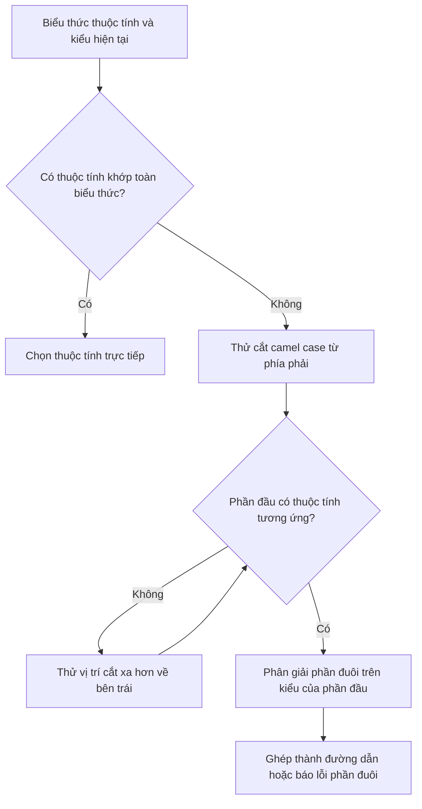

# Quy tắc tách camel case, dấu gạch dưới và tên thuộc tính mơ hồ

Phương thức `findByAddressZipCode` có thể biểu diễn điều kiện trên `addressZipCode` hoặc trên `address.zipCode`. Spring Data không dựa vào ý định của người viết để chọn. Hạ tầng phân tích tên phương thức theo quy tắc và mô hình kiểu Java mà nó nhìn thấy.

Trong chương **Suy diễn tên phương thức** của module `SPRING_DATA_COMMONS`, bài này giải thích cách phân giải đường dẫn thuộc tính, khi nào cần dấu `_`, và vì sao một tên method vẫn hợp lệ sau khi sửa mô hình nhưng lại truy vấn thuộc tính khác. Các quy tắc phân giải dùng chung là nền tảng; việc đường dẫn đó có thể được chuyển thành truy vấn và thực thi hay không còn phụ thuộc từng module store.

## 1. Tách vấn đề thành hai tầng

Một derived query có ngữ pháp ở mức toàn phương thức và quy tắc ở mức đường dẫn thuộc tính.

Ví dụ:

```java
List<Customer> findByAddressZipCodeAndActiveTrue(String zipCode);
```

Về ý tưởng, phần điều kiện chứa:

```text
AddressZipCode  -> một biểu thức thuộc tính
And            -> nối điều kiện
Active + True  -> thuộc tính active với phép kiểm tra true
```

Sau khi nhận diện các phần của query, framework còn phải phân giải `AddressZipCode` thành một đường dẫn hợp lệ bắt đầu từ domain type `Customer`.

| Câu hỏi | Ví dụ | Thuộc vấn đề nào? |
| --- | --- | --- |
| Method là tìm kiếm, đếm hay kiểm tra tồn tại? | `find…By`, `count…By`, `exists…By` | Subject của query |
| Có những điều kiện và toán tử nào? | `And`, `Or`, `LessThan`, `True` | Predicate và keyword |
| Điều kiện đang nói tới thuộc tính nào? | `AddressZipCode` | Property path |
| Store có hỗ trợ phép truy vấn đó không? | So sánh, duyệt quan hệ, phân trang | Khả năng của module store |

Bài này tập trung vào property path. Một tên thuộc tính được phân giải thành công chưa đủ chứng minh mọi keyword và phép duyệt quan hệ đều được store hỗ trợ.

## 2. Dùng tên thuộc tính Java, không dùng tên cột

Xét ví dụ riêng cho JPA:

```java
@Entity
class Customer {

    @Id
    private Long id;

    @Column(name = "postal_code")
    private String postalCode;

    // Getter, constructor và các chi tiết khác được lược bỏ.
}
```

Tên query method thông thường là:

```java
List<Customer> findByPostalCode(String postalCode);
```

Không đổi thành `findByPostal_code` chỉ vì cột mang tên `postal_code`. Tên cột là thông tin ánh xạ của store; biểu thức thuộc tính trong derived query dựa trên tên trong mô hình Java.

Nguyên tắc tương tự áp dụng khi một module ánh xạ `postalCode` sang tên trường lưu trữ khác. Cách khai báo mapping và mức hỗ trợ phụ thuộc module, nhưng tên trường vật lý không tự thay thế tên thuộc tính trong method.

Trong các phần sau, những lớp chỉ có khai báo field là mô hình rút gọn để minh họa đường dẫn. Chúng chưa cung cấp đầy đủ annotation, constructor, accessor hoặc cấu hình lưu trữ cho một store cụ thể. Với ứng dụng thực tế, cần xác định đúng tên thuộc tính mà metadata của store nhận diện; field và getter có thể ảnh hưởng tới tên này tùy cách ánh xạ.

## 3. Quy tắc đầu tiên: thử khớp toàn bộ tên

Giả sử có mô hình:

```java
class Customer {
    String addressZipCode;
    Address address;
}

class Address {
    String zipCode;
}
```

Và method:

```java
List<Customer> findByAddressZipCode(String value);
```

Spring Data trước hết thử tìm thuộc tính tương ứng với toàn bộ biểu thức `AddressZipCode`, theo quy tắc nhận diện tên property. Trong mô hình này, `Customer.addressZipCode` tồn tại nên nó được ưu tiên.

Kết quả là:

```text
findByAddressZipCode
        └───────────> Customer.addressZipCode
```

Không phải:

```text
Customer.address.zipCode
```

**Một thuộc tính trực tiếp khớp toàn tên được ưu tiên trước đường dẫn lồng nhau có thể tạo bằng cách tách camel case.** Tên method có nhiều chữ hoa không có nghĩa framework luôn tách nó thành nhiều thuộc tính.

### 3.1. Tên biến tham số không chọn đường dẫn

Hai method dưới đây đều có phần tên thuộc tính như nhau:

```java
List<Customer> findByAddressZipCode(String nestedZipCode);

List<Customer> findByAddressZipCode(String flatAddressZipCode);
```

Đây là hai cách viết thay thế, không phải hai overload có thể đặt đồng thời trong cùng interface với cùng chữ ký. Đổi tên tham số Java không làm framework chuyển từ `addressZipCode` sang `address.zipCode`.

Giá trị truyền vào cũng không quyết định việc chọn property path. Việc chọn dựa trên tên method và metadata kiểu, không dựa trên giá trị nào đang có dữ liệu trong database.

### 3.2. Kiểu kết quả không giải quyết sự mơ hồ này

Đổi `List<Customer>` thành một projection không phải cách chỉ định dùng thuộc tính trực tiếp hay thuộc tính lồng. Phân giải điều kiện và xử lý dạng kết quả là các trách nhiệm khác nhau.

## 4. Khi không khớp toàn tên: tách camel case từ phải sang trái

Giờ bỏ thuộc tính trực tiếp `addressZipCode`:

```java
class Customer {
    Address address;
}

class Address {
    String zipCode;
}
```

Biểu thức `AddressZipCode` không khớp một thuộc tính trực tiếp của `Customer`. Thuật toán thử tách tại ranh giới camel case, bắt đầu từ phía phải.

### 4.1. Các bước với AddressZipCode

| Bước | Phần được xét trên `Customer` | Phần còn lại | Kết quả trong mô hình trên |
| --- | --- | --- | --- |
| 1 | `addressZipCode` | Không có | Không tồn tại |
| 2 | `addressZip` | `Code` | Phần đầu không tồn tại |
| 3 | `address` | `ZipCode` | Phần đầu tồn tại; tiếp tục trên kiểu `Address` |
| 4 | `zipCode` trên `Address` | Không có | Tồn tại; hoàn tất đường dẫn |

Kết quả:

```text
Customer.address.zipCode
```

“Từ phải sang trái” nói về vị trí thử cắt biểu thức, không có nghĩa duyệt mô hình từ thuộc tính cuối về thuộc tính đầu. Framework vẫn bắt đầu từ domain type rồi đi theo kiểu của từng thuộc tính đã tìm thấy.

### 4.2. Phần đuôi được phân giải tiếp trên kiểu vừa tìm được

Với một đường dẫn dài hơn, ví dụ `Customer.address.country.code`, phần còn lại phải tiếp tục được phân giải trên `Address`, rồi trên `Country`.

Không tìm `country` và `code` trên chính `Customer` sau khi đã chọn `address`. Mỗi đoạn làm thay đổi kiểu đang được xét.



Đây là sơ đồ trách nhiệm rút gọn, không phải mã nguồn đầy đủ của bộ phân tích. Số vị trí cắt là hữu hạn; khi không tìm được đường dẫn hợp lệ, quá trình phân giải thất bại.

## 5. Thuộc tính có tiền tố giống nhau có thể dẫn đến nhánh sai

Xét một mô hình khác:

```java
class Customer {
    Address address;
    AddressZip addressZip;
}

class Address {
    String zipCode;
}

class AddressZip {
    String value;
}
```

`Customer` không có `addressZipCode`, nhưng có cả `address` và `addressZip`.

Với `findByAddressZipCode`, vị trí cắt đầu tiên sau khi khớp toàn tên thất bại là:

```text
AddressZip | Code
```

Phần đầu khớp `Customer.addressZip`. Bộ phân giải tiếp tục tìm `code` trên `AddressZip`, nhưng kiểu này chỉ có `value`, nên việc phân giải có thể thất bại ở nhánh đó.

Sự tồn tại của `Customer.address.zipCode` không có nghĩa thuật toán sẽ duyệt mọi tổ hợp rồi chọn đường mà người viết dự định. Không nên coi property path resolution là phép tìm kiếm toàn bộ đường dẫn có thể có trong mô hình.

Nếu `AddressZip` cũng có `code`, method có thể hợp lệ nhưng chọn:

```text
Customer.addressZip.code
```

thay vì:

```text
Customer.address.zipCode
```

Đây là hai loại rủi ro khác nhau:

| Mô hình ở nhánh được chọn | Hệ quả |
| --- | --- |
| Không có thuộc tính đuôi cần tìm | Có thể báo lỗi tạo query |
| Có thuộc tính đuôi nhưng khác ý định nghiệp vụ | Query có thể được tạo thành công nhưng nhắm sai đường dẫn |

Trường hợp thứ hai khó nhận ra hơn vì không nhất thiết có exception.

## 6. Dùng dấu gạch dưới để chỉ định điểm duyệt

Để thể hiện rõ đường `address.zipCode`, khai báo:

```java
List<Customer> findByAddress_ZipCode(String zipCode);
```

Dấu `_` đặt ranh giới giữa `Address` và `ZipCode`:

```text
Address_ZipCode
   │       │
   │       └── trên kiểu Address: zipCode
   └────────── trên kiểu Customer: address
```

Trong các mô hình trước đó, cách viết này giúp tránh việc toàn tên bị nhận thành `addressZipCode`, hoặc phần đầu bị chọn thành `addressZip`.

### 6.1. Dấu _ là ranh giới đường dẫn

So sánh:

| Tên method | Đường dẫn thể hiện khi các đoạn tương ứng tồn tại |
| --- | --- |
| `findByAddressZipCode` | Phụ thuộc ưu tiên khớp toàn tên và cách tách camel case |
| `findByAddress_ZipCode` | `address` rồi phân giải `ZipCode` trên kiểu của nó |
| `findByAddress_Zip_Code` | `address.zip.code` |

`Address_Zip_Code` không phải một cách viết khác của `Address_ZipCode`. Nó yêu cầu một thuộc tính trung gian `zip`, rồi thuộc tính `code` trên kiểu của `zip`.

Nếu `Address` chỉ có `String zipCode`, thêm `_` giữa `Zip` và `Code` sẽ khiến method không còn mô tả đúng mô hình đó.

### 6.2. Mỗi phần vẫn có thể tiếp tục được phân tích

Đặt `_` chỉ cố định các ranh giới đã chỉ rõ. Nó không biến mọi phần còn lại thành một chuỗi tên literal không bao giờ bị tách.

Trong `Address_ZipCode`, framework đã biết phải đi qua `address`. Trên kiểu `Address`, nếu `zipCode` tồn tại thì khớp trực tiếp; nếu không, phần `ZipCode` vẫn có thể được phân giải theo quy tắc camel case, chẳng hạn thành `zip.code` khi mô hình cho phép.

Muốn nêu rõ cả ba đoạn, sử dụng `Address_Zip_Code`. Cách viết phải đi cùng cấu trúc kiểu thực tế, không chỉ dựa trên hình thức tên method.

### 6.3. Dấu _ không thay đổi phép nối điều kiện

Ví dụ:

```java
List<Customer> findByAddress_ZipCodeAndActiveTrue(String zipCode);
```

`_` chỉ định đường dẫn cho một biểu thức thuộc tính. `And` vẫn nối biểu thức đó với điều kiện trên `active`. Dấu `_` không tạo ngoặc logic, không đổi ưu tiên giữa `And` và `Or`, và không thay thế keyword của derived query.

## 7. Tên field dùng snake_case không phải quy ước thuận lợi

Giả sử mô hình Java thực sự có field:

```java
class Customer {
    String first_name;
}
```

Không nên suy rằng `findByFirst_name` chắc chắn truy vấn trực tiếp field `first_name`. Dấu `_` có vai trò đặc biệt trong ngữ pháp property path và có thể được hiểu là điểm tách đường dẫn.

Cách tổ chức thuận lợi hơn là:

```text
Tên thuộc tính Java: firstName
Tên lưu trữ:        first_name
Tên method:         findByFirstName
```

Dùng cơ chế mapping của store để nối hai tên, thay vì đưa quy ước tên cột vào tên thuộc tính Java.

Nếu đang làm với mô hình cũ không thể đổi tên, cần kiểm tra cơ chế truy vấn được module hỗ trợ, chẳng hạn query khai báo hoặc custom repository fragment. Không tự tạo một quy tắc escape bằng cách nhân đôi tất cả dấu `_` ở bất kỳ vị trí nào.

Việc nhân đôi dấu `_` có một trường hợp liên quan đến thuộc tính bắt đầu bằng `_`, được giải thích riêng bên dưới; nó không phải quy tắc escape tổng quát cho mọi tên snake_case.

## 8. Thuộc tính bắt đầu bằng _ và dấu __

Spring Data có quy tắc xử lý tên thuộc tính bắt đầu bằng dấu gạch dưới. Cần giữ lại dấu này trong biểu thức thuộc tính.

Ví dụ mô hình:

```java
class Account {
    String _name;
    User user;
}

class User {
    String name;
    String _name;
}
```

Các method minh họa:

```java
List<Account> findBy_name(String name);

List<Account> findByUser_Name(String name);

List<Account> findByUser__name(String name);
```

| Method | Đường dẫn mong muốn |
| --- | --- |
| `findBy_name` | `Account._name` |
| `findByUser_Name` | `Account.user.name` |
| `findByUser__name` | `Account.user._name` |

Trong `User__name`, cần biểu diễn cả ranh giới sau `user` lẫn dấu `_` ở đầu tên `_name`. Vì vậy, hai dấu gạch dưới liên tiếp có ý nghĩa khác với một dấu đơn trong ví dụ này.

Không để formatter, công cụ sinh tên hoặc thao tác tìm-thay tự động rút `__` thành `_`. Việc đó có thể thay đổi đường dẫn từ `user._name` sang `user.name` trong mô hình có cả hai thuộc tính.

Những tên này ít gặp hơn camelCase thông thường. Khi sử dụng trong dự án, phải kiểm tra tên property mà metadata và cơ chế ánh xạ của phiên bản đang dùng thực sự nhận diện, thay vì chỉ nhìn field trong một đoạn source rút gọn.

## 9. Tên viết hoa toàn bộ và tên có chữ thứ hai viết hoa

Không phải tên thuộc tính nào cũng được tạo bằng cách hạ toàn bộ chữ cái xuống chữ thường. Các quy ước JavaBeans và cách tra cứu property có những trường hợp tên viết hoa cần giữ nguyên.

### 9.1. Thuộc tính viết hoa toàn bộ

Ví dụ:

```java
class DirectoryEntry {
    UserDetails USER;
}

class UserDetails {
    String name;
}
```

Khi metadata nhận diện property là `USER`, có thể dùng đúng tên viết hoa đó. Đường lồng cần được chỉ rõ bằng dấu `_`, ví dụ:

```java
List<DirectoryEntry> findByUSER_name(String name);
```

Biểu thức thể hiện `USER.name`, không phải lời yêu cầu tự động chuyển `USER` thành `user`.

Tình huống tương tự có thể xuất hiện với acronym như `URL`. Không suy `URL`, `Url` và `url` luôn là ba cách viết tương đương của cùng một thuộc tính. Cần đối chiếu tên property thực tế mà mô hình và metadata công bố.

### 9.2. Thuộc tính có chữ thứ hai viết hoa

Xét:

```java
class Container {
    String qCode;
    Code q;
}

class Code {
    String code;
}
```

Với thuộc tính `qCode`, cách bắt đầu biểu thức bằng hai chữ hoa là `QCode`:

```java
List<Container> findByQCode(String value);
```

Khi `qCode` tồn tại, tên đầy đủ được ưu tiên trước việc tách thành đường `q.code`.

Muốn chỉ định đường lồng:

```java
List<Container> findByQ_Code(String value);
```

| Biểu thức | Trong mô hình trên |
| --- | --- |
| `QCode` | Ưu tiên `qCode` |
| `Q_Code` | Đi qua `q`, rồi `code` |

Nếu bỏ `qCode` và chỉ còn `q.code`, biểu thức `QCode` có thể được phân giải thành đường lồng qua quy tắc tách. Đó cũng là lý do thêm một thuộc tính trực tiếp về sau có thể thay đổi cách hiểu tên method.

### 9.3. Kiểm tra cả field và accessor

Một mô hình có field `qCode` nhưng accessor theo quy ước khác có thể tạo nhầm lẫn khi xem tên property. JavaBeans không đơn giản luôn hạ chữ cái đầu khi tên bắt đầu bằng hai chữ hoa.

Khi gặp trường hợp này, hãy kiểm tra tên mà metadata đang dùng, chế độ field/property access của store và accessor được sinh thực tế. Việc chỉ đổi `QCode` thành `Qcode` theo cảm giác có thể khiến method tìm một tên khác.

## 10. Thay đổi mô hình có thể làm query đổi nghĩa mà không đổi method

Giả sử phiên bản đầu chỉ có:

```text
Customer
  address
    zipCode
```

Method `findByAddressZipCode` được phân giải thành `address.zipCode`.

Sau đó nhóm phát triển bổ sung thuộc tính trực tiếp:

```text
Customer
  addressZipCode
  address
    zipCode
```

Tên method không đổi nhưng quy tắc ưu tiên toàn tên có thể khiến nó chuyển sang `addressZipCode` khi query được tạo lại.

### 10.1. Dữ liệu phải phân biệt được hai đường

Nếu cả hai thuộc tính luôn có cùng giá trị trong dữ liệu thử, việc chọn sai đường có thể không bị phát hiện.

Một bộ dữ liệu phân biệt có thể là:

| Khách hàng | `addressZipCode` | `address.zipCode` |
| --- | --- | --- |
| A | `700000` | `100000` |
| B | `100000` | `700000` |

Tìm mã `700000` sẽ cho hai tập kết quả khác nhau tùy đường dẫn được chọn. Đây là cách thiết kế dữ liệu kiểm tra hành vi có ý nghĩa, thay vì chỉ kiểm tra repository có khởi tạo thành công.

### 10.2. Dùng tên rõ khi ý định là đường lồng

Nếu yêu cầu nghiệp vụ là mã bưu chính trong địa chỉ, `findByAddress_ZipCode` thể hiện ranh giới đó rõ hơn. Việc thêm `addressZipCode` ở gốc sẽ không biến phần `Address_ZipCode` thành thuộc tính trực tiếp cùng tên.

Tuy nhiên, nếu cấu trúc bên trong `Address` tiếp tục thay đổi thì vẫn phải kiểm tra đường dẫn. Dấu `_` giúp nêu ý định ở các ranh giới đã đặt; nó không làm repository miễn nhiễm với mọi thay đổi mô hình.

## 11. Đặt quy tắc này vào đúng phạm vi của Commons

Trong hạ tầng Spring Data, việc phân tích derived query thường liên quan đến `PartTree`, các `Part` và cơ chế `PropertyPath`. Module store dùng kết quả phân tích để tạo query phù hợp.

Phân biệt các mức:

| Mức | Điều cần xác định |
| --- | --- |
| Tách tên method | Subject, điều kiện, keyword |
| Phân giải property path | Từng thuộc tính và kiểu trung gian có được nhận diện không |
| Tạo query cho store | Có biểu diễn được đường dẫn và toán tử đó không |
| Thực thi và mapping | Dữ liệu, kiểu kết quả và tài nguyên có đáp ứng hợp đồng không |

Ví dụ, cùng một đường `address.zipCode` ở mức mô hình có thể tương ứng với embedded value, quan hệ hoặc document lồng. Cách truy vấn, khả năng join và ngữ nghĩa với giá trị thiếu/null không thể suy ra chỉ từ cách đặt camel case.

`_` không yêu cầu JPA tạo một loại join cụ thể, không tự nạp quan hệ và không bảo đảm một document store hỗ trợ truy vấn xuyên mọi tham chiếu.

### 11.1. Chỉ áp dụng khi method đi vào nhánh derived query

Một method do custom fragment hiện thực hoặc có query khai báo được chọn theo strategy không nhất thiết được tạo query từ tên bằng đường vừa mô tả.

Nếu đã đặt `_` mà hành vi không thay đổi, cần xác định method thực sự đi qua derived query hay một implementation khác. Không suy từ tên method rằng nó chắc chắn đang được derive.

Query by Example cũng biểu diễn tiêu chí bằng probe và matcher trong phạm vi store hỗ trợ; không phải mọi tiêu chí của nó được sinh từ cách tách tên method.

### 11.2. Pageable và Sort không sửa property path của điều kiện

Ví dụ:

```java
Page<Customer> findByAddress_ZipCode(
    String zipCode,
    Pageable pageable
);
```

`Pageable` điều khiển trang và sắp xếp khi store hỗ trợ, còn `Address_ZipCode` vẫn được phân giải theo quy tắc property path. Thêm tham số điều khiển không giải quyết một biểu thức thuộc tính sai.

Chuỗi tên thuộc tính truyền qua một API khác, chẳng hạn `Sort.by(...)`, có quy tắc tiếp nhận và xử lý riêng trong hạ tầng tương ứng. Không sao chép máy móc dấu `_` từ tên method sang mọi chuỗi đường dẫn của mọi API.

## 12. Chẩn đoán tên mơ hồ theo một quy trình ngắn

### Bước 1: tách phần property khỏi phần ngữ pháp còn lại

Với `findByAddressZipCodeAndActiveTrue`, cần xét `AddressZipCode` riêng. Không tìm một thuộc tính tên `addressZipCodeAndActiveTrue` trên domain type.

Việc tách chính xác keyword phụ thuộc ngữ pháp của Spring Data; nếu tên thuộc tính trùng các từ đặc biệt, cần xem cách method được phân tích thực tế thay vì tự cắt theo cảm giác.

### Bước 2: liệt kê thuộc tính thực tế của từng kiểu

Ghi rõ những đường có thể gây nhầm:

```text
Customer.addressZipCode
Customer.addressZip.code
Customer.address.zipCode
```

Không thay danh sách này bằng tên cột hoặc tên trường JSON trả về qua API của ứng dụng.

### Bước 3: mô phỏng ưu tiên khớp

Thử toàn tên trước, rồi thử các vị trí cắt camel case từ phải sang trái. Khi chọn phần đầu, chuyển sang đúng kiểu của phần đầu đó để xét phần đuôi.

Nếu một phần đầu tồn tại nhưng đuôi không hợp lệ, đừng mặc định parser sẽ quay lại và chọn đường khác đúng với ý định nghiệp vụ.

### Bước 4: đặt _ ở ranh giới thực sự cần thiết

So sánh `Address_ZipCode` với `Address_Zip_Code` bằng mô hình kiểu, không bằng việc tên nào trông dễ đọc hơn. Với thuộc tính bắt đầu bằng `_`, bảo toàn dấu đó khi biểu diễn đường lồng.

### Bước 5: xác định query được chọn và dữ liệu cần kiểm tra

Nếu method dùng query khai báo hoặc custom implementation, kiểm tra đường thực thi đó trước. Nếu là derived query, dùng dữ liệu phân biệt các property path cạnh tranh để xác nhận hành vi dự kiến trong môi trường kiểm tra thích hợp.

### Bước 6: đọc cause của lỗi tạo query

`PropertyReferenceException` hoặc một exception tạo query có thể chỉ ra phần không tìm được và kiểu đang được xét. Nếu thông báo nói không có `code` trên `AddressZip`, hãy xem vì sao parser đi vào `addressZip` thay vì `address`.

Thông báo và cấu trúc exception phụ thuộc phiên bản; cần đối chiếu đúng dependency khi xem source. Lỗi phân giải thuộc tính có thể xảy ra lúc tạo repository, trước khi database nhận bất kỳ query nào.

## 13. Các cách hiểu dễ dẫn đến sửa sai

| Cách hiểu | Điều cần thay bằng |
| --- | --- |
| Mỗi chữ hoa mở một thuộc tính mới | Ưu tiên khớp toàn tên trước, chỉ tách khi cần |
| Parser duyệt tất cả đường rồi chọn đường có dữ liệu | Việc chọn dựa trên tên và kiểu; không dựa trên giá trị dữ liệu |
| `AddressZipCode` luôn là `address.zipCode` | Nó có thể khớp thuộc tính trực tiếp hoặc một nhánh khác |
| `_` chỉ để làm tên method dễ đọc | Nó có ý nghĩa phân tách property path |
| `Address_Zip_Code` giống `Address_ZipCode` | Hai tên mô tả các ranh giới khác nhau |
| Dùng tên cột snake_case trong method là đúng | Dùng tên thuộc tính Java và mapping của store |
| Nhân đôi `_` là escape được mọi tên field | `__` có vai trò cụ thể khi ghép đường dẫn với thuộc tính bắt đầu bằng `_` |
| Đổi tên biến tham số sẽ đổi property được chọn | Property path đến từ tên method và metadata |
| Repository khởi tạo được là đủ chứng minh đúng đường | Một đường khác có thể cũng hợp lệ; cần kiểm tra kết quả phân biệt |
| Phân giải được path nghĩa là mọi store đều truy vấn được | Cần kiểm tra khả năng và ngữ nghĩa của module store |

## 14. Bài tập đọc tên method

### Bài tập A: tồn tại cả thuộc tính trực tiếp và đường lồng

Mô hình có `Customer.addressZipCode` và `Customer.address.zipCode`. Method là `findByAddressZipCode`.

**Phân tích:** toàn tên khớp `addressZipCode`, nên thuộc tính trực tiếp được ưu tiên. Nếu cần đường lồng, dùng `findByAddress_ZipCode` và kiểm tra store hỗ trợ đường đó.

### Bài tập B: phần đầu dài hơn làm đi nhầm nhánh

Mô hình có `addressZip` và `address`, không có `addressZipCode`. Kiểu của `addressZip` không có `code`; kiểu của `address` có `zipCode`.

**Phân tích:** vị trí cắt `AddressZip | Code` có thể chọn phần đầu `addressZip` rồi thất bại ở phần đuôi. Không dựa vào giả định framework sẽ tự chọn `address.zipCode`. Đặt ranh giới bằng `Address_ZipCode`.

### Bài tập C: hai dấu gạch dưới khác một dấu

Mô hình có cả `Account.user.name` và `Account.user._name`.

**Phân tích:** `findByUser_Name` hướng tới `user.name`; `findByUser__name` bảo toàn dấu `_` đầu thuộc tính `_name`. Không rút gọn hai dấu thành một.

### Bài tập D: qCode và q.code

Mô hình có `String qCode` và `Code q`, trong đó `Code` có `String code`.

**Phân tích:** `findByQCode` ưu tiên thuộc tính trực tiếp `qCode`. Muốn `q.code`, dùng `findByQ_Code`.

### Bài tập E: nhầm tên lưu trữ với property

Entity có property `postalCode` ánh xạ tới cột `postal_code`. Người viết tạo `findByPostal_Code`.

**Phân tích:** `_` có thể khiến parser tìm đường `postal.code`, không phải tên cột `postal_code`. Method theo property Java là `findByPostalCode`.

### Bài tập F: thêm property mới sau một lần refactor

Ban đầu `AddressZipCode` phân giải thành `address.zipCode`; sau đó mô hình có thêm `addressZipCode` ở gốc.

**Phân tích:** ưu tiên khớp toàn tên có thể làm method đổi nghĩa khi tạo lại query. Cần dữ liệu có giá trị khác nhau ở hai đường để phát hiện, đồng thời cân nhắc tên nêu rõ ranh giới nếu nghiệp vụ yêu cầu đường lồng.

## 15. Tự kiểm tra trước khi chốt một derived query

1. Tôi đang dùng tên thuộc tính Java hay tên lưu trữ?
2. Có thuộc tính trực tiếp nào khớp toàn biểu thức và che đường lồng không?
3. Khi cắt từ phải sang trái, có tiền tố dài hơn nào tồn tại và làm chọn nhầm nhánh không?
4. Dấu `_` tôi đặt có mô tả đúng từng kiểu trung gian không?
5. Có tên bắt đầu bằng `_`, viết hoa toàn bộ hoặc có chữ thứ hai viết hoa cần giữ đúng không?
6. Method thực sự dùng derived query hay đang đi qua query khai báo/fragment?
7. Store có hỗ trợ đường dẫn, toán tử và kiểu kết quả này không?
8. Dữ liệu kiểm tra có phân biệt được những đường dẫn cạnh tranh không?

Với một tên mơ hồ, hãy viết ra đường dẫn mong muốn như `customer.address.zipCode`, đối chiếu từng đoạn với mô hình rồi đặt tên method thể hiện đúng ranh giới. Cách làm này giúp giữ ý định truy vấn rõ ràng khi mở rộng repository và thay đổi mô hình dữ liệu.
