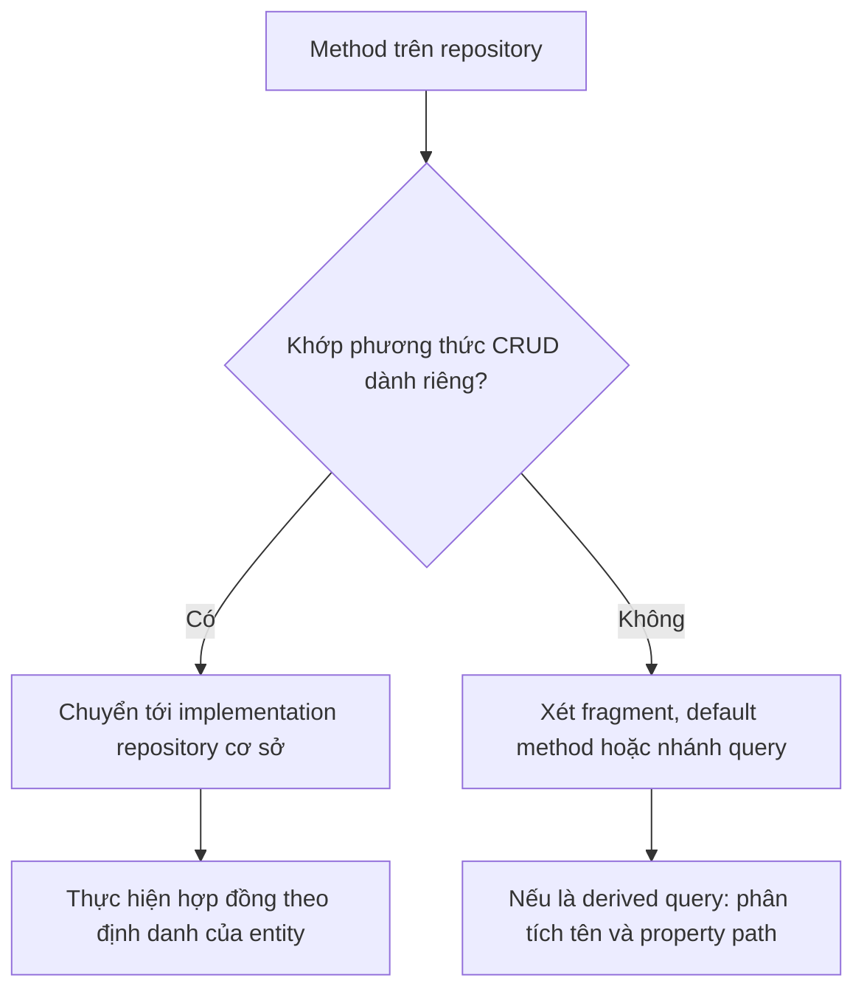

# Phương thức dành riêng như findById luôn nhắm tới định danh

Nếu entity có khóa chính tên `pk` và một thuộc tính thường tên `id`, lời gọi `repository.findById(value)` tìm theo thuộc tính nào? Với phương thức dành riêng theo hợp đồng CRUD của Spring Data, câu trả lời là **định danh của entity**, tức `pk` trong mô hình đó.

Điểm dễ nhầm là một derived query như `findCustomerById(value)` lại có thể tìm theo thuộc tính thường `id`. Hai method chứa cùng đoạn `ById` nhưng thuộc hai cơ chế khác nhau.

Trong chương **Suy diễn tên phương thức** của module `SPRING_DATA_COMMONS`, bài này giải thích ranh giới giữa phương thức CRUD dành riêng và query được suy diễn từ tên. Mục tiêu là chọn đúng method khi đọc, kiểm tra tồn tại hoặc xóa theo định danh, đồng thời tránh truy vấn nhầm một thuộc tính nghiệp vụ trùng tên `id`.

## 1. Định danh là khái niệm metadata, không phải một tên field cố định

Định danh của entity được xác định theo metadata và quy tắc ánh xạ của module store. Một field mang tên `id` thường được dùng làm định danh, nhưng tên đó không phải điều kiện bắt buộc của mọi mô hình.

Ví dụ riêng cho **Spring Data JPA**:

```java
import jakarta.persistence.Column;
import jakarta.persistence.Entity;
import jakarta.persistence.Id;
import jakarta.persistence.Table;

@Entity
@Table(name = "customers")
class Customer {

    @Id
    @Column(name = "customer_pk")
    private Long pk;

    @Column(name = "business_id")
    private Long id;

    private boolean active;

    protected Customer() {
    }

    Customer(Long pk, Long id, boolean active) {
        this.pk = pk;
        this.id = id;
        this.active = active;
    }

    public Long getPk() {
        return pk;
    }

    public Long getId() {
        return id;
    }

    public boolean isActive() {
        return active;
    }
}
```

Trong mô hình này:

| Thành phần | Vai trò |
| --- | --- |
| `pk` | Định danh JPA do được đánh dấu `@Id` |
| `id` | Thuộc tính nghiệp vụ thông thường |
| `customer_pk` | Tên cột lưu `pk` |
| `business_id` | Tên cột lưu `id` |

Đây là mô hình minh họa với khóa chính được gán bởi ứng dụng; chưa phải cấu hình JPA hoàn chỉnh. Việc hai thuộc tính cùng có kiểu `Long` là có chủ đích: truyền nhầm giá trị vẫn có thể biên dịch được.

Annotation `jakarta.persistence.Id` trong ví dụ thuộc JPA. Các module khác có thể dùng annotation của Spring Data hoặc quy ước riêng; phải xác định định danh theo đúng store đang quản lý repository.

## 2. findById là phương thức dành riêng khi khớp hợp đồng repository cơ sở

Khai báo:

```java
import org.springframework.data.repository.CrudRepository;

interface CustomerRepository extends CrudRepository<Customer, Long> {
}
```

Hợp đồng `CrudRepository<T, ID>` đã cung cấp phương thức có dạng:

```java
Optional<T> findById(ID id);
```

Trong `CustomerRepository`, `T` là `Customer`, còn `ID` là `Long`. Đối số của `findById` là giá trị định danh, bất kể property định danh trong mô hình được đặt tên `pk`, `customerId` hay một tên khác.

Với entity ở phần trước:

```java
repository.findById(101L);
```

có nghĩa là tìm `Customer` có **định danh `pk` bằng `101L`**. Không tự chuyển sang tìm thuộc tính nghiệp vụ `id` chỉ vì phần tên method là `ById`.

### 2.1. Vì sao không áp dụng suy diễn tên thông thường?

Có thể hình dung hai nhánh xử lý:



Sơ đồ thể hiện khác biệt trách nhiệm, không mô tả đầy đủ thứ tự mọi bước phân loại method nội bộ.

`findById` theo hợp đồng CRUD thường do implementation cơ sở của module thực hiện. Hạ tầng không cần suy luận rằng chữ `Id` phải là tên một property thông thường để tạo derived query cho method đó.

### 2.2. Giới hạn của từ “luôn” trong tiêu đề

Quy tắc này nói về **phương thức dành riêng khớp hợp đồng repository cơ sở trong cách triển khai chuẩn**. Nó không biến mọi method Java tên `findById` trong service, helper hoặc một đối tượng tự viết thành thao tác CRUD của Spring Data.

Nếu chủ động thay implementation cơ sở hoặc cung cấp logic tùy biến cho method, cần kiểm tra đường thực thi thực tế. Tương tự, không suy rằng mọi overload có cùng tên nhưng tham số khác đều có cách phân loại giống phương thức CRUD chuẩn.

Ý nghĩa hợp đồng vẫn là truy cập theo định danh. Tên field nghiệp vụ `id` không tự thay đổi ý nghĩa đó.

## 3. Ví dụ dữ liệu làm rõ khác biệt

Giả sử dữ liệu ban đầu chỉ có hai khách hàng:

| Khách hàng | `pk` — định danh | `id` — thuộc tính nghiệp vụ | `active` |
| --- | --- | --- | --- |
| A | `101` | `9001` | `false` |
| B | `202` | `101` | `true` |

Giá trị `101` xuất hiện ở hai vị trí khác nhau: là định danh của A và là `id` nghiệp vụ của B.

Với repository CRUD:

```java
Optional<Customer> result = repository.findById(101L);
```

kết quả mong đợi là **A**.

Nếu người viết truyền `9001L` vì đang cầm giá trị nghiệp vụ của A:

```java
Optional<Customer> result = repository.findById(9001L);
```

kết quả là `Optional.empty()` trong bộ dữ liệu này, vì không có entity nào có `pk = 9001`.

Tên biến không thay đổi điều đó:

```java
Long businessId = 101L;
repository.findById(businessId);
```

Lời gọi trên vẫn tìm theo định danh. Tên biến `businessId` chỉ thể hiện ý định của lập trình viên; nó không định tuyến lại repository.

## 4. Cách truy vấn thuộc tính thường cũng mang tên id

Có thể chèn một phần mô tả giữa prefix và `By`, tạo một query method khác với phương thức dành riêng:

```java
import java.util.Optional;

import org.springframework.data.repository.CrudRepository;

interface CustomerRepository extends CrudRepository<Customer, Long> {

    Optional<Customer> findCustomerById(Long businessId);

    Optional<Customer> findByPk(Long pk);
}
```

Trong `findCustomerById`:

```text
findCustomerBy | Id
      │          │
      │          └── predicate trên property id
      └───────────── subject với phần mô tả Customer
```

`Customer` ở đây là phần mô tả trong subject của derived query. Nó không yêu cầu một thuộc tính tên `customer`, cũng không đổi domain type đã được khai báo của repository.

Với dữ liệu ở phần trước:

| Method | Cơ chế thông thường | Thuộc tính được nhắm tới | Kết quả khi truyền `101L` |
| --- | --- | --- | --- |
| `findById` | Hợp đồng CRUD dành riêng | Định danh `pk` | A |
| `findCustomerById` | Derived query | Property `id` | B |
| `findByPk` | Derived query | Property `pk` | A |

`findByPk` trong ví dụ cũng tìm cùng giá trị property với định danh, nhưng nó diễn đạt truy vấn thông qua tên property `pk`. Không nên coi hai method này mặc nhiên có cùng implementation nội bộ, cùng cách dùng persistence context hoặc cùng số lần truy cập store.

### 4.1. Kiểu Optional cần phù hợp với dữ liệu

`Optional<Customer>` biểu diễn tối đa một kết quả. Nếu property nghiệp vụ `id` có thể trùng giữa nhiều entity, cần chọn hợp đồng như:

```java
List<Customer> findCustomerById(Long businessId);
```

Đây là một cách khai báo thay thế cho method trả `Optional`, không đặt hai method chỉ khác return type trong cùng interface.

Nếu dùng `Optional` mà query thực tế trả nhiều kết quả, có thể phát sinh lỗi kích thước kết quả. Spring Data không tự coi property thường là duy nhất chỉ vì nó mang tên `id`.

### 4.2. Không cần tạo một property tên id để findById hoạt động

Nếu bỏ property nghiệp vụ `id` khỏi entity và chỉ giữ `@Id Long pk`, phương thức CRUD `findById` vẫn phục vụ truy cập theo định danh.

Ngược lại, derived query `findCustomerById` cần property `id` mà nó mô tả. Khi property đó không tồn tại, việc phân giải query có thể thất bại; không có quy tắc tự chuyển `Id` trong mọi derived query thành `pk`.

## 5. Nhóm phương thức dành riêng liên quan đến định danh

Các phương thức sau thuộc hợp đồng CRUD dùng chung. Bảng mô tả dạng đồng bộ của `CrudRepository`; những API khác có thể có kiểu wrapper hoặc kiểu collection khác.

| Method | Đối số có ý nghĩa gì? | Hợp đồng chính |
| --- | --- | --- |
| `findById(ID)` | Một định danh | Tìm entity theo định danh |
| `existsById(ID)` | Một định danh | Kiểm tra có entity với định danh đó không |
| `findAllById(Iterable<ID>)` | Các định danh | Tìm các entity có định danh được cung cấp |
| `deleteById(ID)` | Một định danh | Xóa entity theo định danh |
| `deleteAllById(Iterable<? extends ID>)` | Các định danh | Xóa theo các định danh được cung cấp |

Trong mô hình `Customer`, các đối số ở bảng đều là giá trị của **`pk`**, không phải property nghiệp vụ `id`.

### 5.1. existsById không kiểm tra mã nghiệp vụ

Với bộ dữ liệu A và B:

```java
repository.existsById(101L);   // true: A có pk = 101
repository.existsById(9001L);  // false: không có pk = 9001
```

Muốn kiểm tra property nghiệp vụ, có thể khai báo derived query khi store hỗ trợ:

```java
boolean existsCustomerById(Long businessId);
```

Khi đó `existsCustomerById(9001L)` kiểm tra property `id` và tìm thấy A.

### 5.2. findAllById không phải find mọi entity có property id nằm trong danh sách

Ví dụ:

```java
Iterable<Customer> result = repository.findAllById(
    List.of(101L, 202L, 999L)
);
```

Các phần tử đầu vào là các định danh. Với dữ liệu đã nêu, A và B được tìm thấy; không có entity tương ứng với `999` nên không có một kết quả thay thế bắt buộc cho định danh đó.

Không dựa vào thứ tự trả về để ghép từng phần tử với danh sách đầu vào: hợp đồng CRUD không bảo đảm cùng thứ tự. Cũng không suy số phần tử trả về luôn bằng số định danh được cung cấp.

Nếu cần query trên property nghiệp vụ bằng toán tử `In`, có thể dùng một method như:

```java
List<Customer> findCustomerByIdIn(Collection<Long> businessIds);
```

Đây là derived query khác; cần store hỗ trợ và metadata property phù hợp. Nó không đổi ý nghĩa của `findAllById` kế thừa.

### 5.3. deleteById và deleteAllById cần đúng loại giá trị

Với dữ liệu ban đầu, `deleteById(101L)` nhắm tới A. Nó không nhắm tới B dù B có property nghiệp vụ `id = 101`.

Một method derived delete như sau có thể được dùng trong module hỗ trợ:

```java
long deleteCustomerById(Long businessId);
```

Method này biểu diễn điều kiện trên property `id`, nên `deleteCustomerById(101L)` nhắm tới B trong bộ dữ liệu đó.

Hai ví dụ xóa phải được xét độc lập trên dữ liệu ban đầu. Return type, cách thực hiện xóa, callback, transaction và khả năng tối ưu khác nhau theo API và store; không suy derived delete tương đương một bulk delete chỉ từ tên method.

## 6. Có chữ Id trong tên không có nghĩa là phương thức dành riêng

Điểm quyết định là phương thức có khớp hợp đồng dành riêng hay đang được xử lý như một query method khác. Không áp dụng quy tắc định danh bằng cách tìm chuỗi `Id` trong tên.

Giả sử khai báo thêm:

```java
Optional<Customer> findByIdAndActiveTrue(Long businessId);

Optional<Customer> findCustomerByPkAndActiveTrue(Long pk);
```

Với mô hình có `pk` là định danh và `id` là property thường:

| Method | Điều kiện theo derived query |
| --- | --- |
| `findByIdAndActiveTrue` | Property `id` bằng đối số và `active = true` |
| `findCustomerByPkAndActiveTrue` | Property `pk` bằng đối số và `active = true` |

`findByIdAndActiveTrue` là một method khác với phương thức CRUD `findById`. Nó không tự kế thừa quy tắc “Id nghĩa là định danh” rồi gắn thêm điều kiện `active`.

Với dữ liệu A và B:

```text
findById(101)                         -> A
findByIdAndActiveTrue(101)            -> B
findCustomerByPkAndActiveTrue(101)    -> không có kết quả
```

Nếu entity chỉ có `pk` và không có property `id`, một derived query trên `IdAndActiveTrue` có thể thất bại do không tìm được property `id`. Nó không tự đổi thành `pk`.

Tương tự, `findByIdIn(...)`, `findByIdIsNotNull(...)` hoặc một method có thêm phần sắp xếp là những khai báo phải được phân loại theo đầy đủ tên và chữ ký. Không coi tất cả là biến thể của phương thức dành riêng chỉ vì bắt đầu bằng `findById`.

### 6.1. Tên dễ gây hiểu nhầm nên được làm rõ

Nếu ý định là tìm theo khóa chính và điều kiện hoạt động, tên `findCustomerByPkAndActiveTrue` thể hiện đúng mô hình đang dùng. Nếu ý định là tìm theo mã nghiệp vụ, một tên thuộc tính như `customerNumber` có thể rõ hơn `id`:

```java
Optional<Customer> findByCustomerNumber(Long customerNumber);
```

Đổi tên property là một thay đổi mô hình cần xử lý mapping và các nơi sử dụng tương ứng. Không cần đổi chỉ để phương thức CRUD hoạt động; đây là lựa chọn giúp người đọc phân biệt hai khái niệm.

## 7. Chỉ mở một số method vẫn có thể giữ ngữ nghĩa dành riêng

Không bắt buộc phải kế thừa toàn bộ `CrudRepository` để công bố một method khớp hợp đồng cơ sở.

Ví dụ repository chỉ đọc:

```java
import java.util.Optional;

import org.springframework.data.repository.Repository;

interface CustomerLookupRepository extends Repository<Customer, Long> {

    Optional<Customer> findById(Long identifier);

    Optional<Customer> findCustomerById(Long businessId);
}
```

`Repository` là interface đánh dấu, không tự khai báo `findById`. Tuy nhiên, Spring Data có cơ chế công bố chọn lọc các method CRUD bằng cách khai báo những chữ ký khớp hợp đồng mà repository cơ sở hỗ trợ.

Trong cách cấu hình chuẩn đó:

- `findById` được nối với thao tác tìm theo định danh của implementation cơ sở.
- `findCustomerById` là query method khác, có thể được suy diễn theo property `id`.

Vì vậy, lập luận “interface này không extends CrudRepository nên findById chắc chắn derive theo field id” là không đúng.

### 7.1. Giữ đúng chữ ký thay vì dựa vào tên đơn lẻ

Không thay tùy ý kiểu đối số hoặc kiểu trả về rồi mặc định method vẫn là phương thức CRUD tương ứng. Cơ chế đối chiếu còn liên quan đến metadata repository, generic type và module store.

Nếu kế thừa `CrudRepository<Customer, Long>`, đổi return type của `findById(Long)` thành một kiểu không tương thích còn có thể bị Java từ chối ngay khi biên dịch. Đổi tên biến tham số từ `id` thành `pk` thì không tạo ra method khác.

Muốn query một property nghiệp vụ, cách diễn đạt rõ là dùng một method query riêng, thay vì dựa vào overload để né quy tắc dành riêng.

## 8. Vai trò của kiểu ID và định danh tổng hợp

Với:

```java
CrudRepository<Customer, Long>
```

`Long` mô tả kiểu giá trị định danh mà hợp đồng repository nhận. Generic type này cần phù hợp với metadata định danh của entity.

Nó không có nghĩa “bất kỳ property Long nào trong Customer cũng là định danh”. Trong ví dụ ban đầu, `pk` và `id` đều là `Long`, nhưng chỉ `pk` được ánh xạ làm định danh JPA.

### 8.1. Kiểu dữ liệu khác nhau giúp phát hiện một số nhầm lẫn

Nếu định danh là `Long` còn mã nghiệp vụ là `String`, truyền thẳng mã nghiệp vụ vào `findById` có thể bị phát hiện ở mức kiểu Java. Khi cả hai cùng kiểu, lỗi đó dễ đi qua compiler hơn.

Dù kiểu giống hay khác, vẫn phải đặt tên biến và hợp đồng service rõ ràng. Tự chuyển một chuỗi mã nghiệp vụ thành `Long` không biến nó thành giá trị khóa chính.

### 8.2. Định danh tổng hợp vẫn là một giá trị định danh theo hợp đồng

Trong một biến thể JPA dùng định danh tổng hợp, giả sử entity có `@EmbeddedId CustomerKey pk`. Repository có thể mang kiểu:

```java
CrudRepository<Customer, CustomerKey>
```

Khi đó `findById` nhận một `CustomerKey` đại diện cho định danh tổng hợp, không phải một property thường tên `id`, cũng không phải tùy ý một thành phần của khóa.

Đây là biến thể của mô hình, không phải khai báo thứ hai cho cùng entity `Customer` đã dùng `Long` ở các phần trước. Cách định nghĩa, so sánh và ánh xạ composite identifier phải tuân theo store; không suy mọi module đều hỗ trợ composite identifier theo cách JPA hỗ trợ.

Nếu cần lọc một thành phần của khóa, đó là yêu cầu truy vấn riêng. Cần dùng đúng tên và đường dẫn property của mô hình, cùng khả năng query của module tương ứng.

## 9. Ý nghĩa chung không đồng nhất với cách thực thi ở mọi store

Spring Data Commons cung cấp các hợp đồng repository. Module store bổ sung metadata, implementation và cơ chế truy cập dữ liệu.

| Điều có thể kết luận từ hợp đồng dành riêng | Điều chưa thể kết luận chỉ từ tên method |
| --- | --- |
| Đối số là định danh của entity | Tên cột hoặc trường lưu trữ cụ thể |
| `findById` tìm theo định danh | Luôn phát ra một câu SQL mới |
| `existsById` kiểm tra theo định danh | Luôn dùng cùng thuật toán với `findById` |
| `deleteById` nhận định danh | Luôn thực hiện một bulk statement trực tiếp |
| `findAllById` nhận tập định danh | Trả đúng thứ tự đầu vào hoặc cùng số phần tử |

Trong JPA, implementation tìm theo định danh có thể làm việc với persistence context và các cơ chế của provider. Vì vậy, việc không thấy một query SQL mới không tự chứng minh `findById` không chạy.

Ở store khác, định danh có thể ánh xạ tới cấu trúc khác. Ý nghĩa định danh vẫn cần được đọc từ metadata của đúng module, không phải suy từ tên field hoặc từ ví dụ JPA.

### 9.1. API reactive có dạng kết quả khác

Hợp đồng reactive tương ứng có thể trả `Mono<Customer>` thay vì `Optional<Customer>`, và thời điểm thao tác thực sự chạy còn phụ thuộc subscription cùng hạ tầng reactive.

Điều được giữ là ý nghĩa tìm theo định danh của phương thức dành riêng. Không sao chép nguyên kiểu trả về và giả định thời điểm thực thi của repository đồng bộ sang repository reactive.

### 9.2. Các API riêng của store cần được xét riêng

Một module có thể cung cấp các method truy cập theo khóa hoặc tạo reference với tên khác. Chúng không tự trở thành phần của danh sách method dành riêng trong Commons chỉ vì tên chứa `Id`.

Khi thấy một method ngoài hợp đồng đang học, hãy đọc hợp đồng của interface thực sự khai báo nó trong phiên bản sử dụng. Không suy cách tải dữ liệu, xử lý entity không tồn tại hoặc quản lý transaction bằng phép so tên.

## 10. Tùy biến tường minh và phạm vi của quy tắc chuẩn

Các ví dụ của bài giả định method dành riêng được implementation repository chuẩn xử lý. Trong hệ thống có tùy biến, cần xác định route thực tế trước khi kết luận.

Các tình huống cần nhận diện gồm:

| Tình huống | Điều phải xác định |
| --- | --- |
| Custom fragment hoặc custom base implementation | Method có được cung cấp bởi implementation tùy biến không |
| Query annotation trên method khai báo lại | Module có chọn method đó vào nhánh query theo annotation không |
| Default method có thân trên interface | Thân method gọi tiếp thao tác nào |
| Một lớp service tự đặt method tên `findById` | Logic do lớp đó viết là gì |

Một số module cho phép query annotation làm một method khai báo lại được xử lý qua nhánh query. Đó là cấu hình tường minh cần xét theo module, khác với việc mặc định suy diễn chữ `Id` của phương thức CRUD chuẩn thành một property thường.

Nếu muốn truy vấn theo mã nghiệp vụ, dùng method riêng rõ nghĩa giúp hợp đồng dễ đọc hơn việc đặt logic khác vào tên CRUD quen thuộc.

### 10.1. Query lookup strategy không đổi metadata định danh

Chọn chiến lược dùng query khai báo hoặc tạo query từ tên không tự biến property `id` thành khóa chính, cũng không đổi hợp đồng chuẩn của các method CRUD do implementation cơ sở xử lý.

Ví dụ, cấu hình yêu cầu query khai báo không có nghĩa mọi method CRUD kế thừa đều phải có một câu query annotation mới. Cần phân biệt method đi qua query lookup với method đã được implementation cơ sở cung cấp.

### 10.2. Projection không tự thay đổi mục tiêu tìm kiếm

Một projection thay đổi dạng dữ liệu trả về trong phạm vi hỗ trợ, không phải cơ chế tự chuyển đối số từ định danh sang property nghiệp vụ.

Nếu chủ động khai báo method query cho projection, cần xét đầy đủ tên, annotation và route của chính method đó. Không dùng việc đổi kiểu trả về để suy luận mục tiêu tìm kiếm của một phương thức CRUD dành riêng.

## 11. Đọc mã và chẩn đoán một kết quả bất ngờ

Giả sử màn hình gửi giá trị `101` và nhóm phát triển kỳ vọng nhận B, nhưng `findById(101L)` trả A.

### Bước 1: xác định repository và store

Đọc kiểu repository mà lời gọi sử dụng: domain type, kiểu `ID`, interface cơ sở và các tùy biến đã cấu hình. Một tên method giống nhau trong hai repository không đảm bảo hai mô hình có cùng định danh.

### Bước 2: xác định property định danh

Đối chiếu metadata và annotation của đúng store. Trong ví dụ JPA, `@Id` nằm trên `pk`, nên giá trị `101` được hiểu là khóa chính của A.

Không dùng tên cột `business_id` hoặc tên biến `customerId` trong service để thay cho bước này.

### Bước 3: xác định lời gọi muốn loại giá trị nào

Ghi rõ dữ liệu đi vào là:

```text
Giá trị định danh:        Customer.pk
Giá trị nghiệp vụ:       Customer.id
```

Nếu controller nhận mã nghiệp vụ nhưng service gọi repository bằng hợp đồng định danh, lỗi nằm ở cách nối hai hợp đồng đó, không nhất thiết ở parser.

### Bước 4: kiểm tra method là dành riêng hay query khác

Đối chiếu `findById` với `findCustomerById` và `findByIdAndActiveTrue`. Không rút tên dài thành “cũng là findById” khi đọc log hoặc review code.

Nếu có fragment, query annotation hoặc base class tùy biến, cần xác định nhánh đang chạy thay vì áp dụng máy móc ví dụ mặc định.

### Bước 5: kiểm tra bằng dữ liệu có thể phân biệt hai loại ID

Dùng một giá trị xuất hiện ở khóa chính của entity này và ở property nghiệp vụ của entity khác, giống dữ liệu A và B. Nếu hai loại giá trị luôn bằng nhau trong dữ liệu thử, lỗi dùng nhầm contract dễ bị che.

### Bước 6: tách vấn đề định danh khỏi vấn đề thực thi

Nếu method đã nhắm đúng định danh nhưng vẫn không có kết quả, mới tiếp tục xem tài nguyên store, transaction, bộ lọc hoặc dữ liệu hiện có. Không đổi annotation định danh chỉ để khiến một lời gọi đang truyền nhầm mã nghiệp vụ trả về dữ liệu.

Khi xem stack trace, các frame implementation cơ sở như `SimpleJpaRepository` và đường thực thi query có thể cung cấp dấu mốc khác nhau. Tên và cấu trúc nội bộ phụ thuộc phiên bản; chúng hỗ trợ xác định route, không thay thế hợp đồng public.

## 12. Kịch bản thực hành nhận diện đúng hợp đồng

Dùng lại bảng A và B. Mỗi dòng dưới là một kịch bản độc lập, bắt đầu từ dữ liệu ban đầu; không thực hiện các dòng xóa nối tiếp rồi dùng trạng thái đã đổi để so kết quả đọc.

| Lời gọi | Điều cần kiểm chứng |
| --- | --- |
| `findById(101L)` | Trả A theo `pk` |
| `findCustomerById(101L)` | Trả B theo property nghiệp vụ `id` |
| `findByPk(101L)` | Query theo property `pk`, trả A |
| `existsById(9001L)` | `false` vì không có `pk = 9001` |
| `existsCustomerById(9001L)` | `true` vì A có property `id = 9001` |
| `findByIdAndActiveTrue(101L)` | Trả B theo `id` và điều kiện hoạt động |
| `findCustomerByPkAndActiveTrue(101L)` | Không có kết quả vì A không hoạt động |
| `findAllById(List.of(101L, 202L))` | Có A và B, không mặc định thứ tự |
| `deleteById(101L)` | Nhắm tới A theo định danh |
| `deleteCustomerById(101L)` | Nhắm tới B theo property nghiệp vụ, nếu store hỗ trợ method này |

Đây là kịch bản thiết kế thực hành, không phải kết quả của một bộ test đã được chạy trong bài. Khi triển khai, cần cấu hình store, dữ liệu, transaction và các method minh họa tương ứng.

Nếu kiểm tra query trả một kết quả, cần xác định tính duy nhất của property nghiệp vụ trong dữ liệu. Một giá trị `id` trùng giữa nhiều bản ghi làm `Optional` trở thành một hợp đồng khác với `List`.

## 13. Các nhận định cần sửa

| Nhận định dễ nhầm | Cách hiểu đúng |
| --- | --- |
| Entity có field `id` nên `findById` chắc chắn tìm field đó | Phương thức CRUD dành riêng nhắm tới định danh do metadata xác định |
| Khóa chính tên `pk` nên phải viết lại `findById` | Hợp đồng CRUD không yêu cầu property định danh phải tên `id` |
| `findById` và `findCustomerById` chỉ khác tên cho dễ đọc | Một method là dành riêng; method kia có thể derive theo property thường |
| Mọi tên bắt đầu bằng `findById` đều nhắm khóa chính | Xét đầy đủ method; thêm predicate có thể tạo derived query bình thường |
| `existsById` xác minh được mọi mã có tên ID trong nghiệp vụ | Nó kiểm tra giá trị định danh của entity |
| `findAllById` là query `In` trên property thường `id` | Nó nhận các định danh theo hợp đồng CRUD |
| Đổi tên biến đối số thành `businessId` sẽ đổi ý nghĩa query | Tên biến không đổi hợp đồng của method được gọi |
| Cùng kiểu `Long` nghĩa là có thể dùng hai loại ID thay nhau | Kiểu Java giống nhau không làm hai khái niệm dữ liệu đồng nhất |
| Không extends `CrudRepository` thì method không thể là CRUD chọn lọc | Các chữ ký khớp cơ sở có thể được công bố qua `Repository` |
| `findById` luôn phải tạo một câu SQL mới | Cách truy cập và cache thuộc implementation/store/provider |

## 14. Câu hỏi tự kiểm tra

1. Entity có `@Id Long pk` và `Long id`: `findById(10L)` nhắm tới property nào?
2. `findCustomerById(10L)` cần property nào tồn tại nếu nó được xử lý như derived query?
3. Vì sao `findByIdAndActiveTrue` không tự mang ý nghĩa khóa chính của phương thức CRUD `findById`?
4. `findAllById` nhận danh sách mã nghiệp vụ hay định danh của entity?
5. Có cần giữ một field tên `id` để phương thức dành riêng hoạt động không?
6. Vì sao dữ liệu thử nên có giá trị khóa chính và mã nghiệp vụ khác nhau?
7. Điều gì cần kiểm tra thêm khi có query annotation hoặc custom fragment cho method khai báo lại?

Khi đọc một lời gọi repository, hãy xác định trước nó sử dụng **hợp đồng truy cập theo định danh** hay **query trên một property có tên cụ thể**. Sau đó mới đối chiếu giá trị được truyền vào với metadata entity. Việc phân biệt này đặc biệt hữu ích khi mô hình có nhiều loại mã, khi mở rộng repository và khi chuyển giữa các store có cách quản lý định danh khác nhau.
