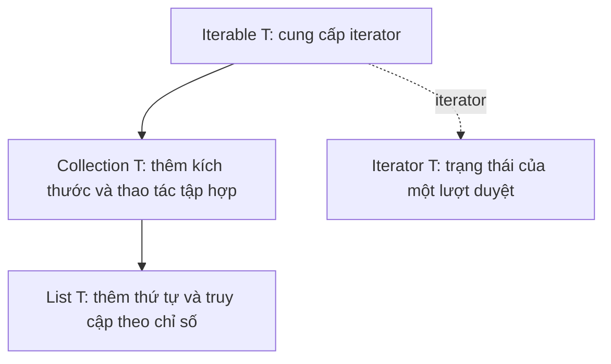

# Collection, List, Iterable và Iterator

## 1. Kiểu kết quả là một phần của hợp đồng repository

Một phương thức truy vấn có thể tìm được nhiều bản ghi, nhưng “nhiều bản ghi” chưa cho biết người gọi được phép làm gì với kết quả. Có cần truy cập theo vị trí không? Có cần biết kích thước không? Có cần giữ lại kết quả để duyệt lần nữa không? Dữ liệu đã được nạp hay việc duyệt sẽ tiếp tục truy cập kho dữ liệu?

`Collection<T>`, `List<T>`, `Iterable<T>` và `Iterator<T>` trả lời những phần khác nhau của các câu hỏi đó. Chúng là các kiểu Java, không phải bốn chiến lược truy vấn tương đương. Chọn đúng kiểu giúp người dùng repository hiểu những thao tác được hỗ trợ, đồng thời tránh suy luận sai về thứ tự, tính lười, bộ nhớ và vòng đời tài nguyên.

Trong Spring Data Commons, hợp đồng repository được chia sẻ giữa nhiều mô-đun kho dữ liệu. Tuy nhiên, khả năng trả trực tiếp một kiểu kết quả cho query method, cách ánh xạ và cách thực thi vẫn thuộc mô-đun cụ thể. Đặc biệt với lựa chọn trả trực tiếp `Iterator<T>`, cần đối chiếu khả năng của đúng mô-đun và phiên bản thay vì suy ra hỗ trợ chỉ vì đây là kiểu JDK.

Bài học tập trung vào hợp đồng Java, cách dùng các kiểu này với repository và những bảo đảm mà kiểu kết quả không cung cấp. Khi cần streaming hoặc cursor thực sự, phải chọn cơ chế được kho dữ liệu hỗ trợ và hiểu trách nhiệm đóng tài nguyên.

## 2. Quan hệ giữa bốn kiểu

Có thể hình dung hệ thống kiểu như sau:



Trong Java, `Collection<T>` kế thừa `Iterable<T>`, và `List<T>` kế thừa `Collection<T>`. Mũi tên trong sơ đồ mô tả việc bổ sung khả năng từ trên xuống.

`Iterator<T>` là một đối tượng khác: nó giữ vị trí của một lượt duyệt. Nó không phải lớp cha hay lớp con của ba interface còn lại.

| Kiểu | Khả năng chính | Có `size()`? | Có truy cập theo chỉ số? | Trạng thái một lượt duyệt? |
| --- | --- | --- | --- | --- |
| `Iterable<T>` | Cung cấp `iterator()`, dùng được với enhanced for | Không | Không | Không trực tiếp; do iterator cung cấp |
| `Collection<T>` | Duyệt, hỏi kích thước, kiểm tra phần tử, các thao tác tập hợp | Có | Không | Không trực tiếp |
| `List<T>` | Hợp đồng collection có thứ tự, truy cập theo chỉ số | Có | Có | Không trực tiếp |
| `Iterator<T>` | `hasNext()`, `next()`, duyệt phần còn lại | Không | Không | Có |

Khi đọc bảng, cần tách “có phương thức trong interface” khỏi “mọi thao tác đều được phép và có chi phí thấp”. Ví dụ, thao tác sửa collection có thể không được hỗ trợ; `size()` hay `get(index)` cũng không có cùng độ phức tạp trên mọi implementation.

### 2.1. Iterable là nguồn cung cấp một lượt duyệt

```java
Iterable<Customer> customers = repository.findByActiveTrue();

for (Customer customer : customers) {
    handle(customer);
}
```

Enhanced for lấy một iterator rồi duyệt các phần tử. Người gọi không cần biết dữ liệu bên trong được giữ bằng danh sách, collection khác hay một nguồn có hành vi riêng.

Interface này không cam kết dữ liệu được đọc lười, không cam kết không dùng nhiều bộ nhớ và cũng không cam kết mỗi lần duyệt lại thấy cùng một snapshot. Với một kết quả đã được materialize thành danh sách, `Iterable` có thể chỉ là kiểu khai báo hẹp hơn của danh sách ấy.

### 2.2. Iterator là vị trí trong một lượt duyệt

```java
Iterator<Customer> iterator = customers.iterator();

while (iterator.hasNext()) {
    Customer customer = iterator.next();
    handle(customer);
}
```

Sau vòng lặp, iterator đã ở cuối. Nếu gọi `next()` khi không còn phần tử, người gọi có thể nhận `NoSuchElementException`; không nên dùng `null` làm tín hiệu kết thúc.

Một iterator không tự quay về đầu. Muốn duyệt lại phải có một nguồn cho phép tạo lượt duyệt mới hoặc đã lưu lại dữ liệu. Việc có biến kiểu `Iterator` không tự cung cấp nguồn ấy.

## 3. Mô hình minh họa và các query method

Giả sử ứng dụng có kiểu domain sau. Khi triển khai thực tế, cần thêm mapping entity, định danh và cấu hình repository theo mô-đun kho dữ liệu đã chọn.

```java
public class Customer {
    private final Long id;
    private final String email;
    private final String city;
    private final boolean active;

    public Customer(Long id, String email, String city, boolean active) {
        this.id = id;
        this.email = email;
        this.city = city;
        this.active = active;
    }

    public Long getId() {
        return id;
    }

    public String getEmail() {
        return email;
    }

    public String getCity() {
        return city;
    }

    public boolean isActive() {
        return active;
    }
}
```

Đây là mô hình Java để đọc ví dụ; nó không tự trở thành entity hợp lệ cho mọi kho dữ liệu. Chẳng hạn, mô-đun dùng JPA cần ánh xạ và cấu trúc entity phù hợp với nền tảng JPA của dự án.

Trong mô-đun hỗ trợ những kiểu kết quả tương ứng, repository có thể công khai các phương thức như:

```java
import java.util.Collection;
import java.util.List;
import org.springframework.data.repository.Repository;

public interface CustomerRepository extends Repository<Customer, Long> {
    Collection<Customer> findByCity(String city);

    List<Customer> findByCityOrderByIdAsc(String city);

    Iterable<Customer> findByActiveTrue();
}
```

Ba phương thức trên diễn đạt ba hợp đồng khác nhau, không phải cách overload cùng một phương thức chỉ bằng kiểu trả về. Java không cho khai báo hai phương thức cùng tên và tham số mà chỉ khác kiểu trả về.

Ví dụ cố ý nhận `Iterator` qua `Iterable.iterator()` ở phía người gọi. Nếu muốn repository trực tiếp trả `Iterator`, phải kiểm tra hợp đồng query return type của mô-đun. Không nên sửa chữ ký sang `Iterator` rồi mặc định framework sẽ mở cursor phù hợp.

## 4. Collection: tập kết quả với thao tác tập hợp

`Collection<T>` phù hợp khi người gọi cần biết số phần tử hoặc thao tác ở mức collection nhưng không muốn hứa truy cập theo vị trí.

```java
Collection<Customer> customers = repository.findByCity("Da Nang");

if (customers.isEmpty()) {
    return;
}

int numberOfReturnedCustomers = customers.size();
for (Customer customer : customers) {
    handle(customer);
}
```

`size()` ở đây là số phần tử trong collection được trả về. Nó không tự có nghĩa là tổng số khách hàng trong kho dữ liệu hoặc tổng số phần tử thỏa truy vấn nếu kết quả đã bị giới hạn.

Các giới hạn cần hiểu:

- Interface không biểu đạt yêu cầu loại trùng. Một `Collection` hoàn toàn có thể là một `List` chứa các phần tử trùng theo tiêu chí nghiệp vụ.
- Interface không quy định truy cập theo chỉ số, nên không có `get(0)`.
- Một implementation có thể có thứ tự duyệt, nhưng chỉ nhìn kiểu `Collection` không đủ để suy ra thứ tự truy vấn được cam kết.
- Các thao tác `add`, `remove` hoặc `clear` là những thao tác sửa có thể không được implementation hỗ trợ.

Trong repository, đổi `List<Customer>` sang `Collection<Customer>` không làm truy vấn tự `distinct`. Muốn kết quả phân biệt, phải xác định đơn vị phân biệt và cơ chế truy vấn phù hợp.

### 4.1. Thay đổi container không phải lệnh lưu hoặc xóa

Giả sử kết quả là một danh sách có thể sửa được. Việc thêm một đối tượng vào danh sách kết quả không phải lời gọi `save`. Xóa một phần tử khỏi danh sách kết quả không phải lời gọi `deleteById`.

Cần phân biệt ba việc:

1. Thay đổi cấu trúc container kết quả.
2. Thay đổi trạng thái của đối tượng entity bên trong container.
3. Gọi thao tác ghi được repository hoặc client kho dữ liệu hỗ trợ.

Trong JPA, entity đang được quản lý có thể chịu cơ chế dirty checking; một collection quan hệ được ánh xạ cũng có quy tắc riêng. Những điều đó không biến mọi danh sách kết quả truy vấn thành một API xóa dữ liệu theo phần tử.

## 5. List: có thứ tự trong kết quả, chưa chắc có thứ tự truy vấn ổn định

`List<T>` cung cấp hợp đồng thứ tự phần tử và truy cập theo chỉ số:

```java
List<Customer> customers = repository.findByCityOrderByIdAsc("Da Nang");

if (!customers.isEmpty()) {
    Customer first = customers.get(0);
    handle(first);
}
```

Trong ví dụ này, thứ tự tăng dần theo id đến từ `OrderByIdAsc`, không đến từ riêng kiểu `List`.

Nếu repository chỉ trả `List<Customer>` từ một truy vấn không có yêu cầu sort, danh sách vẫn có vị trí 0, 1, 2 khi nhận được. Tuy nhiên, việc khách hàng nào nằm ở mỗi vị trí có thể thay đổi giữa các lần thực thi. Không nên dựa vào thứ tự chèn, định danh hoặc cách một DB hiện tại tình cờ trả hàng.

Khi thứ tự là yêu cầu sản phẩm, hãy biểu đạt bằng `OrderBy`, `Sort`, `Pageable` hoặc truy vấn khai báo mà mô-đun hỗ trợ. Nếu tiêu chí chính có thể bằng nhau, thêm khóa phụ để có thứ tự xác định theo hợp đồng.

### 5.1. List không đồng nghĩa ArrayList

`List<Customer>` không cam kết lớp runtime là `ArrayList`. Không nên ép kiểu chỉ vì debugger đang hiển thị lớp đó trong một lần chạy.

Nếu cần một danh sách ứng dụng tự sở hữu để sửa cấu trúc, có thể tạo bản sao:

```java
List<Customer> editable = new ArrayList<>(customers);
editable.removeIf(customer -> !customer.isActive());
```

Đoạn mã dùng `java.util.ArrayList`. Đây là bản sao nông: các phần tử vẫn tham chiếu đến cùng đối tượng `Customer`. Sửa trường của một entity qua một tham chiếu có thể được thấy qua tham chiếu còn lại.

Bản sao cũng làm phát sinh chi phí bộ nhớ theo số phần tử. Không nên tạo nó chỉ để “an toàn” nếu người gọi chỉ cần duyệt dữ liệu.

### 5.2. List không tự loại trùng hoặc cho phép sửa

Một list có thể chứa nhiều phần tử có cùng email hoặc cùng tên; kiểu kết quả không đặt ra quy tắc duy nhất theo nghiệp vụ. Nó cũng không cam kết các thao tác sửa được hỗ trợ.

Nếu người gọi cần dữ liệu chỉ đọc, có thể diễn đạt chính sách ở tầng ứng dụng. Tuy nhiên, một wrapper không cho sửa list vẫn không tự làm các entity bên trong bất biến hoặc an toàn khi chia sẻ giữa nhiều luồng.

## 6. Iterable trong các interface CRUD chung

`CrudRepository<T, ID>` của Spring Data Commons công khai một số thao tác bằng `Iterable`, chẳng hạn:

```java
Iterable<T> findAll();
Iterable<T> findAllById(Iterable<ID> ids);
<S extends T> Iterable<S> saveAll(Iterable<S> entities);
```

Chữ ký này cho phép nhiều mô-đun cung cấp kết quả mà không bắt người gọi phụ thuộc vào một loại danh sách cụ thể. Nó không yêu cầu mọi implementation phải đọc dữ liệu theo từng phần tử từ server.

Với một repository kế thừa `CrudRepository`, nên dùng đúng hợp đồng:

```java
Iterable<Customer> customers = repository.findAll();
for (Customer customer : customers) {
    handle(customer);
}
```

Không nên mặc định ép kiểu:

```java
// Không có bảo đảm từ hợp đồng CrudRepository.findAll().
List<Customer> customers = (List<Customer>) repository.findAll();
```

Ép kiểu có thể chạy ở một implementation và hỏng khi thay mô-đun, wrapper hoặc implementation tùy chỉnh.

### 6.1. Khi muốn hợp đồng List ngay từ repository

Ở những phiên bản cung cấp `ListCrudRepository`, interface này diễn đạt các thao tác CRUD tương ứng với kết quả dạng `List`:

```java
import org.springframework.data.repository.ListCrudRepository;

public interface CustomerCrudRepository
        extends ListCrudRepository<Customer, Long> {
}
```

Khi kiểu này được phiên bản và mô-đun tích hợp hỗ trợ, người gọi có thể nhận `List<Customer>` từ `findAll()` mà không ép kiểu kết quả `Iterable`.

Lựa chọn này thay đổi hợp đồng container; nó không tự thêm phân trang, sắp xếp, tính bất biến, streaming hoặc batch tối ưu cho `saveAll`.

### 6.2. FindAllById không hứa khớp một-một theo thứ tự đầu vào

Không nên giả định kết quả `findAllById` luôn có cùng số phần tử hoặc cùng thứ tự với tập id đưa vào. Một id không tồn tại có thể không có phần tử tương ứng; hợp đồng CRUD không bảo đảm thứ tự kết quả theo danh sách đầu vào.

Nếu cần ghép mỗi id với kết quả, hãy tra theo định danh và giữ chính sách riêng cho trường hợp thiếu. Không ghép hai iterator theo vị trí rồi mặc định phần tử thứ nhất thuộc id thứ nhất.

## 7. Iterator: tiêu thụ một lượt duyệt đúng cách

### 7.1. Giữ một iterator cho một lượt duyệt

Cách thông thường là lấy iterator một lần:

```java
Iterator<Customer> iterator = customers.iterator();
while (iterator.hasNext()) {
    Customer customer = iterator.next();
    handle(customer);
}
```

Không nên viết:

```java
// Sai về cách quản lý lượt duyệt.
while (customers.iterator().hasNext()) {
    Customer customer = customers.iterator().next();
    handle(customer);
}
```

Nếu nguồn là một danh sách không rỗng và mỗi lần gọi tạo iterator mới, đoạn sai liên tục quay lại đầu danh sách. Nó có thể xử lý mãi phần tử đầu thay vì đi tiếp.

Với nguồn có hành vi khác, việc liên tục yêu cầu iterator mới còn có thể tạo thêm công việc hoặc tài nguyên. Enhanced for thường là lựa chọn rõ ràng nếu không cần quản lý iterator trực tiếp.

### 7.2. Duyệt phần còn lại

```java
Iterator<Customer> iterator = customers.iterator();

if (iterator.hasNext()) {
    handleFirst(iterator.next());
}

iterator.forEachRemaining(customer -> handleRemaining(customer));
```

`forEachRemaining` xử lý từ vị trí hiện tại, không quay lại phần tử đã đọc. Nếu dùng một iterator để đếm trước rồi dùng tiếp để xuất dữ liệu, bước xuất chỉ nhìn thấy phần chưa bị tiêu thụ.

Không nên trả cùng một iterator cho hai bên cùng kỳ vọng được nhận toàn bộ kết quả. Có thể chuyển sang một container phù hợp hoặc thiết kế rõ quyền sở hữu lượt duyệt.

### 7.3. Iterator không phải Iterable

Java không tự cho phép enhanced for trên một biến chỉ có kiểu `Iterator<Customer>`. Người gọi có thể dùng `while`, `forEachRemaining` hoặc một abstraction nguồn dữ liệu được thiết kế thích hợp.

Việc bọc cùng một iterator vào nhiều wrapper cũng không tạo ra nhiều lượt duyệt độc lập. Tất cả vẫn có thể chia sẻ một vị trí đang thay đổi.

### 7.4. Remove là thao tác tùy chọn

`Iterator.remove()` không được mọi implementation hỗ trợ. Nó cũng không phải lệnh xóa entity khỏi kho dữ liệu.

Nếu cần xóa dữ liệu, hãy dùng thao tác repository hoặc API ghi thích hợp, với transaction và quy tắc nghiệp vụ tương ứng. Nếu chỉ cần lọc kết quả hiển thị, hãy giữ rõ đó là lọc trong bộ nhớ hay điều kiện trong query.

Không nên chia sẻ tùy ý một iterator giữa nhiều luồng. Các interface trong bài không tự cung cấp bảo đảm thread safety, còn entity và context truy cập dữ liệu có thể có giới hạn riêng.

## 8. Iterable và Iterator không tự có nghĩa streaming

Đây là một phân biệt quan trọng khi làm việc với dữ liệu lớn.

### 8.1. Cùng một kiểu, nhiều cách thực thi

Một `Iterable<Customer>` có thể bao quanh:

- Danh sách đã được nạp toàn bộ trước khi repository trả về.
- Một tập kết quả đã được giới hạn bằng truy vấn.
- Một nguồn tùy chỉnh tạo dữ liệu trong quá trình duyệt.

Một `Iterator<Customer>` cũng có thể chỉ đang duyệt một danh sách hoàn toàn nằm trong bộ nhớ. Việc không có `size()` không chứng minh dữ liệu chưa được nạp.

Có thể hình dung hai đường thực thi khác nhau:

```text
Query -> nạp toàn bộ kết quả -> List -> Iterator của List

Query/cursor được hỗ trợ -> đọc từng phần khi duyệt -> Iterator của cursor
```

Chỉ nhìn kiểu `Iterator` không phân biệt được hai đường này. Phải xem hợp đồng và implementation của API cụ thể.

### 8.2. Trả Iterable không tự giảm bộ nhớ

Đổi chữ ký từ `List<Customer>` thành `Iterable<Customer>` nhưng vẫn dùng cùng cơ chế query materialize toàn bộ kết quả có thể không làm giảm bộ nhớ đáng kể. Đây là thay đổi bề mặt API, chưa chắc là thay đổi cách lấy dữ liệu.

Muốn xử lý khối lượng lớn, cần xác định:

- Số hàng thực sự được đọc mỗi lần.
- Cơ chế phân trang, scrolling hoặc cursor mà mô-đun hỗ trợ.
- Transaction và thời gian giữ kết nối.
- Tốc độ xử lý phía người dùng so với tốc độ đọc dữ liệu.
- Cách dừng sớm và giải phóng tài nguyên.

### 8.3. Đã có List không có nghĩa mọi dữ liệu liên quan đã được nạp

Trong mô-đun như JPA, danh sách entity có thể đã được nạp nhưng một quan hệ lazy bên trong từng entity vẫn chưa được tải. Vòng lặp đọc thuộc tính quan hệ có thể tạo thêm truy vấn hoặc gặp giới hạn vòng đời persistence context.

Vì vậy, “đã materialize danh sách gốc” và “đã có toàn bộ dữ liệu cần dùng” là hai việc khác nhau. Chọn projection, fetch plan hoặc truy vấn phù hợp với nhu cầu đọc thực tế.

Đây cũng là lý do không thể đánh giá chi phí một vòng lặp chỉ bằng số lần gọi `next()`: công việc phát sinh khi xử lý từng entity cũng có thể truy cập kho dữ liệu.

## 9. Vòng đời tài nguyên khi nguồn thực sự dùng cursor

`Iterator<T>` chuẩn không tự cung cấp phương thức `close()` và không kế thừa `AutoCloseable`. Một đối tượng chỉ được công khai dưới kiểu này không diễn đạt đầy đủ trách nhiệm đóng cursor nếu implementation đang giữ tài nguyên.

Nếu một API cụ thể trả cursor, stream hoặc iterator có thể đóng, cần tuân thủ chính hợp đồng đó. Một số abstraction có thể biểu đạt việc đóng tài nguyên bằng kiểu riêng, nhưng không được suy ra rằng mọi repository trực tiếp trả kiểu ấy đều được hỗ trợ.

Các câu hỏi phải trả lời trước khi trả nguồn dữ liệu sống ra ngoài repository hoặc service:

1. Ai mở nguồn và ai sở hữu trách nhiệm đóng?
2. Có cần transaction còn hoạt động trong suốt quá trình duyệt không?
3. Nếu dừng sau vài phần tử hoặc handler ném exception, tài nguyên được giải phóng thế nào?
4. Có được chuyển nguồn sang luồng khác hoặc giữ lại để xử lý sau không?
5. Có phải mỗi lần gọi `iterator()` mở một nguồn mới không?

Không nên mặc định đọc hết iterator là đã đóng mọi tài nguyên. Một API có thể tự giải phóng khi đọc hết, một API khác vẫn yêu cầu đóng rõ ràng. Dừng sớm là trường hợp đặc biệt cần được xử lý.

Đối với stream hoặc cursor có hợp đồng đóng tài nguyên, thường cần một phạm vi sử dụng và cơ chế quản lý tài nguyên phù hợp như try-with-resources. Kiểu khai báo và API phải thực sự hỗ trợ điều đó; không thể chỉ đặt một `Iterator` thông thường vào khối try-with-resources rồi coi là đã giải quyết vòng đời.

Việc tạo một iterator trong một service rồi trả nó sau khi transaction đã kết thúc cũng không tự kéo dài transaction. Khi cần dữ liệu độc lập với context truy cập, có thể đọc lượng dữ liệu có giới hạn và ánh xạ thành DTO trước khi trả ra ngoài.

## 10. Chuyển đổi giữa các kiểu có chi phí và ngữ nghĩa

### 10.1. Sao chép Iterable sang List

Khi người gọi thực sự cần truy cập theo chỉ số hoặc giữ một danh sách riêng, có thể duyệt và sao chép:

```java
import java.util.ArrayList;
import java.util.List;
import java.util.Objects;

public final class ResultCopies {
    private ResultCopies() {
    }

    public static <T> List<T> copyToList(Iterable<? extends T> source) {
        Objects.requireNonNull(source, "source");

        List<T> result = new ArrayList<>();
        for (T element : source) {
            result.add(element);
        }
        return result;
    }
}
```

Hàm này có các đặc tính rõ ràng:

- Đọc toàn bộ các phần tử mà nguồn cung cấp trong lượt duyệt đó.
- Tạo container mới và dùng bộ nhớ theo số phần tử.
- Giữ thứ tự mà lượt duyệt nguồn cung cấp, không tự sắp xếp theo nghiệp vụ.
- Giữ tham chiếu phần tử, không sao chép sâu các entity.
- Không tự đóng một nguồn có yêu cầu tài nguyên riêng.

Nếu nguồn thực sự giữ cursor, bên sở hữu tài nguyên phải tổ chức phạm vi đóng phù hợp quanh việc sao chép. Một hàm nhận `Iterable` thông thường không tự biết tất cả trách nhiệm của nguồn.

### 10.2. Tiêu thụ Iterator sang List

```java
import java.util.ArrayList;
import java.util.Iterator;
import java.util.List;
import java.util.Objects;

public static <T> List<T> drainToList(Iterator<? extends T> iterator) {
    Objects.requireNonNull(iterator, "iterator");
    List<T> result = new ArrayList<>();
    iterator.forEachRemaining(result::add);
    return result;
}
```

Đây là một phương thức tiện ích đặt trong một lớp của ứng dụng. Nó chỉ sao chép **phần còn lại** của iterator. Nếu iterator đã đọc ba phần tử, kết quả không bao gồm lại ba phần tử ấy.

Sau khi hàm kết thúc thành công, iterator đã bị tiêu thụ đến cuối. Chuyển đổi này cũng không tự đóng tài nguyên mà nguồn có thể sở hữu.

### 10.3. Không chuyển đổi nếu chỉ cần duyệt

Nếu mục tiêu chỉ là gọi `handle` cho từng khách hàng, enhanced for trên `Iterable` đã đủ. Chuyển sang `List` rồi lập tức duyệt có thể thêm cấp phát mà không cung cấp khả năng cần thiết nào.

Ngược lại, nếu thuật toán cần truy cập ngẫu nhiên nhiều lần, hãy chọn hoặc tạo một cấu trúc phù hợp thay vì liên tục duyệt lại nguồn. Đừng che một yêu cầu thuật toán bằng một kiểu API quá hẹp.

## 11. Kết quả rỗng, thứ tự và phần tử thiếu

### 11.1. Không có bản ghi không đồng nghĩa null container

Với phương thức trả tập hợp hoặc nguồn kết quả nhiều phần tử được Spring Data hỗ trợ, hợp đồng dùng kết quả rỗng để biểu đạt không tìm thấy dữ liệu, thay vì buộc người gọi xử lý một container `null`.

Ví dụ:

```java
List<Customer> customers = repository.findByCityOrderByIdAsc("Unknown City");

if (customers.isEmpty()) {
    showNoCustomers();
}
```

Với nguồn `Iterable` rỗng, vòng enhanced for chạy không lần nào. Với một iterator rỗng, `hasNext()` trả `false`.

Một implementation tùy chỉnh vẫn phải tuân thủ hợp đồng đã chọn. Nếu tự viết fragment rồi trả `null` ở nhánh không có dữ liệu, lỗi ấy không được sửa bằng việc người gọi bổ sung kiểm tra `null` ở khắp nơi.

### 11.2. Container rỗng khác phần tử rỗng

Danh sách không có phần tử khác với danh sách có phần tử chứa trường `null`. Projection scalar cũng có thể có ngữ nghĩa `null` riêng tùy truy vấn.

Không nên suy ra rằng một container không `null` sẽ làm mọi thuộc tính của mỗi phần tử đều có giá trị. Những bảo đảm đó thuộc mô hình dữ liệu và hợp đồng query.

### 11.3. Không ghép kết quả bằng vị trí nếu hợp đồng không hứa vị trí

Giả sử đầu vào có id `[20, 10, 99]`, trong đó 99 không tồn tại. `findAllById` có thể trả hai entity hiện có với thứ tự khác đầu vào.

Nếu cần phản hồi theo đúng thứ tự yêu cầu, có thể xây ánh xạ id sang entity rồi duyệt lại danh sách id ban đầu. Cần quyết định rõ cách xử lý id không tồn tại và id xuất hiện nhiều lần.

Một `List` có chỉ số vẫn không đủ để bảo đảm phép ghép theo vị trí là đúng. Cần một hợp đồng về quan hệ giữa đầu vào và đầu ra.

## 12. Dữ liệu lớn: giới hạn truy vấn thay vì chỉ đổi interface

Một phương thức `findAll()` trả `Iterable` vẫn có thể nạp lượng dữ liệu rất lớn. Một phương thức trả `List` có giới hạn rõ lại có thể phù hợp hơn cho tác vụ có bộ nhớ hữu hạn.

Trong mô-đun hỗ trợ truy vấn collection có `Pageable`, có thể diễn đạt:

```java
List<Customer> findByActiveTrue(Pageable pageable);
```

Và gọi:

```java
Pageable request = PageRequest.of(0, 100, Sort.by("id"));
List<Customer> batch = repository.findByActiveTrue(request);
```

Các kiểu `Pageable`, `PageRequest` và `Sort` thuộc `org.springframework.data.domain`. Chữ ký trả `List` cung cấp nội dung được yêu cầu; nó không tự bổ sung tổng số phần tử hoặc số trang như hợp đồng `Page`.

Ví dụ cần cơ chế áp dụng `Pageable` của mô-đun. Với fragment tự viết, implementation phải thực sự sử dụng giới hạn và sort, không được chỉ thêm tham số vào chữ ký rồi bỏ qua.

Nếu cần đi qua nhiều lô, phải có chiến lược tiến đến lô tiếp theo. Gọi lặp mãi cùng yêu cầu trang đầu hoặc cùng query `Top` chỉ đọc lại cùng vùng dữ liệu. Khi có ghi đồng thời, phân trang offset cũng có thể chịu ảnh hưởng bởi dữ liệu thay đổi.

Tùy kho dữ liệu, có thể cân nhắc scrolling, keyset hoặc cursor được hỗ trợ. Những lựa chọn này thay đổi cách truy xuất; riêng việc đổi `List` sang `Iterator` không thực hiện được chúng.

Trước khi dùng một kiểu kết quả hẹp hơn để tối ưu, hãy đo hoặc xác định:

- Số phần tử được đọc trước khi repository trả về.
- Số truy vấn, gồm cả truy vấn quan hệ phát sinh trong lúc xử lý.
- Bộ nhớ đỉnh và kích thước lô.
- Thời gian giữ transaction, kết nối hoặc cursor.
- Hành vi khi dừng sớm hoặc khi có exception.

## 13. Chọn kiểu kết quả theo nhu cầu sử dụng

| Nhu cầu | Kiểu hoặc hướng tiếp cận nên xem xét | Điều không được mặc định |
| --- | --- | --- |
| Chỉ cần duyệt, chấp nhận hợp đồng tối thiểu | `Iterable<T>` khi mô-đun hỗ trợ | Dữ liệu được đọc lười |
| Cần kích thước và thao tác collection | `Collection<T>` | Có thứ tự nghiệp vụ hoặc tự loại trùng |
| Cần vị trí, thứ tự kết quả và tiện ích list | `List<T>` | Có `OrderBy`, mutable hoặc runtime là `ArrayList` |
| Cần quản lý vị trí trong một lượt duyệt | `Iterator<T>` từ nguồn phù hợp | Duyệt lại được hoặc có cursor thật |
| Cần kết quả có giới hạn | Query có limit, `Pageable` hoặc cơ chế tương ứng | Container tự áp dụng giới hạn |
| Cần thông tin còn trang tiếp theo | `Slice` hoặc hợp đồng tương ứng được hỗ trợ | `List` đủ kích thước là chắc chắn còn dữ liệu |
| Cần tổng số phần tử hoặc số trang | `Page` và cơ chế đếm đúng | `Collection.size()` là tổng của toàn bộ query |
| Cần xử lý dữ liệu liên tục từ server | API streaming/cursor của mô-đun | `Iterator` thông thường diễn đạt đủ vòng đời |

Nên chọn kiểu phù hợp với cách người gọi được phép sử dụng dữ liệu. Đồng thời ghi rõ những bảo đảm ngoài hệ thống kiểu, như thứ tự, giới hạn, khả năng duyệt lại và trách nhiệm đóng tài nguyên nếu có.

Không cần chọn interface hẹp nhất bằng mọi giá. Nếu người dùng hợp đồng cần một danh sách có thứ tự và truy cập theo vị trí, `List` là thông tin hữu ích. Nếu chỉ cần duyệt, `Iterable` có thể giúp giảm phụ thuộc vào cấu trúc container nhưng không hứa một tối ưu thực thi cụ thể.

## 14. Kiểm chứng hợp đồng trong dự án thực tế

Khi thêm hoặc đổi kiểu kết quả repository, có thể dùng các nhóm kiểm chứng sau:

| Điều cần bảo vệ | Ca kiểm chứng có ý nghĩa |
| --- | --- |
| Không có dữ liệu | Nhận kết quả rỗng, không phải container `null` |
| Một hoặc nhiều phần tử | Không mất phần tử và không đổi điều kiện lọc |
| Thứ tự được cam kết | Query có sort rõ; các giá trị bằng nhau có khóa phụ thích hợp |
| Không hứa thứ tự | So sánh tập định danh thay vì khóa vào thứ tự tình cờ |
| Vị trí iterator | Đọc một phần rồi `forEachRemaining` chỉ xử lý phần còn lại |
| Phần tử thiếu | Không ghép `findAllById` với id đầu vào theo vị trí |
| Giới hạn query | Lượng dữ liệu được lấy phù hợp giới hạn, không chỉ cắt sau khi nạp hết |
| Tài nguyên sống | Dừng sớm và exception vẫn đi qua đường đóng đúng hợp đồng |
| Ánh xạ và lazy loading | Dữ liệu cần dùng còn truy cập được trong phạm vi đã thiết kế |
| Tính di động | Mã không ép kiểu theo lớp collection runtime tình cờ |

Với phần xử lý thuần Java, một danh sách mẫu có thể kiểm chứng thuật toán. Với giới hạn query, streaming, mapping hoặc tài nguyên, cần kiểm chứng tích hợp phù hợp mô-đun và kho dữ liệu.

Một mock repository trả `ArrayList` không chứng minh repository thật cũng trả `ArrayList`, cũng không chứng minh dữ liệu thật được đọc theo từng lô. Hãy kiểm chứng đúng đặc tính mà quyết định thiết kế đang dựa vào.

## 15. Tình huống tự đánh giá

### A. Đổi List sang Iterable để giảm bộ nhớ

Một phương thức query nạp toàn bộ khách hàng. Nhóm đổi chữ ký từ `List<Customer>` sang `Iterable<Customer>` và cho rằng đã có streaming.

Hãy giải thích vì sao kết luận đó chưa có cơ sở. Xác định thông tin cần quan sát và những cơ chế truy xuất dữ liệu thực sự có thể thay đổi bộ nhớ sử dụng.

### B. List nhưng kết quả đổi thứ tự

Giao diện lấy `get(0)` làm khách hàng mới nhất, trong khi query trả `List<Customer>` không có sort.

Phân biệt thứ tự nội tại của một list đã nhận với thứ tự nghiệp vụ được cam kết. Nêu thay đổi cần có ở query và trường hợp cần khóa phụ.

### C. Dùng lại iterator sau khi đếm

Một đoạn mã đọc hết iterator để tính số phần tử, rồi truyền chính iterator đó cho bộ xuất báo cáo. Báo cáo không có dòng nào.

Giải thích trạng thái iterator, đề xuất hợp đồng nguồn hoặc container phù hợp và nêu chi phí của việc materialize dữ liệu nếu chọn cách đó.

### D. Xóa khỏi collection kết quả

Người viết gọi `customers.remove(customer)` trên một collection kết quả rồi chờ bản ghi bị xóa khỏi database.

Phân biệt container, entity được quản lý và thao tác ghi repository. Xác định API và ranh giới transaction cần dùng nếu ý định thực sự là xóa dữ liệu.

### E. Ghép findAllById theo vị trí

Đầu vào có ba id, một id không tồn tại. Chương trình ghép phần tử kết quả thứ hai với id đầu vào thứ hai và cập nhật dữ liệu sai người.

Chỉ ra giả định không được hợp đồng bảo đảm. Đề xuất cách ghép theo định danh, giữ thứ tự đầu vào và xử lý trường hợp thiếu.

### F. Trả cursor sau khi service kết thúc

Một implementation tùy chỉnh mở nguồn dữ liệu sống rồi trả nó dưới kiểu `Iterator<Customer>`. Service kết thúc transaction trước khi phía gọi bắt đầu duyệt.

Nêu các câu hỏi về vòng đời và quyền sở hữu tài nguyên. Đề xuất một hợp đồng rõ hơn hoặc một cách trả dữ liệu có giới hạn không phụ thuộc vào nguồn đã đóng.