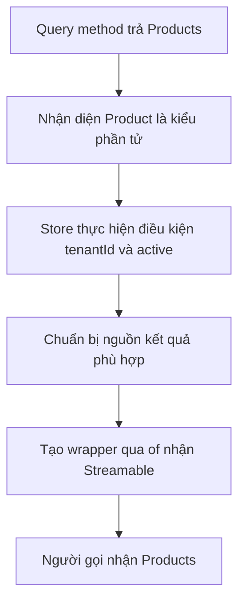

# Kiểu wrapper tùy chỉnh và thư viện collection được hỗ trợ

## Mục tiêu bài học

Một query method không nhất thiết phải trả `List<T>`. Spring Data có cơ chế làm việc với `Streamable<T>`, một số wrapper tùy chỉnh bao quanh tập kết quả và các kiểu collection của thư viện được tích hợp. Những lựa chọn này giúp hợp đồng repository diễn đạt ngôn ngữ nghiệp vụ rõ hơn, nhưng vẫn cần tuân theo quy tắc nhận diện và khả năng của store.

Sau bài học, bạn có thể:

- Giải thích vai trò của `Streamable<T>` trong hợp đồng kết quả truy vấn.
- Viết một wrapper tùy chỉnh đáp ứng điều kiện để Spring Data tạo trực tiếp từ kết quả.
- Phân biệt wrapper tập kết quả với entity, projection và metadata phân trang.
- Nhận diện các dạng collection Vavr thường được hỗ trợ và cách chuyển đổi từ nguồn Java phù hợp.
- Tránh suy luận sai về streaming, tính bất biến, số lượng kết quả và chi phí xử lý.

## 1. Vì sao cần một kiểu bao tập kết quả?

Giả sử module có domain sản phẩm:

```text
Product
├── id: Long
├── tenantId: String
├── name: String
├── price: BigDecimal
└── active: boolean
```

Trong ví dụ, mọi giá đều được biểu diễn bằng VND, có giá trị khác null và tuân theo cùng quy tắc tiền tệ của ứng dụng. Domain phải được mapping theo store thực tế; mô hình trên chưa tự tạo bảng hay collection.

Repository trả danh sách là một lựa chọn thông thường:

```java
List<Product> findByTenantIdAndActiveTrue(String tenantId);
```

Nếu nhiều nơi đều cần tính tổng giá niêm yết, chọn sản phẩm vượt một mức giá hoặc kết hợp các tập kết quả, logic đó dễ bị lặp lại ở người gọi. Một kiểu `Products` có thể tập trung hành vi liên quan đến tập sản phẩm:

```text
Tập kết quả Product
        │
        ▼
Products
├── duyệt từng sản phẩm
├── dùng các phép toán của Streamable
└── tính tổng giá theo quy tắc đã xác định
```

`Products` ở đây là kiểu bao tập kết quả đọc. Nó không tự trở thành một aggregate được lưu trữ và không tạo thêm quan hệ trong domain persistence.

Cần chọn wrapper khi nó bổ sung ý nghĩa hoặc hành vi hữu ích. Chỉ đổi tên `List<Product>` thành một lớp có một field mà không có hợp đồng rõ ràng chưa chắc làm API dễ dùng hơn.

## 2. `Streamable<T>` là abstraction gì?

`org.springframework.data.util.Streamable<T>` là abstraction của Spring Data Commons dựa trên `Iterable<T>`. Nó cho phép duyệt các phần tử, tạo một Java Stream không song song và sử dụng các thao tác tiện ích như `map`, `filter` hoặc kết hợp nguồn bằng `and`.

Ví dụ với một tập sản phẩm đã có:

```java
import java.math.BigDecimal;
import java.util.List;
import java.util.stream.Collectors;

import org.springframework.data.util.Streamable;

Streamable<Product> products = Streamable.of(existingProducts);

List<String> expensiveNames = products
        .filter(product -> product.getPrice()
                .compareTo(new BigDecimal("100000")) >= 0)
        .map(Product::getName)
        .stream()
        .collect(Collectors.toList());
```

`existingProducts` là một `Iterable<Product>`; `Product` có các getter tương ứng. Các phép lọc trong đoạn này được áp dụng khi duyệt nguồn Java. Chúng không tự được chuyển thành điều kiện truy vấn ở database.

### 2.1. Có thể dùng trực tiếp làm kiểu trả về

Với store hỗ trợ hợp đồng này, query method có thể trả:

```java
Streamable<Product> findByTenantIdAndActiveTrue(String tenantId);
```

Không có kết quả được biểu diễn bằng một nguồn không có phần tử theo hợp đồng kết quả nhiều phần tử. Không cần thêm `Optional<Streamable<Product>>` chỉ để diễn đạt tập rỗng.

### 2.2. `Streamable` không tự bảo đảm datastore streaming

`Streamable` giúp biểu diễn và xử lý một tập có thể duyệt. Nó không tự cam kết rằng driver sẽ đọc dần bằng cursor, rằng dữ liệu chưa được materialize hoặc rằng bộ nhớ sử dụng là hằng số.

Một store có thể đã lấy kết quả vào collection trước khi trả wrapper. Những phép toán được hoãn ở tầng Java chỉ hoãn việc xử lý nguồn, không tự làm truy vấn database trở thành lazy.

`Streamable` cũng không cung cấp cùng hợp đồng vòng đời với một repository method trả `Stream<T>` có thể đang giữ tài nguyên datastore. Không dùng wrapper này để thay thế nghĩa vụ quản lý transaction, connection hoặc đóng stream theo yêu cầu của store.

## 3. Điều kiện để Spring Data nhận diện wrapper tùy chỉnh

Đối với cơ chế wrapper dựa trên `Streamable`, kiểu trả về tùy chỉnh cần đáp ứng hai điều kiện chính:

1. Implement `Streamable<T>` với kiểu phần tử phù hợp.
2. Có cách tạo wrapper từ một `Streamable`, thông qua constructor phù hợp hoặc static factory method tên `of(…)` hay `valueOf(…)` nhận một `Streamable`.

Ví dụ hình dạng được mong đợi:

```text
Products implements Streamable<Product>
        │
        └── static Products of(Streamable<Product> source)
```

Các điều kiện này mô tả cơ chế nhận diện wrapper, không bảo đảm mọi loại query của mọi module đều hỗ trợ kiểu trả về đó. Cần đối chiếu khả năng và phiên bản của Commons cùng module lưu trữ đang dùng.

### 3.1. Vì sao chỉ có một field `List` chưa đủ?

Lớp sau có thể là DTO hợp lệ của ứng dụng:

```java
final class ProductsResponse {
    private final List<Product> items;

    ProductsResponse(List<Product> items) {
        this.items = items;
    }
}
```

Tuy vậy, chỉ khai báo nó làm kiểu trả về không yêu cầu Spring Data tự suy ra rằng mọi `List<Product>` phải được bọc vào lớp này. Nó chưa đáp ứng cơ chế wrapper `Streamable` vừa mô tả.

Tương tự, một factory tên `fromList(List<Product>)` không tự trở thành factory `of(Streamable)` hoặc `valueOf(Streamable)` được nhận diện bởi cơ chế đó. Tên và chữ ký factory là một phần hợp đồng kỹ thuật cần tuân thủ.

### 3.2. Constructor và factory là các lựa chọn thay thế

Bạn có thể dùng một constructor nhận `Streamable<Product>` thay cho factory, hoặc factory `valueOf` thay cho `of`. Không cần thêm mọi dạng khởi tạo chỉ để Spring Data có nhiều lựa chọn.

Với một wrapper, nên giữ một đường tạo đối tượng rõ ràng. Giữ generic `Product` nhất quán giữa kiểu `Streamable` được implement, nguồn đầu vào và iterator giúp hạ tầng nhận diện phần tử đúng và giúp mã Java an toàn kiểu hơn.

## 4. Viết một wrapper hoàn chỉnh

Ví dụ không cần Lombok hoặc thư viện collection ngoài JDK:

```java
import java.math.BigDecimal;
import java.util.Iterator;
import java.util.Objects;

import org.springframework.data.util.Streamable;

public final class Products implements Streamable<Product> {

    private final Streamable<Product> source;

    private Products(Streamable<Product> source) {
        this.source = Objects.requireNonNull(source, "source");
    }

    public static Products of(Streamable<Product> source) {
        return new Products(source);
    }

    @Override
    public Iterator<Product> iterator() {
        return source.iterator();
    }

    public BigDecimal totalPriceVnd() {
        return stream()
                .map(Product::getPrice)
                .reduce(BigDecimal.ZERO, BigDecimal::add);
    }
}
```

Những phần quan trọng:

- Lớp implement `Streamable<Product>` để thể hiện đây là một tập phần tử `Product`.
- Factory công khai `of` nhận đúng abstraction `Streamable<Product>`.
- `iterator()` ủy quyền cho nguồn.
- `totalPriceVnd()` là hành vi tính toán trên các phần tử hiện có.
- Kiểm tra nguồn khác null bảo vệ trạng thái wrapper; nó không cấm một nguồn rỗng.

Ví dụ giả định `getPrice()` không trả null và mọi phần tử dùng cùng đơn vị tiền tệ. Nếu domain có nhiều tiền tệ, cần phân nhóm hoặc chuyển đổi theo hợp đồng rõ ràng trước khi cộng. Wrapper không tự biết tỷ giá hay quy tắc làm tròn.

### 4.1. Tập rỗng là một giá trị hợp lệ

Với nguồn rỗng, `totalPriceVnd()` trả `BigDecimal.ZERO` vì phép `reduce` có giá trị khởi đầu là số không.

Đó là quyết định nghiệp vụ của phương thức tổng. Một phương thức tính trung bình hoặc lấy sản phẩm đắt nhất sẽ cần quyết định riêng cho tập rỗng; không nên mặc định mọi phép tổng hợp đều trả được số không.

### 4.2. Wrapper chưa tự là một snapshot bất biến

Field `source` là `final`, nhưng điều đó chỉ ngăn gán lại tham chiếu trong wrapper. Nó không tự đóng băng collection nguồn hoặc trạng thái của từng `Product`.

Nếu cần một snapshot độc lập ở tầng ứng dụng, phải thiết kế việc sao chép dữ liệu hoặc ánh xạ sang các giá trị bất biến phù hợp. Ví dụ trên chỉ bao nguồn được cung cấp, không tự tạo bản sao sâu của entity.

## 5. Trả wrapper trực tiếp từ repository

Với store hỗ trợ, có thể khai báo:

```java
import org.springframework.data.domain.Sort;
import org.springframework.data.repository.Repository;

interface ProductRepository extends Repository<Product, Long> {

    Products findByTenantIdAndActiveTrue(
            String tenantId, Sort sort);
}
```

Luồng khái niệm:



Đây là mô hình giải thích việc thích nghi kết quả, không phải thứ tự chi tiết của mọi thành phần trong mọi module.

Người gọi có thể dùng:

```java
Products products = repository.findByTenantIdAndActiveTrue(
        tenantId,
        Sort.by(Sort.Order.asc("name"), Sort.Order.asc("id"))
);

BigDecimal total = products.totalPriceVnd();
```

Điều kiện lọc tenant và trạng thái nằm ở query method. `Sort` điều khiển thứ tự theo khả năng của store. `Products` bổ sung hành vi trên kết quả, không tự thêm hai điều kiện lọc đó.

### 5.1. Các phép toán ở wrapper không tự được đẩy xuống database

```java
Products products = repository.findByTenantIdAndActiveTrue(
        tenantId, Sort.unsorted());

long expensiveCount = products
        .filter(product -> product.getPrice()
                .compareTo(new BigDecimal("100000")) > 0)
        .stream()
        .count();
```

Phép lọc giá trong đoạn này là xử lý Java trên nguồn đã được repository trả về. Nó không tự bổ sung `price > ...` vào query method đã gọi.

Nếu dữ liệu lớn và chỉ cần số lượng hoặc tổng, hãy cân nhắc query đếm, aggregation hoặc truy vấn khai báo mà store hỗ trợ. Một wrapper giúp tổ chức API; nó không tự tối ưu kế hoạch thực thi.

### 5.2. Kết hợp nguồn không đồng nghĩa hợp nhất truy vấn

`Streamable.and(...)` có thể kết hợp việc duyệt hai nguồn. Nếu hai nguồn đến từ hai lời gọi repository, chúng vẫn có thể là hai truy vấn riêng.

Phép kết hợp này cũng không tự khử trùng, tạo một thứ tự chung hay bảo đảm cả hai lần đọc thuộc cùng snapshot dữ liệu. Những yêu cầu đó cần được thiết kế riêng theo nghiệp vụ và store.

## 6. Wrapper, projection và phân trang giải quyết các việc khác nhau

| Cơ chế | Thay đổi chính |
| --- | --- |
| Wrapper như `Products` | Bao tập phần tử và bổ sung hành vi trên tập |
| Projection | Mô tả hình dạng mỗi phần tử kết quả |
| `Optional<Product>` | Biểu đạt tối đa một phần tử có thể vắng mặt |
| `Page<Product>` | Bao dữ liệu trang cùng metadata tổng số |
| `Slice<Product>` | Bao một lát dữ liệu cùng thông tin còn lát tiếp theo |

### 6.1. Wrapper không tự tạo projection

`Products implements Streamable<Product>` vẫn biểu đạt phần tử là `Product`. Thêm một phương thức `names()` vào wrapper để lấy tên không tự yêu cầu backend chỉ đọc trường `name`.

Nếu cần một hình dạng phần tử khác, hãy chọn projection hoặc DTO theo cơ chế được store hỗ trợ. Việc có thể tối ưu lượng dữ liệu đọc còn phụ thuộc loại projection và truy vấn thực tế.

### 6.2. Wrapper không tự có tổng số bản ghi

Một wrapper chỉ nhận `Streamable<Product>` không được cung cấp tự động các thông tin như:

- Tổng số phần tử của toàn bộ điều kiện trong database.
- Chỉ số trang và kích thước trang.
- Tổng số trang.
- Thông tin có trang tiếp theo.

Duyệt nguồn rồi đếm chỉ cho biết số phần tử trong nguồn đó. Nếu nguồn chỉ có mười sản phẩm do truy vấn giới hạn, số đếm không trở thành tổng số sản phẩm trong kho dữ liệu.

Một lớp yêu cầu constructor `(Streamable<Product> items, long totalElements)` cũng chưa đáp ứng đường tạo wrapper một nguồn đã nêu. Hạ tầng không tự phát minh truy vấn đếm để cung cấp tham số thứ hai.

Nếu cần metadata trang, có thể giữ `Page<Product>` tại hợp đồng repository và xây dựng kiểu phản hồi ở service. Một `Products` được tạo từ `page.getContent()` chỉ bao nội dung trang đó; metadata của `Page` cần được giữ riêng nếu người gọi cần dùng.

## 7. Collection của thư viện ngoài: chỉ các dạng được tích hợp

Việc một thư viện collection xuất hiện trên classpath không có nghĩa mọi kiểu của thư viện đó đều dùng trực tiếp làm kiểu trả về repository.

Một ví dụ tích hợp trong Spring Data Commons là Vavr. Khi dùng bản Commons có hỗ trợ tương ứng, dependency phù hợp hiện diện và store hỗ trợ hợp đồng kết quả đó, repository có thể sử dụng những dạng Vavr được nhận diện.

Các dạng chuyển đổi thường được mô tả như sau:

| Kiểu collection Vavr | Implementation Vavr được dùng khi thích nghi nguồn Java | Nguồn Java phù hợp |
| --- | --- | --- |
| `io.vavr.collection.Seq` | `io.vavr.collection.List` | `java.lang.Iterable` |
| `io.vavr.collection.Set` | `io.vavr.collection.LinkedHashSet` | `java.lang.Iterable` |
| `io.vavr.collection.Map` | `io.vavr.collection.LinkedHashMap` | `java.util.Map` |

Bảng thể hiện cơ chế thích nghi collection, không bảo đảm mọi backend đều tạo được mọi dạng nguồn. Những kiểu cụ thể như Vavr `List` cũng cần được đối chiếu với tập kiểu trả về mà phiên bản Commons/module đang dùng hỗ trợ.

Không cần cố định một phiên bản dependency trong ví dụ bài học. Khi triển khai, dùng bộ phiên bản tương thích của dự án và kiểm tra hỗ trợ của đúng module lưu trữ.

### 7.1. Ví dụ repository trả Vavr

```java
import org.springframework.data.domain.Sort;
import org.springframework.data.repository.Repository;

interface ProductVavrRepository extends Repository<Product, Long> {

    io.vavr.collection.Seq<Product> findByTenantIdAndActiveTrue(
            String tenantId, Sort sort);

    io.vavr.collection.Set<Product> findByTenantIdAndNameStartingWith(
            String tenantId, String prefix);
}
```

Dùng tên đầy đủ trong ví dụ giúp tránh nhầm với các interface `List`, `Set` hoặc `Map` của JDK. Trong mã nguồn thực tế, có thể import kiểu được chọn nếu không tạo ra sự mơ hồ.

Các điều kiện `ActiveTrue` và `StartingWith` vẫn phải được store hỗ trợ. Đổi collection từ JDK sang Vavr không làm một keyword chưa được store hỗ trợ trở nên hợp lệ.

### 7.2. Bất biến của collection là bất biến nông

Một Vavr collection không sửa chính cấu trúc của nó theo cách mutable collection thông thường. Những phép như thêm phần tử trả về collection mới:

```java
io.vavr.collection.Seq<Product> original =
        repository.findByTenantIdAndActiveTrue(tenantId, Sort.unsorted());

io.vavr.collection.Seq<Product> extended = original.append(extraProduct);
```

`original` vẫn giữ cấu trúc cũ. Tuy vậy, các đối tượng `Product` bên trong có thể vẫn mutable. Collection bất biến không tự biến entity thành value object bất biến hoặc tự tách entity khỏi persistence context.

Nếu mục đích là chia sẻ dữ liệu đọc không thể thay đổi, cần xem xét cả cấu trúc collection lẫn kiểu phần tử.

## 8. `Seq`, `Set` và `Map` có hợp đồng riêng

### 8.1. `Seq` giữ một chuỗi phần tử

`Seq` phù hợp khi người gọi cần một dãy và muốn sử dụng API collection của Vavr. Nó không tự loại bỏ những phần tử bằng nhau.

Thứ tự có ý nghĩa phải được xác lập qua truy vấn, `Sort` hoặc quy tắc phù hợp. Một dãy giữ thứ tự của nguồn không biến nguồn chưa có thứ tự xác định thành danh sách luôn ổn định giữa các lần truy vấn.

### 8.2. `Set` loại trùng theo equality của phần tử

Một `Set` loại các phần tử bằng nhau theo quy tắc equality/hash code của kiểu phần tử và implementation tương ứng. Với entity, điều này khiến cách thiết kế `equals` và `hashCode` trở nên quan trọng.

Không dùng việc đổi `List` thành `Set` để chữa một truy vấn join sai hoặc thay thế unique constraint. Hai bản ghi vi phạm một khóa nghiệp vụ chưa chắc được xem là hai object bằng nhau; ngược lại, một quy tắc equality không phù hợp có thể làm mất phần tử bạn cần giữ.

Việc adapter chọn một implementation giữ thứ tự duyệt như `LinkedHashSet` chỉ giúp bảo toàn thứ tự nguồn trong cơ chế đó. Nó không tự thêm `ORDER BY` hoặc index vào database.

### 8.3. `Map` cần một nguồn có ý nghĩa khóa và giá trị

Hỗ trợ thích nghi một Java `Map` sang Vavr `Map` không có nghĩa bạn có thể viết một query method đọc nhiều `Product` rồi tự nhận được map theo `id` mà không định nghĩa cách tạo khóa.

Cần biết:

- Backend/query trả dạng dữ liệu nào?
- Khóa là gì và giá trị là gì?
- Nếu hai phần tử tạo cùng khóa thì xử lý thế nào?
- Kiểu `Map` được store hỗ trợ trong ngữ cảnh đó có đang mô tả một hàng dữ liệu, một projection hay một cấu trúc khác?

Nếu nhu cầu là lập chỉ mục các sản phẩm theo `id`, có thể chuyển đổi rõ ràng ở service hoặc một wrapper phù hợp. Đây là thao tác của ứng dụng, không phải hệ quả tự động của việc khai báo `Map<Long, Product>`.

## 9. Những kiểu wrapper không được suy ra tự động

Các hình dạng sau cần được phân tích theo cơ chế cụ thể thay vì dựa vào tên lớp:

| Kiểu mong muốn | Vì sao chưa đủ để suy ra hỗ trợ |
| --- | --- |
| `ApiResponse<List<Product>>` | Một envelope API không tự thuộc cơ chế wrapper `Streamable` |
| `ProductsResponse` có constructor nhận `List<Product>` | Chưa đáp ứng hình dạng nhận diện wrapper được nêu |
| `SearchResult<Product>` cần thêm tổng số và thời gian chạy | Query method không tự cung cấp các metadata đó |
| Một immutable collection bất kỳ | Cần adapter/tích hợp cho đúng kiểu, không chỉ dependency |
| Wrapper generic dùng raw type | Có thể mất metadata phần tử và làm hợp đồng khó nhận diện |

Việc đăng ký một converter ở một `ConversionService` của ứng dụng cũng không tự bảo đảm đường xử lý kết quả repository sẽ sử dụng converter đó cho mọi kiểu trả về. Cần phân biệt cơ chế chuyển đổi dữ liệu, mapping của store và cơ chế thích nghi wrapper của repository.

Nếu một kiểu không được hỗ trợ trực tiếp, cách triển khai rõ ràng là trả kiểu đã được store hỗ trợ rồi bọc ở service, hoặc dùng fragment tùy biến khi cần kiểm soát cách truy vấn và chuyển đổi.

## 10. Chi phí và vòng đời của kết quả vẫn cần được quản lý

Wrapper không tự thay đổi những đặc tính sau:

- Số phần tử mà truy vấn thực tế đọc về.
- Chi phí ánh xạ từng phần tử.
- Số lần duyệt nguồn khi gọi nhiều phép tổng hợp.
- Truy vấn bổ sung do truy cập thuộc tính lazy của entity, nếu có.
- Vòng đời transaction và tài nguyên datastore.

`totalPriceVnd()` trong ví dụ duyệt toàn bộ nguồn mỗi lần được gọi. Nếu gọi liên tiếp nhiều phép tổng hợp, có thể xảy ra nhiều lần duyệt. Điều này có thể hợp lý với một tập nhỏ, nhưng không nên được xem như một phép tổng hợp đã chạy ở database.

Wrapper cũng không tự cache kết quả hoặc thiết lập thời điểm dữ liệu có hiệu lực. Nếu cần snapshot, cache hoặc một báo cáo nhất quán, hãy thiết kế chúng như những yêu cầu riêng.

Với tác vụ chỉ cần một tổng số lớn, aggregation ở backend có thể phù hợp hơn tải mọi entity rồi cộng trong Java. Lựa chọn còn phụ thuộc store, độ chính xác phép tính và yêu cầu nghiệp vụ.

## 11. Chọn kiểu trả về theo nhu cầu

| Nhu cầu | Lựa chọn có thể dùng |
| --- | --- |
| Người gọi chỉ cần danh sách đơn giản | `List<T>` hoặc collection thông dụng được hỗ trợ |
| Cần API duyệt và kết hợp tiện ích của Commons | `Streamable<T>` |
| Cần hành vi nghiệp vụ trên một tập kết quả | Wrapper implement `Streamable<T>` có đường tạo phù hợp |
| Dự án sử dụng Vavr nhất quán | Collection Vavr được Commons và store hỗ trợ |
| Cần tổng số trang hoặc thông tin trang tiếp theo | `Page<T>` hoặc `Slice<T>` theo khả năng của store |
| Cần đọc dần kèm quản lý tài nguyên | Hợp đồng streaming/cursor của đúng module |
| Cần envelope HTTP với nhiều metadata | Xây dựng phản hồi ở service/controller từ kết quả repository |

Một repository có thể trả `Products` mà không yêu cầu API HTTP phải serialize nguyên wrapper đó. Hình dạng phản hồi bên ngoài là một hợp đồng riêng; có thể ánh xạ wrapper sang DTO khi cần.

## 12. Nhận diện lỗi theo đúng tầng

| Biểu hiện | Điểm cần kiểm tra |
| --- | --- |
| Kiểu wrapper bị coi là phần tử cần mapping | Generic và điều kiện nhận diện `Streamable` có đúng không? |
| Không tạo được wrapper | Constructor/factory có đúng tên, kiểu đầu vào và khả năng truy cập không? |
| Vavr collection không được chấp nhận | Dependency, phiên bản và mức hỗ trợ của module có phù hợp không? |
| Trả `Map` nhưng không có ánh xạ khóa mong muốn | Nguồn truy vấn có thật sự là map với hợp đồng khóa/giá trị đó không? |
| Tập kết quả mất phần tử khi đổi sang `Set` | Equality và hash code của phần tử có đúng ý định không? |
| Mất tổng số trang khi bọc dữ liệu | Có đang chỉ bọc nội dung của một `Page` không? |
| Dữ liệu vẫn bị tải nhiều | Có đang lọc/tổng hợp sau truy vấn thay vì tại backend không? |
| Collection bất biến nhưng entity vẫn thay đổi | Có đang nhầm bất biến cấu trúc với bất biến của phần tử không? |
| Kết quả lỗi khi dùng ngoài transaction | Phần tử hoặc nguồn còn phụ thuộc tài nguyên/lazy loading không? |

Khi xác minh một wrapper, các trường hợp có ích gồm nguồn rỗng, một phần tử, nhiều phần tử, phần tử bằng nhau và nhiều lần duyệt. Với collection thư viện, cần kiểm tra đúng loại runtime mà API hứa hỗ trợ, thứ tự mong muốn và cách dữ liệu được chuyển đổi.

Đây là việc kiểm tra hợp đồng kết quả. Nó không thay thế việc kiểm tra điều kiện lọc tenant, mapping, index hoặc khả năng truy vấn của backend.

## 13. Bài tập tự kiểm tra

### Bài 1: Nhận diện wrapper

Một lớp `Products` có field `List<Product>` và constructor nhận `List<Product>`, nhưng không implement `Streamable`. Có đủ để Spring Data tự bọc kết quả bằng cơ chế trong bài không?

**Gợi ý đáp án:** Chưa đủ. Cần implement `Streamable<Product>` và có constructor hoặc factory `of`/`valueOf` nhận `Streamable` phù hợp. Nếu không dùng cơ chế đó, hãy bọc rõ ràng ở tầng ứng dụng hoặc chọn implementation tùy biến.

### Bài 2: Tổng giá chạy ở đâu?

Repository trả `Products`, sau đó service gọi `totalPriceVnd()`. Có thể kết luận backend đã chạy một câu tổng hợp `SUM` không?

**Gợi ý đáp án:** Không. Phương thức trong ví dụ cộng các phần tử bằng Java Stream. Nếu muốn backend tính tổng, phải dùng khả năng truy vấn/aggregation tương ứng.

### Bài 3: Có tổng số toàn bộ không?

Một wrapper được tạo từ mười phần tử của một trang. Duyệt nguồn và đếm được mười phần tử có đồng nghĩa toàn bộ điều kiện chỉ khớp mười sản phẩm không?

**Gợi ý đáp án:** Không. Đó chỉ là kích thước nguồn hiện tại. Tổng số toàn bộ cần metadata hoặc truy vấn phù hợp; `Streamable` không tự cung cấp thông tin đó.

### Bài 4: Tính bất biến

Một Vavr `Seq<Product>` không thể bị sửa cấu trúc tại chỗ. Có thể kết luận các `Product` bên trong cũng không thay đổi được không?

**Gợi ý đáp án:** Không. Cấu trúc collection bất biến không tự làm entity bất biến. Cần xem hợp đồng của chính kiểu phần tử.

### Bài 5: Map theo định danh

Bạn muốn nhận `Map<Long, Product>` với khóa là `id`. Chỉ đổi kiểu trả về của derived query đọc nhiều sản phẩm sang Vavr `Map` có tự thiết lập quy tắc khóa này không?

**Gợi ý đáp án:** Không. Cần một nguồn map được store hỗ trợ hoặc thao tác chuyển đổi rõ ràng với quy tắc tạo khóa và xử lý trùng khóa.

### Bài 6: Wrapper và streaming

Một query method trả `Products implements Streamable<Product>`. Có đủ để cam kết truy vấn không materialize toàn bộ kết quả và luôn dùng bộ nhớ cố định không?

**Gợi ý đáp án:** Không. Cần kiểm tra cách store, provider và driver thực thi. `Streamable` mô tả khả năng duyệt, không phải cam kết cursor hay tài nguyên của backend.

## Những điểm cần nhớ

- Wrapper dựa trên `Streamable` cần đúng interface cùng constructor hoặc factory `of`/`valueOf` nhận nguồn phù hợp.
- Wrapper bổ sung hành vi trên tập kết quả; projection, phân trang và streaming có hợp đồng riêng.
- Vavr là một ví dụ collection được tích hợp; cần xác nhận đúng kiểu, dependency, phiên bản và store.
- `Seq`, `Set` và `Map` khác nhau về thứ tự, equality và hợp đồng khóa; không thay thế lẫn nhau chỉ để làm truy vấn chạy được.
- API collection thuận tiện không tự thay đổi số dữ liệu đọc, vị trí thực hiện phép tính hay vòng đời tài nguyên datastore.
