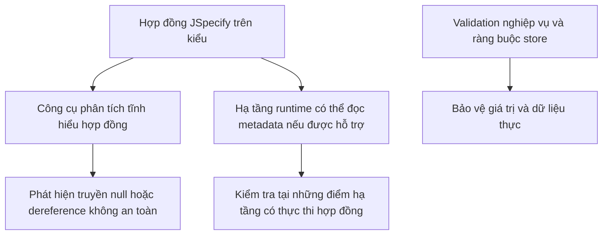

# JSpecify với `@NullMarked`, `@Nullable` và `@NullUnmarked` từ dòng phiên bản hỗ trợ

## Mục tiêu bài học

Một repository trả `Account`, `Optional<Account>` hay `List<Account>` cần có hợp đồng rõ về null. JSpecify cung cấp annotation để mô tả nullability của các kiểu Java, giúp công cụ và người gọi hiểu nơi nào có thể có null mà không phải đoán từ tên phương thức.

Sau bài học, bạn có thể:

- Xác định dòng Spring phù hợp trước khi áp dụng hợp đồng JSpecify.
- Dùng `@NullMarked` để thiết lập phạm vi mặc định non-null.
- Dùng `@Nullable` ở đúng vị trí, kể cả trên type argument.
- Dùng `@NullUnmarked` để tạo ranh giới chưa xác định nullability cho mã legacy.
- Phân biệt hợp đồng kiểu, kiểm tra tĩnh, kiểm tra runtime và ràng buộc dữ liệu của store.

Bài học đặt trong phạm vi Spring Data Commons. Các ví dụ repository cần module lưu trữ và mapping phù hợp; annotation nullability không thay thế việc cấu hình JPA, MongoDB hay một store khác.

## 1. Bắt đầu từ dòng phiên bản có hỗ trợ

Spring Framework 7 và Spring Data 4 là các mốc chuyển sang sử dụng JSpecify để mô tả nullability trong API của hệ sinh thái Spring tương ứng. Với các dòng cũ hơn, bạn thường gặp hợp đồng dựa trên annotation của Spring như `org.springframework.lang.NonNullApi` và `org.springframework.lang.Nullable`.

Cần tách ba câu hỏi:

| Câu hỏi | Vì sao quan trọng? |
| --- | --- |
| Dự án có dependency JSpecify không? | Mã nguồn cần nhận diện được các annotation được import |
| Dòng Framework, Data Commons và module store có hỗ trợ tương ứng không? | Quyết định cách API và hạ tầng Spring hiểu metadata |
| Công cụ phân tích hoặc compiler liên quan có hiểu JSpecify không? | Quyết định các cảnh báo và kiểm tra tĩnh bạn thực sự nhận được |

Việc thêm một JAR annotation vào một dự án cũ không tự nâng cấp hợp đồng API của toàn bộ Spring hoặc cách proxy repository xử lý null. Ngược lại, dự án đang dùng dòng mới vẫn cần cấu hình công cụ phù hợp nếu muốn kiểm tra nullability trong quá trình phát triển.

Các annotation trong bài có package:

```java
import org.jspecify.annotations.NullMarked;
import org.jspecify.annotations.Nullable;
import org.jspecify.annotations.NullUnmarked;
```

Dependency chứa chúng có tọa độ `org.jspecify:jspecify`. Chọn phiên bản theo bộ dependency tương thích của dự án và cơ chế quản lý dependency đang dùng; không chỉ nâng riêng một thành phần Spring để lấy một annotation mới.

### Đây không phải phép đổi tên import đơn giản

`@NullMarked` diễn đạt mặc định cho các kiểu tham chiếu trong phạm vi của nó, bao gồm những vị trí kiểu sâu hơn như type argument. `@NonNullApi` của Spring cũ tập trung vào hợp đồng mặc định của tham số và giá trị trả về; nullability của field còn có cơ chế riêng.

Vì vậy, chuyển từ annotation cũ sang JSpecify cần xem lại field, generic và ranh giới legacy, thay vì thay tên annotation trên toàn bộ codebase rồi coi hợp đồng giữ nguyên.

## 2. Ba annotation, ba vai trò

| Annotation | Vai trò chính |
| --- | --- |
| `@NullMarked` | Thiết lập phạm vi mà các kiểu tham chiếu thông thường có mặc định non-null |
| `@Nullable` | Đánh dấu một vị trí kiểu cụ thể có thể nhận null |
| `@NullUnmarked` | Bỏ mặc định null-marked trong một phạm vi, để các vị trí không được chỉ rõ có nullability chưa xác định |

Trong phạm vi null-marked, các khai báo đơn giản như sau thể hiện hợp đồng khác null:

```java
String displayName;

Account loadAccount(String tenantId, String loginName);
```

Nếu một vị trí có thể null, hãy ghi rõ:

```java
@Nullable String recoveryEmail;

@Nullable Account findAccount(String tenantId, String loginName);
```

Các ví dụ trên minh họa hợp đồng kiểu. Một field bắt buộc khác null vẫn cần được khởi tạo đúng bằng constructor hoặc cơ chế thích hợp; annotation không tự tạo giá trị cho field.

Với type variable, wildcard và những cấu trúc generic nâng cao, nullability còn phụ thuộc khai báo và giới hạn kiểu. Không áp dụng máy móc kết luận “mọi chữ không có `@Nullable` đều là một đối tượng chắc chắn khác null” cho mọi biểu thức generic.

## 3. Thiết lập mặc định bằng `@NullMarked`

### 3.1. Áp dụng cho một package

Nội dung minh họa của `package-info.java`:

```java
@NullMarked
package example.account;

import org.jspecify.annotations.NullMarked;
```

Khi package được đánh dấu, các khai báo nằm trong phạm vi đó sử dụng mặc định null-marked, trừ những ngoại lệ được mô tả rõ.

Ví dụ interface trong package `example.account`:

```java
interface AccountLookup {

    Account requireAccount(String tenantId, String loginName);
}
```

Ở các vị trí tham chiếu thông thường này:

- `tenantId` không được phép null theo hợp đồng.
- `loginName` không được phép null theo hợp đồng.
- Kết quả trả về không được phép null theo hợp đồng.

Điều đó chưa nói rằng các chuỗi được phép rỗng, rằng tài khoản có tồn tại hay rằng đầu vào có được quyền truy cập tenant hay không. Những quy tắc đó cần validation và xử lý nghiệp vụ riêng.

### 3.2. Package con là một phạm vi riêng

Đánh dấu `example.account` không tự đánh dấu package `example.account.internal`. Tên có chung tiền tố không làm annotation của package cha lan xuống mọi package con.

Nếu tổ chức theo nhiều package, cần chủ động quyết định phạm vi nullability cho từng package. Đây là điểm dễ bị bỏ sót khi chuyển một module lớn sang mặc định non-null.

### 3.3. Có thể bắt đầu từ một type

Khi chưa thể đánh dấu toàn package, có thể áp dụng ở một type:

```java
import org.jspecify.annotations.NullMarked;
import org.jspecify.annotations.Nullable;

@NullMarked
interface RecoveryEmailPolicy {

    boolean accepts(String tenantId, @Nullable String recoveryEmail);
}
```

`tenantId` có hợp đồng khác null, còn `recoveryEmail` được phép null. Cách này giúp đưa hợp đồng rõ ràng vào một phần API mà chưa phải đưa toàn bộ mã legacy vào cùng mặc định.

Annotation trên một type cũng không tự thay đổi hợp đồng của các dependency bên ngoài chỉ vì type đó gọi chúng.

## 4. `@Nullable` áp dụng cho vị trí kiểu cụ thể

JSpecify `@Nullable` là annotation dùng trên type. Nó có thể mô tả kết quả, tham số, field hoặc một type argument phù hợp.

### 4.1. Kết quả có thể null

```java
@Nullable Account findAccount(String tenantId, String loginName);
```

Hợp đồng cho phép trả null khi không có tài khoản. Người gọi cần kiểm tra trước khi dereference.

```java
@Nullable Account account = lookup.findAccount(tenantId, loginName);

if (account == null) {
    return "Không tìm thấy tài khoản";
}

return account.getLoginName();
```

Ví dụ giả định `Account` có getter và nhánh xử lý trên nằm trong một phương thức trả chuỗi. Một công cụ hiểu JSpecify có thể dùng kiểm tra null để biết tài khoản có giá trị ở nhánh còn lại.

### 4.2. Tham số có thể null

```java
void updateRecoveryEmail(
        String tenantId,
        Long accountId,
        @Nullable String recoveryEmail);
```

Annotation cho phép truyền null ở vị trí email. API vẫn phải mô tả null có nghĩa gì: xóa email, giữ nguyên, hay một ý nghĩa khác. Annotation chỉ mô tả khả năng nhận null, không tự chọn ngữ nghĩa cập nhật.

### 4.3. Không nhầm primitive với wrapper

Một primitive như `long` không có giá trị null. Nếu trạng thái thiếu giá trị là hợp lệ, cần một kiểu tham chiếu hoặc mô hình trạng thái thích hợp, chẳng hạn `@Nullable Long`.

Đồng thời, việc cho phép một giá trị null không quyết định nó có hợp lệ trong domain hay không. Một định danh nullable ở DTO yêu cầu tạo mới có thể hợp lý, nhưng định danh dùng để gọi `findById` vẫn cần tuân thủ hợp đồng khác null của API đó.

## 5. Generic: nullability của container khác nullability của phần tử

Trong một phạm vi `@NullMarked`, các khai báo sau khác nhau:

| Kiểu khai báo | Container có thể null? | Phần tử có thể null? |
| --- | --- | --- |
| `List<Account>` | Không | Không |
| `@Nullable List<Account>` | Có | Không |
| `List<@Nullable Account>` | Không | Có |
| `@Nullable List<@Nullable Account>` | Có | Có |

Ví dụ:

```java
import java.util.List;

import org.jspecify.annotations.NullMarked;
import org.jspecify.annotations.Nullable;

@NullMarked
interface AccountBatchGateway {

    List<Account> existingAccounts();

    @Nullable List<Account> cachedAccounts();

    List<@Nullable Account> lookupByInputOrder(List<Long> accountIds);
}
```

Ở ví dụ `lookupByInputOrder`, API giả định một phần tử null có thể đại diện cho vị trí không tìm thấy trong danh sách đầu vào. Đây là hợp đồng riêng của gateway minh họa, không phải cam kết rằng repository Spring Data tự hỗ trợ truy vấn batch giữ vị trí bằng các phần tử null.

Nếu phần tử có thể null, một vòng lặp duyệt container vẫn cần xử lý phần tử:

```java
for (@Nullable Account account : gateway.lookupByInputOrder(ids)) {
    if (account != null) {
        process(account);
    }
}
```

Việc container khác null chỉ bảo đảm có thể bắt đầu duyệt. Nó không tự bảo đảm an toàn khi sử dụng từng phần tử nullable.

Đây là một khác biệt thực tế khi chuyển từ cách chú thích chỉ tập trung vào giá trị trả về sang cách mô tả đầy đủ nullability trong generic.

## 6. Áp dụng vào repository Spring Data Commons

Giả sử `example.account` đã được đánh dấu `@NullMarked` và domain có `tenantId`, `loginName`, `recoveryEmail`, `enabled`:

```java
import java.util.List;
import java.util.Optional;

import org.jspecify.annotations.Nullable;
import org.springframework.data.repository.CrudRepository;

interface AccountRepository extends CrudRepository<Account, Long> {

    Optional<Account> findByTenantIdAndLoginName(
            String tenantId, String loginName);

    @Nullable
    Account findAccountByTenantIdAndLoginName(
            String tenantId, String loginName);

    List<Account> findByTenantIdAndEnabledTrue(String tenantId);

    List<Account> findByTenantIdAndRecoveryEmail(
            String tenantId, @Nullable String recoveryEmail);
}
```

Hai phương thức tra cứu theo login minh họa hai hợp đồng vắng dữ liệu khác nhau. Trong ứng dụng, thường chọn một hợp đồng nhất quán cho cùng nhu cầu thay vì giữ cả hai biến thể chỉ để đổi cách biểu diễn.

Các phương thức trên cần được store hỗ trợ. Ý nghĩa nullability là:

| Phương thức | Hợp đồng đáng chú ý |
| --- | --- |
| Trả `Optional<Account>` | Container khác null; không có tài khoản biểu diễn bằng `Optional.empty()` |
| Trả `@Nullable Account` | Được phép trả null khi không có tài khoản |
| Trả `List<Account>` | Container và phần tử được mô tả khác null trong phạm vi marked |
| Tham số `@Nullable String recoveryEmail` | Cho phép đối số null về mặt hợp đồng kiểu; ngữ nghĩa truy vấn còn phụ thuộc store |

### 6.1. `@Nullable` không tự bỏ predicate

Tham số email được phép null không có nghĩa là nếu null thì tự bỏ điều kiện email. Ví dụ, derived equality query trong JPA có thể chuyển đối số null thành điều kiện `IS NULL`.

Trong document store, điều kiện null có thể liên quan cả trường có giá trị null và trường không tồn tại. Truy vấn khai báo lại có quy tắc riêng về so sánh và binding null.

Nếu muốn “không có bộ lọc”, hãy thể hiện lựa chọn đó bằng thiết kế query, tiêu chí có trạng thái rõ hoặc API truy vấn động được store hỗ trợ. JSpecify không phải cơ chế tạo truy vấn động.

### 6.2. `@Nullable` không bắt repository trả null

Đánh dấu một kiểu là nullable cho phép trạng thái null trong hợp đồng; nó không yêu cầu implementation phải tạo ra null.

Đặc biệt, query method trả collection theo hợp đồng Spring Data thông dụng biểu diễn không có kết quả bằng collection rỗng. Đánh dấu nullable cho container không tự đổi danh sách rỗng thành null và thường làm API khó dùng hơn nếu không có thêm lý do nghiệp vụ.

### 6.3. Annotation không thay thế cardinality

`Optional<Account>` và `@Nullable Account` đều là hợp đồng kết quả đơn. Nếu query có nhiều tài khoản phù hợp, annotation nullable không cho phép framework tự chọn một đối tượng.

Tương tự, mặc định non-null không tạo unique constraint cho `loginName`. Cần thống nhất điều kiện tenant, quy tắc chuẩn hóa và cơ chế bảo vệ tính duy nhất ở backend.

## 7. Optional trong phạm vi null-marked

Trong phạm vi được đánh dấu:

```java
Optional<Account> findAccount(String tenantId, String loginName);
```

hợp đồng mong muốn là:

```text
Có một Optional khác null
├── empty: không có tài khoản
└── present: có một Account khác null
```

Viết:

```java
@Nullable Optional<Account> findAccount(
        String tenantId, String loginName);
```

thì cho phép thêm trạng thái container null bên cạnh empty. Chỉ dùng hình dạng đó khi có một hợp đồng đặc biệt được giải thích rõ; với tra cứu repository thông thường, nó tạo thêm nhánh kiểm tra mà không giúp biểu đạt tốt hơn.

`Optional` không chứa giá trị null như một phần tử present. Do đó, không dùng một type argument nullable để cố biểu đạt “Optional có mặt nhưng bên trong là null”. Nếu cần phân biệt nhiều trạng thái nghiệp vụ, hãy chọn mô hình kết quả khác.

Ngoài ra, `Account` bên trong vẫn có thể có thuộc tính nullable như `recoveryEmail`. Optional chỉ mô tả sự hiện diện của tài khoản, không tự nâng mọi field thành non-null.

## 8. `@NullUnmarked`: ranh giới chưa xác định nullability

Giả sử một package đã dùng `@NullMarked`, nhưng một adapter legacy chưa được kiểm tra đầy đủ:

```java
import org.jspecify.annotations.NullUnmarked;
import org.jspecify.annotations.Nullable;

@NullUnmarked
interface LegacyAccountGateway {

    Account load(String externalKey);

    @Nullable Account findDocumentedMissing(String externalKey);
}
```

Trong phạm vi unmarked:

- Những vị trí không có nullability rõ ràng như kết quả `load` và tham số `externalKey` có nullability chưa xác định.
- `@Nullable` trên kết quả `findDocumentedMissing` vẫn là một khai báo nullable tường minh.

### 8.1. Unmarked không có nghĩa là mọi thứ nullable

`@NullUnmarked` gỡ mặc định của vùng marked. Nó không tự biến mọi tham số, field và kết quả thành `@Nullable`.

Sự khác biệt quan trọng:

| Trạng thái | Điều bạn biết |
| --- | --- |
| Non-null | Hợp đồng không cho phép null |
| Nullable | Hợp đồng cho phép null |
| Unspecified trong vùng unmarked | Chưa có đủ hợp đồng để kết luận nullable hay non-null |

Công cụ có thể có chính sách riêng khi xử lý dữ liệu từ mã unspecified. Đừng coi việc không có cảnh báo ở ranh giới legacy là bằng chứng rằng giá trị chắc chắn khác null.

### 8.2. Dùng phạm vi nhỏ và có mục đích

`@NullUnmarked` có ích khi chuyển đổi dần, nhưng nếu phủ lên một package lớn chỉ để dập cảnh báo, bạn sẽ bỏ mất nhiều thông tin kiểu đang muốn thiết lập.

Một cách tổ chức rõ hơn là:

1. Giữ giao tiếp legacy ở một ranh giới nhỏ.
2. Làm rõ kết quả có thể thiếu bằng annotation hoặc wrapper phù hợp.
3. Kiểm tra và chuyển đổi giá trị tại adapter.
4. Đưa API bên trong về hợp đồng marked mà mã ứng dụng có thể dựa vào.

Không đặt `@NullMarked` và `@NullUnmarked` cùng một nơi để mong hai annotation tự dung hòa. Chọn phạm vi và mặc định có chủ đích.

## 9. Phân tích tĩnh và kiểm tra runtime là hai cơ chế khác nhau

JSpecify mô tả nullability. Annotation không tự chèn một lệnh `Objects.requireNonNull` vào mọi điểm gọi, không tự tạo một trình kiểm tra và không tự sửa các giá trị null đang có trong dữ liệu.

Có thể hình dung các tầng như sau:



### 9.1. Ở thời điểm phát triển

Một công cụ hỗ trợ JSpecify có thể phát hiện:

- Truyền null vào tham số non-null.
- Trả null từ phương thức có hợp đồng non-null.
- Sử dụng trực tiếp kết quả nullable mà chưa kiểm tra.
- Đưa phần tử nullable vào collection được khai báo chứa phần tử non-null.

Các lỗi này không mặc nhiên được `javac` từ chối chỉ vì annotation có mặt. Cần công cụ, cấu hình và mức nghiêm ngặt tương ứng. Với người gọi Kotlin, cách hợp đồng JSpecify được nhập vào hệ kiểu cũng phụ thuộc compiler và cấu hình hỗ trợ của dự án.

### 9.2. Ở thời điểm chạy

Spring Data có cơ chế kiểm tra nullability ở những đường xử lý repository và dòng phiên bản có hỗ trợ tương ứng. Cần xác minh chính xác việc đọc annotation JSpecify cùng kiểm tra đầu vào/đầu ra của phiên bản đang dùng trước khi dựa vào nó như một bảo đảm runtime.

Ngay cả khi repository proxy kiểm tra một hợp đồng, điều đó không đồng nghĩa mọi phương thức Java thông thường, mọi lần gọi nội bộ hoặc mọi phần tử lồng trong generic đều được tự động duyệt và kiểm tra sâu.

Khi một cơ chế runtime thực thi hợp đồng kết quả bắt buộc non-null, không có dữ liệu có thể dẫn tới lỗi như `EmptyResultDataAccessException`; đầu vào vi phạm có thể bị từ chối theo đường xử lý tương ứng. Đây là hành vi của hạ tầng thực thi, không phải ngoại lệ được chính annotation JSpecify tự ném.

### 9.3. Những việc vẫn cần bảo vệ riêng

- Validation chuỗi trắng, độ dài và định dạng.
- Quy tắc “null nghĩa là xóa” hoặc “không lọc”.
- Ràng buộc `NOT NULL`, schema document và unique index.
- Khởi tạo entity, DTO và các giá trị đi qua ranh giới chưa được chú thích.
- Vòng đời transaction và tài nguyên truy cập dữ liệu.

Một API Java có hợp đồng non-null không tự làm cột trong database thành `NOT NULL`. Chiều ngược lại, cột `NOT NULL` cũng không tự chú thích đúng mọi phương thức Java.

## 10. Kế thừa hợp đồng và implementation

Nếu một interface đã cho phép nhận giá trị nullable, implementation phải xử lý được những lời gọi hợp lệ theo interface. Không được âm thầm thu hẹp đầu vào thành bắt buộc khác null rồi dựa vào người gọi “tự biết”.

Ví dụ:

```java
@NullMarked
interface RecoveryEmailUpdater {

    void update(Long accountId, @Nullable String recoveryEmail);
}
```

Một implementation có thể quyết định null là xóa email nếu đó là hợp đồng API. Nó cần xử lý trường hợp đó; việc bỏ annotation hoặc thay phạm vi đánh dấu không làm cho các lời gọi null qua interface tự biến mất.

Tương tự, một phương thức được công bố trả non-null không được implementation trả nullable rồi yêu cầu người gọi kiểm tra dù chữ ký đã hứa ngược lại.

Công cụ hỗ trợ JSpecify giúp phát hiện nhiều vi phạm khi override. Khi triển khai một interface từ thư viện, nên xem hợp đồng gốc và cách công cụ hiểu nó thay vì chỉ dựa vào annotation mặc định của package implementation.

## 11. Chuyển đổi một package repository theo từng bước

Một quy trình chuyển đổi có thể thực hiện ở phạm vi nhỏ:

1. Xác định bộ Framework, Data Commons và store module tương thích, có hỗ trợ JSpecify theo yêu cầu.
2. Xác định công cụ phân tích và mức kiểm tra nullability của dự án.
3. Phân loại các phương thức trả kết quả đơn: bắt buộc có, nullable hoặc Optional.
4. Xác định các tham số thật sự được phép null cùng ý nghĩa truy vấn của chúng.
5. Xem lại field, generic, collection và ranh giới API chưa có hợp đồng.
6. Áp dụng `@NullMarked` cho type hoặc package đã được chuẩn bị.
7. Đánh dấu `@Nullable` tại các vị trí cần thiết; dùng `@NullUnmarked` có giới hạn cho phần chưa chuyển đổi.
8. Xác minh các tình huống dữ liệu và lời gọi có khả năng phân biệt hợp đồng cũ với hợp đồng mới.

Đây là hướng dẫn nội dung để thiết kế việc chuyển đổi, không yêu cầu sửa mọi package cùng lúc.

### Ví dụ cần cân nhắc khi bỏ annotation cũ

Nếu trước đây chỉ phương thức được quản lý bằng `@NonNullApi`, một field `recoveryEmail` nullable chưa có annotation rõ có thể bị bỏ sót khi chuyển sang mặc định rộng hơn.

Một `List<Account>` trước đây chưa mô tả nullability của phần tử cũng cần được xem lại: dữ liệu thực có bao giờ chứa phần tử null không? Nếu có, nên sửa nguồn dữ liệu hay giữ một hợp đồng `List<@Nullable Account>` có chủ đích?

Không nên thêm `@Nullable` hàng loạt chỉ để hết cảnh báo. Cần chọn trạng thái phù hợp với domain và phản ánh nó trong implementation.

## 12. Các lỗi dễ nhầm

| Nhầm lẫn | Cách hiểu đúng |
| --- | --- |
| Thêm dependency JSpecify là mọi null đều bị chặn | Cần công cụ và hạ tầng thực thi phù hợp; annotation mô tả hợp đồng |
| `@NullMarked` tự áp dụng cho mọi package con | Mỗi package là một phạm vi riêng |
| `@NullUnmarked` nghĩa là mọi thứ đều nullable | Nó bỏ mặc định, để lại những vị trí chưa xác định |
| `@Nullable List<Account>` cho phép phần tử null | Annotation đó nói về container; nullable phần tử cần ở type argument |
| Có `Optional<Account>` thì mọi field Account khác null | Optional chỉ mô tả sự hiện diện của tài khoản |
| Tham số `@Nullable` sẽ tự bỏ điều kiện query | Ngữ nghĩa null phụ thuộc query và store |
| Mặc định non-null tự tạo constraint trong database | Schema/index và hợp đồng Java là hai tầng khác nhau |
| Đổi import cũ sang mới luôn giữ nguyên hợp đồng | Phạm vi và khả năng mô tả kiểu sâu có thể thay đổi |
| Không có cảnh báo ở mã legacy nghĩa là an toàn | Công cụ có thể chưa có đủ thông tin hoặc chưa được cấu hình kiểm tra |

## 13. Bài tập tự kiểm tra

### Bài 1: Phạm vi package

Package `example.account` có `package-info.java` dùng `@NullMarked`. Interface nằm trong `example.account.export` có tự nhận cùng mặc định không?

**Gợi ý đáp án:** Không. Package con là một package riêng; cần quyết định phạm vi nullability cho nó thay vì dựa vào tên có cùng tiền tố.

### Bài 2: Container và phần tử

Trong vùng marked, `@Nullable List<Account>` khác `List<@Nullable Account>` ở đâu?

**Gợi ý đáp án:** Dạng đầu cho phép container null nhưng phần tử Account có hợp đồng non-null. Dạng sau yêu cầu container khác null nhưng cho phép từng phần tử null.

### Bài 3: Optional nullable

Có nên dùng `@Nullable Optional<Account>` cho một repository tra cứu bình thường chỉ vì tài khoản có thể chưa tồn tại không?

**Gợi ý đáp án:** Thông thường không cần. `Optional.empty()` đã biểu đạt không có tài khoản; container nullable thêm một trạng thái khó dùng mà chưa có ý nghĩa nghiệp vụ mới.

### Bài 4: Unmarked và nullable

Một phương thức không có `@Nullable` nằm trong type `@NullUnmarked`. Có thể kết luận kết quả chắc chắn khác null không?

**Gợi ý đáp án:** Không. Những vị trí không được chỉ rõ có nullability chưa xác định. Cần làm rõ hợp đồng hoặc xử lý tại ranh giới tích hợp.

### Bài 5: Kiểm tra runtime

Một method Java thông thường nằm trong package marked nhưng implementation trả null. Chỉ annotation có bảo đảm luôn ném lỗi ngay tại lời gọi không?

**Gợi ý đáp án:** Không. Cần công cụ kiểm tra tĩnh hoặc cơ chế runtime thực sự thực thi hợp đồng ở đường gọi đó. JSpecify không tự chèn mã kiểm tra vào mọi phương thức.

### Bài 6: Null trong điều kiện query

Một tham số repository được đánh dấu `@Nullable`. Nếu người gọi truyền null, có thể mặc định query sẽ bỏ điều kiện đó không?

**Gợi ý đáp án:** Không. Annotation cho phép giá trị null ở hợp đồng kiểu. Store và loại query quyết định ý nghĩa truy vấn; bộ lọc tùy chọn phải được thiết kế rõ.

## Những điểm cần nhớ

- Áp dụng JSpecify cùng bộ phiên bản và công cụ có hỗ trợ, không chỉ bằng việc thêm một import.
- `@NullMarked` đặt mặc định, `@Nullable` mô tả vị trí có thể null, còn `@NullUnmarked` tạo vùng chưa có mặc định nullability.
- Kiểu của container và kiểu của phần tử có hợp đồng riêng; generic là một phần quan trọng khi chuyển đổi.
- Hợp đồng kiểu, hành vi proxy repository, validation và ràng buộc store cần được xem như những tầng bảo vệ riêng.
- Chọn Optional, nullable hay kết quả bắt buộc theo nghiệp vụ rồi làm cho annotation, implementation và người gọi thống nhất với lựa chọn đó.
