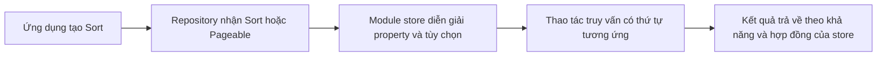

# Sort, Sort.Order và Sort.Direction

Một yêu cầu “khách hàng mới nhất trước, nếu cùng thời điểm thì theo ID tăng dần” chứa nhiều thông tin: có hai tiêu chí, mỗi tiêu chí có chiều riêng, và tiêu chí thứ nhất được ưu tiên hơn tiêu chí thứ hai. Spring Data Commons biểu diễn yêu cầu đó bằng `Sort`, `Sort.Order` và `Sort.Direction`.

Trong chương **Sắp xếp** của module `SPRING_DATA_COMMONS`, bài này hướng dẫn tạo, kết hợp và truyền các đối tượng sắp xếp vào repository. Mục tiêu là đọc đúng cấu hình thứ tự và hiểu phần nào thuộc hợp đồng Commons, phần nào phải được module store chuyển thành thao tác truy vấn cụ thể.

## 1. Ba thành phần và ba trách nhiệm

| Thành phần | Đại diện cho điều gì? | Ví dụ |
| --- | --- | --- |
| `Sort.Direction` | Chiều sắp xếp | `ASC`, `DESC` |
| `Sort.Order` | Một tiêu chí gồm property, chiều và các tùy chọn liên quan | `createdAt DESC` |
| `Sort` | Danh sách các tiêu chí theo thứ tự ưu tiên | `createdAt DESC`, sau đó `id ASC` |

Có thể hình dung:

```text
Sort
  ├── Order(property = "createdAt", direction = DESC)
  └── Order(property = "id",        direction = ASC)
```

`Direction` không chứa tên property. `Order` mô tả một tiêu chí. `Sort` kết hợp một hoặc nhiều tiêu chí, hoặc biểu diễn không yêu cầu sắp xếp động.

Các lớp này nằm trong package `org.springframework.data.domain`:

```java
import org.springframework.data.domain.Sort;
import org.springframework.data.domain.Sort.Direction;
import org.springframework.data.domain.Sort.Order;
```

`Direction` và `Order` là các kiểu lồng trong `Sort`; import riêng chỉ giúp ví dụ ngắn hơn.

## 2. Sort là mô tả yêu cầu, không phải bộ sắp xếp collection Java

Tạo một đối tượng `Sort` chưa làm bất kỳ danh sách nào đổi thứ tự:

```java
Sort sort = Sort.by(Direction.DESC, "createdAt");
```

Cần truyền đối tượng đó vào một API hỗ trợ, chẳng hạn một method repository nhận `Sort`, hoặc đặt nó vào `Pageable`.



Sơ đồ không có nghĩa mọi store dùng SQL. Với JPA, thứ tự có thể được chuyển thành biểu thức truy vấn phù hợp; một document store hoặc module khác có cách biểu diễn riêng.

Nếu đã có `List<Customer>` trong bộ nhớ và muốn sắp xếp nó bằng Java, cần dùng API như `Comparator` và `List.sort`. `Sort` không tự đóng vai trò `Comparator` và không sắp lại danh sách chỉ vì được khởi tạo cạnh danh sách đó.

## 3. Tạo Sort cho một hoặc nhiều property cùng chiều

Giả sử mô hình `Customer` có các property Java:

```text
Customer
  id: Long
  firstName: String
  lastName: String
  createdAt: Instant
  priority: Integer
```

Các ví dụ giả định module store hỗ trợ sắp xếp trên những property tương ứng. `priority` có thể nullable để minh họa tùy chọn xử lý null ở phần sau.

### 3.1. Mặc định là tăng dần

```java
Sort byLastName = Sort.by("lastName");
```

Cấu hình này biểu diễn `lastName ASC`.

Nhiều property cùng chiều mặc định:

```java
Sort byName = Sort.by("lastName", "firstName");
```

Thứ tự tiêu chí là:

```text
1. lastName ASC
2. firstName ASC
```

`firstName` chỉ phân biệt các phần tử bằng nhau theo tiêu chí `lastName`. Nó không được ưu tiên trước chỉ vì xuất hiện cuối.

### 3.2. Chỉ định chiều tường minh

```java
Sort newestFirst = Sort.by(Direction.DESC, "createdAt");

Sort nameAscending = Sort.by(
    Direction.ASC,
    "lastName",
    "firstName"
);
```

Trong overload nhận một `Direction` và nhiều property, chiều đó áp dụng cho tất cả property được truyền vào.

Ví dụ:

```java
Sort sort = Sort.by(Direction.DESC, "createdAt", "id");
```

nghĩa là `createdAt DESC`, rồi `id DESC`. Nó không biểu đạt trường hợp `createdAt DESC`, rồi `id ASC`.

### 3.3. Property phải có ý nghĩa trong mô hình truy vấn

`Sort.by("lastName")` nhận một chuỗi, không phải một tham chiếu field được compiler kiểm tra. Viết nhầm `"lastNmae"` vẫn có thể biên dịch nhưng thất bại khi module phân giải property hoặc tạo/thực thi query.

Thời điểm phát hiện lỗi tùy API và store. Việc tạo được đối tượng `Sort` không tự chứng minh property có tồn tại và có thể sắp xếp được.

## 4. Sort.Order cho các tiêu chí khác chiều

Dùng từng `Order` khi mỗi property cần chiều hoặc tùy chọn riêng:

```java
Sort newestThenId = Sort.by(
    Order.desc("createdAt"),
    Order.asc("id")
);
```

Cấu hình này chính xác là:

```text
createdAt DESC
id ASC
```

Một tiêu chí `Order` chứa thông tin về property, direction, yêu cầu không phân biệt hoa thường và cách xử lý null được đề nghị. Các getter có thể dùng để quan sát cấu hình:

```java
Order order = Order.desc("createdAt");

String property = order.getProperty();
Direction direction = order.getDirection();
boolean ignoreCase = order.isIgnoreCase();
Sort.NullHandling nullHandling = order.getNullHandling();
```

Đây là đọc metadata của yêu cầu. Nó không kiểm tra database đã chấp nhận hoặc áp dụng mọi tùy chọn hay chưa.

### 4.1. So sánh theo thứ tự ưu tiên

Với hai tiêu chí:

```text
createdAt DESC, id ASC
```

thứ tự được hiểu theo kiểu từ điển:

1. So sánh `createdAt` giảm dần.
2. Chỉ khi bằng nhau theo tiêu chí đó, so sánh `id` tăng dần.
3. Nếu vẫn bằng nhau theo toàn bộ tiêu chí, cấu hình chưa phân biệt được hai phần tử.

Nếu muốn ID là tiêu chí chính, phải đặt nó trước. `Sort.by(Order.asc("id"), Order.desc("createdAt"))` có ý nghĩa khác.

### 4.2. Một ví dụ có thể kiểm chứng

Giả sử các giá trị `createdAt` đều không-null:

| Thứ tự dữ liệu đầu vào minh họa | `id` | `createdAt` |
| --- | --- | --- |
| A | 42 | `2026-11-21T10:00:00Z` |
| B | 7 | `2026-11-20T10:00:00Z` |
| C | 21 | `2026-11-21T10:00:00Z` |
| D | 19 | `2026-11-20T10:00:00Z` |

Với `createdAt DESC, id ASC`, thứ tự ID mong đợi là:

```text
21, 42, 7, 19
```

Hai phần tử mới hơn đứng trước; trong từng nhóm cùng thời điểm, ID nhỏ hơn đứng trước. Thứ tự dữ liệu đầu vào không phải một tiêu chí ngầm của truy vấn.

## 5. Kết hợp Sort và giữ đúng kết quả của thao tác cấu hình

### 5.1. and nối thêm các tiêu chí phía sau

```java
Sort primary = Sort.by(Direction.DESC, "createdAt");
Sort secondary = Sort.by(Direction.ASC, "id");

Sort combined = primary.and(secondary);
```

`combined` biểu diễn `createdAt DESC`, rồi `id ASC`. Các tiêu chí của `secondary` được nối sau tiêu chí đã có, nên có mức ưu tiên thấp hơn.

`and` không phải phép nối điều kiện lọc. Nó không tạo thêm một biểu thức `WHERE` với toán tử `AND`; nó kết hợp danh sách thứ tự.

### 5.2. Giữ giá trị trả về

Các thao tác cấu hình như `and`, `ascending`, `descending` và các tùy chọn của `Order` trả về cấu hình kết quả. Không giả định gọi chúng sẽ tự sửa biến ban đầu.

Ví dụ dễ bỏ sót:

```java
Sort sort = Sort.by("lastName");
sort.and(Sort.by("firstName"));
```

Đoạn trên bỏ qua giá trị được trả về. Nếu muốn cấu hình kết hợp:

```java
Sort sort = Sort.by("lastName")
    .and(Sort.by("firstName"));
```

Hoặc giữ biến riêng:

```java
Sort base = Sort.by("lastName");
Sort detailed = base.and(Sort.by("firstName"));
```

Quy tắc sử dụng này giúp nhìn rõ đâu là cấu hình nền và đâu là cấu hình được mở rộng, mà không dựa vào hiệu ứng sửa tại chỗ.

### 5.3. ascending và descending áp dụng cho toàn bộ tiêu chí

```java
Sort mixed = Sort.by(
    Order.desc("createdAt"),
    Order.asc("id")
);

Sort allDescending = mixed.descending();
```

`allDescending` có `createdAt DESC`, `id DESC`. Nó không đảo từng chiều tương đối để thành `createdAt ASC`, `id DESC`.

Tương tự, `mixed.ascending()` đặt tất cả tiêu chí thành tăng dần. Muốn giữ các chiều khác nhau, hãy xây hoặc chỉnh từng `Order` theo ý định.

### 5.4. Không dùng and như phép ghi đè property

Ví dụ:

```java
Sort conflicting = Sort.by(Order.asc("id"))
    .and(Sort.by(Order.desc("id")));
```

`and` ghép các tiêu chí; không nên dùng nó với kỳ vọng tiêu chí sau tự thay thế tiêu chí trước cùng property.

Nếu ứng dụng cho phép caller thay một chiều sắp xếp đã có, hãy xây lại cấu hình cuối cùng sau khi xử lý property trùng. Một tiêu chí lặp theo hai chiều làm cấu hình khó đọc và có thể tạo biểu thức dư thừa ở store.

## 6. Sort.unsorted biểu đạt không có yêu cầu sắp xếp động

```java
Sort none = Sort.unsorted();

boolean unsorted = none.isUnsorted();
boolean sorted = none.isSorted();
```

Trong ví dụ, `unsorted` là `true`, còn `sorted` là `false`.

Dùng `Sort.unsorted()` khi API nhận `Sort` nhưng caller không bổ sung thứ tự động. Không truyền null để thay cho ý định này khi API yêu cầu tham số không-null.

### 6.1. Unsorted không phải một thứ tự mặc định có thể dựa vào

Nếu query cuối cùng không có một thứ tự được xác định, không mặc định dữ liệu sẽ theo ID, theo thời điểm tạo hoặc theo lần chèn. Một lần chạy có thể trông đúng do kế hoạch truy vấn hiện tại, nhưng đó chưa phải một hợp đồng thứ tự.

Mặt khác, `Sort.unsorted()` không yêu cầu xóa mọi thứ tự đã có trong query. Một method có thứ tự tĩnh hoặc một query khai báo có `ORDER BY` vẫn có thể tạo kết quả có thứ tự.

Nói chính xác, cấu hình unsorted không mang thêm các `Order` động. Hành vi cuối cùng còn cần xem toàn bộ query và quy tắc của module.

### 6.2. isSorted chỉ mô tả đối tượng cấu hình

`sort.isSorted()` cho biết cấu hình có tiêu chí sắp xếp. Nó không chứng minh store hỗ trợ tất cả property, đã áp dụng case-insensitive sort hay đã thực thi query thành công.

Để đọc từng tiêu chí:

```java
for (Order order : sort) {
    System.out.println(
        order.getProperty() + " " + order.getDirection()
    );
}
```

`Sort` cho phép duyệt các `Order` theo thứ tự của cấu hình. Đây cũng là thứ tự ưu tiên cần giữ khi truyền tiếp hoặc chuyển đổi yêu cầu sắp xếp.

Khi dùng `getOrderFor`, phải xử lý trường hợp không tìm thấy:

```java
Order idOrder = sort.getOrderFor("id");
if (idOrder != null) {
    System.out.println(idOrder.getDirection());
}
```

Không coi chuỗi do `toString()` tạo ra là một đoạn SQL có thể ghép vào query. Đó là biểu diễn của cấu hình, không phải hợp đồng ngôn ngữ truy vấn chung.

## 7. Ignore case và null handling là các yêu cầu cần store hỗ trợ

### 7.1. Không phân biệt hoa thường khi sắp xếp

```java
Order nameOrder = Order.asc("lastName").ignoreCase();
Sort sort = Sort.by(nameOrder);
```

`ignoreCase()` gắn yêu cầu sắp xếp không phân biệt hoa thường cho tiêu chí đó. Nó không thay đổi giá trị đang lưu, cũng không thêm một điều kiện lọc không phân biệt hoa thường.

Ví dụ, hướng dẫn thứ tự cho `lastName` khác với một derived query có predicate `LastNameIgnoreCase`. Một cái nói cách sắp xếp tập kết quả; cái kia nói cách so sánh để chọn phần tử.

Cách diễn giải phụ thuộc store, collation, kiểu dữ liệu và API query. Không suy rằng bật `ignoreCase()` sẽ đồng thời bỏ dấu tiếng Việt, chuẩn hóa mọi dạng Unicode hoặc áp dụng một quy tắc ngôn ngữ cụ thể.

### 7.2. Đề nghị đưa null lên trước hoặc xuống cuối

```java
Order priorityOrder = Order.asc("priority").nullsLast();

Order nameOrder = Order.asc("lastName")
    .ignoreCase()
    .nullsFirst();
```

Các giá trị trong `Sort.NullHandling`:

| Giá trị | Ý nghĩa mong muốn |
| --- | --- |
| `NATIVE` | Để store dùng cách xử lý null bản địa |
| `NULLS_FIRST` | Đề nghị đặt giá trị null trước giá trị không-null |
| `NULLS_LAST` | Đề nghị đặt giá trị null sau giá trị không-null |

Các factory `Order.asc` và `Order.desc` mặc định dùng null handling bản địa. Có thể diễn đạt lại lựa chọn đó bằng `nullsNative()` khi cần xây cấu hình.

**Null handling là một hint trong abstraction Commons.** Module hoặc đường query có thể hỗ trợ, không áp dụng được hoặc từ chối tùy chọn. Tạo được `Order.nullsLast()` không có nghĩa query cuối chắc chắn thực hiện được yêu cầu đó.

### 7.3. Chiều và vị trí null là hai thông tin khác nhau

`ASC` hoặc `DESC` quyết định chiều của các giá trị được so sánh theo quy tắc store. Nó không tự xác định một quy tắc null giống nhau giữa mọi hệ quản trị dữ liệu.

Nếu vị trí null là yêu cầu nghiệp vụ, cần kiểm chứng khả năng hỗ trợ và kết quả trên store thực tế. Không suy `DESC` luôn đồng nghĩa null xuống cuối, hoặc `ASC` luôn đồng nghĩa null lên đầu.

Nếu một module không hỗ trợ null placement mong muốn, có thể phải dùng biểu thức query hoặc giải pháp riêng của store. Không tự sửa dữ liệu null thành một giá trị khác chỉ để làm cho cấu hình Sort có vẻ hoạt động.

## 8. Tên property và ranh giới với ngôn ngữ truy vấn

### 8.1. Dùng tên trong mô hình mà query nhận diện

Ví dụ JPA có property:

```java
@Column(name = "last_name")
private String lastName;
```

Cấu hình thông thường là:

```java
Sort.by("lastName");
```

Không đổi thành `Sort.by("last_name")` chỉ vì cột mang tên đó. Tên cột vật lý và tên property Java là hai lớp thông tin; module thực hiện ánh xạ tương ứng.

Với query khai báo, một số module có thể chấp nhận alias được chọn trong query theo quy tắc riêng. Khả năng đó không biến mọi tên cột hoặc alias thành property hợp lệ trong mọi query repository.

### 8.2. Đường dẫn lồng phụ thuộc khả năng của store

Nếu mô hình bổ sung `address` có property `city`, một cấu hình có thể là:

```java
Sort.by("address.city");
```

Ví dụ chỉ có ý nghĩa khi module và query đang dùng hỗ trợ đường dẫn đó. Nó không yêu cầu mọi store tự tạo join, tự duyệt mọi loại tham chiếu hoặc tạo cùng ngữ nghĩa với một document lồng.

Đường qua quan hệ nhiều phần tử còn có thể làm yêu cầu thứ tự phức tạp hơn: cần xác định phần tử nào cung cấp giá trị sắp xếp và query có làm thay đổi tập kết quả hay không. Một chuỗi property không thay thế được thiết kế query cho tình huống đó.

Không sao chép máy móc cách dùng `_` trong tên derived query sang mọi chuỗi property của mọi API. Cần dùng dạng đường dẫn mà chính API và module đang nhận hỗ trợ.

### 8.3. Sort không phải nơi truyền SQL hoặc biểu thức tùy ý

Một chuỗi như `"length(lastName)"` không trở thành property chuẩn của Commons chỉ vì được đưa vào `Sort.by`.

Nếu cần sắp xếp theo hàm, biểu thức tính toán, aggregation hoặc query native, phải dùng cơ chế phù hợp mà module hỗ trợ. Query khai báo và native query cũng có thể có giới hạn riêng về cách nhận Sort động.

Tách rõ hai trường hợp:

```text
Sắp xếp theo property domain được hỗ trợ
Sắp xếp theo một biểu thức query đặc thù của store
```

Điều này giúp tránh viết một cấu hình có vẻ dùng chung nhưng chỉ có ý nghĩa ở một đường query cụ thể.

## 9. Truyền Sort vào repository

Ví dụ repository đồng bộ:

```java
import java.util.List;

import org.springframework.data.repository.PagingAndSortingRepository;
import org.springframework.data.domain.Sort;

interface CustomerRepository
        extends PagingAndSortingRepository<Customer, Long> {

    List<Customer> findByLastName(String lastName, Sort sort);
}
```

Giả định store quản lý repository hỗ trợ API tìm và sắp xếp tương ứng. Interface cơ sở công bố thao tác như `findAll(Sort)`; method derived bổ sung cho phép vừa lọc vừa truyền thứ tự động.

Cách gọi:

```java
Sort sort = Sort.by(
    Order.desc("createdAt"),
    Order.asc("id")
);

Iterable<Customer> all = repository.findAll(sort);

List<Customer> matching = repository.findByLastName(
    "Nguyen",
    sort
);
```

`lastName` là giá trị điều kiện. `sort` là tham số điều khiển; nó không được bind như một property nghiệp vụ trong predicate của method.

Khi không bổ sung sort động:

```java
List<Customer> matching = repository.findByLastName(
    "Nguyen",
    Sort.unsorted()
);
```

Đối tượng trả về có thể vẫn theo thứ tự tĩnh nếu method/query đã công bố thứ tự ở nơi khác. Cần đọc toàn bộ hợp đồng query để biết thứ tự cuối.

### Kết quả projection vẫn cần thứ tự được diễn giải hợp lệ

Một query có thể trả projection thay vì entity và vẫn nhận Sort nếu module hỗ trợ. Tuy nhiên, property hay alias có thể sắp xếp phải được xác định theo query thực tế.

Không suy rằng thêm một accessor vào projection là đủ để store tự sắp xếp theo một biểu thức tính toán. Cũng không suy chỉ có các property hiển thị trên projection mới được mọi store cho phép sắp xếp; quy tắc này cần đối chiếu module và dạng query.

## 10. Sort trong Pageable và thứ tự ổn định khi phân trang

Để dùng cùng yêu cầu thứ tự trong phân trang:

```java
import org.springframework.data.domain.PageRequest;
import org.springframework.data.domain.Pageable;

Sort sort = Sort.by(
    Order.desc("createdAt"),
    Order.asc("id")
);

Pageable pageable = PageRequest.of(0, 20, sort);
```

`0` là chỉ số trang đầu trong API này, `20` là kích thước trang. `Sort` nằm trong `Pageable` và được truyền cùng yêu cầu trang.

Một method minh họa có thể là:

```java
Page<Customer> findByLastName(String lastName, Pageable pageable);
```

Đoạn này dùng `org.springframework.data.domain.Page`. Với query method nhận `Pageable`, đặt cấu hình sort trong chính đối tượng đó; không thêm một tham số `Sort` riêng để biểu diễn lại cùng vai trò.

### 10.1. Thêm tiêu chí phân biệt các giá trị trùng nhau

Nếu chỉ sắp xếp theo `createdAt`, nhiều khách hàng có thể bằng nhau ở tiêu chí duy nhất. Store chưa có ràng buộc thứ tự giữa những phần tử đó.

Thêm `id` duy nhất, không-null và có thể sắp xếp giúp xác định thứ tự rõ hơn trong tập dữ liệu đang xét:

```text
createdAt DESC, id ASC
```

Điều này hữu ích khi chia trang, lấy nhóm phần tử đầu tiên hoặc so sánh kết quả giữa các lần chạy trên dữ liệu không đổi.

### 10.2. Thứ tự xác định không phải snapshot dữ liệu

Nếu dữ liệu được thêm, xóa hoặc thay đổi giữa hai lần lấy trang, vị trí phần tử vẫn có thể dịch chuyển. Một tie-breaker duy nhất không tự tạo snapshot xuyên nhiều request.

Vì vậy, phân biệt hai yêu cầu: thứ tự không mơ hồ trên một tập dữ liệu và tính nhất quán khi tập dữ liệu thay đổi. Yêu cầu thứ hai còn liên quan đến cách phân trang, transaction và khả năng của store.

## 11. Chuyển chiều sắp xếp từ dữ liệu đầu vào

`Direction` có hai giá trị:

```java
Direction.ASC;
Direction.DESC;
```

Có thể phân tích một chuỗi bằng API:

```java
Direction ascending = Direction.fromString("asc");
Direction descending = Direction.fromString("DESC");
```

API nhận tên chiều không phân biệt hoa thường. Một giá trị không hợp lệ như `"up"` không phải một chiều được định nghĩa và sẽ bị từ chối bằng `IllegalArgumentException`.

Ứng dụng nên xác định rõ cách xử lý trường hợp thiếu hoặc chuỗi trắng, thay vì trông chờ mọi dạng đầu vào đều tự được chuẩn hóa:

```java
static Direction parseDirection(String value) {
    if (value == null || value.isBlank()) {
        return Direction.ASC;
    }
    return Direction.fromString(value.trim());
}
```

Đây là chính sách ví dụ: thiếu chiều thì mặc định tăng dần; chuỗi được cắt khoảng trắng trước khi phân tích; một từ khác ASC/DESC vẫn là lỗi. `String.isBlank()` yêu cầu Java 11 trở lên.

Không bắt mọi exception rồi âm thầm đổi thành ASC nếu hợp đồng API yêu cầu báo một chiều không hợp lệ. Caller cần biết yêu cầu của mình được chấp nhận hay bị thay bằng mặc định.

## 12. Ánh xạ khóa sắp xếp của ứng dụng sang property

Tên công khai trên một API không nhất thiết phải giống tên property Java. Có thể giới hạn các lựa chọn và ánh xạ rõ ràng:

```java
import java.util.Map;

import org.springframework.data.domain.Sort;
import org.springframework.data.domain.Sort.Direction;
import org.springframework.data.domain.Sort.Order;

final class CustomerSorts {

    private static final Map<String, String> PROPERTIES = Map.of(
        "name", "lastName",
        "created", "createdAt",
        "priority", "priority"
    );

    private CustomerSorts() {
    }

    static Sort resolve(String requestedKey, String requestedDirection) {
        String key = requestedKey == null || requestedKey.isBlank()
            ? "name"
            : requestedKey.trim();

        String property = PROPERTIES.get(key);
        if (property == null) {
            throw new IllegalArgumentException(
                "Khóa sắp xếp không được hỗ trợ: " + key
            );
        }

        Direction direction =
            requestedDirection == null || requestedDirection.isBlank()
                ? Direction.ASC
                : Direction.fromString(requestedDirection.trim());

        return Sort.by(
            new Order(direction, property),
            Order.asc("id")
        );
    }
}
```

Cách gọi:

```java
Sort sort = CustomerSorts.resolve("created", "desc");
```

Kết quả cấu hình là `createdAt DESC`, rồi `id ASC`.

Các lựa chọn của ví dụ được công bố rõ:

| Đầu vào | Chính sách |
| --- | --- |
| Thiếu khóa | Dùng `name`, ánh xạ sang `lastName` |
| Thiếu chiều | Dùng ASC |
| Khóa ngoài danh sách | Báo lỗi |
| Chiều ngoài ASC/DESC | Báo lỗi |
| Tiêu chí phụ | Luôn thêm `id ASC` |

Giới hạn và ánh xạ giúp API không phụ thuộc trực tiếp vào mọi property nội bộ, đồng thời làm các lựa chọn được hỗ trợ có thể kiểm soát. Các tên trong danh sách vẫn phải phù hợp với domain và query của store thực tế.

Ví dụ chỉ nhận một khóa chính. Nếu hỗ trợ nhiều tiêu chí từ caller, cần giữ đúng thứ tự ưu tiên, quyết định cách xử lý property lặp và tránh tự thêm lại một tie-breaker đã có theo một chính sách mâu thuẫn.

Các hint như `ignoreCase` hoặc null placement cũng nên được thêm theo yêu cầu nghiệp vụ và khả năng store đã xác định. Không coi chúng là những cờ có hiệu lực chung trên mọi property và mọi module.

## 13. Các kịch bản thực hành

Dùng lại bốn dòng dữ liệu ở phần 4, với `createdAt` không-null. Các kết quả dưới đây mô tả thứ tự mong đợi nếu store hỗ trợ query và áp dụng các tiêu chí tương ứng:

| Cấu hình | Thứ tự ID mong đợi |
| --- | --- |
| `Sort.by(Order.desc("createdAt"), Order.asc("id"))` | `21, 42, 7, 19` |
| `Sort.by(Direction.DESC, "createdAt", "id")` | `42, 21, 19, 7` |
| `Sort.by(Order.asc("id"), Order.desc("createdAt"))` | `7, 19, 21, 42` |
| `mixed.ascending()` với `mixed` ở phần 5 | `7, 19, 21, 42` |
| `mixed.descending()` với `mixed` ở phần 5 | `42, 21, 19, 7` |

Đây là kịch bản thiết kế thực hành, không phải kết quả của một bộ test đã được chạy trong bài.

### 13.1. Kiểm tra việc giữ giá trị trả về

So sánh cấu hình tạo bởi:

```java
Sort base = Sort.by(Order.desc("createdAt"));
base.and(Sort.by(Order.asc("id")));
```

với:

```java
Sort complete = Sort.by(Order.desc("createdAt"))
    .and(Sort.by(Order.asc("id")));
```

Ở đoạn thứ nhất, `base` vẫn không có tiêu chí phụ chỉ vì gọi `and` rồi bỏ qua kết quả. Dữ liệu có thời điểm trùng nhau sẽ giúp phát hiện thiếu sót đó.

### 13.2. Kiểm tra unsorted theo hợp đồng thay vì một thứ tự tình cờ

Với `Sort.unsorted()`, hãy kiểm tra cấu hình không thêm tiêu chí động. Không gán một danh sách ID cố định làm thứ tự mặc định nếu query không có yêu cầu thứ tự khác.

Nếu repository method đã có thứ tự tĩnh, cần kiểm tra hành vi kết hợp của chính query đó, không dùng một giả định chung cho mọi method.

### 13.3. Kiểm tra hint trên store thực tế

Chuẩn bị dữ liệu có:

- Giá trị chuỗi khác nhau về hoa thường.
- Giá trị null và không-null ở property nullable.
- Các giá trị bằng nhau ở tiêu chí chính.

Đối chiếu khả năng hỗ trợ, collation và kết quả thực tế. Một kiểm tra chỉ xem `order.isIgnoreCase()` hoặc `order.getNullHandling()` chỉ xác nhận metadata cấu hình, chưa xác nhận store thực hiện theo hint.

## 14. Chẩn đoán cấu hình không cho kết quả mong muốn

| Dấu hiệu | Điều cần kiểm tra |
| --- | --- |
| Tạo Sort nhưng danh sách trong bộ nhớ không đổi | Sort đã được truyền vào API hỗ trợ hay chưa |
| Tiêu chí phụ không có tác dụng | Thứ tự ghép và giá trị trả về của `and` có được giữ không |
| Chiều của nhiều property bị đổi ngoài ý định | Có gọi `ascending()` hoặc `descending()` cho toàn Sort không |
| Query báo không có property | Tên Java, mapping, đường dẫn và alias của query |
| Null placement không như mong muốn | Hint có được module và loại query hỗ trợ không |
| Chữ hoa/thường vẫn có thứ tự khác kỳ vọng | Collation, kiểu dữ liệu và khả năng áp dụng ignoreCase |
| Có kết quả đảo vị trí giữa các lần lấy trang | Tiêu chí có phân biệt mọi phần tử và dữ liệu có thay đổi không |
| Dùng unsorted nhưng kết quả vẫn có thứ tự | Query có thứ tự tĩnh hoặc ORDER BY khai báo sẵn không |
| Cấu hình chứa cùng property nhiều lần | Chính sách kết hợp có đang nhầm and thành override không |

Khi xử lý một trường hợp cụ thể, nên viết ra cấu hình cuối theo thứ tự:

```text
1. property, direction, ignoreCase, nullHandling
2. property, direction, ignoreCase, nullHandling
...
```

Sau đó xác định query thực sự được chọn và cách store diễn giải cấu hình. Cách đọc này giúp tách lỗi tạo Sort khỏi lỗi mapping property, khả năng query và quy tắc so sánh của hệ lưu trữ.

## 15. Tự kiểm tra mức độ hiểu

1. Vì sao `Direction.DESC` chưa đủ biểu đạt một tiêu chí sắp xếp?
2. `Sort.by(Direction.DESC, "createdAt", "id")` khác hai Order có chiều DESC và ASC như thế nào?
3. `and` thêm tiêu chí vào vị trí nào và có ý nghĩa gì về độ ưu tiên?
4. Vì sao phải giữ giá trị trả về khi xây cấu hình qua các thao tác kết hợp?
5. `Sort.unsorted()` có bảo đảm thứ tự theo ID hoặc xóa ORDER BY đã có không?
6. `nullsLast()` và `ignoreCase()` công bố yêu cầu gì, và điều gì còn phải kiểm tra ở store?
7. Vì sao tên cột vật lý không tự là tên property dùng chung cho Sort?
8. Một tie-breaker duy nhất giúp được gì khi phân trang, và vì sao nó chưa tạo snapshot giữa các request?

Khi tạo thứ tự cho repository, hãy xác định **property cần sắp xếp**, **chiều của từng property** và **độ ưu tiên giữa các tiêu chí** trước. Sau đó thêm các hint được hỗ trợ và truyền cấu hình vào đúng API. `Sort`, `Order` và `Direction` giúp diễn đạt yêu cầu nhất quán; module store quyết định cách thực hiện yêu cầu đó trên dữ liệu thực tế.
