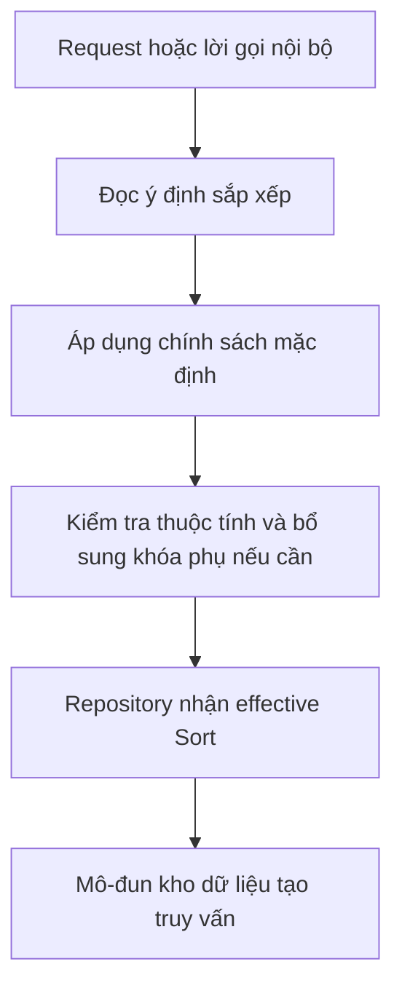

# Sort.unsorted và lựa chọn giá trị mặc định

## 1. Không yêu cầu sắp xếp là một trạng thái hợp lệ

Một truy vấn repository có thể nhận tiêu chí sắp xếp từ người gọi. Có lúc người gọi yêu cầu giá tăng dần; có lúc chỉ muốn dùng thứ tự mặc định của ứng dụng; cũng có lúc không cần bảo đảm thứ tự nào.

Ba ý định đó cần được phân biệt. `Sort.unsorted()` của Spring Data Commons biểu đạt một đối tượng Sort không có tiêu chí sắp xếp. Nó không tự chọn một thuộc tính mặc định và không mang thông tin về lý do không có tiêu chí.

Nếu ứng dụng muốn luôn hiển thị sản phẩm mới nhất trước khi người dùng chưa chọn cách sắp xếp, chính sách ấy phải được đặt ở một ranh giới rõ ràng. Không nên dựa vào việc cơ sở dữ liệu tình cờ trả bản ghi theo thứ tự trông có vẻ ổn định.

Trong phạm vi Spring Data Commons, Sort là abstraction chung. Mô-đun kho dữ liệu quyết định cách chuyển các thuộc tính và hướng sắp xếp thành truy vấn thực thi. Việc có đối tượng Sort không tự chứng minh mọi đường dẫn thuộc tính hoặc tùy chọn đều được kho dữ liệu hỗ trợ.

## 2. Hợp đồng của Sort.unsorted()

### 2.1. Một Sort không có Order

```java
import org.springframework.data.domain.Sort;

Sort sort = Sort.unsorted();

boolean unsorted = sort.isUnsorted(); // true
boolean sorted = sort.isSorted();     // false
```

Sort này không chứa yêu cầu như `createdAt DESC` hay `id ASC`. Nó là một đối tượng hợp lệ để truyền vào API nhận Sort khi không có yêu cầu sắp xếp động.

Không cần dùng null để biểu đạt trường hợp ấy:

```java
repository.findByActiveTrue(Sort.unsorted());
```

Với các tham số đặc biệt như Sort trong repository được hỗ trợ, nên tuân thủ hợp đồng không null và dùng `Sort.unsorted()` khi không có sort. Không mặc định rằng mọi implementation sẽ tự đổi một tham số null thành Sort rỗng.

### 2.2. Những bảo đảm không được suy ra từ unsorted

`Sort.unsorted()` không có nghĩa:

- Lấy bản ghi theo id tăng dần.
- Giữ thứ tự chèn vào kho dữ liệu.
- Sắp xếp theo trường được đánh dấu auditing.
- Dùng một default sort tự có của Spring Data cho mọi repository.
- Xáo trộn ngẫu nhiên kết quả.
- Xóa mọi phần `ORDER BY` đã nằm trong query.

Ý nghĩa cần giữ là: **đối tượng Sort này không bổ sung tiêu chí sắp xếp động**. Query vẫn có thể chứa một thứ tự tĩnh hoặc chịu một chính sách do ứng dụng áp dụng trước khi gọi repository.

### 2.3. Kiểm tra trạng thái bằng API, không bằng identity

Để biết một Sort có tiêu chí hay không, dùng `isSorted()` hoặc `isUnsorted()`. Không dựa vào phép so sánh tham chiếu với một lần gọi `Sort.unsorted()`.

Ứng dụng cần biết ý nghĩa của đối tượng, không cần phụ thuộc vào việc framework có tái sử dụng một instance nội bộ hay không.

## 3. Ba khái niệm mặc định khác nhau

| Khái niệm | Ví dụ | Nơi quyết định |
| --- | --- | --- |
| Hướng mặc định khi chỉ đưa tên thuộc tính | `Sort.by("price")` dùng hướng tăng dần | Hợp đồng tạo Sort |
| Thứ tự mặc định của một nghiệp vụ | Sản phẩm mới nhất trước, id giảm dần để phân xử hòa | Ứng dụng hoặc cấu hình API |
| Thứ tự mà DB tình cờ trả khi không có yêu cầu | Một lần chạy nhìn giống thứ tự id | Cách thực thi hiện tại, không phải hợp đồng thứ tự nghiệp vụ |

Ví dụ:

```java
Sort byPrice = Sort.by("price");
```

Đây là một Sort đã có tiêu chí. Nó không phải unsorted. Hướng mặc định tăng dần khi tạo Sort không có nghĩa mọi query thiếu Sort sẽ tự được sắp xếp tăng dần.

Nếu nghiệp vụ muốn rõ ràng hơn, có thể viết:

```java
Sort byPrice = Sort.by(Sort.Order.asc("price"));
```

Ngược lại, gọi các thao tác đổi hướng trên một Sort không có tiêu chí không tự chọn được thuộc tính cần sắp xếp. Muốn có default sort phải cung cấp Order thực sự.

## 4. Xác định nơi áp dụng default sort

Một yêu cầu có thể đi qua nhiều tầng:



Default có thể được khai báo ở web argument resolver, tại service hoặc qua query có sắp xếp tĩnh. Tuy nhiên, mỗi lựa chọn có phạm vi khác nhau.

| Vị trí | Phạm vi tác dụng | Điểm cần lưu ý |
| --- | --- | --- |
| Web resolver | Các request đi qua resolver đó | Lời gọi nội bộ không tự có cùng default |
| Service hoặc policy dùng chung | Những đường gọi áp dụng policy | Cần phân biệt thiếu sort với yêu cầu không sắp xếp nếu API cho phép |
| Tên query method có `OrderBy` | Query method cụ thể | Không phải default toàn cục của mọi repository |
| Query khai báo có `order by` | Biểu thức truy vấn cụ thể | Sort rỗng không tự xóa phần đã khai báo |
| Custom fragment | Theo mã thực thi fragment | Implementation phải thực sự áp dụng Sort nếu hợp đồng nhận nó |

Nên xác định nơi chịu trách nhiệm chính cho hợp đồng nghiệp vụ. Nếu nhiều tầng cùng bổ sung default, có thể xuất hiện tiêu chí trùng hoặc thứ tự ưu tiên khó hiểu.

## 5. Ví dụ domain và repository

Giả sử ứng dụng quản lý sản phẩm có các thuộc tính sau:

| Thuộc tính | Kiểu minh họa | Vai trò |
| --- | --- | --- |
| `id` | `Long` | Định danh duy nhất |
| `name` | `String` | Tên hiển thị |
| `price` | `BigDecimal` | Giá |
| `createdAt` | `Instant` | Thời điểm tạo |
| `active` | `boolean` | Có đang được hiển thị không |

Trong ví dụ, `id` và `createdAt` có giá trị ở mọi sản phẩm được truy vấn. Mô hình thực tế phải có mapping phù hợp với mô-đun kho dữ liệu.

Repository có thể công khai các phương thức sau khi mô-đun hỗ trợ query method cùng Sort và Pageable tương ứng:

```java
import java.util.List;
import org.springframework.data.domain.Page;
import org.springframework.data.domain.Pageable;
import org.springframework.data.domain.Sort;
import org.springframework.data.repository.Repository;

public interface ProductRepository extends Repository<Product, Long> {
    List<Product> findByActiveTrue(Sort sort);

    Page<Product> findByActiveTrue(Pageable pageable);
}
```

Hai phương thức dùng cho hai nhu cầu khác nhau: một danh sách và một trang kèm thông tin tổng. Kiểu Sort không tự giới hạn số phần tử của danh sách; nếu dữ liệu có thể lớn, cần chọn hợp đồng lấy dữ liệu phù hợp.

## 6. Default chỉ được dùng khi người gọi không có tiêu chí

Giả sử chính sách là:

> Khi chưa chọn cách sắp xếp, hiển thị `createdAt DESC`, sau đó `id DESC`. Nếu người gọi có tiêu chí hợp lệ, giữ tiêu chí đó.

Có thể diễn đạt phần chọn default bằng một hàm nhỏ:

```java
import java.util.Objects;
import org.springframework.data.domain.Sort;

public final class DefaultProductOrder {
    private static final Sort DEFAULT_SORT = Sort.by(
            Sort.Order.desc("createdAt"),
            Sort.Order.desc("id"));

    private DefaultProductOrder() {
    }

    public static Sort useDefaultIfUnsorted(Sort requested) {
        Objects.requireNonNull(requested, "requested");
        return requested.isUnsorted() ? DEFAULT_SORT : requested;
    }
}
```

Hàm này chọn giữa hai giá trị, không ghép chúng. Với `price ASC`, kết quả vẫn là `price ASC`, không tự thêm `createdAt DESC`.

Một controller hoặc adapter có thể chuyển trạng thái thiếu thông tin sắp xếp thành `Sort.unsorted()` trước khi gọi policy. Nếu nhận null ở một ranh giới ngoài, cần quyết định rõ ở ranh giới đó; không để repository phải đoán null có nghĩa gì.

### 6.1. And là nối tiêu chí, không phải fallback

```java
Sort requested = Sort.by(Sort.Order.asc("price"));
Sort defaultSort = Sort.by(
        Sort.Order.desc("createdAt"),
        Sort.Order.desc("id"));

Sort combined = requested.and(defaultSort);
```

Ý nghĩa của `combined` là:

```text
price ASC, createdAt DESC, id DESC
```

Đó là một thứ tự nhiều tiêu chí. Default không chỉ được dùng khi requested rỗng; nó đã được nối vào sau tiêu chí giá.

Việc nối có thể đúng nếu nghiệp vụ muốn giá bằng nhau thì xét ngày tạo, rồi id. Nhưng đây là một chính sách khác với “chỉ dùng default khi không có lựa chọn”. Hãy đặt tên hàm và mô tả API theo đúng chính sách được chọn.

Các thao tác kết hợp Sort trả về giá trị cần sử dụng. Đoạn sau không cập nhật biến theo ý định:

```java
Sort sort = Sort.unsorted();
sort.and(Sort.by("id")); // Không giữ lại kết quả của phép kết hợp.
```

Cách viết có giữ kết quả:

```java
Sort sort = Sort.unsorted();
sort = sort.and(Sort.by("id"));
```

## 7. Default sort khác khóa phụ để phân xử hòa

Giả sử hai sản phẩm có cùng giá. Nếu trang sản phẩm sắp xếp theo giá nhưng không có tiêu chí duy nhất phía sau, thứ tự giữa hai sản phẩm có thể không được xác định đủ rõ.

Ứng dụng có thể chọn hai quy tắc độc lập:

1. Nếu không có sort, dùng default `createdAt DESC, id DESC`.
2. Với sort đã chọn, thêm `id DESC` nếu chưa có tiêu chí id.

Ví dụ:

| Sort được yêu cầu | Sort sau policy |
| --- | --- |
| Unsorted | `createdAt DESC, id DESC` |
| `price ASC` | `price ASC, id DESC` |
| `name DESC` | `name DESC, id DESC` |
| `id ASC` | `id ASC` |
| `createdAt ASC, id ASC` | Giữ nguyên hai tiêu chí |

Không thêm một tiêu chí id ngược hướng nếu người gọi đã chỉ định id. Không nên nối nguyên default vào mọi lựa chọn chỉ vì cần một khóa phụ duy nhất.

Với cùng một tập dữ liệu, một khóa phân xử duy nhất giúp thứ tự có tính xác định. Nó không tự bảo đảm snapshot không thay đổi giữa các request; phần phân trang còn cần đánh giá tình huống có ghi đồng thời.

## 8. Một policy hoàn chỉnh cho ví dụ sản phẩm

Phiên bản sau kết hợp ba trách nhiệm: chọn default khi unsorted, kiểm tra thuộc tính được phép và thêm khóa phụ khi thiếu. Ví dụ dùng các tiện ích có trên Java 17 trở lên.

```java
import java.util.HashSet;
import java.util.Objects;
import java.util.Set;
import org.springframework.data.domain.Sort;

public final class ProductSortPolicy {
    private static final Sort DEFAULT_SORT = Sort.by(
            Sort.Order.desc("createdAt"),
            Sort.Order.desc("id"));

    private static final Set<String> ALLOWED_PROPERTIES = Set.of(
            "createdAt", "id", "name", "price");

    private ProductSortPolicy() {
    }

    public static Sort resolve(Sort requested) {
        Objects.requireNonNull(requested, "requested");

        Sort effective = requested.isUnsorted()
                ? DEFAULT_SORT
                : requested;

        Set<String> seen = new HashSet<>();
        for (Sort.Order order : effective) {
            String property = order.getProperty();
            if (!ALLOWED_PROPERTIES.contains(property)) {
                throw new IllegalArgumentException(
                        "Không hỗ trợ sort theo: " + property);
            }
            if (!seen.add(property)) {
                throw new IllegalArgumentException(
                        "Thuộc tính sort bị lặp: " + property);
            }
        }

        if (effective.getOrderFor("id") == null) {
            effective = effective.and(Sort.by(Sort.Order.desc("id")));
        }
        return effective;
    }
}
```

Tên thuộc tính ở đây là thuộc tính domain, chẳng hạn `createdAt`. Không mặc định tên cột vật lý như `created_at` có thể dùng thay thế trong một query method nhận Sort.

Policy không tự sửa lỗi đánh máy thành default. Nếu người gọi yêu cầu một thuộc tính không được hỗ trợ, nó báo đầu vào không hợp lệ. Làm rỗng một sort sai rồi dùng default có thể che lỗi tích hợp và khiến người dùng không hiểu vì sao lựa chọn của họ không có hiệu lực.

Helper tập trung vào thuộc tính, hướng và thứ tự tiêu chí của ví dụ. Những tùy chọn như ignore-case hoặc null handling nếu được API công khai cho phép vẫn cần hợp đồng và khả năng thực thi tương ứng của mô-đun.

### 8.1. Giữ ưu tiên của người gọi

Khi nhận `price ASC`, helper thêm id sau giá. Khi nhận `id ASC`, helper không nối thêm `id DESC`.

Một thuộc tính duy nhất đã có ở trước có thể làm những tiêu chí sau nó không còn ảnh hưởng đến thứ tự. Vì vậy, không nên tự sắp lại thứ tự các Order mà người gọi đã gửi nếu chưa có chính sách rõ.

Policy này là ví dụ cho một endpoint yêu cầu kết quả luôn có thứ tự. Nó cố ý coi unsorted là tín hiệu chọn default; nếu endpoint cho phép chủ động không thêm sort, cần mô hình ý định riêng như phần 11.

## 9. Dùng default sort với Pageable mà không đổi yêu cầu trang

### 9.1. Unsorted và unpaged nói về hai trục khác nhau

```java
Pageable first = PageRequest.of(0, 20);
Pageable second = PageRequest.of(0, 20,
        Sort.by(Sort.Order.desc("createdAt"), Sort.Order.desc("id")));
Pageable all = Pageable.unpaged();
```

Các kiểu thuộc `org.springframework.data.domain`:

| Giá trị | Có phân trang? | Sort trong ví dụ |
| --- | --- | --- |
| `first` | Có, trang 0 với size 20 | Unsorted |
| `second` | Có, trang 0 với size 20 | Có tiêu chí |
| `all` | Không | Unsorted |

`PageRequest.of(0, 20)` không tự yêu cầu id tăng dần. Nó biểu đạt phân trang nhưng chưa có tiêu chí sắp xếp trong yêu cầu này.

Sort nói về thứ tự, còn phân trang nói về phần dữ liệu cần lấy. Không được dùng `Pageable.unpaged()` để thay thế `Sort.unsorted()` khi mục đích chỉ là không bổ sung tiêu chí sort.

### 9.2. Giữ nguyên page number và page size

Với endpoint yêu cầu phân trang theo mô hình PageRequest thông thường, service có thể chuẩn hóa như sau:

```java
import java.util.Objects;
import org.springframework.data.domain.Page;
import org.springframework.data.domain.Pageable;
import org.springframework.data.domain.PageRequest;
import org.springframework.data.domain.Sort;

public final class ProductSearchService {
    private final ProductRepository repository;

    public ProductSearchService(ProductRepository repository) {
        this.repository = Objects.requireNonNull(repository);
    }

    public Page<Product> search(Pageable requested) {
        Objects.requireNonNull(requested, "requested");
        if (requested.isUnpaged()) {
            throw new IllegalArgumentException(
                    "Thao tác này yêu cầu thông tin phân trang");
        }

        Sort effectiveSort = ProductSortPolicy.resolve(requested.getSort());
        Pageable effective = PageRequest.of(
                requested.getPageNumber(),
                requested.getPageSize(),
                effectiveSort);

        return repository.findByActiveTrue(effective);
    }
}
```

Nếu người gọi yêu cầu trang 2, size 50, Sort unsorted, kết quả chuẩn hóa vẫn là trang 2, size 50 và thêm thứ tự mặc định. Không đặt lại thành trang 0, size 20 chỉ vì cần đổi Sort.

Service kiểm tra unpaged trước khi đọc các thông tin trang. Không ép mọi Pageable tùy chỉnh về PageRequest nếu ứng dụng có metadata hoặc ngữ nghĩa riêng cần giữ; ví dụ trên được giới hạn ở phân trang offset thông thường.

Quy tắc cho phép unpaged, giới hạn size và kiểm tra sort là những quyết định riêng. Không nên làm chúng thay đổi ngầm cùng một nhánh fallback.

### 9.3. Khóa phụ chưa đủ xử lý mọi thay đổi giữa các trang

Một default có id phân xử hòa giúp tránh vùng thứ tự chưa xác định giữa các bản ghi bằng nhau. Tuy nhiên, nếu một sản phẩm mới được thêm vào trước khi người dùng đọc trang tiếp theo, vị trí offset của các bản ghi có thể thay đổi.

Nếu nghiệp vụ yêu cầu duyệt nhất quán hơn trong bối cảnh có ghi đồng thời, cần xem xét snapshot, transaction hoặc các cơ chế scrolling/keyset mà mô-đun hỗ trợ. `Sort.unsorted()` và việc thêm một Order không tự giải quyết bài toán đó.

## 10. Mặc định ở tầng web có phạm vi riêng

Khi ứng dụng tích hợp web argument resolver của Spring Data, có thể khai báo default cho tham số controller.

Ví dụ một phương thức trong controller phân trang:

```java
import org.springframework.data.domain.Page;
import org.springframework.data.domain.Pageable;
import org.springframework.data.domain.Sort;
import org.springframework.data.web.PageableDefault;
import org.springframework.web.bind.annotation.GetMapping;

@GetMapping("/products")
public Page<Product> listProducts(
        @PageableDefault(
                size = 20,
                sort = {"createdAt", "id"},
                direction = Sort.Direction.DESC)
        Pageable pageable) {
    return service.search(pageable);
}
```

Snippet giả định controller đã có `ProductSearchService service` và cấu hình resolver phù hợp. Annotation mô tả giá trị mặc định cho việc đọc tham số ở ranh giới web; nó không tự biến mọi repository method trong ứng dụng thành có default sort.

Với một tham số Sort riêng, `@SortDefault` thuộc `org.springframework.data.web` là cơ chế tương ứng để mô tả default ở tầng đó. Cần dùng annotation đúng loại tham số thay vì mặc định cấu hình của Pageable áp dụng cho một Sort độc lập.

Những điểm cần xác định:

- Khi không có tham số sort, resolver tạo giá trị gì?
- Khi có sort hợp lệ từ request, default có còn được dùng theo cấu hình này không?
- Chuỗi sort rỗng, sai định dạng hoặc tên thuộc tính sai được xử lý thế nào?
- Lời gọi từ job nội bộ không qua HTTP được áp dụng policy ở đâu?

Không suy ra ý định của một request chỉ từ một đối tượng Sort đã đi qua resolver. Giá trị thiếu hoặc rỗng có thể đã được chuẩn hóa trước khi controller nhận tham số.

Nếu cả annotation web và service đều khai báo default, cần giữ chúng cùng một hợp đồng và kiểm chứng các đường gọi. Service policy giúp các lời gọi nội bộ có hành vi nhất quán; web default giúp biểu đạt hợp đồng của endpoint. Chúng không nên âm thầm cạnh tranh bằng các thứ tự khác nhau.

## 11. Phân biệt thiếu lựa chọn với chủ động không bổ sung sort

### 11.1. Sort rỗng không lưu nguồn gốc ý định

Giả sử có ba trạng thái ở ranh giới API:

1. Người dùng chưa gửi lựa chọn.
2. Người dùng gửi một thứ tự cụ thể.
3. Người dùng chủ động yêu cầu không áp dụng sort động.

Nếu trạng thái 1 và 3 đều được đổi ngay thành `Sort.unsorted()`, service chỉ nhận một giá trị rỗng và không thể biết ý định ban đầu. Không có phương thức trên Sort để khôi phục thông tin đã mất ấy.

Đây là vấn đề thiết kế hợp đồng, không phải lỗi của Sort.

### 11.2. Giữ chế độ lựa chọn nếu sản phẩm cần ba trạng thái

Có thể mô hình hóa chế độ ở tầng ứng dụng:

| Chế độ | Ý nghĩa | Hành vi policy |
| --- | --- | --- |
| `DEFAULT` | Dùng mặc định của nghiệp vụ | Chọn `createdAt DESC, id DESC` |
| `CUSTOM` | Dùng thứ tự được cung cấp | Kiểm tra và thêm khóa phụ theo chính sách |
| `NONE` | Không bổ sung thứ tự động | Giữ `Sort.unsorted()` cho phần sort động |

Những tên chế độ này là lựa chọn của ứng dụng, không phải enum có sẵn của Spring Data Commons.

Nếu chọn `NONE`, không được tiếp tục đưa Sort rỗng qua một helper luôn đổi unsorted thành default, rồi cho rằng đã giữ lựa chọn người dùng. Cũng không thêm id một cách vô điều kiện sau nhánh `NONE` nếu hợp đồng của nhánh đó là không thêm sort.

Ngược lại, nếu endpoint cần phân trang ổn định và không cho phép opt-out, hãy quy định chỉ có default hoặc custom. Không cần tạo một trạng thái mà sản phẩm không muốn hỗ trợ.

Ngay cả chế độ `NONE` cũng phải được hiểu cùng query. Nếu query đã có `OrderBy` tĩnh, Sort rỗng không tự hủy phần tĩnh đó. Muốn thực sự có một đường truy vấn không áp dụng thứ tự đã khai báo, cần thiết kế đường query phù hợp.

## 12. Query có OrderBy tĩnh vẫn có thể sắp xếp khi nhận unsorted

### 12.1. Derived query có thứ tự trong tên

Ví dụ phương thức:

```java
List<Product> findByActiveTrueOrderByCreatedAtDesc(Sort sort);
```

Phần `OrderByCreatedAtDesc` là yêu cầu sắp xếp tĩnh của query method. Truyền `Sort.unsorted()` không biến tên phương thức thành một query không có phần đó.

Nếu truyền thêm sort động, cần hiểu cách mô-đun kết hợp thứ tự tĩnh và động. Không mặc định sort động luôn thay thế thứ tự tĩnh hoặc được ưu tiên trước nó. Khi ưu tiên là yêu cầu quan trọng, nên giữ một chính sách rõ và kiểm chứng query thực thi.

### 12.2. Truy vấn khai báo có order by

Trong Spring Data JPA, một query được khai báo có thể chứa JPQL như:

```sql
select p from Product p
where p.active = true
order by p.createdAt desc, p.id desc
```

Đây là thứ tự đã nằm trong query. Một Sort rỗng không phải lệnh chỉnh sửa hoặc xóa `order by` trong JPQL.

Với native query hoặc ngôn ngữ của kho dữ liệu khác, khả năng tích hợp sort động còn phụ thuộc mô-đun và cấu trúc query được hỗ trợ. Commons không tự bảo đảm có thể chèn, thay hoặc xóa thứ tự trong mọi câu truy vấn.

### 12.3. Fragment phải thực hiện hợp đồng nhận Sort

Một fragment có tham số Sort nhưng bỏ qua tham số ấy sẽ không được sửa chỉ bằng việc caller truyền một default hợp lệ. Custom implementation phải áp dụng các Order vào API truy vấn của kho dữ liệu hoặc từ chối những yêu cầu không hỗ trợ.

Cũng cần thống nhất khi nào fragment tự có thứ tự mặc định và khi nào service cung cấp effective Sort. Hai nơi cùng thêm khóa phụ có thể tạo Order bị lặp.

## 13. Chọn default có chủ đích

### 13.1. Gắn với câu hỏi nghiệp vụ

“Mới nhất trước” thường cần một thuộc tính thời gian rõ ràng. Không mặc định id lớn hơn luôn có nghĩa bản ghi mới hơn trong mọi chiến lược định danh.

Nếu sản phẩm muốn ưu tiên mức độ liên quan, mức độ khẩn cấp hoặc tên hiển thị, cần mô hình và tiêu chí phù hợp. `Sort.unsorted()` không tự lựa chọn giúp những quy tắc ấy.

### 13.2. Xác định tie-breaker và giá trị thiếu

Một khóa phụ duy nhất giúp có thứ tự xác định trên cùng dữ liệu. Nếu tiêu chí chính được phép null, cần biết thứ tự null của môi trường thực thi và những tùy chọn mô-đun hỗ trợ.

Không nên khẳng định mọi kho dữ liệu đều thực hiện cùng một chính sách null-first/null-last chỉ vì đối tượng Sort có thể biểu đạt một yêu cầu. Tương tự, sort chuỗi còn liên quan collation và khả năng ignore-case.

Trong ví dụ sản phẩm, giả định `createdAt` có dữ liệu giúp default tránh một câu hỏi chưa được quyết định về giá trị thiếu. Nếu dữ liệu thực tế vi phạm giả định ấy, cần xử lý hợp đồng và dữ liệu thay vì trông chờ id tự sửa mọi ý nghĩa.

### 13.3. Xem chi phí của default

Default được áp dụng thường xuyên có thể ảnh hưởng lớn đến chi phí query. Cần xem sort cùng bộ lọc, giới hạn, index và dữ liệu đại diện.

Bỏ `ORDER BY` có thể thay đổi chi phí, nhưng cũng bỏ một bảo đảm thứ tự. Không đánh giá hai query như cùng chức năng nếu một query có thứ tự nghiệp vụ còn query kia không có.

Index có thể hỗ trợ một số dạng truy vấn, nhưng không được coi thứ tự vật lý hoặc một kế hoạch thực thi hiện tại là thay thế cho tiêu chí sort trong hợp đồng.

### 13.4. Thay default là thay đổi hành vi quan sát được

Chuyển từ `createdAt DESC` sang `price ASC` có thể làm trang đầu chứa những sản phẩm khác hẳn. Với phân trang, thay khóa phụ cũng có thể đổi ranh giới giữa các trang.

Vì vậy, default nên được đặt tên, mô tả và kiểm chứng như một phần hành vi của API. Đừng để nó chỉ tồn tại trong một controller ít được chú ý hoặc một câu query mà các đường gọi khác không dùng.

## 14. Các lỗi thường gặp và cách chẩn đoán

| Hiện tượng | Giả định cần xem lại | Hướng xử lý |
| --- | --- | --- |
| Truyền unsorted nhưng kết quả vẫn có thứ tự | Unsorted xóa mọi sort | Kiểm tra default đã chuẩn hóa, `OrderBy` tĩnh và query khai báo |
| Người dùng chọn giá nhưng kết quả xét thêm ngày tạo | `and(default)` là fallback | Phân biệt nối tiêu chí với chỉ chọn default khi rỗng |
| Sau fallback luôn quay về trang đầu | Đổi sort đồng nghĩa tạo request mới với mọi giá trị mặc định | Giữ page number và size được yêu cầu |
| Job nội bộ có thứ tự khác HTTP | Annotation web áp dụng toàn ứng dụng | Đặt policy ở ranh giới mà cả hai đường gọi cần sử dụng |
| Sort sai bị lặng lẽ đổi sang default | Không hợp lệ đồng nghĩa thiếu lựa chọn | Tách lỗi đầu vào khỏi trạng thái unsorted hợp lệ |
| Tiêu chí id bị lặp hoặc ngược hướng | Luôn nối id bất kể người gọi đã có | Kiểm tra `getOrderFor("id")` và quy định tiêu chí lặp |
| Chế độ không sort vẫn nhận default | Mọi Sort rỗng đều bị chuẩn hóa giống nhau | Giữ ý định trước khi biến thành Sort |
| Cùng giá nhưng thứ tự thay đổi | Một tiêu chí chưa duy nhất là đủ | Thêm khóa phân xử phù hợp và xem bối cảnh ghi đồng thời |
| Sort truyền vào fragment không có tác dụng | Nhận tham số là tự động thực thi | Kiểm tra implementation có áp dụng Sort không |

Khi chẩn đoán, nên phân biệt requested Sort với effective Sort được gửi xuống repository. Nếu hệ thống có chế độ `DEFAULT`, `CUSTOM`, `NONE`, nguồn lựa chọn cũng là thông tin hữu ích để đối chiếu hành vi.

Không cần phụ thuộc vào tên lớp proxy hoặc chi tiết parser nội bộ để trả lời những câu hỏi này. Hợp đồng đầu vào, policy và query thực thi là các bằng chứng quan trọng hơn.

## 15. Kiểm chứng trong dự án thực tế

Các ca kiểm chứng có ý nghĩa cho policy ví dụ gồm:

| Đầu vào | Kỳ vọng |
| --- | --- |
| `Sort.unsorted()` | `createdAt DESC, id DESC` |
| `price ASC` | Giữ giá trước, thêm `id DESC` |
| `id ASC` | Không thêm `id DESC` |
| `createdAt ASC, id ASC` | Giữ nguyên ưu tiên và hướng |
| Thuộc tính không được phép | Báo đầu vào không hợp lệ |
| Một thuộc tính xuất hiện hai lần | Xử lý theo chính sách đã chọn; ví dụ này từ chối |
| Trang 2, size 50, unsorted | Giữ trang 2 và size 50, bổ sung default |
| Unpaged vào service yêu cầu trang | Báo không phù hợp hợp đồng endpoint |
| Request không có sort | Đúng default của resolver và policy |
| Lời gọi nội bộ không qua web | Đúng default tại service nếu hợp đồng yêu cầu |
| Query có OrderBy tĩnh và sort rỗng | Không kỳ vọng phần tĩnh bị xóa |
| Nhiều bản ghi bằng tiêu chí chính | Khóa phụ tạo thứ tự xác định trên cùng dữ liệu |

Kiểm chứng policy thuần Java có thể xác minh danh sách Order. Để biết sort đã được mô-đun áp dụng đúng, cần kiểm chứng tích hợp với mapping và kho dữ liệu tương ứng.

Nếu chỉ có dữ liệu mà mọi giá đều khác nhau, khó phát hiện thiếu khóa phụ. Nếu chỉ gọi HTTP, khó phát hiện default thiếu ở các đường gọi nội bộ. Dữ liệu và đường gọi kiểm chứng phải tương ứng với bảo đảm mà ứng dụng đưa ra.

## 16. Tình huống tự đánh giá

### A. Unsorted nhưng vẫn mới nhất trước

Repository có `findByActiveTrueOrderByCreatedAtDesc`. Người gọi truyền `Sort.unsorted()` và kết luận framework bỏ qua yêu cầu vì kết quả vẫn mới nhất trước.

Hãy phân biệt sort động với thứ tự tĩnh và giải thích giới hạn của unsorted trong tình huống này.

### B. Nối default làm thay đổi ưu tiên phụ

Người dùng yêu cầu `price ASC`. Service nối thêm toàn bộ default `createdAt DESC, id DESC`, trong khi hợp đồng chỉ yêu cầu giá bằng nhau thì theo id.

Chỉ ra khác biệt giữa thứ tự thực tế và hợp đồng. Đề xuất policy chọn default và bổ sung tie-breaker riêng.

### C. Default làm mất trang đã chọn

Người dùng yêu cầu trang 4, size 50, không có sort. Service tạo `PageRequest.of(0, 20, defaultSort)` rồi gọi repository.

Xác định dữ liệu đầu vào nào đã bị thay đổi ngoài mục đích và cách chuẩn hóa chỉ phần sort.

### D. Không gửi sort và không muốn sort

API muốn phân biệt người dùng không đưa lựa chọn với người dùng chủ động không bổ sung thứ tự. Adapter đổi cả hai thành `Sort.unsorted()`.

Giải thích vì sao service không thể khôi phục ý định và đề xuất mô hình đầu vào phù hợp hơn. Nêu nhánh nào được phép đi qua helper fallback.

### E. Sort theo id đã có nhưng bị thêm ngược hướng

Một policy luôn gọi `.and(Sort.by(Sort.Order.desc("id")))`, kể cả khi requested đã có `id ASC`.

Phân tích tiêu chí bị lặp và cách giữ đúng ưu tiên người gọi. Giải thích vì sao thêm khóa phụ không nên trở thành việc ghi đè một lựa chọn rõ ràng.

### F. HTTP đúng, job nội bộ khác

Controller có default qua annotation web, nhưng một job gọi service trực tiếp bằng Sort rỗng nhận kết quả không có thứ tự được cam kết.

Xác định phạm vi của web default và nơi nên đặt hợp đồng sắp xếp chung nếu cả hai đường gọi cần cùng hành vi.