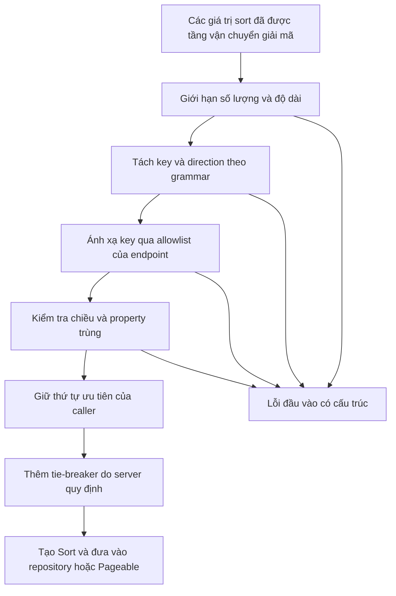

# Kiểm soát tên trường sắp xếp từ đầu vào ngoài ứng dụng

Một API nhận `sort=created,desc` đang cho caller tham gia quyết định cấu trúc truy vấn. Chuỗi `created` không phải giá trị nghiệp vụ được đem so sánh với một property; nó chọn dữ liệu nào được dùng để xác định thứ tự.

Vì vậy, không nên lấy một tên bất kỳ từ HTTP, cấu hình do người dùng quản lý hoặc một thông điệp bên ngoài rồi đưa thẳng vào `Sort.by`. Ứng dụng cần công bố những lựa chọn được hỗ trợ, ánh xạ chúng sang property phù hợp và kiểm tra yêu cầu trước khi gọi repository.

Trong chương **Sắp xếp** của module `SPRING_DATA_COMMONS`, bài này xây dựng một chính sách như vậy. Các abstraction `Sort`, `Sort.Order` và `Sort.Direction` dùng để biểu đạt yêu cầu đã được kiểm soát; việc chuyển chúng thành query vẫn thuộc module store.

## 1. Vì sao tên trường cần được kiểm soát riêng?

Xét đoạn mã:

```java
Sort sort = Sort.by(direction, externalField);
```

Tạo được `Sort` chưa chứng minh rằng:

- Property tồn tại và được query hiện tại nhận diện.
- Endpoint cho phép sắp xếp theo property đó.
- Module hỗ trợ đường dẫn hoặc biểu thức tương ứng.
- Thứ tự tạo ra phù hợp với phân trang và chi phí truy vấn dự kiến.

Một property có thật trong entity cũng có thể không thuộc hợp đồng public. Ví dụ, API danh sách sản phẩm chỉ cho phép tên, giá và thời điểm tạo; các property như `internalCost`, `tenantId` hoặc một đường qua `supplier` không tự trở thành lựa chọn hợp lệ chỉ vì metadata nhận diện được.

### 1.1. Không đồng nhất mọi Sort chưa kiểm tra với SQL injection

Nhiều đường query của Spring Data có cơ chế phân giải property và từ chối chuỗi không hợp lệ. Không thể kết luận mọi lần truyền tên ngoài vào `Sort.by` đều lập tức thực thi một đoạn SQL tùy ý.

Tuy nhiên, kiểm tra của framework không thay thế chính sách của ứng dụng. Native query, API chấp nhận biểu thức hoặc việc tự nối chuỗi còn có hợp đồng khác. Chính sách allowlist giúp kiểm soát khả năng public và giảm phụ thuộc vào chi tiết của một đường query cụ thể.

### 1.2. Bind giá trị không đồng nghĩa bind tên property

Bind parameter phù hợp để truyền một giá trị như giá tiền hoặc mã sản phẩm vào điều kiện. Nó không phải cơ chế tổng quát để biến một chuỗi thành tên cột trong `ORDER BY`.

Ví dụ, `ORDER BY :field` trong một query không tự có nghĩa “sắp xếp theo cột có tên bằng giá trị field”. Tùy ngôn ngữ và provider, nó có thể không hợp lệ hoặc được diễn giải như một biểu thức giá trị, không phải tham chiếu property mong muốn.

Ứng dụng cần chọn property từ một tập đã biết rồi để API query phù hợp diễn giải property đó. Không tự nối tên ngoài vào SQL để bù cho sự khác nhau này.

## 2. Thiết kế một hợp đồng đầu vào nhỏ và rõ

Giả sử danh sách sản phẩm dùng mô hình:

```text
Product
  id: Long
  displayName: String
  price: BigDecimal
  createdAt: Instant
  tenantId: Long
  internalCost: BigDecimal
```

Endpoint chỉ công bố ba khóa:

| Khóa public | Property nội bộ | Ghi chú |
| --- | --- | --- |
| `name` | `displayName` | Sắp xếp theo tên hiển thị |
| `price` | `price` | Sắp xếp theo giá |
| `created` | `createdAt` | Sắp xếp theo thời điểm tạo |

Tên public không bắt buộc giống tên entity. Nhờ đó, đổi `displayName` trong implementation không nhất thiết buộc client đổi khóa `name`.

### 2.1. Grammar của ví dụ

Mỗi giá trị của tham số `sort` chứa đúng một khóa và một chiều:

```text
sort=<key>,<direction>
```

Nhiều tiêu chí được truyền thành nhiều giá trị, giữ thứ tự xuất hiện:

```text
?sort=created,desc&sort=name,asc
```

**Đây là grammar riêng của ứng dụng minh họa.** Nó không mô tả toàn bộ cú pháp mà các resolver `Sort` hoặc `Pageable` chuẩn của Spring Data Web có thể nhận.

### 2.2. Chính sách được chọn

| Trường hợp | Quy tắc của ví dụ |
| --- | --- |
| Không có tham số sort | `createdAt DESC`, rồi `id ASC` |
| Số tiêu chí do caller gửi | Tối đa 3 |
| Mỗi biểu thức | Tối đa 64 ký tự trước khi trim |
| Khóa public | Phân biệt hoa thường; chỉ nhận đúng khóa trong bảng |
| Chiều | Chỉ ASC hoặc DESC, không phân biệt hoa thường |
| Thiếu chiều hoặc có thêm thành phần | Báo lỗi |
| Cùng property xuất hiện nhiều lần | Báo lỗi |
| Tiêu chí phụ cuối cùng | Server thêm `id ASC` |

`id` là tiêu chí do server bổ sung, không phải khóa public trong ví dụ. Ba tiêu chí tối đa của caller cộng với tiêu chí phụ tạo tối đa bốn `Order`.

Chính sách khác cũng có thể hợp lệ, nhưng phải được công bố và thực hiện nhất quán. Không âm thầm thay một khóa không hợp lệ bằng mặc định, vì caller có thể tưởng rằng yêu cầu của mình đã được áp dụng.

## 3. Tách kiểm tra cú pháp, quyền chọn trường và tạo Sort



Ba loại kiểm tra có vai trò riêng:

| Loại kiểm tra | Ví dụ |
| --- | --- |
| Cú pháp | Có đúng hai thành phần `key,direction` không? |
| Chính sách | Khóa `price` có nằm trong tập lựa chọn của endpoint không? |
| Tương thích store/query | Property `price` có sắp xếp được trong query này không? |

Regex chỉ giới hạn ký tự không thay thế allowlist. Một chuỗi chỉ gồm chữ cái như `internalCost` vẫn có thể bị cấm theo hợp đồng public.

Ngược lại, kiểm tra property tồn tại qua reflection hoặc metadata chỉ giải quyết một phần tương thích, không chứng minh ứng dụng muốn công bố property đó cho caller.

## 4. Một implementation chính sách hoàn chỉnh

Đoạn Java dưới đây dùng các API có trong Java 17 và những kiểu Commons cơ bản. Nó chỉ xử lý chính sách sắp xếp, không phụ thuộc SQL hoặc annotation của một store cụ thể.

```java
import java.util.ArrayList;
import java.util.HashSet;
import java.util.List;
import java.util.Map;
import java.util.Set;

import org.springframework.data.domain.Sort;
import org.springframework.data.domain.Sort.Direction;
import org.springframework.data.domain.Sort.Order;

public final class ProductSortPolicy {

    private static final int MAX_CRITERIA = 3;
    private static final int MAX_EXPRESSION_LENGTH = 64;

    private static final Map<String, String> PROPERTIES = Map.of(
        "name", "displayName",
        "price", "price",
        "created", "createdAt"
    );

    private ProductSortPolicy() {
    }

    public static Sort resolve(List<String> rawValues) {
        if (rawValues == null || rawValues.isEmpty()) {
            return defaultSort();
        }

        if (rawValues.size() > MAX_CRITERIA) {
            throw new InvalidSortException(
                "Chỉ được gửi tối đa 3 tiêu chí sắp xếp"
            );
        }

        List<Order> orders = new ArrayList<>(rawValues.size() + 1);
        Set<String> seenProperties = new HashSet<>();

        for (int index = 0; index < rawValues.size(); index++) {
            String raw = rawValues.get(index);

            if (raw == null || raw.isBlank()) {
                throw invalid(index, "Tiêu chí không được rỗng");
            }

            if (raw.length() > MAX_EXPRESSION_LENGTH) {
                throw invalid(index, "Tiêu chí vượt giới hạn độ dài");
            }

            String[] parts = raw.split(",", -1);
            if (parts.length != 2) {
                throw invalid(index, "Cần đúng định dạng key,direction");
            }

            String key = parts[0].trim();
            String directionText = parts[1].trim();

            String property = PROPERTIES.get(key);
            if (property == null) {
                throw invalid(index, "Khóa sắp xếp không được hỗ trợ");
            }

            Direction direction;
            if ("asc".equalsIgnoreCase(directionText)) {
                direction = Direction.ASC;
            } else if ("desc".equalsIgnoreCase(directionText)) {
                direction = Direction.DESC;
            } else {
                throw invalid(index, "Chiều phải là ASC hoặc DESC");
            }

            if (!seenProperties.add(property)) {
                throw invalid(index, "Property sắp xếp bị lặp");
            }

            orders.add(new Order(direction, property));
        }

        orders.add(Order.asc("id"));
        return Sort.by(orders);
    }

    private static Sort defaultSort() {
        return Sort.by(
            Order.desc("createdAt"),
            Order.asc("id")
        );
    }

    private static InvalidSortException invalid(int index, String detail) {
        return new InvalidSortException(
            "Tiêu chí " + (index + 1) + ": " + detail
        );
    }

    public static final class InvalidSortException
            extends IllegalArgumentException {

        public InvalidSortException(String message) {
            super(message);
        }
    }
}
```

### 4.1. Những lựa chọn có chủ đích trong code

- `split(",", -1)` giữ cả thành phần trống ở cuối, để `name,` bị từ chối thay vì mất dấu hiệu thiếu chiều.
- Khoảng trắng ở hai đầu thành phần được trim; tên khóa vẫn phải khớp chính xác allowlist.
- `HashSet` dùng để phát hiện trùng; `List<Order>` mới là nơi giữ độ ưu tiên. Không dùng thứ tự của set/map làm thứ tự kết quả.
- Kiểm tra trùng thực hiện trên property sau ánh xạ. Nếu sau này có hai alias cùng trỏ tới một property, chúng vẫn không tạo hai tiêu chí lặp.
- Thông báo lỗi dùng vị trí tiêu chí và loại lỗi; không cần phản chiếu nguyên biểu thức ngoài vào thông báo.
- Danh sách Order được tạo cục bộ và không đưa cho caller sửa tiếp; hàm trả cấu hình cuối cùng.

Policy nhận null hoặc list rỗng như tình huống không có lựa chọn từ caller. Một phần tử null trong list có tiêu chí lại là lỗi. Sự khác nhau đó thuộc hợp đồng của chính hàm, không phải một quy tắc mặc định áp dụng cho mọi tham số repository.

## 5. Ví dụ hợp lệ và không hợp lệ

| Giá trị đưa vào `resolve` | Kết quả |
| --- | --- |
| Không có list hoặc list rỗng | `createdAt DESC`, `id ASC` |
| `["name,asc"]` | `displayName ASC`, `id ASC` |
| `["created,DESC", "price,asc"]` | `createdAt DESC`, `price ASC`, `id ASC` |
| `[" name , dEsC "]` | `displayName DESC`, `id ASC` |
| `["NAME,asc"]` | Lỗi khóa: grammar chọn phân biệt hoa thường ở key |
| `["internalCost,asc"]` | Lỗi khóa, dù property có trong entity |
| `["id,desc"]` | Lỗi khóa: ID chưa được công bố cho caller |
| `["supplier.email,asc"]` | Lỗi khóa: không tự mở mọi đường dẫn lồng |
| `["length(displayName),desc"]` | Lỗi khóa: không nhận biểu thức tùy ý |
| `["name"]` | Lỗi cú pháp vì thiếu thành phần chiều |
| `["name,"]` | Lỗi chiều rỗng |
| `["name,up"]` | Lỗi chiều ngoài ASC/DESC |
| `["name,asc,ignorecase"]` | Lỗi cú pháp vì có thêm thành phần |
| `["name,asc", "name,desc"]` | Lỗi property trùng |
| Bốn tiêu chí bất kỳ | Lỗi vượt giới hạn số tiêu chí |

Các quy tắc mặc định chỉ áp dụng khi không có yêu cầu sort. Một yêu cầu có mặt nhưng sai phải được xử lý như đầu vào sai, không tự trở thành “không có yêu cầu”.

Thứ tự các tiêu chí hợp lệ được giữ nguyên. `created,desc` rồi `price,asc` có ý nghĩa khác với `price,asc` rồi `created,desc`.

## 6. Nối với tầng HTTP mà không đổi grammar ngoài ý định

Ví dụ một đoạn controller Spring MVC:

```java
import java.util.List;

import org.springframework.data.domain.Sort;
import org.springframework.util.MultiValueMap;
import org.springframework.web.bind.annotation.GetMapping;
import org.springframework.web.bind.annotation.RequestParam;

@GetMapping("/products")
public List<ProductSummary> list(
    @RequestParam MultiValueMap<String, String> query
) {
    Sort approvedSort = ProductSortPolicy.resolve(query.get("sort"));
    return productService.listForCurrentTenant(approvedSort);
}
```

`ProductSummary` và `productService` là DTO/dependency của ứng dụng. Đoạn này minh họa vị trí policy trong đường gọi, không phải một controller và service hoàn chỉnh.

Với `@RequestParam MultiValueMap` không chỉ định tên, ứng dụng có thể lấy danh sách giá trị của khóa `sort` sau khi tầng HTTP đã giải mã tham số. Cần giữ thứ tự những giá trị đó theo hợp đồng mà endpoint nhận.

### 6.1. Kiểm tra cả bước binding

Đừng mặc định mọi cách khai báo `List<String>` ở controller đều giữ nguyên từng giá trị chứa dấu phẩy. Cơ chế conversion của framework có thể xử lý dấu phẩy khi chuyển chuỗi thành collection.

Nếu grammar yêu cầu mỗi tham số lặp là một biểu thức `key,direction`, cần kiểm chứng đường đi từ request thực tế đến list đưa vào policy:

```text
sort=name,asc&sort=created,desc
             ↓
["name,asc", "created,desc"]
```

Đó là lý do kiểm tra hàm `resolve` bằng list tự tạo chưa đủ để xác nhận tầng HTTP đang cung cấp đúng cấu trúc.

Policy không tự URL-decode lần nữa. Decode lại trong nhiều tầng có thể làm một chuỗi bị diễn giải khác với giá trị mà biên HTTP đã nhận diện.

### 6.2. Không coi Sort đã được framework tạo là tự động được phê duyệt

Một resolver chuẩn có thể tạo được `Sort` hoặc `Pageable` từ request. Điều đó xác nhận framework đã phân tích đầu vào theo grammar của resolver, không chứng minh endpoint cho phép mọi property trong kết quả.

Nếu chọn dùng resolver đó, vẫn cần một bước policy cho các `Order` đã nhận:

1. Kiểm tra số tiêu chí.
2. Ánh xạ tên public sang property được phép.
3. Kiểm tra trùng và giữ đúng độ ưu tiên.
4. Chỉ giữ các tùy chọn mà endpoint công bố.
5. Dựng lại Sort cuối cùng và thêm tiêu chí phụ theo chính sách.

Chỉ kiểm tra `getProperty()` rồi chuyển nguyên mọi `Order` từ ngoài vào có thể vô tình giữ các hint hoặc lựa chọn mà endpoint chưa thiết kế. Kiểu dữ liệu `Sort` không mang sẵn thông tin nguồn gốc rằng nó đã qua chính sách của ứng dụng.

## 7. Đặt Sort đã kiểm soát vào Pageable

Sau khi xử lý sort:

```java
Sort approvedSort = ProductSortPolicy.resolve(rawSortValues);

Pageable pageable = PageRequest.of(
    page,
    size,
    approvedSort
);

Page<Product> result = productRepository.findByTenantId(
    tenantId,
    pageable
);
```

Đoạn này dùng `Page`, `PageRequest`, `Pageable` trong `org.springframework.data.domain`. Giả định `page` và `size` đã được kiểm tra theo giới hạn endpoint, `tenantId` được lấy từ ngữ cảnh có thẩm quyền, và module hỗ trợ query tương ứng.

Một repository đồng bộ minh họa:

```java
interface ProductRepository extends Repository<Product, Long> {

    Page<Product> findByTenantId(Long tenantId, Pageable pageable);
}
```

Phần khai báo dùng `org.springframework.data.repository.Repository`. Domain và mapping store được cấu hình riêng; ví dụ không khẳng định mọi module đều hỗ trợ `Page` và đường truy vấn này giống nhau.

### 7.1. Sort nằm trong Pageable vẫn phải đi qua policy

Không kiểm tra một tham số sort riêng rồi lại dùng nguyên `Pageable` do caller tạo, vì Sort thực sự được repository nhận có thể vẫn là cấu hình khác.

Đối tượng truyền xuống repository phải chứa chính cấu hình cuối đã được chấp thuận. Với query method nhận `Pageable`, đưa Sort vào Pageable thay vì thêm một tham số Sort thứ hai cho cùng vai trò.

### 7.2. Dùng chính sách theo use case

Endpoint danh sách sản phẩm, báo cáo tổng hợp và màn hình quản trị có thể hỗ trợ các khóa khác nhau. Một allowlist toàn bộ entity dễ công bố nhiều khả năng hơn từng use case thực sự cần.

Nếu có nhiều đường vào cùng chức năng, đặt việc kiểm soát ở một tầng được các đường đó sử dụng, hoặc giữ rõ trách nhiệm của từng adapter. Một policy chỉ được gọi từ một controller không tự bảo vệ một đường import hay message handler đi thẳng vào repository.

## 8. Property lồng, biểu thức và các tùy chọn riêng

### 8.1. Chỉ thêm đường dẫn lồng khi đó là khả năng được thiết kế

Nếu endpoint cần khóa public `supplierName`, ứng dụng có thể cân nhắc một ánh xạ như:

```text
supplierName -> supplier.displayName
```

Nhưng trước khi thêm phải xác định query và store có hỗ trợ đường đó không, quan hệ có thể thiếu/null không và việc duyệt quan hệ có thay đổi số dòng hay chi phí query không.

Không chấp nhận mọi chuỗi có dấu chấm chỉ bằng regex. Một đường dẫn hợp lệ về cú pháp vẫn có thể vượt phạm vi dữ liệu mà endpoint định hỗ trợ hoặc không phù hợp với query hiện tại.

### 8.2. Không mở cơ chế biểu thức bằng một khóa bất kỳ

Một số API đặc thù của store cho phép sắp xếp theo biểu thức. Chẳng hạn, JPA có cơ chế như `JpaSort.unsafe` để biểu đạt những trường hợp không theo kiểm tra property path thông thường.

Đây không phải lý do đưa chuỗi ngoài chưa kiểm soát vào cơ chế đó. Nếu có một khóa công khai như `nameLength`, ứng dụng cần ánh xạ nó tới biểu thức do ứng dụng xác định và sử dụng đúng API của module.

Cùng một khóa public có thể cần implementation khác nhau giữa query entity, query projection và query nhóm. Tên khóa ổn định không đồng nghĩa chuỗi property/biểu thức bên trong có thể dùng nguyên cho mọi store.

### 8.3. Case và null placement là một phần của hợp đồng

Grammar ví dụ không nhận một thành phần như `ignorecase` hoặc `nullsLast`. Các lựa chọn đó có thể được server quy định riêng cho từng khóa khi store hỗ trợ.

Nếu muốn công bố chúng cho caller, cần thiết kế thêm grammar, tập giá trị và quy tắc tương thích; không chỉ đọc một chuỗi rồi tự chuyển thành hint bất kỳ.

`Order.ignoreCase()` và null placement vẫn phụ thuộc khả năng store, loại query và collation. Việc allowlist tên field không tự làm các hint đó có hiệu lực.

## 9. Kiểm soát trường không thay cho lọc dữ liệu và giới hạn chi phí

### 9.1. Sort không quyết định phạm vi bản ghi được phép thấy

Allowlist trả lời: “Caller được chọn thứ tự theo thuộc tính nào?”. Nó không trả lời: “Caller được xem những bản ghi nào?”.

Trong ví dụ nhiều tenant, điều kiện tenant phải nằm trong đường truy vấn theo ngữ cảnh được xác thực và chính sách dữ liệu của ứng dụng. Không dựa vào việc cấm khóa `tenantId` trong sort để suy rằng kết quả đã được giới hạn tenant.

Ngay cả khi một khóa sort được phép, property đó vẫn cần phù hợp với quyền và mục đích của endpoint. Thứ tự theo một thuộc tính nội bộ có thể tạo ra thông tin suy đoán dù giá trị không được trả trực tiếp trong DTO; việc công bố khóa là một lựa chọn khả năng truy vấn cần có chủ đích.

### 9.2. Giới hạn số tiêu chí chỉ kiểm soát một phần shape của query

Ba tiêu chí được phép không bảo đảm query rẻ. Chi phí còn phụ thuộc bộ lọc, số dòng, index, phân trang, collation, biểu thức và cấu trúc dữ liệu của store.

Cần đánh giá các tổ hợp mà endpoint thực sự công bố trên dữ liệu phù hợp. Đừng lấy việc `Sort.by` tạo nhanh trong Java làm bằng chứng rằng truy vấn sắp xếp trên store sẽ nhanh.

Giới hạn độ dài trong code dùng `String.length()`, tức đơn vị UTF-16 của chuỗi Java. Nó không thay cho giới hạn kích thước request ở tầng vận chuyển, vì list và chuỗi đã được tạo trước khi hàm policy chạy.

## 10. Mặc định và tie-breaker phải ổn định, có chủ đích

Policy chọn mặc định:

```text
createdAt DESC, id ASC
```

Và luôn thêm `id ASC` sau các tiêu chí hợp lệ của caller. Giả định `id` là giá trị duy nhất trong tập kết quả, không-null và có thể được store sắp xếp.

Nếu nhiều sản phẩm có cùng giá và cùng thời điểm tạo, tiêu chí ID giúp phân biệt chúng. Điều này hữu ích khi lấy nhóm kết quả đầu hoặc phân trang trên dữ liệu không đổi.

### 10.1. Không nhầm tie-breaker với snapshot

Một thứ tự đầy đủ không giữ nguyên tập dữ liệu giữa hai request. Nếu giá hoặc trạng thái sản phẩm thay đổi, vị trí trong kết quả vẫn có thể dịch chuyển.

Yêu cầu nhất quán qua nhiều trang cần được xét cùng phương pháp phân trang, transaction và khả năng store. Kiểm soát tên sort không tự giải quyết toàn bộ vấn đề đó.

### 10.2. Mở khóa ID về sau cần cập nhật chính sách ghép

Ví dụ hiện tại không cho caller chọn ID, nên server có thể thêm `id ASC` mà không trùng với tiêu chí do caller gửi.

Nếu sau này công bố khóa `id`, phải quyết định rõ có giữ chiều caller chọn hay bắt buộc một chiều ở tiêu chí cuối. Không dùng `and` với kỳ vọng tiêu chí trùng phía sau tự ghi đè phía trước; `and` kết hợp các Order, không phải một phép cập nhật theo tên property.

### 10.3. Sort.unsorted không tự là mặc định phù hợp cho mọi endpoint

`Sort.unsorted()` biểu đạt không thêm yêu cầu thứ tự động. Nếu endpoint phân trang cần thứ tự xác định, phải chọn mặc định tương ứng thay vì dựa vào thứ tự dữ liệu tình cờ từ store.

Nếu query đã có thứ tự tĩnh hoặc ORDER BY khai báo sẵn, cần xác định nó kết hợp với Sort động ra sao. Kiểm tra chính query được dùng; không giả định Sort của caller luôn thay thế mọi thứ tự có trước.

## 11. Trả lỗi đầu vào có cấu trúc

Một request sai cú pháp hoặc chọn khóa ngoài hợp đồng nên được từ chối trước khi gọi repository. Ví dụ endpoint dùng HTTP 400 và một mã lỗi ổn định:

```java
import java.util.Map;

import org.springframework.http.ResponseEntity;
import org.springframework.web.bind.annotation.ExceptionHandler;
import org.springframework.web.bind.annotation.RestControllerAdvice;

@RestControllerAdvice
class SortErrorHandler {

    @ExceptionHandler(ProductSortPolicy.InvalidSortException.class)
    ResponseEntity<Map<String, String>> invalidSort(
        ProductSortPolicy.InvalidSortException exception
    ) {
        return ResponseEntity.badRequest().body(Map.of(
            "code", "INVALID_SORT",
            "message", exception.getMessage()
        ));
    }
}
```

Ví dụ response:

```json
{
  "code": "INVALID_SORT",
  "message": "Tiêu chí 1: Khóa sắp xếp không được hỗ trợ"
}
```

Code lỗi giúp client xử lý ổn định; message hỗ trợ người đọc. Không cần lộ tên cột vật lý, query text hoặc stack trace để giải thích một khóa ngoài allowlist.

### 11.1. Không bắt mọi IllegalArgumentException làm lỗi sort

Policy có subtype riêng để phân biệt lỗi đầu vào đã nhận diện. Nếu bắt tất cả `IllegalArgumentException` toàn ứng dụng rồi trả `INVALID_SORT`, một lỗi lập trình hoặc lỗi ở một API khác có thể bị gán nhầm nguyên nhân.

Tương tự, lỗi kết nối store hoặc query timeout không nên bị diễn giải thành “tên trường không hợp lệ”. Cần giữ khác biệt giữa lỗi request, lỗi cấu hình mapping và lỗi thực thi.

### 11.2. Khóa hợp lệ nhưng mapping hỏng là vấn đề implementation

Giả sử `name` là khóa đúng hợp đồng, nhưng sau khi refactor entity, map vẫn trỏ tới property cũ. Caller đã gửi một lựa chọn hợp lệ; lỗi nằm ở implementation hoặc cấu hình policy/query.

Không dùng việc store báo “không tìm thấy property” làm cơ chế kiểm tra đầu vào chính, rồi gán mọi lỗi như vậy cho caller. Mapping của các khóa được công bố cần được xác minh cùng query mà ứng dụng thực sự chạy.

## 12. Kịch bản kiểm chứng chính sách

### 12.1. Kiểm chứng riêng hàm policy

Những trường hợp có giá trị phân biệt rõ:

| Kịch bản | Điều cần xác nhận |
| --- | --- |
| Thiếu sort | Đúng hai Order mặc định và đúng độ ưu tiên |
| Hai khóa hợp lệ | Giữ thứ tự caller và thêm ID sau cùng |
| Chiều `dEsC` | Được chuẩn hóa thành DESC |
| Khóa `NAME` | Bị từ chối theo quy tắc phân biệt hoa thường |
| Khóa nội bộ `displayName` | Bị từ chối dù được dùng làm đích ánh xạ của `name` |
| Khóa `internalCost` | Bị từ chối dù entity có property này |
| Cùng khóa hai lần, khác chiều | Bị từ chối, không tự ghi đè |
| Khóa có khoảng trắng hai đầu lặp lại | Vẫn bị phát hiện trùng sau chuẩn hóa |
| Thiếu chiều hoặc chiều rỗng | Bị từ chối |
| Có thành phần thứ ba | Bị từ chối theo grammar đã công bố |
| List có phần tử null | Bị từ chối ở tiêu chí tương ứng |
| Quá ba tiêu chí hoặc biểu thức quá dài | Bị từ chối trước khi tạo Sort cuối |

Nếu bổ sung alias public cùng trỏ tới một property, thêm tình huống hai alias xuất hiện trong một request để xác nhận kiểm tra trùng dựa trên property sau ánh xạ.

### 12.2. Kiểm chứng biên HTTP

Gửi cả request có một tham số và request có nhiều tham số lặp:

```text
?sort=name,asc
?sort=created,desc&sort=name,asc
```

Xác nhận policy nhận đúng danh sách biểu thức, theo đúng thứ tự. Một lỗi binding có thể làm list bị tách khác grammar dù bản thân hàm policy xử lý đúng đầu vào đã thiết kế.

Kiểm chứng request sai nhận mã lỗi đã công bố và đường xử lý đó không tiếp tục gọi repository.

### 12.3. Kiểm chứng trên query của module store

Với mỗi khóa public, xác định:

- Property hoặc alias đích có hợp lệ trong query đang dùng không.
- Thứ tự thực tế có đúng khi giá trị chính bằng nhau không.
- Null, collation và các hint do server thêm có hành vi đã công bố không.
- Bộ lọc của use case vẫn được giữ nguyên khi thay Sort.
- Phân trang dùng đúng Sort đã kiểm soát.

Đây là những kịch bản thiết kế thực hành, không phải kết quả của một bộ test đã được chạy trong bài. Kiểm tra policy và kiểm tra query trả lời các câu hỏi khác nhau; không chỉ nhìn `Sort.isSorted()` để kết luận toàn bộ hành vi đã đúng.

Nếu mục tiêu còn bao gồm hiệu năng, cần dữ liệu và cách quan sát phù hợp với store. Một kiểm tra vài bản ghi không đủ kết luận mọi tổ hợp được phép sẽ có chi phí chấp nhận được trên dữ liệu thực tế.

## 13. Giữ hợp đồng public khi thay đổi mô hình hoặc store

Một allowlist có ánh xạ tường minh giúp tách tên API khỏi tên implementation:

```text
Khóa client tiếp tục dùng: name
Đích cũ:                 displayName
Đích sau refactor:       title
```

Nếu đổi đích, phải kiểm tra ngữ nghĩa mới có thực sự tương đương không, không chỉ kiểm tra property mới tồn tại. Thay từ tên hiển thị sang tên pháp lý hoặc một biểu thức khác có thể đổi thứ tự mà client quan sát được.

Khi chuyển giữa module store, cùng một khóa public có thể cần mapping hoặc cách tạo query riêng. Commons không bảo đảm cùng một chuỗi nested path, biểu thức tính toán hay null placement được hỗ trợ y hệt ở mọi store.

Một số thay đổi có thể ảnh hưởng trực tiếp đến hành vi public:

| Thay đổi | Tác động cần xem xét |
| --- | --- |
| Đổi thứ tự mặc định | Trang đầu và vị trí bản ghi có thể đổi |
| Đổi chiều tie-breaker | Thứ tự các phần tử bằng nhau ở tiêu chí chính đổi |
| Bỏ một khóa | Client đang dùng khóa đó có thể nhận lỗi |
| Thêm alias | Cần giữ kiểm tra trùng theo property đích |
| Mở khóa nested/computed | Query và chi phí có thể thay đổi |
| Đổi collation hoặc chính sách null | Thứ tự chuỗi và giá trị thiếu có thể đổi |

Kiểm tra hợp đồng của endpoint cụ thể sẽ giúp đánh giá thay đổi rõ hơn việc duy trì một danh sách mọi field của entity rồi tự động công bố nó.

## 14. Tự kiểm tra mức độ hiểu

1. Vì sao một property có thật trong entity chưa đủ để được phép nhận từ caller?
2. Regex giới hạn ký tự và allowlist giải quyết hai câu hỏi khác nhau nào?
3. Tại sao bind parameter cho giá trị không tự cho phép bind tên cột trong ORDER BY?
4. Nếu resolver đã tạo được Sort, endpoint còn cần kiểm tra điều gì?
5. Vì sao cần kiểm tra trùng sau ánh xạ, thay vì chỉ so sánh khóa public?
6. Một policy hợp lệ có tự bảo đảm phạm vi tenant hoặc chi phí query không?
7. Tại sao cần kiểm chứng cả request một tham số có dấu phẩy lẫn request nhiều tham số lặp?
8. Nếu thêm khóa public ID, quy tắc thêm tie-breaker phải được xem lại như thế nào?

Với đầu vào ngoài ứng dụng, hãy coi lựa chọn sắp xếp là một phần của hợp đồng query: **công bố khóa được phép, ánh xạ tường minh, kiểm tra cấu trúc và chiều, rồi tạo Sort cuối cùng**. Sau đó giữ đúng cấu hình đó qua repository hoặc Pageable, đồng thời xác nhận khả năng thực thi trên module store của use case.
