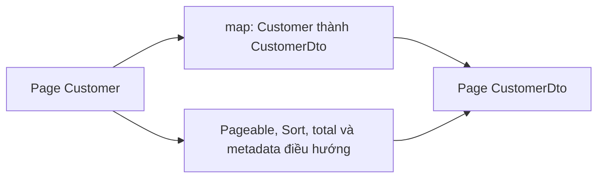

# map để đổi nội dung mà giữ metadata phân trang

Một repository trả `Page<Customer>`, nhưng API chỉ muốn công bố `CustomerDto`. Nếu lấy `page.getContent()` rồi đổi sang một `List<CustomerDto>`, ứng dụng vẫn có dữ liệu nhưng dễ làm mất số trang, kích thước trang, tổng số phần tử và thông tin điều hướng.

`Page.map` giải quyết trực tiếp nhu cầu này: chuyển từng phần tử trong nội dung trang sang kiểu khác, đồng thời giữ ngữ cảnh phân trang của trang nguồn. Với `Slice`, thao tác tương ứng giữ metadata của lát dữ liệu mà không tạo thêm một tổng số phần tử chưa có.

Trong chương **Phân trang** của module `SPRING_DATA_COMMONS`, bài này hướng dẫn dùng `map` để chuyển entity sang DTO hoặc biến đổi giá trị, đồng thời làm rõ giới hạn: `map` không tự lọc lại toàn bộ tập dữ liệu, không tính lại tổng và không thực hiện lại truy vấn.

## 1. Một trang gồm nội dung và metadata

Có thể hình dung một `Page<T>` như hai phần đi cùng nhau:

```text
Page<T>
  content:
    phần tử 1
    phần tử 2
    ...
  metadata:
    số trang
    kích thước trang
    số phần tử của trang hiện tại
    tổng số phần tử
    tổng số trang
    Sort và Pageable
    trạng thái trang trước/trang sau
```

Các API thường dùng:

| API | Ý nghĩa |
| --- | --- |
| `getContent()` | Danh sách phần tử của trang hiện tại |
| `getNumber()` | Chỉ số trang, theo quy ước bắt đầu từ 0 của API phân trang |
| `getSize()` | Kích thước trang được biểu diễn trong đối tượng |
| `getNumberOfElements()` | Số phần tử thực có trong trang hiện tại |
| `getTotalElements()` | Tổng số phần tử theo metadata Page |
| `getTotalPages()` | Tổng số trang theo metadata Page |
| `getPageable()` | Ngữ cảnh yêu cầu phân trang |
| `getSort()` | Yêu cầu thứ tự gắn với trang |
| `hasNext()`, `hasPrevious()` | Khả năng điều hướng theo metadata |

`getSize()` và `getNumberOfElements()` không nhất thiết bằng nhau. Trang cuối có thể yêu cầu kích thước 10 nhưng chỉ có 5 phần tử.

`getTotalElements()` cũng không phải số phần tử đang nằm trong list nội dung. Một trang có 10 phần tử có thể thuộc một tập kết quả gồm hàng nghìn phần tử.

## 2. Hợp đồng map: đổi kiểu phần tử, giữ cấu trúc trang

Chữ ký cốt lõi có dạng:

```java
<U> Page<U> map(Function<? super T, ? extends U> converter);
```

Ý nghĩa của các kiểu:

| Thành phần | Vai trò |
| --- | --- |
| `T` | Kiểu phần tử nguồn |
| `U` | Kiểu phần tử sau chuyển đổi |
| `converter` | Hàm nhận một T và tạo một U |
| `Page<U>` | Trang kết quả với nội dung đã chuyển đổi |

Ví dụ:

```java
Page<CustomerDto> result = customers.map(customer ->
    new CustomerDto(customer.getId(), customer.getDisplayName())
);
```

Với implementation chuẩn như `PageImpl`, nội dung được chuyển theo thứ tự đang có; một phần tử nguồn tạo một vị trí kết quả. Metadata được mang sang trang kết quả theo ngữ cảnh của trang nguồn.



Không có thao tác lấy lại dữ liệu ở store trong bản thân phép map của `PageImpl`. Tuy nhiên, mã bên trong converter có thể tự gây thêm truy cập dữ liệu; phần này cần được xem riêng.

### 2.1. Giữ giá trị trả về

`map` trả về trang kết quả. Nó không tự đổi kiểu và thay nội dung của biến nguồn tại chỗ:

```java
customers.map(CustomerMapper::toDto); // kết quả bị bỏ qua
```

Cách dùng cần giữ giá trị:

```java
Page<CustomerDto> result = customers.map(CustomerMapper::toDto);
```

Đoạn method reference giả định có `CustomerMapper.toDto(Customer)` trả `CustomerDto` tương ứng. Trang nguồn vẫn là một `Page<Customer>`.

### 2.2. Không phải phép clone sâu

Converter quyết định đối tượng trả về. Nếu nó trả lại chính reference đầu vào, phần tử đó vẫn là cùng đối tượng, dù được đặt trong kết quả map.

`map` không tự clone entity, detach entity hoặc sao chép sâu mọi quan hệ. Việc tạo DTO mới trong converter là lựa chọn mapping của ứng dụng.

## 3. Ví dụ có thể quan sát metadata mà không cần store

Để tập trung vào abstraction Commons, phần này dùng các record Java thuần và `PageImpl`, không cần khởi tạo repository hay database. Các record này không được giả định là entity của một module cụ thể.

```java
record CustomerValue(Long id, String displayName) {
}

record CustomerDto(Long id, String name) {
}
```

Tạo trang nguồn và chuyển đổi, với Java 17:

```java
import java.util.List;
import java.util.stream.LongStream;

import org.springframework.data.domain.Page;
import org.springframework.data.domain.PageImpl;
import org.springframework.data.domain.PageRequest;
import org.springframework.data.domain.Pageable;
import org.springframework.data.domain.Sort;

Pageable request = PageRequest.of(
    1,
    10,
    Sort.by(Sort.Direction.ASC, "id")
);

List<CustomerValue> content = LongStream.rangeClosed(11, 20)
    .mapToObj(id -> new CustomerValue(id, "Khách hàng " + id))
    .toList();

Page<CustomerValue> source = new PageImpl<>(content, request, 25);

Page<CustomerDto> mapped = source.map(value ->
    new CustomerDto(value.id(), value.displayName())
);
```

Đây là các khai báo và câu lệnh minh họa; khi đưa vào Java, đặt chúng trong cấu trúc lớp/method phù hợp. `PageImpl` lưu và biểu diễn dữ liệu được cung cấp, không tự query hoặc tự sắp lại `content` theo Sort trong constructor.

### 3.1. Đối chiếu nguồn và đích

| Thông tin | `source` | `mapped` |
| --- | --- | --- |
| Kiểu phần tử | `CustomerValue` | `CustomerDto` |
| `getNumber()` | 1 | 1 |
| `getSize()` | 10 | 10 |
| `getNumberOfElements()` | 10 | 10 |
| `getTotalElements()` | 25 | 25 |
| `getTotalPages()` | 3 | 3 |
| Thứ tự | `id ASC` | `id ASC` |
| `hasPrevious()` | true | true |
| `hasNext()` | true | true |
| ID trong nội dung | 11 đến 20 | 11 đến 20 |

Chỉ số 1 là trang thứ hai theo cách đếm bắt đầu từ 0. Dữ liệu của hai trang còn lại không cần được tải vào `source` để thực hiện phép map này.

### 3.2. Chỉ nội dung trang hiện tại được chuyển đổi

Converter được áp dụng cho các phần tử có trong nội dung. Tổng 25 không có nghĩa converter chạy cho cả 25 phần tử.

Trong ví dụ, `source` có 10 phần tử, nên converter chuyển 10 phần tử. `map` không tự lấy trang trước, trang sau hoặc toàn bộ tập kết quả để đổi sang DTO.

Metadata tổng được giữ từ nguồn, không được suy ra bằng số lần gọi converter.

## 4. Đưa map vào tầng service

Giả sử ứng dụng có domain `Customer` được store ánh xạ, với accessor `getId()` và `getDisplayName()`. Đây là domain của ứng dụng, khác với record Java thuần `CustomerValue` ở bài thực hành trên.

Một repository minh họa:

```java
import org.springframework.data.domain.Page;
import org.springframework.data.domain.Pageable;
import org.springframework.data.repository.Repository;

interface CustomerRepository extends Repository<Customer, Long> {

    Page<Customer> findByDisplayNameContaining(
        String term,
        Pageable pageable
    );
}
```

Ví dụ giả định module hỗ trợ derived query `Containing`, `Page` và phân trang tương ứng. Cấu hình mapping và store được thực hiện riêng.

Service chuyển kết quả:

```java
final class CustomerService {

    private final CustomerRepository repository;

    CustomerService(CustomerRepository repository) {
        this.repository = repository;
    }

    Page<CustomerDto> search(String term, Pageable pageable) {
        Page<Customer> page = repository.findByDisplayNameContaining(
            term,
            pageable
        );

        return page.map(customer -> new CustomerDto(
            customer.getId(),
            customer.getDisplayName()
        ));
    }
}
```

Tầng gọi nhận `Page<CustomerDto>` nên vẫn có thể đọc tổng số trang và trạng thái điều hướng, đồng thời không cần sử dụng entity làm kiểu dữ liệu public.

### Converter tập trung vào việc chuyển một phần tử

Một mapper tách riêng có thể tái sử dụng logic:

```java
final class CustomerMapper {

    static CustomerDto toDto(Customer customer) {
        return new CustomerDto(
            customer.getId(),
            customer.getDisplayName()
        );
    }
}
```

Khi đó service chỉ cần:

```java
return page.map(CustomerMapper::toDto);
```

Nếu dùng công cụ sinh mapper, chọn method chuyển một phần tử khi gọi `Page.map`. Không cần biến Page thành List chỉ vì mapper còn cung cấp một method chuyển collection.

## 5. Vì sao không chỉ map getContent rồi dựng một Page mới?

### 5.1. Chỉ lấy List thì không còn hợp đồng Page

```java
List<CustomerDto> items = page.getContent().stream()
    .map(CustomerMapper::toDto)
    .toList();
```

`items` chỉ chứa các phần tử của trang hiện tại. Nó không mang theo `getTotalElements()`, `getTotalPages()` hay thông tin trang kế tiếp.

Đây có thể là kết quả đúng nếu API cố ý chỉ cần List. Nếu API vẫn cần metadata, dùng `Page.map` giữ chúng đi cùng nội dung rõ hơn.

### 5.2. Constructor chỉ nhận content không khôi phục metadata gốc

Một cách dễ nhầm:

```java
Page<CustomerDto> result = new PageImpl<>(items);
```

Constructor này tạo một Page từ list được đưa vào, không biết list đó là trang thứ hai của một query gồm 25 phần tử. Nó không thể tự phục hồi `Pageable`, Sort và tổng số phần tử của trang nguồn.

Cách này phù hợp khi chủ động tạo một Page từ toàn bộ list trong ngữ cảnh tương ứng; nó không phải phép chuyển đổi giữ metadata của một Page có sẵn.

### 5.3. Truyền lại metadata bằng tay có thể làm được, nhưng dễ sai hơn

Nếu nội dung thật sự được chuyển một-một, một cách thủ công là:

```java
Page<CustomerDto> result = new PageImpl<>(
    items,
    page.getPageable(),
    page.getTotalElements()
);
```

Tuy nhiên, người viết phải tự bảo đảm list có cùng số phần tử, cùng thứ tự và cùng đơn vị kết quả với nguồn. `page.map(...)` diễn đạt mục đích trực tiếp và tránh quên một phần metadata.

Ngoài ra, `PageImpl` có cơ chế điều chỉnh total trong một số tình huống ở trang cuối dựa trên content và Pageable được cung cấp. Không coi constructor là một nơi chép mọi con số nguyên trạng bất kể list đã bị thay đổi thế nào.

## 6. Quan hệ một-một là điều kiện để metadata tiếp tục có ý nghĩa

### 6.1. map không phải filter

Nếu query có 25 khách hàng, mỗi khách hàng được đổi thành một DTO thì tổng 25 vẫn mô tả đúng số DTO của toàn bộ tập kết quả theo cùng quan hệ chuyển đổi.

Nếu chỉ giữ những khách hàng có email, tập kết quả đã thay đổi. Lọc riêng nội dung của một trang không cho biết còn bao nhiêu khách hàng có email trong các trang khác.

Ví dụ không nên dùng để biểu diễn một tập kết quả đã lọc đầy đủ:

```java
List<CustomerDto> filtered = page.getContent().stream()
    .filter(customer -> customer.getEmail() != null)
    .map(CustomerMapper::toDto)
    .toList();

return new PageImpl<>(
    filtered,
    page.getPageable(),
    page.getTotalElements()
);
```

Giả định domain có `getEmail()`. List mới có thể ngắn hơn nguồn, nhưng total vẫn đến từ điều kiện query cũ hoặc còn có thể bị constructor điều chỉnh theo content của trang cuối. Cả hai trường hợp đều không thay thế một phép đếm toàn bộ tập đã lọc.

Nếu điều kiện email quyết định phần tử nào thuộc tập kết quả, đưa điều kiện đó vào query hoặc một cơ chế lấy dữ liệu có hợp đồng tổng số phù hợp trước khi phân trang.

### 6.2. Trả null không xóa một phần tử

```java
Page<CustomerDto> result = page.map(customer -> {
    if (customer.getEmail() == null) {
        return null;
    }
    return CustomerMapper.toDto(customer);
});
```

Trong cách map thông thường của `PageImpl`, null không được diễn giải thành yêu cầu loại phần tử. Một vị trí kết quả có thể trở thành null; số vị trí không tự giảm như một phép filter.

Nếu DTO không được null, mapper cần tuân thủ điều đó hoặc từ chối dữ liệu không đáp ứng hợp đồng. Không dùng null như một tín hiệu bí mật để thay đổi số lượng.

### 6.3. map không phải flatMap

Nếu một phần tử nguồn được chuyển thành `List<U>`, kết quả có thể là:

```text
Page<List<U>>
```

Nó vẫn có một phần tử ngoài cho mỗi phần tử nguồn. Metadata đếm các phần tử ngoài, không đếm tổng số U bên trong mọi list.

Muốn chuyển từ trang đơn hàng sang trang dòng hàng là thay đổi đơn vị phân trang. Làm phẳng nội dung một trang đơn hàng không tạo ra một trang dòng hàng có tổng số và ranh giới trang đúng cho toàn bộ dữ liệu.

Cần phân trang đúng đơn vị mong muốn ở query hoặc thiết kế một hợp đồng khác thể hiện rõ các nhóm bên trong.

### 6.4. Gom nhóm sau khi lấy trang cũng thay đổi đơn vị

Nếu gom khách hàng của một trang theo thành phố, số nhóm chỉ phản ánh trang đó. Không dùng tổng số khách hàng làm tổng số thành phố và không coi mỗi trang khách hàng là một trang nhóm thành phố.

`map` phù hợp khi thay cách biểu diễn một mục. Các phép lọc, nhân bản, làm phẳng hoặc gom nhóm cần được xem lại về ý nghĩa số lượng và cách phân trang.

## 7. Giữ thứ tự và hiểu đúng Sort trong metadata

### 7.1. map không chạy lại phép sắp xếp

Converter được áp dụng theo thứ tự nội dung đã có trong implementation chuẩn. Nếu nguồn có ID `11, 12, 13`, việc tạo DTO không tự đổi chúng thành một thứ tự khác.

Nếu mapper tạo một nhãn hiển thị mới, kết quả không tự được sắp xếp lại theo nhãn đó. Sort vẫn mô tả thứ tự của query/trang nguồn.

### 7.2. Đổi tên field trong DTO không đổi property của Sort

Giả sử query sắp theo property domain `displayName`, còn DTO công bố component `name`:

```java
record CustomerDto(Long id, String name) {
}
```

Sau map, metadata Sort có thể vẫn chứa `displayName`. `map` không tự dịch tên đó sang `name` và không biết quy ước tên public của API.

Nếu response cần công bố tên khóa sắp xếp public, hãy ánh xạ metadata đó theo hợp đồng API riêng. Không mặc định tên property query luôn là tên property DTO.

### 7.3. Sắp xếp lại riêng trang hiện tại không tạo thứ tự toàn tập

Lấy 10 phần tử của một trang rồi sắp lại DTO theo tên chỉ làm đổi thứ tự 10 phần tử đó. Nó không đưa các phần tử ở trang khác vào đúng vị trí theo tên trên toàn bộ tập kết quả.

Muốn phân trang theo một tiêu chí mới, tiêu chí đó cần tham gia bước tạo tập kết quả có thứ tự trước khi cắt trang, trong phạm vi store hỗ trợ.

Nếu chỉ định dạng số hoặc ngày thành chuỗi hiển thị, hãy phân biệt giá trị dùng để sắp xếp với chuỗi trình bày. Map không tự thay thứ tự số thành thứ tự từ điển của chuỗi đã định dạng.

## 8. Trang rỗng vẫn có thể mang metadata có ý nghĩa

Không cần một nhánh đặc biệt chỉ để tránh map trang rỗng:

```java
return page.map(CustomerMapper::toDto);
```

Nếu content rỗng, không có phần tử nào cần chuyển đổi. Ngữ cảnh của trang nguồn vẫn cần được giữ.

### 8.1. Content rỗng không luôn có nghĩa tổng bằng 0

Ví dụ Java thuần:

```java
Page<CustomerValue> beyondEnd = new PageImpl<>(
    List.of(),
    PageRequest.of(5, 10, Sort.by("id")),
    25
);

Page<CustomerDto> mappedEmpty = beyondEnd.map(value ->
    new CustomerDto(value.id(), value.displayName())
);
```

Nguồn mô tả một yêu cầu ở chỉ số trang 5, nằm ngoài tập kết quả có tổng 25 phần tử với kích thước trang 10. Nội dung rỗng nhưng metadata total vẫn là 25.

Trong ví dụ `PageImpl` này, map giữ chỉ số trang, kích thước trang, Sort và tổng nguồn. Nó không tự kéo yêu cầu về trang 0 hoặc trang cuối hợp lệ.

### 8.2. Thay bằng Page.empty có thể đổi hợp đồng

Một nhánh như sau bỏ mất thông tin có sẵn:

```java
if (page.isEmpty()) {
    return Page.empty();
}
```

Ngay cả `Page.empty(page.getPageable())` cũng công bố một trang có tổng bằng 0, không tự giữ tổng nguồn 25 trong ví dụ trên.

Nếu chỉ đang chuyển kiểu phần tử, cứ map trang nguồn. Chỉ tạo một trang rỗng mới khi đó thật sự là trạng thái dữ liệu và metadata mà nghiệp vụ muốn trả.

## 9. Slice.map giữ thông tin Slice, không sinh tổng số

Một repository có thể trả Slice để phục vụ điều hướng mà không công bố tổng số phần tử:

```java
Slice<Customer> findSliceByDisplayNameContaining(
    String term,
    Pageable pageable
);
```

Đoạn này dùng `org.springframework.data.domain.Slice` và giả định module hỗ trợ query tương ứng. Phần mô tả `Slice` trong tên không phải nguồn sinh metadata; kiểu trả về và hạ tầng store quyết định hợp đồng Slice.

Chuyển đổi:

```java
Slice<CustomerDto> result = slice.map(CustomerMapper::toDto);
```

Kết quả giữ nội dung theo quan hệ một-một cùng thông tin phân trang và điều hướng mà Slice nguồn có, chẳng hạn `hasNext()` trong implementation chuẩn.

| Nguồn | Kết quả map | Có tổng số toàn bộ tập kết quả không? |
| --- | --- | --- |
| `Page<T>` | `Page<U>` | Giữ tổng đã có của Page |
| `Slice<T>` | `Slice<U>` | Không tự bổ sung một tổng |
| `List<T>` được map thành list | `List<U>` | Không có metadata phân trang đi kèm |

Không ép một Slice bất kỳ thành Page để lấy tổng. Cũng không dùng `slice.getNumberOfElements()` làm `totalElements`, vì nó chỉ đếm phần tử của lát hiện tại.

## 10. Converter có chi phí và hành vi của chính nó

### 10.1. PageImpl map chuyển nội dung ngay khi được gọi

Trong implementation chuẩn, phép map tạo nội dung đã chuyển đổi khi gọi method. Không nên đọc nó như một pipeline `Stream.map` chưa có terminal operation và còn chờ xử lý sau.

Nếu content có n phần tử, việc chuyển đổi duyệt các phần tử của content đó. Chi phí thực tế còn phụ thuộc công việc converter làm trên mỗi phần tử, không phụ thuộc trực tiếp tổng số phần tử trong metadata.

### 10.2. Bản thân map không chạy lại query, nhưng getter có thể tải dữ liệu

Ví dụ mapper chỉ đọc ID và tên đã có sẵn thường khác với mapper đọc một quan hệ lazy hoặc tự gọi repository khác cho từng phần tử.

Trong JPA, truy cập dữ liệu lazy có thể gây thêm query hoặc gặp lỗi nếu ngữ cảnh cần thiết không còn hợp lệ. Store khác có cơ chế tải và vòng đời riêng.

Nếu mapper thực hiện một lần gọi store hoặc dịch vụ ngoài cho mỗi phần tử, một trang 20 phần tử có thể tạo thêm nhiều thao tác. Không kết luận “Page.map không query” rồi bỏ qua mã bên trong converter.

Hướng xử lý cần gắn với dữ liệu mapper thực sự dùng: lấy đủ dữ liệu bằng query phù hợp, dùng projection khi phù hợp, hoặc lấy bổ sung theo lô cho các ID của trang rồi map bằng dữ liệu đã có. Chọn cách theo module và hợp đồng truy cập dữ liệu, không chỉ theo số dòng code.

### 10.3. Mapper nên tránh sửa entity nguồn

Để tạo một DTO hiển thị, nên tính giá trị trên DTO thay vì sửa entity rồi trả nó. Trong một persistence context quản lý entity, việc sửa nguồn có thể có ý nghĩa ghi dữ liệu, không chỉ trình bày.

Bản thân Page.map không tạo ranh giới transaction, không rollback side effect và không biến các thao tác bên trong mapper thành thao tác chỉ đọc.

### 10.4. Xác định chính sách khi mapper thất bại

Nếu converter ném exception, lời gọi map của `PageImpl` không trả về một Page kết quả thành công. Nó không tự bỏ qua phần tử lỗi rồi tiếp tục tạo một trang thiếu mục.

Nếu nghiệp vụ cho phép một DTO mang trạng thái cảnh báo, có thể biểu đạt điều đó như một mục kết quả hợp lệ theo quan hệ một-một. Nếu nghiệp vụ muốn loại mục, cần xem lại tập kết quả và metadata theo nguyên tắc lọc đã nêu.

Không bắt lỗi chuyển đổi rồi trả null chỉ để giữ lời gọi hoàn tất; điều đó tạo một hợp đồng phần tử khác mà caller có thể chưa được chuẩn bị để xử lý.

## 11. Page.map và repository projection giải quyết hai giai đoạn khác nhau

| Lựa chọn | Thời điểm chính | Mục đích |
| --- | --- | --- |
| Repository trả entity rồi `Page.map` | Sau khi có nội dung trang | Chuyển cách biểu diễn trong ứng dụng |
| Repository trả projection/DTO được hỗ trợ | Trong cơ chế query và mapping của store | Lấy và tạo dạng dữ liệu đọc phù hợp |
| Projection rồi map thêm một lần | Sau query projection | Chuyển sang hợp đồng public hoặc định dạng riêng |

Đổi `Page<Customer>` thành `Page<CustomerDto>` bằng map không tự làm query ban đầu chỉ đọc các cột của DTO. Entity hoặc dữ liệu khác có thể đã được tải trước khi converter chạy.

Nếu mục tiêu là giảm dữ liệu cần lấy từ store, hãy xem khả năng projection và query của module. Một projection cũng cần được đánh giá theo query thực tế; không chỉ dựa vào tên kiểu để kết luận toàn bộ cách tải.

Trong ví dụ, domain có property `displayName` nhưng DTO có component `name`. Page.map đã diễn đạt rõ phép nối giữa hai tên. Nếu chuyển sang DTO projection ở repository, phải khai báo mapping hoặc query tương ứng theo module, không mặc định store tự biết phép đổi tên từ converter cũ.

Page.map vẫn hữu ích sau projection, chẳng hạn để đưa nhiều dạng kết quả store vào cùng một hợp đồng ứng dụng, với điều kiện giữ quan hệ một-một và ý nghĩa metadata.

## 12. Tạo response API mà không vô tình bỏ metadata

Nếu API muốn một envelope riêng, có thể map nội dung trước rồi chuyển Page sang response tường minh:

```java
import java.util.List;

import org.springframework.data.domain.Page;

public record PageResponse<T>(
    List<T> items,
    int number,
    int size,
    int numberOfElements,
    long totalElements,
    int totalPages,
    boolean hasNext,
    boolean hasPrevious
) {
    public static <T> PageResponse<T> from(Page<T> page) {
        return new PageResponse<>(
            page.getContent(),
            page.getNumber(),
            page.getSize(),
            page.getNumberOfElements(),
            page.getTotalElements(),
            page.getTotalPages(),
            page.hasNext(),
            page.hasPrevious()
        );
    }
}
```

Cách sử dụng:

```java
Page<CustomerDto> mapped = page.map(CustomerMapper::toDto);
PageResponse<CustomerDto> response = PageResponse.from(mapped);
```

Envelope trên là hợp đồng ví dụ của ứng dụng, không phải một kiểu bắt buộc của Commons. API có thể chọn những trường khác, nhưng cần giữ rõ ý nghĩa: `numberOfElements` đếm nội dung hiện tại, còn `totalElements` mô tả toàn bộ tập kết quả theo metadata nguồn.

Nếu muốn công bố Sort, xem lại tên property nội bộ và tên khóa public như phần trước. Nếu muốn số trang bắt đầu từ 1 ở API, chuyển đổi tại biên một cách tường minh; `map` không tự thay quy ước đánh số của Page.

Cách tách này giúp API quyết định JSON riêng mà không vô tình chỉ trả một List sau khi đã mất ngữ cảnh phân trang.

## 13. Kịch bản thực hành kiểm chứng hành vi

Các tình huống sau có giá trị phân biệt rõ giữa chuyển nội dung và thay cấu trúc kết quả:

| Kịch bản | Điều cần kiểm chứng |
| --- | --- |
| Trang giữa: chỉ số 1, size 10, total 25 | Sau map vẫn là trang 1, có 10 mục, total 25 và có trang tiếp |
| Trang cuối: chỉ số 2, size 10, có 5 mục, total 25 | Số mục vẫn 5; size vẫn 10; total vẫn 25 |
| Content rỗng ở trang ngoài phạm vi | Không reset chỉ số trang hoặc total chỉ vì content rỗng |
| Query có Sort theo `displayName` | Map sang DTO `name` không tự đổi tên Sort |
| Mapper tạo DTO mới một-một | Số phần tử và thứ tự tương ứng nguồn |
| Mapper trả null | Không được coi là filter bỏ mục |
| Mapper ném exception | Không nhận một Page thành công với phần tử lỗi bị bỏ qua |
| Slice có `hasNext = true` | Sau map vẫn giữ trạng thái điều hướng tương ứng, không tự có total |
| Mapper chỉ đọc dữ liệu đã có | Map không tự thực hiện lại query/count của repository |
| Mapper đọc dữ liệu lazy hoặc gọi API khác | Quan sát riêng chi phí và vòng đời của các truy cập phát sinh |

Đây là các kịch bản thiết kế thực hành, không phải kết quả của một bộ test đã được chạy trong bài.

Khi đối chiếu metadata, so sánh giá trị và ý nghĩa thay vì yêu cầu nguồn và đích phải là cùng reference Page. Đổi kiểu phần tử cần một kết quả phù hợp; tính đồng nhất của object chứa không phải mục tiêu của thao tác.

Nếu tự triển khai `Page` hoặc `Slice`, cần bảo đảm implementation map giữ hợp đồng phù hợp. Những ví dụ cụ thể trong bài dựa trên các implementation chuẩn của Commons, đặc biệt `PageImpl`.

## 14. Chẩn đoán khi metadata sau chuyển đổi không như mong đợi

| Dấu hiệu | Điều cần kiểm tra |
| --- | --- |
| Tổng số phần tử bằng đúng số mục trang hiện tại | Có dùng constructor PageImpl chỉ nhận List không |
| Mất số trang hoặc không còn API hasNext | Có chuyển Page thành List ở một tầng trung gian không |
| Trang rỗng bỗng trở thành trang 0, total 0 | Có thay trang nguồn bằng `Page.empty()` không |
| Số mục ngắn đi nhưng total vẫn của query cũ | Có filter sau khi lấy trang không |
| Total bị điều chỉnh khi tự dựng PageImpl | Content, Pageable và total có còn nhất quán, đặc biệt ở trang cuối không |
| DTO chứa một list nhưng total bị hiểu là số mục bên trong | Đơn vị phân trang có đang bị nhầm giữa phần tử ngoài và phần tử con không |
| Metadata sort còn tên domain | Map không thực hiện ánh xạ tên khóa public của API |
| Có nhiều query trong lúc map | Converter có đọc lazy hoặc gọi store theo từng phần tử không |
| Page map xong nhưng biến cũ vẫn trả entity | Giá trị trả về của map có được giữ và truyền tiếp không |

Một cách đọc có mục tiêu là xác định trang nguồn, mapper và điểm tạo response riêng biệt. Metadata có thể bị mất ở bước sau map, chẳng hạn một adapter chỉ lấy `getContent()`, dù bản thân phép map đã đúng.

Map cũng không xác minh total với trạng thái store mới nhất. Nếu nguồn được tạo từ query nội dung và count ở những thời điểm có dữ liệu thay đổi, map chỉ tiếp tục dùng metadata đã có; nó không tạo snapshot hay làm mới phép đếm.

## 15. Tự kiểm tra mức độ hiểu

1. Vì sao `page.getContent().stream().map(...)` chưa đủ để thay cho `Page.map` khi caller cần metadata?
2. Trong ví dụ total 25 nhưng content có 10 mục, converter làm việc trên bao nhiêu mục?
3. Vì sao filter sau phân trang làm total cũ không còn mô tả chắc chắn tập kết quả mới?
4. Trả null trong converter khác loại phần tử bằng filter ở điểm nào?
5. Một `Page<List<U>>` đang đếm các đơn vị nào?
6. Vì sao content rỗng không chứng minh tổng số phần tử phải bằng 0?
7. Khi DTO đổi tên property, điều gì xảy ra với tên property trong Sort nguồn?
8. Page.map có giảm dữ liệu đã lấy từ store hoặc tự loại N+1 trong mapper không?
9. Slice.map giữ được gì và không tự tạo thêm thông tin nào?

Hãy dùng map khi một mục nguồn trở thành một mục kết quả và tập được phân trang vẫn giữ nguyên ý nghĩa. Giữ Page hoặc Slice qua bước chuyển đổi giúp nội dung và metadata tiếp tục đi cùng nhau; các thay đổi về bộ lọc, đơn vị kết quả hoặc thứ tự toàn tập cần được thiết kế ở giai đoạn phù hợp trước khi cắt trang.
