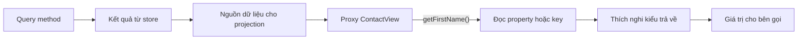

# Proxy projection và quá trình ánh xạ giá trị

Trong chương **Projection interface** của module **SPRING_DATA_COMMONS**, một phương thức repository có thể trả về interface chỉ gồm các getter, dù ứng dụng không tự viết class triển khai interface đó. Spring Data cung cấp cơ chế tạo đối tượng proxy để nối hợp đồng interface với dữ liệu nguồn.

Bài này giải thích đường đi của một giá trị từ kết quả truy vấn đến getter: dữ liệu nguồn được chuẩn bị ở đâu, proxy tìm property như thế nào, khi nào cần chuyển đổi kiểu và vì sao getter có thể trả null hoặc phát sinh lỗi ánh xạ. Các chi tiết về truy vấn vẫn thuộc module store; không nên suy ra rằng mọi kho dữ liệu đều trả cùng một dạng kết quả trung gian.

## 1. Hai loại proxy cần phân biệt

Xét một domain type `Person` đã được ánh xạ trong ứng dụng, có các property `id`, `firstName`, `lastName` và `email`. Khai báo góc nhìn liên hệ:

```java
import java.util.Optional;

public interface ContactView {

    Long getId();

    String getFirstName();

    String getLastName();

    Optional<String> getEmail();

    default String getDisplayName() {
        return getFirstName() + " " + getLastName();
    }
}
```

Repository có thể dùng kiểu đó trong query method, nếu store hỗ trợ:

```java
import java.util.List;

import org.springframework.data.repository.Repository;

public interface PersonRepository extends Repository<Person, Long> {

    List<ContactView> findByLastName(String lastName);
}
```

Trong ví dụ có hai vai trò khác nhau:

| Đối tượng | Nhận lời gọi nào? | Trách nhiệm |
| --- | --- | --- |
| Repository proxy | `findByLastName("Nguyen")` | Điều phối việc thực thi query method |
| Projection proxy | `contact.getFirstName()` | Cung cấp giá trị theo hợp đồng `ContactView` |

Spring Data tạo projection interface tại runtime và chuyển tiếp lời gọi đến dữ liệu đích. Mô hình này được mô tả trong [Interface-based Projections](https://docs.spring.io/spring-data/commons/reference/repositories/projections.html#projections.interfaces).

Ứng dụng làm việc với `ContactView`; không cần một class `ContactViewImpl` do lập trình viên viết. Cũng không nên ép kiểu kết quả về `Person` để gọi hành vi của entity: kiểu trả về đang biểu đạt một góc nhìn đọc, không phải hợp đồng trả entity.

## 2. Đường đi từ query đến giá trị getter

Có thể hình dung quá trình theo sơ đồ sau:



Sơ đồ tách hai giai đoạn:

1. **Chuẩn bị kết quả:** repository và module store xử lý query, rồi chuẩn bị dữ liệu có thể dùng làm nguồn projection.
2. **Đọc qua interface:** khi bên gọi gọi getter, proxy xử lý lời gọi trên nguồn đó và trả giá trị phù hợp với khai báo.

Không phải mọi giá trị đều cần được sao chép vào các field của một class DTO ngay khi tạo proxy. Trong cơ chế proxy mặc định của Commons, lời gọi được xử lý bởi các interceptor và nguồn được gắn vào proxy. Có thể tham khảo [ProxyProjectionFactory](https://github.com/spring-projects/spring-data-commons/blob/main/src/main/java/org/springframework/data/projection/ProxyProjectionFactory.java).

Một getter đơn giản trên map có thể chỉ là đọc một key trong bộ nhớ. Nếu nguồn là một đối tượng có property lazy, việc đọc property lại có thể phụ thuộc ngữ cảnh persistence của store. Vì vậy, “getter chạy sau” không đồng nghĩa “mỗi getter đều chạy một query”, cũng không bảo đảm “getter luôn không có I/O”.

### Nguồn projection có thể có hình dạng khác nhau

| Nguồn | Cách hiểu |
| --- | --- |
| Một đối tượng domain hoặc bean | Getter projection đọc property tương ứng của đối tượng |
| Một `Map<String, Object>` | Tên property xác định key cần đọc |
| Kết quả trung gian được module store thích nghi | Store chuẩn bị cấu trúc phù hợp trước khi tạo projection |

Ví dụ, Spring Data JPA thường dùng truy vấn `Tuple` để xây dựng proxy interface. Đây là cơ chế của module JPA, không phải yêu cầu rằng mọi Spring Data store phải cung cấp `Tuple`. Xem [Using Projections with JPA](https://docs.spring.io/spring-data/jpa/reference/repositories/projections.html#projections.jpa).

## 3. Quan sát cơ chế bằng ProjectionFactory

Để tách phần proxy khỏi phần truy vấn, có thể tạo projection từ một map có sẵn. API public `SpelAwareProxyProjectionFactory` hỗ trợ tạo projection từ kiểu interface và đối tượng nguồn. Xem [API SpelAwareProxyProjectionFactory](https://docs.spring.io/spring-data/commons/docs/current/api/org/springframework/data/projection/SpelAwareProxyProjectionFactory.html).

Đoạn minh họa sau dùng `ContactView` đã khai báo, đặt các kiểu trong cùng package và có Spring Data Commons trong dependencies:

```java
import java.util.HashMap;
import java.util.Map;

import org.springframework.data.projection.ProjectionFactory;
import org.springframework.data.projection.SpelAwareProxyProjectionFactory;

public final class ProjectionMappingDemo {

    public static void main(String[] args) {
        Map<String, Object> values = new HashMap<>();
        values.put("id", 7L);
        values.put("firstName", "Linh");
        values.put("lastName", "Nguyen");
        values.put("email", null);

        ProjectionFactory factory =
                new SpelAwareProxyProjectionFactory();

        ContactView view =
                factory.createProjection(ContactView.class, values);

        System.out.println(view.getId());          // 7
        System.out.println(view.getFirstName());   // Linh
        System.out.println(view.getDisplayName()); // Linh Nguyen
        System.out.println(view.getEmail());       // Optional.empty
    }
}
```

Các chú thích mô tả giá trị dự kiến từ dữ liệu mẫu. Đoạn này không mở kết nối cơ sở dữ liệu và không chứng minh một query repository đã chọn đúng các field.

Phân tích lời gọi `view.getFirstName()`:

| Bước | Thông tin được sử dụng | Kết quả trong ví dụ |
| --- | --- | --- |
| Nhận diện accessor | Tên getter `getFirstName` | Property `firstName` |
| Đọc nguồn map | Key `firstName` | Chuỗi `"Linh"` |
| Xem kiểu trả về | Getter khai báo `String` | Giá trị đã phù hợp |
| Trả cho bên gọi | Giá trị đã thích nghi | `"Linh"` |

Cơ chế đọc map sử dụng tên property để lấy giá trị trong map; xem [MapAccessingMethodInterceptor](https://github.com/spring-projects/spring-data-commons/blob/main/src/main/java/org/springframework/data/projection/MapAccessingMethodInterceptor.java).

### Đối chiếu với nguồn là bean

Nếu nguồn là một bean, lời gọi accessor được chuyển đến cơ chế đọc property của bean; triển khai mặc định có hỗ trợ fallback truy cập field. Xem [PropertyAccessingMethodInterceptor](https://github.com/spring-projects/spring-data-commons/blob/main/src/main/java/org/springframework/data/projection/PropertyAccessingMethodInterceptor.java).

Trong cả hai trường hợp, điều cần thiết vẫn là quan hệ rõ ràng giữa getter và dữ liệu nguồn. Proxy không tự đoán rằng `getFirstName()` phải đọc một property có tên hoàn toàn khác như `givenName`.

## 4. Tên property, alias và dữ liệu thiếu

Với nguồn map thuần trong ví dụ:

| Getter | Property cần tìm | Key tương ứng |
| --- | --- | --- |
| `getId()` | `id` | `"id"` |
| `getFirstName()` | `firstName` | `"firstName"` |
| `getLastName()` | `lastName` | `"lastName"` |
| `getEmail()` | `email` | `"email"` |

Nếu map chỉ có key `first_name`, không có key `firstName`, không nên kỳ vọng cơ chế map thuần tự đổi tên snake_case sang camelCase. Module store có thể có bước thích nghi riêng, nhưng đó là một hợp đồng khác cần kiểm tra theo store và loại query.

### Ví dụ alias trong truy vấn JPA

Với một JPA entity mang tên `Person` và các property đã nêu, có thể chọn các giá trị cùng alias rõ ràng:

```java
import java.util.List;

import org.springframework.data.jpa.repository.Query;
import org.springframework.data.repository.Repository;
import org.springframework.data.repository.query.Param;

public interface JpaContactRepository extends Repository<Person, Long> {

    @Query("""
            select p.id as id,
                   p.firstName as firstName,
                   p.lastName as lastName,
                   p.email as email
            from Person p
            where p.lastName = :lastName
            """)
    List<ContactView> findContactsByLastName(
            @Param("lastName") String lastName);
}
```

Ví dụ này dùng text block, phù hợp với Java 17 trở lên. Các biểu thức là property JPQL của entity; chúng không phải tên cột vật lý. Alias mô tả tên giá trị được dùng để ghép với các getter.

Đây là ví dụ riêng cho Spring Data JPA. Với native query, document query hoặc module khác, cần đối chiếu quy tắc mapping và alias tương ứng.

### Không nhầm giá trị null với alias bị thiếu

Một map có key `email` mang giá trị null và một map không có key `email` đều có thể cho kết quả `map.get("email") == null`. Bởi vậy, nhận `Optional.empty()` từ getter không đủ để kết luận dữ liệu nguồn thực sự không có email.

Khi chẩn đoán, cần phân biệt:

- Truy vấn đã chọn đúng giá trị nhưng dữ liệu là null.
- Truy vấn chọn sai alias hoặc không cung cấp giá trị.
- Bước thích nghi giữa kết quả store và nguồn projection bị lệch.

Một wrapper chống null không thay thế việc kiểm tra hợp đồng ánh xạ.

## 5. Thích nghi kiểu trả về và nullable wrapper

Sau khi đọc được giá trị nguồn, cơ chế projection còn cần đối chiếu với kiểu trả về của phương thức. Nếu kiểu đã phù hợp thì có thể dùng trực tiếp; trường hợp khác có thể cần converter, projection lồng hoặc xử lý collection. Không có bảo đảm rằng mọi cặp kiểu đều chuyển đổi được. Xem [ProjectingMethodInterceptor](https://github.com/spring-projects/spring-data-commons/blob/main/src/main/java/org/springframework/data/projection/ProjectingMethodInterceptor.java).

Một hợp đồng dễ kiểm soát nên giữ các kiểu tương thích ngay từ nguồn:

| Giá trị nguồn dự kiến | Getter thích hợp trong ví dụ | Ý nghĩa |
| --- | --- | --- |
| `Long` | `Long getId()` | Định danh |
| `String` | `String getFirstName()` | Tên |
| `String` hoặc null | `Optional<String> getEmail()` | Liên hệ có thể thiếu |
| Một đối tượng địa chỉ | `AddressView getAddress()` | Góc nhìn lồng |

Không nên dùng khả năng conversion để che một hợp đồng chưa xác định. Ví dụ, một query tổng hợp có thể trả kiểu số khác kiểu số mà getter khai báo. Cần xác định kiểu thực tế theo store/provider thay vì giả định mọi số đều tự chuyển sang `Long` an toàn.

### Optional ở getter khác Optional ở repository

Hai khai báo sau xử lý hai mức thiếu dữ liệu khác nhau:

```java
// Một người được tìm thấy có thể không có email.
Optional<String> getEmail();

// Truy vấn có thể không tìm thấy người nào.
Optional<ContactView> findContactById(Long id);
```

Với getter, giá trị nguồn khác null được biểu diễn bằng wrapper có giá trị; giá trị null được biểu diễn bằng wrapper rỗng trong các nullable wrapper được hỗ trợ. Xem [Nullable Wrappers](https://docs.spring.io/spring-data/commons/reference/repositories/projections.html#projections.interfaces.nullable-wrappers).

Nếu repository trả `Optional<ContactView>`, một kết quả có người nhưng không có email vẫn có thể là:

```text
Optional chứa ContactView
    -> getEmail()
    -> Optional.empty()
```

Đó không phải trạng thái “không tìm thấy người”.

### Getter primitive cần nguồn không null

Nếu một thuộc tính có thể thiếu, getter kiểu primitive như `long` hoặc `boolean` không biểu diễn được null. Lỗi có thể xuất hiện khi gọi getter nếu nguồn không đáp ứng hợp đồng.

Cần lựa chọn giữa:

- Một giá trị bắt buộc và nguồn bảo đảm cung cấp nó.
- Một kiểu reference có hợp đồng null rõ ràng.
- Nullable wrapper được Spring Data hỗ trợ.

Không thêm giá trị mặc định như 0 chỉ để tránh nhìn thấy lỗi ánh xạ. Mã định danh bị thiếu và mã định danh bằng 0 là hai trạng thái khác nhau.

## 6. Projection lồng: ánh xạ đối tượng con

Mở rộng ví dụ bằng góc nhìn địa chỉ:

```java
public interface AddressView {

    String getCity();
}
```

```java
public interface ContactWithAddressView extends ContactView {

    AddressView getAddress();
}
```

Đặt nguồn địa chỉ vào map, rồi tạo projection mở rộng. Đoạn này tiếp tục sử dụng biến `values` và `factory` trong ví dụ ở mục 3:

```java
values.put("address", Map.of("city", "Da Nang"));

ContactWithAddressView contact =
        factory.createProjection(
                ContactWithAddressView.class,
                values);

String city = contact.getAddress().getCity();
// Giá trị dự kiến: "Da Nang"
```

Đường truy cập có hai cấp:

```text
ContactWithAddressView.getAddress()
    -> property "address"
    -> nguồn địa chỉ
    -> AddressView

AddressView.getCity()
    -> property "city" của nguồn địa chỉ
    -> "Da Nang"
```

Nếu đối tượng con chưa đáp ứng kiểu interface cần trả, cơ chế projection có thể tạo proxy cho đối tượng con. Nếu giá trị đã phù hợp kiểu yêu cầu, không cần xem việc tạo thêm proxy là một điều bắt buộc.

Các getter trả collection cũng cần khai báo kiểu phần tử rõ ràng, chẳng hạn `List<AddressView>` khi nguồn và store hỗ trợ. Kiểu generic giúp mô tả cách nhìn từng phần tử; `List` thô làm mất thông tin này.

### Null ở cấp cha vẫn cần được xử lý

Nếu `address` là null, không nên gọi thẳng:

```java
contact.getAddress().getCity();
```

Với hợp đồng cho phép địa chỉ null, đọc giá trị một lần rồi xử lý rõ:

```java
AddressView address = contact.getAddress();

String city = address == null
        ? "Chua co dia chi"
        : address.getCity();
```

Chuỗi thay thế là quyết định hiển thị trong ví dụ, không phải giá trị mà proxy tự tạo. Nếu thành phố cũng có thể null, bên sử dụng cần định nghĩa cách xử lý riêng.

Projection lồng chỉ mô tả cách nhìn đối tượng con. Nó không tự cam kết rằng store chỉ đọc duy nhất field `city`, hoặc rằng một quan hệ lazy đã sẵn sàng ngoài ngữ cảnh persistence.

## 7. Default method và SpEL đi qua các nhánh khác nhau

### Default method tính từ các getter hiện có

Trong `ContactView`, `getDisplayName()` có phần thân Java:

```java
default String getDisplayName() {
    return getFirstName() + " " + getLastName();
}
```

Khi gọi phương thức này, proxy thực thi default method; các lời gọi getter bên trong tiếp tục được giải quyết qua projection. Không cần một key `displayName` trong map của ví dụ.

Do đó, khi tên hiển thị sai, cần kiểm tra cả hai đầu vào `firstName` và `lastName`. Không kết luận ngay rằng projection thiếu property `displayName`.

### Phương thức có @Value đánh giá biểu thức

Một interface khác có thể khai báo giá trị tính toán bằng SpEL:

```java
import org.springframework.beans.factory.annotation.Value;

public interface ExpressionNameView {

    @Value("#{target.firstName + ' ' + target.lastName}")
    String getDisplayName();
}
```

Với factory hỗ trợ SpEL, phương thức được gắn biểu thức sẽ được xử lý qua nhánh đánh giá biểu thức. `target` là đối tượng nguồn; các phương thức không có biểu thức được chuyển về nhánh accessor thông thường. Xem [SpelEvaluatingMethodInterceptor](https://github.com/spring-projects/spring-data-commons/blob/main/src/main/java/org/springframework/data/projection/SpelEvaluatingMethodInterceptor.java).

Nếu biểu thức tham chiếu một Spring bean, factory còn cần ngữ cảnh có thể phân giải bean đó. Việc tạo factory thủ công trong ví dụ không đồng nghĩa mọi bean của ứng dụng đã được tự động cung cấp cho nó.

Nên giữ các phép tính trong projection nhỏ và dễ hiểu. Không coi một phương thức chỉ có khai báo nhưng không có nguồn property, không có default body và không có cơ chế xử lý phù hợp là nơi có thể tự chạy logic tùy ý.

### Closed/open liên quan đến khả năng phân tích đầu vào

Một projection chỉ cần các property xác định có thể được phân tích để biết những giá trị đầu vào cần cung cấp. Projection dùng SpEL truy cập tùy ý vào nguồn không có cùng đặc tính này.

Điểm cần nhớ là hai việc khác nhau: factory có thể tạo một proxy có phương thức tính toán, còn module store có tối ưu được query cho projection đó hay không là một câu hỏi riêng.

## 8. Metadata, cache và thời điểm lỗi xuất hiện

`ProjectionInformation` cung cấp kiểu projection, các input property và thông tin closed projection. Xem [API ProjectionInformation](https://docs.spring.io/spring-data/commons/docs/current/api/org/springframework/data/projection/ProjectionInformation.html).

Có thể quan sát tên các property đầu vào bằng API public:

```java
import java.beans.PropertyDescriptor;

List<String> inputs = factory
        .getProjectionInformation(ContactView.class)
        .getInputProperties()
        .stream()
        .map(PropertyDescriptor::getName)
        .sorted()
        .toList();
```

Đoạn trên cần import `java.util.List` và dùng Java 17 trở lên cho `Stream.toList()`. Nó đọc metadata của interface, không đọc thêm dữ liệu khách hàng và không xác nhận alias thực tế của một query.

Factory có thể cache metadata về kiểu và cách xử lý phương thức. Không nên suy ra từ đó rằng giá trị của từng hàng hoặc kết quả của mọi getter đều được cache thành snapshot.

### Nguồn thay đổi có thể làm giá trị đọc thay đổi

Với nguồn map mutable trong ví dụ:

```java
String before = view.getFirstName(); // Linh

values.put("firstName", "Mai");

String after = view.getFirstName();  // Mai
```

Getter đọc lại nguồn map ở lần gọi tiếp theo, nên việc proxy không khai báo setter không làm map nguồn trở nên bất biến. Đây là hệ quả trực tiếp của cách đọc key trong ví dụ; không mở rộng nó thành lời hứa rằng mọi nguồn store có cùng hành vi cập nhật.

Nếu cần cố định dữ liệu để trả ra ngoài, có thể tạo một DTO/record từ các getter tại thời điểm mong muốn:

```java
public record ContactSnapshot(
        Long id,
        String firstName,
        String lastName,
        String email) {

    public static ContactSnapshot from(ContactView view) {
        return new ContactSnapshot(
                view.getId(),
                view.getFirstName(),
                view.getLastName(),
                view.getEmail().orElse(null));
    }
}
```

Các giá trị trong record này đều là `Long` hoặc `String`, phù hợp cho ví dụ snapshot. Chuyển thành DTO không thực hiện truy vấn mới, nhưng vẫn gọi các getter hiện tại; nếu một getter có lỗi, bước ánh xạ DTO cũng sẽ thấy lỗi đó.

### Tạo được proxy chưa chứng minh mọi getter đều đúng

Một lỗi có thể xuất hiện ở các thời điểm khác nhau:

| Thời điểm | Ví dụ vấn đề |
| --- | --- |
| Phân tích hoặc thực thi query | Sai property truy vấn, query không hợp lệ |
| Thích nghi kết quả store | Dạng kết quả không phù hợp hợp đồng |
| Tạo proxy hoặc phân tích metadata | Kiểu yêu cầu không phải interface với factory đang dùng, biểu thức không hợp lệ |
| Gọi getter | Property không đọc được, giá trị không chuyển được sang kiểu khai báo |
| Gọi getter lồng hoặc ánh xạ response | Địa chỉ null, nguồn lazy không còn truy cập được |

Vì vậy, chỉ kiểm tra danh sách không rỗng hoặc đối tượng khác null là chưa đủ để xác nhận hợp đồng projection.

## 9. Chẩn đoán theo từng tầng ánh xạ

Giả sử giao diện hiển thị tên nhưng email luôn trống. Trước khi sửa interface, lần lượt xem các tầng sau:

1. **Hợp đồng query:** query đang trả kiểu nào và có chọn email không?
2. **Dữ liệu nguồn:** email thực sự null hay đang có giá trị?
3. **Tên ánh xạ:** property hoặc alias có tương ứng với `email` không?
4. **Kiểu giá trị:** giá trị nguồn có phù hợp `String` bên trong `Optional` không?
5. **Cách sử dụng:** bên gọi có đọc đúng getter và xử lý wrapper đúng không?

Bảng định hướng một số tình huống:

| Biểu hiện | Điều cần kiểm tra trước |
| --- | --- |
| Getter chuỗi trả null bất ngờ | Key/property/alias và dữ liệu thực |
| `Optional.empty()` dù nguồn có dữ liệu | Nguồn đã thích nghi có đúng tên và giá trị không |
| Lỗi kiểu khi gọi getter số | Kiểu số thực tế từ query/provider |
| Default method tạo kết quả sai | Các getter đầu vào và chính logic Java |
| Lỗi SpEL | Tên property trong biểu thức và ngữ cảnh phân giải |
| Getter lồng lỗi | Giá trị cha có null không; kiểu đối tượng con là gì |
| Lỗi chỉ xuất hiện lúc tạo response | Getter nào được mapper hoặc serializer gọi ở thời điểm đó |

Không giải quyết lỗi bằng cách ép kiểu proxy sang entity hoặc thêm getter cho mọi property của entity. Cách sửa nên xuất phát từ tầng gây lệch hợp đồng.

Cũng không dùng tên class proxy sinh ra, số thứ tự trong tên class hoặc kết quả `toString()` làm hợp đồng dữ liệu. Để hiển thị, ánh xạ hoặc so sánh theo nghiệp vụ, hãy dùng các getter và định danh đã khai báo.

## 10. Thực hành đọc đường đi của giá trị

Dùng ví dụ map trong bài để giải thích và quan sát các trường hợp sau trong một dự án có dependencies phù hợp:

1. Tạo `ContactView` rồi đọc `id`, tên và email; chỉ ra nguồn của từng giá trị.
2. Đổi key `firstName` thành `first_name` trong map thuần và xác định tầng nào không còn khớp.
3. So sánh email có giá trị, email null và không có key email; giải thích giới hạn của việc chỉ nhìn `Optional.empty()`.
4. Thêm địa chỉ lồng bằng map, đọc thành phố rồi xử lý trường hợp không có địa chỉ.
5. Thay đổi tên trong map sau khi tạo proxy; so sánh đọc lại proxy với một `ContactSnapshot` đã tạo trước đó.
6. Đọc metadata của projection và phân biệt nó với dữ liệu của một hàng kết quả.
7. Khi áp dụng với repository thực tế, xác định module store cung cấp dạng nguồn nào và query có hợp đồng alias/kiểu dữ liệu nào.
8. Phân biệt lỗi khi chạy query với lỗi chỉ xuất hiện khi getter được gọi.

Các ví dụ và giá trị chú thích trong bài là minh họa cơ chế, không phải báo cáo chạy kiểm thử. Kết quả cần đạt là theo dõi được chuỗi **query → nguồn → proxy → accessor → giá trị**, đồng thời xác định đúng trách nhiệm của Commons và phần thích nghi do từng store thực hiện.