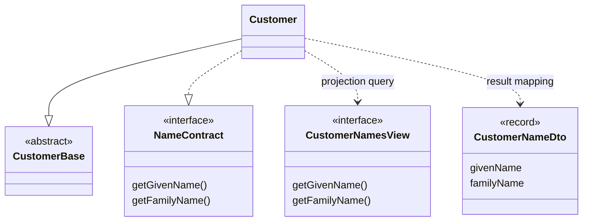

# Phân biệt kiểu kết quả projection với kiểu trong hệ kế thừa của entity

## Mục tiêu bài học

Hai interface có cùng getter chưa chắc có cùng ý nghĩa đối với Spring Data. Nếu entity đã triển khai một interface, trả kết quả dưới kiểu interface đó có thể chỉ là nhìn entity qua một hợp đồng Java hẹp hơn. Một projection độc lập lại mô tả hình dạng kết quả mà repository cần cung cấp.

Sau bài học, bạn có thể:

- Phân biệt domain type, kiểu cha của domain và kiểu kết quả projection.
- Nhận diện bẫy entity tự triển khai interface định dùng làm projection.
- Sử dụng DTO hoặc interface projection nằm ngoài quan hệ kế thừa của entity.
- Chọn đúng `Class<T>` khi dùng projection động.
- Tránh nhầm chuyển kiểu Java, ánh xạ dữ liệu và tối ưu truy vấn.

Bài thuộc chương **DTO và projection động** của module **SPRING_DATA_COMMONS**. Commons cung cấp abstraction repository và thông tin kiểu kết quả. Khả năng tạo projection, chọn trường và ánh xạ constructor vẫn cần được xét theo module lưu trữ, chẳng hạn JPA hoặc MongoDB.

## 1. Ba loại kiểu cần tách biệt

Giả sử repository quản lý aggregate `Customer`.

| Khái niệm | Ví dụ | Vai trò |
| --- | --- | --- |
| Domain type | `Customer` | Kiểu aggregate được repository quản lý |
| Kiểu trong hệ kế thừa của domain | `CustomerBase`, `NameContract` mà Customer triển khai | Một cách biểu diễn quan hệ “Customer là một kiểu này” |
| Kiểu kết quả projection độc lập | `CustomerNamesView`, `CustomerNameDto` | Hợp đồng đọc hoặc đối tượng dữ liệu được tạo cho kết quả query |

Điểm quyết định không phải tên có hậu tố `View`, `Dto` hay `Projection`. Cần xem quan hệ kiểu thật sự và cách query tạo kết quả.

Tài liệu Spring Data phân biệt rõ projection type nằm ngoài hệ kiểu của entity với superclass/interface mà entity đã triển khai. Trả về một kiểu cha hoặc interface đã được entity triển khai sẽ trả một entity đã được materialize theo cơ chế của store, thay vì tự tạo một partial projection. Xem [quy tắc về type hierarchy trong Spring Data Commons](https://docs.spring.io/spring-data/commons/reference/repositories/projections.html).

## 2. Cùng getter nhưng khác quan hệ kiểu

### 2.1. Interface là hợp đồng của domain

```java
public interface NameContract {

    String getGivenName();

    String getFamilyName();
}
```

Giả sử `Customer` đã triển khai hợp đồng này:

```text
Customer extends CustomerBase implements NameContract
```

Domain có các thuộc tính:

```text
Customer
├── id: Long
├── tenantId: String
├── givenName: String
├── familyName: String
└── internalNotes: String
```

Ví dụ giả định `Customer` được mapping hợp lệ trong module đang dùng, có getter tương ứng. `CustomerBase` là một superclass Java của Customer; việc superclass đó có mapping persistence hay không là quyết định riêng của ứng dụng.

Một đối tượng Customer có thể được gán trực tiếp cho biến NameContract:

```java
Customer customer = loadCustomer();
NameContract names = customer;
```

`loadCustomer()` ở đây đại diện cho lời gọi lấy entity của ứng dụng, không phải API có sẵn của Spring Data.

Phép gán không tạo đối tượng dữ liệu mới, không bỏ `internalNotes` khỏi đối tượng và không chạy một query chọn ít trường hơn.

### 2.2. Interface projection độc lập

Khai báo một interface khác:

```java
public interface CustomerNamesView {

    String getGivenName();

    String getFamilyName();
}
```

Trong ví dụ, `Customer` **không implements CustomerNamesView**.

Mặc dù hai interface có cùng getter, một đối tượng Customer không tự trở thành CustomerNamesView. Java dùng quan hệ khai báo `extends`/`implements`, không coi hai kiểu tương đương chỉ vì có các phương thức trông giống nhau.

Khi query method trả CustomerNamesView và module hỗ trợ, Spring Data có thể tạo projection proxy cho interface đó.

### 2.3. DTO độc lập

Với Java 17, có thể khai báo:

```java
public record CustomerNameDto(
        String givenName,
        String familyName) {
}
```

CustomerNameDto không kế thừa Customer và không phải một entity subtype. Nó là đối tượng dữ liệu riêng, được tạo bằng constructor hoặc cơ chế mapping mà module hỗ trợ.

Một record có accessor `givenName()`, `familyName()`. Không nhầm chúng với getter `getGivenName()`, `getFamilyName()` của interface projection.

## 3. Sơ đồ quan hệ kiểu



Mũi tên kế thừa/triển khai cho biết Customer là một CustomerBase và một NameContract.

Hai đường phụ thuộc tới CustomerNamesView và CustomerNameDto chỉ diễn tả việc query có thể tạo kết quả theo các kiểu đó. Chúng không khai báo rằng Customer kế thừa hay triển khai hai kiểu kết quả.

Đây là khác biệt giữa **quan hệ kiểu của domain** và **cơ chế tạo kết quả đọc**.

## 4. Trả entity qua interface không tự tạo projection

Ví dụ repository với hai phương thức riêng:

```java
import java.util.List;

import org.springframework.data.domain.Pageable;
import org.springframework.data.repository.Repository;

public interface CustomerReadRepository
        extends Repository<Customer, Long> {

    List<NameContract>
    findContractsByTenantIdOrderByIdAsc(
            String tenantId,
            Pageable pageable);

    List<CustomerNamesView>
    findViewsByTenantIdOrderByIdAsc(
            String tenantId,
            Pageable pageable);
}
```

`Contracts` và `Views` là phần mô tả trong tên query method. Hai truy vấn đều lọc tenant và sắp xếp theo id, nhưng kiểu phần tử trả về mang ý nghĩa khác nhau.

| Phương thức | Quan hệ với Customer | Ý nghĩa trong ví dụ |
| --- | --- | --- |
| Trả `NameContract` | Customer đã implements interface | Nhận entity dưới kiểu hợp đồng của nó |
| Trả `CustomerNamesView` | Customer không implements interface | Yêu cầu interface projection độc lập |

Không kết luận query đầu chỉ lấy hai thuộc tính tên vì NameContract chỉ công khai hai getter.

### 4.1. Kiểu biến hẹp hơn không làm đối tượng nhỏ hơn

Trong đoạn Java:

```java
NameContract names = customer;
```

compiler chỉ cho caller sử dụng những thành viên của NameContract qua biến `names`. Đối tượng phía sau vẫn là entity Customer hoặc đối tượng entity do provider tạo theo mapping.

Nếu một lời gọi trước đó đã tải entity, đổi kiểu biến về interface không hoàn tác chi phí tải, mapping hoặc quản lý entity đã xảy ra.

### 4.2. Materialize entity không có nghĩa tải eager mọi quan hệ

Với JPA, nhận entity theo hợp đồng entity không đồng nghĩa mọi quan hệ lazy hoặc mọi thuộc tính có khả năng tải trì hoãn đều đã được đọc ngay.

Cần hiểu kết luận ở đây là **kết quả có bản chất entity**, chứ không phải cam kết rằng một câu query đã tải toàn bộ đồ thị đối tượng.

Fetch plan, provider, transaction và mapping vẫn quyết định những dữ liệu nào sẵn có tại thời điểm sử dụng.

## 5. Projection độc lập cho phép một cơ chế kết quả khác

Với CustomerNamesView nằm ngoài quan hệ kế thừa của Customer:

```java
List<CustomerNamesView> rows =
        repository.findViewsByTenantIdOrderByIdAsc(
                tenantId,
                PageRequest.of(0, 20));

for (CustomerNamesView row : rows) {
    System.out.println(row.getGivenName());
    System.out.println(row.getFamilyName());
}
```

Đoạn gọi sử dụng `PageRequest` từ `org.springframework.data.domain`.

Các accessor khớp property của domain giúp module biết dữ liệu đầu vào của projection. Tuy nhiên:

- Việc tối ưu select/field list phụ thuộc module và dạng query.
- Projection proxy không phải entity chỉ vì getter giống getter của entity.
- Một projection không tự có các phương thức cập nhật hoặc hợp đồng persistence của Customer.
- Kết quả có thể được dựng từ tuple, map hoặc nguồn thích hợp, tùy module.

Trong JPA, tài liệu mô tả việc sử dụng tuple để dựng interface projection và những quy tắc riêng cho DTO constructor query. Xem [projections với Spring Data JPA](https://docs.spring.io/spring-data/jpa/reference/repositories/projections.html).

### 5.1. DTO cần được tạo, không phải chỉ được ép kiểu

Đoạn ánh xạ rõ ràng:

```java
CustomerNameDto dto = new CustomerNameDto(
        customer.getGivenName(),
        customer.getFamilyName());
```

tạo một đối tượng dữ liệu mới.

Ngược lại:

```java
// Sai: cast không chuyển entity thành DTO.
CustomerNameDto dto = CustomerNameDto.class.cast(customer);
```

không sao chép hay chuyển đổi dữ liệu; với Customer không phải CustomerNameDto, phép cast thất bại.

Có hai đường khác nhau để nhận DTO:

```text
Query trả entity
    → ứng dụng gọi constructor DTO

Query được hỗ trợ trả DTO trực tiếp
    → store/module ánh xạ dữ liệu vào constructor
```

Đường thứ nhất hữu ích khi entity đã cần cho đơn vị công việc. Đường thứ hai có thể phù hợp khi chỉ cần dữ liệu đọc. Tạo DTO sau khi tải entity không tự tạo tối ưu truy vấn ngược về trước.

## 6. Projection động không thay đổi quy tắc kế thừa

Query method có thể cho caller chọn kiểu kết quả:

```java
import java.util.List;

import org.springframework.data.domain.Pageable;
import org.springframework.data.repository.Repository;

public interface CustomerDynamicRepository
        extends Repository<Customer, Long> {

    <T> List<T> findByTenantIdOrderByIdAsc(
            String tenantId,
            Class<T> type,
            Pageable pageable);
}
```

Giả sử module và dạng query hỗ trợ các lựa chọn dưới đây:

```java
Pageable page = PageRequest.of(0, 20);

List<Customer> entities =
        repository.findByTenantIdOrderByIdAsc(
                tenantId, Customer.class, page);

List<NameContract> contracts =
        repository.findByTenantIdOrderByIdAsc(
                tenantId, NameContract.class, page);

List<CustomerNamesView> views =
        repository.findByTenantIdOrderByIdAsc(
                tenantId, CustomerNamesView.class, page);

List<CustomerNameDto> dtos =
        repository.findByTenantIdOrderByIdAsc(
                tenantId, CustomerNameDto.class, page);
```

Chữ ký `<T> ... Class<T>` giúp ràng buộc kiểu kết quả với type token ở lời gọi. Nó không có nghĩa mọi class bất kỳ đều là một lựa chọn được mapping thành công.

| Type token | Cần hiểu |
| --- | --- |
| `Customer.class` | Yêu cầu entity/domain result |
| `NameContract.class` | Interface mà Customer đã triển khai; không tự trở thành partial projection |
| `CustomerNamesView.class` | Interface projection độc lập trong ví dụ |
| `CustomerNameDto.class` | DTO độc lập; cần constructor/mapping được hỗ trợ |

Đổi type token không làm một interface vốn thuộc hệ kiểu của Customer trở thành projection độc lập.

### 6.1. Không ràng buộc projection thành subtype của entity

Chữ ký sau chỉ cho phép T thuộc nhánh Customer:

```java
<T extends Customer> List<T> findByTenantId(
        String tenantId,
        Class<T> type);
```

CustomerNameDto không extends Customer, nên không thể dùng nó như T theo chữ ký này.

Nếu mục tiêu là chọn cả entity lẫn DTO độc lập, một ràng buộc như `T extends Customer` đã loại DTO ra ngay ở tầng Java. Không nên cho DTO kế thừa entity chỉ để vượt qua giới hạn generic đó.

### 6.2. Class<T> không phải phép biến đổi entity tùy ý

Truyền một class không có constructor phù hợp, property không ánh xạ được hoặc không được module hỗ trợ vẫn có thể thất bại.

Projection động chọn hợp đồng kết quả. Nó không tự giải quyết mọi chuyển đổi, lọc subtype hoặc dựng đồ thị đối tượng cho caller.

## 7. Có interface cha chung chưa chắc projection thuộc hệ kiểu của entity

Xét một projection kế thừa hợp đồng tên:

```java
public interface CustomerNamesProjection extends NameContract {
}
```

Customer đã implements NameContract, nhưng **không implements CustomerNamesProjection**.

Quan hệ là:

```text
                NameContract
                 /         \
          Customer       CustomerNamesProjection
```

Hai nhánh cùng có một hợp đồng cha không làm Customer trở thành CustomerNamesProjection.

Kiểm tra Java:

```java
boolean contractAcceptsCustomer =
        NameContract.class.isAssignableFrom(Customer.class);

boolean projectionAcceptsCustomer =
        CustomerNamesProjection.class.isAssignableFrom(Customer.class);

System.out.println(contractAcceptsCustomer);   // true
System.out.println(projectionAcceptsCustomer); // false
```

Với các accessor phù hợp và query được hỗ trợ, CustomerNamesProjection vẫn có thể là interface projection độc lập cho Customer.

Điểm cần hỏi là “Customer có thể được dùng trực tiếp như kiểu kết quả này không?”, không phải “hai kiểu có bất kỳ ancestor chung nào không?”. Nếu dùng tiêu chí có ancestor chung, gần như mọi class Java đều liên hệ qua Object.

### 7.1. Bẫy cho entity triển khai luôn projection

Giả sử ban đầu:

```text
Customer không implements CustomerNamesView
```

Nhóm phát triển có thể thêm:

```text
Customer implements CustomerNamesView
```

để tái sử dụng cùng interface cho nhiều nơi.

Thay đổi này làm Customer trở thành một instance hợp lệ của CustomerNamesView. Chữ ký query method có thể vẫn biên dịch như cũ, nhưng kiểu kết quả đã nằm trong quan hệ triển khai của entity.

Không nên giữ nguyên giả định rằng repository vẫn phải tạo một partial projection độc lập như trước.

Nếu NameContract là hợp đồng domain cần dùng chung, có thể để domain triển khai NameContract và để một projection con riêng kế thừa NameContract, miễn domain không triển khai chính projection con đó.

### 7.2. DTO cũng có thể dùng chung hợp đồng nếu có chủ đích

Một DTO có thể triển khai NameContract bằng các getter adapter:

```java
public record CustomerNameDto(
        String givenName,
        String familyName) implements NameContract {

    @Override
    public String getGivenName() {
        return givenName;
    }

    @Override
    public String getFamilyName() {
        return familyName;
    }
}
```

Đây là phiên bản thay thế của record đã giới thiệu, không phải một khai báo thứ hai cùng tên trong cùng project.

DTO và Customer cùng implements NameContract, nhưng DTO không extends Customer. Chia sẻ hợp đồng đọc không đồng nghĩa chia sẻ bản chất entity hoặc danh tính persistence.

Việc DTO constructor có được query sử dụng trực tiếp hay không vẫn phụ thuộc mapping projection của module.

## 8. Entity subtype không phải một DTO ít field

Giả sử:

```text
PremiumCustomer extends Customer
```

và PremiumCustomer là subtype được mapping hợp lệ theo store của ứng dụng.

PremiumCustomer biểu diễn một loại Customer trong mô hình nghiệp vụ hoặc persistence. Nó không chỉ là cách chọn vài field để hiển thị.

| Nhu cầu | Cách biểu đạt phù hợp |
| --- | --- |
| Đọc tên của mọi khách hàng | Projection/DTO với các thuộc tính tên |
| Đọc khách hàng thuộc loại Premium | Query hoặc repository cho subtype theo mapping store |
| Trả một hợp đồng chung của Customer | Kiểu cha hoặc interface entity đã triển khai |
| Thêm field vào dữ liệu phản hồi | DTO hoặc projection có dữ liệu và mapping phù hợp |

### 8.1. Không tạo DTO bằng cách extends entity

Ví dụ thiết kế dễ gây nhầm:

```java
// Không phù hợp để diễn tả một DTO đọc độc lập.
class CustomerSummaryDto extends Customer {
}
```

Tên có chữ Dto không thay đổi quan hệ Java: đây vẫn là subtype của Customer.

Tùy module, constructor, mapping và cách query, kiểu đó có thể không được chấp nhận hoặc bị xử lý khác với class-based projection độc lập. Không coi đây là cách yêu cầu Spring Data lấy một tập field nhỏ.

Một DTO phù hợp hơn thường giữ các giá trị cần đọc bằng constructor, không kế thừa entity để tái sử dụng property hoặc vượt qua một generic bound.

### 8.2. Chọn subtype không tự tạo điều kiện lọc subtype

Không truyền `PremiumCustomer.class` vào một dynamic projection rồi mặc định rằng query sẽ:

- Chuyển mọi Customer thành PremiumCustomer.
- Tự thêm mọi điều kiện discriminator cần thiết.
- Bỏ các Customer không thuộc subtype theo cùng một quy tắc trên mọi store.

Nếu cần đọc entity subtype, thiết kế query/repository dựa trên mapping inheritance mà store hỗ trợ. Projection type token không phải một API lọc subtype phổ quát.

## 9. Optional, List và Page không thay đổi bản chất phần tử

Các wrapper mô tả số lượng hoặc metadata kết quả:

| Kiểu trả về | Điều phải xem bên trong |
| --- | --- |
| `Optional<Customer>` | Entity hoặc không có kết quả |
| `Optional<NameContract>` | Trong ví dụ, entity qua interface đã triển khai |
| `List<CustomerNamesView>` | Các phần tử projection độc lập khi được hỗ trợ |
| `Page<CustomerNameDto>` | DTO cùng metadata phân trang |
| `List<CustomerBase>` | Entity qua superclass nếu query/module cho phép |

Không kết luận một kết quả là projection chỉ vì nó nằm trong List hay Optional.

### 9.1. Generic collection không thực hiện phép chiếu

Java không cho phép gán trực tiếp:

```java
// Không hợp lệ dù Customer implements NameContract:
List<NameContract> contracts = customers;
```

khi `customers` có kiểu `List<Customer>`.

Có thể tạo một collection chứa các tham chiếu tương thích:

```java
import java.util.ArrayList;
import java.util.List;

List<NameContract> contracts = new ArrayList<>(customers);
```

Nhưng đây chỉ là một danh sách mới chứa các đối tượng Customer cũ. Không có DTO mới hoặc query chọn trường mới được tạo.

Nếu hai danh sách có phần tử và không bị thay đổi:

```java
boolean sameObject =
        contracts.get(0) == customers.get(0); // true
```

Đây là một ví dụ cho thấy “đổi kiểu nhìn” khác “dựng một kết quả projection”.

## 10. Không thay kiểu trả về của base method để ép projection

Một repository kế thừa CrudRepository có sẵn:

```java
Optional<Customer> findById(Long id);
```

Không khai báo lại nó như sau:

```java
// Ví dụ không hợp lệ về kiểu trả về kế thừa:
interface BrokenCustomerRepository
        extends CrudRepository<Customer, Long> {

    Optional<CustomerNamesView> findById(Long id);
}
```

Optional<CustomerNamesView> không phải kiểu trả về tương thích với Optional<Customer>. Generic wrapper không tự có quan hệ covariance như mong muốn ở đây.

Ngoài vấn đề biên dịch, các base method của repository có hợp đồng riêng. Không coi việc đổi tên kiểu kết quả trên một base method là cách chung để bật projection.

Một phương thức query riêng biểu đạt ý định rõ hơn:

```java
import java.util.Optional;

import org.springframework.data.repository.CrudRepository;

public interface CustomerRepository
        extends CrudRepository<Customer, Long> {

    Optional<CustomerNamesView> findProjectedById(Long id);
}
```

`Projected` là phần mô tả trước `By`; điều kiện vẫn dùng property id. `findById` kế thừa giữ hợp đồng entity, còn `findProjectedById` là query method riêng cho projection khi module hỗ trợ.

Nếu chức năng cần điều kiện tenant, có thể dùng query riêng như `findProjectedByTenantIdAndId(...)` với đầy đủ tham số tương ứng.

Một số module có cơ chế query khai báo cho những trường hợp đặc biệt, nhưng cần theo đúng tài liệu module; không suy thành quy tắc rằng mọi base method đều có thể đổi tùy ý sang DTO.

## 11. Quan hệ gán Java là công cụ phân tích, không phải bộ nhận diện projection hoàn chỉnh

`Class.isAssignableFrom` giúp kiểm tra hướng quan hệ kiểu:

```java
NameContract.class.isAssignableFrom(Customer.class);      // true
CustomerBase.class.isAssignableFrom(Customer.class);      // true
CustomerNamesView.class.isAssignableFrom(Customer.class); // false
CustomerNameDto.class.isAssignableFrom(Customer.class);   // false
```

Có thể đọc biểu thức `A.class.isAssignableFrom(B.class)` là: một tham chiếu kiểu B có thể được gán cho biến kiểu A mà không cần phép chuyển kiểu thu hẹp hay không, trong các ví dụ reference type này.

Hướng kiểm tra quan trọng. Nếu PremiumCustomer extends Customer:

```java
Customer.class.isAssignableFrom(PremiumCustomer.class); // true
PremiumCustomer.class.isAssignableFrom(Customer.class); // false
```

Xem [hợp đồng Class.isAssignableFrom của Java](https://docs.oracle.com/en/java/javase/17/docs/api/java.base/java/lang/Class.html#isAssignableFrom(java.lang.Class)).

### 11.1. Kết quả false chưa đủ để gọi một kiểu là DTO projection

Một kiểu nằm ngoài quan hệ gán từ Customer có thể là:

- Interface projection hợp lệ.
- DTO constructor projection hợp lệ.
- Kiểu scalar hoặc aggregate result của một query.
- Entity subtype theo hướng quan hệ ngược lại.
- Một class không liên quan và không được query mapping hỗ trợ.

Do đó, không viết quy tắc đơn giản “không assignable thì chắc chắn là projection hợp lệ”.

Spring Data có metadata kiểu trả về như `ReturnedType`, biểu diễn domain type, returned type và dữ liệu cần để dựng kết quả. Các khái niệm này giúp hạ tầng phân biệt yêu cầu query; không chỉ dựa vào tên class. Xem [API ReturnedType](https://docs.spring.io/spring-data/commons/docs/current/api/org/springframework/data/repository/query/ReturnedType.html).

### 11.2. Runtime proxy có thể làm getClass() gây hiểu nhầm

Entity JPA có thể được biểu diễn bằng proxy của provider. Interface projection cũng có thể là proxy do hạ tầng projection tạo.

Vì vậy:

- Tên runtime class có chữ Proxy chưa đủ để phân loại.
- `getClass() == Customer.class` không phải phép kiểm tra chung cho mọi entity instance.
- Một projection proxy không tự có danh tính persistence của Customer.
- Cần xem quan hệ kiểu, chữ ký query, mapping và dạng dữ liệu được query trả.

Quan sát runtime hữu ích khi chẩn đoán, nhưng không thay thế việc hiểu hợp đồng kết quả.

## 12. Hệ quả đối với persistence, hiệu năng và phản hồi API

### 12.1. Persistence

Với JPA trong phạm vi persistence context phù hợp, entity có thể được quản lý và tham gia dirty checking theo cấu hình. Trả entity dưới NameContract không làm nó tự biến thành một DTO tách rời.

Một DTO chỉ giữ các giá trị chuỗi như CustomerNameDto không trở thành managed Customer chỉ vì nó có cùng tên thuộc tính.

Không mở rộng kết luận đó thành mọi DTO đều hoàn toàn độc lập với entity: một DTO khác có thể chứa tham chiếu entity bên trong. Cần xem kiểu dữ liệu thực sự được giữ.

### 12.2. Hiệu năng

Trả entity qua kiểu cha không tạo yêu cầu chọn ít field.

Projection độc lập có thể cung cấp cơ sở cho module tối ưu truy vấn, nhưng còn phụ thuộc:

- Projection đóng hay mở.
- Query suy ra hay query khai báo.
- Constructor/alias có khớp hay không.
- Quan hệ lồng nhau và fetch plan.
- Khả năng của store và provider.

Vì vậy, có hai câu hỏi riêng:

1. Đây là entity result hay projection result?
2. Query cụ thể lấy những dữ liệu nào và tốn bao nhiêu công việc?

Trả lời câu thứ nhất chưa tự trả lời toàn bộ câu thứ hai.

### 12.3. Phản hồi API

Kiểu biến Java không phải một hợp đồng chắc chắn về field JSON. Serializer có thể dựa vào runtime type hoặc cấu hình khác của ứng dụng.

Nếu API chỉ được có tên, một DTO phản hồi rõ ràng giúp thể hiện hợp đồng đó. Không dùng riêng phép gán Customer sang NameContract như bằng chứng rằng mọi property khác chắc chắn biến mất khỏi phản hồi.

Lựa chọn dữ liệu ở query và lựa chọn field ở API là hai quyết định liên quan nhưng khác nhau.

## 13. Thực hành phân loại trước khi viết query

Với mỗi kiểu kết quả định dùng, thực hiện lần lượt:

1. Xác định domain type thật sự của repository.
2. Kiểm tra domain có extends/implements kiểu kết quả không.
3. Kiểm tra kiểu kết quả có phải một entity subtype không.
4. Nếu là interface độc lập, đối chiếu accessor với dữ liệu query cung cấp.
5. Nếu là DTO độc lập, đối chiếu constructor và quy tắc mapping của module.
6. Nếu dùng dynamic projection, bảo đảm type token khớp kiểu T và được hỗ trợ.
7. Quan sát query và kết quả thực tế cho chức năng cần hoàn thành.

Các tình huống hữu ích:

| Tình huống | Điều cần xác minh |
| --- | --- |
| Customer implements NameContract | Trả NameContract không được mặc định là partial projection |
| Customer không implements CustomerNamesView | Query tạo được interface projection phù hợp |
| CustomerNamesProjection extends NameContract | Quan hệ cha chung không làm Customer triển khai projection con |
| CustomerNameDto có constructor phù hợp | DTO được dựng đúng khi module hỗ trợ |
| Thêm implements projection vào entity | Giả định về phân loại kết quả có thay đổi không |
| Dùng superclass của Customer | Kết quả vẫn thuộc hợp đồng entity nếu được query hỗ trợ |
| Dùng PremiumCustomer | Mapping và điều kiện subtype được xác định rõ |
| Dùng Optional hoặc Page | Xem bản chất kiểu phần tử, không chỉ wrapper |
| Đổi select hoặc alias | Projection/DTO còn đủ dữ liệu và đúng kiểu hay không |

Đây là các hướng thực hành, không phải những kiểm thử tích hợp đã được chạy trong bài.

## 14. Câu hỏi tự kiểm tra

### Câu 1: Entity triển khai interface có hai getter

Customer implements NameContract với hai getter tên. Query trả NameContract có chắc chỉ lấy hai trường tên không?

**Trả lời:** Không. Interface đó nằm trong quan hệ triển khai của entity; kết quả có thể là entity dưới kiểu hợp đồng của nó. Số getter không tạo yêu cầu partial projection.

### Câu 2: Hai interface có cùng chữ ký phương thức

NameContract và CustomerNamesView có cùng getter, nhưng Customer chỉ implements NameContract. Chúng có thể được dùng thay thế tùy ý như cùng một kiểu Java không?

**Trả lời:** Không. Java cần quan hệ kiểu được khai báo. Hình dạng phương thức giống nhau không làm Customer tự implements CustomerNamesView.

### Câu 3: Projection con của hợp đồng domain

Customer implements NameContract. CustomerNamesProjection extends NameContract, còn Customer không implements CustomerNamesProjection. Projection con có bắt buộc trở thành entity result không?

**Trả lời:** Không. Customer không phải CustomerNamesProjection. Interface con vẫn có thể là projection độc lập khi accessor và query được hỗ trợ.

### Câu 4: Dùng DTO extends Customer

Đặt tên một subclass là CustomerSummaryDto có làm nó thành class-based projection độc lập không?

**Trả lời:** Không. Nó vẫn là subtype của Customer. Cần một DTO độc lập với constructor/mapping phù hợp nếu muốn mô tả kết quả đọc riêng.

### Câu 5: Dynamic projection với interface entity đã triển khai

Query có `<T> List<T> ... Class<T>`. Truyền NameContract.class có làm interface đó tự trở thành một projection ngoài hệ kiểu entity không?

**Trả lời:** Không. Dynamic projection không thay đổi quan hệ extends/implements của các kiểu.

### Câu 6: Chuyển danh sách sang kiểu interface

Tạo `new ArrayList<NameContract>(customers)` có materialize các DTO mới không?

**Trả lời:** Không. Nó tạo collection mới nhưng giữ tham chiếu tới các Customer đã có.

### Câu 7: Cast entity sang record

Có thể dùng cast để biến Customer thành CustomerNameDto chứa tên không?

**Trả lời:** Không. Cast kiểm tra quan hệ runtime, không thực hiện ánh xạ dữ liệu. Cần constructor, mapper hoặc query DTO được hỗ trợ.

### Câu 8: Kiểu độc lập luôn được query hỗ trợ?

Một class không nằm trong hệ kế thừa Customer có tự trở thành projection hợp lệ khi truyền vào Class<T> không?

**Trả lời:** Không. Còn phải đáp ứng hợp đồng constructor/accessor, dữ liệu nguồn, dạng query và khả năng module.

## Những điểm cần nhớ

- Kiểu cha hoặc interface entity đã triển khai cung cấp một cách nhìn entity qua hợp đồng Java.
- Projection độc lập biểu diễn một hợp đồng kết quả đọc ngoài quan hệ kế thừa trực tiếp đó.
- Cùng getter, cùng tên field hoặc cùng interface cha chưa đủ để đồng nhất hai kiểu.
- DTO không cần và thường không nên kế thừa entity để được dùng làm kết quả query.
- Dynamic projection chọn kiểu kết quả nhưng không thay đổi quan hệ kiểu hoặc mapping.
- Wrapper như List, Optional và Page không sửa bản chất entity/projection của phần tử.
- Phân loại kiểu kết quả và kiểm chứng dữ liệu query lấy là hai bước riêng.
