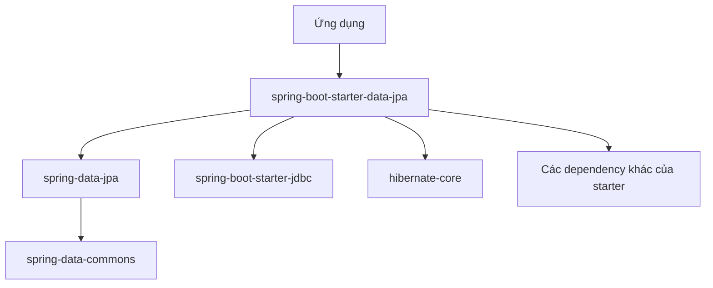

# Artifact spring-data-commons và cách được kéo vào qua starter

Trong một ứng dụng Spring Boot, bạn có thể sử dụng `CrudRepository`, `Pageable` hoặc `Sort` dù không khai báo trực tiếp dependency có tên `spring-data-commons`. Nguyên nhân thường là một starter truy cập dữ liệu đã đưa module Spring Data tương ứng vào cây phụ thuộc, và module đó phụ thuộc tiếp vào Commons.

Bài thuộc chương **Phụ thuộc và phiên bản** của module `SPRING_DATA_COMMONS`. Mục tiêu là nhận diện đúng artifact chứa các abstraction dùng chung, hiểu đường đi của dependency bắc cầu và biết thành phần nào quyết định phiên bản thực tế. Đây là nền tảng để sử dụng repository, derived query, phân trang, projection, Query by Example, metadata và auditing trong đúng ngữ cảnh lưu trữ.

## 1. Nhận diện đúng artifact

Tọa độ Maven của Spring Data Commons là:

```text
groupId:    org.springframework.data
artifactId: spring-data-commons
packaging:  jar
```

Khi có thêm phiên bản cụ thể, tọa độ thường được biểu diễn như sau:

```text
org.springframework.data:spring-data-commons:COMMONS_VERSION
```

`COMMONS_VERSION` ở đây là ký hiệu minh họa, không phải một phiên bản có thể tải về.

Tên artifact dùng để khai báo dependency khác với tên package trong Java. Chẳng hạn:

```java
import org.springframework.data.repository.CrudRepository;
import org.springframework.data.domain.Page;
import org.springframework.data.domain.Pageable;
import org.springframework.data.domain.Sort;
```

Không tìm thấy chuỗi `spring-data-commons` trong các câu import không có nghĩa là ứng dụng không dùng artifact này.

Một số API tiêu biểu thuộc Commons:

| Nhóm abstraction | Ví dụ API | Ý nghĩa khi xét dependency |
| --- | --- | --- |
| Repository và CRUD | `Repository`, `CrudRepository` | Hợp đồng dùng chung cho repository |
| Phân trang, sắp xếp | `Page`, `Slice`, `Pageable`, `PageRequest`, `Sort` | Các kiểu mô tả yêu cầu và kết quả truy vấn |
| Query by Example | `Example`, `ExampleMatcher`, `QueryByExampleExecutor` | Hợp đồng và mô hình ví dụ để tìm kiếm |
| Projection | `ProjectionFactory` | Hạ tầng tạo biểu diễn kết quả theo projection |
| Auditing | `AuditorAware`, `@CreatedDate`, `@LastModifiedDate` | Hợp đồng và annotation liên quan đến thông tin kiểm toán |
| Metadata repository | `RepositoryMetadata` | Thông tin về hợp đồng repository để hạ tầng xử lý |

Có API trên classpath chưa bảo đảm mọi kho dữ liệu thực hiện toàn bộ khả năng của API đó. Ví dụ, việc có `ExampleMatcher` chưa chứng minh một module cụ thể hỗ trợ mọi lựa chọn so khớp; có annotation auditing cũng chưa tự kích hoạt auditing.

Commons cung cấp nền tảng dùng chung. Triển khai truy cập dữ liệu và cách tích hợp các tính năng vẫn gắn với từng module Spring Data.

## 2. Phân biệt bốn thành phần dễ bị nhầm

| Thành phần | Ví dụ | Vai trò chính |
| --- | --- | --- |
| Thư viện dùng chung | `org.springframework.data:spring-data-commons` | Chứa abstraction và hạ tầng chung |
| Module theo kho dữ liệu | `org.springframework.data:spring-data-jpa` | Cung cấp repository và cơ chế truy vấn theo JPA |
| Starter của Spring Boot | `org.springframework.boot:spring-boot-starter-data-jpa` | Tập hợp các dependency để bắt đầu với một nhóm tính năng |
| BOM | `org.springframework.boot:spring-boot-dependencies` | Quản lý một tập phiên bản dependency |

Ba khái niệm cần tách riêng:

- **Có mặt trong cây phụ thuộc:** do dependency trực tiếp hoặc bắc cầu đưa artifact vào.
- **Được chọn phiên bản nào:** do dependency management, constraints và quy tắc resolution quyết định.
- **Được cấu hình để chạy:** do cấu hình ứng dụng, auto-configuration và tài nguyên hạ tầng đáp ứng điều kiện.

Ví dụ, import một BOM chưa làm cho `CrudRepository` xuất hiện trên compile classpath. Ngược lại, có JAR chứa `CrudRepository` chưa tạo ra datasource, kết nối MongoDB hay repository bean hoạt động.

Spring Boot cung cấp danh mục phiên bản được quản lý qua `spring-boot-dependencies`. Khi dự án sử dụng cơ chế quản lý này, các dependency nằm trong danh mục thường có thể bỏ phiên bản riêng trong phần khai báo. [Spring Boot — Build Systems](https://docs.spring.io/spring-boot/reference/using/build-systems.html)

## 3. Commons được kéo vào qua starter như thế nào?

### 3.1. Dependency trực tiếp và dependency bắc cầu

Giả sử ứng dụng khai báo:

```xml
<dependency>
    <groupId>org.springframework.boot</groupId>
    <artifactId>spring-boot-starter-data-jpa</artifactId>
</dependency>
```

Đối với ứng dụng, starter này là dependency trực tiếp. Nếu starter phụ thuộc vào một module khác, module đó có thể trở thành dependency bắc cầu của ứng dụng. Chuỗi tiếp tục cho đến các thư viện mà những module này cần dùng, trong giới hạn scope, exclusion và metadata công bố.

Để nhìn rõ các cạnh phụ thuộc, có thể dùng cấu trúc đã công bố tại mốc Spring Boot 3.5.0 và Spring Data JPA 3.5.0:



Tại mốc này, mã nguồn starter khai báo Spring Data JPA; POM của Spring Data JPA khai báo Commons. Đây là ví dụ cụ thể cho cơ chế bắc cầu, không phải yêu cầu mọi dòng Spring Boot giữ nguyên toàn bộ cấu trúc đồ thị. Các dòng khác có thể bổ sung module trung gian. [Starter JPA của Spring Boot 3.5.0](https://github.com/spring-projects/spring-boot/blob/v3.5.0/spring-boot-project/spring-boot-starters/spring-boot-starter-data-jpa/build.gradle), [POM Spring Data JPA 3.5.0](https://github.com/spring-projects/spring-data-jpa/blob/3.5.0/spring-data-jpa/pom.xml)

Vì vậy, khi biên dịch một ứng dụng đã có starter JPA phù hợp, các import từ Commons có thể hoạt động mà không cần thêm một khai báo Commons riêng.

### 3.2. Không chỉ có đường đi qua JPA

Các module Spring Data khác cũng sử dụng nền tảng chung. Ví dụ, POM của Spring Data MongoDB khai báo dependency đến Commons. Một starter MongoDB phù hợp có thể đưa module này và Commons vào cây dependency của ứng dụng. [POM Spring Data MongoDB 4.5.0](https://github.com/spring-projects/spring-data-mongodb/blob/4.5.0/spring-data-mongodb/pom.xml)

Đường đi khái quát là:

```text
Ứng dụng
  -> starter phù hợp với công nghệ
     -> module Spring Data tương ứng
        -> spring-data-commons
```

Đây là sơ đồ rút gọn theo trách nhiệm. Cây dependency đã resolve của dự án mới là bằng chứng chính xác cho đường đi, scope và phiên bản đang được dùng.

Không phải starter nào cũng kéo Commons vào. `spring-boot-starter` hoặc một starter web không tự đồng nghĩa với có repository Spring Data.

## 4. Maven: khai báo starter và nhận phiên bản từ Spring Boot

Các cấu hình dưới đây là những mảnh cấu hình dành cho `pom.xml`. Ký hiệu `BOOT_VERSION` phải được thay bằng phiên bản Spring Boot đã chọn cho dự án. Java và build tool phải phù hợp với dòng Boot đó.

### 4.1. Dùng Spring Boot starter parent

Trong một dự án Maven sử dụng parent của Boot:

```xml
<parent>
    <groupId>org.springframework.boot</groupId>
    <artifactId>spring-boot-starter-parent</artifactId>
    <version>BOOT_VERSION</version>
    <relativePath/>
</parent>

<dependencies>
    <dependency>
        <groupId>org.springframework.boot</groupId>
        <artifactId>spring-boot-starter-data-jpa</artifactId>
    </dependency>
</dependencies>
```

Trong cấu hình này:

1. Parent cung cấp dependency management của Boot.
2. Dependency starter đưa nhóm thư viện truy cập JPA vào dự án.
3. Commons xuất hiện qua đường phụ thuộc của module Spring Data.
4. Phiên bản cuối cùng được xác định khi Maven xây dựng mô hình và resolve dependency.

Không cần ghi một phiên bản Commons tùy ý chỉ để dùng `Pageable`. Nếu muốn khai báo Commons trực tiếp vì quy ước quản lý dependency, vẫn có thể để phiên bản được quản lý chung.

Starter parent còn cung cấp các mặc định build và quản lý plugin. Khả năng này khác với chỉ import BOM. [Spring Boot Maven Plugin — Using the Plugin](https://docs.spring.io/spring-boot/maven-plugin/using.html)

### 4.2. Dùng parent riêng và import BOM của Boot

Nếu dự án phải kế thừa parent của tổ chức, có thể import BOM thay vì đổi parent:

```xml
<properties>
    <spring-boot.version>BOOT_VERSION</spring-boot.version>
</properties>

<dependencyManagement>
    <dependencies>
        <dependency>
            <groupId>org.springframework.boot</groupId>
            <artifactId>spring-boot-dependencies</artifactId>
            <version>${spring-boot.version}</version>
            <type>pom</type>
            <scope>import</scope>
        </dependency>
    </dependencies>
</dependencyManagement>

<dependencies>
    <dependency>
        <groupId>org.springframework.boot</groupId>
        <artifactId>spring-boot-starter-data-jpa</artifactId>
    </dependency>
</dependencies>
```

Đây là một lựa chọn thay thế cho ví dụ dùng starter parent. Import BOM mang lại dependency management, còn plugin management và các thiết lập build khác phải được xử lý theo cấu hình dự án.

Nếu chỉ giữ `dependencyManagement` rồi bỏ toàn bộ `dependencies` liên quan, BOM không tự cài nhóm thư viện JPA hoặc Commons vào classpath.

Cũng không thay thế bước này bằng cách chỉ khai báo `spring-boot-maven-plugin`. Plugin phục vụ các công việc build; khai báo plugin không tương đương thêm starter vào dependency của ứng dụng.

### 4.3. JDBC driver là một quyết định riêng

Starter JPA không biết trước bạn sẽ dùng PostgreSQL, MySQL hay cơ sở dữ liệu nào khác. Với một ứng dụng PostgreSQL, dự án có thể thêm:

```xml
<dependency>
    <groupId>org.postgresql</groupId>
    <artifactId>postgresql</artifactId>
    <scope>runtime</scope>
</dependency>
```

Ví dụ giả định phiên bản driver được BOM đang dùng quản lý. Ngoài JAR driver, ứng dụng vẫn cần thông tin kết nối và môi trường database.

Việc Commons đã có mặt không phải bằng chứng datasource đã cấu hình xong. Đây là hai yêu cầu khác nhau trong quá trình đưa ứng dụng vào hoạt động.

## 5. Gradle: cũng cần cơ chế quản lý phiên bản rõ ràng

Với Gradle, việc bỏ version của starter cần dựa trên dependency management hoặc platform đã được thiết lập. Chỉ nhìn thấy plugin Boot trong build script chưa đủ kết luận mọi dependency đã được quản lý đúng.

Một cách dùng hỗ trợ BOM native của Gradle, theo Groovy DSL:

```groovy
plugins {
    id 'java'
    id 'org.springframework.boot' version 'BOOT_VERSION'
}

repositories {
    mavenCentral()
}

dependencies {
    implementation platform(
        org.springframework.boot.gradle.plugin.SpringBootPlugin.BOM_COORDINATES
    )

    implementation 'org.springframework.boot:spring-boot-starter-data-jpa'
    runtimeOnly 'org.postgresql:postgresql'
}
```

Sau khi thay `BOOT_VERSION` bằng phiên bản phù hợp:

- Plugin Boot cung cấp hằng `BOM_COORDINATES` theo phiên bản plugin.
- `platform(...)` đưa constraints phiên bản từ BOM vào các configuration liên quan.
- Starter vẫn là khai báo đưa nhóm dependency JPA vào dự án.
- Commons được module Spring Data đưa vào theo đường bắc cầu.

Một lựa chọn khác là kết hợp plugin Boot với `io.spring.dependency-management`. Khi plugin quản lý dependency được áp dụng theo cách Boot hỗ trợ, BOM Boot tương ứng được import tự động. Không cần ghép cả hai cách quản lý chỉ để có Commons.

Với native `platform`, constraints của BOM có thể bị ảnh hưởng bởi các yêu cầu hoặc constraints khác. `enforcedPlatform` có ngữ nghĩa cưỡng chế mạnh hơn; không nên thêm nó chỉ để che một đồ thị phiên bản đang mâu thuẫn. Cần đọc kết quả resolution thay vì coi BOM là một khóa bất biến. [Spring Boot Gradle Plugin — Managing Dependencies](https://docs.spring.io/spring-boot/gradle-plugin/managing-dependencies.html)

## 6. Ai quyết định phiên bản của Commons?

Có thể hình dung hai luồng khác nhau:

```text
Luồng đưa artifact vào dự án:
starter -> module Spring Data -> spring-data-commons

Luồng quản lý phiên bản:
cấu hình Boot / BOM / constraints
  -> phiên bản được quản lý
  -> kết quả resolution cuối cùng
```

Một dependency có thể được kéo vào bởi module A nhưng nhận phiên bản được quản lý từ BOM B. Không nên chỉ đọc version trong POM của A rồi kết luận ứng dụng chắc chắn dùng đúng version đó.

Các yếu tố có thể tác động đến kết quả:

| Yếu tố | Tác động cần hiểu |
| --- | --- |
| BOM hoặc parent đang áp dụng | Cung cấp tập phiên bản được quản lý |
| Version khai báo trực tiếp | Có thể thay đổi phiên bản dự định sử dụng |
| Nhiều đường phụ thuộc | Có thể đưa vào các yêu cầu version khác nhau |
| Dependency management hoặc constraints khác | Có thể thay đổi lựa chọn cuối cùng |
| Exclusion | Loại bỏ một đường đưa artifact vào đồ thị |
| Scope/configuration | Quyết định artifact có mặt ở compile, runtime hay test |

Maven và Gradle có quy tắc chọn phiên bản khác nhau. Maven có dependency mediation và dependency management; Gradle có cơ chế resolution và constraints riêng. Không áp dụng quy tắc “gần nhất” của Maven như một quy tắc chung cho mọi build tool. [Maven — Introduction to the Dependency Mechanism](https://maven.apache.org/guides/introduction/introduction-to-dependency-mechanism.html)

### 6.1. Spring Data BOM và Boot BOM không cùng phạm vi

Spring Data cung cấp `org.springframework.data:spring-data-bom` để quản lý các module trong release train Spring Data. Spring Boot quản lý một tập dependency rộng hơn cho ứng dụng, bao gồm cả các thư viện ngoài Spring Data.

Số phiên bản của release train không phải số phiên bản artifact Commons. Các module Spring Data cũng không bắt buộc có cùng số major/minor. Để chọn tập tương thích, cần dựa vào BOM và tài liệu của dòng đang dùng, thay vì gán một số version giống nhau cho mọi artifact. [Spring Data Commons — Dependencies](https://docs.spring.io/spring-data/commons/reference/dependencies.html)

Nếu ứng dụng đang để Boot quản lý, cách bắt đầu rõ ràng là giữ tập phiên bản Boot lựa chọn. Khi cần nâng cấp để đáp ứng một yêu cầu cụ thể, phải xem xét cả tập module và nền tảng liên quan.

Một thao tác chỉ nâng `spring-data-commons` mà để nguyên `spring-data-jpa`, Spring Framework và các phần khác có thể tạo ra tổ hợp không tương thích. Việc tải được JAR hoặc biên dịch được một phần chưa chứng minh ứng dụng khởi động và chạy đúng.

### 6.2. Đọc đúng lỗi do lệch phiên bản

Ví dụ, một module được biên dịch với Commons có method A, nhưng lúc chạy classpath chọn Commons không có method đó. Lỗi có thể biểu hiện thành `NoSuchMethodError`.

`ClassNotFoundException` hoặc `NoClassDefFoundError` cũng cần được xem theo classpath runtime, không chỉ theo việc IDE có gợi ý import hay không. Các lỗi này còn có nguyên nhân khác; phải đọc tên class, cause và đường phụ thuộc trước khi kết luận.

Sửa bằng cách thêm một version mới ngẫu nhiên có thể chuyển lỗi sang một chỗ khác. Cần xác định ai yêu cầu version, ai quản lý nó và artifact nào cuối cùng được đóng gói.

## 7. Khi nào nên khai báo Commons trực tiếp?

### 7.1. Ứng dụng Boot đã sử dụng starter dữ liệu

Nếu starter và dependency management đã đưa Commons đúng vào classpath, không cần thêm Commons riêng chỉ để các import hoạt động.

Tuy nhiên, khai báo dependency trực tiếp vẫn có thể có ích để diễn tả rằng mã nguồn của module phụ thuộc trực tiếp vào API Commons:

```xml
<!-- Dùng khi phiên bản đã được quản lý bởi parent hoặc BOM. -->
<dependency>
    <groupId>org.springframework.data</groupId>
    <artifactId>spring-data-commons</artifactId>
</dependency>
```

Đây là quyết định về độ rõ của hợp đồng dependency, không phải một yêu cầu bắt buộc để starter hoạt động. Tránh gắn version riêng nếu không có mục đích tương thích đã được xác định.

Khai báo trực tiếp và đường bắc cầu cùng trỏ tới một module không tự tạo ra hai bản JAR của module đó trong một classpath đã resolve thông thường. Vấn đề cần kiểm tra là phiên bản được chọn và các quy tắc resolution.

### 7.2. Thư viện chỉ cần các abstraction của Commons

Giả sử một thư viện định nghĩa API nhận `Pageable` hoặc trả `Page<Result>` nhưng không tự truy cập JPA. Thư viện đó có thể phụ thuộc trực tiếp vào Commons, thay vì thêm cả starter JPA chỉ để lấy các kiểu này.

Với Gradle `java-library`:

- Dùng `api` nếu kiểu Commons xuất hiện trong API công khai mà consumer phải biên dịch cùng.
- Dùng `implementation` nếu Commons chỉ là chi tiết triển khai bên trong.

Ví dụ sau giả định plugin `java-library` và cơ chế quản lý phiên bản đã có:

```groovy
dependencies {
    api 'org.springframework.data:spring-data-commons'
}
```

Đối với Maven, dependency compile thông thường của thư viện có thể được truyền tiếp đến consumer theo metadata và quy tắc scope. Việc công bố API có kiểu Commons cũng gắn consumer với dependency này, nên cần cân nhắc thiết kế API của thư viện.

### 7.3. Dự án không dùng Spring Boot

Không dùng Boot vẫn có thể dùng Spring Data. Ví dụ, một thư viện dùng Commons có thể import Spring Data BOM:

```xml
<properties>
    <spring-data.train>SPRING_DATA_TRAIN</spring-data.train>
</properties>

<dependencyManagement>
    <dependencies>
        <dependency>
            <groupId>org.springframework.data</groupId>
            <artifactId>spring-data-bom</artifactId>
            <version>${spring-data.train}</version>
            <type>pom</type>
            <scope>import</scope>
        </dependency>
    </dependencies>
</dependencyManagement>

<dependencies>
    <dependency>
        <groupId>org.springframework.data</groupId>
        <artifactId>spring-data-commons</artifactId>
    </dependency>
</dependencies>
```

`SPRING_DATA_TRAIN` phải được thay bằng release train phù hợp. Đây là ví dụ cho dự án không dùng Boot, không phải yêu cầu import thêm BOM này vào mọi ứng dụng đã được Boot quản lý.

Nếu dự án thực sự cần repository JPA, nên khai báo module JPA tương ứng và cấu hình hạ tầng cần thiết. Chỉ thêm Commons không thay thế `EntityManagerFactory`, provider, transaction manager hoặc cấu hình repository của module lưu trữ.

## 8. Có lớp trên classpath khác với có repository hoạt động

Xét một interface:

```java
import org.springframework.data.repository.CrudRepository;

public interface CustomerRepository extends CrudRepository<Customer, Long> {
}
```

Nếu `Customer` là một kiểu Java hợp lệ và Commons có trên compile classpath, phần khai báo hợp đồng có thể biên dịch. Nhưng để inject và sử dụng repository thực tế, còn phải có các điều kiện phù hợp.

| Mức cần đạt | Những gì phải xác định |
| --- | --- |
| Biên dịch được interface | Có các kiểu Java và dependency chứa API |
| Tạo được repository bean | Có module lưu trữ, phạm vi scan và factory tương ứng |
| Mapping được domain | Domain được ánh xạ theo công nghệ đang dùng |
| Đọc/ghi được dữ liệu | Có kết nối, tài nguyên và cấu hình truy cập phù hợp |
| Có transaction, auditing hoặc tính năng bổ sung | Có tích hợp và cấu hình đáp ứng yêu cầu tính năng |

Ví dụ với JPA, Commons không tự biến một lớp bất kỳ thành entity. Với auditing, chỉ import `@CreatedDate` chưa chứng minh callback hoặc listener đã được kích hoạt.

Starter thường giúp ứng dụng có một tập dependency hợp lý để auto-configuration phát huy tác dụng. Auto-configuration vẫn cần thỏa mãn điều kiện; nó không thể suy ra mọi thông tin nghiệp vụ và môi trường.

## 9. Cách kiểm tra artifact đã đến từ đâu

Các lệnh dưới đây là ví dụ để người học dùng trong một dự án phù hợp. Kết quả phải được lấy từ đúng module và đúng classpath cần chẩn đoán; các cây minh họa trong bài không phải output đã đo từ một dự án cụ thể.

### 9.1. Maven

Xem các đường phụ thuộc đến Commons:

```shell
mvn dependency:tree -Dincludes=org.springframework.data:spring-data-commons
```

Xem mô hình POM sau khi xử lý kế thừa, property và dependency management:

```shell
mvn help:effective-pom
```

Cách đọc một cây rút gọn:

```text
customer-app
\- spring-boot-starter-data-jpa:BOOT_VERSION
   \- spring-data-jpa:JPA_VERSION
      \- spring-data-commons:COMMONS_VERSION
```

Các ký hiệu version trên là nhãn minh họa. Khi đọc kết quả thật, cần xem cả groupId, artifactId, version và scope. Nếu có nhiều đường yêu cầu cùng artifact, chú ý thông tin phiên bản bị bỏ qua hoặc được quản lý; một cây đã lọc có thể không thể hiện đầy đủ mọi nguyên nhân.

### 9.2. Gradle

Xem cây dependency của runtime classpath:

```shell
./gradlew dependencies --configuration runtimeClasspath
```

Xem các đường yêu cầu và lý do chọn phiên bản Commons:

```shell
./gradlew dependencyInsight --dependency org.springframework.data:spring-data-commons --configuration runtimeClasspath
```

Khi chẩn đoán lỗi biên dịch, có thể cần kiểm tra `compileClasspath` thay vì `runtimeClasspath`. Với dự án nhiều module, chọn đúng đường dẫn task, chẳng hạn `:app:dependencyInsight`.

Gradle cung cấp `dependencies` để nhìn đồ thị và `dependencyInsight` để phân tích nguồn gốc cùng lý do lựa chọn dependency. [Gradle — Viewing Dependencies](https://docs.gradle.org/current/userguide/viewing_debugging_dependencies.html)

### 9.3. Bốn câu hỏi cần trả lời từ kết quả thật

1. Artifact Commons đã có trong configuration đang xét chưa?
2. Đường dependency nào đưa nó vào?
3. Phiên bản cuối cùng là gì, và vì sao version đó được chọn?
4. Kết quả compile, test và runtime có khác nhau do scope hoặc configuration không?

IDE nhận diện được `Pageable` chỉ trả lời một phần câu hỏi về compile classpath. Nó chưa chứng minh runtime có cùng đồ thị hoặc repository đã được cấu hình thành công.

## 10. Các tình huống dễ gặp

| Hiện tượng | Cách suy luận phù hợp |
| --- | --- |
| Không khai báo Commons nhưng import được `Sort` | Tìm đường dependency bắc cầu từ starter hoặc module khác |
| Import Boot BOM nhưng không import được `CrudRepository` | BOM quản lý version; cần dependency thực sự đưa Commons vào |
| Đã thêm Commons nhưng không inject được repository | Kiểm tra module lưu trữ, factory, scan và cấu hình liên quan |
| Chỉ test chạy được, mã main không biên dịch | Kiểm tra dependency có bị đặt trong test scope hoặc test configuration không |
| Biên dịch được nhưng lỗi thiếu class lúc chạy | Đối chiếu runtime classpath, scope và đóng gói thực tế |
| Xuất hiện `NoSuchMethodError` sau khi ép version Commons | Kiểm tra tổ hợp version giữa Commons và các module sử dụng nó |
| Starter JPA có mặt nhưng thiếu JDBC driver phù hợp | Khai báo driver theo database và kiểm tra cấu hình kết nối |
| Dùng hai module Spring Data và thấy nhiều đường đến Commons | Kiểm tra version cuối cùng; nhiều đường không tự có nghĩa là nhiều bản JAR |
| Muốn giảm dependency bằng cách exclude Commons khỏi JPA | Đánh giá vai trò bắt buộc của Commons; exclusion có thể làm module JPA hỏng |
| `Pageable` có mặt nhưng một tính năng truy vấn không được hỗ trợ | Phân biệt hợp đồng chung với mức hỗ trợ của kho dữ liệu |

Nếu cần kiểm soát phụ thuộc của một thư viện nội bộ, hãy khai báo dependency theo API mà thư viện thật sự sử dụng. Nếu cần một ứng dụng truy cập dữ liệu hoàn chỉnh, hãy chọn starter theo công nghệ rồi giữ cơ chế quản lý phiên bản nhất quán.

## 11. Bài tập đọc cấu hình

### Tình huống A: chỉ có BOM

Một dự án import `spring-boot-dependencies` nhưng chưa khai báo dependency dữ liệu. Lập trình viên kỳ vọng dùng được `CrudRepository` ngay.

**Giải thích:** BOM chưa tạo đường đưa Commons vào classpath. Cần khai báo starter hoặc dependency phù hợp với mục đích sử dụng.

### Tình huống B: có starter JPA và thêm Commons với version riêng

Ứng dụng trước đó để Boot quản lý. Sau khi thêm Commons với một version khác, ứng dụng phát sinh lỗi liên kết class.

**Hướng xử lý:** xem cây đã resolve và effective configuration để xác định phiên bản bị thay đổi. Đối chiếu tập phiên bản của Boot và Spring Data trước khi điều chỉnh; không tiếp tục nâng từng JAR theo phỏng đoán.

### Tình huống C: thư viện chỉ công bố API phân trang

Một thư viện dùng `Page` và `Pageable` trong API nhưng không thực hiện truy cập database.

**Lựa chọn phù hợp:** khai báo Commons trực tiếp và diễn tả đúng mức độ phụ thuộc công khai. Không cần thêm starter của một kho dữ liệu chỉ để lấy các abstraction này.

### Tình huống D: Commons đã có mặt nhưng auditing chưa chạy

Dự án import được annotation auditing nhưng các trường ngày tạo vẫn chưa được điền.

**Giải thích:** bài toán dependency và bài toán kích hoạt tính năng là hai lớp khác nhau. Cần kiểm tra tích hợp auditing theo module lưu trữ và đường ghi dữ liệu đang dùng.

Khi đánh giá một cấu hình, hãy nối ba thông tin: artifact nào cung cấp API, đường dependency nào đưa nó vào và cơ chế nào chọn version. Sau đó mới xét hạ tầng cần thiết để những abstraction của Commons hoạt động với kho dữ liệu cụ thể.
