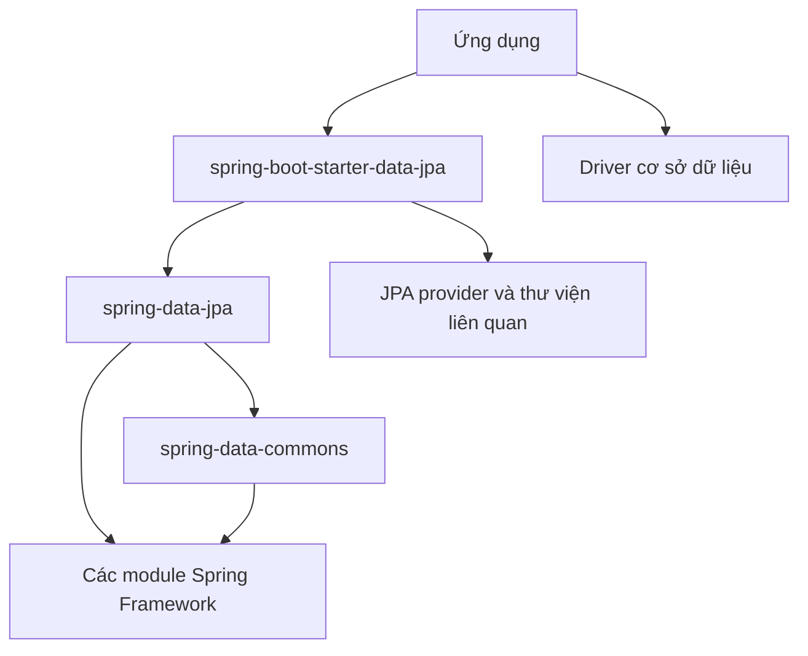
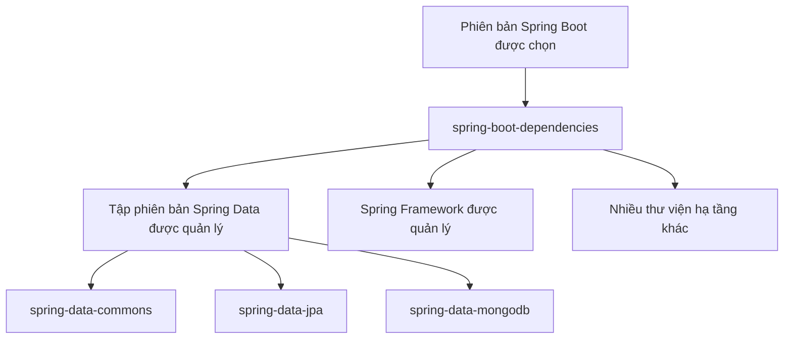

# Release train, Spring Data BOM và dependency management của Spring Boot

Trong một ứng dụng Spring Data, `spring-data-commons` thường xuất hiện cùng module dành cho kho dữ liệu như Spring Data JPA hoặc Spring Data MongoDB. Các module này lại làm việc với Spring Framework, driver, thư viện persistence và công cụ build. Chọn riêng phiên bản mới nhất cho từng artifact có thể tạo ra một classpath mà từng dependency đều tải được nhưng không hoạt động cùng nhau.

Bài này thuộc chương **Phụ thuộc và phiên bản** của Spring Data Commons (`SPRING_DATA_COMMONS`). Mục tiêu là hiểu ba tầng quyết định phiên bản: **release train điều phối một tập module Spring Data; Spring Data BOM biểu diễn tập phiên bản đó cho công cụ build; Spring Boot quản lý một tập dependency rộng hơn cho ứng dụng**. Đây là nền tảng để dùng ổn định các abstraction như Repository, CRUD, derived query, phân trang, projection và auditing.

Các cấu hình bên dưới dùng giá trị thay thế như `BOOT_VERSION_DA_XAC_NHAN` và `TRAIN_VERSION_DA_XAC_NHAN`. Chúng không phải phiên bản artifact có thật. Trước khi dùng, phải thay bằng phiên bản đã được chọn cho dự án. Bài không chỉ định một bộ phiên bản mới nhất vì lựa chọn phụ thuộc dòng Boot, Java, module lưu trữ và yêu cầu của ứng dụng.

## 1. Vấn đề cần giải quyết: một tính năng, nhiều dependency liên quan

Giả sử ứng dụng dùng repository cho đơn hàng trên JPA. Một phần đồ thị dependency có thể được nhìn như sau:



Sơ đồ chỉ mô tả một phần quan hệ để giải thích vấn đề quản lý phiên bản. Trong đồ thị đầy đủ còn có những dependency và đường phụ thuộc khác.

Commons cung cấp nhiều API và hạ tầng dùng chung cho repository, truy vấn, mapping metadata và auditing. Module JPA sử dụng những phần thích hợp của Commons để cung cấp khả năng làm việc với JPA. Vì thế, hai module không nên được chọn như hai thư viện hoàn toàn độc lập.

Một tình huống lỗi thường gặp:

```text
Module JPA được biên dịch và phát hành cùng một tập API Commons.
Ứng dụng tự ghim Commons sang một phiên bản khác.
Công cụ build chọn phiên bản đã bị ghim.
Đến lúc chạy, một lớp hoặc phương thức cần dùng không còn khớp.
```

Hệ quả có thể là `NoSuchMethodError`, `NoClassDefFoundError` hoặc lỗi khởi tạo repository. Những lỗi này còn có nhiều nguyên nhân khác, nhưng xung đột phiên bản là một hướng kiểm tra quan trọng. Tên derived query đúng hoặc entity mapping đúng không sửa được một classpath không tương thích.

## 2. Release train: điều phối phát hành nhiều module

### 2.1. Release train là gì?

Một **release train** của Spring Data điều phối việc phát hành một tập dự án hoặc module Spring Data. Thay vì yêu cầu người dùng tự thử mọi tổ hợp Commons, JPA, MongoDB và những module liên quan, train cung cấp một tập phiên bản được phối hợp để sử dụng cùng nhau.

Có thể hình dung:

```text
Một phiên bản release train
├── spring-data-commons -> một phiên bản module cụ thể
├── spring-data-jpa     -> một phiên bản module cụ thể
├── spring-data-mongodb -> một phiên bản module cụ thể
└── các module Spring Data khác có trong train
```

Train là đơn vị điều phối phát hành; ứng dụng không cần cài tất cả các module trong train. Một ứng dụng chỉ dùng MongoDB vẫn có thể hưởng lợi từ tập phiên bản được quản lý mà không đưa JPA vào classpath.

### 2.2. Phiên bản train và phiên bản module là hai tọa độ khác nhau

Không lấy chuỗi phiên bản train rồi gán trực tiếp cho `spring-data-commons` hoặc `spring-data-jpa`. Version của BOM và version của từng module có vai trò riêng, dù có thể nhìn tương tự trong một số dòng phát hành.

| Tọa độ | Version biểu thị điều gì? |
| --- | --- |
| `org.springframework.data:spring-data-bom` | Phiên bản của BOM dùng để chọn tập module trong train. |
| `org.springframework.data:spring-data-commons` | Phiên bản của artifact Commons cụ thể. |
| `org.springframework.data:spring-data-jpa` | Phiên bản của artifact JPA cụ thể. |
| `org.springframework.data:spring-data-mongodb` | Phiên bản của artifact MongoDB cụ thể. |

Tên và cách đánh số train đã có thay đổi qua lịch sử Spring Data. Điều ổn định cần nhớ là **tra tập phiên bản được quản lý**, không suy ra rằng mọi module đều dùng cùng một chuỗi version hoặc rằng version của module bằng version của train.

### 2.3. Phạm vi bảo đảm của train

Release train giúp điều phối tương thích giữa các module tham gia. Nó không đồng nghĩa:

- Mọi train đều chạy với mọi phiên bản Spring Boot hoặc Spring Framework.
- Mọi module đều có cùng khả năng repository, truy vấn, transaction và reactive.
- Mọi driver, persistence provider hoặc thư viện bên ngoài đều đã được Spring Data BOM quản lý đủ cho ứng dụng.
- Nâng một train sẽ không tạo ra thay đổi hành vi cần kiểm thử.

Chẳng hạn Commons có abstraction `Pageable`, nhưng cách thực thi truy vấn phân trang vẫn phụ thuộc module kho dữ liệu. Đồng bộ phiên bản giải quyết tính phối hợp của thư viện; nó không xóa khác biệt về chức năng giữa các store.

## 3. Spring Data BOM: biến tập phiên bản thành dữ liệu cho build

### 3.1. BOM là gì?

**BOM**, viết tắt của *Bill of Materials*, là một POM tập trung khai báo các phiên bản được quản lý. Tọa độ BOM dành cho Spring Data là:

```text
groupId:    org.springframework.data
artifactId: spring-data-bom
packaging:  pom
```

Trong Maven, ứng dụng thường import BOM vào `dependencyManagement` với `type` là `pom` và `scope` là `import`.

```xml
<dependencyManagement>
    <dependencies>
        <dependency>
            <groupId>org.springframework.data</groupId>
            <artifactId>spring-data-bom</artifactId>
            <version>${spring-data.train.version}</version>
            <type>pom</type>
            <scope>import</scope>
        </dependency>
    </dependencies>
</dependencyManagement>
```

Property `spring-data.train.version` trong đoạn trích là property do dự án tự đặt và phải được định nghĩa. Tên property này không phải yêu cầu bắt buộc của Spring Data.

### 3.2. Quản lý phiên bản khác với thêm dependency

Một BOM được import không tự đưa tất cả thư viện được quản lý vào ứng dụng.

```text
BOM: nói rằng nếu cần artifact X, dùng version nào theo chính sách quản lý.
Dependency: nói rằng ứng dụng thực sự cần artifact X trên một classpath cụ thể.
```

Ví dụ sau chỉ thêm Commons:

```xml
<dependencies>
    <dependency>
        <groupId>org.springframework.data</groupId>
        <artifactId>spring-data-commons</artifactId>
    </dependency>
</dependencies>
```

Nếu `spring-data-bom` đã được import và quản lý artifact đó, Maven có thể lấy version từ phần quản lý. Tuy nhiên, chỉ có Commons vẫn chưa tạo ra một JPA repository hay MongoDB repository hoạt động. Ứng dụng cần module store, cấu hình và các dependency liên quan.

Đồng thời, BOM không tự:

- Cài đặt một cơ sở dữ liệu hoặc tạo kết nối.
- Sinh entity, mapping hay interface repository.
- Bật auditing và cung cấp thông tin người dùng hiện tại.
- Cấu hình plugin đóng gói ứng dụng.

Đây là những trách nhiệm khác với việc chọn version.

### 3.3. BOM giúp nhất quán nhưng vẫn có thể bị ghi đè

Một dự án có thể import đúng BOM nhưng sau đó khai báo version riêng cho Commons. Khi đó, đồ thị cuối có thể không còn dùng toàn bộ tập phiên bản từ train như dự định.

```xml
<!-- Ví dụ cần xem xét lại: đang ghim riêng một module. -->
<dependency>
    <groupId>org.springframework.data</groupId>
    <artifactId>spring-data-commons</artifactId>
    <version>COMMONS_VERSION_GHIM_RIENG</version>
</dependency>
```

Điều cần đánh giá là **version được resolve cuối cùng và nguồn quyết định version ấy**, không chỉ việc trong build có xuất hiện chữ `spring-data-bom`.

## 4. Spring Boot quản lý một tập dependency rộng hơn

### 4.1. Ba artifact dễ nhầm

| Thành phần | Vai trò |
| --- | --- |
| `spring-boot-starter-data-jpa` hoặc starter tương ứng | Tập dependency thuận tiện cho một nhóm tính năng. |
| `spring-boot-dependencies` | BOM quản lý nhiều dependency trong hệ sinh thái Boot, bao gồm tập Spring Data phù hợp với dòng Boot đó. |
| `spring-boot-starter-parent` | Parent Maven cung cấp dependency management cùng những mặc định và plugin management phục vụ build. |

Starter giúp chọn thư viện cần dùng. BOM giúp chọn version. Parent còn tham gia vào cấu hình build được kế thừa. Ba vai trò này liên quan nhưng không thể hoán đổi cho nhau.

### 4.2. Chuỗi quyết định khi đi theo Boot

Trong một ứng dụng theo tập dependency mặc định của Boot, có thể đọc chính sách phiên bản như sau:



Sơ đồ mô tả quan hệ quản lý phiên bản. Nó không có nghĩa tất cả các artifact ở cuối sơ đồ sẽ được tải vào ứng dụng.

Với ứng dụng Boot thông thường, điểm bắt đầu hợp lý là dùng tập dependency do Boot quản lý và không gắn version riêng cho các module Spring Data đã được quản lý. Khi cần cập nhật, trước tiên xem bản Boot phù hợp có cung cấp tập thư viện mong muốn hay không.

### 4.3. Đừng dùng version Boot cho artifact Spring Data

Một lỗi cấu hình là dùng `${spring-boot.version}` làm version cho `spring-data-commons`. Version Boot định danh artifact Boot, không phải version dùng chung cho mọi thư viện trong hệ sinh thái.

```text
Boot version     -> chọn tập dependency được quản lý
Spring Data BOM  -> xác định các version module Spring Data
Module version   -> chọn artifact cụ thể
```

Tương tự, version của driver, Hibernate hoặc plugin Maven không được suy ra bằng cách sao chép version Spring Data.

## 5. Maven với Spring Boot: hai cách thiết lập phổ biến

### 5.1. Kế thừa `spring-boot-starter-parent`

Nếu dự án không bị ràng buộc bởi một parent khác, cấu hình có thể bắt đầu như sau:

```xml
<project xmlns="http://maven.apache.org/POM/4.0.0"
         xmlns:xsi="http://www.w3.org/2001/XMLSchema-instance"
         xsi:schemaLocation="http://maven.apache.org/POM/4.0.0 https://maven.apache.org/xsd/maven-4.0.0.xsd">
    <modelVersion>4.0.0</modelVersion>

    <parent>
        <groupId>org.springframework.boot</groupId>
        <artifactId>spring-boot-starter-parent</artifactId>
        <version>BOOT_VERSION_DA_XAC_NHAN</version>
        <relativePath/>
    </parent>

    <groupId>com.example</groupId>
    <artifactId>orders</artifactId>
    <version>1.0.0-SNAPSHOT</version>

    <dependencies>
        <dependency>
            <groupId>org.springframework.boot</groupId>
            <artifactId>spring-boot-starter-data-jpa</artifactId>
        </dependency>
    </dependencies>
</project>
```

Đây là khung minh họa dependency management, chưa phải toàn bộ cấu hình của một ứng dụng chạy được. Cần chọn Java phù hợp, thêm driver và cấu hình dữ liệu theo môi trường; nếu cần đóng gói ứng dụng Boot, cấu hình plugin thích hợp.

Điểm chính là starter không có `<version>` riêng. Tập phiên bản được lấy từ parent. Không cần khai báo `spring-data-commons` trực tiếp chỉ vì ứng dụng có repository: module store thường đã đưa Commons vào qua dependency bắc cầu.

Dùng Commons trực tiếp trong một thư viện là trường hợp khác. Khi thư viện chủ động công khai hoặc sử dụng API Commons, việc khai báo dependency trực tiếp có thể giúp hợp đồng build rõ ràng, nhưng version vẫn nên đến từ nguồn quản lý đã chọn.

### 5.2. Giữ parent doanh nghiệp và import Boot BOM

Maven chỉ cho một parent trực tiếp. Nếu dự án cần kế thừa parent doanh nghiệp, có thể giữ parent đó và import `spring-boot-dependencies`.

```xml
<properties>
    <spring-boot.version>BOOT_VERSION_DA_XAC_NHAN</spring-boot.version>
</properties>

<dependencyManagement>
    <dependencies>
        <dependency>
            <groupId>org.springframework.boot</groupId>
            <artifactId>spring-boot-dependencies</artifactId>
            <version>${spring-boot.version}</version>
            <type>pom</type>
            <scope>import</scope>
        </dependency>
    </dependencies>
</dependencyManagement>

<dependencies>
    <dependency>
        <groupId>org.springframework.boot</groupId>
        <artifactId>spring-boot-starter-data-jpa</artifactId>
    </dependency>
</dependencies>
```

Đoạn này được đặt vào POM hiện có, không thay thế toàn bộ POM. Import BOM đưa dependency management vào mô hình hiệu lực của Maven, nhưng không kế thừa toàn bộ cấu hình build và plugin management của `spring-boot-starter-parent`.

Vì vậy, cần xem parent doanh nghiệp đã quản lý những gì và cấu hình riêng phần còn thiếu, chẳng hạn compiler hoặc plugin Boot nếu dự án cần. Không suy ra rằng import BOM đã tự cấu hình `spring-boot-maven-plugin`.

### 5.3. Property khi kế thừa parent và khi import BOM

Khi kế thừa parent, một số property được parent công bố có thể dùng để tùy chỉnh version theo cơ chế kế thừa của Maven. Tên property phải được kiểm tra ở đúng dòng Boot đang sử dụng.

Khi chỉ import một BOM, không giả định rằng khai báo một property cùng tên trong POM ứng dụng sẽ thay được mọi giá trị đã được nội suy bên trong BOM đó. Import dependency management không tương đương kế thừa toàn bộ cấu trúc property của một parent.

Đây là lý do một hướng dẫn override dành cho `spring-boot-starter-parent` có thể không hoạt động nguyên dạng ở dự án chỉ import `spring-boot-dependencies`. Hãy kiểm tra effective POM để biết điều gì thật sự có hiệu lực.

## 6. Gradle: nhận diện cơ chế đang quản lý dependency

### 6.1. Không đồng nhất Boot plugin với dependency management

Trong Gradle, plugin Boot phục vụ các khả năng build của ứng dụng Boot. Việc áp dụng plugin Boot không nên được hiểu là mọi dependency tự động được quản lý trong mọi cấu hình build.

Hai cách phổ biến để dùng tập phiên bản Boot là:

| Cách | Cơ chế chính |
| --- | --- |
| Plugin `io.spring.dependency-management` phối hợp với plugin Boot | Plugin dependency management thực thi cơ chế quản lý dependency; khi tích hợp theo cấu hình được hỗ trợ, tập BOM của Boot được áp dụng. |
| Hỗ trợ BOM native của Gradle | Khai báo Boot BOM bằng `platform(...)` trong configuration phù hợp. |

Không cần đưa cả hai vào cùng một ví dụ cơ bản. Nếu dự án đã kết hợp nhiều cơ chế, cần đọc quy tắc thực tế của chúng thay vì dựa vào thứ tự nhìn thấy trong file build.

### 6.2. Ví dụ Groovy DSL dùng BOM native

```groovy
plugins {
    id 'java'
}

repositories {
    mavenCentral()
}

def bootVersion = providers.gradleProperty('springBootVersion').get()

dependencies {
    implementation platform(
        "org.springframework.boot:spring-boot-dependencies:${bootVersion}"
    )

    implementation 'org.springframework.boot:spring-boot-starter-data-jpa'
}
```

Property `springBootVersion` cần được cung cấp qua cấu hình Gradle của dự án hoặc tham số build. Ví dụ tập trung vào dependency management nên không cấu hình plugin Boot, driver hay task đóng gói ứng dụng.

Với `implementation` của Java plugin, các dependency và ràng buộc của configuration này tham gia những classpath tương ứng theo quan hệ configuration. Nếu dùng configuration riêng, cần bảo đảm BOM có tác dụng ở đúng nơi cần resolve. Có BOM trong một configuration không đồng nghĩa mọi configuration tùy biến đều tự kế thừa nó.

Nếu dự án cũng dùng plugin Boot, chọn version plugin và BOM theo cùng chính sách phiên bản của dự án. Đừng để plugin được nâng ở một nơi còn BOM vẫn bị ghim ở nơi khác mà không nhận ra.

### 6.3. `platform` không đồng nghĩa cưỡng ép mọi version

`platform(...)` đưa các ràng buộc version từ BOM vào quá trình resolve của Gradle. Kết quả cuối vẫn chịu ảnh hưởng của dependency khác, constraint, rule và chính sách resolve.

`enforcedPlatform(...)` có tác dụng cưỡng ép mạnh hơn. Đây không phải thay đổi tương đương về ý nghĩa; đặc biệt với một thư viện được phát hành cho dự án khác sử dụng, sự cưỡng ép có thể ảnh hưởng tới người tiêu thụ.

Không thay `platform` bằng `enforcedPlatform` chỉ để làm một báo cáo dependency trông đồng đều. Trước hết phải biết nguồn xung đột và quyết định chính sách phiên bản mong muốn.

## 7. Không dùng Spring Boot: import Spring Data BOM trực tiếp

Một thư viện hoặc ứng dụng có thể dùng Spring Data mà không dùng Boot. Khi đó, Spring Data BOM là công cụ phù hợp để quản lý tập module Spring Data.

Ví dụ các phần trong POM của một thư viện chỉ cần API Commons:

```xml
<properties>
    <spring-data.train.version>TRAIN_VERSION_DA_XAC_NHAN</spring-data.train.version>
</properties>

<dependencyManagement>
    <dependencies>
        <dependency>
            <groupId>org.springframework.data</groupId>
            <artifactId>spring-data-bom</artifactId>
            <version>${spring-data.train.version}</version>
            <type>pom</type>
            <scope>import</scope>
        </dependency>
    </dependencies>
</dependencyManagement>

<dependencies>
    <dependency>
        <groupId>org.springframework.data</groupId>
        <artifactId>spring-data-commons</artifactId>
    </dependency>
</dependencies>
```

Nếu cần JPA, MongoDB hoặc một store khác, khai báo module tương ứng thay vì chờ Commons tự cung cấp triển khai. Những dependency như driver, persistence provider và cấu hình Spring Framework phải được phối hợp phù hợp với module được chọn.

Trong Gradle, ý tưởng tương ứng là đưa `org.springframework.data:spring-data-bom` vào `platform(...)`, rồi khai báo module cần dùng mà không ghim version riêng. Spring Data BOM tập trung vào tập Spring Data; nó không thay thế toàn bộ vai trò quản lý hệ sinh thái rộng của Boot.

Với dự án không dùng Boot, trách nhiệm lựa chọn Java baseline, Spring Framework, driver và những thành phần khác thuộc về cấu hình dự án. Việc build tải được artifact chưa đủ chứng minh các lựa chọn đó tương thích ở runtime.

## 8. Khi nhiều nguồn cùng quyết định version

### 8.1. Maven: dependency management và dependency resolution

Cần phân biệt hai việc:

- **Dependency management** cung cấp hoặc điều phối version và một số thuộc tính dependency.
- **Dependency resolution** xây dựng đồ thị dependency cuối cùng dựa trên khai báo, quan hệ bắc cầu và các quy tắc Maven.

Một số quy tắc hữu ích khi đọc build Maven:

| Tình huống | Cách đọc |
| --- | --- |
| Dependency trực tiếp khai báo version | Version trực tiếp đó không đơn thuần lấy mặc định từ BOM nữa. |
| POM hiện tại khai báo một mục quản lý cụ thể | Mục quản lý trực tiếp có thể được dùng để override giá trị từ BOM import theo quy tắc Maven. |
| Nhiều BOM import ở cùng cấp cùng quản lý một artifact, không có khai báo ưu tiên cao hơn | Thứ tự import có thể quyết định; với xung đột giữa các import như vậy, khai báo đầu tiên được ưu tiên. |
| Có parent, BOM lồng nhau và quản lý ở POM con | Cần đọc effective POM, không suy ra chỉ từ một đoạn XML. |
| Xung đột dependency bắc cầu thông thường | Maven có cơ chế mediation như ưu tiên đường gần hơn; dependency management có thể thay đổi version được chọn. |

Không dùng quy tắc “BOM cuối cùng luôn thắng” cho Maven. Cũng không áp dụng quy tắc ưu tiên của Maven cho mọi build Gradle.

### 8.2. Gradle: phải nhìn cả configuration và constraint

Trong Gradle, version cuối có thể chịu tác động từ:

- Dependency khai báo trực tiếp và các dependency bắc cầu.
- BOM được dùng bằng `platform` hoặc `enforcedPlatform`.
- Constraint, strict version, force hoặc resolution rule.
- Dependency management plugin nếu đang áp dụng.
- Lockfile hoặc chính sách khóa dependency của dự án.

Một version catalog giúp tập trung các tọa độ hoặc alias, nhưng không tự chứng minh mọi dependency trong đồ thị đã được đồng bộ. Chẳng hạn catalog có alias cho Commons với version riêng thì vẫn có thể đưa thêm một yêu cầu version khác với BOM.

Vì thế, cần hỏi: “Artifact này được resolve ở configuration nào, về version nào, và do nguồn nào quyết định?”. Chỉ nhìn chuỗi version viết trong một file cấu hình có thể bỏ sót kết quả thực tế.

### 8.3. Một dòng version duy nhất vẫn có thể sai

Công cụ build thường chọn một version của một module cho một classpath đã resolve. Vì vậy, thấy đúng một `spring-data-commons` trong báo cáo không đủ kết luận classpath tương thích.

Có thể module JPA đang thuộc một train còn Commons đã bị ép về một version khác. Chỉ một version của Commons được chọn, nhưng đó có thể là version không phù hợp với module JPA.

Mục tiêu cần kiểm tra là **một tập phiên bản có chủ đích và tương thích**, không chỉ “không có hai dòng cùng tên artifact”.

## 9. Override phiên bản: chọn phạm vi thay đổi phù hợp

### 9.1. Ưu tiên xác định nhu cầu trước

Ví dụ đội dự án cần một bản sửa lỗi trong Spring Data. Các hướng xử lý có phạm vi khác nhau:

| Hướng | Phạm vi ảnh hưởng | Điều cần đánh giá |
| --- | --- | --- |
| Nâng lên bản Boot phù hợp trong chính sách dự án | Cập nhật tập dependency do Boot quản lý. | Thay đổi của Boot và các thành phần liên quan, Java baseline và kiểm thử ứng dụng. |
| Override tập Spring Data theo train | Cập nhật phối hợp các module Spring Data. | Tương thích với Boot, Framework, store và driver hiện tại. |
| Override một module đơn lẻ | Thay một phần của tập đã được quản lý. | Module có còn tương thích với các thành phần còn lại không; vì sao không thể nâng theo tập? |

Không phải mọi thay đổi đều bắt buộc nâng toàn bộ ứng dụng. Tuy nhiên, một override đơn lẻ cần có lý do cụ thể và bằng chứng tương thích, vì nó dễ làm lệch tập module hơn.

### 9.2. Cách hiểu đúng về override train

Nếu buộc phải dùng một train khác với train Boot quản lý, hãy xác định rõ cơ chế override của build:

- Với Boot parent Maven, xem property hoặc điểm cấu hình mà dòng parent đó hỗ trợ.
- Với Maven chỉ import BOM, tổ chức `dependencyManagement` theo quy tắc ưu tiên và kiểm tra effective POM.
- Với Gradle, chọn cơ chế tương ứng với dependency management plugin hoặc BOM native đang dùng.

Không sao chép tên property từ một hướng dẫn của dòng Boot khác rồi kết luận đã override thành công. Cũng không thêm một BOM thứ hai chỉ để thử vận may với thứ tự khai báo.

Sau thay đổi, cần xác nhận các module Spring Data thực sự được resolve về tập mong muốn. Nâng toàn train giúp phối hợp nội bộ Spring Data, nhưng vẫn phải đánh giá tương thích với hệ sinh thái bên ngoài train.

### 9.3. Override không bổ sung khả năng mà store không hỗ trợ

Giả sử code dùng một kiểu trả về repository mà module hiện tại không hỗ trợ. Nâng Commons riêng không tự biến module store thành triển khai của khả năng đó.

Tương tự, nâng train không tự thêm cấu hình auditing, không tự chuyển một query SQL sang ngôn ngữ truy vấn MongoDB và không tự thay đổi mô hình giao dịch của store. Version, khả năng API và cấu hình tính năng là những chiều cần xem riêng khi chẩn đoán.

## 10. Đọc dependency đã resolve trong dự án thực tế

Các lệnh ở phần này là ví dụ để người học kiểm tra build của chính mình. Cần chọn Maven hoặc Gradle đúng với dự án, dùng wrapper nếu dự án đã cung cấp và đối chiếu cả classpath phát sinh lỗi.

### 10.1. Maven

Xem các module Spring Data trong cây dependency:

```shell
mvn dependency:tree "-Dincludes=org.springframework.data:*"
```

Xem POM hiệu lực sau khi Maven kết hợp parent, property và dependency management:

```shell
mvn help:effective-pom
```

Hai lệnh trả lời hai câu hỏi khác nhau:

| Kết quả | Câu hỏi chính |
| --- | --- |
| Dependency tree | Những artifact nào tham gia đồ thị và version nào đang được chọn? |
| Effective POM | Những khai báo quản lý và cấu hình nào thực sự có hiệu lực? |

Tùy mức chi tiết của plugin và tùy chọn đang dùng, báo cáo cây có thể hiện thêm các dependency bị bỏ qua do xung đột. Nếu chưa đủ thông tin, cần dùng chế độ hiển thị phù hợp của phiên bản công cụ đó.

### 10.2. Gradle

Với một dự án Java dùng wrapper, có thể xem runtime classpath:

```shell
./gradlew dependencies --configuration runtimeClasspath
```

Sau đó xem lý do chọn Commons:

```shell
./gradlew dependencyInsight --dependency spring-data-commons --configuration runtimeClasspath
```

Trên Windows, dùng wrapper tương ứng như `gradlew.bat`. Trong build nhiều project, cần chọn đúng project chứa ứng dụng hoặc thư viện đang lỗi. Nếu lỗi ở compilation hoặc test, xem thêm configuration tương ứng như `compileClasspath` hoặc `testRuntimeClasspath` thay vì mặc định runtime của ứng dụng chính giải thích được mọi trường hợp.

`dependencyInsight` hữu ích vì nó cho thấy đường dẫn và lý do chọn version. Một báo cáo có thể cho thấy Commons được đưa vào qua module store nhưng version cuối bị nâng hoặc ép bởi một khai báo khác.

### 10.3. Ghi lại kết quả đủ để đối chiếu

Một bảng kiểm tra dependency có thể giữ các thông tin sau:

| Thành phần | Cần xác định |
| --- | --- |
| Spring Boot | Version hoặc nguồn quản lý đang chọn. |
| Spring Data BOM | Train nào có hiệu lực, nếu được dùng. |
| Commons và module store | Version thực tế đã resolve của từng module liên quan. |
| Spring Framework và thư viện store | Có thuộc tập tương thích theo lựa chọn của dự án không? |
| Override | Khai báo trực tiếp, property, BOM khác hoặc rule nào đang tác động? |
| Classpath | Compile, runtime, test hay configuration tùy biến nào đang được xem? |

Không cần liệt kê toàn bộ hàng trăm dependency để hiểu một xung đột ban đầu. Hãy bắt đầu ở các artifact có liên hệ với lỗi, rồi mở rộng theo bằng chứng.

## 11. Tình huống thực hành: repository lỗi sau khi thêm Commons trực tiếp

### 11.1. Diễn biến

Một ứng dụng Boot có `spring-boot-starter-data-jpa` không ghi version. Repository chạy bình thường. Sau đó, lập trình viên thêm `spring-data-commons` trực tiếp với một version lấy từ ví dụ khác để dùng một API mới.

Sau thay đổi, ứng dụng phát sinh `NoSuchMethodError` khi khởi tạo repository.

Không nên kết luận ngay rằng Spring Data có lỗi hoặc entity mapping sai. Thay đổi version vừa xuất hiện là một giả thuyết có thể kiểm chứng.

### 11.2. Cách phân tích

1. Xác định class và method được nêu trong lỗi để biết thành phần gọi và thành phần được gọi.
2. Xem version Commons thực tế trên classpath phát sinh lỗi.
3. Xem module JPA thực tế và tập Spring Data mà Boot đang quản lý.
4. Kiểm tra khai báo Commons trực tiếp có thay version từ tập quản lý không.
5. Xác định API mới thật sự yêu cầu phiên bản nào và có giải pháp phù hợp với dòng Boot hiện tại không.

Nếu dependency trực tiếp không cần thiết, có thể bỏ khai báo đó để quay về dependency bắc cầu được quản lý. Nếu dự án cần khai báo trực tiếp cho hợp đồng build, có thể giữ artifact nhưng bỏ version riêng để dùng quản lý chung, với điều kiện API cần dùng có trong phiên bản được chọn.

Nếu API cần một tập phiên bản mới hơn, phải quyết định nâng Boot hoặc phối hợp nâng Spring Data cùng các thành phần liên quan. Không sửa bằng cách ghim tiếp JPA, Framework và nhiều artifact khác cho đến khi tình cờ hết lỗi đầu tiên.

### 11.3. Xác minh sau khi sửa chính sách version

Việc xem lại dependency graph giúp xác nhận build đang dùng tập phiên bản mong muốn. Sau đó, kiểm thử cần đánh vào tính năng ứng dụng thực sự sử dụng, chẳng hạn:

- Khởi tạo application context và repository của đúng store.
- Lưu rồi đọc một đối tượng qua đường mapping chính.
- Chạy derived query hoặc truy vấn khai báo có ý nghĩa với ứng dụng.
- Kiểm tra phân trang, projection hoặc auditing nếu phần nâng cấp có liên quan.
- Kiểm tra transaction và xử lý đồng thời nếu thay đổi ảnh hưởng hành vi đó.

Biên dịch thành công chỉ xác nhận một phần tương thích. Một thay đổi mapping hoặc truy vấn có thể chỉ bộc lộ khi chạy với cơ sở dữ liệu phù hợp.

## 12. Chọn nguồn quản lý cho từng loại dự án

| Dự án | Điểm bắt đầu phù hợp | Cần tránh |
| --- | --- | --- |
| Ứng dụng Boot dùng Maven, không có parent bắt buộc khác | Boot parent và starter phù hợp. | Gắn version riêng cho từng module Spring Data đã được quản lý. |
| Ứng dụng Boot dùng Maven và có parent doanh nghiệp | Import Boot BOM, xem lại cấu hình build được parent cung cấp. | Tưởng import BOM đã kế thừa toàn bộ plugin management của Boot parent. |
| Ứng dụng Boot dùng Gradle | Chọn cơ chế dependency management phù hợp hoặc dùng Boot BOM native. | Tưởng chỉ áp dụng Boot plugin đã đủ trong mọi cấu hình. |
| Dự án Spring Data không dùng Boot | Spring Data BOM cho tập module Spring Data và quản lý các nền tảng liên quan riêng. | Mong BOM Spring Data thay toàn bộ trách nhiệm của Boot. |
| Thư viện dùng API Commons | Khai báo dependency cần thiết, xác định phạm vi tương thích cho người dùng thư viện. | Áp đặt vô tình một chính sách version cưỡng ép mà người tiêu thụ không dự kiến. |

Trong dự án nhiều module, nên đặt chính sách dùng chung ở nơi quản lý tập trung phù hợp với cấu trúc build. Mỗi module vẫn phải khai báo dependency mà nó thực sự cần; quản lý version tập trung không thay thế ranh giới dependency rõ ràng giữa các module.

## 13. Bài tập tự kiểm tra

### Câu 1: import BOM nhưng repository chưa hoạt động

Một dự án chỉ import `spring-data-bom`, không khai báo Commons hay module store. Vì sao nó chưa có khả năng truy cập dữ liệu?

**Gợi ý:** BOM là quản lý version. Dependency thật, triển khai store, driver và cấu hình hoạt động là những phần cần được cung cấp riêng.

### Câu 2: các module không cùng chuỗi version

Một BOM quản lý các module bằng những chuỗi version không hoàn toàn giống nhau. Có cần sửa để tất cả bằng nhau không?

**Gợi ý:** Không sửa chỉ để chuỗi version giống nhau. Cần xác định chúng có đúng tập được BOM quản lý không; version train và version từng artifact không phải một khái niệm.

### Câu 3: Maven đã thấy hai BOM

POM import cả Boot BOM và Spring Data BOM. Có thể kết luận train mong muốn đang có hiệu lực không?

**Gợi ý:** Chưa. Cần đọc quy tắc ưu tiên, effective POM, version đã resolve và các khai báo quản lý hoặc version trực tiếp khác.

### Câu 4: Gradle chỉ hiện một Commons

Báo cáo runtime chỉ có một version Commons. Điều đó có đủ để khẳng định tương thích với module store không?

**Gợi ý:** Chưa. Phải đối chiếu version được chọn với module store và chính sách train hoặc Boot, đồng thời tìm lý do version đó được chọn.

### Câu 5: nâng Commons để có một tính năng repository

Một API Commons mới tồn tại trong phiên bản cao hơn. Có nên ghim riêng Commons ngay không?

**Gợi ý:** Trước hết xác định module store có hỗ trợ khả năng đó không, tập phiên bản nào phối hợp được với nó và dự án nên nâng ở cấp Boot, train hay module. API tồn tại chưa đồng nghĩa toàn bộ đường thực thi đã sẵn sàng.

Khi đọc một build dùng Spring Data, hãy nối ba câu hỏi: **ai chọn tập phiên bản, công cụ build đã resolve ra tập nào, và tập đó có phù hợp với runtime của ứng dụng không**. Release train, Spring Data BOM và dependency management của Boot lần lượt giúp trả lời các phần của chuỗi này; không phần nào thay thế việc hiểu module kho dữ liệu và hành vi ứng dụng thực tế.
