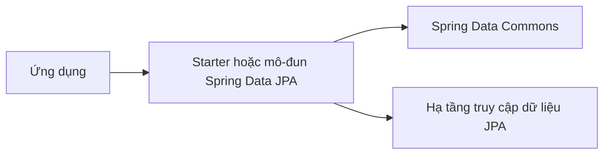

# Phạm vi sử dụng Commons trực tiếp trong thư viện hoặc ứng dụng

Spring Data Commons là nền tảng dùng chung cho nhiều mô-đun Spring Data. Bạn có thể sử dụng trực tiếp một số kiểu như `Pageable`, `Sort`, `Page`, `Slice` hoặc các contract repository mà không cần ứng dụng đó sử dụng JPA hay MongoDB.

Tuy nhiên, có dependency `spring-data-commons` không có nghĩa ứng dụng đã có một cơ chế lưu trữ hoàn chỉnh. Việc chọn Commons trực tiếp còn ảnh hưởng đến API công khai của thư viện, dependency mà bên sử dụng phải nhận và cách quản lý phiên bản.

Bài học thuộc chương **Phụ thuộc và phiên bản** của mô-đun **SPRING_DATA_COMMONS**. Mục tiêu là xác định đúng phạm vi sử dụng Commons trong thư viện hoặc ứng dụng, phân biệt dependency trực tiếp với dependency bắc cầu và chọn phạm vi khai báo phù hợp.

## 1. “Sử dụng trực tiếp” có hai khía cạnh

Cần tách hai câu hỏi thường bị gộp làm một:

1. **Mã nguồn có gọi hoặc công bố API của Commons không?**
2. **Build của mô-đun có khai báo dependency Commons trực tiếp không?**

Ví dụ, một ứng dụng dùng starter JPA có thể biên dịch đoạn mã tham chiếu `Pageable` vì Commons đã có trên classpath thông qua dependency bắc cầu. Mã nguồn dùng API Commons trực tiếp, dù build chưa khai báo cạnh dependency trực tiếp tới Commons.

Ngược lại, thêm Commons vào build nhưng không dùng API nào của nó không tạo ra giá trị tự động cho ứng dụng.

| Khái niệm | Ý nghĩa |
| --- | --- |
| Dependency trực tiếp | Mô-đun khai báo artifact đó trong cấu hình dependency của chính mình |
| Dependency bắc cầu | Artifact được đưa vào thông qua dependency của một dependency khác |
| Dependency dùng trong implementation | Mã bên trong cần dependency, nhưng contract công khai có thể không nhắc đến nó |
| Dependency xuất hiện trong API công khai | Kiểu của dependency xuất hiện ở tham số, kiểu trả về, kiểu cha hoặc contract công khai khác |
| Phạm vi dependency | Quy tắc quyết định dependency có mặt ở bước biên dịch, kiểm thử, chạy và được công bố cho bên sử dụng như thế nào |

Artifact của Commons là:

```text
org.springframework.data:spring-data-commons
```

Không nên suy ra phạm vi sử dụng chỉ từ việc thấy artifact này trong danh sách thư viện. Cần xem cả mã nguồn, API công khai và dependency được công bố.

## 2. Những gì có thể dùng khi chỉ phụ thuộc Commons

Commons chứa các abstraction và hạ tầng dùng chung. Một số nhóm có thể được tham chiếu độc lập với một mô-đun lưu trữ:

| Nhóm API | Ví dụ sử dụng trực tiếp | Điều chưa tự xuất hiện |
| --- | --- | --- |
| Phân trang và sắp xếp | Tạo `PageRequest`, truyền `Pageable`, mô tả `Sort` | Truy vấn cơ sở dữ liệu hoặc sắp xếp danh sách tự động |
| Kết quả phân trang | Dùng `Page`, `Slice` làm contract hoặc tạo kết quả phù hợp | Tổng số phần tử chính xác nếu implementation không tính |
| Repository | Khai báo `Repository`, `CrudRepository` hoặc interface trung gian | Bean repository có thể thực thi CRUD |
| Query by Example | Tạo `Example`, cấu hình `ExampleMatcher` | Một engine tự tìm kiếm trên mọi nguồn dữ liệu |
| Auditing | Tham chiếu annotation và contract như `AuditorAware` | Điền người tạo/sửa nếu chưa tích hợp cơ chế auditing |
| Mapping và metadata | Xây công cụ hoặc tích hợp dựa trên abstraction metadata | Mapping đầy đủ cho một kho dữ liệu bất kỳ |
| Projection | Dùng các cơ chế hỗ trợ phù hợp để xây tầng đọc | Tự sinh truy vấn tối ưu cho mọi loại nguồn dữ liệu |

Điểm chung là **mô tả yêu cầu hoặc cung cấp hạ tầng không đồng nghĩa với thực thi yêu cầu trên một kho dữ liệu**.

Một thư viện có thể dùng `Pageable` làm contract cho việc đọc từ dịch vụ từ xa hoặc dữ liệu tự quản lý. Implementation của thư viện phải tự chuyển yêu cầu đó thành thao tác mà nguồn dữ liệu hiểu.

## 3. Trường hợp ứng dụng chỉ cần API tiện ích của Commons

Giả sử ứng dụng gọi một dịch vụ danh mục bên ngoài. Dịch vụ đó nhận số trang, kích thước trang và tiêu chí sắp xếp. Nhóm phát triển muốn dùng các kiểu phân trang của Spring Data trong lớp tích hợp.

Ứng dụng có thể tạo yêu cầu:

```java
import org.springframework.data.domain.PageRequest;
import org.springframework.data.domain.Pageable;
import org.springframework.data.domain.Sort;

Pageable request = PageRequest.of(
    0,
    20,
    Sort.by("name").ascending()
);
```

Đoạn mã nằm trong một phương thức của ứng dụng. Nó tạo một đối tượng mô tả yêu cầu:

- Trang đầu có chỉ số `0` theo quy ước của `PageRequest`.
- Kích thước trang là 20.
- Thứ tự mong muốn là tăng dần theo thuộc tính `name`.

Không có repository hay cơ sở dữ liệu nào được gọi ở đoạn này. Adapter phải ánh xạ `name` sang tiêu chí mà dịch vụ bên ngoài chấp nhận, chuyển quy ước số trang nếu khác và gửi yêu cầu thực tế.

Nếu nguồn dữ liệu chỉ hỗ trợ cursor, không nên hứa hẹn khả năng nhảy đến trang bất kỳ chỉ vì contract có một số trang. Contract cần phản ánh đúng khả năng thực tế của nguồn.

Trong trường hợp này, phụ thuộc trực tiếp Commons có thể phù hợp nếu ứng dụng đã chấp nhận các kiểu đó. Thêm cả starter JPA chỉ để dùng `PageRequest` sẽ kéo vào một nhóm khả năng không phục vụ nhu cầu đã nêu.

## 4. Trường hợp ứng dụng dùng mô-đun lưu trữ cụ thể

Một ứng dụng JPA thường có quan hệ dependency khái niệm như sau:



Với MongoDB, nhánh tích hợp được thay bằng mô-đun và client tương ứng. Commons thường đến thông qua dependency bắc cầu.

Cần phân biệt hai quyết định:

- **Chọn bộ khả năng lưu trữ:** dùng mô-đun hoặc starter dành cho công nghệ thực tế.
- **Khai báo dependency mã nguồn sử dụng:** cân nhắc một dependency trực tiếp nếu mô-đun chủ động dùng các API Commons.

Một dependency trực tiếp có thể làm rõ trách nhiệm của mô-đun và giảm việc dựa ngầm vào cấu trúc bắc cầu. Đây là lựa chọn tổ chức build, không phải điều kiện bắt buộc để đoạn mã dùng Commons biên dịch khi classpath bắc cầu đã cung cấp đầy đủ.

Khai báo Commons trực tiếp không nên đi kèm một phiên bản tự chọn làm lệch bộ Spring Data đã được quản lý. Nếu dự án đã dùng dependency management phù hợp, hãy để phiên bản đi theo bộ đó.

Trong cơ chế giải quyết dependency thông thường, có hai đường dẫn đến cùng một artifact không có nghĩa phải tải hai bản JAR chỉ vì có hai cạnh trong đồ thị. Điều cần xem là phiên bản cuối cùng được chọn và classpath thực tế.

**Không thay mô-đun JPA hoặc MongoDB bằng Commons chỉ vì cả hai đều cung cấp tên interface quen thuộc.** Commons không thay thế factory repository, implementation truy vấn, mapping và tích hợp lưu trữ của mô-đun cụ thể.

## 5. Trường hợp thư viện công bố kiểu Commons trong API

Giả sử một thư viện dùng chung công bố contract đọc danh mục:

```java
import org.springframework.data.domain.Page;
import org.springframework.data.domain.Pageable;

public interface CatalogReader {

    Page<CatalogItem> search(
        CatalogFilter filter,
        Pageable pageable
    );
}
```

`CatalogItem` và `CatalogFilter` là các kiểu do thư viện định nghĩa. Hai kiểu còn lại thuộc Commons.

Thiết kế này có thể hợp lý khi thư viện chủ đích tích hợp vào hệ sinh thái Spring Data. Nhưng nó tạo ra những hệ quả cụ thể:

1. Bên sử dụng cần các kiểu Commons trên compile classpath để làm việc đầy đủ với contract.
2. Phiên bản Commons trở thành một phần của yêu cầu tương thích của thư viện.
3. Một ứng dụng không dùng Spring Data vẫn phải chấp nhận dependency nếu muốn dùng API này.
4. Việc đổi kiểu trả về từ `Page` sang kiểu khác có thể là thay đổi API công khai.
5. Contract `Page` yêu cầu implementation cung cấp thông tin tổng phù hợp, không chỉ một danh sách kết quả.

Phụ thuộc không chỉ xuất hiện khi dùng `import` trong thân phương thức. Nó còn có thể lộ ra qua:

- Interface cha mà một interface công khai kế thừa.
- Generic bound hoặc kiểu phần tử trong kiểu trả về.
- Annotation trên API công khai mà bên tích hợp cần đọc.
- Constructor và exception type được công bố.

Chẳng hạn, một interface công khai kế thừa `CrudRepository` cũng công bố sự phụ thuộc vào Commons, dù không viết lại các chữ ký CRUD.

## 6. Trường hợp thư viện muốn giữ API độc lập với Commons

Nếu thư viện cần phục vụ nhiều kiểu ứng dụng, có thể định nghĩa contract của riêng nó:

```java
public record CatalogPageRequest(
    int page,
    int size
) {
    public CatalogPageRequest {
        if (page < 0) {
            throw new IllegalArgumentException("Trang phải không âm");
        }

        if (size < 1 || size > 100) {
            throw new IllegalArgumentException(
                "Kích thước trang phải từ 1 đến 100"
            );
        }
    }
}
```

```java
import java.util.List;

public record CatalogSlice<T>(
    List<T> items,
    boolean hasNext
) {
    public CatalogSlice {
        items = List.copyOf(items);
    }
}
```

```java
public interface CatalogReader {

    CatalogSlice<CatalogItem> search(
        CatalogFilter filter,
        CatalogPageRequest request
    );
}
```

Các đoạn mã minh họa contract Java dùng record. Giới hạn 100 là lựa chọn của thư viện trong ví dụ, không phải giới hạn của Commons. Contract kết quả chỉ cam kết danh sách và khả năng có phần tiếp theo, nên không cần giả định nguồn dữ liệu biết tổng số kết quả.

Một adapter Spring Data có thể chuyển `CatalogPageRequest` sang `Pageable` và chuyển kết quả `Slice` về `CatalogSlice`.

Có thể tách cấu trúc thư viện theo trách nhiệm:

```text
catalog-core
  API và kiểu dữ liệu do thư viện sở hữu

catalog-spring-data
  Adapter, ánh xạ và dependency Spring Data Commons

application
  Chọn adapter và mô-đun lưu trữ phù hợp
```

Đây là cấu trúc minh họa, không phải những thư mục cần tạo để học bài này.

Lợi ích của việc tách là phần core không buộc mọi người dùng nhận Commons. Đổi lại, nhóm phát triển phải duy trì kiểu dữ liệu, ánh xạ và các kiểm tra nhất quán của chính mình.

Không cần tạo một bản sao của toàn bộ `Pageable`, `Sort` và `Page` nếu thư viện vốn chỉ phục vụ các ứng dụng Spring Data. Mức độc lập nên có giá trị rõ ràng cho người sử dụng.

## 7. Khai báo Maven: dependency thường và dependency management

### 7.1. Dependency trực tiếp trong dự án đã quản lý phiên bản

Nếu phiên bản Commons đã được dependency management cung cấp, phần dependency có thể là:

```xml
<dependency>
    <groupId>org.springframework.data</groupId>
    <artifactId>spring-data-commons</artifactId>
</dependency>
```

Không ghi `scope` nghĩa là dùng scope `compile` mặc định của Maven. Dependency có mặt khi biên dịch và chạy, đồng thời thường được truyền tới bên sử dụng theo các quy tắc dependency bắc cầu của Maven.

Đoạn trên không phải một POM độc lập: nếu không có dependency management cung cấp phiên bản, cần bổ sung một phiên bản hợp lệ theo cách quản lý của dự án.

### 7.2. Import BOM khi dự án chủ động quản lý bộ Spring Data

Một dự án không dùng bộ quản lý phiên bản khác có thể import Spring Data BOM:

```xml
<dependencyManagement>
    <dependencies>
        <dependency>
            <groupId>org.springframework.data</groupId>
            <artifactId>spring-data-bom</artifactId>
            <version>${spring-data-bom.version}</version>
            <type>pom</type>
            <scope>import</scope>
        </dependency>
    </dependencies>
</dependencyManagement>
```

`spring-data-bom.version` là property mà dự án phải định nghĩa bằng phiên bản BOM đã lựa chọn và kiểm tra tương thích. Đây không phải tên một phiên bản được bài học mặc định chọn giúp.

Cần nhớ:

- Import BOM quản lý các phiên bản; nó không tự thêm Commons vào classpath.
- Vẫn cần khai báo dependency thực sự nếu mô-đun dùng Commons.
- Phiên bản BOM và phiên bản artifact Commons không nhất thiết có cùng chuỗi giá trị.
- Các mô-đun trong cùng bộ Spring Data không nhất thiết có số phiên bản artifact giống hệt nhau.

Nếu ứng dụng đã để Spring Boot quản lý bộ phiên bản, việc import thêm một BOM khác có thể tạo ra chồng lấn hoặc override. Hãy có một cơ chế quyết định phiên bản rõ ràng thay vì ghép các đoạn cấu hình từ nhiều ví dụ.

### 7.3. Không nhầm `optional` hoặc `provided` với “API chỉ có interface”

| Khai báo Maven | Ý nghĩa liên quan | Khi cần thận trọng |
| --- | --- | --- |
| `compile` | Có khi biên dịch và chạy; được công bố theo quy tắc bắc cầu | Lựa chọn thông thường khi thư viện thực sự cần Commons |
| `runtime` | Không cung cấp dependency cho biên dịch mã chính của chính mô-đun | Không phù hợp nếu mã chính import kiểu Commons mà không có nguồn khác cung cấp |
| `provided` | Biên dịch với dependency nhưng kỳ vọng môi trường cung cấp khi chạy | Một ứng dụng Java hoặc container bất kỳ không tự bảo đảm có Commons |
| `optional=true` | Mô-đun hiện tại vẫn dùng được dependency, nhưng bên sử dụng không tự nhận nó qua đường bắc cầu đó | Consumer cần chủ động thêm dependency nếu dùng phần tích hợp yêu cầu Commons |
| `test` | Phục vụ mã kiểm thử | Không đáp ứng nhu cầu dùng Commons trong mã chính |

Một thư viện trả về `Page<T>` không tự phù hợp với `optional=true` chỉ vì `Page` là interface. Bên dùng vẫn phải có lớp/interface đó để biên dịch, liên kết hoặc chạy các đường mã liên quan.

## 8. Khai báo Gradle: phân biệt `api` và `implementation`

Với Gradle `java-library`, lựa chọn giữa `api` và `implementation` cần dựa trên contract công khai.

Ví dụ minh họa sau giả định phiên bản Commons đã được quản lý bằng platform hoặc cơ chế tương đương:

```kotlin
plugins {
    `java-library`
}

dependencies {
    api("org.springframework.data:spring-data-commons")
}
```

Dùng `api` phù hợp khi kiểu của Commons xuất hiện trong API công khai, chẳng hạn `CatalogReader` nhận `Pageable` và trả `Page`. Consumer cần nhìn thấy dependency để biên dịch với contract đó.

Nếu Commons chỉ được dùng bên trong adapter và API công khai dùng các kiểu của thư viện:

```kotlin
dependencies {
    implementation("org.springframework.data:spring-data-commons")
}
```

`implementation` giúp tránh công bố dependency như một phần compile API của consumer trong mô hình `java-library`. Nó không có nghĩa dependency biến mất ở runtime. Implementation của thư viện vẫn có thể cần Commons khi chạy.

Nếu dự án dùng Spring Data BOM bằng platform, ý tưởng cấu hình là:

```kotlin
val springDataBomVersion: String by project

dependencies {
    implementation(
        platform(
            "org.springframework.data:spring-data-bom:$springDataBomVersion"
        )
    )

    implementation("org.springframework.data:spring-data-commons")
}
```

Property `springDataBomVersion` phải được dự án cung cấp. Ví dụ này dành cho trường hợp Commons là dependency nội bộ; nếu Commons xuất hiện trong API thì cần điều chỉnh khai báo API và cách công bố quản lý phiên bản phù hợp với thư viện.

Bài học không chọn một số phiên bản cụ thể. Các đoạn Maven và Gradle là những hướng minh họa theo công cụ build tương ứng, không phải yêu cầu dùng đồng thời.

### Vì sao `compileOnly` thường không đủ?

`PageRequest` là một lớp phải được nạp khi lời gọi tạo đối tượng thực thi. Ngay cả khi chỉ công bố interface như `Pageable`, các consumer và đường mã liên quan vẫn có thể cần lớp đó.

Vì vậy, `compileOnly` chỉ hợp lý khi có một contract môi trường rõ ràng bảo đảm dependency được cung cấp ở nơi cần thiết. Không chọn nó chỉ để làm nhẹ danh sách dependency được phát hành.

## 9. Chỉ thêm Commons chưa đủ để có repository hoạt động

Xét thư viện công bố:

```java
import java.util.UUID;

import org.springframework.data.repository.CrudRepository;

public interface CustomerRepository
        extends CrudRepository<Customer, UUID> {
}
```

Việc interface biên dịch thành công chỉ chứng minh các kiểu cần thiết có trên compile classpath. Nó chưa chứng minh ứng dụng có thể inject và gọi repository.

Để có repository thực thi được, ứng dụng cần những phần thích hợp, thường gồm:

1. Mô-đun dành cho kho dữ liệu, như JPA hoặc MongoDB.
2. Công nghệ truy cập dữ liệu bên dưới và cấu hình kết nối.
3. Mapping hợp lệ cho `Customer` và định danh.
4. Hạ tầng đăng ký repository đúng mô-đun và đúng phạm vi.
5. Cấu hình bổ sung cho các khả năng được sử dụng.

Một thư viện chứa interface repository cũng cần quy định ứng dụng tích hợp phải làm gì. Package trong một JAR dependency không tự được quét theo đúng mong muốn trong mọi cách cấu hình ứng dụng.

Nếu nhiều mô-đun repository cùng có mặt, một interface generic và mapping không rõ ràng có thể gây khó khăn khi xác định mô-đun quản lý. Đây là vấn đề tích hợp, không giải quyết bằng việc thêm Commons thêm một lần nữa.

### Các annotation cũng có giới hạn tương tự

- `@CreatedDate` và `@LastModifiedDate` không tự kích hoạt auditing.
- `AuditorAware` không tự biết danh tính người dùng của ứng dụng.
- Metadata của Commons không tự ánh xạ mọi kiểu Java vào mọi kho.
- Annotation ID dùng trong Spring Data không mặc nhiên thay thế annotation định danh mà JPA yêu cầu.

Khi dùng một annotation hoặc contract, cần biết thành phần nào đọc nó và thành phần nào thực hiện hành vi mong muốn.

## 10. Quản lý phiên bản khi phát hành thư viện dùng Commons

### 10.1. Xác định tập hợp cần tương thích

Không nên kiểm tra phiên bản Commons một cách tách rời. Tập hợp cần xem xét có thể bao gồm:

- Phiên bản Java tối thiểu.
- Dòng Spring Framework liên quan.
- Spring Data Commons.
- Mô-đun Spring Data cụ thể nếu thư viện có tích hợp với mô-đun đó.
- Bộ phiên bản do Spring Boot quản lý, nếu consumer dùng Spring Boot.

Không phải thư viện nào cũng cần phụ thuộc tất cả các thành phần trên. Danh sách giúp xác định những gì phải kiểm tra trong phạm vi tích hợp thực tế.

Một thư viện chỉ dùng `Pageable` có phạm vi phụ thuộc khác với thư viện xây repository factory hoặc can thiệp mapping metadata. Mức tích hợp càng sâu, cần càng thận trọng với thay đổi của hạ tầng.

### 10.2. Phiên bản biên dịch không phải bảo đảm cho mọi runtime

Thư viện có thể biên dịch với một phiên bản, nhưng ứng dụng tiêu thụ chọn phiên bản khác thông qua dependency management hoặc giải quyết xung đột.

Những lỗi như `NoClassDefFoundError`, `NoSuchMethodError` hoặc lỗi liên kết khác có thể xuất hiện khi runtime thiếu lớp hoặc không có API mà bytecode đã tham chiếu. Không nên kết luận nguyên nhân chỉ từ tên lỗi; cần kiểm tra đường nạp lớp và phiên bản thực tế.

Thư viện nên công bố mức Java và phạm vi tích hợp mà nó đã kiểm tra. Không hứa tương thích với mọi phiên bản Commons chỉ vì chỉ dùng một số interface có tên ổn định.

### 10.3. Không áp đặt phiên bản tùy tiện lên ứng dụng

Ứng dụng tiêu thụ thường là nơi quyết định đồ thị dependency cuối cùng. BOM mà thư viện dùng để tự build không bảo đảm mọi ứng dụng sẽ có một đồ thị runtime giống hệt.

Khi phát hành, cần bảo đảm metadata dependency phản ánh đúng nhu cầu của thư viện. Nếu Commons thuộc API, consumer cần nhận được thông tin dependency phù hợp. Nếu nó chỉ là một tích hợp tùy chọn, cần có cách đóng gói và hướng dẫn rõ ràng để phần còn lại vẫn dùng được theo contract đã hứa.

Không nâng riêng Commons để có một API mới rồi mặc định mô-đun JPA hoặc MongoDB hiện tại sẽ tương thích. Cần xét bộ phiên bản được quản lý và các yêu cầu của từng thành phần.

## 11. Những lựa chọn dễ sai và cách nhận diện

| Lựa chọn | Vì sao dễ sai | Hướng xem lại |
| --- | --- | --- |
| Thêm starter lưu trữ chỉ để dùng `Sort` | Đưa vào nhiều thành phần không phục vụ nhu cầu | Xem liệu dependency Commons trực tiếp có đủ |
| Thay starter lưu trữ bằng Commons để giảm dependency | Mất phần tích hợp thực thi repository | Giữ mô-đun phù hợp với kho dữ liệu |
| Dùng `implementation` nhưng trả `Page` trong public API của thư viện Gradle | Kiểu Commons vẫn lộ qua contract, consumer cần nhìn thấy khi biên dịch | Dùng `api` hoặc đổi contract để không lộ kiểu |
| Đánh dấu Commons `optional` vì chỉ dùng interface | Consumer có thể thiếu những kiểu cần thiết | Công bố dependency theo nhu cầu sử dụng thực tế |
| Dùng `provided` vì ứng dụng “chạy trong Spring” | Spring không phải bảo đảm môi trường có mọi mô-đun | Xác định cụ thể ai cung cấp JAR và ở giai đoạn nào |
| Tự đặt phiên bản Commons khác với BOM | Có thể phá vỡ tập hợp tương thích | Xem lại cơ chế quản lý phiên bản và đồ thị đã resolve |
| Công bố `Page` khi nguồn chỉ cho biết còn dữ liệu hay không | Contract hứa nhiều thông tin hơn implementation có thể cung cấp | Dùng `Slice` hoặc kết quả riêng phù hợp |
| Dùng QBE rồi kỳ vọng tự tìm được dữ liệu | Có mô tả điều kiện nhưng chưa có execution engine | Bổ sung mô-đun hoặc implementation truy vấn phù hợp |
| Gắn annotation auditing trong thư viện rồi coi như hoàn tất | Chưa có kích hoạt và tích hợp vòng đời | Quy định trách nhiệm cấu hình của ứng dụng tiêu thụ |

## 12. Quy trình quyết định cho một dependency Commons trực tiếp

Trước khi thêm dependency, hãy trả lời theo thứ tự:

1. **Mình cần API nào?** Ghi rõ cần `Pageable`, repository contract, auditing hay hạ tầng metadata.
2. **Ai thực thi hành vi?** Nếu chỉ tạo đối tượng mô tả thì Commons có thể đủ; nếu cần CRUD trên kho dữ liệu thì phải có tích hợp tương ứng.
3. **API có xuất hiện trong contract công khai không?** Câu trả lời ảnh hưởng đến dependency mà consumer cần khi biên dịch.
4. **Thư viện có chủ đích phục vụ người dùng ngoài Spring Data không?** Nếu có, cân nhắc contract riêng hoặc mô-đun adapter.
5. **Ai cung cấp dependency ở runtime?** Không dựa vào giả định “có Spring là có Commons”.
6. **Ai quản lý phiên bản?** Xác định BOM, dependency management hoặc platform đang có hiệu lực.
7. **Metadata phát hành có phản ánh đúng contract không?** Phân biệt API dependency, implementation dependency và tích hợp tùy chọn.

Khi kiểm tra một dự án thật, nên xem dependency đã được giải quyết cuối cùng và metadata mà consumer nhận được. File khai báo ban đầu chỉ thể hiện ý định; nó không luôn phản ánh đầy đủ classpath thực tế.

## 13. Tình huống tự kiểm tra

### Tình huống A: thư viện chỉ chuyển yêu cầu phân trang

Một thư viện gọi HTTP tới dịch vụ bên ngoài, dùng `PageRequest` bên trong nhưng public API chỉ nhận `CatalogPageRequest` của chính thư viện.

**Lựa chọn có cơ sở:** Commons có thể là dependency implementation. Không cần thêm mô-đun JPA nếu không có nhu cầu JPA. Thư viện vẫn phải ánh xạ quy ước phân trang của dịch vụ ngoài và cần Commons ở runtime cho đường mã tạo `PageRequest`.

### Tình huống B: thư viện công bố `Pageable` và `Page`

Consumer phải implement một interface có tham số `Pageable` và kết quả `Page<CatalogItem>`.

**Lựa chọn có cơ sở:** Commons là một phần của API dependency. Với Gradle `java-library`, dùng `api` phù hợp hơn `implementation` cho dependency này. Với Maven, dependency `compile` thông thường có thể công bố nhu cầu đó theo quy tắc bắc cầu.

Thư viện phải xác định phiên bản tương thích và ý nghĩa thông tin tổng của kết quả `Page`.

### Tình huống C: ứng dụng cần lưu entity JPA

Nhóm chỉ thêm `spring-data-commons`, khai báo `CrudRepository` và chờ có bean để inject.

**Điều còn thiếu:** mô-đun tích hợp JPA, công nghệ truy cập JPA, mapping, cấu hình kết nối và đăng ký repository phù hợp. Dependency Commons không tự cung cấp các phần này.

### Tình huống D: ứng dụng đã được Spring Boot quản lý phiên bản

Nhóm muốn khai báo Commons trực tiếp vì mã nguồn dùng `Slice`, nhưng định gắn thêm một phiên bản lấy từ ví dụ khác.

**Lựa chọn có cơ sở:** khai báo trực tiếp có thể giúp làm rõ dependency, nhưng nên dùng phiên bản do bộ quản lý hiện tại cung cấp, trừ khi có một quyết định override đã được kiểm tra. Không cần tự chọn lại phiên bản chỉ vì dependency trở thành trực tiếp.

## 14. Điểm cần ghi nhớ

Có thể dùng Spring Data Commons trực tiếp trong thư viện hoặc ứng dụng khi cần các abstraction của nó. Phạm vi đó bao gồm việc tạo và truyền các contract dùng chung; các khả năng lưu trữ vẫn cần mô-đun hoặc implementation thực thi tương ứng.

Quyết định dependency cần xét đồng thời ba mặt: **mã nguồn dùng gì, API công khai hứa gì và runtime được cung cấp những gì**. Sau đó chọn scope hoặc configuration phù hợp, quản lý phiên bản theo một bộ tương thích và công bố đúng yêu cầu cho bên sử dụng.
