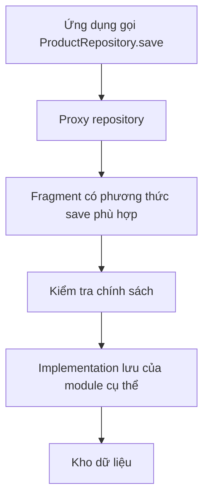

# Ghi đè hành vi phương thức cơ sở có chủ đích

Trong chương **Repository fragment** của Spring Data Commons, ghi đè hành vi phương thức cơ sở là cách thay thế có chọn lọc một phần hợp đồng mà repository đã cung cấp, chẳng hạn `save`. Mục tiêu là bổ sung một chính sách rõ ràng mà vẫn giữ được ý nghĩa CRUD và cách sử dụng repository.

Spring Data Commons cung cấp mô hình repository và cơ chế kết hợp các fragment. Thao tác lưu thực tế do module kho dữ liệu đảm nhiệm. Vì vậy, một fragment có thể thể hiện chính sách dùng chung, nhưng cách triển khai ghi xuống JPA, MongoDB hoặc một kho khác phải phù hợp với module tương ứng.

Sau bài này, bạn có thể:

- Nhận diện khi nào cần ghi đè phương thức cơ sở thay vì thêm một phương thức mới.
- Khai báo fragment với chữ ký tương thích và hiểu thứ tự lựa chọn implementation.
- Triển khai một chính sách trước khi lưu mà không gọi vòng lại chính repository đang mở rộng.
- Xác định những đường ghi dữ liệu mà fragment không tự bao phủ, đặc biệt với thao tác theo lô và cơ chế theo dõi thay đổi của JPA.

## 1. “Ghi đè” ở đây là thay đổi thành phần xử lý lời gọi

Xét repository có hợp đồng lưu từ `CrudRepository`:

```java
<S extends T> S save(S entity);
```

Ở một repository thông thường, implementation cơ sở của module lưu trữ xử lý lời gọi này. Khi bổ sung fragment cũng cung cấp phương thức phù hợp, Spring Data có thể định tuyến lời gọi tới implementation của fragment.

Điều này khác với việc viết một subclass Java và gọi `super.save(entity)`: repository mà ứng dụng sử dụng là proxy được lắp ghép từ nhiều thành phần. Fragment không mặc nhiên có một đối tượng cha để gọi `super`.

| Cách mở rộng | Ý nghĩa | Phạm vi điển hình |
| --- | --- | --- |
| Thêm `saveWithValidation(...)` | Tạo API mới; `save(...)` cũ vẫn có thể được gọi riêng | Một nghiệp vụ có tên và đầu vào riêng |
| Fragment triển khai `save(...)` | Thay thành phần xử lý cho phương thức cơ sở tại repository có kết hợp fragment | Một hoặc một nhóm repository được chọn |
| Đổi repository base class | Thay implementation nền thông qua cấu hình repository factory của module | Nhiều repository cùng một cấu hình |
| Callback hoặc entity listener | Chạy tại một giai đoạn của vòng đời thực thể theo module lưu trữ | Các thao tác thực sự đi qua vòng đời đó |
| Service có transaction | Điều phối nhiều repository và nhiều bước nghiệp vụ | Một ca sử dụng hoàn chỉnh |

Một nguyên tắc chọn phạm vi: nếu chỉ `ProductRepository` cần chính sách riêng cho `save`, fragment là lựa chọn đáng cân nhắc. Nếu toàn bộ repository trong một hệ thống cần cùng hành vi nền, hãy đánh giá custom base class. Nếu thao tác cần ghi nhiều aggregate rồi phát sự kiện nghiệp vụ, service thường là nơi điều phối phù hợp hơn.

## 2. Thứ tự ưu tiên trong composition

Repository có thể được hình dung như sau:



Custom fragment có độ ưu tiên cao hơn implementation cơ sở và các repository aspect khi có phương thức trùng khớp. Đây chính là cơ chế cho phép ghi đè có chủ đích.

Khi nhiều custom fragment cùng cung cấp một phương thức, thứ tự khai báo fragment trong interface repository ảnh hưởng đến việc giải quyết xung đột. Không nên dùng thứ tự đó như một cơ chế ngầm để phối hợp nhiều chính sách độc lập.

Ví dụ cấu trúc có xung đột:

```java
interface ProductRepository extends
        JpaRepository<Product, Long>,
        ValidatedProductSave,
        AnotherProductSave {
}
```

Nếu hai fragment đều xử lý cùng chữ ký `save`, đừng giả định rằng cả hai implementation sẽ lần lượt chạy. Hãy tạo một fragment duy nhất điều phối các bước cần thiết, hoặc tách thành các API có tên khác nhau. Việc lựa chọn một implementation không đồng nghĩa với việc tạo một chuỗi interceptor.

### 2.1. Không có cơ chế tự động “chạy tiếp fragment kế tiếp”

Trong fragment, lời gọi sau là nguy hiểm:

```java
// Mẫu cần tránh: repository chính lại trỏ tới composition hiện tại.
return productRepository.save(entity);
```

Nếu `productRepository` là proxy đang kết hợp fragment này, lời gọi có thể quay lại chính phương thức đang chạy và gây đệ quy. Việc inject repository chính vào fragment của nó còn có thể tạo vòng phụ thuộc ngay lúc khởi tạo bean.

Fragment phải có một đường thực thi xuống tầng lưu trữ được thiết kế rõ ràng: một collaborator chuyên trách, một implementation cơ sở được ủy quyền có kiểm soát, hoặc API lưu trữ phù hợp với module. Không xem proxy repository chính là “implementation mặc định” để gọi lại.

## 3. Giữ nguyên hợp đồng phương thức cơ sở

Đối với `save`, chữ ký cần giữ là:

```java
<S extends T> S save(S entity);
```

Có hai điểm quan trọng:

1. `S` thể hiện kiểu thực thể cụ thể được truyền vào và được trả về. Nếu fragment khai báo một chữ ký khác, nó có thể trở thành overload hoặc gây xung đột kiểu thay vì thay đúng phương thức cơ sở.
2. Giá trị trả về là kết quả của thao tác lưu. Không được mặc định trả lại đối số đầu vào nếu tầng lưu trữ trả về một instance khác.

Chẳng hạn, với JPA, nhánh `merge` có thể trả về instance được quản lý khác với đối tượng truyền vào. Fragment cần trả lại kết quả của delegate để người gọi tiếp tục làm việc với giá trị đúng.

Các thay đổi sau cần được xem là thay đổi hợp đồng và phải được đánh giá riêng:

- Trả `null` khi dữ liệu không hợp lệ dù phương thức được kỳ vọng trả thực thể đã lưu.
- Bỏ qua thao tác ghi mà không thể hiện rõ với người gọi.
- Nuốt lỗi lưu dữ liệu rồi trả lại đầu vào như thể đã thành công.
- Biến `save` thành một quy trình có tác dụng phụ ngoài dự kiến, như tự gửi email cho mọi lần cập nhật.
- Dùng một kiểu projection làm kết quả của `save` cơ sở. Projection phục vụ định hình kết quả đọc; nó không tự thay đổi hợp đồng lưu thực thể.

“Có chủ đích” nghĩa là hành vi mới có lý do, ranh giới và cách kiểm chứng cụ thể, không chỉ là làm cho một phương thức khác chạy trước.

## 4. Ví dụ: kiểm tra chính sách sản phẩm trước khi lưu

### 4.1. Phạm vi của ví dụ

Yêu cầu: mọi lời gọi trực tiếp tới `ProductRepository.save(...)` phải từ chối sản phẩm có mã trống hoặc giá âm trước khi thực hiện lưu.

Ví dụ sử dụng **Spring Data JPA với Jakarta Persistence**, một persistence unit và cấu hình repository scanning bao phủ package `com.example.catalog`. Đây là minh họa cách ghép fragment từ Commons với implementation lưu của JPA; không phải implementation có thể chuyển nguyên xi sang mọi kho dữ liệu.

Chính sách này là kiểm tra đầu vào của API `save`. Nó chưa được coi là hàng rào cho mọi đường cập nhật dữ liệu. Phần sau sẽ chỉ rõ những đường còn lại.

### 4.2. Thực thể minh họa

File `Product.java`:

```java
package com.example.catalog;

import jakarta.persistence.Column;
import jakarta.persistence.Entity;
import jakarta.persistence.GeneratedValue;
import jakarta.persistence.Id;

import java.math.BigDecimal;

@Entity
public class Product {

    @Id
    @GeneratedValue
    private Long id;

    @Column(nullable = false)
    private String sku;

    @Column(nullable = false)
    private BigDecimal price;

    protected Product() {
    }

    public Product(String sku, BigDecimal price) {
        this.sku = sku;
        this.price = price;
    }

    public Long getId() {
        return id;
    }

    public String getSku() {
        return sku;
    }

    public BigDecimal getPrice() {
        return price;
    }
}
```

Entity được giữ tối giản để quan sát fragment. Trong một mô hình miền thực tế, constructor hoặc các phương thức thay đổi trạng thái cũng có thể bảo vệ các bất biến của sản phẩm.

### 4.3. Khai báo interface fragment

File `ValidatedProductSave.java`:

```java
package com.example.catalog;

public interface ValidatedProductSave {

    <S extends Product> S save(S entity);
}
```

Fragment này không kế thừa `CrudRepository`. Nó chỉ công bố phần hành vi cần tham gia vào composition. Giới hạn `S extends Product` tương thích với phương thức `save` của repository quản lý `Product`.

### 4.4. Triển khai fragment với đường ủy quyền rõ ràng

File `ValidatedProductSaveImpl.java`:

```java
package com.example.catalog;

import jakarta.persistence.EntityManager;
import org.springframework.data.jpa.repository.support.SimpleJpaRepository;
import org.springframework.transaction.annotation.Transactional;

import java.util.Objects;

public class ValidatedProductSaveImpl implements ValidatedProductSave {

    private final SimpleJpaRepository<Product, Long> delegate;

    public ValidatedProductSaveImpl(EntityManager entityManager) {
        this.delegate = new SimpleJpaRepository<>(
                Product.class, entityManager);
    }

    @Override
    @Transactional
    public <S extends Product> S save(S entity) {
        Objects.requireNonNull(entity, "product must not be null");

        if (entity.getSku() == null || entity.getSku().isBlank()) {
            throw new IllegalArgumentException("sku must not be blank");
        }

        if (entity.getPrice() == null
                || entity.getPrice().signum() < 0) {
            throw new IllegalArgumentException(
                    "price must be present and non-negative");
        }

        return delegate.save(entity);
    }
}
```

Tên `ValidatedProductSaveImpl` ghép từ **tên interface fragment** và hậu tố implementation mặc định `Impl`. Đặt implementation trong phạm vi mà cơ chế phát hiện fragment của cấu hình repository nhận diện được. Nếu đã đổi hậu tố hoặc có nhiều bean ứng viên, cần cấu hình tương ứng; không dựa vào việc đặt tên gần giống nhau.

Ở cấu hình một persistence unit thông thường, Spring có thể cấp `EntityManager` phù hợp cho constructor. Với nhiều persistence unit, việc chọn đúng `EntityManager` phải được cấu hình rõ ràng, chẳng hạn thông qua một bean implementation được khai báo thủ công và cơ chế chọn persistence unit thích hợp.

Điểm đáng chú ý trong implementation:

- Các điều kiện được kiểm tra trước khi gọi delegate.
- `SimpleJpaRepository` là implementation cơ sở của **JPA**, không thuộc hợp đồng trung lập kho dữ liệu của Commons.
- `@Transactional` tạo ranh giới transaction cho phương thức fragment khi phương thức được gọi qua hạ tầng proxy Spring. Transaction ở service bên ngoài, nếu có, vẫn ảnh hưởng đến transaction thực tế theo propagation và cấu hình đang áp dụng.
- Delegate được tạo bằng `new` không phải một bean proxy riêng. Không dựa vào annotation transaction trên chính delegate để mở transaction cho lời gọi trực tiếp này.
- `return delegate.save(entity)` giữ lại kết quả lưu thực tế, bao gồm instance do nhánh `merge` trả về.
- Không inject hoặc gọi lại `ProductRepository` từ fragment.

Đây là một cách ủy quyền có giới hạn cho bài học: một loại thực thể, một persistence unit và một phương thức. Một instance `SimpleJpaRepository` tự tạo không tự kế thừa mọi tùy biến, metadata của lời gọi và cấu hình nội bộ mà repository factory đã gắn cho implementation nền của proxy. Nếu cần giữ nguyên các cấu hình nâng cao đó, hãy thiết kế collaborator phù hợp hoặc cân nhắc custom repository base class qua factory của JPA.

### 4.5. Kết hợp fragment vào repository

File `ProductRepository.java`:

```java
package com.example.catalog;

import org.springframework.data.jpa.repository.JpaRepository;

public interface ProductRepository extends
        JpaRepository<Product, Long>,
        ValidatedProductSave {
}
```

Ứng dụng vẫn gọi API quen thuộc:

```java
Product saved = productRepository.save(
        new Product("BOOK-001", new BigDecimal("125000")));
```

Lời gọi sau bị từ chối ở fragment:

```java
productRepository.save(
        new Product("BOOK-002", new BigDecimal("-1")));
```

Trong ví dụ này, `IllegalArgumentException` được ném ra trước khi delegate thực hiện `save`. Không nên chuyển lỗi đó thành một kết quả thành công giả. Tầng API hoặc service có thể ánh xạ lỗi theo quy ước của ứng dụng.

## 5. Ghi đè `save` không bao phủ mọi đường ghi

Một sai lầm phổ biến là suy luận rằng vì đã thay `save`, mọi thao tác cuối cùng có lưu thực thể đều sẽ chạy fragment. Composition xử lý lời gọi đi qua proxy; các lời gọi nội bộ của implementation cơ sở không mặc nhiên đi qua proxy đó lần nữa.

| Đường thực hiện | Tự động được chính sách `save` của fragment bao phủ? | Điều cần làm rõ |
| --- | --- | --- |
| Gọi `productRepository.save(product)` qua proxy | Có, khi fragment được lắp ghép và chọn đúng | Xác minh wiring và chữ ký |
| Gọi `saveAll(products)` | Không được suy ra từ việc đã ghi đè `save` | Xem implementation của module; có thể cần ghi đè riêng |
| Gọi `saveAndFlush(product)` của JPA | Không được mặc định bảo đảm | Phương thức cơ sở có thể tự gọi `save` bên trong cùng đối tượng |
| Thay đổi một entity đang được JPA quản lý rồi commit | Không cần đi qua repository `save` | Dirty checking có thể ghi thay đổi trực tiếp |
| Cập nhật hàng loạt bằng câu lệnh update | Không phải đường gọi `save` | Đánh giá riêng API truy vấn cập nhật |
| Ghi bằng `EntityManager`, template, driver hoặc SQL khác | Không đi qua fragment repository này | Phải có chính sách ở đường ghi tương ứng |
| Lưu entity liên quan thông qua cascade của JPA | Không phải từng lời gọi qua repository của entity liên quan | Đánh giá vòng đời và ràng buộc của từng entity |

Ví dụ, trong implementation JPA, `saveAll` có thể lặp và gọi `save` trên chính đối tượng implementation cơ sở. Lời gọi nội bộ đó không quay ra proxy để chọn lại fragment. Tương tự, không nên xem tên `saveAndFlush` là cam kết sẽ chạy chính sách của fragment `save`.

Nếu yêu cầu nghiệp vụ là “mọi sản phẩm được ghi đều có giá không âm”, chỉ chặn `ProductRepository.save` là chưa đủ. Cần phối hợp những lớp bảo vệ phù hợp như bất biến trong mô hình miền, validation/callback được cấu hình cho vòng đời đang dùng, ràng buộc cơ sở dữ liệu và kiểm soát các đường cập nhật trực tiếp.

Ràng buộc `NOT NULL` trong ví dụ chỉ bảo vệ giá trị không null; nó không tự biểu đạt điều kiện giá không âm hoặc mã không chỉ gồm khoảng trắng. Điều kiện cần được thể hiện đúng ở từng lớp nếu lớp đó được dùng để bảo đảm dữ liệu.

## 6. Nếu cần mở rộng sang `saveAll`

Trước hết phải quyết định rõ hợp đồng của thao tác theo lô:

- Từ chối toàn bộ ngay khi phát hiện một phần tử sai, hay trả kết quả riêng cho từng phần tử?
- Kiểm tra toàn bộ đầu vào trước khi bắt đầu ghi, hay vừa kiểm tra vừa ghi?
- Toàn bộ thao tác có nằm trong một transaction hay không?
- Các tác dụng phụ ngoài kho dữ liệu có thể hoàn tác hay không?

Nếu chọn hợp đồng lưu tất cả hoặc thất bại toàn bộ và repository đang dùng `ListCrudRepository` hoặc một module có `saveAll` trả về `List`, chữ ký fragment cần tương thích:

```java
<S extends Product> List<S> saveAll(Iterable<S> entities);
```

Với hợp đồng chỉ dựa trên `CrudRepository`, kiểu trả về cơ sở là `Iterable<S>`. Không sao chép máy móc chữ ký mà không kiểm tra các interface thực sự được repository kế thừa.

Một cách tổ chức hợp lý là tách kiểm tra chính sách thành collaborator, đọc đầu vào `Iterable` một lượt vào một danh sách, kiểm tra các phần tử rồi ủy quyền lưu trong transaction thích hợp. Việc materialize đầu vào cũng cần được cân nhắc về bộ nhớ khi khối lượng dữ liệu lớn.

Không viết `saveAll` bằng cách gọi `productRepository.save` từ chính fragment chỉ để “tận dụng” logic, vì cách đó lại đưa proxy repository chính vào vòng phụ thuộc. Có thể tái sử dụng một hàm kiểm tra hoặc collaborator mà cả hai phương thức cùng gọi.

Ngoài ra, transaction chỉ bảo đảm những tài nguyên thực sự tham gia transaction. Một email đã gửi hoặc lời gọi HTTP thành công không tự bị hoàn tác khi transaction cơ sở dữ liệu rollback.

## 7. Transaction, thời điểm ghi và metadata

### 7.1. `save` không đồng nghĩa với commit

Với JPA, việc gọi `save` thành công không bảo đảm mọi câu SQL đã được thực thi và transaction đã commit. Lỗi ràng buộc có thể xuất hiện ở thời điểm flush hoặc commit.

Do đó, fragment không nên đánh dấu một hoạt động là “đã commit thành công” ngay sau khi delegate trả về. Nếu cần phát thông báo chỉ sau commit, hãy dùng cơ chế đồng bộ transaction hoặc xử lý sự kiện sau commit phù hợp với yêu cầu ứng dụng.

### 7.2. Transaction bên ngoài vẫn quyết định hành vi thực tế

Nếu service đã mở transaction và gọi repository bên trong, fragment thường tham gia transaction đang có theo propagation được cấu hình. Annotation ở fragment không tự chuyển một transaction bên ngoài từ read-only thành một transaction ghi mới.

Phương thức ghi cần được gọi trong ngữ cảnh transaction đúng. Không dùng việc ghi đè `save` để che giấu ranh giới transaction chưa rõ ở service.

### 7.3. Không tự suy luận trạng thái mới của entity bằng ID

Một cách triển khai dễ sai là:

```java
// Giả định quá hẹp cho một cơ chế lưu tổng quát.
if (entity.getId() == null) {
    entityManager.persist(entity);
} else {
    entityManager.merge(entity);
}
```

Spring Data JPA có cơ chế xác định entity mới dựa trên metadata, thuộc tính version hoặc hợp đồng như `Persistable`, tùy mô hình. Entity sử dụng ID được gán trước có thể vẫn là entity mới.

Ví dụ chính dùng `SimpleJpaRepository` để không tự viết lại nhánh `persist`/`merge` dựa trên một giả định duy nhất về ID. Khi thay cách ủy quyền, cần bảo toàn quy tắc xác định trạng thái và ý nghĩa giá trị trả về.

### 7.4. Ghi đè không có nghĩa là tự động giữ mọi tính năng

Auditing, optimistic locking, entity callbacks và metadata gắn với phương thức repository đều có điểm tích hợp riêng theo module. Đường gọi qua API lưu trữ cấp thấp không mặc nhiên tương đương đường gọi qua repository được factory cấu hình.

Chẳng hạn, một native update có thể bỏ qua cơ chế auditing dựa trên vòng đời entity. Một fragment gọi driver trực tiếp cũng không tự nhận toàn bộ hành vi mà implementation repository trước đó cung cấp.

Khi bổ sung chính sách, hãy nêu cụ thể những tính năng nào phải tiếp tục hoạt động: phát hiện entity mới, version, auditing, transaction và các cấu hình metadata liên quan. Nếu dùng JPA, kiểm tra bằng tình huống của JPA; nếu dùng MongoDB hoặc kho khác, kiểm tra trên module đó.

## 8. Tránh biến fragment thành lớp điều phối nghiệp vụ lớn

Fragment thích hợp với hành vi gắn chặt vào hợp đồng truy cập dữ liệu của repository được chọn. Nó trở nên khó kiểm soát nếu một lần `save` còn tự:

1. Tải và thay đổi nhiều aggregate khác.
2. Gọi dịch vụ thanh toán bên ngoài.
3. Gửi thông báo.
4. Thay đổi trạng thái quy trình nghiệp vụ.

Các bước đó có yêu cầu về transaction, retry và tính lặp an toàn khác nhau. Hãy đưa việc điều phối về một service có tên theo ca sử dụng, ví dụ `publishProduct`, trong khi fragment giữ trách nhiệm nhỏ và rõ.

Tương tự, nếu mục tiêu chỉ là tiện lợi cho người gọi, chẳng hạn đọc một trang kết quả đã sắp xếp hoặc trả một projection, hãy đánh giá các abstraction truy vấn sẵn có. Không cần ghi đè `save` để giải quyết một yêu cầu đọc dữ liệu.

## 9. Cách kiểm chứng hành vi khi tích hợp

Để kiểm tra fragment có thực sự được chọn, cần một kiểm tra đi qua repository do Spring tạo. Khởi tạo trực tiếp `new ValidatedProductSaveImpl(...)` chỉ kiểm tra thân implementation; nó không xác minh composition, việc phát hiện fragment hoặc transaction qua proxy.

Các tình huống nên được đưa vào kiểm tra ở bước tích hợp:

| Tình huống | Kết quả cần quan sát |
| --- | --- |
| Lưu sản phẩm có mã hợp lệ và giá bằng 0 hoặc lớn hơn 0 | Thao tác được ủy quyền và trả về kết quả lưu |
| Lưu sản phẩm có mã trống | Báo lỗi chính sách trước khi gọi lưu |
| Lưu sản phẩm có giá âm hoặc null | Báo lỗi chính sách; không âm thầm bỏ qua |
| Cập nhật một entity detached trong JPA | Người gọi nhận đúng kết quả do lưu trả về |
| Gọi phương thức lưu theo lô | Hành vi đúng với hợp đồng `saveAll` đã công bố, không suy diễn từ `save` |
| Có transaction ở service | Tham gia và rollback theo transaction thực tế |
| Sử dụng version hoặc auditing | Các tính năng cần giữ vẫn hoạt động trên đường ghi đã chọn |
| Thêm một fragment khác có phương thức trùng | Phát hiện xung đột; không vô tình đổi chính sách |

Một kiểm tra chính sách bị từ chối nên quan sát trạng thái dữ liệu sau khi transaction liên quan đã kết thúc hoặc trong ngữ cảnh đọc phù hợp. Việc chỉ thấy một exception chưa chứng minh mọi đường ghi đều được bảo vệ.

Nếu implementation không được gọi, hãy kiểm tra theo thứ tự: repository có kế thừa interface fragment không, chữ ký có tương thích không, tên implementation và hậu tố có đúng cấu hình không, implementation có nằm trong phạm vi phát hiện không, và lời gọi có thực sự đi qua proxy repository không.

## 10. Bài tập áp dụng

Cho `ProductRepository` có fragment kiểm tra `save` như ví dụ trên, hãy thiết kế thay đổi cho ba yêu cầu:

1. Chỉ repository sản phẩm cần chính sách này, còn các repository khác giữ hợp đồng hiện tại.
2. `saveAll` phải kiểm tra toàn bộ danh sách trước khi bắt đầu ghi và thất bại toàn bộ nếu có sản phẩm sai.
3. Cơ sở dữ liệu phải luôn từ chối giá âm, kể cả khi có một công cụ quản trị ghi trực tiếp.

Hướng giải quyết:

- Yêu cầu thứ nhất phù hợp với việc kết hợp fragment riêng vào `ProductRepository`.
- Yêu cầu thứ hai cần hợp đồng `saveAll` riêng, kiểm tra đầu vào và ranh giới transaction rõ ràng; không chỉ ghi đè `save` rồi kỳ vọng lời gọi nội bộ tự đi qua fragment.
- Yêu cầu thứ ba cần ràng buộc phù hợp ở cơ sở dữ liệu. Fragment có thể cung cấp lỗi sớm cho ứng dụng nhưng không kiểm soát một công cụ ghi bên ngoài.

Khi đánh giá một phương án, hãy mô tả chính xác: **phương thức nào bị thay hành vi, lời gọi nào đi qua fragment, thao tác nào được ủy quyền, và điều gì vẫn cần được bảo đảm ở lớp khác**. Đó là nền tảng để mở rộng repository mà người gọi vẫn hiểu và tin cậy hợp đồng của nó.