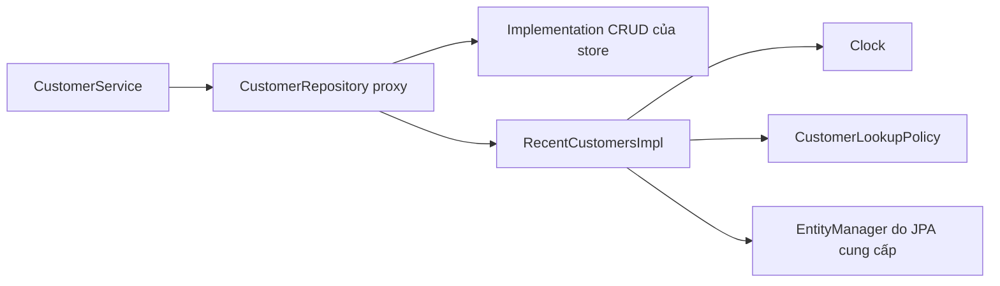

# Tiêm phụ thuộc (dependency injection) và vòng đời bean fragment

Repository fragment cho phép bổ sung một nhóm hành vi vào repository bằng một interface riêng và một lớp triển khai riêng. Khi hành vi đó cần truy vấn tùy chỉnh, lấy thời gian, đọc cấu hình hoặc gọi một dịch vụ khác, câu hỏi quan trọng là: ai tạo fragment, dependency được cấp vào lúc nào và instance đó được dùng chung ra sao?

Trong Spring Data Commons, repository được hình thành từ các thành phần có thể ghép lại. Lớp triển khai fragment tham gia thành phần này dưới dạng đối tượng do hạ tầng Spring quản lý. Vì vậy, hiểu dependency injection và vòng đời bean giúp viết fragment vừa dễ mở rộng, vừa không gặp lỗi do tự khởi tạo đối tượng, lưu trạng thái dùng chung hoặc đặt công việc sai thời điểm.

## 1. Phân biệt repository proxy, fragment và dependency

Xét thiết kế sau:

```java
public interface RecentCustomers {
    List<CustomerSummary> findRecentByRegion(String region, int limit);
}

public interface CustomerRepository
        extends CrudRepository<Customer, Long>, RecentCustomers {
}
```

Có ba đối tượng hoặc nhóm đối tượng khác nhau cần nhận diện:

| Thành phần | Vai trò | Ai quản lý |
| --- | --- | --- |
| Repository proxy | Điểm mà service thường gọi; ghép CRUD, query method và fragment | Hạ tầng repository của Spring Data |
| Implementation của fragment | Thực thi các phương thức trong `RecentCustomers` | Spring, thông qua cơ chế phát hiện hoặc đăng ký bean |
| Dependency của fragment | Cung cấp thời gian, cấu hình, persistence context hoặc cộng tác viên khác | Spring container và các tích hợp tương ứng |

Khi service gọi `customerRepository.findRecentByRegion(...)`, hạ tầng repository chuyển lời gọi đến fragment tương ứng. Service không cần biết lớp triển khai cụ thể.



Trong sơ đồ, CRUD và fragment cùng nằm sau repository proxy nhưng không vì thế mà trở thành cùng một instance. Một repository có thể ghép nhiều fragment; mỗi fragment có thể có dependency và lifecycle riêng.

## 2. Điều kiện để dependency injection hoạt động

Spring chỉ thực hiện injection và các bước quản lý bean đối với đối tượng mà container thực sự quản lý.

Với cơ chế fragment thông thường:

1. Repository mở rộng interface fragment.
2. Spring Data tìm implementation theo cấu hình phát hiện implementation.
3. Nếu cần, hạ tầng đăng ký implementation để container tạo bean.
4. Container cấp dependency và chạy các bước khởi tạo bean.
5. Repository sử dụng implementation đó trong composition của mình.

Hậu tố mặc định cho implementation là `Impl`. Vì vậy, với interface `RecentCustomers`, tên lớp thường là `RecentCustomersImpl`. Đặt implementation trong phạm vi package mà cơ chế phát hiện implementation của repository quét đến, thông thường là package chứa repository hoặc package con.

```text
com.example.customer
├── CustomerRepository.java
├── RecentCustomers.java
└── RecentCustomersImpl.java
```

Nếu dự án đổi `repositoryImplementationPostfix`, tên implementation phải phù hợp với cấu hình đó. Không nên đoán theo tên repository hoặc dựa vào một annotation đơn lẻ.

Đối với implementation được Spring Data phát hiện theo quy ước, không bắt buộc phải thêm `@Component` chỉ để constructor injection hoạt động. Container vẫn có thể quản lý bean mà Spring Data đăng ký.

Ngược lại, cách khởi tạo sau chỉ tạo một đối tượng Java:

```java
RecentCustomers fragment = new RecentCustomersImpl(policy, clock);
```

Dòng này không tự thực hiện `@PersistenceContext`, `@PostConstruct`, transaction advice hay các BeanPostProcessor khác. Việc một instance có đúng kiểu hoặc đúng tên lớp không đồng nghĩa instance đó đã được Spring quản lý.

## 3. Ví dụ: fragment tìm khách hàng được cập nhật gần đây

Ví dụ dưới đây dùng một repository JPA để minh họa dependency injection. Các abstraction về fragment thuộc Spring Data Commons; `EntityManager`, JPQL và `@PersistenceContext` thuộc tích hợp JPA.

Giả định ứng dụng đã cấu hình datasource, JPA và quét repository, entity, configuration trong package `com.example.customer`. Mỗi kiểu `public` được đặt trong file Java cùng tên. Ví dụ dùng namespace `jakarta.persistence`, `jakarta.annotation` và Java có hỗ trợ `record`.

### 3.1. Entity và kiểu kết quả

```java
package com.example.customer;

import jakarta.persistence.Entity;
import jakarta.persistence.Id;
import java.time.Instant;

@Entity
public class Customer {

    @Id
    private Long id;

    private String name;
    private String region;
    private Instant updatedAt;

    protected Customer() {
    }

    public Customer(
            Long id,
            String name,
            String region,
            Instant updatedAt) {
        this.id = id;
        this.name = name;
        this.region = region;
        this.updatedAt = updatedAt;
    }
}
```

```java
package com.example.customer;

import java.time.Instant;

public record CustomerSummary(
        Long id,
        String name,
        Instant updatedAt) {
}
```

JPQL trong ví dụ sử dụng field access của entity. Kiểu kết quả là DTO được tạo tường minh bằng constructor expression; phương thức fragment tự quyết định cách ánh xạ dữ liệu.

### 3.2. Interface fragment và repository

```java
package com.example.customer;

import java.util.List;

public interface RecentCustomers {

    List<CustomerSummary> findRecentByRegion(String region, int limit);
}
```

```java
package com.example.customer;

import org.springframework.data.repository.CrudRepository;

public interface CustomerRepository
        extends CrudRepository<Customer, Long>, RecentCustomers {
}
```

`CrudRepository` là abstraction dùng chung. Việc thực thi CRUD ở đây do module Spring Data JPA đảm nhiệm. Phương thức trong `RecentCustomers` được implementation của fragment thực hiện, không được suy ra chỉ từ tên phương thức.

### 3.3. Dependency biểu diễn chính sách và thời gian

```java
package com.example.customer;

import java.time.Duration;

public record CustomerLookupPolicy(
        int maxResults,
        Duration recentWindow) {

    public CustomerLookupPolicy {
        if (maxResults < 1) {
            throw new IllegalArgumentException("maxResults must be positive");
        }
        if (recentWindow == null
                || recentWindow.isZero()
                || recentWindow.isNegative()) {
            throw new IllegalArgumentException("recentWindow must be positive");
        }
    }
}
```

```java
package com.example.customer;

import java.time.Clock;
import java.time.Duration;
import org.springframework.context.annotation.Bean;
import org.springframework.context.annotation.Configuration;

@Configuration(proxyBeanMethods = false)
public class CustomerFragmentConfiguration {

    @Bean
    CustomerLookupPolicy customerLookupPolicy() {
        return new CustomerLookupPolicy(100, Duration.ofDays(30));
    }

    @Bean("repositoryClock")
    Clock repositoryClock() {
        return Clock.systemUTC();
    }
}
```

Tách `Clock` thành dependency giúp xác định rõ nguồn thời gian. Cửa sổ “gần đây” được tính ở mỗi lần gọi, nên không bị đóng băng tại thời điểm ứng dụng khởi động.

`CustomerLookupPolicy` là cấu hình bất biến. Fragment có thể dùng chung bean này mà không cần thay đổi giá trị cho từng request.

### 3.4. Implementation nhận dependency

```java
package com.example.customer;

import jakarta.persistence.EntityManager;
import jakarta.persistence.PersistenceContext;
import java.time.Clock;
import java.time.Instant;
import java.util.List;
import org.springframework.beans.factory.annotation.Qualifier;
import org.springframework.transaction.annotation.Transactional;

public class RecentCustomersImpl implements RecentCustomers {

    private final CustomerLookupPolicy policy;
    private final Clock clock;

    @PersistenceContext
    private EntityManager entityManager;

    public RecentCustomersImpl(
            CustomerLookupPolicy policy,
            @Qualifier("repositoryClock") Clock clock) {
        this.policy = policy;
        this.clock = clock;
    }

    @Override
    @Transactional(readOnly = true)
    public List<CustomerSummary> findRecentByRegion(
            String region,
            int limit) {

        if (region == null || region.isBlank()) {
            throw new IllegalArgumentException("region must not be blank");
        }
        if (limit < 1 || limit > policy.maxResults()) {
            throw new IllegalArgumentException(
                    "limit must be between 1 and " + policy.maxResults());
        }

        Instant cutoff = clock.instant().minus(policy.recentWindow());

        return entityManager.createQuery("""
                select new com.example.customer.CustomerSummary(
                    c.id, c.name, c.updatedAt)
                from Customer c
                where c.region = :region
                  and c.updatedAt >= :cutoff
                order by c.updatedAt desc, c.id asc
                """, CustomerSummary.class)
                .setParameter("region", region.trim())
                .setParameter("cutoff", cutoff)
                .setMaxResults(limit)
                .getResultList();
    }
}
```

Có hai cơ chế injection trong cùng một bean:

- Constructor nhận các dependency thông thường là `CustomerLookupPolicy` và `Clock`.
- Hạ tầng persistence xử lý `@PersistenceContext` để cung cấp `EntityManager`.

Ở lớp chỉ có một constructor, Spring có thể dùng constructor đó mà không cần `@Autowired`. `@Qualifier` chỉ rõ bean thời gian mong muốn khi ứng dụng có nhiều `Clock`.

Không truy cập `entityManager` trong constructor: field này được cấp sau khi đối tượng đã được tạo. Việc constructor đã chạy không có nghĩa toàn bộ injection đã hoàn tất.

Thứ tự theo `updatedAt` rồi `id` giúp kết quả có tiêu chí phụ rõ ràng khi nhiều khách hàng có cùng thời gian cập nhật. Giới hạn kết quả trong ví dụ là một quy tắc của fragment; nó không biến phương thức thành một API phân trang hoàn chỉnh.

## 4. Chọn cách injection phù hợp

### Constructor injection cho dependency bắt buộc

Constructor thể hiện các điều kiện cần để tạo một fragment có thể sử dụng được:

```java
public RecentCustomersImpl(
        CustomerLookupPolicy policy,
        @Qualifier("repositoryClock") Clock clock) {
    this.policy = policy;
    this.clock = clock;
}
```

Cách này có các lợi ích thực tế:

- Dependency được khai báo tập trung.
- Field có thể là `final`.
- Thiếu dependency hoặc có nhiều bean không phân giải được thường lộ ra khi Spring tạo bean.
- Logic thuần sử dụng các dependency này dễ được gọi với các đối tượng thay thế trong kiểm thử.

Constructor nên gán dependency và kiểm tra điều kiện cục bộ đơn giản. Không nên dùng constructor để chạy truy vấn, gọi repository hoặc thực hiện một đợt đồng bộ dữ liệu.

### Setter injection cho điểm mở rộng có chủ đích

Setter phù hợp khi dependency thực sự có thể được thay đổi hoặc có mặc định rõ ràng. Một dependency nghiệp vụ bắt buộc không nên bị biến thành “tùy chọn” chỉ bằng việc bỏ qua lỗi injection.

Nếu cộng tác viên là tùy chọn theo thiết kế, có thể biểu đạt bằng `Optional<T>` hoặc `ObjectProvider<T>` tại điểm injection, cùng hành vi rõ ràng khi bean không tồn tại.

`ObjectProvider<T>` cũng có thể phục vụ việc lấy đối tượng tại thời điểm sử dụng, nhưng không nên dùng nó để che giấu một đồ thị dependency đang có vòng.

### Injection theo tích hợp của store

`@PersistenceContext` trong ví dụ có ngữ nghĩa của JPA, bao gồm lựa chọn persistence unit nếu có nhiều persistence unit. Không thay annotation này bằng `@Qualifier` một cách máy móc: hai cơ chế giải quyết các vấn đề khác nhau.

Các store khác dùng cộng tác viên khác, chẳng hạn template hoặc operations interface của chính module đó. Cách xác định bean, transaction manager và tài nguyên kết nối phụ thuộc tích hợp của store.

## 5. Phát hiện implementation và đăng ký bean thủ công

Cách đơn giản là để Spring Data phát hiện `RecentCustomersImpl` rồi cấp các dependency đã có trong context.

Khi cần tự tạo implementation bằng một factory method, có thể đăng ký bean theo tên mà cơ chế phát hiện fragment dự kiến sử dụng:

```java
@Bean("recentCustomersImpl")
RecentCustomersImpl recentCustomersImpl(
        CustomerLookupPolicy policy,
        @Qualifier("repositoryClock") Clock clock) {
    return new RecentCustomersImpl(policy, clock);
}
```

Đây là phương án thay thế khi cần cấu hình cách tạo instance. Factory method trên thuộc một lớp `@Configuration` được quét; các bean policy và clock vẫn phải tồn tại.

Với quy ước mặc định trong ví dụ, tên bean là `recentCustomersImpl`. Khi Spring Data nhận diện implementation và thấy bean phù hợp đã được khai báo, nó có thể dùng bean đó thay vì tự tạo definition mặc định.

Dù factory method gọi `new`, đối tượng trả về từ `@Bean` vẫn đi qua vòng đời bean của Spring. Vì thế, `@PersistenceContext` và các bước hậu xử lý vẫn có cơ hội được áp dụng. Đây là điểm khác với một đối tượng được tạo bằng `new` rồi giữ trong biến cục bộ ngoài container.

Khi tùy chỉnh bean name, hậu tố implementation hoặc có nhiều implementation trùng tên đơn giản ở các package khác nhau, cần làm cho cấu hình phát hiện và tên bean nhất quán. Không đồng thời khai báo nhiều đường tạo bean cho cùng một implementation nếu không có mục đích rõ ràng.

`@Primary` và `@Qualifier` chủ yếu giải quyết việc chọn dependency giữa các bean cùng kiểu. Chúng không thay thế yêu cầu ghép đúng interface fragment với implementation mà repository sử dụng.

## 6. Vòng đời của một fragment bean

Một mô hình khái quát hữu ích là:

```text
Phát hiện implementation hoặc tìm bean đã khai báo
    ↓
Phân giải dependency cho constructor
    ↓
Gọi constructor
    ↓
Cấp các property/field và xử lý callback nhận biết container
    ↓
Hậu xử lý trước khởi tạo, bao gồm @PostConstruct
    ↓
Các callback khởi tạo khác nếu có
    ↓
Hậu xử lý sau khởi tạo, có thể trả về AOP proxy
    ↓
Đưa implementation đã được quản lý vào composition của repository
    ↓
Phục vụ nhiều lần gọi
    ↓
Callback hủy khi context đóng, nếu scope hỗ trợ
```

Đây là trình tự khái quát của bean, không phải cam kết mọi bean của toàn ứng dụng khởi tạo theo một chuỗi cố định. Bean lazy, dependency và cơ chế bootstrap repository có thể ảnh hưởng thời điểm tạo instance.

### `@PostConstruct`: khởi tạo cục bộ sau injection

Callback này phù hợp cho việc xác thực cấu hình hoặc chuẩn bị cấu trúc dữ liệu nhỏ, không cần đi qua repository hay transaction proxy.

```java
import jakarta.annotation.PostConstruct;

@PostConstruct
void initialize() {
    // Xác thực quan hệ giữa các giá trị cấu hình,
    // hoặc chuẩn bị dữ liệu bất biến dùng nội bộ.
}
```

Không nên coi `@PostConstruct` là bằng chứng ứng dụng đã sẵn sàng phục vụ. Một fragment khác, repository khác hoặc hạ tầng bên ngoài có thể chưa ở trạng thái mong muốn.

Đặt `@Transactional` lên chính callback này cũng không bảo đảm callback được chạy qua transaction proxy như một lời gọi nghiệp vụ từ bên ngoài. Công việc khởi động cần transaction nên được đưa vào một thành phần riêng và gọi qua bean đã được quản lý, tại thời điểm phù hợp với ứng dụng.

Không lấy mốc thời gian truy vấn động rồi giữ mãi trong callback:

```java
// Thiết kế gây sai ngữ nghĩa "30 ngày gần đây":
// cutoff = clock.instant().minus(policy.recentWindow());
// lưu cutoff thành field và dùng lại cho mọi lần truy vấn.
```

Hãy tính `cutoff` trong phương thức nghiệp vụ như ví dụ chính.

### `@PreDestroy`: chỉ giải phóng tài nguyên do fragment sở hữu

Callback hủy có ích nếu fragment tự tạo và sở hữu một tài nguyên cần đóng. Với singleton được quản lý bình thường, callback được gọi khi container đóng một cách có trật tự.

Không tự đóng `EntityManager`, datasource, template hoặc client dùng chung đã được container cấp vào chỉ vì fragment đang bị hủy. Thành phần sở hữu tài nguyên phải chịu trách nhiệm đóng nó.

Callback hủy cũng không phải cơ chế bảo đảm nghiệp vụ khi tiến trình bị dừng đột ngột. Không dựa vào nó để lưu dữ liệu quan trọng lần cuối.

## 7. Scope mặc định và trạng thái dùng chung

Bean fragment thông thường có scope `singleton`: một instance cho mỗi bean definition trong một Spring container. Điều này không có nghĩa một instance cho toàn bộ JVM, hoặc một instance mới cho mỗi request, mỗi truy vấn hay mỗi lời gọi repository.

Do đó, các lời gọi đồng thời có thể cùng đi vào một fragment.

| Có thể giữ dưới dạng field | Nên giữ trong biến cục bộ hoặc tham số |
| --- | --- |
| Dependency bất biến, policy bất biến, `Clock` an toàn cho dùng chung | Region đang truy vấn, tenant của lời gọi hiện tại |
| Template hoặc proxy do framework thiết kế để dùng chung | Danh sách kết quả đang được xây dựng |
| Cấu trúc bất biến đã chuẩn bị khi khởi tạo | Query object có parameter của một lần gọi |
| Cache có thiết kế đồng thời và quy tắc phân vùng rõ ràng | Bộ đếm, buffer hoặc entity mutable chưa có cơ chế đồng bộ phù hợp |

Ví dụ lỗi:

```java
// Không dùng các field này để giữ dữ liệu của lời gọi hiện tại.
private String currentRegion;
private List<CustomerSummary> currentResults;
```

Hai request có thể ghi đè `currentRegion` của nhau. Với thông tin như tenant hoặc quyền truy cập, lỗi này còn có thể làm dữ liệu của người dùng này xuất hiện trong ngữ cảnh của người dùng khác.

Trong ví dụ chính, `region`, `cutoff` và query đều là dữ liệu cục bộ của phương thức. Fragment không tích lũy trạng thái nghiệp vụ qua các lần gọi.

### Vì sao có thể injection `EntityManager` vào singleton?

Một `EntityManager` thực không phải đối tượng để tùy ý chia sẻ giữa các thread. Trong cấu hình Spring JPA thông thường, `@PersistenceContext` với persistence context kiểu transaction cung cấp một tham chiếu được quản lý, thường là shared proxy, để định tuyến đến persistence context phù hợp với lời gọi.

Không suy ra từ đó rằng mọi `EntityManager` đều an toàn cho việc dùng chung. Một instance tự tạo từ `EntityManagerFactory`, một extended persistence context hoặc tài nguyên có lifecycle khác cần được đánh giá theo chính cơ chế quản lý của nó.

Cũng không tự mang query hoặc persistence context sang thread khác. Cơ chế gắn tài nguyên và transaction vào luồng thực thi phải được tích hợp đúng.

### Đổi sang `prototype` có tạo fragment mới cho mỗi lần gọi không?

Không tự động. Khi một dependency prototype được resolve và giữ bởi một thành phần sống lâu, việc lookup thường chỉ xảy ra lúc injection hoặc lúc thành phần đó được tạo.

Repository composition có thể tiếp tục giữ đối tượng fragment đã nhận. Vì vậy, thêm `@Scope("prototype")` không phải lời giải mặc định cho yêu cầu “mỗi lời gọi có trạng thái riêng”.

Spring cũng không tự quản lý đầy đủ callback hủy cho các prototype sau khi đã giao chúng cho nơi sử dụng. Cách đơn giản cho fragment là giữ nó stateless và dùng biến cục bộ cho dữ liệu của mỗi lời gọi.

Nếu thực sự cần scope ngắn hơn, phải thiết kế rõ cơ chế lookup hoặc scoped proxy, nơi sử dụng và trách nhiệm giải phóng tài nguyên. Không giả định phạm vi HTTP request luôn tồn tại trong batch job hay consumer.

## 8. Transaction và AOP khi gọi fragment

Được dependency injection không đồng nghĩa mọi phương thức đã có transaction.

Ở ví dụ chính, `@Transactional(readOnly = true)` thể hiện yêu cầu transaction của phương thức truy vấn. Hạ tầng transaction và transaction manager phù hợp vẫn phải được cấu hình. Thuộc tính `readOnly` chủ yếu biểu đạt ý định và có thể hỗ trợ tối ưu; nó không phải hàng rào bảo mật ngăn mọi hành vi ghi ở mọi datastore.

Các transaction mặc định của một implementation CRUD không tự trở thành quy tắc chung cho mọi phương thức tùy chỉnh trong mọi fragment.

Một ứng dụng có thể chọn đặt ranh giới transaction tại service:

```java
package com.example.customer;

import java.util.List;
import org.springframework.stereotype.Service;
import org.springframework.transaction.annotation.Transactional;

@Service
public class CustomerReportService {

    private final CustomerRepository customers;

    public CustomerReportService(CustomerRepository customers) {
        this.customers = customers;
    }

    @Transactional(readOnly = true)
    public List<CustomerSummary> reportFor(String region) {
        return customers.findRecentByRegion(region, 20);
    }
}
```

Ranh giới này hữu ích khi một use case gọi nhiều repository. Nếu propagation là `REQUIRED` như mặc định, lời gọi bên trong thường tham gia transaction sẵn có; annotation ở fragment không tự tạo một transaction độc lập.

Ba điểm cần nhớ về lời gọi:

1. Gọi qua repository được injection là đường sử dụng thông thường để hạ tầng repository và advice tương ứng tham gia.
2. Gọi trực tiếp một implementation tự tạo ngoài Spring không có các bảo đảm của bean được quản lý.
3. Trong AOP dựa trên proxy thông thường, `this.otherMethod()` bên trong cùng đối tượng không đi ra ngoài rồi quay lại proxy, nên không kích hoạt riêng advice của phương thức được gọi theo cách đó.

Vì vậy, nếu một bước thật sự cần transaction độc lập, hãy thiết kế ranh giới qua một bean cộng tác phù hợp. Việc đổi chỗ annotation mà vẫn gọi nội bộ chưa giải quyết được vấn đề.

## 9. Tránh vòng phụ thuộc giữa repository và chính fragment

Một vòng phổ biến là:

```text
CustomerRepository
    → RecentCustomersImpl
        → CustomerRepository
```

Nó xuất hiện khi implementation nhận chính repository đang cần fragment đó để được tạo hoàn chỉnh:

```java
// Dễ tạo vòng trong quá trình khởi tạo repository:
// RecentCustomersImpl(CustomerRepository customers, ...) { ... }
```

Thiết kế nên được phân tách theo trách nhiệm:

- Fragment dùng operations hoặc template của store để làm công việc persistence tùy chỉnh.
- Service điều phối nhiều hành vi và gọi repository sau khi các bean đã được tạo.
- Logic tính toán hoặc chính sách dùng chung nằm trong một collaborator độc lập.
- Nếu cần một repository khác, kiểm tra đồ thị dependency để bảo đảm nó không dẫn ngược về fragment hiện tại.

`@Lazy` hoặc lookup trì hoãn có thể thay đổi thời điểm resolve dependency, nhưng không tự loại bỏ vòng logic. Nếu phương thức trong fragment gọi lại đúng phương thức mà repository chuyển đến fragment đó, chương trình vẫn có thể đệ quy vô hạn.

Không gọi repository từ constructor hoặc callback khởi tạo để “kiểm tra kết nối” hay “làm nóng” fragment. Những lời gọi này dễ kéo cả đồ thị bean vào quá trình tạo khi nó chưa hoàn tất.

## 10. Áp dụng đúng khả năng của từng store

Spring Data Commons cung cấp mô hình repository và composition; nó không đồng nhất các API truy cập dữ liệu hay mô hình thực thi của mọi store.

| Ngữ cảnh | Dependency thường phù hợp | Điều cần xem xét |
| --- | --- | --- |
| JPA imperative | `EntityManager`, cộng tác viên JPA được quản lý | Persistence context, transaction manager, lazy loading |
| MongoDB imperative | `MongoOperations` hoặc template tương ứng | Mapping, cấu hình database và khả năng transaction của hệ thống |
| JDBC | Operations, template hoặc aggregate operations tương ứng | SQL, mapping aggregate và transaction của datasource |
| Reactive store | Operations reactive của module tương ứng | Publisher, subscriber context và transaction reactive |

Không sao chép `@PersistenceContext` sang fragment MongoDB hoặc JDBC. Tương tự, không giả định constructor expression của JPQL áp dụng cho một store khác.

Trong một fragment reactive, tránh đưa thao tác blocking vào chuỗi reactive hoặc gọi `.block()` chỉ để tái sử dụng một đoạn imperative. Ngữ cảnh transaction reactive gắn với mô hình thực thi reactive, nên không thể chỉ dựa vào giả định về thread của ví dụ JPA.

Bean singleton reactive cũng có thể phục vụ nhiều subscription. Không lưu tenant, người dùng hiện tại hoặc dữ liệu của một subscription vào field mutable. Nếu dependency hoặc giá trị phải được xác định theo subscription, việc resolve cần được thiết kế tại thời điểm thực thi phù hợp với reactive context.

## 11. Chẩn đoán lỗi theo giai đoạn

| Dấu hiệu | Khả năng cần kiểm tra | Hướng xử lý |
| --- | --- | --- |
| Spring cố tạo derived query cho phương thức fragment hoặc báo không tìm thấy property | Interface chưa được ghép với implementation; sai tên, hậu tố hoặc phạm vi phát hiện | Kiểm tra repository extends interface fragment và cấu hình phát hiện |
| Không có bean phù hợp để cấp vào constructor | Chưa đăng ký dependency hoặc configuration nằm ngoài phạm vi quét | Kiểm tra bean definition, profile và phạm vi quét của dependency |
| Có nhiều bean cùng kiểu | Dependency chưa có tiêu chí chọn rõ ràng | Dùng `@Qualifier`, hoặc `@Primary` nếu đó là mặc định hợp lý toàn ứng dụng |
| `EntityManager` là `null` trên instance đang gọi | Instance tự tạo, injection chưa hoàn tất hoặc hạ tầng JPA chưa được cấu hình | Xác định đúng instance do repository sử dụng và đường tạo bean |
| Lỗi vòng phụ thuộc lúc khởi động | Fragment nhận repository chứa chính nó hoặc một dependency dẫn ngược lại | Tách orchestration ra service, giảm dependency ngược |
| Annotation transaction không có hiệu lực như mong đợi | Gọi trực tiếp ngoài container, self-invocation hoặc chọn sai transaction manager | Kiểm tra đường gọi qua proxy và cấu hình transaction |
| Kết quả sai ngẫu nhiên khi tải tăng | Field mutable đang giữ dữ liệu theo request | Chuyển dữ liệu sang biến cục bộ hoặc cấu trúc đồng thời được thiết kế rõ ràng |
| Cửa sổ thời gian “gần đây” không dịch chuyển | Mốc thời gian được tính một lần khi khởi tạo | Injection `Clock` và tính mốc trong mỗi lần thực thi |

Các dấu hiệu này không phải kết luận tuyệt đối. Chẳng hạn, lỗi phân tích tên phương thức có thể bắt nguồn từ nhiều cấu hình khác nhau. Hãy xác định giai đoạn lỗi: phát hiện fragment, tạo bean, ghép repository hay thực thi nghiệp vụ.

Có thể kiểm chứng wiring bằng một kiểm thử tích hợp nhỏ của repository khi phát triển ứng dụng: lấy repository từ Spring context, gọi phương thức fragment và quan sát dependency được cấu hình. Việc chỉ `new` implementation trong một kiểm thử đơn vị không xác nhận được phát hiện fragment, injection JPA hoặc transaction advice.

## 12. Bài thực hành củng cố

Dựa trên ví dụ, thực hiện các thay đổi sau trong một ứng dụng JPA đã cấu hình:

1. Thêm một `Clock` thứ hai và quan sát vai trò của `@Qualifier("repositoryClock")`. Xác nhận fragment vẫn dùng đúng nguồn thời gian.
2. Cấp một `Clock.fixed(...)` trong cấu hình kiểm thử để làm rõ ranh giới của cửa sổ 30 ngày. Tạo dữ liệu trước và sau ranh giới, rồi gọi qua repository.
3. Chạy hai lời gọi với hai region khác nhau. Kiểm tra implementation chỉ giữ dependency ở field, không giữ region hoặc kết quả hiện tại.
4. Đưa use case báo cáo vào service có transaction và xác định transaction manager sẽ quản lý JPA.
5. Thử viết sơ đồ dependency trước khi thêm repository vào constructor của fragment. Nếu đường đi quay lại repository ban đầu, tách collaborator trước khi tiếp tục.

Kết quả cần giải thích được là: container tạo fragment theo đường nào, dependency nào được cấp qua constructor, dependency nào do tích hợp persistence cung cấp, lúc nào bean đã hoàn tất khởi tạo và dữ liệu nào chỉ sống trong một lần gọi.

Một fragment được thiết kế tốt nhận các cộng tác viên rõ ràng, giữ trạng thái dùng chung ở mức tối thiểu và thực thi persistence theo khả năng của store đang dùng. Nhờ đó, repository có thể mở rộng hành vi mà service vẫn làm việc qua abstraction ổn định của Spring Data.
