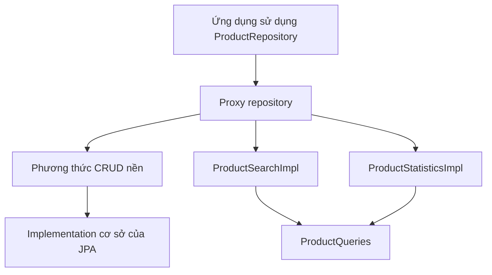

# Phân biệt mô hình fragment với kiểu triển khai duy nhất theo tên repository cũ

Trong chương **Repository fragment** của Spring Data Commons, có một khác biệt dễ bị bỏ qua: lớp `ProductRepositoryImpl` gắn với repository chính theo quy ước cũ không có cùng vai trò thiết kế với lớp `ProductSearchImpl` triển khai một fragment `ProductSearch`.

Cả hai cách đều có thể dùng hậu tố `Impl`. Điểm phân biệt nằm ở **interface nào sở hữu hợp đồng mở rộng, implementation được nhận diện theo tên nào và repository được lắp ghép như thế nào**. Nắm được điều này giúp đọc mã cũ, tránh đặt nhầm tên lớp và chuyển sang mô hình fragment mà vẫn kiểm soát hành vi của ứng dụng.

Bài học thuộc phạm vi Spring Data Commons: cơ chế repository và composition dùng chung giữa các module. Ví dụ truy cập dữ liệu cụ thể dùng Spring Data JPA; các phần dựa trên `EntityManager` phải được thay bằng cơ chế phù hợp nếu dùng MongoDB hoặc kho dữ liệu khác.

## 1. Bốn thành phần cần gọi đúng tên

Trước khi so sánh, hãy tách rõ các vai trò:

| Thành phần | Vai trò | Ví dụ |
| --- | --- | --- |
| Interface repository chính | API ứng dụng sử dụng; kết hợp CRUD, truy vấn và khả năng mở rộng | `ProductRepository` |
| Interface fragment | Khai báo một nhóm phương thức mở rộng có trách nhiệm rõ ràng | `ProductSearch` |
| Implementation fragment | Cung cấp phần xử lý cho hợp đồng fragment | `ProductSearchImpl` |
| Implementation cơ sở của module | Thực hiện các phương thức repository nền theo kho dữ liệu | `SimpleJpaRepository` trong JPA |

`ProductRepository` thường được Spring Data cung cấp dưới dạng proxy. Lớp có hậu tố `Impl` không mặc nhiên là đối tượng thực hiện toàn bộ hợp đồng của proxy đó.

Ví dụ, một `ProductSearchImpl` có thể chỉ thực hiện một phương thức tìm kiếm. Các phương thức CRUD như `findById` và `deleteById` vẫn do những thành phần khác trong composition xử lý.

Điều tương tự cũng cần được nhớ khi đọc mô hình cũ: một `ProductRepositoryImpl` cung cấp phần mở rộng tùy biến không nhất thiết là lớp Java triển khai mọi phương thức của `JpaRepository`.

## 2. Mô hình cũ: tìm một implementation theo tên repository chính

Xét một dự án có ba kiểu sau:

```text
ProductRepository
ProductRepositoryCustom
ProductRepositoryImpl
```

Repository chính kế thừa interface phần mở rộng:

```java
package com.example.catalog;

import org.springframework.data.jpa.repository.JpaRepository;

public interface ProductRepository extends
        JpaRepository<Product, Long>,
        ProductRepositoryCustom {
}
```

Interface tùy biến gom các phương thức chưa được CRUD nền đáp ứng:

```java
package com.example.catalog;

import java.util.List;

public interface ProductRepositoryCustom {

    List<Product> searchVisibleInCategory(String category, int limit);

    long countVisibleProducts();
}
```

Implementation được đặt theo **tên repository chính**:

```java
package com.example.catalog;

import java.util.List;

public class ProductRepositoryImpl implements ProductRepositoryCustom {

    private final ProductQueries queries;

    public ProductRepositoryImpl(ProductQueries queries) {
        this.queries = queries;
    }

    @Override
    public List<Product> searchVisibleInCategory(
            String category, int limit) {
        return queries.searchVisibleInCategory(category, limit);
    }

    @Override
    public long countVisibleProducts() {
        return queries.countVisibleProducts();
    }
}
```

`ProductQueries` là collaborator truy cập dữ liệu dùng trong ví dụ và được triển khai ở phần 5. Việc dùng collaborator cho phép quan sát sự thay đổi cách lắp ghép mà không phải đổi đồng thời câu truy vấn.

Ở quy ước cũ, cặp tên đáng chú ý là:

```text
ProductRepository      → ProductRepositoryImpl
repository chính         phần implementation tùy biến theo tên repository
```

Lớp implementation vẫn có thể hiện thực một interface riêng như `ProductRepositoryCustom`. Đặc điểm nhận diện mô hình cũ trong trường hợp này là tên `ProductRepositoryImpl` được suy ra từ repository chính, thay vì từ interface `ProductRepositoryCustom`.

Cách này thường dẫn đến một nơi tập trung mọi phần mở rộng của repository. Khi nhu cầu tăng, cùng một lớp dễ chứa tìm kiếm, thống kê, cập nhật đặc biệt và các thao tác không có cùng trách nhiệm.

Đó là vấn đề về ranh giới mở rộng và khả năng kết hợp, không phải khẳng định rằng mọi lớp có tên `RepositoryImpl` đều sai hoặc đều không thể chạy.

## 3. Mô hình fragment: repository kết hợp các hợp đồng mở rộng

Trong mô hình fragment, mỗi nhóm hành vi có một interface cùng implementation tương ứng:

```text
ProductSearch       → ProductSearchImpl
ProductStatistics   → ProductStatisticsImpl
```

Repository chính công bố việc kết hợp hai khả năng đó bằng quan hệ kế thừa interface:

```java
package com.example.catalog;

import org.springframework.data.jpa.repository.JpaRepository;

public interface ProductRepository extends
        JpaRepository<Product, Long>,
        ProductSearch,
        ProductStatistics {
}
```

Có thể hình dung cách tổ chức như sau:



Sơ đồ mô tả trách nhiệm, không biểu diễn thứ tự interceptor hay thời điểm thực thi transaction.

### 3.1. Interface fragment thứ nhất

File `ProductSearch.java`:

```java
package com.example.catalog;

import java.util.List;

public interface ProductSearch {

    List<Product> searchVisibleInCategory(String category, int limit);
}
```

File `ProductSearchImpl.java`:

```java
package com.example.catalog;

import java.util.List;

public class ProductSearchImpl implements ProductSearch {

    private final ProductQueries queries;

    public ProductSearchImpl(ProductQueries queries) {
        this.queries = queries;
    }

    @Override
    public List<Product> searchVisibleInCategory(
            String category, int limit) {
        return queries.searchVisibleInCategory(category, limit);
    }
}
```

### 3.2. Interface fragment thứ hai

File `ProductStatistics.java`:

```java
package com.example.catalog;

public interface ProductStatistics {

    long countVisibleProducts();
}
```

File `ProductStatisticsImpl.java`:

```java
package com.example.catalog;

public class ProductStatisticsImpl implements ProductStatistics {

    private final ProductQueries queries;

    public ProductStatisticsImpl(ProductQueries queries) {
        this.queries = queries;
    }

    @Override
    public long countVisibleProducts() {
        return queries.countVisibleProducts();
    }
}
```

Điểm thay đổi quan trọng là `ProductRepository` không còn phải có một lớp tùy biến mang tên `ProductRepositoryImpl`. Nó được cấu thành từ các fragment mà interface repository đã kế thừa.

Một fragment riêng lẻ cũng đủ để sử dụng mô hình mới. Không cần có ít nhất hai fragment và cũng không cần tách một lớp chỉ để làm tăng số lượng lớp.

## 4. Bảng so sánh và quy tắc nhận diện

| Tiêu chí | Kiểu triển khai duy nhất theo tên repository cũ | Mô hình fragment |
| --- | --- | --- |
| Điểm neo của quy ước tên | Interface repository chính | Interface fragment |
| Cặp tên ví dụ | `ProductRepository` và `ProductRepositoryImpl` | `ProductSearch` và `ProductSearchImpl` |
| Đơn vị tổ chức phần mở rộng | Một implementation tùy biến gắn với repository | Một hoặc nhiều hợp đồng fragment được kết hợp |
| Cách thể hiện trách nhiệm | Thường gom qua một interface custom tổng hợp | Mỗi fragment có thể có một trách nhiệm riêng |
| Tái sử dụng | Dễ gắn chặt vào repository ban đầu | Có thể kết hợp lại nếu hợp đồng và implementation phù hợp |
| Thêm khả năng mở rộng | Thường bổ sung vào khối tùy biến hiện có | Thêm hoặc tái sử dụng fragment tương ứng |
| Đổi implementation nền của toàn bộ repository | Không phải mục đích mặc định | Cũng không tự thực hiện việc này |
| Chiến lược cho mã mới | Cần nhận diện để bảo trì và chuyển đổi có kiểm soát | Nên ưu tiên khi cần custom repository composition |

### 4.1. Hậu tố `Custom` không quyết định mô hình

Cấu trúc dưới đây vẫn có thể là cách tổ chức theo fragment:

```text
ProductRepository extends ProductRepositoryCustom
ProductRepositoryCustomImpl implements ProductRepositoryCustom
```

Implementation được đặt theo tên interface phần mở rộng `ProductRepositoryCustom`, nên việc interface có chữ `Custom` không tự biến nó thành mô hình cũ.

Ngược lại, đổi tên interface từ `ProductRepositoryCustom` thành `ProductSearch` nhưng vẫn giữ implementation là `ProductRepositoryImpl` chưa làm rõ được mô hình fragment theo cặp tên mới.

Hãy kiểm tra đồng thời:

1. Repository chính kế thừa interface mở rộng nào?
2. Implementation thực hiện interface nào?
3. Tên implementation đang được suy ra từ interface nào?
4. Có cấu hình hoặc bean khai báo thủ công làm thay đổi cách nhận diện hay không?

### 4.2. `Impl` là hậu tố quy ước, không phải từ khóa Java

Theo quy ước mặc định, implementation fragment có tên bằng tên interface fragment cộng `Impl`. Nếu cấu hình đã thay hậu tố, tên lớp phải được hiểu theo cấu hình thực tế.

Không nên đoán mô hình chỉ từ một tên lớp xuất hiện trong kết quả tìm kiếm. Một bean được khai báo thủ công hoặc một cấu hình quét khác có thể làm cách kết nối khác với giả định mặc định.

### 4.3. Kế thừa interface không đồng nghĩa với kế thừa implementation

Khi viết:

```java
public interface ProductRepository extends
        JpaRepository<Product, Long>, ProductSearch {
}
```

bạn công bố hợp đồng `ProductSearch` như một phần API repository. Bạn không yêu cầu `ProductRepository` trở thành subclass của `ProductSearchImpl`.

Spring Data lắp ghép implementation tại runtime. Bởi vậy, việc interface biên dịch được chưa chứng minh fragment đã được nhận diện đúng khi khởi tạo ứng dụng.

## 5. Phần truy cập dữ liệu cụ thể trong ví dụ

Phần này dùng JPA với Jakarta Persistence. Giả sử entity, helper và repository nằm trong phạm vi entity scanning, component scanning và repository scanning của ứng dụng; ứng dụng có một persistence unit được cấu hình.

Hai phiên bản repository ở phần 2 và phần 3 là **hai trạng thái thay thế nhau khi chuyển đổi**. Không đặt cả hai khai báo `ProductRepository` vào cùng một chương trình.

### 5.1. Entity tối giản

File `Product.java`:

```java
package com.example.catalog;

import jakarta.persistence.Column;
import jakarta.persistence.Entity;
import jakarta.persistence.GeneratedValue;
import jakarta.persistence.Id;

@Entity
public class Product {

    @Id
    @GeneratedValue
    private Long id;

    @Column(nullable = false)
    private String category;

    private boolean visible;

    protected Product() {
    }

    public Product(String category, boolean visible) {
        this.category = category;
        this.visible = visible;
    }

    public Long getId() {
        return id;
    }

    public String getCategory() {
        return category;
    }

    public boolean isVisible() {
        return visible;
    }
}
```

### 5.2. Collaborator giữ nguyên khi chuyển đổi

File `ProductQueries.java`:

```java
package com.example.catalog;

import jakarta.persistence.EntityManager;
import jakarta.persistence.PersistenceContext;
import org.springframework.stereotype.Repository;
import org.springframework.transaction.annotation.Transactional;

import java.util.List;

@Repository
@Transactional(readOnly = true)
public class ProductQueries {

    @PersistenceContext
    private EntityManager entityManager;

    public List<Product> searchVisibleInCategory(
            String category, int limit) {
        if (category == null || category.isBlank()) {
            throw new IllegalArgumentException(
                    "category must not be blank");
        }
        if (limit < 1 || limit > 100) {
            throw new IllegalArgumentException(
                    "limit must be between 1 and 100");
        }

        return entityManager.createQuery(
                        "select p from Product p "
                                + "where p.visible = true "
                                + "and p.category = :category "
                                + "order by p.id desc",
                        Product.class)
                .setParameter("category", category)
                .setMaxResults(limit)
                .getResultList();
    }

    public long countVisibleProducts() {
        return entityManager.createQuery(
                        "select count(p) from Product p "
                                + "where p.visible = true",
                        Long.class)
                .getSingleResult();
    }
}
```

Helper này là một Spring bean truy cập dữ liệu, không phải fragment chỉ vì nó nằm gần repository. Nó không được `ProductRepository` kế thừa dưới dạng interface; các implementation fragment gọi nó như một dependency thông thường.

Transaction được khai báo ở bean helper. Khi các fragment được Spring tạo và gọi helper đã được proxy hóa, các phương thức helper nhận hành vi transaction theo cấu hình Spring. Transaction từ service bên ngoài vẫn có thể ảnh hưởng đến transaction thực tế theo propagation.

Các truy vấn được giữ đơn giản để tập trung vào mô hình mở rộng. Trong ứng dụng thật, hãy đánh giá derived queries, `Pageable`, `Sort` hoặc projection nếu chúng đã diễn đạt đầy đủ nhu cầu. Không cần custom fragment cho mọi câu truy vấn ngắn.

Tham số `limit` ở đây chỉ giới hạn số kết quả. Nó không phải hợp đồng phân trang như `Page`, không có tổng số bản ghi và không tự có khả năng chuyển trang.

## 6. Chuyển đổi theo từng bước

### Bước 1: Lập danh sách hợp đồng đang có

Với ví dụ, hai phương thức tùy biến hiện tại là:

```text
searchVisibleInCategory(String, int) → List<Product>
countVisibleProducts()              → long
```

Ghi nhận cả ý nghĩa của đầu vào, lỗi được ném, thứ tự kết quả, giới hạn kích thước và transaction. Một lần chuyển đổi cấu trúc chưa cần thay các hành vi đó.

Đồng thời phân biệt:

- Phương thức do implementation tùy biến xử lý.
- Derived query do Spring Data phân tích.
- Phương thức có truy vấn khai báo.
- Phương thức CRUD cơ sở.

Nếu không tách rõ nguồn thực hiện, bạn có thể di chuyển nhầm một phương thức đang được infrastructure xử lý.

### Bước 2: Chia hợp đồng theo trách nhiệm

Trong ví dụ:

```text
Tìm danh sách sản phẩm → ProductSearch
Đếm và thống kê       → ProductStatistics
```

Không bắt buộc mỗi phương thức phải thành một fragment. Những phương thức có cùng mục đích, dependency và quy tắc thay đổi có thể ở cùng một interface.

### Bước 3: Tạo implementation theo từng interface fragment

Chuyển phần xử lý sang các cặp:

```text
ProductSearch       + ProductSearchImpl
ProductStatistics   + ProductStatisticsImpl
```

Giữ nguyên collaborator `ProductQueries` trong ví dụ để giảm số hành vi thay đổi cùng lúc. Với mã cũ truy vấn trực tiếp, có thể chuyển nguyên logic tương ứng vào từng fragment trước khi thực hiện một lần refactor khác.

### Bước 4: Đổi quan hệ kế thừa của repository chính

Chuyển từ:

```java
JpaRepository<Product, Long>, ProductRepositoryCustom
```

sang:

```java
JpaRepository<Product, Long>, ProductSearch, ProductStatistics
```

Mã chỉ phụ thuộc `ProductRepository` và gọi hai phương thức cũ có thể giữ nguyên cách gọi vì các phương thức vẫn được kế thừa từ fragment mới.

Tuy nhiên, nếu mã khác inject hoặc tham chiếu trực tiếp `ProductRepositoryCustom`, việc xóa interface cũ có thể làm mã đó không còn tương thích. Cần kiểm tra các phụ thuộc vào kiểu cũ thay vì chỉ nhìn vào chữ ký của repository chính.

### Bước 5: Loại bỏ đường kết nối cũ còn hoạt động

Sau khi đã chuyển toàn bộ phương thức, xử lý lớp `ProductRepositoryImpl` và cấu hình bean cũ để chúng không còn tham gia ngoài ý muốn. Nếu vẫn cần một phần logic của lớp đó, chuyển trách nhiệm còn lại sang vị trí đã chọn trước khi loại bỏ.

Không giữ cả implementation cũ lẫn fragment mới cùng cung cấp một phương thức rồi kỳ vọng Spring sẽ luôn chọn đúng ý định của bạn. Cơ chế tương thích, thứ tự composition hoặc cấu hình bean có thể làm hành vi khó nhận biết.

Tương tự, một lớp `ProductRepositoryImpl` tưởng như chỉ là helper có thể vô tình khớp quy ước cũ ở môi trường vẫn hỗ trợ cơ chế đó. Hãy đặt tên helper theo vai trò thực tế, chẳng hạn `ProductQueries`.

### Bước 6: Xác minh qua repository do Spring tạo

Cần có kiểm tra tích hợp sử dụng bean `ProductRepository` thực tế để quan sát:

- Application context khởi tạo được.
- Phương thức tìm kiếm trả đúng sản phẩm hiển thị và đúng thứ tự.
- Giới hạn đầu vào và các lỗi cũ được giữ nguyên.
- Phương thức thống kê giữ đúng ý nghĩa.
- Các phương thức CRUD nền vẫn hoạt động.
- Không còn phụ thuộc đến tên bean hoặc implementation cũ ngoài dự kiến.

Một unit test khởi tạo `new ProductSearchImpl(...)` có ích cho logic bên trong nhưng không chứng minh Spring Data đã lắp đúng fragment vào proxy repository.

## 7. Khả năng tái sử dụng có điều kiện

Mô hình fragment cho phép một interface mở rộng được kết hợp vào nhiều repository. Điều đó không có nghĩa mọi implementation đều dùng được cho mọi kiểu entity hoặc mọi kho dữ liệu.

Ví dụ, `ProductSearch` ở trên gắn với `Product`, và `ProductQueries` truy vấn entity JPA `Product`. Không thể chỉ cho một `CustomerRepository` kế thừa interface đó rồi coi đây là một cơ chế tìm kiếm tổng quát cho khách hàng.

Muốn tái sử dụng rộng hơn, cần thiết kế hợp đồng có kiểu phù hợp, chẳng hạn một interface generic, đồng thời giải quyết cách implementation biết:

- Domain type mà repository quản lý.
- Kiểu ID hoặc thông tin mapping cần thiết.
- API truy cập dữ liệu đúng với module lưu trữ.
- Persistence unit hoặc template tương ứng nếu có nhiều nguồn dữ liệu.

Các nhu cầu metadata đó cần cơ chế hỗ trợ thực tế của cấu hình và module đang dùng. Tên lớp theo quy ước không tự cung cấp đầy đủ metadata cho một implementation generic tùy ý.

Đối với MongoDB, phần hợp đồng fragment và cách kết hợp vẫn có giá trị, nhưng helper dùng `EntityManager` trong bài phải được thay bằng implementation thích hợp. Commons thống nhất abstraction; nó không làm JPQL trở thành ngôn ngữ dùng chung cho mọi kho.

## 8. Xung đột phương thức và ghi đè hành vi nền

Nếu hai fragment cùng có một phương thức, composition cần giải quyết phương thức đó thuộc implementation nào. Custom fragments có ưu tiên so với implementation cơ sở và các repository aspect; thứ tự khai báo fragment có vai trò khi giải quyết xung đột giữa các fragment.

Không hiểu điều này thành “mọi fragment có phương thức cùng tên sẽ cùng chạy”. Composition không tự trở thành một pipeline nghiệp vụ.

Ví dụ cần làm rõ thiết kế:

```java
interface ProductRepository extends
        JpaRepository<Product, Long>,
        CheckedProductSave,
        LoggedProductSave {
}
```

Nếu cả hai fragment cung cấp cùng chữ ký `save`, hãy xác định implementation xử lý và cách phối hợp hai chính sách một cách tường minh. Có thể dùng một fragment điều phối các collaborator thay vì dựa vào thứ tự kế thừa để ngầm tạo chuỗi xử lý.

Khi chuyển mã cũ từng tùy biến `save` sang fragment, cần giữ chính xác hợp đồng generic của phương thức cơ sở:

```java
<S extends Product> S save(S entity);
```

Một phương thức trông gần giống có thể là overload hoặc tạo xung đột kiểu. Đồng thời, fragment không nên inject rồi gọi lại `ProductRepository.save` của chính composition để tìm “implementation mặc định”; cách đó có thể gây vòng phụ thuộc hoặc đệ quy.

## 9. Những nhầm lẫn thường gặp

### “Chỉ cần đổi tên `ProductRepositoryImpl` thành `ProductSearchImpl`”

Chưa đủ. Repository chính phải công bố đúng interface fragment, implementation phải thực hiện hợp đồng tương ứng, tên và phạm vi phát hiện phải phù hợp với cấu hình. Nếu còn nhiều phương thức trong lớp cũ, cần quyết định chúng thuộc fragment nào.

### “Một lớp có `@Repository` thì tự trở thành fragment”

`@Repository` là stereotype Spring. Nó không tự tuyên bố rằng mọi phương thức trong lớp sẽ được gắn vào một repository proxy. Fragment còn cần hợp đồng và cơ chế kết nối tương ứng.

Trong ví dụ, `ProductQueries` có annotation này nhưng chỉ là collaborator. `ProductSearchImpl` được kết nối theo hợp đồng fragment và quy ước implementation.

### “Phải triển khai cả `JpaRepository` trong lớp `Impl`”

Không. Fragment chỉ thực hiện interface mở rộng của nó. Việc buộc một lớp phải viết lại toàn bộ CRUD thường cho thấy đang nhầm fragment với custom base class hoặc với một repository được tự xây dựng hoàn toàn.

### “Gom mọi thứ vào `ProductRepositoryCustomImpl` là luôn sai”

Không thể kết luận chỉ từ tên hoặc số lượng lớp. Cặp `ProductRepositoryCustom` và `ProductRepositoryCustomImpl` có thể là một fragment hợp lệ. Câu hỏi thiết kế là các phương thức có cùng trách nhiệm hay không và cách kết hợp có rõ ràng hay không.

### “Tách fragment sẽ tự tăng tốc truy vấn”

Việc tách hợp đồng và implementation thay đổi cấu trúc mã. Nó không tự thêm index, đổi kế hoạch thực thi, giảm số truy vấn hoặc thay đổi chiến lược fetch. Hiệu năng vẫn phụ thuộc truy vấn và kho dữ liệu cụ thể.

### “Tên giống quy ước là đủ để chạy”

Cần cả vị trí package và cấu hình phát hiện phù hợp. Nếu implementation không được kết nối, một phương thức có thể bị xem xét như query method và dẫn đến lỗi tạo repository, thay vì đi vào mã tùy biến mong muốn. Đây là dấu hiệu cần kiểm tra wiring, không phải lý do để đổi bừa tên phương thức.

## 10. Bài tập nhận diện

Với mỗi cấu trúc dưới đây, hãy xác định mô hình và điều cần kiểm tra.

| Cấu trúc | Nhận định |
| --- | --- |
| `OrderRepository` kế thừa `OrderRepositoryCustom`; lớp xử lý là `OrderRepositoryImpl` | Dấu hiệu kiểu implementation tùy biến theo tên repository cũ |
| `OrderRepository` kế thừa `OrderLookup`; lớp xử lý là `OrderLookupImpl` | Cấu trúc fragment theo quy ước mặc định |
| `OrderRepository` kế thừa `OrderRepositoryCustom`; lớp xử lý là `OrderRepositoryCustomImpl` | Có thể là fragment hợp lệ; chữ `Custom` không quyết định mô hình |
| Có `OrderLookupImpl` nhưng `OrderRepository` không kế thừa `OrderLookup` | Chưa thể kết luận khả năng lookup đã được công bố trong repository |
| `OrderLookupImpl` chỉ có một phương thức | Vẫn có thể là fragment; số phương thức không phải tiêu chí nhận diện |
| Có hai implementation ứng viên cùng hợp đồng | Cần giải quyết rõ việc lựa chọn bean và cách phát hiện, không dựa vào tên ngẫu nhiên |

Một cách tự kiểm tra khi đọc mã là viết ra hai phép ghép:

```text
Repository chính kế thừa những hợp đồng nào?
Mỗi hợp đồng tùy biến được implementation nào thực hiện?
```

Nếu câu trả lời chỉ là “có một lớp cùng tên repository cộng `Impl`”, bạn mới nhận diện được dấu hiệu của quy ước cũ. Khi từng hợp đồng mở rộng được công bố, triển khai và kết hợp rõ ràng, bạn có cơ sở để hiểu repository theo mô hình fragment và kiểm soát việc chuyển đổi.