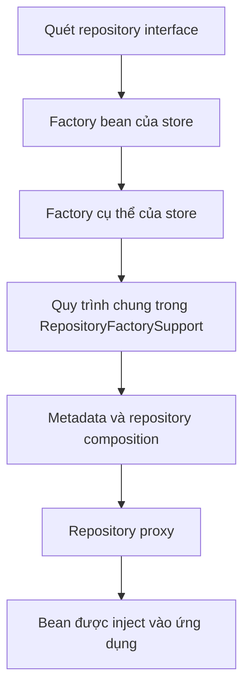
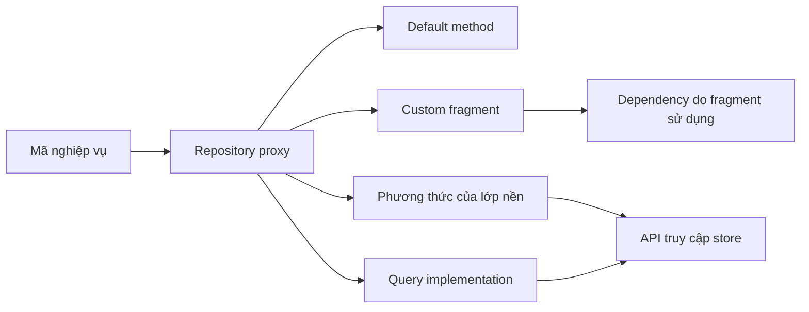

# RepositoryFactorySupport và lớp triển khai do store cung cấp

## 1. Vị trí của factory trong Spring Data Commons

Trong chương **Factory và metadata** của module **SPRING_DATA_COMMONS**, bài này giải thích cách Spring Data biến một repository interface thành đối tượng có thể nhận lời gọi thực tế. Trọng tâm là `RepositoryFactorySupport`: abstraction dùng chung để tạo repository, kết hợp metadata, đối tượng triển khai nền, các fragment và cơ chế xử lý query.

Spring Data Commons cung cấp ngôn ngữ chung như `Repository`, CRUD, phân trang, sắp xếp và metadata. Tuy nhiên, việc ghi một entity bằng JPA, đọc một document từ MongoDB hay gọi một API reactive cần các thành phần khác nhau. Vì vậy, Commons tổ chức quá trình tạo repository, còn module dành cho từng store cung cấp phần triển khai phù hợp.

Sau bài học, bạn cần phân biệt được:

- Repository interface mà mã nghiệp vụ sử dụng.
- Factory tạo repository proxy.
- Lớp triển khai nền thực hiện các thao tác có sẵn.
- Query implementation xử lý các phương thức truy vấn.
- Metadata mô tả repository và entity.
- Factory bean tích hợp quá trình trên vào Spring container.

Điểm cần giữ xuyên suốt: **repository interface, repository proxy và lớp triển khai nền là ba thành phần khác nhau**.

## 2. Bài toán: một interface, nhiều nguồn triển khai

Xét repository sử dụng Spring Data JPA:

```java
import java.util.List;
import org.springframework.data.jpa.repository.JpaRepository;

public interface CustomerRepository
        extends JpaRepository<Customer, Long> {

    List<Customer> findByEmail(String email);
}
```

Ứng dụng không viết một lớp có tên `CustomerRepositoryImpl` để triển khai toàn bộ interface này. Tuy vậy, repository vẫn xử lý được cả `save(customer)` lẫn `findByEmail(email)`.

Hai lời gọi có nguồn thực thi khác nhau:

| Lời gọi | Nguồn thực thi điển hình |
| --- | --- |
| `save(customer)` | Phương thức của lớp nền JPA, thường là `SimpleJpaRepository` |
| `findByEmail(email)` | Query được giải quyết bởi hạ tầng truy vấn của Spring Data JPA |
| Phương thức thuộc custom fragment | Đối tượng triển khai fragment đã được cấu hình |
| Default method của interface | Phần thân default method qua cơ chế gọi thích hợp của proxy |

Factory tạo proxy để trình bày các khả năng này dưới cùng một interface. Không cần có một đối tượng đích duy nhất tự viết đầy đủ mọi phương thức của `CustomerRepository`.

Từ đây có thể tránh hai suy luận sai:

1. Có `findByEmail` trong interface không có nghĩa `SimpleJpaRepository` phải có một phương thức Java cùng tên.
2. Các repository đều dùng Commons không có nghĩa mọi store hỗ trợ cùng query keyword, kiểu projection, transaction hoặc cơ chế auditing.

## 3. Các thành phần và ranh giới trách nhiệm

### 3.1. RepositoryFactorySupport

`org.springframework.data.repository.core.support.RepositoryFactorySupport` là lớp nền trừu tượng cho các repository factory.

Vai trò chính của nó là tổ chức việc tạo repository:

- Đọc cấu trúc interface và tạo metadata cần thiết.
- Xác định lớp triển khai nền thông qua phần mở rộng do store cung cấp.
- Kết hợp đối tượng nền với các repository fragment.
- Thiết lập proxy triển khai repository interface.
- Nối vào cơ chế giải quyết query và các interceptor liên quan.
- Cung cấp các điểm mở rộng phục vụ tùy biến hạ tầng.

Đây là lớp hỗ trợ phát triển framework và tích hợp store. Trong ứng dụng thông thường, bạn hiếm khi cần trực tiếp khởi tạo hoặc kế thừa nó.

`RepositoryFactorySupport` không tự biết phải gọi `EntityManager`, chuyển đổi MongoDB document hay diễn giải mọi ngôn ngữ query của các hệ lưu trữ.

### 3.2. Factory cụ thể của store

Factory cụ thể nối quy trình chung với công nghệ lưu trữ.

| Thành phần | Ví dụ phía JPA | Ví dụ phía MongoDB |
| --- | --- | --- |
| Factory tạo repository | `JpaRepositoryFactory` | `MongoRepositoryFactory` |
| Lớp triển khai nền mặc định điển hình | `SimpleJpaRepository` | `SimpleMongoRepository` |
| Đối tượng truy cập store | `EntityManager` | `MongoOperations` |
| Query implementation | Xử lý query theo khả năng JPA | Xử lý query theo khả năng MongoDB |

Bảng minh họa đường đi của repository đồng bộ. Repository reactive có factory, lớp nền và kiểu trả về phù hợp với hạ tầng reactive; không nên lấy cấu hình đồng bộ rồi chỉ đổi kiểu trả về thành `Mono` hoặc `Flux`.

Một factory cụ thể có thể quyết định:

- Dùng thông tin nào để nhận diện entity và ID.
- Chọn lớp nền nào.
- Khởi tạo đối tượng nền bằng dependency nào.
- Tạo query từ tên phương thức, khai báo query hoặc cơ chế riêng ra sao.
- Áp dụng những kiểm tra và tùy biến dành riêng cho store.

### 3.3. Repository proxy

Proxy là đối tượng cuối cùng mà ứng dụng thường nhận qua dependency injection. Nó triển khai interface được khai báo và chuyển lời gọi tới phần thực thi tương ứng.

Do vậy, phép kiểm tra sau không phải cách đáng tin cậy để kết luận repository có sử dụng `SimpleJpaRepository` hay không:

```java
boolean isSimpleRepository =
        repository instanceof SimpleJpaRepository;
```

Đối tượng ứng dụng nhận có thể là proxy của interface. Cấu trúc bên trong proxy mới chứa đối tượng nền và các thành phần dispatch.

### 3.4. Lớp triển khai nền

Lớp nền là nơi thực hiện nhiều thao tác có sẵn của repository, chẳng hạn tìm theo ID, lưu hoặc xóa entity, tùy API của store.

Ví dụ, `SimpleJpaRepository` làm việc với `EntityManager` và thông tin entity của JPA. `SimpleMongoRepository` làm việc với abstraction thao tác MongoDB và thông tin entity tương ứng.

Lớp nền không phải toàn bộ repository runtime. Query method, fragment, default method và các lớp advice còn tham gia xử lý lời gọi.

## 4. Phân biệt RepositoryFactoryBeanSupport và RepositoryFactorySupport

Tên gần giống nhau nhưng hai thành phần hoạt động ở hai tầng khác nhau.

| Thành phần | Câu hỏi nó giải quyết |
| --- | --- |
| `RepositoryFactoryBeanSupport` | Làm thế nào đưa repository vào vòng đời và cấu hình của Spring container? |
| `RepositoryFactorySupport` | Làm thế nào tạo proxy repository từ interface, metadata và các phần triển khai? |
| Factory bean cụ thể của store | Làm thế nào nhận dependency và cấu hình cần thiết cho store đó? |
| Factory cụ thể của store | Làm thế nào dựng repository hoạt động với store đó? |

Với Spring Data JPA, cặp thành phần điển hình là `JpaRepositoryFactoryBean` và `JpaRepositoryFactory`.

Luồng tổng quát:



Đây là sơ đồ trách nhiệm, không phải danh sách chính xác mọi lời gọi nội bộ hay thứ tự khởi tạo của mọi phiên bản.

Cấu hình `repositoryBaseClass` và `repositoryFactoryBeanClass` cũng giải quyết hai nhu cầu khác nhau:

- `repositoryBaseClass`: thay lớp thực hiện hành vi nền cho nhóm repository.
- `repositoryFactoryBeanClass`: thay điểm tích hợp factory với Spring, thường khi cần dựng factory có hành vi hạ tầng riêng.

Không cần thay factory bean chỉ để thêm một hàm nghiệp vụ vào một repository.

## 5. Metadata được dùng như thế nào?

### 5.1. RepositoryMetadata: repository khai báo gì?

`RepositoryMetadata` mô tả cấu trúc repository interface, đặc biệt là kiểu domain, kiểu ID và interface repository.

Với:

```java
public interface CustomerRepository
        extends JpaRepository<Customer, Long> {
}
```

Metadata phản ánh:

| Thuộc tính | Giá trị |
| --- | --- |
| Repository interface | `CustomerRepository` |
| Domain type | `Customer` |
| ID type | `Long` |

Ví dụ đọc metadata bằng API Commons:

```java
import org.springframework.data.repository.core.RepositoryMetadata;
import org.springframework.data.repository.core.support.AbstractRepositoryMetadata;

RepositoryMetadata metadata =
        AbstractRepositoryMetadata.getMetadata(CustomerRepository.class);

Class<?> domainType = metadata.getDomainType();
Class<?> idType = metadata.getIdType();
Class<?> repositoryType = metadata.getRepositoryInterface();
```

Đây là thông tin về hợp đồng Java của repository. Từ metadata này không thể kết luận bảng có tồn tại trong database hoặc một thuộc tính có được đánh index.

### 5.2. RepositoryInformation: repository sẽ được triển khai ra sao?

`RepositoryInformation` mở rộng góc nhìn metadata bằng thông tin liên quan đến lớp nền và phương thức của repository.

Nó hỗ trợ hạ tầng phân biệt những phương thức thuộc phần nền, custom implementation hay tập query method. Việc phân loại có ý nghĩa vì từng nhóm cần đường thực thi khác nhau.

Không nên tự phân loại query bằng quy tắc như “tên bắt đầu bằng `find` thì là derived query”. Một phương thức có thể được triển khai bởi fragment, được nhận diện là phương thức nền hoặc có query khai báo theo cơ chế của store.

### 5.3. EntityInformation: entity được nhận diện ra sao?

`EntityInformation<T, ID>` cung cấp góc nhìn về một entity cụ thể, bao gồm cách đọc ID và xác định trạng thái mới theo chiến lược đang sử dụng.

Nó khác với metadata của repository:

- `RepositoryMetadata` mô tả repository interface.
- `EntityInformation` mô tả cách hạ tầng làm việc với entity.
- Mapping metadata của store mô tả cách entity liên hệ với mô hình lưu trữ.

Ở JPA, factory sử dụng thông tin entity phù hợp với JPA; ở MongoDB, factory sử dụng thông tin phù hợp với mapping MongoDB.

Không nên rút gọn quy tắc thành “ID khác null thì entity chắc chắn đã tồn tại”. Việc xác định entity mới còn có thể liên quan đến version, `Persistable` hoặc chiến lược nhận diện riêng. Đây là một lý do Commons cần abstraction và store cần cung cấp triển khai cụ thể.

## 6. Những điểm mở rộng quan trọng của factory

Khi đọc mã nguồn một factory cụ thể, ba điểm mở rộng sau giúp định vị trách nhiệm.

### 6.1. getEntityInformation(...)

Factory cung cấp `EntityInformation` cho domain type.

Câu hỏi cần hỏi khi đọc phần này:

- ID được đọc bằng cách nào?
- Trạng thái entity mới được xác định theo chiến lược nào?
- Thông tin này đến từ mapping context, metamodel hay abstraction nào của store?

Đây không phải nơi tự động bật auditing. Auditing còn cần cấu hình, metadata và callback hoặc listener tương ứng.

### 6.2. getRepositoryBaseClass(...)

Factory xác định lớp triển khai nền phù hợp với repository metadata.

Một store có thể có nhiều nhánh triển khai tùy khả năng được bật. Vì vậy, không nên mặc định mỗi factory chỉ có đúng một lớp nền cho mọi trường hợp.

Nếu một repository không hỗ trợ thao tác mong muốn, cần kiểm tra hợp đồng interface và khả năng của store trước khi tìm cách thay lớp nền.

### 6.3. getTargetRepository(...)

Factory tạo đối tượng đích với các dependency cần thiết, chẳng hạn thông tin entity và đối tượng truy cập store.

Lớp nền được chọn và đối tượng nền được tạo là hai vấn đề riêng:

1. Chọn lớp nào đáp ứng hợp đồng.
2. Tạo một instance hợp lệ của lớp đó.

Một custom base class có thể đúng về kế thừa nhưng vẫn không khởi tạo được nếu constructor không phù hợp với cách factory tạo instance.

### 6.4. Query lookup và các điểm tùy biến khác

Factory còn kết nối `QueryLookupStrategy`, xử lý composition và cho phép can thiệp vào proxy qua các điểm mở rộng thích hợp.

Cách dùng cụ thể, overload và thứ tự callback phụ thuộc phiên bản Spring Data. Khi triển khai tùy biến hạ tầng, cần đối chiếu API của phiên bản dự án đang dùng; các tên trên trong bài giúp nhận diện trách nhiệm, không thay thế hợp đồng API chi tiết.

## 7. Từ interface đến proxy: luồng tổng quát

Có thể hình dung quá trình tạo repository qua các bước sau:

1. Hạ tầng xác định repository interface thuộc cấu hình store nào.
2. Factory nhận interface cùng các fragment đã được phát hiện hoặc cung cấp.
3. Factory tạo repository metadata.
4. Factory xác định lớp nền và thông tin triển khai.
5. Store tạo đối tượng nền với dependency truy cập dữ liệu.
6. Hạ tầng xây dựng repository composition và cơ chế query.
7. Proxy được cấu hình để triển khai interface cùng các advice cần thiết.
8. Proxy trở thành đối tượng repository mà ứng dụng sử dụng.

Đây là mô hình học để đọc kiến trúc. Một số bước có thể đan xen hoặc được trì hoãn tùy cấu hình bootstrap, cách khởi tạo repository và phiên bản.

Sau khi tạo xong, lời gọi đi theo dạng khái quát:



Sơ đồ chỉ ra các nguồn thực thi. Nó không quy định một thứ tự interceptor cố định cho mọi phiên bản.

Các điều kiện như transaction, exception translation hoặc thông tin gọi phương thức có thể được bổ sung bởi hạ tầng tích hợp. Không nên hiểu rằng mỗi repository tạo thủ công bằng factory đều có đầy đủ hành vi như bean được quản lý qua cấu hình Spring.

## 8. Ví dụ: dùng factory JPA trực tiếp để thấy ranh giới

Ví dụ sau minh họa việc tạo proxy từ một interface đơn giản:

```java
import java.util.List;
import java.util.Optional;
import org.springframework.data.repository.Repository;

public interface CustomerLookupRepository
        extends Repository<Customer, Long> {

    Optional<Customer> findById(Long id);

    List<Customer> findByEmail(String email);
}
```

Trong ngữ cảnh đã có một `EntityManager` hợp lệ:

```java
import jakarta.persistence.EntityManager;
import org.springframework.data.jpa.repository.support.JpaRepositoryFactory;
import org.springframework.data.repository.core.support.RepositoryFactorySupport;

public class RepositoryCreationExample {

    public CustomerLookupRepository create(EntityManager entityManager) {
        RepositoryFactorySupport factory =
                new JpaRepositoryFactory(entityManager);

        return factory.getRepository(CustomerLookupRepository.class);
    }
}
```

Giả định `Customer` là một JPA entity có ID kiểu `Long` và thuộc tính `email` được mapping hợp lệ.

Ví dụ cho thấy:

- Biến `factory` có kiểu abstraction của Commons.
- Đối tượng factory thực tế thuộc Spring Data JPA.
- Kết quả có kiểu repository interface.
- `findById` được nối tới khả năng nền tương ứng.
- `findByEmail` được xử lý bởi hạ tầng query của JPA.

Interface này chỉ công bố hai thao tác đọc. Việc lớp nền JPA có thêm thao tác khác không tự làm các thao tác đó xuất hiện trong API của interface.

Đây là ví dụ quan sát cơ chế. Trong ứng dụng Spring, cách thông thường vẫn là để repository configuration tạo bean và inject nó. Tạo factory thủ công không tự thay thế cấu hình transaction, lifecycle hay mọi proxy post-processor mà hạ tầng Spring đã thiết lập cho repository bean.

Mã dùng namespace `jakarta.persistence`, phù hợp với các dòng Spring Data JPA sử dụng Jakarta Persistence. Dự án dùng dòng API cũ cần điều chỉnh theo dependency thực tế.

## 9. Ví dụ: mở rộng lớp nền JPA có chủ đích

Giả sử nhiều repository JPA trong một package đều cần phương thức `getRequired(id)`: lấy entity hoặc ném ngoại lệ nếu không tìm thấy.

Đây là thay đổi hành vi chung cho một nhóm repository, nên có thể dùng custom base class.

### 9.1. Interface nền

Mỗi public type trong các ví dụ dưới được đặt trong file Java tương ứng. Cùng package `com.example.customer` được dùng cho ví dụ.

```java
package com.example.customer;

import org.springframework.data.jpa.repository.JpaRepository;
import org.springframework.data.repository.NoRepositoryBean;

@NoRepositoryBean
public interface RequiredRepository<T, ID>
        extends JpaRepository<T, ID> {

    T getRequired(ID id);
}
```

`@NoRepositoryBean` cho biết đây là interface nền, không phải một repository cụ thể để hạ tầng tạo bean trực tiếp.

### 9.2. Lớp triển khai nền

```java
package com.example.customer;

import jakarta.persistence.EntityManager;
import org.springframework.data.jpa.repository.support.JpaEntityInformation;
import org.springframework.data.jpa.repository.support.SimpleJpaRepository;
import org.springframework.transaction.annotation.Transactional;

public class RequiredJpaRepository<T, ID>
        extends SimpleJpaRepository<T, ID>
        implements RequiredRepository<T, ID> {

    public RequiredJpaRepository(
            JpaEntityInformation<T, ?> entityInformation,
            EntityManager entityManager) {

        super(entityInformation, entityManager);
    }

    @Override
    @Transactional(readOnly = true)
    public T getRequired(ID id) {
        return findById(id).orElseThrow(
                () -> new IllegalArgumentException(
                        "Không tìm thấy entity với id: " + id));
    }
}
```

Constructor nhận hai thành phần mà factory JPA sử dụng để tạo lớp nền trong cấu hình này: metadata của entity và `EntityManager`.

Ứng dụng thực tế có thể dùng loại ngoại lệ riêng phù hợp với hợp đồng service. `IllegalArgumentException` ở đây giữ ví dụ tập trung vào cơ chế factory.

### 9.3. Domain và repository cụ thể

```java
package com.example.customer;

import jakarta.persistence.Entity;
import jakarta.persistence.GeneratedValue;
import jakarta.persistence.Id;

@Entity
public class Customer {

    @Id
    @GeneratedValue
    private Long id;

    private String email;

    protected Customer() {
    }

    public Customer(String email) {
        this.email = email;
    }

    public Long getId() {
        return id;
    }

    public String getEmail() {
        return email;
    }
}
```

```java
package com.example.customer;

import java.util.List;

public interface CustomerRepository
        extends RequiredRepository<Customer, Long> {

    List<Customer> findByEmail(String email);
}
```

### 9.4. Chọn lớp nền trong cấu hình repository

```java
package com.example.customer;

import org.springframework.context.annotation.Configuration;
import org.springframework.data.jpa.repository.config.EnableJpaRepositories;

@Configuration
@EnableJpaRepositories(
        basePackageClasses = CustomerRepository.class,
        repositoryBaseClass = RequiredJpaRepository.class)
public class CustomerRepositoryConfiguration {
}
```

Ví dụ giả định persistence unit đã quản lý `Customer`, có `EntityManagerFactory` và transaction manager phù hợp. `@EnableJpaRepositories` thiết lập việc tạo repository, không tự hoàn thành mọi cấu hình JPA.

Khi repository bean được tạo:

| Phương thức | Nguồn xử lý |
| --- | --- |
| `getRequired(id)` | `RequiredJpaRepository` |
| `save(customer)` | Hành vi kế thừa từ `SimpleJpaRepository` |
| `findByEmail(email)` | Hạ tầng query JPA |

Chỉ khai báo `getRequired` trên interface mà không nối implementation phù hợp là chưa đủ. Hạ tầng có thể cố diễn giải phương thức không được nhận diện thành query và báo lỗi.

Custom base class này dành cho JPA. Nó phụ thuộc `EntityManager` và `SimpleJpaRepository`, nên không thể dùng nguyên trạng làm lớp nền cho MongoDB hoặc một repository reactive.

## 10. Chọn đúng mức mở rộng

Factory là điểm mở rộng mạnh nhưng thường không phải lựa chọn đầu tiên cho logic nghiệp vụ.

| Nhu cầu | Cách tiếp cận phù hợp thường gặp |
| --- | --- |
| Ghép các thao tác đã có thành tiện ích đơn giản | Default method hoặc service |
| Thêm truy vấn nghiệp vụ cho một vài repository | Repository fragment |
| Thay hành vi nền của nhiều repository trong một phạm vi | Custom repository base class |
| Thay cách tạo hoặc cấu hình repository ở tầng hạ tầng | Custom factory, có thể kèm factory bean |
| Cung cấp module Spring Data cho một store mới | Factory và hạ tầng store chuyên biệt |

Ví dụ, tìm khách hàng bằng một API tìm kiếm ngoài có thể đặt trong fragment riêng. Nhu cầu đó không tự đòi hỏi kế thừa `RepositoryFactorySupport`.

Ngược lại, nếu đang xây một store module mới, cần nối metadata, query, lớp nền và dependency truy cập store vào toàn bộ quy trình tạo repository; đó mới là phạm vi tự nhiên của factory.

Khi fragment và lớp nền có phương thức trùng nhau, composition và quy tắc ưu tiên của Spring Data có ảnh hưởng đến dispatch. Nên thiết kế hợp đồng rõ ràng và kiểm tra đúng phương thức được gọi, thay vì đoán từ tên lớp implementation.

## 11. Liên hệ với các abstraction khác của Commons

### CRUD

Interface CRUD công bố tập thao tác và kiểu trả về. Store cung cấp phần thực thi cho các thao tác được hỗ trợ.

Không nên hiểu một abstraction chung là cam kết rằng mọi store đều có cùng hiệu năng, khả năng batch, transaction hay ngữ nghĩa lưu entity.

### Phân trang và sắp xếp

`Pageable`, `Page`, `Slice` và `Sort` giúp chuẩn hóa hợp đồng gọi. Factory kết nối repository với query và lớp nền có khả năng sử dụng các abstraction đó.

Khả năng phân trang, cách đếm tổng, hỗ trợ sort theo thuộc tính và chi phí truy vấn phụ thuộc store cùng kiểu truy vấn. Việc kế thừa một interface có phân trang không chứng minh một phương thức tùy ý đã có implementation hợp lệ.

### Derived queries và projection

Commons cung cấp các thành phần hỗ trợ phân tích cấu trúc phương thức, thông tin kết quả và projection. Store vẫn quyết định cách chuyển yêu cầu đó thành query thực tế.

Không nên giả định cùng một tên phương thức hoặc biểu thức projection sẽ có hành vi giống nhau ở mọi store. Trước khi chuyển repository sang store khác, cần kiểm tra keyword, kiểu trả về và các giới hạn projection.

### Query by Example

Các kiểu như `Example` và `ExampleMatcher` cung cấp ngôn ngữ mô tả ví dụ tìm kiếm. Để repository thực thi được, cần có hợp đồng executor phù hợp và phần hỗ trợ của store.

Factory không tự biến một store thiếu hỗ trợ thành store có đầy đủ Query by Example.

### Auditing

Các abstraction về người tạo, thời điểm tạo hoặc người sửa hỗ trợ mô hình auditing chung. Việc kích hoạt và cập nhật dữ liệu auditing cần cấu hình cùng callback hoặc listener phù hợp với store.

Tùy biến factory hoặc lớp nền không đồng nghĩa auditing đã được bật. Cần phân biệt việc tạo repository với vòng đời ghi và chuyển đổi entity.

## 12. Chẩn đoán các vấn đề thường gặp

### 12.1. Phương thức custom bị diễn giải thành query

**Biểu hiện:** lỗi liên quan đến tên thuộc tính hoặc quá trình tạo query, trong khi bạn nghĩ đã viết implementation.

**Khả năng cần kiểm tra:**

- Fragment interface và implementation chưa được kết nối đúng.
- Custom base class chưa được chọn trong cấu hình repository.
- Chữ ký phương thức implementation không khớp hợp đồng.
- Repository đang được quét bởi cấu hình khác với cấu hình dự kiến.

**Hướng xử lý:** xác định phương thức này phải thuộc base class, fragment hay query; sau đó kiểm tra đường đăng ký tương ứng.

### 12.2. Không khởi tạo được custom base class

**Biểu hiện:** lỗi tạo repository bean, thường liên quan đến constructor hoặc dependency.

**Khả năng cần kiểm tra:**

- Constructor không phù hợp với cách factory của store tạo lớp nền.
- Lớp nền dùng dependency của store khác.
- Cấu hình `repositoryBaseClass` chưa trỏ tới lớp dự kiến.

Không nên sửa bằng cách tùy tiện thêm constructor rỗng. Đối tượng nền vẫn cần dependency hợp lệ để thực hiện thao tác dữ liệu.

### 12.3. Không xác định được domain hoặc ID type

**Biểu hiện:** lỗi metadata hoặc lỗi khi khởi tạo repository dùng kiểu generic chưa được cụ thể hóa.

**Khả năng cần kiểm tra:**

- Interface nền thiếu `@NoRepositoryBean`.
- Repository cụ thể chưa gắn domain type và ID type rõ ràng.
- Hợp đồng repository bị khai báo theo cách hạ tầng không suy ra được thông tin cần thiết.

**Hướng xử lý:** kiểm tra interface đang được tạo bean và chuỗi kế thừa generic của chính nó.

### 12.4. Repository gắn với store không mong muốn

**Biểu hiện:** repository bị bỏ qua, không xác định được store hoặc gặp lỗi query/mapping không phù hợp trong ứng dụng có nhiều module Spring Data.

**Khả năng cần kiểm tra:**

- Phạm vi quét các repository của từng store.
- Store-specific repository interface và annotation trên domain.
- Cấu hình riêng cho từng persistence infrastructure.

`RepositoryFactorySupport` không tự suy đoán đúng mọi ý định của ứng dụng nhiều store. Việc chọn module quản lý repository là trách nhiệm của hạ tầng cấu hình và quá trình đăng ký trước khi proxy được sử dụng.

### 12.5. Repository tạo thủ công có hành vi khác bean được inject

**Biểu hiện:** transaction, advice hoặc dependency hoạt động khác kỳ vọng.

**Khả năng cần kiểm tra:** ví dụ tạo factory trực tiếp có bỏ qua cấu hình do factory bean, repository configuration hoặc Spring container cung cấp hay không.

**Hướng xử lý:** ưu tiên so sánh cấu hình hạ tầng và cách tạo instance, không chỉ so sánh cùng một repository interface.

## 13. Kiểm tra một thay đổi về lớp nền hoặc factory

Khi thực sự triển khai tùy biến trong dự án, nên kiểm tra theo hợp đồng bên ngoài:

| Tình huống | Điều cần xác minh |
| --- | --- |
| Khởi động context | Repository được tạo với cấu hình dự kiến |
| Gọi CRUD nền | Hành vi đọc/ghi cơ bản vẫn đúng |
| Gọi phương thức mới | Được chuyển tới custom implementation |
| Gọi derived query | Hạ tầng query vẫn hoạt động |
| Entity không tồn tại | Kết quả hoặc ngoại lệ đúng hợp đồng |
| Có fragment trùng phương thức | Dispatch đúng theo thiết kế |
| Có transaction hoặc auditing liên quan | Hiệu ứng thực tế đúng cấu hình store |

Với ví dụ `getRequired`, các kịch bản hữu ích là:

1. Lưu một khách hàng, lấy ID rồi gọi `getRequired` và nhận đúng entity.
2. Gọi `getRequired` với ID không tồn tại và nhận ngoại lệ đã quy định.
3. Gọi `findByEmail` để xác minh custom base class không làm mất khả năng derived query.
4. Khởi tạo repository qua cùng cơ chế cấu hình mà ứng dụng dùng.

Kiểm tra bằng repository bean được cấu hình thực tế giúp phát hiện lỗi wiring mà việc chỉ gọi trực tiếp `new RequiredJpaRepository<>(...)` có thể bỏ sót.

Bài này trình bày các kịch bản kiểm tra để áp dụng trong dự án; các đoạn mã là ví dụ minh họa, không phải kết quả của một lần chạy integration test.

## 14. Tự kiểm tra kiến thức

**Vì sao không thể khởi tạo trực tiếp RepositoryFactorySupport?**

Vì đây là lớp trừu tượng tổ chức quy trình chung; store phải cung cấp thông tin entity, đối tượng nền và phần tích hợp cần thiết.

**Vì sao findByEmail không cần tồn tại trong SimpleJpaRepository?**

Vì nó có thể được nhận diện là query method và xử lý bởi hạ tầng query phía sau proxy.

**RepositoryMetadata có thay thế mapping metadata của store không?**

Không. Metadata của repository mô tả hợp đồng repository; mapping metadata mô tả entity và mô hình lưu trữ ở tầng store.

**Khi nào dùng custom base class?**

Khi cần bổ sung hoặc điều chỉnh hành vi nền dùng chung cho một nhóm repository và lớp nền đó phù hợp với factory của store.

**Đổi từ JPA sang MongoDB có giữ nguyên custom base class không?**

Một lớp phụ thuộc `EntityManager` và `SimpleJpaRepository` cần được thiết kế lại cho store mới. Interface nghiệp vụ có thể dùng lại một phần nếu hợp đồng và khả năng truy vấn thực tế vẫn phù hợp.

**Vai trò ngắn gọn của ba tầng chính là gì?**

Factory bean tích hợp với Spring container; factory tạo và kết hợp các phần triển khai; repository proxy nhận lời gọi của ứng dụng rồi chuyển tới nơi thực hiện tương ứng.
