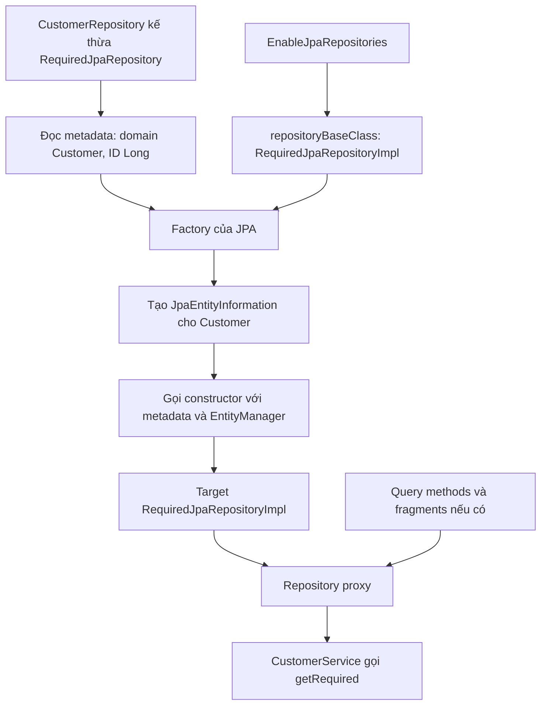

# Thay lớp repository cơ sở qua cấu hình của store

## Mục tiêu và phạm vi

Trong chương **Factory và metadata** của **SPRING_DATA_COMMONS**, bài này giải thích cách thay lớp triển khai cơ sở mà repository factory sử dụng để tạo repository cho một store cụ thể.

Spring Data Commons cung cấp các abstraction dùng chung như repository metadata, repository factory và cơ chế ghép các phần triển khai thành một repository proxy. Store module, chẳng hạn Spring Data JPA hoặc Spring Data MongoDB, bổ sung lớp triển khai cơ sở, cách xác định thông tin entity và các dependency cần thiết.

Sau bài học, bạn có thể:

- Phân biệt interface repository, lớp cơ sở và repository proxy.
- Khai báo một hợp đồng dùng chung bằng `@NoRepositoryBean`.
- Cấu hình `repositoryBaseClass` trong phạm vi repository của một store.
- Viết constructor tương thích với factory của store đó.
- Nhận biết khi nào nên dùng lớp cơ sở, fragment hoặc factory tùy biến.
- Kiểm tra thay đổi có thực sự áp dụng cho repository được tạo hay không.

Ví dụ chính dùng JPA để làm rõ cơ chế. Phần MongoDB cho thấy cùng một ý tưởng của Commons cần một triển khai khác khi thay store.

## 1. Ba thành phần dễ bị nhầm lẫn

Giả sử ứng dụng có repository:

```java
public interface CustomerRepository
        extends JpaRepository<Customer, Long> {
}
```

Đối tượng được inject vào service thông thường là một **repository proxy** do Spring Data tạo, không đơn thuần là một instance của interface hoặc một lớp bạn tự khai báo.

| Thành phần | Vai trò | Ví dụ với JPA |
| --- | --- | --- |
| Interface repository | Khai báo hợp đồng mà application sử dụng | `CustomerRepository` |
| Lớp repository cơ sở | Cung cấp phần triển khai nền cho những thao tác được giao cho nó | `SimpleJpaRepository` |
| Repository factory | Đọc metadata, tạo target và xây dựng proxy | `JpaRepositoryFactory` |
| Factory bean | Tích hợp quá trình tạo repository vào Spring container | `JpaRepositoryFactoryBean` |
| Repository proxy | Điểm vào thực tế, kết hợp target, query execution và các thành phần mở rộng | Bean được inject qua `CustomerRepository` |

Một repository có thể gồm nhiều phần: lớp cơ sở, custom fragments, query methods và các interceptor như transaction hoặc exception translation.

Vì vậy, thay lớp cơ sở không có nghĩa là mọi lời gọi repository đều đi qua một method tương ứng trong lớp mới. Ví dụ, một derived query có thể được xử lý bởi hạ tầng truy vấn thay vì một method CRUD trong lớp cơ sở.

## 2. Khi nào cần thay lớp cơ sở?

Dùng lớp cơ sở tùy biến khi cần một hành vi triển khai dùng chung cho nhiều repository trong cùng một phạm vi cấu hình.

Ví dụ phù hợp:

- Bổ sung thao tác `getRequired(id)` có cùng quy ước báo lỗi.
- Chuẩn hóa một thao tác dữ liệu lặp lại ở nhiều repository.
- Thay đổi một thao tác CRUD cụ thể khi đã hiểu rõ hợp đồng của store.
- Chia sẻ một phần triển khai cần sử dụng API của store và metadata entity.

Không phải mọi tiện ích dùng chung đều cần thay lớp cơ sở.

| Nhu cầu | Cơ chế nên cân nhắc trước |
| --- | --- |
| Ghép một số method đã có trên interface | Default method trên interface |
| Một nhóm nghiệp vụ chỉ dành cho vài repository | Repository fragment |
| Một thuật toán dữ liệu áp dụng rộng cho các repository cùng store | Lớp cơ sở tùy biến |
| Thay đổi cách factory chọn target hoặc xây dựng repository | Factory hoặc factory bean tùy biến |
| Gán người tạo, thời điểm tạo, người cập nhật | Hạ tầng auditing của store |
| Khai báo điều kiện truy vấn theo tên hoặc annotation | Query method |

Ví dụ, thêm auditing bằng cách chỉ override `save` thường không bao phủ các đường ghi khác. Auditing cần được thiết kế theo cơ chế lifecycle hoặc callback mà store cung cấp.

## 3. Hợp đồng của repository dùng chung

Giả sử ứng dụng muốn tất cả repository JPA trong một nhóm cung cấp:

```java
T getRequired(ID id);
```

Hành vi dự kiến:

- Có entity mang ID đó: trả về entity.
- Không có entity: ném exception theo quy ước.
- ID không hợp lệ: giữ nguyên kiểm tra của thao tác `findById` được gọi bên dưới.

Khai báo interface trung gian:

```java
package example.customer.persistence;

import org.springframework.data.jpa.repository.JpaRepository;
import org.springframework.data.repository.NoRepositoryBean;

@NoRepositoryBean
public interface RequiredJpaRepository<T, ID>
        extends JpaRepository<T, ID> {

    T getRequired(ID id);
}
```

### Vì sao cần `@NoRepositoryBean`?

`RequiredJpaRepository` là hợp đồng trung gian, chưa gắn với một entity và một kiểu ID cụ thể. `@NoRepositoryBean` yêu cầu hạ tầng repository không tạo một repository bean độc lập cho interface này.

Annotation đó không:

- Chọn lớp triển khai.
- Đăng ký `repositoryBaseClass`.
- Tự cung cấp phần thân của `getRequired`.
- Ngăn các interface con cụ thể trở thành repository bean.

Repository cụ thể vẫn cần được scan và được tạo theo cấu hình đúng.

### Vì sao không chỉ thêm method vào interface?

Nếu không có phần triển khai được nhận diện, hạ tầng có thể cố xử lý method như một query method và thất bại khi phân tích hoặc xác thực query, tùy store và chế độ bootstrap.

Vì vậy, khai báo hợp đồng và cấu hình phần triển khai là hai việc riêng biệt, cần hoàn thành cả hai.

## 4. Viết lớp cơ sở cho JPA

Lớp tùy biến kế thừa lớp cơ sở của JPA:

```java
package example.customer.persistence;

import jakarta.persistence.EntityManager;
import jakarta.persistence.EntityNotFoundException;

import org.springframework.data.jpa.repository.support.JpaEntityInformation;
import org.springframework.data.jpa.repository.support.SimpleJpaRepository;
import org.springframework.transaction.annotation.Transactional;

public class RequiredJpaRepositoryImpl<T, ID>
        extends SimpleJpaRepository<T, ID>
        implements RequiredJpaRepository<T, ID> {

    public RequiredJpaRepositoryImpl(
            JpaEntityInformation<T, ?> entityInformation,
            EntityManager entityManager) {

        super(entityInformation, entityManager);
    }

    @Override
    @Transactional(readOnly = true)
    public T getRequired(ID id) {
        return findById(id).orElseThrow(() ->
                new EntityNotFoundException(
                        "Không tìm thấy entity có id=" + id));
    }
}
```

Ví dụ dùng namespace `jakarta.persistence`, phù hợp với dòng Spring Data JPA sử dụng Jakarta Persistence. Dự án trên dòng cũ dùng namespace `javax.persistence` phải dùng dependency và import nhất quán với dòng đó.

### Ý nghĩa của constructor

Factory của JPA cần tạo target repository dựa trên domain type mà repository quản lý. Hai đối số ở đây là:

- `JpaEntityInformation<T, ?>`: metadata entity mà JPA factory đã xác định.
- `EntityManager`: đối tượng JPA được factory sử dụng cho nhóm repository tương ứng.

Constructor chuyển hai đối số đó cho `SimpleJpaRepository`, nhờ vậy giữ lại các thao tác CRUD nền và cách chúng sử dụng thông tin entity.

Không thay constructor này bằng một constructor chỉ nhận một service nghiệp vụ rồi kỳ vọng factory tự tìm bean để truyền vào. Quá trình tạo target repository tuân theo các đối số mà factory của store cung cấp; đó không phải cơ chế tự do chọn mọi constructor như một component thông thường.

Giữ một constructor rõ ràng, tương thích với store, giúp tránh lỗi khởi tạo do không tìm thấy constructor phù hợp.

### Vì sao dùng `findById`?

`findById` thể hiện đúng hợp đồng kiểm tra có entity rồi trả về entity nếu tồn tại. Không thay bằng `getReferenceById` khi muốn bảo đảm lỗi được phát hiện ngay trong thao tác này: một reference JPA có thể trì hoãn việc truy cập dữ liệu và thời điểm phát hiện entity không tồn tại.

`getRequired` cũng không tạo ra khóa bi quan hay bảo đảm entity vẫn tồn tại sau khi method kết thúc. Yêu cầu về khóa và tính nhất quán phải được thiết kế riêng.

### Giao dịch của method mới

Method `getRequired` có `@Transactional(readOnly = true)` vì đây là một method đọc mới trong lớp triển khai. Hạ tầng repository của JPA có thể nhận diện metadata giao dịch trên implementation.

Nếu service bên ngoài đã mở một transaction, cấu hình propagation mặc định thường khiến method tham gia transaction đó. `readOnly = true` không phải một cơ chế bảo mật cấm mọi thao tác ghi và không tự làm entity trả về trở thành bất biến.

Trong nội bộ lớp, lời gọi `findById` không phải một lần đi qua repository proxy mới. Vì thế, không nên dựa vào self-invocation để kích hoạt riêng một interceptor khác; hãy đặt ranh giới giao dịch cho thao tác công khai cần được bảo vệ.

## 5. Chọn lớp cơ sở qua cấu hình của store

Cấu hình các repository JPA thuộc package của ứng dụng:

```java
package example.customer.config;

import example.customer.persistence.CustomerRepository;
import example.customer.persistence.RequiredJpaRepositoryImpl;

import org.springframework.context.annotation.Configuration;
import org.springframework.data.jpa.repository.config.EnableJpaRepositories;

@Configuration
@EnableJpaRepositories(
        basePackageClasses = CustomerRepository.class,
        repositoryBaseClass = RequiredJpaRepositoryImpl.class
)
public class CustomerRepositoryConfiguration {
}
```

`basePackageClasses` lấy package của class hoặc interface được chỉ định làm gốc để scan. Trong ví dụ, đó là package chứa `CustomerRepository` và các package con của nó.

`repositoryBaseClass` yêu cầu factory dùng lớp đã chỉ định làm lớp triển khai cơ sở cho các repository thuộc cấu hình này.

Khai báo repository cụ thể:

```java
package example.customer.persistence;

public interface CustomerRepository
        extends RequiredJpaRepository<Customer, Long> {
}
```

Giả sử `Customer` đã là entity được mapping hợp lệ và persistence unit đã được cấu hình, service có thể gọi:

```java
package example.customer.application;

import example.customer.persistence.Customer;
import example.customer.persistence.CustomerRepository;

import org.springframework.stereotype.Service;
import org.springframework.transaction.annotation.Transactional;

@Service
public class CustomerService {

    private final CustomerRepository customers;

    public CustomerService(CustomerRepository customers) {
        this.customers = customers;
    }

    @Transactional(readOnly = true)
    public Customer loadRequired(Long id) {
        return customers.getRequired(id);
    }
}
```

Không cần thêm `@Repository` vào `RequiredJpaRepositoryImpl` để biến nó thành một bean thông thường. Repository factory tạo target cho từng repository cụ thể theo cấu hình.

Tên hậu tố `Impl` trong ví dụ không tự làm lớp này trở thành lớp cơ sở. Chính `repositoryBaseClass = RequiredJpaRepositoryImpl.class` quyết định vai trò đó.

### Hợp đồng và cấu hình phải đi cùng nhau

Hai câu hỏi phải được trả lời độc lập:

1. Mã gọi nhìn thấy method nào qua interface repository?
2. Factory dùng lớp nào để cung cấp phần triển khai nền?

Nếu chỉ cấu hình lớp cơ sở nhưng interface cụ thể vẫn chỉ kế thừa `JpaRepository`, mã gọi qua interface đó không tự nhìn thấy method `getRequired`.

Ngược lại, nếu interface kế thừa `RequiredJpaRepository` nhưng cấu hình vẫn dùng lớp cơ sở mặc định, method mới có thể không được tìm thấy như một thao tác đã có implementation.

## 6. Dòng chảy từ metadata đến target repository

Có thể hình dung quá trình khởi tạo theo sơ đồ sau. Đây là sơ đồ khái niệm, không phải cam kết về thứ tự gọi từng method nội bộ của mọi phiên bản.



Ở tầng Commons, `RepositoryMetadata` mô tả repository như domain type và ID type; `RepositoryInformation` bổ sung thông tin về repository đã được factory phân tích, bao gồm lớp cơ sở và các method liên quan.

Ở tầng store, metadata chung chưa đủ để thực thi thao tác dữ liệu. Ví dụ, JPA còn cần entity information và `EntityManager`; MongoDB cần entity information của MongoDB và operations tương ứng.

`RepositoryFactorySupport` cung cấp khả năng đặt repository base class, còn store factory chịu trách nhiệm sử dụng lựa chọn đó để tạo target phù hợp. Cấu hình annotation của store là cách thông thường để chuyển lựa chọn từ ứng dụng xuống factory.

Không cần tự đọc reflection của mọi repository hoặc tạo một registry riêng chỉ để truyền domain type cho lớp cơ sở. Factory đã có metadata đó trong quá trình xây dựng repository.

## 7. Phạm vi áp dụng và nhiều nhóm repository

`repositoryBaseClass` gắn với một cấu hình repository, không tự động là một thiết lập toàn cục cho mọi store trong ứng dụng.

Ví dụ:

| Nhóm | Phạm vi scan | Lớp cơ sở |
| --- | --- | --- |
| Customer JPA | `example.customer.persistence` | `RequiredJpaRepositoryImpl` |
| Billing JPA | `example.billing.persistence` | Lớp mặc định hoặc lớp riêng |
| Catalog MongoDB | `example.catalog.persistence` | Lớp cơ sở dành cho MongoDB |

Nếu chia nhiều nhóm:

- Tách rõ phạm vi scan để tránh đăng ký cùng một repository nhiều lần.
- Với nhiều persistence unit JPA, ghép cấu hình với đúng `entityManagerFactoryRef` và `transactionManagerRef`.
- Kiểm tra package của repository cụ thể có thuộc cấu hình mong muốn hay không.
- Khi dùng Spring Boot, xác định rõ nhóm repository được quản lý bởi cấu hình tường minh và nhóm dựa vào auto-configuration.
- Nếu có nhiều store module, sử dụng hợp đồng repository đặc thù store và cấu hình scan rõ ràng để tránh phân loại nhầm.

Một lớp cơ sở dùng chung cũng phải giữ được tính tổng quát. Không hard-code tên entity `Customer`, bảng `customers` hoặc giả định mọi ID đều là `Long` trong `RequiredJpaRepositoryImpl<T, ID>`.

## 8. Đối chiếu với MongoDB

Cùng ý tưởng có thể được triển khai cho MongoDB imperative, nhưng không tái sử dụng lớp `SimpleJpaRepository`.

### Hợp đồng và implementation

```java
package example.catalog.persistence;

import org.springframework.data.mongodb.repository.MongoRepository;
import org.springframework.data.repository.NoRepositoryBean;

@NoRepositoryBean
public interface RequiredMongoRepository<T, ID>
        extends MongoRepository<T, ID> {

    T getRequired(ID id);
}
```

```java
package example.catalog.persistence;

import java.util.NoSuchElementException;

import org.springframework.data.mongodb.core.MongoOperations;
import org.springframework.data.mongodb.repository.query.MongoEntityInformation;
import org.springframework.data.mongodb.repository.support.SimpleMongoRepository;

public class RequiredMongoRepositoryImpl<T, ID>
        extends SimpleMongoRepository<T, ID>
        implements RequiredMongoRepository<T, ID> {

    public RequiredMongoRepositoryImpl(
            MongoEntityInformation<T, ID> entityInformation,
            MongoOperations mongoOperations) {

        super(entityInformation, mongoOperations);
    }

    @Override
    public T getRequired(ID id) {
        return findById(id).orElseThrow(() ->
                new NoSuchElementException(
                        "Không tìm thấy document có id=" + id));
    }
}
```

Đăng ký với cấu hình MongoDB:

```java
package example.catalog.config;

import example.catalog.persistence.ProductRepository;
import example.catalog.persistence.RequiredMongoRepositoryImpl;

import org.springframework.context.annotation.Configuration;
import org.springframework.data.mongodb.repository.config.EnableMongoRepositories;

@Configuration
@EnableMongoRepositories(
        basePackageClasses = ProductRepository.class,
        repositoryBaseClass = RequiredMongoRepositoryImpl.class
)
public class CatalogRepositoryConfiguration {
}
```

Repository cụ thể có thể là:

```java
package example.catalog.persistence;

public interface ProductRepository
        extends RequiredMongoRepository<Product, String> {
}
```

Ví dụ giả định `Product` đã được mapping và `MongoOperations` đã có trong application context.

### Những gì được chia sẻ và những gì phải thay

| Khía cạnh | JPA | MongoDB imperative |
| --- | --- | --- |
| Ý tưởng của Commons | Factory chọn lớp cơ sở khi tạo repository | Tương tự |
| Annotation cấu hình | `@EnableJpaRepositories` | `@EnableMongoRepositories` |
| Lớp cơ sở trong ví dụ | `SimpleJpaRepository` | `SimpleMongoRepository` |
| Entity metadata dùng trong constructor | `JpaEntityInformation` | `MongoEntityInformation` |
| Đối tượng truy cập store | `EntityManager` | `MongoOperations` |
| Giao dịch | Phụ thuộc hạ tầng JPA và transaction manager | Phụ thuộc cấu hình, deployment và khả năng giao dịch của MongoDB |

Không sao chép annotation giao dịch của ví dụ JPA sang MongoDB rồi coi như đã có cùng bảo đảm. Việc thay lớp cơ sở không tự thiết lập transaction manager hay khả năng giao dịch cho store.

Tương tự, một lớp cơ sở imperative trả về `T` không phải lớp cơ sở reactive. Repository reactive cần implementation, constructor, kiểu kết quả và cách xử lý lỗi tương ứng, ví dụ kết quả bất đồng bộ thay vì chặn luồng để lấy `T`.

Với store khác, cần kiểm tra API của đúng module và phiên bản: tên annotation, hỗ trợ tùy biến lớp cơ sở, lớp mặc định, constructor và cơ chế tạo target có thể khác nhau.

## 9. Thay lớp cơ sở không đồng nghĩa thay toàn bộ factory

Hai thuộc tính có tên gần nhau nhưng phạm vi khác:

| Cấu hình | Thay đổi gì? | Khi nào dùng? |
| --- | --- | --- |
| `repositoryBaseClass` | Chọn lớp triển khai cơ sở cho target repository | Cần thêm hoặc tùy biến hành vi chung trong lớp cơ sở |
| `repositoryFactoryBeanClass` | Chọn factory bean tích hợp với Spring để cung cấp repository factory | Cần mở rộng sâu quá trình tạo repository |

Đối với một method như `getRequired`, tùy biến factory bean thường là phạm vi lớn hơn cần thiết.

Factory riêng có thể phù hợp nếu phải thay cách chọn target hoặc xử lý metadata theo một chính sách mà cấu hình lớp cơ sở không diễn đạt được. Khi đó cần hiểu các extension point của store và chịu thêm chi phí bảo trì khi nâng phiên bản.

Không cấu hình `repositoryBaseClass` bằng một lớp factory bean. Hai thuộc tính nhận các loại lớp có vai trò khác nhau.

## 10. Nếu muốn override thao tác CRUD sẵn có

Có thể ghi đè một thao tác được lớp cơ sở cung cấp, chẳng hạn `save`, nhưng phải giữ đúng chữ ký generic:

```java
@Override
@Transactional
public <S extends T> S save(S entity) {
    // Kiểm tra hoặc xử lý dùng chung nếu thật sự thuộc thao tác lưu.
    return super.save(entity);
}
```

Đoạn này là phần mở rộng tùy chọn đặt trong lớp JPA cơ sở ở trên, với import `org.springframework.transaction.annotation.Transactional`.

Những điểm cần xem xét:

- `<S extends T> S` giữ được subtype của đối số và kiểu trả về.
- Kết quả trả về phải là kết quả của thao tác lưu; không mặc định trả lại đối số đầu vào vì JPA có trường hợp merge trả về instance khác.
- Logic phải hoạt động cho mọi entity thuộc nhóm cấu hình.
- Không giả định override `save` sẽ chặn mọi đường ghi như bulk query, store template, native API hoặc thao tác từ một ứng dụng khác.
- Một custom fragment có method phù hợp có thể được ưu tiên hơn base implementation trong repository composition.

Nếu yêu cầu nghiệp vụ là “không bao giờ được xóa vật lý”, chỉ override một biến thể `delete` là chưa đủ. Cần rà soát toàn bộ hợp đồng, các biến thể xóa và các đường truy cập dữ liệu khác; lớp cơ sở tự nó không tạo ra ràng buộc bao trùm hệ thống.

Nếu nhu cầu là kiểm soát một quy trình nghiệp vụ, service thường là nơi rõ ràng hơn để đặt ranh giới thao tác, giao dịch và điều kiện hợp lệ.

## 11. Các ngộ nhận thường gặp

### “Đổi lớp cơ sở sẽ làm mọi derived query đi qua `findAll`”

Không đúng. Derived query có đường thực thi query riêng. Chẳng hạn `findByStatus` không bắt buộc gọi `findAll` trong lớp cơ sở.

Vì vậy, override `findAll` để thêm điều kiện tenant hoặc soft delete không bảo đảm mọi query đều có điều kiện đó.

### “Đăng ký lớp cơ sở thành bean là đủ”

Một bean riêng của lớp triển khai không thay đổi lựa chọn của repository factory. Cần cấu hình đúng extension point của store.

### “Có `@NoRepositoryBean` thì method mới tự chạy”

Annotation chỉ loại interface trung gian khỏi quá trình tạo repository bean độc lập. Nó không tạo implementation và không chọn lớp cơ sở.

### “Lớp cơ sở JPA dùng được cho mọi repository của Commons”

Commons thống nhất nhiều abstraction, nhưng không thống nhất toàn bộ cơ chế truy cập dữ liệu. Entity manager, template, transaction và mapping vẫn phụ thuộc store.

### “Đã thay lớp cơ sở thì projection, phân trang và QBE tự thay đổi”

Không tự động. Các khả năng đó phụ thuộc hợp đồng repository, query execution và hỗ trợ của store. Nếu chỉ thêm `getRequired` và giữ các implementation kế thừa, các thao tác khác vẫn dùng cơ chế tương ứng của chúng.

Khi override một thao tác trả về `Page`, `Slice` hoặc sử dụng `Sort`, phải giữ đúng ý nghĩa của kết quả và chi phí truy vấn cần thiết. Việc chọn lớp cơ sở không miễn các yêu cầu này.

## 12. Kiểm chứng trong dự án thực tế

Mục tiêu kiểm chứng là chứng minh cấu hình tạo được repository đúng và method mới thực sự được gọi qua repository proxy.

| Tình huống | Điều cần quan sát |
| --- | --- |
| Application context khởi tạo | Không lỗi constructor hoặc query creation cho `getRequired` |
| Gọi `getRequired` với ID tồn tại | Nhận đúng entity/document |
| Gọi `getRequired` với ID không tồn tại | Nhận exception theo hợp đồng đã chọn |
| Thao tác CRUD tiêu biểu | Tiếp tục có hành vi phù hợp của store |
| Hai repository trong cùng nhóm | Đều sử dụng được hợp đồng dùng chung |
| Repository ngoài nhóm | Chỉ thay đổi nếu cấu hình của nó cũng chọn lớp cơ sở |
| Repository có fragment trùng method | Hành vi thực tế phù hợp với composition mong muốn |
| Nhiều persistence unit hoặc nhiều store | Repository sử dụng đúng cấu hình và tài nguyên dữ liệu |

Trong một integration test JPA, có thể lưu entity mẫu, gọi repository qua interface đã inject và kiểm tra cả trường hợp có ID lẫn không có ID. Dùng test slice hoặc application context với đúng cấu hình repository; chỉ gọi `new RequiredJpaRepositoryImpl<>(...)` sẽ không chứng minh được cấu hình scan và tạo proxy hoạt động.

Nếu dùng chế độ bootstrap lazy hoặc deferred, cần gọi method để buộc repository được khởi tạo; chỉ thấy context ban đầu khởi động chưa đủ để kết luận mọi repository đã được dựng thành công.

Không kiểm tra bằng:

```java
customers instanceof RequiredJpaRepositoryImpl
```

Kết quả có thể không phản ánh đúng target vì bean là proxy. Ưu tiên kiểm tra hành vi qua hợp đồng; nếu cần chẩn đoán sâu, dùng công cụ kiểm tra target hoặc metadata thích hợp trong môi trường test.

## 13. Chẩn đoán lỗi theo dấu hiệu

| Dấu hiệu | Nguyên nhân nên kiểm tra | Hướng xử lý |
| --- | --- | --- |
| Lỗi tạo query cho `getRequired` | Lớp cơ sở tùy biến chưa được áp dụng, hoặc chữ ký không khớp | Kiểm tra cấu hình scan, interface và implementation |
| Lỗi không tìm được constructor phù hợp | Constructor không khớp các đối số factory của store cung cấp | Dùng metadata và đối tượng truy cập store đúng loại |
| Service không gọi được method mới khi compile | Repository cụ thể chưa kế thừa hợp đồng chung | Cập nhật interface repository cụ thể |
| Cùng repository bị đăng ký nhiều lần | Các cấu hình scan chồng lấn | Tách package hoặc thu hẹp phạm vi scan |
| Repository mới vẫn dùng hành vi mặc định | Nằm ngoài cấu hình đã tùy biến hoặc có implementation khác được chọn | Kiểm tra phạm vi đăng ký và fragments |
| Lỗi entity không được quản lý | Mapping hoặc persistence unit không khớp domain type | Sửa cấu hình entity/persistence unit |
| Hành vi giao dịch khác dự kiến | Transaction bên ngoài, transaction manager hoặc metadata giao dịch không phù hợp | Kiểm tra ranh giới gọi và cấu hình giao dịch |
| Chạy với JPA nhưng lỗi khi chuyển store | Đã mang theo constructor hoặc API riêng của JPA | Viết implementation và cấu hình riêng cho store đích |

Không khắc phục các lỗi này bằng cách ép kiểu repository proxy thành lớp cơ sở rồi gọi trực tiếp. Cách đó bỏ qua hợp đồng repository và làm mã ứng dụng phụ thuộc cơ chế proxy.

## 14. Bài tập vận dụng

Xây dựng hai repository `CustomerRepository` và `OrderRepository` cùng sử dụng `RequiredJpaRepository`.

1. Viết interface trung gian và đánh dấu `@NoRepositoryBean`.
2. Viết lớp cơ sở kế thừa `SimpleJpaRepository` với constructor phù hợp.
3. Cấu hình `repositoryBaseClass` cho đúng package.
4. Lưu dữ liệu mẫu và gọi `getRequired` qua từng repository.
5. Kiểm tra trường hợp ID không tồn tại.
6. Đặt một repository ở nhóm cấu hình khác để xác nhận phạm vi áp dụng.
7. Giải thích vì sao `findByStatus` không nhất thiết đi qua `findAll` đã override.

Câu hỏi mở rộng: nếu chỉ `OrderRepository` cần một nhóm truy vấn nghiệp vụ riêng, phần đó nên được đặt vào lớp cơ sở chung hay một fragment? Hãy lựa chọn dựa trên phạm vi tái sử dụng, dependency của implementation và độ ổn định của hợp đồng.

## 15. Những điều cần ghi nhớ

- Interface trung gian xác định hợp đồng; `repositoryBaseClass` chọn implementation nền.
- Repository factory tạo target dựa trên metadata và tài nguyên truy cập của store.
- Constructor của lớp cơ sở phải tương thích với quá trình tạo target của store.
- `@NoRepositoryBean` loại interface trung gian khỏi việc tạo bean, không đăng ký implementation.
- Phạm vi thay đổi đi theo cấu hình repository và phạm vi scan.
- Lớp cơ sở, fragment, query methods và proxy cùng tham gia tạo hành vi repository.
- Một implementation JPA không trở thành implementation dùng được cho MongoDB hoặc reactive chỉ vì cùng thuộc hệ sinh thái Spring Data.
- Kiểm chứng qua repository được inject giúp phát hiện đồng thời lỗi hợp đồng, cấu hình và khởi tạo.
