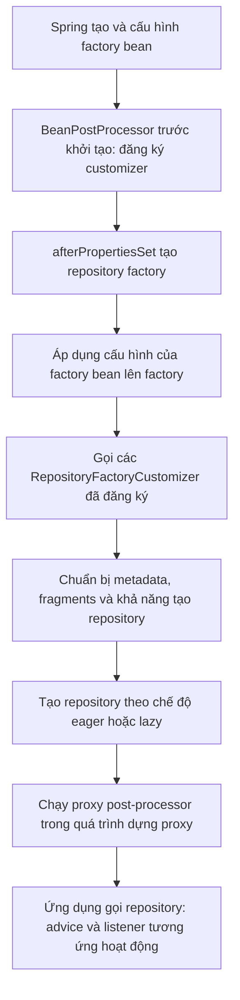

# RepositoryFactoryCustomizer và hook mở rộng theo phiên bản

## 1. Bài toán: can thiệp đúng chỗ trong quá trình tạo repository

Trong Spring Data Commons, repository là một abstraction dùng chung; implementation thực tế do module của kho dữ liệu cung cấp. Khi muốn ghi nhận thời gian gọi repository, kiểm kê query method hoặc cung cấp metadata cho một fragment, cần xác định hai việc: can thiệp ở giai đoạn tạo repository hay ở mỗi lần gọi phương thức, và API đó có tồn tại trong phiên bản đang dùng hay không.

Bài này thuộc chương **Factory và metadata** của module **SPRING_DATA_COMMONS**. Phạm vi là cơ chế mở rộng hạ tầng repository. Các khái niệm CRUD, derived query, phân trang, sắp xếp, projection, truy vấn theo ví dụ và auditing vẫn phụ thuộc hợp đồng của abstraction cùng khả năng của từng module lưu trữ.

Một tình huống xuyên suốt: ứng dụng có repository phục vụ danh mục sách và một số repository nội bộ. Ta muốn ghi thời gian gọi nhóm thứ nhất, giữ nguyên kết quả và ngoại lệ của phương thức, đồng thời tránh gắn hook ngoài phạm vi đã chọn.

Sau bài học, người học cần có khả năng:

- Phân biệt factory bean, repository factory và repository proxy.
- Đăng ký `RepositoryFactoryCustomizer` vào đúng factory bean trước khởi tạo.
- Chọn hook theo dữ liệu đầu vào và thời điểm cần can thiệp.
- Nhận diện API theo phiên bản Commons, đặc biệt các mốc 2.4, 3.4 và 4.0.
- Giới hạn phạm vi tùy biến khi có nhiều repository hoặc nhiều loại kho dữ liệu.

## 2. Ba đối tượng có tên gần nhau nhưng trách nhiệm khác nhau

| Thành phần | Trách nhiệm | Ví dụ điều chỉnh |
| --- | --- | --- |
| `RepositoryFactoryBeanSupport<T, S, ID>` | Tích hợp quá trình tạo repository với vòng đời bean của Spring | Nhận customizer, cấu hình khởi tạo |
| `RepositoryFactorySupport` | Hạ tầng tạo repository, phối hợp metadata, implementation và proxy | Thêm listener, proxy post-processor |
| Repository proxy | Đối tượng được ứng dụng inject để gọi repository | Chạy advice và chuyển lời gọi tới xử lý tương ứng |

`RepositoryFactoryCustomizer` nhận **repository factory**, không nhận repository proxy hay một entity:

```java
void customize(RepositoryFactorySupport repositoryFactory);
```

Đây là callback có từ Spring Data Commons **2.4**. Callback thiết lập factory để tác động tới việc tạo repository sau đó; bản thân nó không phải callback chạy trên mỗi lần `save` hoặc mỗi truy vấn. [Javadoc RepositoryFactoryCustomizer](https://docs.spring.io/spring-data/commons/docs/current/api/org/springframework/data/repository/core/support/RepositoryFactoryCustomizer.html)

Cần phân biệt thêm hai thao tác:

```java
factoryBean.addRepositoryFactoryCustomizer(customizer);
```

Thao tác này đăng ký callback trên **factory bean**.

```java
repositoryFactory.addRepositoryProxyPostProcessor(processor);
```

Thao tác này đăng ký một hook trên **repository factory**, thường được thực hiện bên trong callback trên. Phương thức `addRepositoryFactoryCustomizer` không nằm trên `RepositoryFactorySupport`.

## 3. Vòng đời quyết định vị trí đăng ký

Luồng dưới đây mô tả các bước liên quan trong `RepositoryFactoryBeanSupport` của Commons 3.5.6:



Ở phiên bản này, factory bean áp dụng các cấu hình như query lookup strategy và repository base class trước khi gọi customizer. Sau đó mới chuẩn bị metadata, fragments và giá trị repository dạng lazy; nếu không cấu hình lazy, repository được lấy ngay trong quá trình khởi tạo. Đây là mô tả của phiên bản cụ thể, không phải cam kết rằng mọi chi tiết nội bộ sẽ bất biến qua các dòng phát hành. [Mã nguồn RepositoryFactoryBeanSupport 3.5.6](https://github.com/spring-projects/spring-data-commons/blob/3.5.6/src/main/java/org/springframework/data/repository/core/support/RepositoryFactoryBeanSupport.java)

Từ luồng này có ba hệ quả:

1. Đăng ký customizer trong `postProcessBeforeInitialization` của factory bean là đúng thời điểm.
2. Đăng ký trong `postProcessAfterInitialization` thường đã bỏ lỡ lượt gọi customizer trong `afterPropertiesSet`.
3. Cấu hình lazy không có nghĩa là có thể đăng ký callback tùy ý sau khởi tạo: thời điểm chạy customizer và thời điểm tạo proxy là hai mốc riêng.

`BeanPostProcessor` có callback trước và sau các phương thức khởi tạo, bao gồm `InitializingBean.afterPropertiesSet()`. Khi khai báo processor bằng `@Bean`, nên dùng phương thức `static`, trả về kiểu processor và hạn chế dependency để tránh kéo các bean nghiệp vụ vào giai đoạn khởi tạo sớm. [Spring Framework: Container Extension Points](https://docs.spring.io/spring-framework/reference/core/beans/factory-extension.html)

## 4. Đọc hook theo phiên bản Spring Data Commons

Phiên bản trong bảng là phiên bản **Spring Data Commons**, không phải số phiên bản Spring Boot, Spring Framework hay tên release train. Ví dụ chính của bài dùng các API đã có trong Commons 3.5.x và cú pháp Java 17. Các dòng dưới là mốc xuất hiện của API, không phải khuyến nghị chọn một phiên bản cũ cho dự án mới.

| Mốc Commons | API hoặc thay đổi liên quan | Hệ quả khi triển khai |
| --- | --- | --- |
| Trước 2.4 | Chưa có `RepositoryFactoryCustomizer` | Không sao chép trực tiếp cách đăng ký callback trong bài |
| Từ 2.4 | `RepositoryFactoryCustomizer` và `addRepositoryFactoryCustomizer(...)` | Có thể gắn callback trước khi tạo repository |
| Từ 2.4 | `RepositoryMethodInvocationListener` | Có listener nhận thông tin sau thực thi phương thức được hạ tầng theo dõi |
| Từ 3.4 | `setExposeMetadata(boolean)`, `RepositoryMethodContext`, `RepositoryMetadataAccess` | Có cơ chế cung cấp metadata của lời gọi đang diễn ra |
| Từ 3.4 | Các API mới dùng `EvaluationContextProvider` và `ValueExpressionDelegate` | Phải đối chiếu overload khi tùy biến xử lý expression hoặc query lookup |
| Từ 4.0 | `setRepositoryFragmentsFunction(...)` trên factory bean | Có điểm cấu hình fragments bổ sung không tồn tại trong 3.5.x |

Mốc đăng ký customizer và metadata được ghi trong [Javadoc factory bean 3.5.6](https://docs.spring.io/spring-data/commons/docs/3.5.6/api/org/springframework/data/repository/core/support/RepositoryFactoryBeanSupport.html). Mốc listener được ghi trong [Javadoc RepositoryMethodInvocationListener](https://docs.spring.io/spring-data/commons/docs/current/api/org/springframework/data/repository/core/support/RepositoryMethodInvocationListener.html). Mốc fragments function được ghi trong [Javadoc factory bean của dòng 4.x](https://docs.spring.io/spring-data/commons/reference/api/java/org/springframework/data/repository/core/support/RepositoryFactoryBeanSupport.html#setRepositoryFragmentsFunction(org.springframework.data.repository.core.support.RepositoryFactoryBeanSupport.RepositoryFragmentsFunction)).

Trong Commons 3.5.6, overload query lookup nhận `QueryMethodEvaluationContextProvider` đã được đánh dấu deprecated từ 3.4 và hướng sang overload nhận `ValueExpressionDelegate`. Sự thay đổi này đặc biệt quan trọng khi kế thừa factory: cùng tên phương thức không có nghĩa là cùng chữ ký hoặc cùng đường thực thi. [Javadoc RepositoryFactorySupport 3.5.6](https://docs.spring.io/spring-data/commons/docs/3.5.6/api/org/springframework/data/repository/core/support/RepositoryFactorySupport.html)

Khi đọc một ví dụ trên mạng, hãy đối chiếu lần lượt package, kiểu tham số, khả năng truy cập `public/protected`, mục `Since` và cảnh báo deprecated của đúng phiên bản. Một phương thức `protected` trong factory không trở thành khả dụng cho lambda customizer chỉ vì đã có tham chiếu tới factory.

## 5. Chọn hook theo mục tiêu

| Mục tiêu | Điểm mở rộng phù hợp | Điểm cần phân biệt |
| --- | --- | --- |
| Thiết lập factory trước khi tạo repository | `RepositoryFactoryCustomizer` | Cấu hình hạ tầng, không xử lý trực tiếp từng request |
| Thêm advice vào proxy đang được dựng | `RepositoryProxyPostProcessor` | Nhận `ProxyFactory` cùng `RepositoryInformation` |
| Nhận thông báo query object vừa được tạo | `QueryCreationListener` | Gắn với vòng đời query object |
| Nhận thông tin sau thực thi query/fragment method được theo dõi | `RepositoryMethodInvocationListener` | Gắn với thực thi phương thức, không đồng nghĩa số câu lệnh gửi tới database |
| Bổ sung hành vi nghiệp vụ cho repository | Repository fragment | Có hợp đồng phương thức và implementation rõ ràng |
| Thay đổi implementation nền dùng chung | Repository base class tương thích với store | Ảnh hưởng cách phân loại và định tuyến phương thức |
| Thay đổi sâu cách tạo repository | Factory bean/factory riêng của module lưu trữ | Phải duy trì hợp đồng SPI theo phiên bản |

`RepositoryProxyPostProcessor.postProcess(ProxyFactory, RepositoryInformation)` là callback trong quá trình tạo proxy. Nó cho phép thêm interceptor vào proxy factory trước khi proxy được tạo. [Javadoc RepositoryProxyPostProcessor](https://docs.spring.io/spring-data/commons/docs/current/api/org/springframework/data/repository/core/support/RepositoryProxyPostProcessor.html)

Một customizer có thể đăng ký nhiều hook, nhưng mỗi hook vẫn giữ ý nghĩa riêng. Ví dụ: customizer được gọi một lần khi cấu hình factory; advice mà nó cài đặt có thể chạy nhiều lần sau đó.

## 6. Ví dụ: chỉ ghi thời gian cho repository được đánh dấu

### 6.1. Quy ước của ví dụ

Giả sử ứng dụng đã có module Spring Data của kho dữ liệu, cấu hình repository và mapping cho entity `Book`. Phần dưới chỉ thêm hạ tầng quan sát lời gọi. Mỗi public type nằm trong một tệp Java cùng tên khi người học đưa ví dụ vào ứng dụng.

Tạo annotation dành riêng cho nhóm repository cần quan sát:

```java
package example.repositorysupport;

import java.lang.annotation.ElementType;
import java.lang.annotation.Retention;
import java.lang.annotation.RetentionPolicy;
import java.lang.annotation.Target;

@Target(ElementType.TYPE)
@Retention(RetentionPolicy.RUNTIME)
public @interface TraceRepositoryCalls {
}
```

Gắn annotation trực tiếp trên interface repository cụ thể:

```java
package example.catalog;

import example.repositorysupport.TraceRepositoryCalls;
import org.springframework.data.repository.CrudRepository;

@TraceRepositoryCalls
public interface BookRepository extends CrudRepository<Book, Long> {
}
```

`Book` là kiểu domain đã được mapping theo module lưu trữ của ứng dụng. Ví dụ không định nghĩa một entity dùng chung cho tất cả kho dữ liệu. Annotation vừa tạo cũng không bật repository scanning; nó chỉ làm điều kiện lựa chọn cho processor bên dưới.

### 6.2. Customizer cài advice

```java
package example.repositorysupport;

import org.aopalliance.intercept.MethodInterceptor;
import org.springframework.data.repository.core.support.RepositoryFactoryCustomizer;
import org.springframework.data.repository.core.support.RepositoryFactorySupport;

public final class RepositoryLatencyCustomizer
        implements RepositoryFactoryCustomizer {

    private static final System.Logger LOG =
            System.getLogger(RepositoryLatencyCustomizer.class.getName());

    @Override
    public void customize(RepositoryFactorySupport factory) {
        factory.addRepositoryProxyPostProcessor((proxyFactory, information) -> {
            String repositoryName =
                    information.getRepositoryInterface().getName();

            MethodInterceptor timingAdvice = invocation -> {
                if (invocation.getMethod().getDeclaringClass() == Object.class
                        || !LOG.isLoggable(System.Logger.Level.DEBUG)) {
                    return invocation.proceed();
                }

                long startedAt = System.nanoTime();

                try {
                    return invocation.proceed();
                } finally {
                    long elapsedNanos = System.nanoTime() - startedAt;

                    try {
                        LOG.log(
                                System.Logger.Level.DEBUG,
                                "{0}#{1}: {2} ns",
                                repositoryName,
                                invocation.getMethod().getName(),
                                elapsedNanos);
                    } catch (RuntimeException loggingFailure) {
                        // Lỗi ghi log không thay kết quả hoặc ngoại lệ nghiệp vụ.
                    }
                }
            };

            proxyFactory.addAdvice(timingAdvice);
        });
    }
}
```

Advice gọi `proceed()` đúng một lần trên mỗi nhánh. Khi phương thức trả về, kết quả được giữ nguyên; khi phương thức ném lỗi, lỗi tiếp tục truyền ra. Đo thời gian dùng `System.nanoTime()` vì mục tiêu là khoảng thời gian, không phải thời điểm lịch.

`RepositoryInformation` được nhận khi dựng proxy cung cấp thông tin về repository và cách phân loại phương thức. Ví dụ dùng interface repository từ metadata để định danh, tránh suy đoán từ tên lớp proxy được sinh. [Javadoc RepositoryInformation](https://docs.spring.io/spring-data/commons/docs/current/api/org/springframework/data/repository/core/RepositoryInformation.html)

Đây là phép đo tại ranh giới advice đã thêm. Giá trị bao gồm công việc bên trong chuỗi xử lý mà advice bao quanh, không phải phép đo riêng thời gian thực thi câu lệnh database. Ví dụ chỉ ghi tên repository, tên phương thức và thời gian; không ghi tham số hoặc kết quả truy vấn.

### 6.3. Gắn customizer vào factory bean trước khởi tạo

```java
package example.repositorysupport;

import org.springframework.beans.factory.config.BeanPostProcessor;
import org.springframework.context.annotation.Bean;
import org.springframework.context.annotation.Configuration;
import org.springframework.data.repository.core.support.RepositoryFactoryBeanSupport;
import org.springframework.data.repository.core.support.RepositoryFactoryCustomizer;

@Configuration(proxyBeanMethods = false)
public class RepositoryHookConfiguration {

    @Bean
    public static BeanPostProcessor repositoryHookBinder() {
        RepositoryFactoryCustomizer customizer =
                new RepositoryLatencyCustomizer();

        return new BeanPostProcessor() {
            @Override
            public Object postProcessBeforeInitialization(
                    Object bean, String beanName) {

                if (!(bean instanceof RepositoryFactoryBeanSupport<?, ?, ?>
                        factoryBean)) {
                    return bean;
                }

                Class<?> repositoryType = factoryBean.getObjectType();

                if (repositoryType != null
                        && repositoryType.isAnnotationPresent(
                                TraceRepositoryCalls.class)) {
                    factoryBean.addRepositoryFactoryCustomizer(customizer);
                }

                return bean;
            }
        };
    }
}
```

Cấu hình phải được component scan hoặc import vào application context tạo các repository. Processor thao tác trên **factory bean**. Nó chỉ đọc kiểu sản phẩm bằng `getObjectType()`, không gọi `getObject()` để buộc tạo repository sớm.

Điều kiện `isAnnotationPresent` trong ví dụ phục vụ annotation được gắn trực tiếp. Nếu muốn hỗ trợ annotation tổng hợp hoặc tìm trên toàn cây interface, phải thiết kế quy tắc tìm kiếm riêng và kiểm chứng nó.

Chỉ khai báo một bean kiểu `RepositoryFactoryCustomizer` chưa đủ để Commons tự áp dụng callback lên mọi repository factory bean. Cần có bước liên kết cụ thể như `addRepositoryFactoryCustomizer` ở trên. Tài liệu Commons khuyến nghị chọn rõ factory bean cần áp dụng, nhất là khi có nhiều repository hoặc nhiều module Spring Data. [Spring Data Commons: Custom Repository Implementations](https://docs.spring.io/spring-data/commons/reference/repositories/custom-implementations.html)

Trong ví dụ, customizer được tạo ngay trong processor vì nó không có dependency nghiệp vụ. Nếu sau này cần tích hợp registry hoặc dịch vụ ngoài, phải cân nhắc vòng đời khởi tạo sớm thay vì inject trực tiếp một repository khác vào processor.

### 6.4. Kết quả mong đợi

Với mức log DEBUG phù hợp và một lời gọi đi qua proxy, log có thể có dạng:

```text
example.catalog.BookRepository#findById: 428500 ns
```

Con số chỉ minh họa định dạng, không phải kết quả benchmark. Repository không được đánh dấu sẽ không nhận advice này. Với repository có phương thức quá tải, tên phương thức trong ví dụ chưa phân biệt đầy đủ chữ ký; có thể bổ sung kiểu tham số vào định danh khi cần.

Không lưu thời điểm bắt đầu vào một field của customizer: customizer có thể được dùng cho nhiều factory và advice có thể được gọi đồng thời. Biến cục bộ trong mỗi invocation giúp các lời gọi không ghi đè dữ liệu đo của nhau.

## 7. Query creation và method invocation là hai loại sự kiện khác nhau

### 7.1. Khi cần kiểm kê query object

`QueryCreationListener<T extends RepositoryQuery>` nhận callback `onCreation(T query)` ngay sau khi query object được tạo. Một listener đơn giản có thể ghi tên query method:

```java
package example.repositorysupport;

import org.springframework.data.repository.core.support.QueryCreationListener;
import org.springframework.data.repository.query.RepositoryQuery;

public final class QueryInventoryListener
        implements QueryCreationListener<RepositoryQuery> {

    private static final System.Logger LOG =
            System.getLogger(QueryInventoryListener.class.getName());

    @Override
    public void onCreation(RepositoryQuery query) {
        LOG.log(
                System.Logger.Level.DEBUG,
                "Created repository query: {0}",
                query.getQueryMethod().getName());
    }
}
```

Bên trong một customizer đã được liên kết với factory bean:

```java
factory.addQueryCreationListener(new QueryInventoryListener());
```

Đây là kiểm kê quá trình tạo query object, không phải bộ đếm số lần truy vấn database. [Javadoc QueryCreationListener](https://docs.spring.io/spring-data/commons/docs/current/api/org/springframework/data/repository/core/support/QueryCreationListener.html)

Một query object có thể phục vụ nhiều lần gọi. Các phương thức đã có implementation nền như nhiều thao tác CRUD cũng không nhất thiết được tạo thành `RepositoryQuery` qua cùng đường xử lý. Vì vậy, không dùng số callback này để suy ra số lượt gọi `save`, số bản ghi đã đọc hoặc số câu lệnh thực thi.

### 7.2. Khi cần quan sát sau thực thi phương thức

`RepositoryMethodInvocationListener` cung cấp sự kiện sau thực thi cùng thông tin lời gọi và thời gian. Có thể đăng ký bằng `factory.addInvocationListener(listener)`.

Hạ tầng factory mô tả listener này cho query methods và fragment methods. Không nên mặc định rằng nó bao phủ mọi đường gọi như `Object.toString()`, mọi default method, hay toàn bộ thao tác của driver. Phạm vi quan sát phải phù hợp với loại phương thức đang dùng. [Javadoc addInvocationListener](https://docs.spring.io/spring-data/commons/docs/3.5.6/api/org/springframework/data/repository/core/support/RepositoryFactorySupport.html#addInvocationListener(org.springframework.data.repository.core.support.RepositoryMethodInvocationListener))

Một tình huống dễ nhầm: phương thức trả về trang dữ liệu có thể phát sinh thêm truy vấn đếm ở tầng store. Một sự kiện phương thức repository không cung cấp đủ thông tin để kết luận có đúng một câu lệnh database. Nếu mục tiêu là quan sát câu lệnh của driver, cần điểm quan sát tương ứng ở tầng đó.

## 8. Metadata tĩnh và metadata của lời gọi hiện tại

### 8.1. Metadata khi tạo proxy

`RepositoryInformation` phù hợp để biết repository interface, base class và cách hạ tầng phân loại phương thức trong quá trình tạo repository. Nó hữu ích cho quyết định cài advice vào repository nào hoặc xác định nhóm phương thức cần xử lý.

Không cần bật metadata của lời gọi chỉ để đọc tên repository từ đối số `information` trong proxy post-processor.

### 8.2. Metadata khi đang thực thi phương thức

Từ Commons 3.4, có thể bật cung cấp metadata hiện tại trên factory:

```java
RepositoryFactoryCustomizer metadataCustomizer =
        factory -> factory.setExposeMetadata(true);
```

Callback này cũng cần được liên kết vào các factory bean được chọn. Việc bật metadata có thêm chi phí interception; đây không phải thiết lập bắt buộc cho mọi repository.

Ở bên trong phần thực thi được gọi qua repository proxy và có context hợp lệ:

```java
import org.springframework.data.repository.core.RepositoryMethodContext;

RepositoryMethodContext context = RepositoryMethodContext.getContext();

Class<?> domainType = context.getMetadata().getDomainType();
String methodName = context.getMethod().getName();
```

Đoạn trên là nội dung đặt **trong thân một phương thức đang được thực thi**, không phải khai báo ở cấp lớp. `getContext()` có thể ném `IllegalStateException` nếu không có context hoặc repository chưa được cấu hình cung cấp metadata. Không gọi nó ở lúc khởi động trong `customize(...)`, vì tại đó chưa có lời gọi repository của ứng dụng. [Javadoc RepositoryMethodContext](https://docs.spring.io/spring-data/commons/docs/current/api/org/springframework/data/repository/core/RepositoryMethodContext.html)

Một lựa chọn có phạm vi rõ hơn là để **implementation của fragment** cần metadata implement marker `RepositoryMetadataAccess`. Marker này có từ 3.4 và hướng tới fragment implementation trong repository composition; thông thường fragment interface không cần kế thừa marker. [Javadoc RepositoryMetadataAccess](https://docs.spring.io/spring-data/commons/docs/current/api/org/springframework/data/repository/core/support/RepositoryMetadataAccess.html)

Metadata hiện tại được cung cấp theo cơ chế ThreadLocal của hạ tầng factory. Không giả định nó tự đi theo một tác vụ bất đồng bộ, một executor khác hay một chuỗi reactive sau khi đổi luồng. Nếu cần chuyển thông tin sang công việc khác, hãy lấy dữ liệu cần thiết trong phạm vi hợp lệ và truyền một giá trị tường minh.

## 9. Giới hạn với store, reactive và thứ tự advice

### 9.1. Hook Commons không bổ sung năng lực truy vấn cho store

Một factory có thể tạo repository hỗ trợ abstraction dùng chung nhưng thực thi dựa trên module lưu trữ. Việc thêm advice không tự làm cho store hỗ trợ một kiểu derived query, phép phân trang, projection, truy vấn theo ví dụ hay auditing còn thiếu.

Ví dụ, advice có thể ghi nhận lời gọi `save`; cấu hình auditing vẫn cần hạ tầng auditing tương ứng của module. Một advice quan sát cũng không thay thế implementation của query hoặc fragment.

Không ép mọi factory sang một lớp JPA chỉ vì dự án hiện tại có JPA. Nếu mục tiêu thực sự cần API riêng của store, hãy giới hạn cả điều kiện chọn repository lẫn kiểu factory được hỗ trợ, rồi tách phần phụ thuộc đó khỏi logic Commons.

### 9.2. Đo lời gọi trả về publisher khác đo hoàn tất tác vụ

Trong ví dụ timing advice, `finally` chạy khi `invocation.proceed()` trả về hoặc ném lỗi. Với phương thức đồng bộ trả về một giá trị đã xử lý, đây là khoảng thời gian của lời gọi tại ranh giới advice.

Với phương thức trả về `Mono`, `Flux`, future hoặc một kiểu trì hoãn tương tự, advice có thể chỉ đo quá trình tạo và trả về đối tượng đại diện công việc. Hoàn tất, lỗi và hủy của công việc có thể diễn ra sau đó.

Do đó, nếu dùng ví dụ với reactive repository, phải gọi chỉ số này là thời gian trả về từ phương thức. Để đo đến terminal signal cần cơ chế quan sát phù hợp với publisher và kiểm tra cả completion, error, cancellation, nhiều subscription và việc không có subscription. Hook dùng chung không xóa được khác biệt mô hình thực thi này.

### 9.3. Thứ tự đăng ký là một phần của thiết kế

Hai customizer cùng thêm listener có thể làm một sự kiện được ghi hai lần. Hai customizer cùng gọi setter của cùng thuộc tính có thể tạo cấu hình phụ thuộc thứ tự.

Không giả định rằng thêm `@Order` lên một bean customizer sẽ tự sắp xếp mọi callback: ví dụ này đăng ký một instance trực tiếp bằng `addRepositoryFactoryCustomizer`. Nếu có nhiều callback, nên tổ chức bước liên kết ở một chỗ và thể hiện thứ tự một cách rõ ràng.

Tương tự, vị trí của timing advice trong chuỗi advisor quyết định phần công việc được đo. Không suy từ phép đo ở repository rằng nó luôn bao gồm thời gian commit transaction hoặc các aspect bên ngoài proxy đó.

## 10. Khi cần factory riêng thay cho customizer

Customizer thích hợp khi API công khai của factory đã cung cấp điểm gắn phù hợp. Nếu cần thay đổi sâu cách tạo target repository hoặc cách lựa chọn query lookup strategy mà API công khai không cho phép, có thể cần factory hoặc factory bean riêng.

Lúc đó cần làm rõ:

1. Factory bean riêng có giữ các cấu hình và tích hợp của module lưu trữ không?
2. Factory mới có duy trì metadata, base class và fragments nhất quán không?
3. Phương thức override có đúng chữ ký của phiên bản mục tiêu không?
4. Cơ chế cấu hình repository của module có thực sự chọn factory bean mới không?
5. Việc thay implementation nền có làm một phương thức bị phân loại khác đi không?

Không dùng reflection để gọi một phương thức nội bộ chỉ nhằm giữ nguyên một ví dụ không phù hợp phiên bản. Phần phụ thuộc SPI càng sâu thì chi phí theo dõi thay đổi khi nâng cấp càng lớn.

Trong ứng dụng có nhiều kho dữ liệu, một fragment có hợp đồng rõ ràng thường dễ giới hạn hơn một factory thay toàn bộ quá trình tạo repository. Chọn mức mở rộng đủ giải quyết yêu cầu giúp người bảo trì thấy rõ nơi chứa hành vi.

## 11. Lỗi thường gặp và cách nhận diện

| Hiện tượng | Nguyên nhân cần kiểm tra | Hướng xử lý |
| --- | --- | --- |
| Bean customizer tồn tại nhưng callback không chạy | Chưa liên kết với factory bean | Kiểm tra bước `addRepositoryFactoryCustomizer` |
| Hook đăng ký nhưng không có tác dụng | Đăng ký sau lượt `afterPropertiesSet` | Chuyển bước liên kết sang trước khởi tạo |
| Không thấy log timing | DEBUG chưa bật hoặc repository không vượt điều kiện lọc | Kiểm tra mức log và annotation trên interface cụ thể |
| Repository không mong muốn cũng có hook | Điều kiện chọn quá rộng | Chọn rõ annotation, nhóm interface hoặc factory của store |
| Một lời gọi có hai bản ghi giống nhau | Hook được gắn lặp | Kiểm tra các đường đăng ký và cấu hình được import |
| Không biên dịch sau khi nâng phiên bản | Sai overload, API deprecated hoặc API chưa tồn tại | Đọc Javadoc của đúng dependency đã resolve |
| `RepositoryMethodContext.getContext()` ném lỗi | Không có invocation context hoặc chưa bật metadata | Đọc context trong đường gọi qua proxy có cấu hình thích hợp |
| Thời gian reactive gần bằng không | Đang đo lúc trả publisher | Chuyển điểm đo sang vòng đời thực thi cần quan sát |
| Processor tạo vòng phụ thuộc | Inject repository hoặc dịch vụ khởi tạo quá sớm | Thu gọn dependency của processor và tách logic nghiệp vụ |
| Query listener không phản ánh CRUD | Nhầm tạo query object với thực thi phương thức | Chọn listener hoặc advice theo đúng mục tiêu |

## 12. Thực hành và tiêu chí tự kiểm tra

Trong một ứng dụng đã có repository hoạt động, có thể thực hành theo trình tự:

1. Thêm annotation và customizer của ví dụ, rồi liên kết bằng processor.
2. Chọn hai repository hợp lệ, chỉ đánh dấu một repository.
3. Bật DEBUG cho logger của `RepositoryLatencyCustomizer`.
4. Gọi một phương thức trả về bình thường và một phương thức ném lỗi.
5. Kiểm tra hook chỉ áp dụng đúng repository được chọn và lời gọi vẫn giữ kết quả hoặc ngoại lệ ban đầu.
6. Nếu dùng query creation listener, phân biệt bản ghi tạo query với bản ghi của nhiều lần thực thi.
7. Nếu dùng metadata, so sánh lời gọi qua proxy với việc gọi trực tiếp đối tượng implementation.
8. Nếu dùng chế độ lazy, ghi nhận riêng mốc chạy customizer và mốc dựng proxy.
9. Nếu module hỗ trợ reactive repository, phân biệt thời gian trả publisher với thời gian hoàn tất công việc.

Các bước này là hướng dẫn thực hành cho người học; bài viết không khẳng định đã chạy một ứng dụng mẫu hay benchmark.

Kết quả cần giải thích được là: **callback nào được đăng ký vào đối tượng nào, chạy ở thời điểm nào, áp dụng cho repository nào, dựa vào API của phiên bản nào và quan sát phần công việc nào**. Đây là cơ sở để mở rộng repository mà vẫn giữ đúng hợp đồng của Spring Data Commons và module kho dữ liệu đang sử dụng.
