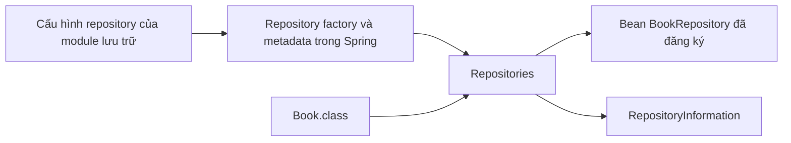

# Repositories để tra repository theo kiểu miền

Trong chương **Factory và metadata** của Spring Data Commons (`SPRING_DATA_COMMONS`), một nhu cầu thường gặp là tìm repository khi chỉ biết lớp miền, chẳng hạn `Book.class`. Một thành phần kiểm kê metadata hoặc một bộ điều phối có cấu hình động có thể biết lớp này mà không biết trước interface repository tương ứng.

Bài học sử dụng `org.springframework.data.repository.support.Repositories` để giải quyết nhu cầu đó. Trọng tâm là tra repository và đọc metadata trong Spring container; khả năng truy vấn, phân trang, sắp xếp, projection, Query by Example hay auditing vẫn phụ thuộc vào hợp đồng repository và module lưu trữ cụ thể.

## 1. Mục tiêu và tình huống sử dụng

Sau bài học, bạn có thể:

- Tạo một đối tượng `Repositories` từ Spring application context.
- Phân biệt khóa tra cứu là lớp miền với khóa tra cứu là interface repository.
- Xử lý rõ trường hợp không có repository.
- Lấy repository dưới dạng đối tượng, kiểm tra kiểu rồi gọi đúng hợp đồng.
- Đọc metadata để lập danh mục repository mà không truy vấn dữ liệu.
- Nhận ra giới hạn khi một lớp miền có nhiều repository hoặc khi ứng dụng dùng nhiều loại kho dữ liệu.

Ví dụ, hệ thống thư viện có:

```text
Book.class      -> BookRepository
Author.class    -> AuthorRepository
Loan.class      -> LoanRepository
```

Một màn hình quản trị nội bộ muốn liệt kê kiểu miền, kiểu ID và interface repository. Nếu viết riêng logic cho từng kiểu, mỗi lần thêm repository lại phải sửa bộ kiểm kê. Một thành phần dựa trên metadata có thể làm công việc này theo cùng một quy trình.

Ngược lại, service nghiệp vụ chỉ làm việc với sách thường nên nhận trực tiếp `BookRepository` qua constructor. Khi dependency đã biết lúc biên dịch, cách tiêm trực tiếp giúp IDE, compiler và người đọc nhìn thấy hợp đồng rõ hơn.

## 2. Phân biệt ba đối tượng dễ nhầm

| Thành phần | Vai trò | Ví dụ |
|---|---|---|
| Lớp miền | Kiểu đối tượng được repository quản lý | `Book.class` |
| Interface repository | Hợp đồng truy cập dữ liệu mà ứng dụng khai báo | `BookRepository.class` |
| Bean repository | Đối tượng Spring tạo và quản lý, thường là proxy | Bean thực thi `BookRepository` |

Với một interface như sau:

```java
public interface BookRepository extends CrudRepository<Book, Long> {
}
```

`Book` là kiểu miền, `Long` là kiểu ID, còn `BookRepository` là interface repository.

Hai cách tìm sau giải quyết hai câu hỏi khác nhau:

```java
// Đã biết interface cần lấy.
BookRepository direct =
        applicationContext.getBean(BookRepository.class);

// Chỉ biết kiểu miền được quản lý.
Optional<Object> discovered =
        repositories.getRepositoryFor(Book.class);
```

Không truyền `BookRepository.class` vào `getRepositoryFor` rồi mong nó hoạt động như `ApplicationContext.getBean`. Khóa của phương thức này là kiểu miền.

## 3. Repositories lấy thông tin từ đâu?

`Repositories` bao bọc việc truy cập các repository đã được Spring đăng ký cùng metadata tương ứng. Nó nhận một `ListableBeanFactory`; `ApplicationContext` cũng đáp ứng hợp đồng này. Đây không phải lời gọi tự tạo repository từ một lớp Java bất kỳ. Xem [API chính thức của Repositories](https://docs.spring.io/spring-data/commons/docs/current/api/org/springframework/data/repository/support/Repositories.html).

Luồng khái niệm:



Repository factory của module lưu trữ chịu trách nhiệm tạo repository và cung cấp thông tin. `Repositories` sử dụng thông tin đã có để tra cứu. Vì vậy:

- Chỉ khai báo một lớp miền chưa làm xuất hiện repository cho lớp đó.
- Một interface nằm ngoài phạm vi repository scanning có thể chưa có bean.
- Tự tạo một mock hoặc một bean Java thực thi interface chưa đủ để bảo đảm nó được nhận diện như repository do Spring Data factory quản lý.
- Các repository được thêm động sau khi đối tượng `Repositories` đã khởi tạo cần được xem xét riêng về vòng đời; không giả định đây là bộ theo dõi tự cập nhật mọi thay đổi của container.

Trong bài này, giả định repository được cấu hình theo vòng đời khởi động thông thường của Spring. Những chi tiết về cách thu thập factory information và lưu ánh xạ có thể đối chiếu tại [mã nguồn Repositories nhánh 3.5.x](https://raw.githubusercontent.com/spring-projects/spring-data-commons/3.5.x/src/main/java/org/springframework/data/repository/support/Repositories.java).

## 4. Chuẩn bị một ví dụ cụ thể

Ví dụ dưới đây dùng Spring Data JPA để có một mô hình lưu trữ cụ thể. `Repositories` vẫn thuộc Spring Data Commons. Annotation JPA và cách lưu `Book` là phần riêng của module JPA.

Giả định ứng dụng đã có Spring Data JPA, datasource và repository scanning hợp lệ. Mỗi lớp hoặc interface `public` trong ví dụ được đặt trong file Java tương ứng, cùng package `example.catalog`.

### 4.1. Kiểu miền và repository

```java
package example.catalog;

import jakarta.persistence.Entity;
import jakarta.persistence.GeneratedValue;
import jakarta.persistence.Id;

@Entity
public class Book {

    @Id
    @GeneratedValue
    private Long id;

    private String title;

    protected Book() {
    }

    public Book(String title) {
        this.title = title;
    }

    public Long getId() {
        return id;
    }

    public String getTitle() {
        return title;
    }
}
```

```java
package example.catalog;

import java.util.List;
import org.springframework.data.repository.CrudRepository;

public interface BookRepository extends CrudRepository<Book, Long> {

    List<Book> findByTitleContainingIgnoreCase(String title);
}
```

Phương thức tìm theo tiêu đề minh họa một derived query trong ví dụ JPA. `Repositories` chỉ giúp tìm đúng bean; nó không phân tích tên phương thức thay cho bộ máy truy vấn của Spring Data JPA.

### 4.2. Khai báo Repositories thành bean

```java
package example.catalog;

import org.springframework.context.ApplicationContext;
import org.springframework.context.annotation.Bean;
import org.springframework.context.annotation.Configuration;
import org.springframework.data.repository.support.Repositories;

@Configuration(proxyBeanMethods = false)
public class RepositoryLookupConfiguration {

    @Bean
    Repositories repositories(ApplicationContext applicationContext) {
        return new Repositories(applicationContext);
    }
}
```

Tạo bean này một lần trong cấu hình phù hợp, rồi tiêm vào thành phần cần tra cứu. Không cần tạo lại `Repositories` trong mỗi request chỉ để tìm cùng một repository.

Cũng không nên đặt việc khởi tạo registry vào đường khởi tạo mà chính repository hoặc repository fragment lại phụ thuộc ngược vào registry đó. Khi gặp vòng phụ thuộc, cần chỉnh thiết kế vòng đời thay vì dùng tra cứu động để che giấu dependency.

## 5. Những API cần phân biệt

Các phương thức thường dùng có thể chia theo mục đích:

| Nhu cầu | Lời gọi | Kết quả hoặc điều cần chú ý |
|---|---|---|
| Kiểm tra có repository cho kiểu miền | `hasRepositoryFor(Book.class)` | `boolean` |
| Lấy bean theo kiểu miền | `getRepositoryFor(Book.class)` | `Optional<Object>` |
| Lấy metadata theo kiểu miền | `getRepositoryInformationFor(Book.class)` | `Optional<RepositoryInformation>` |
| Lấy metadata theo interface | `getRepositoryInformation(BookRepository.class)` | `Optional<RepositoryInformation>` |
| Lấy thông tin nhận diện thực thể | `getEntityInformationFor(Book.class)` | `EntityInformation<T, ID>` |
| Lấy mô hình mapping | `getPersistentEntity(Book.class)` | `PersistentEntity<?, ?>`; cần xử lý khả năng không có mapping metadata |
| Duyệt các kiểu đã đăng ký | `for (Class<?> type : repositories)` | Phần tử là kiểu miền, không phải bean |

Điểm cần nhớ về tên: phương thức metadata có hậu tố `For` nhận kiểu miền; phương thức `getRepositoryInformation` nhận interface repository. Chi tiết hợp đồng được mô tả trong [Javadoc Repositories](https://docs.spring.io/spring-data/commons/docs/current/api/org/springframework/data/repository/support/Repositories.html).

Không suy ra cùng một quy tắc xử lý thiếu dữ liệu cho tất cả phương thức. Một API trả `Optional` cho phép rẽ nhánh trực tiếp; API metadata khác có hợp đồng riêng. Nếu cần đọc sâu hơn, trước hết hãy xác định kiểu miền thực sự có repository.

## 6. Tra cứu và xử lý trường hợp không tìm thấy

### 6.1. Khi sự vắng mặt là tình huống bình thường

Một thành phần kiểm kê có thể bỏ qua kiểu không được quản lý:

```java
repositories.getRepositoryFor(Book.class)
        .ifPresent(repository -> {
            System.out.println(
                    "Đã tìm được bean: "
                    + repository.getClass().getName());
        });
```

Tên lớp của bean ở ví dụ trên chỉ hữu ích để chẩn đoán. Bean có thể là proxy, nên không dùng tên lớp triển khai này làm định danh ổn định trong cấu hình.

Có thể dùng `hasRepositoryFor` khi chỉ cần câu trả lời có hoặc không:

```java
boolean supported = repositories.hasRepositoryFor(Book.class);
```

Nếu mục tiêu là lấy bean, thường chỉ cần gọi `getRepositoryFor` rồi xử lý `Optional`, không bắt buộc kiểm tra hai lần.

### 6.2. Khi thiếu repository là lỗi cấu hình

Một lớp hỗ trợ có thể tập trung việc báo lỗi và kiểm tra kiểu:

```java
package example.catalog;

import java.util.Objects;
import org.springframework.data.repository.support.Repositories;
import org.springframework.stereotype.Component;

@Component
public class RepositoryLookup {

    private final Repositories repositories;

    public RepositoryLookup(Repositories repositories) {
        this.repositories = repositories;
    }

    public <R> R require(
            Class<?> domainType,
            Class<R> expectedRepositoryType) {

        Objects.requireNonNull(domainType, "domainType");
        Objects.requireNonNull(
                expectedRepositoryType, "expectedRepositoryType");

        Object bean = repositories.getRepositoryFor(domainType)
                .orElseThrow(() -> new IllegalArgumentException(
                        "Không có repository cho "
                        + domainType.getName()));

        if (!expectedRepositoryType.isInstance(bean)) {
            throw new IllegalStateException(
                    "Repository của " + domainType.getName()
                    + " không thực thi "
                    + expectedRepositoryType.getName());
        }

        return expectedRepositoryType.cast(bean);
    }
}
```

`Class.isInstance` kiểm tra đối tượng có thực thi hợp đồng mong đợi hay không, kể cả khi đối tượng là proxy. `Class.cast` thực hiện phép ép kiểu đã được kiểm tra.

Lớp này vẫn không chứng minh quan hệ giữa hai tham số tại thời điểm biên dịch. Người gọi có thể truyền nhầm `Book.class` và `AuthorRepository.class`; việc kiểm tra lúc chạy giúp lỗi xuất hiện rõ ràng.

### 6.3. Gọi một phương thức đã biết

```java
package example.catalog;

import java.util.List;
import org.springframework.stereotype.Service;

@Service
public class BookSearchService {

    private final RepositoryLookup lookup;

    public BookSearchService(RepositoryLookup lookup) {
        this.lookup = lookup;
    }

    public List<Book> search(String phrase) {
        BookRepository repository =
                lookup.require(Book.class, BookRepository.class);

        return repository.findByTitleContainingIgnoreCase(phrase);
    }
}
```

Đoạn này minh họa đường đi từ kiểu miền đến bean rồi đến derived query. Trong một service chỉ xử lý `Book` như ví dụ, tiêm trực tiếp `BookRepository` thường gọn hơn. Giá trị của lớp tra cứu xuất hiện khi kiểu miền thực sự được chọn ở thời điểm chạy, chẳng hạn một tác vụ kiểm kê nhận danh sách kiểu từ cấu hình nội bộ.

## 7. Dùng metadata để lập danh mục repository

Không phải thành phần động nào cũng cần gọi CRUD. Một công cụ quan sát cấu hình chỉ cần biết:

- Repository quản lý lớp miền nào.
- Kiểu ID là gì.
- Interface công khai của repository là gì.
- Metadata xác định repository có sử dụng mô hình reactive hay không.

Những thông tin này được cung cấp qua hợp đồng [RepositoryMetadata](https://docs.spring.io/spring-data/commons/docs/current/api/org/springframework/data/repository/core/RepositoryMetadata.html), mà `RepositoryInformation` kế thừa.

Ví dụ dùng Java 17:

```java
package example.catalog;

public record RepositoryDescription(
        String domainType,
        String idType,
        String repositoryInterface,
        boolean reactive) {
}
```

```java
package example.catalog;

import java.util.ArrayList;
import java.util.Comparator;
import java.util.List;
import org.springframework.data.repository.support.Repositories;
import org.springframework.stereotype.Component;

@Component
public class RepositoryCatalog {

    private final Repositories repositories;

    public RepositoryCatalog(Repositories repositories) {
        this.repositories = repositories;
    }

    public List<RepositoryDescription> describe() {
        List<RepositoryDescription> result = new ArrayList<>();

        for (Class<?> registeredType : repositories) {
            repositories.getRepositoryInformationFor(registeredType)
                    .ifPresent(info -> result.add(
                            new RepositoryDescription(
                                    info.getDomainType().getName(),
                                    info.getIdType().getName(),
                                    info.getRepositoryInterface().getName(),
                                    info.isReactiveRepository())));
        }

        return result.stream()
                .distinct()
                .sorted(Comparator.comparing(
                        RepositoryDescription::domainType)
                        .thenComparing(
                                RepositoryDescription::repositoryInterface))
                .toList();
    }
}
```

Ở ví dụ chỉ có `BookRepository`, một hàng kết quả có ý nghĩa:

```text
domainType          = example.catalog.Book
idType              = java.lang.Long
repositoryInterface = example.catalog.BookRepository
reactive            = false
```

Dữ liệu trên mô tả cấu hình repository, không phải danh sách bản ghi sách.

Việc sắp xếp giúp đầu ra ổn định để hiển thị hoặc so sánh. `distinct()` loại bỏ hàng trùng hoàn toàn nếu nhiều khóa tra cứu dẫn đến cùng một mô tả. Không coi thứ tự lặp nội bộ là thứ tự nghiệp vụ.

Danh mục này cũng không phải danh sách mọi bean repository trong mọi tình huống. Registry định tuyến theo kiểu miền, nên nhiều repository cạnh tranh cùng một khóa có thể không xuất hiện thành các hàng độc lập.

## 8. Chọn đúng loại metadata

Ba tên sau liên quan nhau nhưng phục vụ các câu hỏi khác nhau:

| Metadata | Câu hỏi thích hợp |
|---|---|
| `RepositoryInformation` | Repository có interface nào, quản lý domain/ID nào và được tổ chức ra sao? |
| `EntityInformation<T, ID>` | Lấy ID của một thực thể thế nào, kiểu ID là gì, thực thể được xem là mới hay chưa? |
| `PersistentEntity<?, ?>` | Mô hình mapping của thực thể có những thuộc tính và đặc điểm nào? |

Ví dụ tra metadata repository theo hai hướng:

```java
repositories.getRepositoryInformationFor(Book.class)
        .ifPresent(info -> {
            System.out.println(info.getRepositoryInterface().getName());
            System.out.println(info.getIdType().getName());
        });

repositories.getRepositoryInformation(BookRepository.class)
        .ifPresent(info -> {
            System.out.println(info.getDomainType().getName());
        });
```

Với metadata mapping, chỉ tiếp tục sau khi đã tìm thấy repository và vẫn kiểm tra kết quả:

```java
repositories.getRepositoryInformationFor(Book.class)
        .ifPresent(info -> {
            var persistentEntity =
                    repositories.getPersistentEntity(Book.class);

            if (persistentEntity == null) {
                System.out.println("Kho này không cung cấp mapping metadata");
                return;
            }

            System.out.println(persistentEntity.getType().getName());
        });
```

Một module không cung cấp mapping subsystem tương ứng có thể không trả `PersistentEntity`. Cần phân biệt điều đó với việc không có repository; xem hợp đồng của `getPersistentEntity` trong [API Repositories](https://docs.spring.io/spring-data/commons/docs/current/api/org/springframework/data/repository/support/Repositories.html).

Khi dùng `getEntityInformationFor`, tham số generic mà người gọi chọn không tự kiểm chứng kiểu miền và kiểu ID. Với mã tổng quát, đọc domain/ID từ metadata trước; tránh khẳng định mọi repository đều dùng `Long` hoặc dựa vào một phép ép kiểu không được kiểm tra.

## 9. Tìm thấy repository chưa xác định đầy đủ khả năng thao tác

Kết quả của `getRepositoryFor` là `Object` vì các repository không cùng một hợp đồng thao tác. Một repository có thể:

- Chỉ kế thừa marker interface `Repository` và khai báo vài phương thức chọn lọc.
- Cung cấp CRUD đồng bộ.
- Cung cấp API reactive.
- Hỗ trợ paging hoặc sorting qua interface thích hợp.
- Bổ sung fragment riêng của ứng dụng.

Bởi vậy, đoạn mã sau chứa hai giả định cần tránh:

```java
// Ví dụ không nên dùng làm cơ chế tổng quát.
CrudRepository<Book, Long> repository =
        (CrudRepository<Book, Long>)
                repositories.getRepositoryFor(Book.class).orElseThrow();
```

Nó vừa giả định bean thực thi `CrudRepository`, vừa giả định cặp kiểu `Book, Long`. Generics bị xóa ở thời điểm chạy nên phép ép kiểu không kiểm chứng đầy đủ các giả định đó.

### 9.1. CRUD, paging và sorting

Nếu cần gọi `findAll(Pageable)`, trước hết phải có một hợp đồng thực sự cung cấp phương thức đó. Việc một bean được nhận diện là repository không tự thêm phương thức paging cho nó.

Tương tự, lấy được kiểu ID từ metadata không đồng nghĩa đã chuyển đổi hợp lệ một chuỗi đầu vào thành ID. Chuyển đổi và kiểm tra đầu vào vẫn là trách nhiệm của lớp gọi.

### 9.2. Query by Example và projection

Tra cứu repository không làm bean tự thực thi `QueryByExampleExecutor`. Muốn dùng Query by Example, cần hợp đồng và hỗ trợ tương ứng từ module lưu trữ.

Projection cũng đi theo chữ ký truy vấn và khả năng của module. Không suy ra có thể yêu cầu mọi projection động chỉ vì đã có `RepositoryInformation`.

### 9.3. Reactive và auditing

Một bean reactive không trở thành repository đồng bộ sau khi được tra cứu. Không ép nó thành `CrudRepository` hoặc tự chèn thao tác chặn vào luồng xử lý chỉ để dùng chung một đường gọi.

Auditing phụ thuộc cấu hình và cơ chế callback/listener của module. `Repositories` không tự bật auditing cho thực thể.

### 9.4. Khi cần một lớp gọi thao tác tổng quát

Spring Data Commons còn có `RepositoryInvokerFactory` và `RepositoryInvoker` dành cho việc trừu tượng hóa lời gọi một số thao tác repository. `RepositoryInvokerFactory.getInvokerFor(domainType)` lấy invoker theo kiểu miền; xem [API RepositoryInvokerFactory](https://docs.spring.io/spring-data/commons/docs/current/api/org/springframework/data/repository/support/RepositoryInvokerFactory.html).

Đây là hướng mở rộng khi đang xây dựng hạ tầng động. Vẫn cần đối chiếu thao tác được hỗ trợ, kiểu trả về, chuyển đổi ID và chính sách truy cập. Không coi invoker là bộ chuyển đổi mọi API reactive, truy vấn tùy biến và kho dữ liệu thành một hợp đồng CRUD duy nhất.

## 10. Nhiều repository cho cùng một kiểu miền

Giả sử ứng dụng có:

```text
Book.class -> BookReadRepository
Book.class -> BookAdminRepository
```

Lời gọi sau không chứa đủ thông tin để thể hiện ý định chọn một trong hai hợp đồng:

```java
repositories.getRepositoryFor(Book.class);
```

Nó không nhận qualifier, tên bean, loại kho hay tên nghiệp vụ. Vì vậy, không dùng nó như cơ chế chọn repository theo quyền người dùng hoặc theo vai trò đọc/ghi.

Trong [triển khai Repositories 3.5.x](https://raw.githubusercontent.com/spring-projects/spring-data-commons/3.5.x/src/main/java/org/springframework/data/repository/support/Repositories.java), ánh xạ giữ một lựa chọn cho mỗi khóa kiểu; bean primary có thể thay lựa chọn đã có khi registry đọc được bean definition. Không dựa vào thứ tự quét để diễn đạt ý định nghiệp vụ.

Cách thiết kế phù hợp tùy nhu cầu:

| Nhu cầu | Hướng xử lý |
|---|---|
| Luôn dùng một interface cụ thể | Tiêm trực tiếp interface đó |
| Có nhiều bean cùng hợp đồng | Chọn rõ bằng cấu hình bean hoặc qualifier |
| Cần một lựa chọn mặc định theo domain | Cấu hình repository chính rõ ràng và xác minh với phiên bản đang dùng |
| Cần chọn theo domain và loại kho | Tạo registry riêng với khóa chứa đủ cả hai thông tin |
| Cần chọn theo nghiệp vụ | Dùng lớp điều phối hoặc strategy có tên và hợp đồng rõ ràng |

Ví dụ, nếu cùng một kiểu Java được dùng cho JPA và MongoDB, chỉ `Book.class` không nói được người gọi muốn kho nào. Trước cả bước tra cứu, việc gán repository cho module và phạm vi scanning cũng phải được cấu hình rõ. `Repositories` không giải quyết thay cấu hình nhiều module.

## 11. Kiểu miền, proxy và kế thừa

Trong thực tế, một thực thể có thể xuất hiện dưới lớp proxy hoặc lớp con. `Repositories` có xử lý lớp người dùng và ánh xạ kiểu trong cơ chế tra cứu; chi tiết có thể đối chiếu tại [mã nguồn Repositories 3.5.x](https://raw.githubusercontent.com/spring-projects/spring-data-commons/3.5.x/src/main/java/org/springframework/data/repository/support/Repositories.java).

Đối với API của chính ứng dụng, truyền kiểu miền đã biết như `Book.class` giúp ý định rõ ràng hơn việc tự lấy `entity.getClass()` rồi giả định đó luôn là lớp miền khai báo.

Không tự viết quy tắc loại bỏ proxy bằng cách sửa chuỗi tên lớp. Cũng không dùng một interface projection hoặc một DTO làm khóa thay cho entity mà không có ánh xạ được cấu hình phù hợp.

Nếu có nhiều kiểu cha cùng có thể phù hợp với một lớp con, hãy xác định hợp đồng định tuyến rõ trong thiết kế của ứng dụng. Không dựa vào chi tiết duyệt nội bộ để chọn repository phục vụ nghiệp vụ.

## 12. Chẩn đoán các lỗi thường gặp

| Hiện tượng | Nguyên nhân cần xem xét | Cách tiếp cận |
|---|---|---|
| `getRepositoryFor(Book.class)` trả rỗng | Chưa có repository cho kiểu đó, scan sai phạm vi hoặc context không thấy bean | Xác minh cấu hình repository và context được truyền |
| Truyền `BookRepository.class` nhưng không tìm thấy | Dùng interface repository làm khóa miền | Dùng `Book.class` cho `getRepositoryFor` |
| Có entity nhưng không có repository | Nhầm mapping entity với đăng ký repository | Khai báo và cấu hình repository cần dùng |
| Bean tìm được không thực thi interface mong đợi | Nhiều repository cùng domain hoặc truyền sai cặp tham số | Chọn hợp đồng rõ và kiểm tra kiểu trước khi gọi |
| Ép thành CRUD bị lỗi | Repository không cung cấp hợp đồng CRUD đó | Dùng đúng interface hoặc lớp gọi phù hợp |
| Không có mapping metadata | Module không cung cấp mapping subsystem tương ứng | Xử lý khả năng vắng metadata sau khi kiểm tra repository |
| Danh sách kiểm kê thiếu repository mong đợi | Ánh xạ theo domain chỉ biểu diễn một lựa chọn hoặc bean chưa được nhận diện | Phân biệt kiểm kê theo kiểu miền với kiểm kê toàn bộ bean |
| Lỗi chuyển chuỗi sang ID | Kiểu ID thực tế khác giả định hoặc giá trị không hợp lệ | Đọc kiểu ID và chuyển đổi có kiểm soát |
| Thay repository sau khởi động nhưng tra cứu vẫn cũ | Thiết kế dựa vào giả định registry tự cập nhật | Thiết kế lại vòng đời hoặc cơ chế registry động |

Lỗi định tuyến nên được báo cùng tên kiểu miền và interface mong đợi. Thông báo như vậy giúp phân biệt lỗi cấu hình với lỗi truy vấn hoặc lỗi kết nối cơ sở dữ liệu.

## 13. Bài thực hành

Thực hiện trong một ứng dụng JPA đã cấu hình, dùng các lớp ở ví dụ trên.

1. Khởi động ứng dụng và lấy bean `Repositories` từ context.
2. Kiểm tra `hasRepositoryFor(Book.class)`; kết quả kỳ vọng là `true` khi repository được đăng ký đúng.
3. Tra `getRepositoryFor(Book.class)`, rồi kiểm tra bean bằng `BookRepository.class.isInstance(bean)`.
4. Gọi `RepositoryCatalog.describe()` và xác nhận domain là `Book`, ID là `Long`, interface là `BookRepository`.
5. Tạo một DTO không có repository, chẳng hạn `BookSearchRequest`, rồi tra bằng lớp đó. Kết quả kỳ vọng là `Optional.empty()`; đây không phải lỗi của database.
6. Lưu vài sách trong bộ dữ liệu thử nghiệm, gọi `BookSearchService.search("spring")` và đối chiếu kết quả với derived query đã khai báo.
7. Tách hai quan sát: tìm được repository là kiểm tra định tuyến; truy vấn trả đúng dữ liệu là kiểm tra hành vi của repository và module lưu trữ.
8. Nếu cần thử nhiều repository cho `Book`, thực hiện trong cấu hình thử nghiệm và ghi rõ chính sách chọn. So sánh kết quả tra theo domain với việc tiêm trực tiếp từng interface.

Các ví dụ và kết quả kỳ vọng trong bài là hướng dẫn thực hành; chúng không khẳng định một ứng dụng cụ thể đã được build hoặc chạy kiểm thử.

Để tự đánh giá thiết kế, hãy giải thích được ba quyết định: vì sao thành phần cần tra động theo domain, nó chọn repository nào khi có nhiều lựa chọn, và nó kiểm tra hợp đồng thao tác thế nào trước khi gọi.