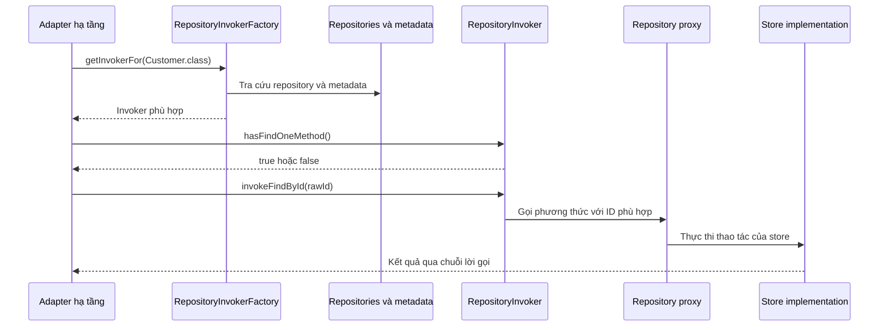

# RepositoryInvoker và điều phối lời gọi từ hạ tầng

## 1. Bài toán: hạ tầng biết domain type nhưng chưa biết repository cụ thể

Một công cụ quản trị nội bộ có thể cần đọc bản ghi của nhiều loại dữ liệu. Với màn hình khách hàng, nó làm việc với `Customer`; với màn hình sản phẩm, nó làm việc với `Product`. Nếu mỗi thao tác đều cần ép kiểu sang `CustomerRepository` hoặc `ProductRepository`, phần hạ tầng nhanh chóng phụ thuộc vào toàn bộ repository của ứng dụng.

Trong chương **Factory và metadata** của module **SPRING_DATA_COMMONS**, `RepositoryInvoker` là điểm nối giữa thông tin repository và việc thực hiện lời gọi. Nó cung cấp API điều phối một số thao tác repository mà phía gọi không cần giữ kiểu interface repository cụ thể. API nằm trong package `org.springframework.data.repository.support` và hướng tới các lời gọi đồng bộ. [API RepositoryInvoker](https://docs.spring.io/spring-data/commons/docs/current/api/org/springframework/data/repository/support/RepositoryInvoker.html).

Sau bài này, bạn cần giải thích được cách chọn repository theo domain type, phân biệt khả năng được phát hiện với quyền được phép sử dụng, truyền ID và tham số truy vấn đúng kiểu, và giữ nguyên giới hạn của kho dữ liệu đứng sau repository. Đây là kiến thức phục vụ xây dựng adapter hoặc framework; nghiệp vụ cụ thể vẫn thường dễ đọc hơn khi gọi trực tiếp repository hoặc application service đã định kiểu.

## 2. Từ metadata đến lời gọi thực tế

Có thể chia đường đi thành ba trách nhiệm:

| Thành phần | Trách nhiệm trong luồng điều phối |
| --- | --- |
| `Repositories` | Tra cứu repository bean và metadata theo domain type trong một `ListableBeanFactory` |
| `RepositoryInvokerFactory` | Cung cấp invoker tương ứng với domain type |
| `RepositoryInvoker` | Kiểm tra những nhóm thao tác có sẵn và gọi repository |

`Repositories.getRepositoryFor(Customer.class)` tìm repository quản lý khách hàng. `getRepositoryInformationFor(Customer.class)` lấy metadata tương ứng. Cần phân biệt các API này với `getRepositoryInformation(CustomerRepository.class)`, vốn nhận **repository interface**. Nhầm hai loại `Class<?>` là nguyên nhân phổ biến của việc tra cứu không có kết quả. [API Repositories](https://docs.spring.io/spring-data/commons/docs/current/api/org/springframework/data/repository/support/Repositories.html).



Sơ đồ biểu diễn trách nhiệm, không phải cam kết rằng mọi lần gọi đều quét lại bean factory. Cách lưu đệm và chọn implementation là chi tiết của factory. Khi thiết kế tích hợp, hãy giữ dependency ở các interface công khai thay vì tự tạo implementation invoker nội bộ.

### Factory invoker khác factory tạo repository

Factory tạo repository xây dựng repository proxy và gắn cơ chế thực thi của store. Factory invoker làm việc với repository **đã tồn tại**, tạo lớp điều phối để hạ tầng gọi nó. Vì vậy, `getInvokerFor(Customer.class)` không thay thế việc cấu hình repository scanning, mapping domain hay kết nối dữ liệu.

`DefaultRepositoryInvokerFactory` có constructor nhận `Repositories`, hoặc nhận thêm `ConversionService`. Nó chọn cách gọi thích hợp với interface repository, ưu tiên lời gọi cụ thể khi có thể. [API DefaultRepositoryInvokerFactory](https://docs.spring.io/spring-data/commons/docs/current/api/org/springframework/data/repository/support/DefaultRepositoryInvokerFactory.html).

Trong mã nguồn mặc định được dẫn dưới đây, repository có cả `PagingAndSortingRepository` và `CrudRepository` đi qua nhánh invoker phân trang; repository có `CrudRepository` đi qua nhánh CRUD; các trường hợp còn lại dùng nhánh reflection. Factory lưu invoker theo domain type và báo lỗi nếu không tìm được repository phù hợp. Các tên implementation trong nhánh chọn là chi tiết nội bộ, không phải loại bean ứng dụng nên tự khởi tạo. [Mã nguồn DefaultRepositoryInvokerFactory](https://raw.githubusercontent.com/spring-projects/spring-data-commons/main/src/main/java/org/springframework/data/repository/support/DefaultRepositoryInvokerFactory.java).

## 3. Đọc capability trước khi thực hiện thao tác

`RepositoryInvoker` kế thừa `RepositoryInvocationInformation`. Bốn phép kiểm tra chính là:

| Kiểm tra | Ý nghĩa về khả năng repository |
| --- | --- |
| `hasSaveMethod()` | Có phương thức lưu được nhận diện |
| `hasFindOneMethod()` | Có phương thức đọc một bản ghi được nhận diện |
| `hasFindAllMethod()` | Có phương thức đọc tập bản ghi được nhận diện |
| `hasDeleteMethod()` | Có phương thức xóa được nhận diện |

Tên kiểm tra vẫn là `hasFindOneMethod()`, còn lời gọi đọc theo ID là `invokeFindById(...)`. Không có yêu cầu repository phải khai báo một phương thức tên `findOne` chỉ để phép kiểm tra này trả về `true`. [API RepositoryInvocationInformation](https://docs.spring.io/spring-data/commons/docs/current/api/org/springframework/data/repository/support/RepositoryInvocationInformation.html).

Ví dụ một repository chỉ đọc có thể chủ động khai báo một phần hợp đồng:

```java
import java.util.Optional;
import org.springframework.data.repository.Repository;

interface CustomerLookupRepository extends Repository<Customer, Long> {
    Optional<Customer> findById(Long id);
}
```

Đây là **phương án thay thế** cho repository đầy đủ ở ví dụ sau, không phải hướng dẫn đăng ký cả hai repository cùng quản lý `Customer`. Giả sử `Customer` đã là domain class được store nhận diện và chỉ có một repository phù hợp cho nó trong phạm vi tra cứu.

Với phương án trên, một adapter có thể cho phép đọc theo ID nhưng phải xử lý trường hợp không có lưu, xóa hoặc đọc toàn bộ. Việc store có khả năng lưu dữ liệu không làm xuất hiện `save(...)` trên hợp đồng repository đã chọn.

Khả năng kỹ thuật và chính sách truy cập là hai điều kiện riêng. `hasDeleteMethod()` trả về `true` chỉ nói rằng hạ tầng có thể tìm thấy thao tác xóa; quyền xóa của người dùng, tenant hiện tại và các ràng buộc nghiệp vụ vẫn phải được xác định bởi ứng dụng. Tương tự, một quy tắc như “chỉ được đóng tài khoản sau khi thanh toán hết công nợ” cần application service riêng, không thể suy ra từ metadata CRUD.

## 4. Cấu hình tối thiểu cho một adapter đọc

Các đoạn mã trong phần này dành cho ứng dụng Spring đã cấu hình một module lưu trữ và repository scanning. `Customer` có thuộc tính `id` kiểu `Long` và `lastName` kiểu `String`, với mapping thích hợp cho store. Spring Data Commons cung cấp abstraction; riêng dependency Commons không tạo ra một cơ sở dữ liệu hay triển khai repository lưu trữ.

Repository đầy đủ dùng cho ví dụ:

```java
import org.springframework.data.domain.Page;
import org.springframework.data.domain.Pageable;
import org.springframework.data.repository.CrudRepository;
import org.springframework.data.repository.PagingAndSortingRepository;
import org.springframework.data.repository.query.Param;

interface CustomerRepository
        extends CrudRepository<Customer, Long>,
                PagingAndSortingRepository<Customer, Long> {

    Page<Customer> findByLastName(
            @Param("lastName") String lastName,
            Pageable pageable);
}
```

Từ Spring Data 3.0, các interface sorting không còn tự kế thừa interface CRUD tương ứng. Ví dụ chủ động kế thừa cả hai để thể hiện đủ khả năng cần dùng. Việc chỉ kế thừa `Repository` và sao chép có chọn lọc các chữ ký CRUD cũng là một cách định nghĩa hợp đồng hợp lệ. [Định nghĩa repository interface](https://docs.spring.io/spring-data/commons/reference/repositories/definition.html).

### 4.1. Khởi tạo registry và factory

Cấu hình sau dành cho demo chưa có các bean hạ tầng tương ứng. Mỗi lớp `public` được đặt trong tệp Java riêng của ứng dụng demo; các đoạn mã ở đây là nội dung bài học.

```java
import org.springframework.context.ApplicationContext;
import org.springframework.context.annotation.Bean;
import org.springframework.context.annotation.Configuration;
import org.springframework.data.repository.support.DefaultRepositoryInvokerFactory;
import org.springframework.data.repository.support.Repositories;
import org.springframework.data.repository.support.RepositoryInvokerFactory;
import org.springframework.format.support.DefaultFormattingConversionService;

@Configuration
public class RepositoryInvocationConfig {

    @Bean
    Repositories infrastructureRepositories(ApplicationContext context) {
        return new Repositories(context);
    }

    @Bean
    RepositoryInvokerFactory infrastructureInvokerFactory(
            Repositories infrastructureRepositories) {

        var conversions = new DefaultFormattingConversionService();

        // Đăng ký converter dành cho ID hoặc tham số riêng tại đây.
        return new DefaultRepositoryInvokerFactory(
                infrastructureRepositories, conversions);
    }

    @Bean
    InfrastructureReader infrastructureReader(
            Repositories infrastructureRepositories,
            RepositoryInvokerFactory infrastructureInvokerFactory) {

        return new InfrastructureReader(
                infrastructureRepositories, infrastructureInvokerFactory);
    }
}
```

Nếu ứng dụng đã có nhiều bean cùng kiểu, cần chọn đúng bean bằng qualifier hoặc điều chỉnh cấu hình hiện có. Ví dụ tạo một `ConversionService` riêng để luồng chuyển đổi rõ ràng; converter đã đăng ký cho Spring MVC không tự động trở thành converter của instance này.

### 4.2. Điều phối đọc theo ID

```java
import java.util.Objects;
import java.util.Optional;
import org.springframework.data.repository.support.Repositories;
import org.springframework.data.repository.support.RepositoryInvoker;
import org.springframework.data.repository.support.RepositoryInvokerFactory;

public final class InfrastructureReader {

    private final Repositories repositories;
    private final RepositoryInvokerFactory invokers;

    public InfrastructureReader(
            Repositories repositories,
            RepositoryInvokerFactory invokers) {

        this.repositories = Objects.requireNonNull(repositories);
        this.invokers = Objects.requireNonNull(invokers);
    }

    public Optional<?> findOne(Class<?> domainType, Object rawId) {
        Objects.requireNonNull(domainType, "domainType");
        Objects.requireNonNull(rawId, "rawId");

        if (!repositories.hasRepositoryFor(domainType)) {
            throw new IllegalArgumentException(
                    "Chưa đăng ký repository cho " + domainType.getName());
        }

        RepositoryInvoker invoker = invokers.getInvokerFor(domainType);

        if (!invoker.hasFindOneMethod()) {
            throw new UnsupportedOperationException(
                    "Repository không cung cấp thao tác đọc theo ID");
        }

        return invoker.invokeFindById(rawId);
    }
}
```

Điểm gọi có thể truyền `reader.findOne(Customer.class, "42")`. Ví dụ kỳ vọng factory dùng conversion service đã cấu hình để chuyển chuỗi thành ID `Long`. ID chuyển đổi hợp lệ nhưng không tìm thấy bản ghi phải được biểu diễn khác với ID sai định dạng.

Nếu adapter nhận resource name từ bên ngoài, hãy ánh xạ tên đó qua một registry do ứng dụng quản lý, chẳng hạn `customers -> Customer.class`. Phần xác thực quyền truy cập chạy trước lời gọi đọc. Không dùng dữ liệu request để tùy ý nạp class và quyết định domain type.

`Optional<?>` trong ví dụ thể hiện rằng adapter chưa biết kiểu domain tại thời điểm biên dịch. Khi chuyển kết quả sang giao diện hoặc API, ứng dụng cần một hợp đồng đầu ra rõ ràng, ví dụ DTO hoặc bộ serializer theo từng resource.

## 5. ID, dữ liệu lưu và kết quả trả về

### 5.1. Chuyển đổi ID theo metadata

Luồng invoker dùng kiểu ID trong metadata và `ConversionService` để thích nghi ID đầu vào. Vì thế, một adapter chung có thể nhận chuỗi từ đường dẫn mà vẫn gọi repository dùng `Long` hoặc `UUID`, nếu converter tương ứng có sẵn. Với ID tùy biến hoặc ID tổng hợp, cần chủ động xác định quy tắc chuyển đổi; không có bảo đảm rằng mọi chuỗi đều chuyển được. [Mã nguồn ReflectionRepositoryInvoker](https://raw.githubusercontent.com/spring-projects/spring-data-commons/main/src/main/java/org/springframework/data/repository/support/ReflectionRepositoryInvoker.java).

Trong thiết kế ứng dụng, nên tách ba kết quả:

| Tình huống | Cách diễn giải ở biên ứng dụng |
| --- | --- |
| `"42"` chuyển được sang `Long`, có bản ghi | Trả kết quả đọc |
| `"42"` chuyển được nhưng không có bản ghi | Xử lý “không tìm thấy” theo hợp đồng API |
| `"abc"` không chuyển được sang `Long` | Báo dữ liệu đầu vào không hợp lệ |

Không bắt mọi exception rồi trả `Optional.empty()`: cách đó làm lỗi định dạng và lỗi kết nối dữ liệu trông giống bản ghi không tồn tại. Adapter nên giữ nguyên nguyên nhân ở tầng nội bộ, sau đó ánh xạ lỗi thành phản hồi ổn định ở biên.

### 5.2. Lưu một entity đã chuẩn bị

Một thao tác ghi qua invoker bắt đầu từ đối tượng domain hợp lệ:

```java
RepositoryInvoker invoker = factory.getInvokerFor(Customer.class);

if (!invoker.hasSaveMethod()) {
    throw new UnsupportedOperationException("Repository không cho phép lưu");
}

// customer đã được application service dựng và kiểm tra.
Customer saved = invoker.invokeSave(customer);
```

Đoạn mã này giả định `factory` và `customer` đã có trong phạm vi sử dụng. JSON, `Map<String, Object>` hoặc DTO đầu vào không tự trở thành entity chỉ vì được truyền vào `invokeSave`. Hãy thực hiện binding, validation và kiểm tra quyền sửa các trường trước khi gọi repository. Sau khi lưu, dùng đối tượng trả về để tiếp tục xử lý.

Nếu luồng ghi bao gồm nhiều thay đổi nghiệp vụ, hãy giữ transaction boundary ở application service phù hợp. Việc gọi invoker không tự thiết kế một giao dịch bao trùm nhiều repository hay nhiều kho dữ liệu.

### 5.3. Xóa và kết quả “không còn bản ghi”

`invokeDeleteById(id)` trả về `void`; không có bộ đếm hàng bị xóa trong hợp đồng invoker. Nếu ứng dụng cần xác nhận một điều kiện nghiệp vụ trước khi xóa, điều kiện đó phải được xử lý trong luồng nghiệp vụ có ranh giới giao dịch thích hợp. Một bước đọc trước rồi xóa riêng rẽ không tự bảo đảm bản ghi không thay đổi giữa hai lời gọi.

## 6. Phân trang và sắp xếp: chú ý đường fallback

Hợp đồng `RepositoryInvoker` trả `Iterable<Object>` cho hai biến thể `invokeFindAll`. Với `Pageable`, nó ưu tiên thao tác nhận `Pageable`, rồi thao tác nhận `Sort`, rồi đọc toàn bộ không tham số. Với `Sort`, nó ưu tiên thao tác nhận `Sort`, rồi đọc toàn bộ không tham số. Vì vậy, truyền `PageRequest` không đủ để bảo đảm kho dữ liệu đã giới hạn số bản ghi. [Hợp đồng invokeFindAll](https://docs.spring.io/spring-data/commons/docs/current/api/org/springframework/data/repository/support/RepositoryInvoker.html).

```java
import org.springframework.data.domain.Page;
import org.springframework.data.domain.PageRequest;
import org.springframework.data.domain.Sort;

var pageable = PageRequest.of(0, 20, Sort.by("id").ascending());

if (!invoker.hasFindAllMethod()) {
    throw new UnsupportedOperationException("Không có thao tác đọc danh sách");
}

Iterable<Object> rows = invoker.invokeFindAll(pageable);

if (rows instanceof Page<?> page) {
    long total = page.getTotalElements();
    int pageNumber = page.getNumber();
    // Dùng page.getContent(), total và pageNumber để tạo DTO phân trang.
} else {
    // Dùng hợp đồng đầu ra cho tập kết quả không có metadata Page.
}
```

Nhánh `instanceof` chỉ nhận diện hình dạng kết quả sau khi gọi. Nếu endpoint bắt buộc phân trang tại nguồn, ứng dụng phải xác định capability phân trang **trước** lời gọi, thông qua cấu hình resource hoặc kiểm tra hợp đồng repository cụ thể. Không dùng nhánh này làm cơ chế bảo vệ giới hạn đọc.

Một thiết kế resource registry có thể ghi rõ ba chính sách độc lập: cho phép đọc danh sách, yêu cầu repository hỗ trợ `Pageable`, và giới hạn page size ở biên. Ví dụ endpoint khách hàng yêu cầu phân trang, trong khi danh mục quốc gia nhỏ có thể dùng hợp đồng đọc toàn bộ. Cả hai chính sách đều cụ thể hơn câu hỏi `hasFindAllMethod()`.

Ngoài ra, không nên ép mọi `Iterable` thành `Page`. Trả `Iterable` cũng không có nghĩa dữ liệu đang được stream từng phần từ cơ sở dữ liệu; hình thức nạp dữ liệu phụ thuộc phương thức repository và store.

## 7. Điều phối một query method đã biết

CRUD dùng các điểm gọi chuẩn. Với query riêng, hạ tầng có thể dùng `invokeQueryMethod(method, parameters, pageable, sort)`. Nó vẫn gọi một phương thức repository đã tồn tại; việc phân tích tên derived query hoặc xử lý truy vấn khai báo thuộc hệ thống repository và store.

Ví dụ sau gọi đúng `findByLastName` đã khai báo trong `CustomerRepository`:

```java
import java.lang.reflect.Method;
import java.util.Optional;
import org.springframework.data.domain.PageRequest;
import org.springframework.data.domain.Pageable;
import org.springframework.data.domain.Sort;
import org.springframework.data.repository.support.RepositoryInvoker;
import org.springframework.data.repository.support.RepositoryInvokerFactory;
import org.springframework.util.LinkedMultiValueMap;
import org.springframework.util.MultiValueMap;

public final class CustomerSearchAdapter {

    private final RepositoryInvokerFactory factory;

    public CustomerSearchAdapter(RepositoryInvokerFactory factory) {
        this.factory = factory;
    }

    public Optional<Object> searchByLastName(String lastName) {
        Method method = approvedSearchMethod();

        MultiValueMap<String, Object> parameters = new LinkedMultiValueMap<>();
        parameters.add("lastName", lastName);

        Pageable pageable = PageRequest.of(
                0, 20, Sort.by("id").ascending());

        RepositoryInvoker invoker = factory.getInvokerFor(Customer.class);
        return invoker.invokeQueryMethod(
                method, parameters, pageable, Sort.unsorted());
    }

    private static Method approvedSearchMethod() {
        try {
            return CustomerRepository.class.getMethod(
                    "findByLastName", String.class, Pageable.class);
        } catch (NoSuchMethodException ex) {
            throw new IllegalStateException(
                    "Khai báo truy vấn của adapter không khớp repository", ex);
        }
    }
}
```

`@Param("lastName")` đặt tên rõ ràng để khóa trong `MultiValueMap` khớp tham số. Với lời gọi này, `Pageable` được truyền qua đối số riêng. Trong nhánh reflection, tham số thường được chuẩn bị theo tên và chuyển kiểu bằng conversion service; nếu cần phát hiện tên từ bytecode thì cấu hình biên dịch phải giữ tên tham số. [Cơ chế chuẩn bị tham số](https://raw.githubusercontent.com/spring-projects/spring-data-commons/main/src/main/java/org/springframework/data/repository/support/ReflectionRepositoryInvoker.java).

Kết quả ở ví dụ là `Optional<Object>` chứa đối tượng kết quả truy vấn, dự kiến là một `Page<Customer>`. Một trang có content rỗng vẫn là một đối tượng trang; adapter cần xem content để kết luận không có khách hàng phù hợp. Không dùng riêng `Optional.isPresent()` làm điều kiện “truy vấn có hàng”.

Adapter đã cố định cả `Method` lẫn tên tham số. Với hệ thống cho phép lựa chọn nhiều truy vấn, hãy xây dựng danh sách các phương thức được duyệt và quy tắc đầu vào cho từng phương thức. Metadata giúp liệt kê hoặc đối chiếu query method; quyết định công khai truy vấn nào thuộc ứng dụng. Không chuyển thẳng một tên method tùy ý từ request thành quyền thực thi.

## 8. Giữ đúng ranh giới của Spring Data Commons

Mục tiêu dùng chung abstraction không có nghĩa mọi store cung cấp cùng một hành vi. Khi mở rộng adapter, cần xác định rõ ranh giới:

| Chủ đề liên quan trong module | Trách nhiệm còn lại ngoài invoker |
| --- | --- |
| Derived query | Store phải hỗ trợ cách diễn giải truy vấn và các toán tử được sử dụng |
| Projection | Repository query và cấu hình projection quyết định hình dạng dữ liệu đầu ra |
| Query by Example | Cần repository có executor phù hợp và store hỗ trợ matcher mong muốn; API invoker không có một điểm gọi QBE chuyên biệt |
| Repository fragment | Phương thức mở rộng cần hợp đồng và cách gọi được thiết kế riêng, thay vì suy ra từ bốn capability CRUD |
| Auditing | Cần cấu hình auditing, nguồn auditor và mapping phù hợp của module lưu trữ |
| Transaction | Cần transaction manager và ranh giới giao dịch thích hợp với store |
| Reactive hoặc coroutine | Cần thiết kế tích hợp với abstraction tương ứng, không giả định API đồng bộ này thay thế chúng |

Ví dụ, giao diện quản trị muốn lọc bằng QBE phải kiểm tra và sử dụng hợp đồng QBE của repository tương ứng. Gọi `invokeFindAll(pageable)` không tự áp dụng một `Example` đã tạo ở nơi khác. Tương tự, muốn trả một projection chỉ gồm `id` và `lastName` thì query hoặc tầng chuyển đổi đầu ra phải nêu rõ yêu cầu đó.

Việc invoker gọi repository bean giúp lời gọi đi vào proxy và các cơ chế đã được cấu hình ở đó. Từ điều này không thể suy ra rằng Bean Validation, auditing hay phân quyền đều tự bật. Mỗi cơ chế phải được cấu hình, có đúng dữ liệu ngữ cảnh và được kích hoạt bởi đường thực thi thực tế.

Nếu cùng một domain type có nhiều repository hoặc xuất hiện ở nhiều store, cần xác định chính sách lựa chọn ngay trong cấu hình. `getInvokerFor(domainType)` không nhận thêm tên store trong chữ ký của nó. Một adapter chung cần registry đủ rõ để tránh dựa vào thứ tự bean hoặc sự trùng hợp của cấu hình.

## 9. Đọc lỗi theo đúng lớp trách nhiệm

| Hiện tượng | Điều cần xem xét trước |
| --- | --- |
| Không tìm được invoker | Domain type có repository trong phạm vi `Repositories` hay chưa; có nhầm với repository interface không |
| Không có thao tác đọc/lưu/xóa | Hợp đồng repository đã công khai phương thức nào; capability đã được kiểm tra chưa |
| ID hợp lệ nhưng kết quả rỗng | Bản ghi không tồn tại hoặc không còn nhìn thấy trong ngữ cảnh truy vấn hiện tại |
| Chuyển đổi ID thất bại | Kiểu ID trong metadata và converter thực sự được factory sử dụng |
| Không bind được query parameter | Tên trong `@Param`, khóa map, kiểu giá trị và cấu hình giữ tên tham số |
| Có `PageRequest` nhưng vẫn đọc nhiều bản ghi | Repository có hỗ trợ phân trang tại nguồn hay đã đi qua fallback |
| Lỗi bên trong store | Mapping, query, kết nối, ràng buộc dữ liệu hoặc transaction của module lưu trữ |

Khi ghi log, thông tin hữu ích là resource được chọn, domain type, loại thao tác và mã tương quan của request. Tránh ghi toàn bộ entity hay mọi tham số truy vấn nếu chúng chứa dữ liệu cá nhân. Mục tiêu là phân biệt lỗi điều phối với lỗi thực thi, để sửa đúng lớp.

## 10. Bài tập thực hành có tiêu chí quan sát

Thực hiện trong một ứng dụng demo có đúng một store đã cấu hình và một domain `Customer` hợp lệ:

1. Đăng ký `CustomerRepository` đầy đủ và gọi `InfrastructureReader.findOne(Customer.class, "42")`. Quan sát riêng tình huống có bản ghi và không có bản ghi.
2. Gọi cùng adapter với `"abc"` khi ID là `Long`. Kết quả phải thể hiện lỗi đầu vào, không bị chuyển thành “không tìm thấy”.
3. Thay hợp đồng repository bằng phương án chỉ đọc theo ID. Không đăng ký đồng thời hai phương án. Quan sát các capability rồi thử yêu cầu đọc danh sách.
4. Với repository hỗ trợ phân trang, gọi đọc danh sách có page size 20. Kiểm tra cả hình dạng kết quả và cách store thực hiện giới hạn; ghi lại sự khác biệt giữa capability đọc danh sách và capability phân trang.
5. Gọi `CustomerSearchAdapter.searchByLastName(...)` với một họ có dữ liệu và một họ không có dữ liệu. So sánh `Optional` bao ngoài với content của `Page` bên trong.
6. Thêm một ID tùy biến vào một resource demo khác và đăng ký converter cho đúng conversion service của factory. Thử cả định dạng hợp lệ và không hợp lệ.

Khi giải thích kết quả, luôn chỉ ra ai quyết định từng bước: registry chọn domain, metadata nhận diện hợp đồng, invoker điều phối, repository proxy thực thi và store xử lý dữ liệu. Cách phân chia này giúp mở rộng hạ tầng dùng chung mà vẫn giữ được ngữ nghĩa của từng repository.
