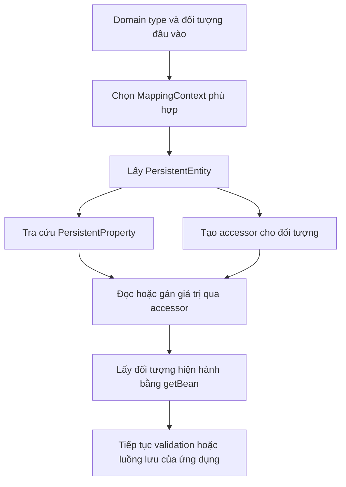

# PersistentPropertyAccessor cho truy cập thuộc tính

## 1. Khi hạ tầng cần thao tác trên thuộc tính đã được ánh xạ

Một thành phần hạ tầng có thể cần đọc giá trị thuộc tính mà không biết trước domain class cụ thể: lấy dữ liệu để hiển thị, điền giá trị sau khi tạo đối tượng hoặc xử lý một quy tắc cập nhật đã được ứng dụng cho phép. Nếu chỉ dùng tên field và reflection tự viết, thành phần đó phải tự giải quyết kế thừa, cách truy cập, kiểu dữ liệu và đối tượng bất biến.

Trong chương **Metadata ánh xạ** của module **SPRING_DATA_COMMONS**, `PersistentPropertyAccessor<T>` cung cấp điểm truy cập giá trị dựa trên `PersistentProperty<?>`. Accessor thường được lấy từ `PersistentEntity`, gắn với một đối tượng cụ thể và giữ đối tượng hiện hành sau các lần cập nhật. [API PersistentPropertyAccessor](https://docs.spring.io/spring-data/commons/docs/current/api/org/springframework/data/mapping/PersistentPropertyAccessor.html).

Ví dụ, metadata cho biết `Customer` có thuộc tính `displayName` kiểu `String`; accessor đọc hoặc gán giá trị của thuộc tính đó trên một khách hàng cụ thể. Việc ghi xuống kho dữ liệu, kiểm tra quyền sửa hồ sơ và bảo đảm tên hợp lệ thuộc các trách nhiệm khác trong ứng dụng.

Mục tiêu của bài là sử dụng đúng chuỗi **mapping context → entity metadata → property metadata → accessor → đối tượng kết quả**. Kiến thức này giúp hiểu cơ chế hạ tầng dùng chung của Spring Data, đồng thời giữ đúng giới hạn của từng module lưu trữ.

## 2. Phân biệt metadata với đối tượng đang được truy cập

| Thành phần | Câu hỏi mà thành phần trả lời |
| --- | --- |
| `MappingContext` | Domain type này có metadata ánh xạ nào trong context đang dùng? |
| `PersistentEntity` | Kiểu đối tượng này được mô tả ra sao và có những thuộc tính nào? |
| `PersistentProperty` | Thuộc tính này thuộc entity nào, mang tên và kiểu gì? |
| `PersistentPropertyAccessor<T>` | Giá trị thuộc tính trên đối tượng cụ thể này là gì; gán giá trị bằng cơ chế nào? |

`MappingContext` cung cấp `getRequiredPersistentEntity(type)` để lấy metadata bắt buộc và `getPersistentPropertyPath(...)` cho đường dẫn thuộc tính. Cần chọn context thực sự được module lưu trữ sử dụng, nhất là khi ứng dụng kết nối nhiều store. Một context của store khác có thể không mang cùng quy tắc mapping. [API MappingContext](https://docs.spring.io/spring-data/commons/docs/current/api/org/springframework/data/mapping/context/MappingContext.html).



Metadata mô tả một kiểu; accessor giữ trạng thái của một lần thao tác trên đối tượng. Từ sự khác biệt này, một thiết kế hợp lý là tái sử dụng metadata thông qua mapping context và tạo accessor khi cần xử lý từng đối tượng. Không giữ một accessor dùng chung cho mọi khách hàng trong một singleton.

Property metadata cũng phải thuộc đúng entity. Hai kiểu `Customer` và `Employee` có thể cùng có thuộc tính tên `displayName`, nhưng không vì thế mà property lấy từ metadata của kiểu này dùng được với accessor của kiểu kia.

## 3. Hợp đồng cơ bản cần nhớ

Accessor có ba thao tác cốt lõi:

| Thao tác | Cách sử dụng |
| --- | --- |
| `getProperty(property)` | Đọc giá trị hiện tại; kết quả có kiểu khai báo `Object` và có thể là `null` |
| `setProperty(property, value)` | Gán giá trị; bản thân lời gọi không trả entity mới |
| `getBean()` | Lấy đối tượng hiện hành, có thể khác đối tượng ban đầu |

`getBean()` đặc biệt quan trọng với dữ liệu bất biến: accessor có thể giữ một instance mới sau cập nhật. Vì thế, mẫu sử dụng an toàn là lấy lại đối tượng từ accessor sau khi hoàn thành các lần gán. [Hợp đồng accessor và đối tượng hiện hành](https://docs.spring.io/spring-data/commons/docs/current/api/org/springframework/data/mapping/PersistentPropertyAccessor.html).

Về tra cứu thuộc tính, `PersistentEntity.getPersistentProperty(name)` có thể trả `null`, trong khi `getRequiredPersistentProperty(name)` yêu cầu thuộc tính tồn tại và báo lỗi nếu thiếu. Dùng biến thể bắt buộc khi tên thuộc tính là một phần của cấu hình đã xác định; dùng biến thể có thể vắng mặt khi đang thăm dò metadata. [API PersistentEntity](https://docs.spring.io/spring-data/commons/docs/current/api/org/springframework/data/mapping/PersistentEntity.html).

Tên dùng để tra cứu là tên thuộc tính Java trong metadata. Nếu store ánh xạ `displayName` thành trường hoặc cột `display_name`, lời gọi vẫn là `getRequiredPersistentProperty("displayName")`. Tên lưu trữ được giải quyết trong lớp mapping của store.

## 4. Ví dụ đọc và gán trên đối tượng có thể thay đổi

Các đoạn mã sau dành cho ứng dụng đã cấu hình một module có mapping context phù hợp. Biến `mappingContext` là context đã được lựa chọn của ứng dụng; bài không tự tạo một context chung thay thế cấu hình store. Mỗi lớp `public` trong ví dụ được đặt ở tệp Java riêng khi thực hành.

Domain class minh họa:

```java
import org.springframework.data.annotation.Id;

public class Customer {

    @Id
    private Long id;
    private String displayName;
    private Integer age;

    public Customer() {
    }

    public Customer(Long id, String displayName, Integer age) {
        this.id = id;
        this.displayName = displayName;
        this.age = age;
    }

    public Long getId() {
        return id;
    }

    public String getDisplayName() {
        return displayName;
    }

    public Integer getAge() {
        return age;
    }
}
```

Ví dụ không khai báo setter. Trong cấu hình field access phù hợp của Spring Data mapping, accessor vẫn có thể gán các field không bất biến. Việc có getter không tự buộc toàn bộ mapping phải đi qua property access.

```java
import org.springframework.data.mapping.PersistentProperty;
import org.springframework.data.mapping.PersistentPropertyAccessor;

Customer original = new Customer(42L, "Lan", 28);
var entity = mappingContext.getRequiredPersistentEntity(Customer.class);

PersistentProperty<?> displayName =
        entity.getRequiredPersistentProperty("displayName");

PersistentPropertyAccessor<Customer> accessor =
        entity.getPropertyAccessor(original);

Object before = accessor.getProperty(displayName);
accessor.setProperty(displayName, "Lan Nguyễn");
Object after = accessor.getProperty(displayName);

Customer updated = accessor.getBean();

System.out.println(before);                   // Lan
System.out.println(after);                    // Lan Nguyễn
System.out.println(updated.getDisplayName()); // Lan Nguyễn
```

`displayName` lấy từ chính metadata dùng tạo accessor. Giá trị gán đã là `String`, phù hợp với kiểu thuộc tính. Với đối tượng có thể thay đổi theo cấu hình ví dụ, cập nhật có thể diễn ra trên instance ban đầu; mã sử dụng vẫn luôn lấy `updated` từ `getBean()` để không phụ thuộc giả định đó.

Đến đây, ta mới thay đổi trạng thái đối tượng trong bộ nhớ. Không có lời gọi repository, không có câu lệnh cập nhật dữ liệu và không có một transaction mới được tạo chỉ vì đã dùng accessor.

### Field access, property access và reflection

Spring Data mapping lựa chọn cách truy cập theo metadata: có thể qua field, getter/setter hoặc cơ chế phù hợp cho giá trị bất biến. Trong luồng mapping được mô tả bởi Commons, field access là mặc định; property access có thể được cấu hình khi muốn đi qua phương thức truy cập. [Cơ chế population thuộc tính](https://docs.spring.io/spring-data/commons/reference/object-mapping.html).

Nếu một setter chứa chuẩn hóa hoặc kiểm tra nghiệp vụ, đừng giả định accessor luôn gọi setter đó. Cần cấu hình cách truy cập đúng mục đích, hoặc thực hiện hành vi nghiệp vụ qua phương thức domain/application service. Accessor phục vụ hạ tầng mapping; tên của nó không bảo đảm mọi bất biến nghiệp vụ được thực thi.

| Cách truy cập | Cơ sở lựa chọn thuộc tính |
| --- | --- |
| Java reflection tự viết | Field hoặc method mà mã tự tìm |
| `org.springframework.beans.BeanWrapper` | Mô hình truy cập bean của Spring Framework |
| `PersistentPropertyAccessor` | Property metadata của Spring Data và cơ chế accessor được entity cung cấp |

## 5. Đối tượng bất biến và vai trò của getBean()

Một accessor có thể biểu diễn cập nhật bằng cách thay đối tượng mà nó đang giữ. Ví dụ sau cung cấp wither để tạo một khách hàng mới khi đổi tên:

```java
import java.beans.ConstructorProperties;
import org.springframework.data.annotation.Id;

public final class ImmutableCustomer {

    @Id
    private final Long id;
    private final String displayName;

    @ConstructorProperties({"id", "displayName"})
    public ImmutableCustomer(Long id, String displayName) {
        this.id = id;
        this.displayName = displayName;
    }

    public Long getId() {
        return id;
    }

    public String getDisplayName() {
        return displayName;
    }

    public ImmutableCustomer withDisplayName(String displayName) {
        return new ImmutableCustomer(id, displayName);
    }
}
```

Một wither gắn với thuộc tính nhận giá trị mới và trả về instance mới của đối tượng. Metadata có thể mô tả phương thức này qua `getWither()`. [API PersistentProperty về wither](https://docs.spring.io/spring-data/commons/docs/current/api/org/springframework/data/mapping/PersistentProperty.html).

```java
ImmutableCustomer original = new ImmutableCustomer(42L, "Lan");
var entity = mappingContext.getRequiredPersistentEntity(ImmutableCustomer.class);
var displayName = entity.getRequiredPersistentProperty("displayName");
var accessor = entity.getPropertyAccessor(original);

accessor.setProperty(displayName, "Lan Nguyễn");
ImmutableCustomer updated = accessor.getBean();

System.out.println(original.getDisplayName()); // Lan
System.out.println(updated.getDisplayName());  // Lan Nguyễn
System.out.println(original == updated);       // false
```

Kết quả kỳ vọng dựa trên wither của ví dụ và việc context nhận diện đúng metadata. Nếu sau `setProperty(...)` mã tiếp tục trả `original`, thay đổi tên sẽ không đi theo kết quả trả về. Đây là một lỗi khó thấy khi trước đó chương trình chỉ xử lý các lớp có thể thay đổi trực tiếp.

Với các kiểu bất biến phù hợp, hạ tầng còn có thể tạo lại instance qua persistence creator. `InstantiationAwarePropertyAccessor` là thành phần hỗ trợ cơ chế này. Nó cần creator và metadata đáp ứng yêu cầu; không thể suy ra rằng mọi field `final` của mọi lớp đều được cập nhật thành công. [API InstantiationAwarePropertyAccessor](https://docs.spring.io/spring-data/commons/docs/current/api/org/springframework/data/mapping/model/InstantiationAwarePropertyAccessor.html).

Khi thực hiện nhiều lần gán, hãy tiếp tục dùng cùng accessor trong lượt thao tác đó, rồi lấy `getBean()` ở cuối. Nếu tạo lại accessor từ `original` sau mỗi lần gán, một luồng cập nhật đối tượng bất biến có thể bỏ mất các giá trị đã thay ở lượt trước.

## 6. Chuyển đổi kiểu bằng ConvertingPropertyAccessor

Dữ liệu từ biểu mẫu thường là chuỗi, trong khi thuộc tính domain có thể là `Integer`, `UUID` hoặc một value object. Khi cần chuyển đổi, dùng `ConvertingPropertyAccessor<T>` bọc accessor gốc và truyền `ConversionService` rõ ràng.

Wrapper này chuyển giá trị đầu vào sang kiểu thuộc tính khi gán, đồng thời cung cấp biến thể `getProperty(property, targetType)` để đọc theo một kiểu đích có thể chuyển đổi. [API ConvertingPropertyAccessor](https://docs.spring.io/spring-data/commons/docs/current/api/org/springframework/data/mapping/model/ConvertingPropertyAccessor.html).

```java
import org.springframework.core.convert.support.DefaultConversionService;
import org.springframework.data.mapping.model.ConvertingPropertyAccessor;

Customer customer = new Customer(42L, "Lan", 28);
var entity = mappingContext.getRequiredPersistentEntity(Customer.class);
var age = entity.getRequiredPersistentProperty("age");

var conversions = new DefaultConversionService();
var accessor = new ConvertingPropertyAccessor<Customer>(
        entity.getPropertyAccessor(customer), conversions);

accessor.setProperty(age, "29");

Object domainValue = accessor.getProperty(age);       // Integer có giá trị 29
String textValue = accessor.getProperty(age, String.class); // "29"
Customer updated = accessor.getBean();
```

Ở đây, `DefaultConversionService` cung cấp chuyển đổi chuỗi và số phù hợp cho ví dụ. Với value object riêng như `CustomerCode`, hãy đăng ký converter mà ứng dụng cần vào đúng conversion service được truyền cho wrapper. Việc đã đăng ký converter trong cấu hình của một store hoặc trong Spring MVC không tự làm thay đổi instance `conversions` vừa tạo.

Việc chuyển sang `String` khi đọc chỉ thay hình thức kết quả đọc; nó không đổi kiểu thuộc tính `age` trong đối tượng thành chuỗi. Ngược lại, khi gán `"abc"` cho `Integer`, conversion phải báo lỗi thay vì âm thầm bỏ qua.

Mã nguồn wrapper thể hiện việc chuyển đổi dựa trên kiểu thuộc tính, giữ nguyên giá trị đã tương thích và chuyển tiếp `null`. Điều đó cũng có nghĩa đây không phải một bộ chuyển đổi toàn bộ cấu trúc JSON thành đồ thị domain hay bộ mapping đầy đủ của store. [Mã nguồn ConvertingPropertyAccessor](https://raw.githubusercontent.com/spring-projects/spring-data-commons/main/src/main/java/org/springframework/data/mapping/model/ConvertingPropertyAccessor.java).

### Phân biệt null, thiếu thuộc tính và thiếu dữ liệu cập nhật

| Tình huống | Ý nghĩa |
| --- | --- |
| Không tìm thấy property metadata | Tên thuộc tính không thuộc mô hình đang tra cứu |
| Property tồn tại, `getProperty(...)` trả `null` | Thuộc tính hiện không có giá trị trên đối tượng |
| Request không chứa khóa `age` | Có thể là yêu cầu giữ nguyên tuổi, tùy hợp đồng cập nhật |
| Request có khóa `age` với giá trị `null` | Có thể là yêu cầu xóa tuổi, nếu ứng dụng cho phép |

Đối với thuộc tính kiểu primitive như `int`, không có giá trị Java `null` để gán. Đối với `Integer`, việc có thể giữ `null` về mặt kiểu Java không có nghĩa các quy tắc nghiệp vụ hoặc ràng buộc dữ liệu đều chấp nhận nó.

Nếu đang xử lý bản cập nhật từng phần bằng map, dùng `containsKey` để phân biệt khóa vắng mặt với khóa có giá trị `null`. Không gọi `get(...)` rồi tự suy ra rằng mọi kết quả `null` đều có nghĩa “giữ nguyên”.

## 7. Thuộc tính lồng nhau cần property path

`PersistentPropertyAccessor` cơ bản nhận một `PersistentProperty`, không nhận chuỗi biểu thức tùy ý. `getRequiredPersistentProperty("address.city")` không phải cách duyệt hai cấp đối tượng.

Nếu một domain type có cấu trúc `address.city`, luồng truy cập đúng là:

1. Dùng `mappingContext.getPersistentPropertyPath("address.city", DomainType.class)` để lấy đường dẫn gồm các property metadata.
2. Lấy accessor mở rộng bằng `entity.getPropertyPathAccessor(bean)`.
3. Đọc hoặc gán qua overload nhận `PersistentPropertyPath`.
4. Lấy lại đối tượng gốc hiện hành bằng `getBean()` sau cập nhật.

`PersistentPropertyPathAccessor<T>` mở rộng accessor cơ bản để hỗ trợ đường dẫn. Với overload gán thông thường, các đối tượng trung gian phải khác `null`; không có cam kết tự tạo `address` chỉ vì bạn muốn gán `address.city`. Các overload có `AccessOptions` cho phép cấu hình hành vi phù hợp với API tương ứng. [API PersistentPropertyPathAccessor](https://docs.spring.io/spring-data/commons/docs/current/api/org/springframework/data/mapping/PersistentPropertyPathAccessor.html).

Ví dụ, nếu khách hàng chưa có địa chỉ, application service có thể yêu cầu tạo một `Address` hợp lệ trước rồi mới cập nhật thành phố. Việc tự tạo một đối tượng rỗng có thể vi phạm quy tắc bắt buộc mã quốc gia hoặc mã bưu chính.

Với collection hoặc map, không suy ra rằng một chuỗi như `addresses[0].city` được hỗ trợ giống cú pháp binding của một framework khác. Hãy chọn API và chính sách duyệt rõ ràng, đồng thời xác định ứng dụng cho phép sửa phần tử nào.

## 8. Một helper truy cập có kiểm soát

Ví dụ dưới đây minh họa việc giữ metadata, đối tượng và chuyển đổi trong cùng một luồng. `allowedProperties` là danh sách do ứng dụng cấu hình cho thao tác hiện tại; nó không phải danh sách tùy ý lấy từ request.

```java
import java.util.Objects;
import java.util.Set;
import org.springframework.core.convert.ConversionService;
import org.springframework.data.mapping.PersistentEntity;
import org.springframework.data.mapping.PersistentProperty;
import org.springframework.data.mapping.model.ConvertingPropertyAccessor;

public final class MetadataPropertyEditor {

    private final ConversionService conversions;

    public MetadataPropertyEditor(ConversionService conversions) {
        this.conversions = Objects.requireNonNull(conversions);
    }

    public <T> T assign(
            PersistentEntity<?, ?> entity,
            T bean,
            String propertyName,
            Object rawValue,
            Set<String> allowedProperties) {

        Objects.requireNonNull(entity, "entity");
        Objects.requireNonNull(bean, "bean");
        Objects.requireNonNull(propertyName, "propertyName");
        Objects.requireNonNull(allowedProperties, "allowedProperties");

        if (!entity.getType().isInstance(bean)) {
            throw new IllegalArgumentException("Metadata không khớp kiểu đối tượng");
        }

        if (!allowedProperties.contains(propertyName)) {
            throw new IllegalArgumentException("Thuộc tính không được phép sửa");
        }

        PersistentProperty<?> property =
                entity.getRequiredPersistentProperty(propertyName);

        if (entity.isIdProperty(property) || entity.isVersionProperty(property)) {
            throw new IllegalArgumentException("Không sửa ID hoặc version tại đây");
        }

        if (rawValue == null && property.getType().isPrimitive()) {
            throw new IllegalArgumentException("Primitive không nhận giá trị null");
        }

        var accessor = new ConvertingPropertyAccessor<T>(
                entity.getPropertyAccessor(bean), conversions);

        accessor.setProperty(property, rawValue);
        return accessor.getBean();
    }
}
```

Ví dụ sử dụng với `Customer` và context đã cấu hình:

```java
var editor = new MetadataPropertyEditor(new DefaultConversionService());
var entity = mappingContext.getRequiredPersistentEntity(Customer.class);
var editable = Set.of("displayName", "age");

Customer updated = editor.assign(entity, customer, "age", "29", editable);
```

Helper xử lý một thuộc tính trực tiếp và trả đối tượng hiện hành. Nó không thay thế validation giá trị tuổi, quyền sửa đúng khách hàng hoặc kiểm tra tenant. Quy tắc không sửa ID/version trong helper là chính sách minh họa của luồng cập nhật hồ sơ; các thành phần mapping chuyên biệt có thể có trách nhiệm khác với những thuộc tính này.

Cũng không dùng riêng `PersistentProperty.isWritable()` làm điều kiện “người dùng được phép sửa”. Trong hợp đồng metadata, phương thức đó nói đến việc giá trị có được ghi ra datastore hay không. Quyền chỉnh sửa của ứng dụng cần chính sách riêng. [Ý nghĩa isWritable trong PersistentProperty](https://docs.spring.io/spring-data/commons/docs/current/api/org/springframework/data/mapping/PersistentProperty.html).

Nếu ghép nhiều lần gán vào một thao tác, cần tính đến thất bại giữa chừng. Đối tượng mutable có thể đã nhận thay đổi thứ nhất trước khi thay đổi thứ hai lỗi. Accessor không cung cấp rollback trong bộ nhớ. Ứng dụng có thể chuẩn bị và kiểm tra dữ liệu trước, hoặc áp dụng cập nhật lên một bản sao/đối tượng mới phù hợp với mô hình domain.

## 9. Ranh giới với lưu trữ, auditing và tối ưu truy cập

### 9.1. Truy cập thuộc tính chưa phải thao tác lưu

Sau `setProperty`, ứng dụng mới có trạng thái đối tượng đã thay đổi. Luồng lưu sau đó phải tuân theo module đang sử dụng: repository, converter, transaction và cơ chế theo dõi thay đổi nếu có.

Không có bảo đảm chung rằng chỉ cần thay đổi một bean bất kỳ là dữ liệu trong store được cập nhật. Trong một ngữ cảnh quản lý đối tượng cụ thể, framework có thể phát hiện thay đổi khi giao dịch hoàn tất; hành vi đó đến từ ngữ cảnh persistence tương ứng, không đến từ hợp đồng accessor.

Các nguyên tắc object mapping trong tài liệu Commons áp dụng cho những module tự triển khai mapping, chẳng hạn MongoDB, Redis, Cassandra và Relational. Spring Data JPA ủy quyền mapping cho JPA provider. Vì vậy, không dùng một ví dụ field access của Commons để suy ra chính xác cách provider JPA tải và cập nhật entity. [Phạm vi object mapping của Commons](https://docs.spring.io/spring-data/commons/reference/object-mapping.html).

### 9.2. Metadata không tự kích hoạt tính năng khác

| Tính năng liên quan trong module | Điều cần cấu hình hoặc thực hiện riêng |
| --- | --- |
| Auditing | Auditing infrastructure, thời điểm ghi và nguồn auditor của store |
| Validation | Quy tắc giá trị và điểm gọi validation phù hợp với luồng cập nhật |
| Optimistic locking | Cơ chế lưu và kiểm tra version của module dữ liệu |
| Projection | Hợp đồng kết quả truy vấn hoặc tầng chuyển đổi đầu ra |
| Derived query, QBE | Repository và executor truy vấn phù hợp; accessor không thực thi truy vấn |

Ví dụ, việc đọc được thuộc tính `lastModifiedDate` qua metadata không làm ngày sửa đổi tự thay khi gọi một setter. Tương tự, gán một giá trị vào `version` không tương đương với việc kho dữ liệu đã kiểm tra xung đột ghi.

### 9.3. Không phụ thuộc implementation accessor

Spring Data có factory sinh bytecode để tăng tốc truy cập thuộc tính. Cơ chế này có thể dùng method handle hoặc truy cập field/getter/setter tùy metadata và điều kiện hỗ trợ của runtime. [API ClassGeneratingPropertyAccessorFactory](https://docs.spring.io/spring-data/commons/docs/current/api/org/springframework/data/mapping/model/ClassGeneratingPropertyAccessorFactory.html).

Phần tích hợp thông thường nên gọi `entity.getPropertyAccessor(bean)` và làm việc với interface. Không ép kiểu accessor sang một lớp được sinh ra hay tự giả định mọi lần gọi đều sử dụng reflection. Khi cần đánh giá hiệu năng, đo trên domain class, JDK và cấu hình triển khai thực tế.

Về vòng đời, accessor giữ tham chiếu đối tượng hiện hành và có thể thay tham chiếu đó. Hãy tạo accessor theo lượt thao tác, không giả định có thể dùng chung an toàn giữa các request hoặc thread. Ngoài khả năng ghi chồng, việc giữ accessor quá lâu còn làm giữ lại đối tượng domain không cần thiết.

## 10. Lỗi thường gặp và bài tập quan sát

| Hiện tượng | Điểm cần kiểm tra |
| --- | --- |
| Không tìm thấy thuộc tính | Tên Java property, domain type và mapping context đã chọn |
| Đọc thuộc tính trả `null` | Phân biệt giá trị chưa có với metadata không tồn tại |
| Gán chuỗi vào số thất bại | Có dùng converting wrapper và converter đúng hay chưa |
| Thay đổi biến mất với immutable entity | Có lấy và sử dụng `getBean()` sau cập nhật không |
| Thay đổi thứ hai làm mất thay đổi thứ nhất | Có tạo lại accessor từ instance cũ trong mỗi lượt không |
| Setter không được gọi | Mapping đang dùng field access hay property access |
| Gán được trong bộ nhớ nhưng store không đổi | Luồng lưu, transaction và ngữ cảnh persistence tương ứng |
| Lỗi khi gán đường dẫn lồng nhau | Đúng path accessor chưa, đối tượng trung gian có `null` không |

Trong ứng dụng demo đã cấu hình store và mapping context, hãy thực hiện các tình huống sau:

1. Dùng `Customer` để đọc `displayName`, gán tên mới và lấy `getBean()`. Quan sát cả giá trị lẫn quan hệ tham chiếu giữa đầu vào và đầu ra.
2. Lặp lại với `ImmutableCustomer`. Xác nhận tên trên `original` giữ nguyên và tên trên đối tượng trả từ accessor đã thay đổi.
3. Dùng converting wrapper gán `"29"`, sau đó gán `"abc"` cho `age`. Phân biệt chuyển đổi thành công với lỗi định dạng, không nuốt lỗi thành giá trị cũ.
4. So sánh property không tồn tại với property tồn tại có giá trị `null`. Sau đó so sánh bản cập nhật không chứa khóa `age` với bản cập nhật chứa khóa có giá trị `null`.
5. Dùng helper với thuộc tính được phép, thuộc tính ngoài danh sách và ID/version nếu domain có khai báo. Giải thích đâu là metadata và đâu là chính sách của ứng dụng.
6. Mở rộng một domain demo có `address.city`. Thử truy cập khi `address` tồn tại và khi `address` là `null`, rồi thiết kế cách tạo địa chỉ hợp lệ trước cập nhật.
7. Sau khi thay đổi đối tượng, thực hiện luồng lưu của store và đọc lại để kiểm tra dữ liệu. Phân biệt rõ kết quả truy cập trong bộ nhớ với kết quả đã được lưu.

Khi giải thích từng kết quả, nêu rõ metadata đến từ context nào, property thuộc entity nào, giá trị được chuyển kiểu ở đâu và đối tượng nào phải đi tiếp vào luồng xử lý. Đó là những thông tin giúp sử dụng `PersistentPropertyAccessor` đúng vai trò trong hạ tầng Spring Data.
