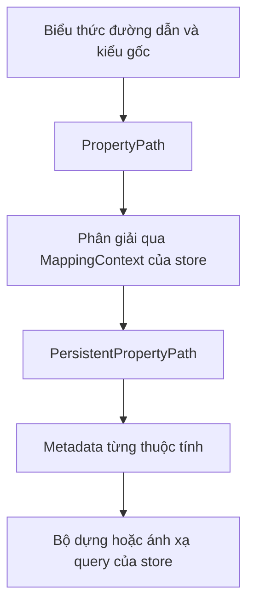

# PropertyPath so với PersistentPropertyPath

## 1. Hai cách nhìn về cùng một đường dẫn

Trong chương **Metadata ánh xạ** của module **SPRING_DATA_COMMONS**, một câu hỏi quan trọng là: khi nói đến đường dẫn `address.city`, ta đang mô tả cấu trúc của lớp Java hay cấu trúc thuộc tính được hệ thống persistence quản lý?

Spring Data Commons có hai abstraction liên quan nhưng không thay thế cho nhau:

- `PropertyPath` mô tả và phân giải đường dẫn thuộc tính dựa trên thông tin kiểu Java.
- `PersistentPropertyPath<P>` biểu diễn một chuỗi `PersistentProperty` đã được phân giải qua metadata của một `MappingContext`.

Ví dụ, một thuộc tính có thể tồn tại trong lớp Java nhưng bị đánh dấu không lưu trữ. `PropertyPath` vẫn có thể tìm thấy thuộc tính đó, trong khi metadata persistence của store có thể loại nó ra. Ngược lại, để biết tên field được ánh xạ xuống document, chỉ có tên thuộc tính Java là chưa đủ.

Bài học tập trung vào cách chọn đúng abstraction khi làm việc với repository, derived query, phân trang, sắp xếp và metadata. Các ví dụ MongoDB bên dưới chỉ minh họa một cách store sử dụng metadata; không suy rộng thành hành vi bắt buộc của mọi module Spring Data.

## 2. Bắt đầu từ mô hình Java

Xét mô hình đơn giản:

```java
import java.util.List;

class Customer {

    String id;
    Address address;
    List<Order> orders;
}

class Address {

    String city;
    String postalCode;
}

class Order {

    String code;
}
```

Các đường dẫn thuộc tính hợp lệ trên mô hình này gồm:

| Đường dẫn | Ý nghĩa trên mô hình Java |
| --- | --- |
| `id` | Thuộc tính trực tiếp của `Customer` |
| `address.city` | Thuộc tính `city` của đối tượng `Address` |
| `address.postalCode` | Thuộc tính `postalCode` của `Address` |
| `orders.code` | Thuộc tính `code` trên kiểu phần tử `Order` |

Đường dẫn `orders.code` mô tả một quan hệ về kiểu. Nó không chỉ định phần tử nào trong danh sách, không chọn một order cụ thể và không quyết định toán tử truy vấn của database.

Để biết một đường dẫn có hợp lệ với mapping của store hay không, cần thêm metadata persistence. Đây là ranh giới giữa hai abstraction.

## 3. PropertyPath: phân giải đường dẫn từ thông tin kiểu

### 3.1. PropertyPath chứa điều gì?

`org.springframework.data.mapping.PropertyPath` biểu diễn một chuỗi các đoạn đường dẫn. Mỗi đoạn gắn với một thuộc tính và thông tin kiểu cần để đi tiếp.

Đầu vào cơ bản là:

1. Một biểu thức đường dẫn.
2. Kiểu gốc để bắt đầu phân giải.

Ví dụ:

```java
import org.springframework.data.mapping.PropertyPath;

PropertyPath path =
        PropertyPath.from("address.city", Customer.class);

String normalized = path.toDotPath();
String firstSegment = path.getSegment();
String leafSegment = path.getLeafProperty().getSegment();
boolean hasNext = path.hasNext();
```

Với mô hình đã cho:

```text
normalized   = address.city
firstSegment = address
leafSegment  = city
hasNext      = true
```

`getSegment()` trả tên của đoạn hiện tại. Nó không trả toàn bộ đường dẫn.

`getLeafProperty()` trả đoạn cuối dưới dạng `PropertyPath`; tên phương thức này không có nghĩa kết quả là một `PersistentProperty`.

### 3.2. PropertyPath không chỉ tách chuỗi theo dấu chấm

Thao tác sau chỉ tạo hai chuỗi:

```java
String[] segments = "address.city".split("\\.");
```

Trong khi đó, `PropertyPath.from(...)` còn phân giải từng đoạn dựa trên kiểu Java. Nó cần xác định `Customer` có thuộc tính `address`, rồi kiểu của thuộc tính đó có `city` hay không.

Nếu đường dẫn không tìm thấy thuộc tính tương ứng, việc phân giải có thể ném `PropertyReferenceException`.

Do đó:

```java
PropertyPath.from("address.unknown", Customer.class);
```

không chỉ tạo một chuỗi “trông giống đường dẫn”. Nó cố kiểm tra quan hệ thuộc tính và thất bại vì `Address` không có `unknown`.

Tuy nhiên, phân giải được trên mô hình Java chưa chứng minh rằng đường dẫn được lưu trữ, được phép truy vấn hoặc được phép dùng làm sort.

### 3.3. Dấu chấm, camel case và dấu gạch dưới

Ngoài biểu thức có dấu chấm, `PropertyPath` hỗ trợ cách phân giải có liên quan đến quy ước tên phương thức truy vấn.

Với mô hình đơn giản không có tên gây nhập nhằng:

```java
PropertyPath nested =
        PropertyPath.from("addressCity", Customer.class);

System.out.println(nested.toDotPath());
// address.city
```

Nhưng khi mô hình có cả thuộc tính trực tiếp và thuộc tính lồng nhau:

```java
class AmbiguousCustomer {

    String addressCity;
    Address address;
}
```

thì cần phân biệt:

```java
PropertyPath direct =
        PropertyPath.from("addressCity", AmbiguousCustomer.class);

PropertyPath nested =
        PropertyPath.from("address_City", AmbiguousCustomer.class);

System.out.println(direct.toDotPath());
// addressCity

System.out.println(nested.toDotPath());
// address.city
```

Thuộc tính trực tiếp khớp tên được ưu tiên trong trường hợp này. Dấu gạch dưới giúp chỉ rõ điểm đi xuống thuộc tính lồng nhau.

Trong derived query, quy tắc này giúp giải thích khác biệt giữa tên như `findByAddressCity` và `findByAddress_City`. Các tên thuộc tính có sẵn dấu gạch dưới hoặc cách viết hoa đặc biệt có thêm quy tắc phân giải; không nên tự xây một parser bằng vài lệnh tách chuỗi.

Khi truyền đường dẫn tường minh vào mã hạ tầng, dạng có dấu chấm như `address.city` thường giúp ý định dễ đọc hơn.

### 3.4. Collection và thông tin kiểu

`PropertyPath` có thể sử dụng thông tin kiểu phần tử khi đi qua collection:

```java
PropertyPath path =
        PropertyPath.from("orders.code", Customer.class);

boolean startsWithCollection = path.isCollection();
String leaf = path.getLeafProperty().getSegment();
```

Trong ví dụ này:

```text
startsWithCollection = true
leaf                 = code
```

`isCollection()` ở đây nói về đoạn hiện tại là `orders`, không phải một cờ tổng quát cho mọi đoạn trong đường dẫn.

Việc phân giải phụ thuộc vào thông tin kiểu mà mô hình cung cấp. Khai báo collection bằng raw type có thể làm mất thông tin cần thiết để xác định thuộc tính của phần tử.

`PropertyPath` không đọc các đối tượng `Customer` đang có trong bộ nhớ để tìm thành phố hoặc mã đơn hàng. Nó làm việc với metadata về kiểu, không duyệt dữ liệu runtime của từng entity.

## 4. PersistentPropertyPath: đường dẫn qua metadata persistence

### 4.1. Một chuỗi các PersistentProperty

`org.springframework.data.mapping.PersistentPropertyPath<P>` là abstraction biểu diễn đường dẫn gồm các `PersistentProperty`.

Tham số kiểu có dạng:

```java
P extends PersistentProperty<P>
```

Mỗi phần tử là metadata của một thuộc tính được mapping context quản lý. Tùy store, metadata đó có thể cung cấp thêm thông tin như:

- Thuộc tính thuộc entity nào.
- Thuộc tính có phải ID hoặc version hay không.
- Thuộc tính là collection hoặc association hay không.
- Annotation và đặc điểm ánh xạ tương ứng.
- Tên field lưu trữ hoặc thông tin bổ sung qua API riêng của store.

Không phải mọi thông tin đặc thù đều nằm trong interface `PersistentProperty` chung. Ví dụ, muốn đọc tên field MongoDB bằng API chuyên biệt, thường cần kiểu `MongoPersistentProperty`.

### 4.2. Vai trò của MappingContext

`MappingContext` quản lý `PersistentEntity` và `PersistentProperty` cho mô hình của store.

Thay vì tạo một danh sách tên rồi coi đó là persistent path, ta yêu cầu context phân giải đường dẫn:

```java
import org.springframework.data.mapping.PersistentProperty;
import org.springframework.data.mapping.PersistentPropertyPath;
import org.springframework.data.mapping.context.MappingContext;

public final class PersistentPathResolver {

    private PersistentPathResolver() {
    }

    public static <P extends PersistentProperty<P>>
            PersistentPropertyPath<P> resolve(
                    MappingContext<?, P> context,
                    Class<?> rootType,
                    String dotPath) {

        return context.getPersistentPropertyPath(dotPath, rootType);
    }
}
```

Ví dụ đầu vào:

```text
rootType = Customer.class
dotPath  = address.city
```

Context kiểm tra từng đoạn theo metadata mà nó quản lý. Nếu không tìm thấy thuộc tính hoặc không thể tiếp tục trên kiểu tương ứng, việc phân giải thất bại.

Đoạn utility trên không tự tạo hay cấu hình mapping context. Nó nhận một context đã được cấu hình phù hợp với store và mô hình của ứng dụng.

### 4.3. Đọc đường dẫn đã phân giải

Sau khi phân giải thành công:

```java
PersistentPropertyPath<P> path =
        context.getPersistentPropertyPath("address.city", Customer.class);

P first = path.getBaseProperty();
P leaf = path.getLeafProperty();

String logicalPath = path.toDotPath();
String firstName = first.getName();
String leafName = leaf.getName();
```

Đoạn mã nằm trong ngữ cảnh generic có `P extends PersistentProperty<P>`.

Với mô hình tương ứng:

```text
logicalPath = address.city
firstName   = address
leafName    = city
```

`PersistentPropertyPath.toDotPath()` dùng tên thuộc tính logic. Không nên tự hiểu kết quả là tên cột SQL hoặc đường dẫn field vật lý đã hoàn thành mọi bước chuyển đổi của store.

### 4.4. Có metadata không đồng nghĩa có query hợp lệ

Một persistent path hợp lệ xác nhận rằng các đoạn đã được phân giải qua mô hình metadata tương ứng. Nó chưa xác nhận:

- Store hỗ trợ mọi phép so sánh trên thuộc tính đó.
- Có thể sort hiệu quả trên đường dẫn đó.
- Một phép join hoặc điều kiện collection đã có ngữ nghĩa đúng.
- Query đã được parameter binding hoặc chuyển đổi giá trị.
- Schema thực tế đang đồng bộ với mô hình mapping.

Metadata là đầu vào của các bước tiếp theo, không phải kết quả cuối cùng của toàn bộ pipeline truy vấn.

## 5. Bảng đối chiếu trực tiếp

| Tiêu chí | PropertyPath | PersistentPropertyPath |
| --- | --- | --- |
| Góc nhìn chính | Cấu trúc thuộc tính theo kiểu Java | Cấu trúc thuộc tính theo metadata persistence |
| Đơn vị của đường dẫn | Các đoạn `PropertyPath` | Các đối tượng `PersistentProperty` |
| Đầu vào phân giải điển hình | Biểu thức và kiểu gốc | Đường dẫn và mapping context của store |
| Đối tượng phân giải điển hình | `PropertyPath.from(...)` | `MappingContext.getPersistentPropertyPath(...)` |
| Cần mapping context của store | Không | Có trong luồng sử dụng này |
| Biết tên field vật lý của store | Không tự cung cấp | Có thể truy cập qua metadata chuyên biệt |
| Có thể thấy thuộc tính bị loại khỏi persistence | Có thể vẫn phân giải theo kiểu Java | Phụ thuộc metadata; thuộc tính bị loại không tạo thành persistent path hợp lệ |
| Tự tạo query SQL hoặc MongoDB | Không | Không |
| Tự đọc giá trị từ entity runtime | Không | Không |
| Dạng `toDotPath()` mặc định | Tên thuộc tính Java | Tên thuộc tính logic từ metadata |

Hai abstraction có thể cùng biểu diễn chuỗi `address.city`, nhưng chuỗi giống nhau không có nghĩa thông tin và bảo đảm giống nhau.

## 6. Ví dụ MongoDB: tên Java khác tên lưu trữ

### 6.1. Mô hình có alias và thuộc tính transient

Ví dụ này cần các dependency Spring Data MongoDB tương ứng. Nó dùng metadata của MongoDB để minh họa, không thêm yêu cầu MongoDB cho mọi ứng dụng dùng Commons.

Mỗi public type được đặt trong file Java riêng:

```java
import org.springframework.data.annotation.Id;
import org.springframework.data.annotation.Transient;
import org.springframework.data.mongodb.core.mapping.Document;
import org.springframework.data.mongodb.core.mapping.Field;

@Document("customers")
public class CustomerDocument {

    @Id
    String id;

    @Field("addr")
    AddressDocument address;

    @Transient
    String temporaryLabel;
}
```

```java
import org.springframework.data.mongodb.core.mapping.Field;

public class AddressDocument {

    @Field("town")
    String city;

    @Field("zip_code")
    String postalCode;
}
```

Một document tương ứng có thể có hình dạng:

```json
{
  "_id": "c-101",
  "addr": {
    "town": "Hue",
    "zip_code": "530000"
  }
}
```

Trong ví dụ này:

| Thuộc tính Java | Field lưu trữ |
| --- | --- |
| `address` | `addr` |
| `address.city` | `addr.town` |
| `address.postalCode` | `addr.zip_code` |
| `temporaryLabel` | Không được lưu theo mapping đã khai báo |

Các giá trị trong JSON chỉ minh họa cấu trúc dữ liệu.

### 6.2. PropertyPath vẫn dùng tên Java

```java
import org.springframework.data.mapping.PropertyPath;

PropertyPath javaPath =
        PropertyPath.from("address.city", CustomerDocument.class);

System.out.println(javaPath.toDotPath());
// address.city
```

`PropertyPath` không đổi `address` thành `addr` hoặc `city` thành `town` chỉ vì có annotation `@Field`.

Ngược lại, đầu vào sau dùng tên lưu trữ thay cho tên Java:

```java
PropertyPath.from("addr.town", CustomerDocument.class);
```

sẽ không tìm thấy thuộc tính `addr` trong mô hình Java đã khai báo.

### 6.3. PersistentPropertyPath cho phép đọc metadata ánh xạ

Giả định `MongoMappingContext` dưới đây là context đã được hạ tầng ứng dụng cấu hình cho mô hình này:

```java
import org.springframework.data.mapping.PersistentPropertyPath;
import org.springframework.data.mongodb.core.mapping.MongoMappingContext;
import org.springframework.data.mongodb.core.mapping.MongoPersistentProperty;

public class MongoPathExample {

    public void inspect(MongoMappingContext mappingContext) {

        PersistentPropertyPath<MongoPersistentProperty> path =
                mappingContext.getPersistentPropertyPath(
                        "address.city",
                        CustomerDocument.class);

        String logicalPath = path.toDotPath();
        String firstField = path.getBaseProperty().getFieldName();
        String leafField = path.getLeafProperty().getFieldName();

        System.out.println(logicalPath);
        System.out.println(firstField);
        System.out.println(leafField);
    }
}
```

Kết quả tương ứng với mapping trong ví dụ:

```text
address.city
addr
town
```

Đầu vào của `getPersistentPropertyPath` vẫn là đường dẫn thuộc tính logic. Sự khác biệt là kết quả chứa metadata để truy cập tên lưu trữ.

### 6.4. Có thể ghép tên field để quan sát, nhưng cần giữ phạm vi

Với đúng trường hợp embedded object đơn giản ở trên, ta có thể quan sát tên field từng đoạn:

```java
import java.util.StringJoiner;
import org.springframework.data.mapping.PersistentPropertyPath;
import org.springframework.data.mongodb.core.mapping.MongoPersistentProperty;

public class EmbeddedFieldPathExample {

    public String inspectSimpleEmbeddedPath(
            PersistentPropertyPath<MongoPersistentProperty> path) {

        StringJoiner joined = new StringJoiner(".");

        for (MongoPersistentProperty property : path) {
            joined.add(property.getFieldName());
        }

        return joined.toString();
    }
}
```

Với path `address.city` của ví dụ, kết quả là `addr.town`.

Đây là cách minh họa metadata, không phải bộ chuyển đổi query tổng quát. Query thực tế có thể liên quan đến ID, association/reference, collection, map, converter hoặc quy tắc tên field đặc biệt. Khi xây truy vấn ứng dụng, nên sử dụng API truy vấn và cơ chế mapping chính thức của store thay vì tự thay toàn bộ bộ ánh xạ bằng phép nối chuỗi.

## 7. Ví dụ transient: hợp lệ trên Java, không hợp lệ trên persistence

Trong `CustomerDocument`, `temporaryLabel` là một field Java có thật:

```java
PropertyPath javaPath =
        PropertyPath.from("temporaryLabel", CustomerDocument.class);

System.out.println(javaPath.toDotPath());
// temporaryLabel
```

Việc phân giải kiểu Java không tự loại thuộc tính này theo quy tắc persistence.

Nhưng khi dùng MongoDB mapping context của ví dụ:

```java
mappingContext.getPersistentPropertyPath(
        "temporaryLabel",
        CustomerDocument.class);
```

thuộc tính đã bị loại khỏi metadata persistent bởi `@Transient`, nên không tạo được persistent path hợp lệ.

Từ đó rút ra một nguyên tắc thiết kế: **kiểm tra PropertyPath thành công không đủ để xác nhận một trường có thể được dùng trong truy vấn persistence**.

Điều ngược lại cũng cần hiểu đúng: phân giải persistent path thành công không phải phép kiểm tra quyền truy cập. Một thuộc tính được lưu trữ vẫn có thể không thuộc tập trường mà API cho phép người dùng lọc hoặc sắp xếp.

## 8. Chuyển từ PropertyPath sang PersistentPropertyPath

Mapping context có API để phân giải một `PropertyPath` sang persistent path phù hợp:

```java
import org.springframework.data.mapping.PropertyPath;
import org.springframework.data.mapping.PersistentPropertyPath;
import org.springframework.data.mongodb.core.mapping.MongoPersistentProperty;

PropertyPath javaPath =
        PropertyPath.from("address.city", CustomerDocument.class);

PersistentPropertyPath<MongoPersistentProperty> persistentPath =
        mappingContext.getPersistentPropertyPath(javaPath);
```

Luồng khái quát:



Cần hiểu đây là một luồng có thể dùng khi phát triển hạ tầng. Không phải mọi query module đều buộc đi qua đúng chuỗi class này; một số store có metamodel và pipeline truy vấn riêng.

Chuyển đổi cũng không bảo đảm luôn thành công:

1. Đường dẫn đúng về kiểu Java.
2. Mapping context bắt đầu kiểm tra theo metadata của nó.
3. Một đoạn có thể là transient, kiểu không được quản lý hoặc không thể tiếp tục phân giải.
4. Việc tạo persistent path thất bại.

Vì vậy, hai loại kiểm tra không nên bị gộp thành một giả định “đã parse được thì chắc chắn lưu được”.

## 9. Collection, association và các giới hạn cần hiểu

### 9.1. Collection không biến path thành biểu thức truy vấn hoàn chỉnh

Với `orders.code`, thông tin kiểu có thể cho biết `orders` chứa các phần tử `Order`. Metadata persistence có thể mô tả thêm việc ánh xạ thuộc tính đó.

Nhưng vẫn còn các câu hỏi dành cho tầng query:

- Điều kiện có nghĩa là tồn tại ít nhất một phần tử thỏa mãn hay tất cả phần tử?
- Nếu có hai điều kiện, chúng cần áp dụng trên cùng một phần tử hay các phần tử khác nhau?
- Có cần join, phép kiểm tra phần tử hoặc toán tử riêng của store?
- Kết quả có bị nhân số dòng hoặc cần loại trùng không?

Cả `PropertyPath` lẫn `PersistentPropertyPath` đều không tự trả lời đầy đủ những câu hỏi này.

### 9.2. Association không đồng nhất với object nhúng

Một quan hệ tham chiếu tới entity khác có thể được lưu theo cách khác với một object nhúng.

Vì vậy, không nên suy ra rằng mọi path `a.b` đều tương ứng với field vật lý `a.b`. Query builder hoặc bộ ánh xạ của store còn cần xem xét loại quan hệ và khả năng truy vấn tương ứng.

Trong JPA, việc đi qua một thuộc tính có thể liên quan đến điều hướng association hoặc join theo ngữ nghĩa truy vấn. Trong MongoDB, field nhúng và reference không có cùng cách truy cập chỉ nhờ một chuỗi tên.

### 9.3. Path thuộc tính không phải JSONPath

Các chuỗi sau thuộc những ngôn ngữ biểu thức khác nhau:

```text
address.city
orders[0].code
$.orders[*].code
orders.$[item].code
```

Bài này dùng đường dẫn thuộc tính theo mô hình Java và metadata Spring Data. Không nên đưa trực tiếp cú pháp JSONPath, chỉ số mảng hoặc toán tử vị trí của store vào `PropertyPath` rồi mong nó có cùng ngữ nghĩa.

### 9.4. Một leaf không chứa toàn bộ ngữ cảnh

Chỉ lấy `getLeafProperty()` có thể làm mất thông tin về các đoạn phía trước.

Ví dụ:

```text
billingAddress.city
shippingAddress.city
```

Cả hai đều có leaf tên `city`, nhưng không cùng đường dẫn. Khi lưu cấu hình sort, dựng thông báo lỗi hoặc lập khóa cache cho việc phân giải, cần giữ kiểu gốc và đường dẫn đầy đủ thay vì chỉ giữ tên leaf.

## 10. Liên hệ với repository và derived queries

Tên phương thức repository thường dùng tên thuộc tính của domain:

```java
import java.util.List;
import org.springframework.data.repository.Repository;

public interface CustomerDocumentRepository
        extends Repository<CustomerDocument, String> {

    List<CustomerDocument> findByAddress_City(String city);
}
```

Tên phương thức thể hiện đường đi `address.city`. Trong ví dụ MongoDB, annotation `@Field` định nghĩa tên lưu trữ; ứng dụng không đổi tên method thành `findByAddr_Town` chỉ vì document dùng `addr.town`.

Để một derived query chạy được, cần nhiều tầng phối hợp:

1. Hợp đồng repository và domain type được nhận diện.
2. Tên phương thức được phân tích theo quy tắc query derivation.
3. Đường dẫn thuộc tính được phân giải.
4. Store xác định toán tử và cách tạo query.
5. Giá trị tham số được chuyển đổi và gắn vào query.
6. Store thực thi và chuyển đổi kết quả.

`PropertyPath` là một phần của câu chuyện phân giải thuộc tính. `PersistentPropertyPath` phục vụ làm việc với metadata khi pipeline của store sử dụng nó. Không abstraction nào một mình bảo đảm toàn bộ quy trình thành công.

Các keyword, kiểu dữ liệu được hỗ trợ và giới hạn quan hệ cần được xem theo store. Việc một path tồn tại không đồng nghĩa mọi dạng derived query trên path đó đều hợp lệ.

## 11. Liên hệ với phân trang, sort, projection và auditing

### 11.1. Sort dùng tên thuộc tính của mô hình khi đi qua repository API phù hợp

Ví dụ:

```java
import org.springframework.data.domain.PageRequest;
import org.springframework.data.domain.Pageable;
import org.springframework.data.domain.Sort;

Pageable pageable = PageRequest.of(
        0,
        20,
        Sort.by("address.city").ascending());
```

Đoạn mã tạo yêu cầu phân trang và sắp xếp theo tên thuộc tính logic. Nó chưa tự truy cập database.

Cách đường dẫn được kiểm tra và ánh xạ khi thực thi phụ thuộc store cùng API repository được gọi. Không nên thay bằng tên lưu trữ như `addr.town` ở mọi nơi chỉ vì đã đọc metadata MongoDB.

Nếu ứng dụng có nhiều API nhận sort, cần phân biệt rõ API nào nhận tên Java, API nào nhận biểu thức query hoặc tên vật lý. Tên tham số đều là `String` không có nghĩa chúng thuộc cùng một ngôn ngữ.

### 11.2. Projection không chỉ là persistent path

Projection có thể sử dụng thông tin thuộc tính và metadata để xác định dữ liệu cần đọc. Tuy nhiên, alias kết quả, biểu thức tính toán và constructor của DTO có cơ chế riêng.

Một tên được dùng làm alias projection không nhất thiết là đường dẫn thuộc tính trên entity. Ngược lại, một persistent path hợp lệ không tự tạo được mọi loại projection.

### 11.3. Auditing dùng metadata nhưng có vòng đời riêng

Metadata của thuộc tính có thể giúp nhận diện các trường auditing. Việc tự động gán người tạo, thời điểm tạo hoặc thời điểm sửa còn cần cấu hình và callback/listener của store.

Tạo `PersistentPropertyPath` không tự bật auditing hoặc ghi giá trị vào entity. Đây vẫn là thao tác mô tả và phân giải metadata.

### 11.4. Query by Example vẫn có quy tắc theo store

Query by Example dựa trên probe, matcher và khả năng truy vấn của store. Việc metadata nhận diện một thuộc tính không tự làm mọi phép so sánh, điều kiện collection hay quan hệ trở nên được hỗ trợ trong Query by Example.

Trong mọi trường hợp, cần tách ba câu hỏi: path có tồn tại, path có persistent và thao tác query trên path có được hỗ trợ hay không.

## 12. Dùng đường dẫn do người dùng nhập

Giả sử API cho phép sắp xếp danh sách khách hàng. Có thể thiết kế hợp đồng ngoài bằng một tập khóa rõ ràng:

| Khóa API | Đường dẫn logic nội bộ |
| --- | --- |
| `city` | `address.city` |
| `postalCode` | `address.postalCode` |

Luồng xử lý phù hợp:

1. Kiểm tra khóa có thuộc tập API cho phép.
2. Ánh xạ khóa sang đường dẫn logic.
3. Dùng API sort/query phù hợp với store.
4. Xử lý lỗi phân giải thành phản hồi đúng hợp đồng.

Không nên chỉ gọi `PropertyPath.from(userInput, Entity.class)` rồi coi mọi path phân giải được đều được phép sử dụng.

Việc dùng một alias ngoài cũng giúp tách hợp đồng API khỏi việc đổi tên field Java hoặc tên lưu trữ. Nhưng alias API, tên thuộc tính Java và tên field vật lý cần được quản lý như ba lớp tên riêng biệt.

Đối với công cụ quản trị metadata nội bộ, nếu cần kiểm tra một trường có thật sự persistent hay không, mapping context mang lại thông tin phù hợp hơn phép phân giải kiểu Java đơn thuần.

## 13. Chẩn đoán các lỗi thường gặp

| Biểu hiện | Khả năng cần kiểm tra | Hướng xử lý |
| --- | --- | --- |
| Không tìm thấy thuộc tính `addr` | Đưa tên field MongoDB vào bộ phân giải tên Java | Dùng `address`, để tầng mapping xử lý alias |
| `addressCity` trỏ vào field trực tiếp | Mô hình có tên gây nhập nhằng | Dùng đường dẫn có dấu chấm hoặc chỉ rõ ranh giới theo API |
| PropertyPath thành công nhưng persistent path thất bại | Thuộc tính transient hoặc metadata không hỗ trợ đường đi | Kiểm tra mapping context và annotation |
| Không đi tiếp được qua collection | Thiếu thông tin kiểu phần tử hoặc giới hạn mapping | Kiểm tra generic và mô hình store |
| Query sai dù path đúng | Toán tử, association hoặc ngữ nghĩa collection chưa đúng | Kiểm tra pipeline query của store |
| Tên lưu trữ bị lẫn trong API | Nhầm hợp đồng tên Java, alias API và tên vật lý | Xác định rõ loại đầu vào của từng API |
| Cùng một leaf nhưng ra đường dẫn sai | Chỉ giữ tên đoạn cuối | Giữ root type và đầy đủ các đoạn |

Khi bắt lỗi, cần phân biệt lỗi phân giải `PropertyPath` với lỗi metadata persistence. Ví dụ, `PropertyReferenceException` liên quan đến tìm thuộc tính theo kiểu; đường dẫn không hợp lệ trong mapping context có thể được báo bằng `InvalidPersistentPropertyPath` hoặc ngoại lệ mapping tương ứng.

Không nên bắt mọi lỗi mapping rồi trả kết quả rỗng. “Không có dữ liệu phù hợp” và “đường dẫn không hợp lệ” là hai trạng thái khác nhau của hợp đồng truy vấn.

## 14. Cách kiểm chứng trong một dự án thực tế

Nếu triển khai chức năng dựa trên metadata, các kịch bản sau giúp kiểm tra đúng ranh giới:

| Kịch bản | Kết quả cần xác minh |
| --- | --- |
| `address.city` trên mô hình Java | PropertyPath phân giải đúng các đoạn |
| Tên không tồn tại | Bộ phân giải báo lỗi |
| Có field trực tiếp `addressCity` | Quy tắc phân giải không bị hiểu nhầm |
| Đường dẫn chứa thuộc tính transient | Khác biệt giữa kiểu Java và metadata persistence được nhận diện |
| Field có alias lưu trữ | Tên logic và tên lưu trữ được giữ đúng vai trò |
| Collection có generic rõ ràng | Phân giải được kiểu phần tử phù hợp |
| Query trên store thực | Kết quả đúng cả mapping và ngữ nghĩa truy vấn |
| API nhận khóa sort | Chỉ các khóa trong hợp đồng được chấp nhận |

Kiểm tra metadata có thể cho biết alias đã được nhận diện, nhưng muốn khẳng định query được thực thi đúng thì cần kiểm tra qua hạ tầng query của store. Một assertion rằng `toDotPath()` trả đúng chuỗi không thay thế được việc đó.

Các đoạn mã trong bài là ví dụ minh họa để áp dụng vào dự án. Chúng không phải báo cáo kết quả chạy test hoặc xác nhận một cấu hình store cụ thể đã được khởi động.

## 15. Tự kiểm tra kiến thức

**Khi nào PropertyPath là đủ?**

Khi cần phân tích hoặc kiểm tra đường dẫn theo mô hình kiểu Java mà chưa cần thông tin mapping của store.

**Khi nào cần PersistentPropertyPath?**

Khi cần làm việc với các thuộc tính đã được mapping context nhận diện, chẳng hạn đọc metadata ID, association hoặc thông tin field của store.

**PersistentPropertyPath.toDotPath() có trả tên vật lý không?**

Mặc định nó biểu diễn đường dẫn bằng tên thuộc tính logic. Tên lưu trữ cần lấy từ metadata tương ứng hoặc thông qua bộ ánh xạ chính thức của store.

**Một field transient có thể có PropertyPath không?**

Có, nếu bộ phân giải kiểu Java tìm thấy thuộc tính đó. Điều này không chứng minh field thuộc metadata persistent.

**Path qua collection có xác định đúng điều kiện truy vấn chưa?**

Chưa. Path xác định đường đi về mặt thuộc tính; toán tử, phạm vi phần tử và ngữ nghĩa query do tầng truy vấn quyết định.

**Có phải mọi store đều dùng PersistentPropertyPath trong mọi query không?**

Không. Các module có thể sử dụng metamodel và pipeline riêng. Cần áp dụng abstraction đúng với hạ tầng thực tế của store.

**Cần nhớ gì khi nhìn thấy chuỗi address.city?**

Trước hết xác định nó thuộc hợp đồng nào: tên thuộc tính Java, đường dẫn metadata persistence hay biểu thức mà một API truy vấn cụ thể chấp nhận. Chỉ khi rõ tầng sử dụng mới có thể chọn cách phân giải và chuyển đổi đúng.
