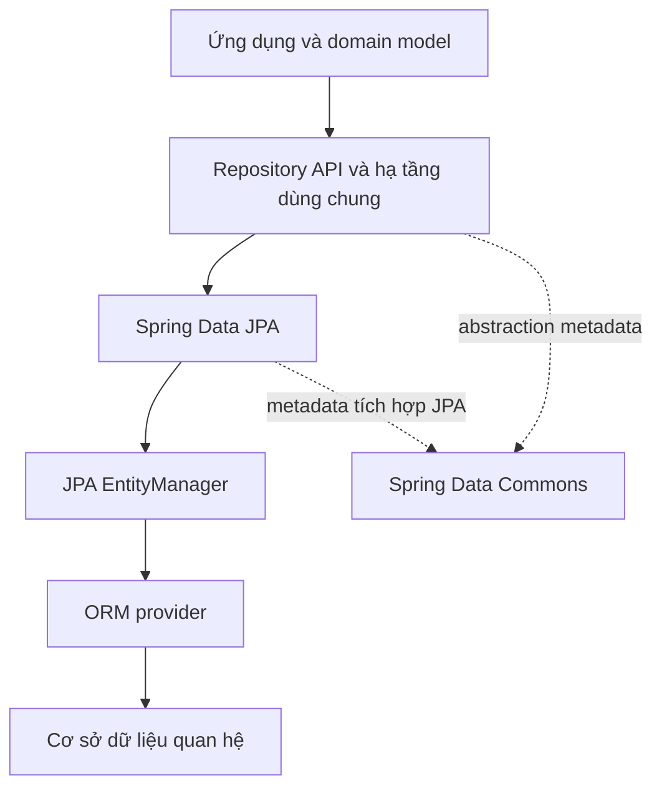

# Ranh giới giữa mapping của Commons với mapping do ORM bên ngoài quản lý

Trong Spring Data, từ “mapping” có thể chỉ metadata mô tả mô hình Java, quy tắc chuyển đổi giá trị, hoặc toàn bộ quá trình lưu và khôi phục đối tượng từ kho dữ liệu. Những nghĩa này liên quan đến nhau nhưng không thuộc cùng một thành phần.

Spring Data Commons cung cấp các abstraction dùng chung để mô tả entity, property và thông tin kiểu. Một module tích hợp quyết định cách áp dụng các abstraction đó cho store cụ thể. Khi dùng Spring Data JPA, ORM provider còn quản lý một tập trách nhiệm riêng: ánh xạ entity sang bảng, persistence context, theo dõi thay đổi và thực thi SQL.

Hiểu ranh giới này giúp chọn đúng annotation, cấu hình đúng converter và xác định đúng nơi chịu trách nhiệm khi một repository lưu dữ liệu khác với dự kiến.

## 1. Ba lớp trách nhiệm cần phân biệt

Một repository JPA có thể được nhìn qua ba lớp:



Sơ đồ thể hiện vai trò, không khẳng định mỗi lời gọi luôn đi qua từng ô như một chuỗi interceptor cố định.

| Lớp | Câu hỏi chủ yếu | Ví dụ |
| --- | --- | --- |
| Spring Data Commons | Có những kiểu, property và abstraction repository nào để hạ tầng cùng sử dụng? | `PersistentEntity`, `PersistentProperty`, `MappingContext`, `Repository` |
| Module Spring Data của store | Repository dùng API truy cập dữ liệu nào? Metadata được diễn giải theo store ra sao? | Spring Data JPA, Spring Data MongoDB, Spring Data JDBC |
| Công nghệ persistence bên dưới | Dữ liệu được ánh xạ, đọc, ghi và quản lý theo mô hình persistence nào? | JPA provider như Hibernate trong ứng dụng JPA |

Không phải module Spring Data nào cũng đặt một ORM ở bên dưới. MongoDB có mô hình document; Spring Data JDBC có mô hình aggregate và ánh xạ quan hệ riêng. Việc cùng sử dụng Commons không làm các module có cùng lifecycle hay khả năng persistence.

Trong bài này, “ORM bên ngoài” là ORM provider nằm ngoài Spring Data Commons. Ví dụ JPA dùng Hibernate hoặc một JPA provider tương thích khác; Spring Data JPA là lớp tích hợp repository với JPA, không phải chính ORM provider đó.

## 2. Mapping metadata khác với mapping engine

### 2.1. Metadata mô tả đối tượng Java

Metadata có thể trả lời:

- Kiểu Java nào đang được mô tả?
- Nó có những persistent property nào?
- Property nào đóng vai trò định danh theo mô hình metadata đang dùng?
- Một property có kiểu đơn, collection hoặc kiểu lồng nhau?
- Có annotation hoặc thông tin nào cần thiết cho hạ tầng xử lý property?

Metadata giúp nhiều tính năng của Spring Data cùng hiểu mô hình domain thay vì mỗi tính năng tự viết lại cơ chế phân tích class.

### 2.2. Mapping engine thực hiện persistence

Một ORM có thể phải trả lời thêm:

- Entity được lưu ở bảng nào?
- Property tương ứng với cột, kiểu dữ liệu và chiến lược chuyển đổi nào?
- Quan hệ nào là association, phía nào sở hữu quan hệ?
- Khi nào cần tạo SQL `INSERT`, `UPDATE` hoặc `DELETE`?
- Đối tượng hiện tại là managed hay detached?
- Thay đổi nào cần được đồng bộ khi flush?
- Phiên bản nào phải được kiểm tra để thực hiện optimistic locking?

Có metadata về một property không đồng nghĩa Commons sẽ tự sinh SQL hoặc theo dõi thay đổi của đối tượng chứa property đó.

Ví dụ, biết property `total` có kiểu `Money` chưa đủ để biết nó sẽ được lưu thành hai cột, một chuỗi JSON hay một document lồng nhau. Quyết định đó thuộc mô hình mapping và cấu hình của công nghệ persistence cụ thể.

### 2.3. Mapping context khác persistence context

Hai khái niệm có tên gần giống nhưng mục đích khác hẳn:

| Khái niệm | Đối tượng được quản lý | Mục đích |
| --- | --- | --- |
| Spring Data `MappingContext` | Metadata của kiểu và property | Cung cấp mô hình ánh xạ cho hạ tầng |
| JPA persistence context | Các entity instance trong một ngữ cảnh persistence | Quản lý identity, trạng thái managed và đồng bộ thay đổi |

Đưa một class vào một mapping context không làm các instance của class trở thành JPA managed entity. Đọc metadata cũng không tương đương với `EntityManager.find(...)`, `persist(...)` hay `merge(...)`.

## 3. Các abstraction metadata của Commons

### `PersistentEntity`

`PersistentEntity` biểu diễn metadata của một kiểu persistent trong mô hình mapping đang sử dụng. Tùy implementation, nó cung cấp thông tin như kiểu Java, property định danh, property phiên bản và các persistent property.

Nó mô tả một kiểu, không phải một bản ghi riêng lẻ trong cơ sở dữ liệu.

### `PersistentProperty`

`PersistentProperty` biểu diễn metadata của một property. Hạ tầng có thể dùng nó để tìm tên property, kiểu, thông tin annotation và các đặc điểm persistence được implementation hỗ trợ.

Tên property Java không nhất thiết trùng với tên trường lưu trữ. Chẳng hạn, `status` có thể được ánh xạ sang cột `order_status`.

### `MappingContext`

`MappingContext` cung cấp và liên kết metadata entity, property cho một mô hình mapping cụ thể. Các implementation do module cung cấp có thể bổ sung cách diễn giải phù hợp với store.

Đoạn sau minh họa việc đọc metadata đã được context hỗ trợ:

```java
import org.springframework.data.mapping.PersistentEntity;
import org.springframework.data.mapping.PersistentProperty;
import org.springframework.data.mapping.context.MappingContext;

public final class MetadataInspector {

    private MetadataInspector() {
    }

    public static void printIdentityMetadata(
            MappingContext<?, ?> mappingContext,
            Class<?> domainType) {

        PersistentEntity<?, ?> entity =
                mappingContext.getRequiredPersistentEntity(domainType);

        PersistentProperty<?> idProperty = entity.getIdProperty();

        System.out.println("Java type: " + entity.getType().getName());

        if (idProperty == null) {
            System.out.println("No single id property exposed here");
            return;
        }

        System.out.println("Id property: " + idProperty.getName());
        System.out.println("Id Java type: " + idProperty.getType().getName());
    }
}
```

Các giới hạn của ví dụ:

- Phải truyền đúng mapping context của module và mô hình đang dùng. Không giả định ứng dụng có một mapping context duy nhất.
- `getRequiredPersistentEntity(...)` yêu cầu context cung cấp được metadata; nó không phải công cụ khám phá schema cho mọi class tùy ý.
- Metadata định danh phức hợp có thể cần API và cách diễn giải riêng của công nghệ tích hợp. Không nên kết luận mọi entity đều có một field `id` đơn giản.
- Đoạn mã không chứng minh ORM đã ánh xạ được class, schema đã đúng hoặc cơ sở dữ liệu đã kết nối.

Với JPA, Spring Data JPA có metadata tích hợp với JPA metamodel, chẳng hạn qua `JpaMetamodelMappingContext`. Việc có abstraction chung không có nghĩa một context thuần Commons có thể thay thế toàn bộ metadata JPA.

## 4. Quy tắc quan trọng: xác định thành phần đọc annotation

Annotation chỉ có tác dụng khi một thành phần có trách nhiệm đọc và áp dụng nó.

```java
import jakarta.persistence.Id;
```

và:

```java
import org.springframework.data.annotation.Id;
```

là hai kiểu annotation khác nhau. Việc cùng có tên đơn giản là `Id` không tạo ra một hợp đồng chung cho mọi store.

| Ý định | Trong entity JPA | Trong hệ sinh thái Spring Data khác |
| --- | --- | --- |
| Khai báo định danh | `jakarta.persistence.Id` hoặc cơ chế JPA tương ứng | Có module dùng `org.springframework.data.annotation.Id` |
| Bỏ qua một property | `jakarta.persistence.Transient` theo quy tắc JPA | Commons có `org.springframework.data.annotation.Transient`, tùy module diễn giải |
| Khai báo phiên bản | `jakarta.persistence.Version` | Commons có `org.springframework.data.annotation.Version` cho tích hợp hỗ trợ |
| Khởi tạo đối tượng khi đọc | Theo quy tắc JPA và khả năng provider | Một số mapping engine dùng `@PersistenceCreator` của Commons |
| Ghi nhận thời gian/người thay đổi | Có thể dùng annotation auditing của Commons với tích hợp JPA | Cần hạ tầng auditing của module tương ứng |

Không dùng `org.springframework.data.annotation.Id` làm sự thay thế mặc định cho `jakarta.persistence.Id` trong JPA. Tương tự, annotation `@Version` của Commons không tự yêu cầu một JPA provider thực hiện optimistic locking như annotation JPA.

Các module có thể bổ sung hỗ trợ cho một số annotation chung. Khi đánh giá một annotation, cần biết đầy đủ package của nó và thành phần đọc nó.

### Một lỗi import dễ bỏ sót

```java
import jakarta.persistence.Entity;
import org.springframework.data.annotation.Id;

@Entity
public class Product {

    @Id
    private Long id;
}
```

Nhìn nhanh có vẻ hợp lý, nhưng `@Id` ở đây không phải annotation định danh của JPA. Không nên dựa vào việc Commons nhận ra một dấu hiệu định danh để suy ra JPA provider sẽ chấp nhận entity này.

Đối với entity JPA, cần khai báo định danh theo JPA. Cũng không nên thêm hai annotation định danh khác hệ chỉ để làm lỗi khởi động biến mất: việc đó có thể che giấu mô hình metadata thiếu nhất quán.

## 5. Ví dụ JPA: mỗi quy tắc mapping có một chủ thể quản lý

Giả định ứng dụng đã cấu hình Spring Data JPA, JPA provider, datasource, transaction manager và quét các class trong package `com.example.order`. Mỗi kiểu `public` dưới đây nằm trong file cùng tên. Ví dụ dùng namespace `jakarta.persistence` và Java hỗ trợ `record`.

### 5.1. Entity sử dụng mapping JPA

```java
package com.example.order;

import jakarta.persistence.Column;
import jakarta.persistence.Convert;
import jakarta.persistence.Embedded;
import jakarta.persistence.Entity;
import jakarta.persistence.EnumType;
import jakarta.persistence.Enumerated;
import jakarta.persistence.GeneratedValue;
import jakarta.persistence.Id;
import jakarta.persistence.Table;
import jakarta.persistence.Version;
import java.util.Objects;

@Entity
@Table(name = "purchase_order")
public class PurchaseOrder {

    @Id
    @GeneratedValue
    private Long id;

    @Version
    private Long version;

    @Convert(converter = OrderCodeConverter.class)
    @Column(name = "order_code", nullable = false, unique = true, length = 50)
    private OrderCode code;

    @Embedded
    private Money total;

    @Enumerated(EnumType.STRING)
    @Column(name = "order_status", nullable = false, length = 20)
    private OrderStatus status;

    protected PurchaseOrder() {
    }

    public PurchaseOrder(OrderCode code, Money total) {
        this.code = Objects.requireNonNull(code);
        this.total = Objects.requireNonNull(total);
        this.status = OrderStatus.NEW;
    }

    public Long getId() {
        return id;
    }

    public void markPaid() {
        this.status = OrderStatus.PAID;
    }
}
```

```java
package com.example.order;

public enum OrderStatus {
    NEW,
    PAID
}
```

Vì `@Id` nằm trên field, ví dụ sử dụng field access theo quy tắc JPA. ORM không cần setter công khai để truy cập các field persistent này.

Các trách nhiệm tương ứng:

| Khai báo | Ý nghĩa trong ví dụ | Thành phần thực hiện chính |
| --- | --- | --- |
| `@Entity`, `@Table` | Kiểu là entity và tên bảng dự kiến | JPA provider |
| `@Id`, `@GeneratedValue` | Định danh và chiến lược sinh định danh được cấu hình | JPA provider |
| `@Version` | Trạng thái phục vụ optimistic locking | JPA provider |
| `@Column` | Metadata cột và ràng buộc mapping | JPA provider |
| `@Embedded` | Ánh xạ một value object theo embeddable | JPA provider |
| `@Convert` | Dùng converter JPA cho `OrderCode` | JPA provider |
| Repository interface | Cung cấp điểm truy cập persistence | Spring Data JPA trên nền các abstraction repository |

`@Column(nullable = false, unique = true)` không phải một chương trình migration. Tác động đến schema còn phụ thuộc cấu hình tạo/kiểm tra schema và cơ chế migration của ứng dụng. Cơ sở dữ liệu thực tế phải có ràng buộc phù hợp nếu cần bảo đảm tính toàn vẹn.

### 5.2. Value object được lưu thành nhiều cột

```java
package com.example.order;

import jakarta.persistence.Column;
import jakarta.persistence.Embeddable;
import java.math.BigDecimal;
import java.util.Objects;

@Embeddable
public class Money {

    @Column(name = "total_amount", precision = 19, scale = 2, nullable = false)
    private BigDecimal amount;

    @Column(name = "total_currency", length = 3, nullable = false)
    private String currency;

    protected Money() {
    }

    public Money(BigDecimal amount, String currency) {
        this.amount = Objects.requireNonNull(amount);
        this.currency = Objects.requireNonNull(currency);
    }
}
```

Trong ví dụ, ORM ánh xạ `Money` vào các cột của bảng chứa `PurchaseOrder`. Commons không tự quyết định một property kiểu `Money` phải được “trải phẳng” thành hai cột.

Nếu dùng cùng một kiểu Java cho một store document, module đó có thể chọn một representation lồng nhau. Quy tắc JPA `@Embeddable` không tự trở thành quy tắc document của module khác.

### 5.3. Value object được chuyển thành một giá trị cột

```java
package com.example.order;

public record OrderCode(String value) {

    public OrderCode {
        if (value == null || value.isBlank()) {
            throw new IllegalArgumentException("Order code must not be blank");
        }
    }
}
```

```java
package com.example.order;

import jakarta.persistence.AttributeConverter;
import jakarta.persistence.Converter;

@Converter(autoApply = false)
public class OrderCodeConverter
        implements AttributeConverter<OrderCode, String> {

    @Override
    public String convertToDatabaseColumn(OrderCode attribute) {
        return attribute == null ? null : attribute.value();
    }

    @Override
    public OrderCode convertToEntityAttribute(String dbData) {
        return dbData == null ? null : new OrderCode(dbData);
    }
}
```

Ở đây, JPA provider sử dụng `AttributeConverter` vì field đã chỉ định `@Convert`. `OrderCode` là value object được chuyển đổi, không phải JPA entity và không cần tự có định danh persistence.

Việc tạo một Spring `Converter<OrderCode, String>` hoặc đăng ký nó với một `ConversionService` bất kỳ không mặc nhiên khiến ORM gọi converter đó khi ghi cột.

## 6. Phân biệt ba luồng chuyển đổi kiểu

Một ứng dụng có thể đồng thời có nhiều cơ chế chuyển đổi:

| Luồng | Ví dụ chuyển đổi | Hạ tầng áp dụng |
| --- | --- | --- |
| Binding hoặc conversion của ứng dụng | Chuỗi đầu vào thành một kiểu Java | `ConversionService` được cấu hình cho luồng đó |
| Mapping của một module Spring Data | Value object thành representation của store | Converter và custom conversions của module đó |
| Mapping của JPA provider | `OrderCode` thành `VARCHAR` | `AttributeConverter`, `@Convert`, `@Converter` |

Commons có các abstraction và annotation hỗ trợ conversion, bao gồm `@ReadingConverter` và `@WritingConverter`. Chúng có ý nghĩa khi converter được đăng ký và sử dụng trong mapping pipeline có hỗ trợ.

Chỉ gắn một annotation chỉ hướng đọc/ghi lên class converter không làm nó tự tham gia mọi repository.

Khi converter không được gọi, hãy xác định đường dữ liệu cụ thể:

```text
HTTP input → binding → Java value
Java entity → ORM mapping → JDBC value
Store representation → module mapping → Java object
```

Đăng ký converter vào đường thứ nhất không thay thế việc cấu hình đường thứ hai hoặc thứ ba.

Đối với ứng dụng có nhiều store, một value object có thể có representation khác nhau ở từng store. Chẳng hạn, `Money` có thể là hai cột trong JPA và một document con trong MongoDB. Cần quyết định representation và converter theo từng pipeline.

## 7. `save`, nhận diện entity mới và dirty checking thuộc các lớp khác nhau

### 7.1. Repository phải quyết định cách lưu theo module

Repository abstraction có phương thức `save`, nhưng không áp đặt cùng một thuật toán persistence cho mọi store.

Trong Spring Data JPA, implementation repository sử dụng thông tin entity để quyết định gọi `EntityManager.persist(...)` hay `EntityManager.merge(...)`. Nhận diện entity mới mặc định thường xem xét property phiên bản không phải primitive trước, rồi đến identifier khi không có property phiên bản thích hợp.

Với `PurchaseOrder` ở trên, `version` có kiểu `Long`. Giá trị `null` của phiên bản có thể được dùng trong chiến lược nhận diện entity mới mặc định của Spring Data JPA.

Không tổng quát hóa điều này thành “mọi repository thấy ID khác null đều update”. Entity có ID do ứng dụng gán, entity triển khai `Persistable`, hoặc module khác có thể sử dụng chiến lược khác.

`Persistable.isNew()` là một điểm mở rộng cho quyết định entity mới trong các tích hợp hỗ trợ. Nó không tự thay thế mapping định danh, chiến lược sinh ID hoặc quy tắc trạng thái managed/detached của ORM.

### 7.2. Dirty checking là trách nhiệm của ORM

```java
package com.example.order;

import org.springframework.stereotype.Service;
import org.springframework.transaction.annotation.Transactional;

@Service
public class OrderPaymentService {

    private final PurchaseOrderRepository orders;

    public OrderPaymentService(PurchaseOrderRepository orders) {
        this.orders = orders;
    }

    @Transactional
    public void confirmPayment(Long orderId) {
        PurchaseOrder order = orders.findById(orderId)
                .orElseThrow(() -> new IllegalArgumentException("Order not found"));

        order.markPaid();
    }
}
```

Nếu entity được tải và vẫn managed trong transaction JPA này, ORM có thể phát hiện thay đổi rồi đồng bộ khi flush. Không có một bộ dirty checking độc lập của Commons thực hiện việc đó.

Ví dụ phụ thuộc vào việc gọi service qua bean được quản lý và có transaction JPA phù hợp. Nó không chứng minh một đối tượng đã detached, hoặc một aggregate từ module khác, cũng sẽ được tự động lưu chỉ vì một field thay đổi.

### 7.3. Thời điểm gọi `save` khác thời điểm SQL thực thi

`persist` hoặc `merge` không phải lúc nào cũng có nghĩa mọi câu SQL đã được gửi ngay. Thời điểm thực thi còn phụ thuộc flush, transaction, chiến lược sinh định danh và hành vi provider.

Với `merge`, đối tượng managed trả về có thể khác instance đầu vào. Khi cần tiếp tục dùng kết quả lưu, hãy sử dụng giá trị trả về của `save` theo hợp đồng repository.

Những chi tiết này thuộc tích hợp JPA và ORM. Không dùng chúng làm giả định mặc định cho MongoDB, JDBC hoặc một repository tùy chỉnh.

## 8. Property path của repository và tên lưu trữ

Repository minh họa cho entity ở trên:

```java
package com.example.order;

import java.util.List;
import java.util.Optional;
import org.springframework.data.domain.Sort;
import org.springframework.data.jpa.repository.JpaRepository;

public interface PurchaseOrderRepository
        extends JpaRepository<PurchaseOrder, Long> {

    Optional<PurchaseOrder> findByCode(OrderCode code);

    List<PurchaseOrder> findByStatus(OrderStatus status, Sort sort);
}
```

Một lời gọi:

```java
orders.findByStatus(
        OrderStatus.NEW,
        Sort.by("total.amount").descending());
```

Các tên như `status`, `code` và `total.amount` là tên property/path của mô hình Java trong ngữ cảnh truy vấn tương ứng.

Trong khi đó:

- `order_status` là tên cột.
- `order_code` là tên cột.
- `total_amount` là tên cột bên trong mapping embeddable của ví dụ.

Do đó, đổi tên cột thành `order_status` không làm phương thức derived query phải đổi thành `findByOrderStatus`.

JPQL sử dụng entity và attribute theo mô hình JPA; native SQL sử dụng bảng, cột và cú pháp của cơ sở dữ liệu. Không lấy một tên vật lý trong SQL rồi mặc định truyền nó vào mọi API `Sort`.

Việc Commons và module phân tích property path hỗ trợ repository diễn giải yêu cầu. ORM cùng lớp tích hợp truy vấn mới chịu trách nhiệm đưa yêu cầu đó vào mô hình truy vấn và SQL phù hợp.

## 9. Quan hệ và cách tạo đối tượng: không chuyển nguyên giả định giữa các store

### Quan hệ JPA

Các annotation như `@ManyToOne`, `@OneToMany`, `@JoinColumn` và cấu hình cascade thuộc mô hình JPA. ORM sử dụng chúng để quản lý association, fetch và đồng bộ quan hệ theo quy tắc của provider và JPA.

Một metadata abstraction biết property là một association không tự cung cấp:

- Lazy-loading proxy.
- Cascade persist hoặc remove theo JPA.
- Orphan removal.
- Persistence context và identity map.
- SQL join hay chiến lược batch fetching.

Tương tự, một reference được module document nhận diện không tự có tất cả ngữ nghĩa của một association JPA.

### Khởi tạo và truy cập property

Commons có hạ tầng phục vụ materialization và truy cập property cho các mapping implementation sử dụng nó. Một số module có thể chọn constructor hoặc factory method dựa trên metadata và `@PersistenceCreator`.

JPA provider có quy tắc riêng về việc tạo entity, access strategy và enhancement. Đối với entity JPA thông thường, cần tuân thủ các yêu cầu JPA áp dụng, chẳng hạn constructor không tham số có mức truy cập phù hợp.

Không thêm `@PersistenceCreator` rồi kết luận ORM sẽ bỏ qua các yêu cầu của JPA. Một kỹ thuật materialization hợp lệ trong module khác chưa chắc là một thiết kế entity JPA hợp lệ.

Trong ví dụ, `PurchaseOrder` và `Money` có constructor không tham số `protected`. `OrderCode` là record được sử dụng thông qua converter, nên vai trò persistence của nó khác với hai kiểu được JPA ánh xạ trực tiếp.

## 10. Auditing là ví dụ của sự phối hợp giữa Commons và JPA

Commons cung cấp các annotation như:

- `@CreatedDate`.
- `@LastModifiedDate`.
- `@CreatedBy`.
- `@LastModifiedBy`.

Chúng thể hiện ý định auditing. Để dữ liệu được gán khi entity JPA thay đổi, ứng dụng còn cần hạ tầng auditing và điểm tích hợp với lifecycle JPA.

Một cách cấu hình thường dùng là bật `@EnableJpaAuditing` và đăng ký `AuditingEntityListener` cho entity hoặc mapped superclass thích hợp. Nếu ghi nhận người thao tác, cần cung cấp `AuditorAware` phù hợp; chỉ dùng trường ngày giờ không nhất thiết cần thông tin người dùng.

Ví dụ mapped superclass cho thời gian:

```java
package com.example.order;

import jakarta.persistence.Column;
import jakarta.persistence.EntityListeners;
import jakarta.persistence.MappedSuperclass;
import java.time.Instant;
import org.springframework.data.annotation.CreatedDate;
import org.springframework.data.annotation.LastModifiedDate;
import org.springframework.data.jpa.domain.support.AuditingEntityListener;

@MappedSuperclass
@EntityListeners(AuditingEntityListener.class)
public abstract class AuditedEntity {

    @CreatedDate
    @Column(name = "created_at", updatable = false)
    private Instant createdAt;

    @LastModifiedDate
    @Column(name = "last_modified_at")
    private Instant lastModifiedAt;
}
```

Nếu chọn thiết kế này, entity có thể kế thừa `AuditedEntity`; phần cấu hình auditing JPA vẫn phải được bật và các dependency hỗ trợ phải sẵn có.

Trong cùng một field:

- `@CreatedDate` được hạ tầng auditing của Spring Data dùng để xác định vai trò.
- `@Column` được ORM dùng để xác định mapping cột.
- Listener JPA kết nối lifecycle entity với việc gán metadata auditing.

Hai nhóm annotation bổ sung cho nhau vì có một cơ chế tích hợp cụ thể. Chúng không chứng minh mọi annotation của Commons đều có tác dụng với ORM.

Các cập nhật hàng loạt bằng query hoặc native SQL có thể bỏ qua lifecycle entity thông thường. Không mặc định rằng mọi thay đổi dữ liệu đi qua cơ sở dữ liệu đều kích hoạt cùng listener auditing.

## 11. Chẩn đoán theo chủ thể chịu trách nhiệm

| Hiện tượng | Thành phần nên kiểm tra trước | Câu hỏi cụ thể |
| --- | --- | --- |
| JPA báo entity không có identifier | Mapping JPA của entity | Đúng import `jakarta.persistence.Id` chưa? Cấu hình ID phức hợp có đúng không? |
| Repository không nhận diện đúng entity mới | Metadata entity của module và chiến lược new-state | Có version property, ID gán sẵn hoặc `Persistable` không? |
| Cột, bảng hoặc association không như dự kiến | ORM metadata và schema thực tế | Tên vật lý, access strategy, converter và migration có thống nhất không? |
| Converter không được gọi | Pipeline thực sự đọc/ghi giá trị | Đã đăng ký đúng converter của JPA hay của module store chưa? |
| Object thay đổi nhưng không có SQL update | Persistence context và transaction JPA | Entity còn managed không? Có transaction, flush hoặc read-only setting nào liên quan không? |
| `@CreatedDate` không có giá trị | Auditing integration | Đã bật auditing và đăng ký listener phù hợp chưa? |
| Sort hoặc derived query không nhận property | Repository query mapping | Đang dùng tên property Java hay tên cột vật lý? |
| Cùng domain type bị nhiều module nhận diện | Cấu hình repository của ứng dụng nhiều store | Có annotation chồng chéo hoặc phạm vi quét không tách rõ không? |

Một quy trình phân tích ngắn:

1. Xác định repository thuộc module nào.
2. Xác định class đang được module đó và công nghệ bên dưới nhận diện ra sao.
3. Kiểm tra package đầy đủ của annotation liên quan.
4. Xác định pipeline đang tạo object, chuyển đổi giá trị hoặc thực hiện cập nhật.
5. Kiểm tra metadata/schema/transaction tương ứng với pipeline đó.

Không cần tìm một lỗi trong Commons nếu vấn đề thực tế là cột chưa được migration tạo ra. Ngược lại, một lỗi phân tích property path ở repository không phải lúc nào cũng là SQL do ORM sinh sai.

## 12. Thiết kế khi có nhiều store

Một hệ thống có thể dùng JPA cho giao dịch và một store document cho một mô hình đọc. Sự hiện diện của Commons giúp chia sẻ một số abstraction nhưng không tự giải quyết khác biệt representation.

Có hai lựa chọn cần cân nhắc:

| Cách thiết kế | Lợi ích | Chi phí cần kiểm soát |
| --- | --- | --- |
| Tách persistence model theo store | Ranh giới mapping, ID và lifecycle rõ ràng | Cần ánh xạ giữa domain model và các persistence model |
| Dùng chung một kiểu với nhiều mapping | Giảm số kiểu trong một số trường hợp đơn giản | Dễ chồng annotation, khác ID, constructor, converter và semantics quan hệ |

Không có yêu cầu rằng mọi domain class phải tách riêng. Tuy nhiên, khi hai store có mô hình dữ liệu và lifecycle khác nhau đáng kể, tách persistence model thường giúp diễn đạt đúng trách nhiệm hơn.

Nếu dùng chung một class, cần làm rõ:

- Mỗi repository thuộc module nào và phạm vi quét của nó.
- Identifier của từng store có cùng ý nghĩa hay không.
- Annotation nào do thành phần nào đọc.
- Representation của value object trong từng store.
- Quy tắc version, auditing và transaction của từng đường ghi.
- Cách giữ nhất quán dữ liệu giữa các store.

Dùng chung `Repository`, `Pageable` hay `Sort` không tạo ra transaction phân tán. Dùng chung metadata cũng không đồng bộ dữ liệu giữa hai hệ lưu trữ.

## 13. Bài thực hành nhận diện ranh giới

Với ví dụ `PurchaseOrder`, hãy giải thích kết quả kỳ vọng của các tình huống sau trước khi triển khai thay đổi:

1. Đổi tên cột `order_status` thành `payment_status`, giữ nguyên tên field `status`. Phương thức `findByStatus` có cần đổi không? Schema cần được cập nhật bởi cơ chế nào?
2. Thay import của `@Id` từ JPA sang Commons. Thành phần nào có thể không còn nhận ra định danh hợp lệ?
3. Đăng ký một Spring `Converter<OrderCode, String>` nhưng bỏ `@Convert`. Vì sao chưa thể kết luận JPA sẽ tiếp tục lưu `OrderCode` như trước?
4. Tải entity trong transaction, thay đổi trạng thái rồi kết thúc transaction. Thành phần nào có thể phát hiện thay đổi? Điều gì khác nếu object đã detached?
5. Thêm `@CreatedDate` nhưng chưa bật auditing JPA. Annotation này có tự gán thời gian không?
6. Chuyển cùng mô hình sang một store document. Những giả định về `@Embedded`, quan hệ và dirty checking nào cần thiết kế lại?
7. Dùng `MappingContext` đọc được kiểu của `total`. Vì sao thông tin đó chưa chứng minh `total_amount` là một cột tồn tại trong cơ sở dữ liệu?

Tiêu chí giải thích là chỉ ra đúng thành phần sở hữu mỗi hành vi: Commons mô tả abstraction chung; module Spring Data kết nối repository với store; ORM quản lý những quy tắc persistence thuộc hợp đồng của nó; cơ sở dữ liệu thực thi schema và ràng buộc vật lý.

Khi ranh giới này rõ ràng, có thể mở rộng repository, đọc metadata, dùng converter và auditing mà vẫn giữ đúng khả năng của từng công nghệ lưu trữ.
