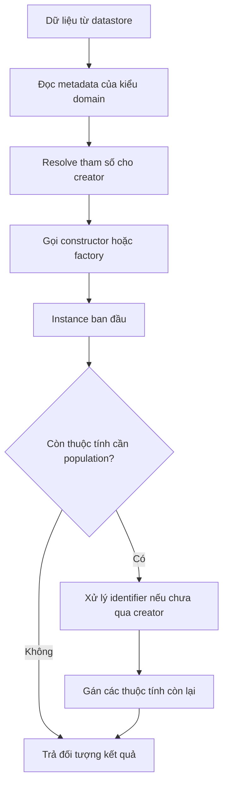

# Hai giai đoạn dựng đối tượng và gán giá trị từ dữ liệu

## 1. Bài toán: từ dữ liệu lưu trữ đến một đối tượng Java

Khi gọi một repository để đọc dữ liệu, ứng dụng thường nhận ngay một đối tượng domain:

```java
Optional<Product> result = productRepository.findById(101L);
```

Ở những module sử dụng hạ tầng object mapping của Spring Data, phía sau kết quả đó là một quá trình chuyển dữ liệu thành object. Hạ tầng phải trả lời hai câu hỏi khác nhau:

1. **Làm cách nào tạo ra instance ban đầu?**
2. **Sau khi có instance, còn thuộc tính persistent nào cần nhận giá trị?**

Đó là hai giai đoạn **khởi tạo đối tượng** (*object instantiation*) và **gán thuộc tính** (*property population*). Giai đoạn đầu dùng constructor hoặc factory method phù hợp. Giai đoạn sau đưa các giá trị còn lại vào đối tượng bằng cơ chế cập nhật mà mapping hỗ trợ.

Trong **SPRING_DATA_COMMONS**, đây là nền tảng để hiểu metadata của domain, mô hình mutable/immutable và cách các module lưu trữ tái tạo dữ liệu. Nó cũng giúp phân biệt phần chung của Spring Data với hành vi riêng của một datastore.

Phạm vi cần lưu ý: không phải mọi repository Spring Data đều tự trực tiếp dùng cùng một bộ chuyển đổi đối tượng. Chẳng hạn, với Spring Data JPA, persistence provider chịu trách nhiệm chính về materialization của entity theo quy tắc JPA. Không dùng các ví dụ constructor của bộ mapping Commons dưới đây để kết luận rằng một JPA entity có thể bỏ mọi yêu cầu của JPA.

## 2. Mô hình hai giai đoạn

### 2.1. Giai đoạn một: tạo instance ban đầu

Hạ tầng mapping sử dụng metadata của kiểu domain để xác định một creator thích hợp. Creator có thể là constructor hoặc factory method mà cơ chế mapping nhận diện.

Các tham số creator được lấy từ dữ liệu nguồn theo metadata, rồi chuyển đổi sang kiểu đích khi cần. Creator nhận những giá trị đó và tạo instance ban đầu.

Ví dụ, với constructor:

```java
Product(String name)
```

hạ tầng cần resolve giá trị của thuộc tính `name` và gọi constructor tương ứng. Sau thời điểm này đã tồn tại một `Product`, nhưng chưa thể kết luận mọi thuộc tính persistent của nó đã có giá trị từ nguồn dữ liệu.

### 2.2. Giai đoạn hai: hoàn thiện thuộc tính còn lại

Sau khi tạo instance, hạ tầng xem xét các thuộc tính persistent chưa được cung cấp qua creator. Tùy metadata và khả năng cập nhật, nó có thể:

- Gán trực tiếp vào field.
- Gọi setter khi cấu hình property access yêu cầu.
- Gọi phương thức `with...` để nhận một bản sao mới của object immutable.
- Dùng cơ chế tạo bản sao qua persistence constructor nếu cấu trúc model và mapping hỗ trợ.

Thuộc tính đã được truyền vào creator không cần được gán lại trong lượt population thông thường. Nếu creator đã nhận đủ mọi thuộc tính cần materialize, giai đoạn population có thể không còn việc phải làm.



Sơ đồ diễn tả trách nhiệm logic. Một converter có thể đọc và chuyển đổi từng giá trị đúng lúc cần; không bắt buộc toàn bộ dữ liệu phải được chuyển thành một map trung gian trước khi gọi constructor.

### 2.3. Hai giai đoạn không đồng nghĩa với hai instance

Với object mutable, hai giai đoạn thường cập nhật cùng một instance. Với object immutable, population có thể tạo bản sao, khiến instance cuối khác instance ban đầu.

Vì vậy, cần phân biệt:

- **Instance ban đầu:** kết quả trực tiếp của creator.
- **Instance hiện tại:** object mới nhất sau từng bước cập nhật.
- **Instance kết quả:** object cuối cùng được converter trả cho phía gọi.

Phân biệt này đặc biệt quan trọng khi đọc code mapping hoặc tự viết converter.

## 3. Metadata nối dữ liệu nguồn với thuộc tính domain

### 3.1. Không chỉ nhìn tên field trong dữ liệu

Hạ tầng cần biết nhiều hơn danh sách field của một lớp Java:

| Thông tin metadata | Vai trò khi dựng đối tượng |
|---|---|
| Kiểu domain | Xác định loại object cần tạo |
| Creator được chọn | Xác định constructor/factory và danh sách tham số |
| Thuộc tính persistent | Xác định phần trạng thái thuộc mô hình lưu trữ |
| Identifier | Nhận diện đối tượng, có thể cần population sớm |
| Kiểu thuộc tính | Hỗ trợ chuyển đổi dữ liệu sang kiểu Java |
| Tên lưu trữ và tên thuộc tính | Kết nối schema nguồn với domain |
| Chiến lược access | Xác định dùng field, setter hoặc đường cập nhật khác |
| Thuộc tính transient | Loại khỏi population persistent thông thường |

Trong hạ tầng Commons, các abstraction như `PersistentEntity` và `PersistentProperty` biểu diễn metadata tương ứng ở cấp kiểu và cấp thuộc tính. Module lưu trữ bổ sung cách diễn giải cụ thể cho nguồn dữ liệu của nó.

Nếu datastore dùng tên `product_name` còn domain dùng `name`, quy tắc mapping tên của module phải nối hai tên này. Không có quy tắc chung rằng tham số constructor luôn phải mang nguyên tên cột hoặc tên field trong datastore.

### 3.2. Constructor nhận giá trị dữ liệu, không tự nhận Spring bean

Constructor domain không phải constructor của một service được autowire theo cách thông thường.

```java
Product(String name)
```

Ở ngữ cảnh materialization, `name` là giá trị cần resolve từ dữ liệu và metadata. Hạ tầng không tìm một Spring bean kiểu `String` để inject vào tham số đó.

Tương tự, thêm một tham số `PricingService` vào persistence constructor không tự làm service ấy được inject. Nếu tham số không có cách resolve phù hợp với mapping đang dùng, quá trình đọc có thể thất bại.

Domain object được mapper tạo ra cũng không tự trở thành một Spring bean. Điều này khác với một entity đang được quản lý trong persistence context của JPA; hai khái niệm quản lý có mục đích và vòng đời khác nhau.

### 3.3. Cần có thông tin tên tham số

Để nối tham số constructor với thuộc tính, mapping cần thông tin tên phù hợp. Với lớp Java thông thường, một cách phổ biến là biên dịch có metadata tên tham số bằng tùy chọn `-parameters`. Record cung cấp thông tin qua các record component và canonical constructor.

Nếu thiếu metadata cần thiết, framework có thể không resolve được tham số dù constructor có kiểu dữ liệu trông đúng. Không nên dựa vào giả định rằng mapping sẽ nối tham số theo thứ tự field khai báo trong source.

Annotation chọn creator và metadata tên tham số giải quyết hai việc khác nhau: chọn đúng constructor chưa bảo đảm mọi tham số của constructor đó đã resolve được.

## 4. Ví dụ đầy đủ với object mutable một phần

### 4.1. Mô hình `Product`

Ví dụ dưới đây dành cho một module có hỗ trợ các annotation và object mapping của Spring Data tương ứng. Nó minh họa cách dựng object; phần cấu hình repository, converter và kết nối datastore được module cụ thể cung cấp.

```java
package com.example.catalog;

import org.springframework.data.annotation.AccessType;
import org.springframework.data.annotation.Id;
import org.springframework.data.annotation.PersistenceCreator;

public class Product {

    @Id
    private Long id;

    private final String name;

    @AccessType(AccessType.Type.PROPERTY)
    private int quantity;

    @PersistenceCreator
    public Product(String name) {
        if (name == null || name.isBlank()) {
            throw new IllegalArgumentException("name must not be blank");
        }
        this.name = name;
    }

    public Long getId() {
        return id;
    }

    public String getName() {
        return name;
    }

    public int getQuantity() {
        return quantity;
    }

    public void setQuantity(int quantity) {
        if (quantity < 0) {
            throw new IllegalArgumentException("quantity must not be negative");
        }
        this.quantity = quantity;
    }
}
```

Ở đây:

- `@PersistenceCreator` nêu rõ constructor được dùng cho việc dựng object từ dữ liệu.
- `name` là trạng thái immutable được cung cấp ngay qua constructor.
- `id` là thuộc tính mutable, không nằm trong danh sách tham số creator.
- `quantity` cũng không nằm trong creator, nhưng được cấu hình property access để dùng getter/setter.

Các annotation được import từ Spring Data. Không thay chúng bằng annotation cùng tên thuộc một framework khác rồi kỳ vọng mọi module sẽ xử lý giống nhau.

### 4.2. Dữ liệu nguồn của một lần đọc

Giả sử sau khi áp dụng quy tắc tên và chuyển đổi cần thiết, nguồn dữ liệu cung cấp các giá trị tương ứng:

```text
id       = 101L
name     = "Bút bi"
quantity = 12
```

Đây là cách biểu diễn giá trị để phân tích, không phải cú pháp query hoặc schema bắt buộc của một datastore.

### 4.3. Theo dõi trạng thái qua từng bước

| Thời điểm | Thao tác | `id` | `name` | `quantity` |
|---|---|---:|---|---:|
| Trước khởi tạo | Resolve tham số `name` | Chưa có object | Chưa có object | Chưa có object |
| Sau creator | Gọi `new Product("Bút bi")` | `null` | `Bút bi` | `0` |
| Population identifier | Gán `id` từ dữ liệu | `101L` | `Bút bi` | `0` |
| Population còn lại | Gọi `setQuantity(12)` | `101L` | `Bút bi` | `12` |
| Hoàn tất | Trả instance kết quả | `101L` | `Bút bi` | `12` |

Giá trị `null` và `0` ngay sau constructor trong ví dụ đến từ quy tắc khởi tạo field của Java và constructor đang viết. Chúng không phải bằng chứng rằng datastore thiếu dữ liệu luôn được mapping thành các giá trị đó.

`name` không bị gán lần thứ hai trong population thông thường vì nó đã là tham số creator. `id` được xử lý ở giai đoạn population vì constructor chưa nhận identifier. `quantity` đi qua setter vì ví dụ đã chỉ định property access.

### 4.4. Vì sao chỉ có setter chưa chắc setter sẽ chạy?

Nếu bỏ cấu hình property access, một mapper đang dùng field access có thể gán trực tiếp vào field `quantity`. Khi đó logic kiểm tra trong setter không mặc nhiên được thực thi.

Vì vậy, câu khẳng định “mọi dữ liệu đọc từ repository đều qua setter” là không đúng. Muốn dựa vào setter để duy trì ràng buộc, phải bảo đảm metadata access của module thực sự chọn đường đó.

Cũng không nên suy rộng rằng mọi mapper hoặc JPA provider đều đọc annotation access của Commons theo cùng cách. Hãy xác định hạ tầng nào đang chịu trách nhiệm dựng kiểu domain cụ thể.

## 5. Vì sao identifier được quan tâm sớm?

Trong quy trình population của hạ tầng mapping chung, identifier được xử lý trước các thuộc tính còn lại khi nó chưa được cung cấp qua creator và cần được gán từ dữ liệu.

Một lý do là hỗ trợ nhận diện object khi dựng đồ thị có tham chiếu vòng. Khi đã có một object cùng identifier, converter có cơ sở để liên hệ các tham chiếu đang được materialize với object đang tồn tại trong ngữ cảnh đọc của nó.

Ví dụ về mặt mô hình:

```text
Department(id = D1) -> manager -> Employee(id = E1)
Employee(id = E1)   -> department -> Department(id = D1)
```

Việc biết identity của department sớm có ích khi xử lý tham chiếu quay lại department. Tuy nhiên, cần giữ ba giới hạn:

1. Nếu identifier đã đi qua creator, không có yêu cầu gán lại identifier chỉ để lặp lại thứ tự này.
2. Không có cam kết mọi thuộc tính còn lại được gán theo thứ tự field trong file Java.
3. Identifier-first không tự giải được mọi chu trình constructor hoặc mọi loại reference của mọi datastore.

Chẳng hạn, nếu constructor của `Department` bắt buộc nhận một `Employee` đã hoàn chỉnh, còn constructor của `Employee` lại bắt buộc nhận một `Department` đã hoàn chỉnh, chưa chắc có thể tạo ra instance đầu tiên. Cần thiết kế reference hoặc cách materialize phù hợp với module, thay vì chỉ trông chờ thứ tự gán identifier.

Cách lưu reference, tải lazy/eager, nhận diện object đã đọc và số lượng truy vấn liên quan đều phụ thuộc module lưu trữ. Đây không phải một bảo đảm chung của `Repository` hay `CrudRepository`.

## 6. Các đường population và hệ quả

### 6.1. Gán field trực tiếp

Với thuộc tính mutable và field access, mapper có thể gán trực tiếp vào field, kể cả khi API domain không cung cấp public setter, miễn là cơ chế access của runtime và mapping cho phép.

```java
private Long id;
```

Không có `setId` trong ví dụ `Product`, nhưng điều đó không đồng nghĩa field `id` không thể được mapping. Ngược lại, việc field có setter cũng không tự buộc mapper phải dùng setter.

Nếu domain cần kiểm tra dữ liệu trước khi mọi instance có thể được sử dụng, cần thiết kế vị trí kiểm tra phù hợp với đường materialization thật sự.

### 6.2. Gọi setter qua property access

Khi metadata yêu cầu property access, việc gán có thể gọi setter. Đường này hữu ích khi setter biểu diễn đúng một phép cập nhật riêng lẻ.

Tuy vậy, setter không nên tự giả định rằng mọi thuộc tính khác đã được population. Ngoại trừ quy tắc identifier phù hợp, không nên dựa vào một thứ tự gán cố định giữa các field còn lại.

Ví dụ một setter kiểm tra `startDate <= endDate` có thể gặp trạng thái trung gian khi ngày còn lại chưa được gán. Với invariant liên quan nhiều giá trị, constructor nhận đủ dữ liệu thường giúp diễn đạt rõ hơn.

### 6.3. Dùng wither cho thuộc tính immutable

Một wither nhận giá trị mới và trả object mới, thay vì sửa object hiện tại:

```java
public ImmutableProduct withId(Long id) {
    return new ImmutableProduct(id, this.name);
}
```

Nếu mapper nhận diện và sử dụng wither, nó phải tiếp tục thao tác trên object được trả về. Bỏ qua object mới sẽ làm mất cập nhật.

Tên và chữ ký phương thức cần đúng cách nhận diện của mapping. Một phương thức bất kỳ tên `changeIdentifier` không tự được xem là wither chỉ vì bên trong cũng tạo bản sao.

### 6.4. Tạo bản sao qua persistence constructor

Một số trường hợp thuộc tính immutable được cập nhật bằng việc tạo bản sao qua persistence constructor. Đường này đòi hỏi creator và metadata có thể cung cấp trạng thái cần thiết cho object mới.

Không thể kết luận mọi `final` field đều được ghi bằng reflection hoặc mọi object immutable đều tự động population thành công. Nếu thuộc tính cần nhận giá trị sau creator nhưng không có đường cập nhật hợp lệ, cấu hình model có thể không materialize được.

Một thiết kế dễ lý giải là cung cấp đủ trạng thái persistent ngay trong creator, hoặc cung cấp wither đúng hợp đồng cho phần trạng thái cần bổ sung.

## 7. Ví dụ immutable: instance cuối có thể là bản sao

### 7.1. Identifier chưa có trong persistence constructor

```java
package com.example.catalog;

import org.springframework.data.annotation.Id;
import org.springframework.data.annotation.PersistenceCreator;

public final class ImmutableProduct {

    @Id
    private final Long id;

    private final String name;

    @PersistenceCreator
    public ImmutableProduct(String name) {
        this(null, name);
    }

    private ImmutableProduct(Long id, String name) {
        if (name == null || name.isBlank()) {
            throw new IllegalArgumentException("name must not be blank");
        }
        this.id = id;
        this.name = name;
    }

    public ImmutableProduct withId(Long id) {
        return new ImmutableProduct(id, this.name);
    }

    public Long getId() {
        return id;
    }

    public String getName() {
        return name;
    }
}
```

Ví dụ chọn constructor nhận `name` để làm rõ hai giai đoạn. Constructor private nhận đủ trạng thái được wither sử dụng để tạo bản sao; nó không phải creator được annotation chọn cho lượt đọc này.

### 7.2. Dòng chuyển đổi object

Với dữ liệu `id = 101L`, `name = "Bút bi"`, có thể hình dung:

```text
Giai đoạn khởi tạo:
  P1 = new ImmutableProduct("Bút bi")
  P1: id = null, name = "Bút bi"

Giai đoạn population identifier:
  P2 = P1.withId(101L)
  P2: id = 101L, name = "Bút bi"

Kết quả:
  trả P2
```

`P1` và `P2` là hai object khác nhau. `P1` không bị sửa. Mapper phải giữ tham chiếu `P2` làm instance hiện tại và trả `P2` sau khi hoàn tất.

Nếu minh họa thủ công bằng Java:

```java
ImmutableProduct first = new ImmutableProduct("Bút bi");
ImmutableProduct ready = first.withId(101L);

// first.getId() vẫn là null.
// ready.getId() là 101L.
// first != ready.
```

Đoạn code chỉ giải thích tính chất của wither. Trong lượt đọc thật, converter và property accessor của module thực hiện việc gọi và giữ object mới.

### 7.3. Wither phải bảo toàn phần trạng thái không đổi

Một wither sai có thể vô tình làm mất các giá trị đã có:

```java
// Sai về mặt thiết kế: làm mất tên đang có của sản phẩm.
public ImmutableProduct withId(Long id) {
    return new ImmutableProduct(id, "Không rõ tên");
}
```

Object mới có identifier nhưng không còn phản ánh đúng dữ liệu nguồn. Với lớp có nhiều field, mỗi phép tạo bản sao phải giữ nguyên các giá trị không được thay đổi.

Population đúng không chỉ là “ghi được một field”; nó còn phải duy trì trạng thái đã được creator hoặc các bước trước thiết lập.

## 8. Khi constructor nhận đủ dữ liệu

### 8.1. Không phải lúc nào cũng cần cập nhật sau constructor

Một model có thể nhận đủ trạng thái persistent ngay khi tạo:

```java
package com.example.catalog;

public record ProductSnapshot(Long id, String name, int quantity) {

    public ProductSnapshot {
        if (name == null || name.isBlank()) {
            throw new IllegalArgumentException("name must not be blank");
        }
        if (quantity < 0) {
            throw new IllegalArgumentException("quantity must not be negative");
        }
    }
}
```

Trong một module và kiểu kết quả có hỗ trợ record mapping, canonical constructor là điểm nhận các component. Nếu `id`, `name`, `quantity` là toàn bộ trạng thái cần materialize và đều được resolve qua creator, không còn thuộc tính đó để population riêng.

Điều này không làm mô hình hai giai đoạn mất ý nghĩa. Giai đoạn hai đơn giản là không có công việc cho trường hợp này.

Record trên minh họa cấu trúc object. Việc dùng nó làm domain lưu trữ hay DTO kết quả, cách nhận diện identifier và cách ánh xạ query vẫn cần metadata/cấu hình phù hợp của module. Khai báo record không tự biến nó thành một entity hợp lệ cho mọi datastore hoặc thành một projection được mọi query hỗ trợ.

### 8.2. Invariant nhiều thuộc tính nên được kiểm tra cùng lúc

Giả sử domain có `minPrice` và `maxPrice`, với điều kiện `minPrice <= maxPrice`. Khi cả hai đi qua constructor, validation có thể đánh giá trạng thái hoàn chỉnh:

```java
public record PriceRange(int minPrice, int maxPrice) {

    public PriceRange {
        if (minPrice > maxPrice) {
            throw new IllegalArgumentException("minPrice must not exceed maxPrice");
        }
    }
}
```

Nếu kiểm tra cùng điều kiện trong từng setter, setter được gọi trước có thể nhìn thấy giá trị mặc định của thuộc tính còn lại và từ chối một bản ghi vốn hợp lệ.

Constructor nhận đủ dữ liệu giúp loại bỏ phụ thuộc vào thứ tự population. Đổi lại, creator cần resolve được đủ tham số; dữ liệu thiếu hoặc dữ liệu lịch sử không hợp lệ phải có cách xử lý rõ ràng.

### 8.3. Constructor đầy đủ không phải yêu cầu chung cho mọi domain

Không cần biến mọi class thành record hoặc immutable chỉ để tránh population. Mô hình mutable vẫn phù hợp khi access strategy và vòng đời object được thiết kế rõ.

Câu hỏi cần trả lời là: sau creator, trạng thái nào đã có, trạng thái nào còn thiếu và đường cập nhật phần còn thiếu có hợp lệ không? Trả lời được ba điểm này giúp đánh giá model cụ thể hơn việc chọn một phong cách theo thói quen.

## 9. Giá trị thiếu, `null` và trạng thái trung gian

### 9.1. Java default khác với quy tắc mapping

Sau `new Product("Bút bi")`, `quantity` đang là `0` vì field kiểu `int` chưa được constructor gán. Nhưng nếu dữ liệu nguồn không có `quantity`, kết quả cuối không thể được suy ra chỉ từ quy tắc đó.

Tùy module, converter và kiểu đích, giá trị thiếu có thể được xử lý bằng cách bỏ qua gán, resolve thành `null`, chuyển đổi sang giá trị nào đó hoặc gây lỗi. Cần phân biệt rõ dữ liệu vắng mặt với dữ liệu có giá trị `null` nếu datastore hỗ trợ sự khác biệt ấy.

Đặc biệt, một tham số creator kiểu primitive không thể nhận `null` như một reference. Một tham số reference có thể nhận `null` về mặt ngôn ngữ Java, nhưng constructor có thể từ chối nó vì ràng buộc domain.

Không dựa vào phát biểu “framework luôn tự điền mặc định” khi thiết kế schema hoặc chuyển đổi dữ liệu cũ.

### 9.2. Constructor có thể từ chối dữ liệu ngay từ giai đoạn đầu

Với `Product(String name)`, dữ liệu có `name` rỗng bị từ chối trong constructor. Khi đó không có instance kết quả để tiếp tục population thành công.

Nếu lỗi nằm ở `setQuantity(-1)`, instance ban đầu có thể đã tồn tại và identifier đã được gán, nhưng quá trình chuyển đổi vẫn thất bại. Không được trả instance chưa hoàn thiện như thể lần đọc đã thành công.

Hai lỗi có thể cùng biểu hiện ở lời gọi repository, nhưng vị trí phát sinh khác nhau:

| Vị trí | Ví dụ nguyên nhân | Trạng thái quá trình |
|---|---|---|
| Resolve tham số | Thiếu metadata tên tham số | Chưa gọi được creator |
| Chuyển đổi giá trị creator | Chuỗi không đổi được sang kiểu số cần thiết | Chưa tạo được instance hợp lệ |
| Trong constructor/factory | Vi phạm invariant ban đầu | Creator thất bại |
| Gán thuộc tính | Setter từ chối dữ liệu | Đã có instance trung gian |
| Tạo bản sao | Wither/creator sao chép không hợp lệ | Chưa có kết quả hoàn chỉnh |

Tên exception và các lớp bọc lỗi phụ thuộc module. Khi chẩn đoán, tìm nguyên nhân sâu nhất và property hoặc creator liên quan, thay vì chỉ đọc lỗi repository ở ngoài cùng.

### 9.3. Không để instance chưa hoàn thiện thoát ra ngoài

Constructor hoặc setter không nên tự đăng ký `this` vào một bộ nhớ dùng chung, phát sự kiện nghiệp vụ dựa trên toàn bộ trạng thái chưa có hoặc gọi logic giả định object đã materialize xong.

Nếu cần xử lý sau khi đọc/chuyển đổi, sử dụng điểm mở rộng phù hợp mà module cung cấp, hoặc thực hiện tại tầng ứng dụng sau khi đã nhận kết quả hoàn chỉnh. Cần xem callback cụ thể được gọi ở thời điểm nào và có cho phép thay instance hay không.

Hai giai đoạn ở đây là cách dựng một object; chúng không tự thiết lập transaction, không tự làm dữ liệu cũ hợp lệ và không thay thế kiểm tra nghiệp vụ.

## 10. Mã giả để đọc hiểu cơ chế

Đoạn dưới là **mã giả**, không phải API Java có thể sao chép để chạy:

```text
metadata = metadataOf(targetType)
creator = selectPersistenceCreator(metadata)

arguments = resolveCreatorArguments(source, creator, metadata)
current = invokeCreator(creator, arguments)

remaining = persistentPropertiesNotSuppliedByCreator(metadata, creator)

if identifier is in remaining:
    idValue = readAndConvert(source, identifier)
    current = assignOrCopy(current, identifier, idValue)
    remove identifier from remaining

for each property in remaining:
    value = readAndConvert(source, property)
    current = assignOrCopy(current, property, value)

return current
```

Có bốn điểm đáng chú ý:

1. `remaining` xuất phát từ metadata, không phải mọi field xuất hiện trong source Java.
2. Những thuộc tính creator đã nhận không bị đưa vào vòng gán lại thông thường.
3. `assignOrCopy` có thể giữ nguyên hoặc thay instance, nên luôn giữ lại kết quả mới nhất.
4. Mã giả không quy định thứ tự giữa các property còn lại và không mô tả đầy đủ reference, conversion hoặc callback của mọi module.

Trong hạ tầng thực tế, property accessor có thể giữ instance hiện tại bên trong. Khi access tạo bản sao, phía gọi cần lấy lại object từ accessor thay vì tiếp tục dùng tham chiếu cũ. Chi tiết API khác mã giả nhưng yêu cầu giữ đúng instance kết quả vẫn giữ nguyên.

## 11. Liên hệ với các abstraction khác của Spring Data

### 11.1. Repository và query không quyết định toàn bộ cách dựng object

Repository xác định hợp đồng truy cập dữ liệu. Derived query, query khai báo hoặc một truy vấn do fragment tự viết có thể đưa kết quả vào các đường chuyển đổi khác nhau tùy module và kiểu trả về.

Vì vậy, khi một phương thức trả `Product`, cần biết converter hoặc provider nào materialize `Product`. Nếu phương thức trả DTO/projection, cần kiểm tra đường tạo kiểu kết quả đó, không mặc nhiên dùng nguyên quy tắc của entity.

Truy vấn được tạo đúng và dữ liệu đã được datastore trả về vẫn chưa đủ để bảo đảm constructor hoặc property population sẽ thành công.

### 11.2. Phân trang và sắp xếp là trách nhiệm khác

`Pageable` và `Sort` mô tả cách lấy, giới hạn hoặc sắp xếp kết quả. Chúng không cung cấp tên tham số constructor và không quyết định field nào được gán qua setter.

Một trang dữ liệu có thể thất bại ở bước chuyển đổi chỉ vì một bản ghi có giá trị không hợp lệ với persistence constructor. Cần phân biệt lỗi truy vấn/phân trang với lỗi materialization của phần tử trong trang.

### 11.3. Auditing không phải cơ chế tự bù mọi dữ liệu thiếu lúc đọc

Không giả định một property như `createdAt` đang thiếu trong dữ liệu sẽ được auditing tự điền khi materialize. Auditing gắn với vòng đời và các callback do module hỗ trợ; nó không thay cho quy tắc đọc dữ liệu hay migration schema.

Khi auditing hoặc quá trình lưu bổ sung giá trị cho object immutable, việc tạo bản sao và giữ lại object kết quả vẫn là vấn đề cần quan tâm. Tuy nhiên, đó là một ngữ cảnh cập nhật trạng thái khác với ví dụ đọc từ datastore trong bài này.

### 11.4. Thuộc tính transient không nằm trong population persistent thông thường

Một thuộc tính được metadata xác định là transient không được xử lý như một property persistent cần lấy từ nguồn lưu trữ. Giá trị của nó có thể đến từ constructor, khởi tạo field, phép tính hoặc logic riêng của ứng dụng.

Không đưa một thuộc tính transient bắt buộc vào persistence constructor rồi mặc nhiên cho rằng nó sẽ có giá trị từ datastore. Creator vẫn cần cách resolve hợp lệ cho từng tham số.

## 12. Hiệu năng và giới hạn của tối ưu hóa

Hạ tầng Spring Data có thể sử dụng cơ chế tạo instance/property accessor được tối ưu hoặc dùng reflection, tùy model, quyền access và môi trường runtime.

Không nên suy luận rằng framework luôn dùng reflection hoặc luôn sinh được accessor cho mọi lớp. Các giới hạn về cấu trúc class, khả năng truy cập và runtime có thể làm cơ chế cụ thể thay đổi.

Constructor nhận đủ trạng thái có thể giảm số thao tác population. Object immutable với nhiều bước tạo bản sao có thể làm phát sinh thêm allocation. Tuy nhiên, không có một tỷ lệ hiệu năng cố định áp dụng cho mọi datastore, graph object và workload.

Trước hết cần bảo đảm model được dựng đúng. Chỉ tối ưu sau khi đo được chi phí thực tế, đồng thời giữ các invariant và semantics của mapping.

## 13. Cách tự phân tích một domain class

Khi gặp một class mới, có thể lập một bảng ngắn trước khi đọc sâu converter:

| Thuộc tính | Persistent? | Có trong creator? | Nếu chưa có, cập nhật bằng gì? |
|---|---|---|---|
| `id` | Có | Không | Field access trong ví dụ mutable; wither trong ví dụ immutable |
| `name` | Có | Có | Không gán lại trong population thông thường |
| `quantity` | Có trong `Product` | Không | Setter vì đã cấu hình property access |
| Trạng thái tính toán tạm | Tùy metadata | Tùy thiết kế | Không mặc nhiên lấy từ datastore |

Sau đó lần lượt kiểm tra:

1. Creator nào thực sự được chọn, và vì sao?
2. Tên/kiểu tham số có resolve được từ metadata và dữ liệu không?
3. Creator thiết lập những invariant nào?
4. Những property nào còn lại sau creator?
5. Identifier có cần population riêng không?
6. Đường cập nhật mỗi property có thật sự được mapping hỗ trợ không?
7. Có bước nào tạo object mới và cần giữ lại tham chiếu mới không?
8. Dữ liệu thiếu, `null` hoặc dữ liệu lịch sử không hợp lệ sẽ gây ra điều gì?

Đây là cách đọc mô hình, không phải yêu cầu thêm setter cho mọi field hoặc thêm no-arg constructor vào mọi class.

## 14. Bài thực hành

### Bài 1: theo dõi object mutable một phần

Trong một module có object mapping phù hợp, dùng lớp `Product` ở phần 4 với dữ liệu `id = 101L`, `name = "Bút bi"`, `quantity = 12`.

Đặt breakpoint ở constructor và `setQuantity`, rồi đọc qua repository. Ghi lại giá trị các field ngay sau constructor và khi setter chạy. Xác nhận `name` đã có từ creator và `quantity` được gán ở giai đoạn sau.

Tiếp theo, thay dữ liệu `quantity` thành `-1`. Xác định lỗi nằm ở population qua setter và quan sát nguyên nhân gốc được module bọc như thế nào.

### Bài 2: chứng minh setter không mặc nhiên được gọi

Giữ setter có validation, nhưng thay cấu hình sang field access theo khả năng module. Đọc lại dữ liệu và quan sát setter còn được gọi không.

Mục tiêu là chỉ ra rằng sự hiện diện của setter không quyết định đường mapping. Sau bài thử, chọn lại thiết kế bảo vệ invariant phù hợp; không giữ dữ liệu không hợp lệ chỉ để tránh lỗi đọc.

### Bài 3: theo dõi instance immutable

Dùng `ImmutableProduct` ở phần 7. Đặt breakpoint trong persistence constructor và `withId`.

Quan sát instance được constructor đầu tiên tạo ra, instance mà wither trả về và instance cuối mà lời gọi đọc nhận được. Kiểm tra identifier đã có ở kết quả và `name` được bảo toàn qua bản sao.

Nếu module hoặc cấu hình thử nghiệm không dùng đường wither dự kiến, kiểm tra metadata và converter thực tế trước khi suy ra cơ chế chung không hoạt động.

### Bài 4: chuyển trạng thái vào creator

Thử một kiểu kết quả hỗ trợ constructor nhận đủ `id`, `name`, `quantity`, chẳng hạn record trong module có hỗ trợ.

So sánh với `Product`: thuộc tính nào còn cần population riêng, và validation dữ liệu không hợp lệ chuyển sang vị trí nào? Kết quả cần cho thấy giai đoạn population có thể không còn thao tác khi creator đã nhận đủ trạng thái.

## 15. Các điểm cần nhớ

- Khởi tạo chọn và gọi creator để có instance ban đầu; population hoàn thiện các property persistent còn lại.
- Metadata quyết định cách nối dữ liệu, tham số creator, identifier và đường access thuộc tính.
- Property đã được cung cấp qua creator không cần gán lại trong population thông thường.
- Identifier được ưu tiên khi cần population, nhưng không tạo một thứ tự tổng quát cho mọi property và không tự giải mọi chu trình object.
- Setter không mặc nhiên được gọi; field access, property access và immutable update có semantics khác nhau.
- Wither hoặc cơ chế sao chép có thể tạo instance mới, nên phải giữ object kết quả mới nhất.
- Creator nhận đủ trạng thái có thể làm bước population không còn việc, đồng thời giúp kiểm tra invariant nhiều thuộc tính.
- Khả năng materialization cụ thể phụ thuộc module/converter/provider; abstraction repository chung không xóa các khác biệt đó.