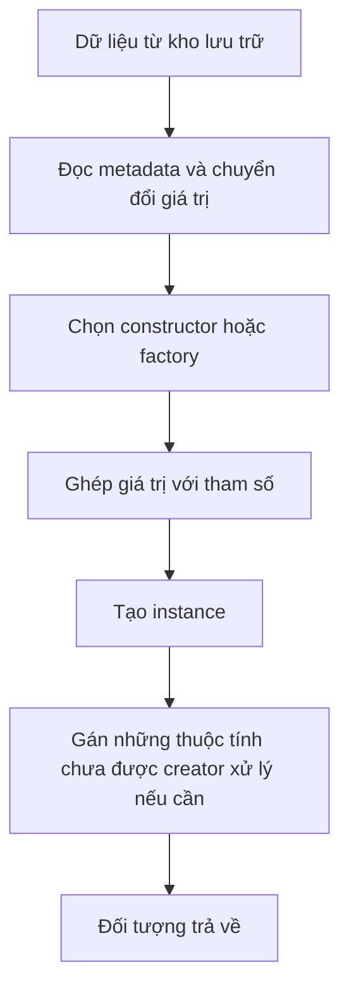

# @PersistenceCreator và xử lý nhiều constructor

Trong chương **Khởi tạo và gán thuộc tính** của Spring Data Commons, một câu hỏi quan trọng là: khi đọc dữ liệu đã lưu, framework phải dùng constructor nào để tạo lại đối tượng miền?

Một lớp có thể có constructor tiện dụng cho ứng dụng, constructor đầy đủ phục vụ tái tạo trạng thái và cả constructor không tham số. Java phân biệt chúng bằng chữ ký khi mã nguồn gọi trực tiếp. Bộ ánh xạ dữ liệu lại cần một quy tắc khác để lựa chọn điểm khởi tạo. `@PersistenceCreator` giúp công bố lựa chọn đó trong hạ tầng ánh xạ Spring Data có hỗ trợ cơ chế này.

Bài học tập trung vào Java, cách chọn constructor hoặc static factory và cách ghép giá trị dữ liệu với tham số. Spring Data Commons cung cấp abstraction dùng chung; việc tạo đối tượng thực tế còn phụ thuộc module kho dữ liệu. Đặc biệt, không được suy ra rằng annotation này sẽ thay thế quy tắc tạo entity của JPA provider.

## 1. Hai nhu cầu khác nhau: tạo mới và tái tạo

Giả sử ứng dụng quản lý một mặt hàng với các thuộc tính:

| Thuộc tính | Ý nghĩa |
| --- | --- |
| `id` | Định danh đã được lưu |
| `sku` | Mã mặt hàng |
| `price` | Giá hiện tại |
| `discontinued` | Mặt hàng đã ngừng kinh doanh hay chưa |

Khi tạo mới, ứng dụng có thể chỉ cần:

```java
new CatalogItem("BOOK-001", new BigDecimal("125000"));
```

Constructor tiện dụng đặt `id` là `null` và `discontinued` là `false`. Đó là một chính sách tạo mặt hàng mới.

Khi đọc lại một mặt hàng đã tồn tại, bộ ánh xạ phải giữ trạng thái từ kho dữ liệu, bao gồm `id` và giá trị `discontinued` đã lưu. Việc tái tạo không được tự coi đối tượng là một mặt hàng mới.

```text
Tạo mới trong ứng dụng:
    sku + price → đối tượng mới với các mặc định nghiệp vụ

Đọc lại từ kho dữ liệu:
    id + sku + price + discontinued → trạng thái đã tồn tại
```

Hai đường có thể chia sẻ một phần kiểm tra dữ liệu, nhưng không nhất thiết có cùng đầu vào hoặc cùng tác dụng phụ. Đây là lý do một lớp miền hợp lý vẫn có thể cần nhiều constructor.

## 2. Annotation xác định điểm khởi tạo

Annotation được dùng trong bài là:

```java
import org.springframework.data.annotation.PersistenceCreator;
```

Nó có thể đặt trên:

- Constructor được dùng để tái tạo đối tượng.
- Static factory method được chọn làm điểm khởi tạo.

Annotation không phải một lệnh gọi constructor. Nó là metadata cho hạ tầng có sử dụng cơ chế creator của Spring Data.

Khi ứng dụng tự viết:

```java
new CatalogItem("BOOK-001", price);
```

Java vẫn gọi constructor khớp với đối số trong biểu thức đó. `@PersistenceCreator` trên một constructor khác không làm Java chuyển hướng lời gọi `new`.

Tương tự, annotation không biến một đối tượng miền thành Spring bean, không yêu cầu container tự inject mọi tham số constructor và không tự tạo truy vấn cơ sở dữ liệu.

## 3. Quy tắc lựa chọn creator trong mô hình Java

Với cơ chế ánh xạ đối tượng của Spring Data Commons, có thể đọc thứ tự lựa chọn theo các bước sau:

1. Nếu có một static factory method được đánh dấu `@PersistenceCreator`, dùng factory đó.
2. Nếu lớp chỉ có một constructor, dùng constructor đó.
3. Nếu có nhiều constructor và đúng một constructor được đánh dấu `@PersistenceCreator`, dùng constructor được đánh dấu.
4. Nếu kiểu là Java record, dùng canonical constructor của record.
5. Nếu có constructor không tham số, dùng constructor đó; các constructor còn lại không được chọn ở nhánh này.

Các bước được xét theo thứ tự. Nhánh constructor không tham số không có nghĩa nó thắng một constructor đã được chọn rõ ở bước trước.

| Hình dạng lớp | Lựa chọn cần hiểu |
| --- | --- |
| Một constructor, không annotation | Constructor duy nhất có thể được dùng |
| Nhiều constructor, một constructor có `@PersistenceCreator` | Constructor được đánh dấu |
| Nhiều constructor, không đánh dấu, có constructor không tham số | Constructor không tham số là nhánh fallback |
| Java record có canonical constructor và constructor tiện dụng, không creator tùy biến | Canonical constructor theo nhánh record |
| Có một static factory được đánh dấu | Factory được chọn theo nhánh ưu tiên tương ứng |
| Nhiều constructor, không đánh dấu, không có đường lựa chọn phù hợp | Không nên trông chờ framework tự đoán ý định |

Đừng suy luận rằng framework sẽ chọn constructor dài nhất, constructor viết đầu tiên hoặc constructor có nhiều tham số khớp tên nhất. Những tiêu chí đó không thay thế quy tắc lựa chọn creator.

Bài này chỉ mô tả trường hợp Java. Kotlin có quy tắc liên quan đến primary constructor, tham số mặc định và các đặc điểm ngôn ngữ khác; không áp dụng nguyên xi bảng trên cho mọi lớp Kotlin.

## 4. Ví dụ đầy đủ với hai constructor

Ví dụ sau phù hợp để minh họa đường đọc của các module dùng cơ chế ánh xạ Spring Data, chẳng hạn Spring Data MongoDB hoặc Spring Data JDBC. Cấu hình repository, converter và kiểu lưu cụ thể vẫn phải phù hợp với module được chọn.

```java
package com.example.catalog;

import org.springframework.data.annotation.Id;
import org.springframework.data.annotation.PersistenceCreator;

import java.math.BigDecimal;
import java.util.Objects;

public final class CatalogItem {

    @Id
    private final String id;

    private final String sku;
    private final BigDecimal price;
    private final boolean discontinued;

    // Đường tạo mới trong mã ứng dụng.
    public CatalogItem(String sku, BigDecimal price) {
        this(null, sku, price, false);
    }

    // Đường tái tạo từ trạng thái đã lưu.
    @PersistenceCreator
    public CatalogItem(
            String id,
            String sku,
            BigDecimal price,
            boolean discontinued) {
        this.id = id;
        this.sku = Objects.requireNonNull(sku, "sku must not be null");
        this.price = Objects.requireNonNull(
                price, "price must not be null");
        this.discontinued = discontinued;
    }

    public String getId() {
        return id;
    }

    public String getSku() {
        return sku;
    }

    public BigDecimal getPrice() {
        return price;
    }

    public boolean isDiscontinued() {
        return discontinued;
    }
}
```

Constructor được đánh dấu nhận đủ các thuộc tính bất biến. Bộ ánh xạ không cần dùng constructor tạo mới rồi tìm cách sửa lại các thuộc tính `final` đã mang mặc định khác.

Giả sử sau bước đọc và chuyển đổi kiểu, dữ liệu logic có các giá trị:

```text
id           = "item-42"
sku          = "BOOK-001"
price        = 125000
discontinued = true
```

Đây là mô tả giá trị thuộc tính, không phải định dạng vật lý bắt buộc của MongoDB hay một bảng SQL.

Kết quả mong muốn tương đương về trạng thái với lời gọi:

```java
new CatalogItem(
        "item-42",
        "BOOK-001",
        new BigDecimal("125000"),
        true);
```

Trạng thái `discontinued = true` phải được giữ lại. Constructor hai tham số vẫn có ích cho tạo mới trong ứng dụng nhưng không phải creator đã được chọn để tái tạo từ dữ liệu.

Ví dụ này tập trung vào đường đọc. Việc gán ID phát sinh khi ghi một đối tượng bất biến còn có yêu cầu riêng về kiểu ID, phương thức tạo bản sao hoặc cơ chế cập nhật thuộc tính của module; annotation chọn creator không tự giải quyết toàn bộ yêu cầu ghi.

## 5. Tham số constructor phải liên hệ được với thuộc tính

Chọn đúng constructor mới chỉ giải quyết câu hỏi “gọi điểm khởi tạo nào”. Framework còn phải biết giá trị nào được truyền vào từng tham số.

Với constructor:

```java
@PersistenceCreator
public CatalogItem(
        String id,
        String sku,
        BigDecimal price,
        boolean discontinued) {
    // Gán trạng thái tương ứng.
}
```

các tên `id`, `sku`, `price` và `discontinued` biểu thị những thuộc tính miền cần lấy từ dữ liệu đã ánh xạ.

### 5.1. Giữ metadata tên tham số

Đối với constructor Java thông thường, nên cấu hình biên dịch để giữ tên tham số, chẳng hạn sử dụng tùy chọn `-parameters` trong cấu hình build phù hợp. Nếu bytecode chỉ cung cấp các tên như `arg0`, `arg1`, việc ghép tham số với thuộc tính có thể không thực hiện được như dự kiến.

`@ConstructorProperties` cũng là một cách khai báo metadata tên tham số cho constructor trong trường hợp phù hợp:

```java
import java.beans.ConstructorProperties;

@PersistenceCreator
@ConstructorProperties({"id", "sku", "price", "discontinued"})
public CatalogItem(
        String id,
        String sku,
        BigDecimal price,
        boolean discontinued) {
    this.id = id;
    this.sku = sku;
    this.price = price;
    this.discontinued = discontinued;
}
```

Đoạn trên minh họa metadata; trong lớp thực tế vẫn cần giữ những kiểm tra dữ liệu đã thiết kế. Danh sách tên trong `@ConstructorProperties` phải tương ứng đúng thứ tự tham số.

Không nên dựa vào việc mã chạy được trong IDE để kết luận bản build phát hành luôn có cùng metadata. Cấu hình compiler của môi trường kiểm tra và phát hành cần nhất quán.

### 5.2. Tên thuộc tính không nhất thiết là tên lưu vật lý

Giả sử thuộc tính Java là `price` nhưng được ánh xạ sang trường hoặc cột `unit_price` bằng annotation của module cụ thể. Constructor thường vẫn nhận tham số gắn với thuộc tính miền `price`; metadata mapping chịu trách nhiệm nối thuộc tính đó với biểu diễn trong kho dữ liệu.

Không tự đổi tham số thành `unit_price` chỉ vì tên cột hoặc trường lưu có dạng đó. Annotation mapping của MongoDB và JDBC cũng không được xem là một annotation dùng chung cho mọi module.

### 5.3. Kiểu dữ liệu phải chuyển đổi được

Metadata tên tham số đúng không giúp một giá trị bất kỳ tự chuyển thành kiểu mong muốn. Chẳng hạn, để truyền vào `BigDecimal price`, converter phải tạo được một giá trị tương thích với `BigDecimal` từ biểu diễn lưu.

Cần phân biệt ba nhóm vấn đề:

| Nhóm vấn đề | Ví dụ |
| --- | --- |
| Chọn creator | Có nhiều constructor nhưng chưa xác định đường tái tạo |
| Ghép tham số | Không biết tham số `arg0` tương ứng thuộc tính nào |
| Chuyển đổi giá trị | Không chuyển được giá trị lưu thành kiểu tham số |

Thêm `@PersistenceCreator` chỉ trực tiếp diễn đạt lựa chọn creator. Nó không tự sửa metadata tên tham số hoặc quy tắc chuyển đổi kiểu.

## 6. Dùng static factory làm creator

Đôi khi một factory có tên rõ ràng phù hợp hơn một constructor công khai. Với cùng lớp `CatalogItem`, có thể chuyển sang factory sau:

```java
@PersistenceCreator
public static CatalogItem restore(
        String id,
        String sku,
        BigDecimal price,
        boolean discontinued) {
    return new CatalogItem(id, sku, price, discontinued);
}
```

Đây là **phương án thay thế** cho việc đánh dấu constructor đầy đủ ở phần trước: bỏ `@PersistenceCreator` khỏi constructor khi chọn factory làm đường tái tạo. Giữ một đường lựa chọn rõ ràng sẽ dễ bảo trì hơn việc cùng lúc đánh dấu nhiều điểm.

Tên `restore` chỉ diễn đạt ý định cho người đọc. Annotation mới là phần công bố factory với hạ tầng persistence. Đặt tên một method là `restore` hoặc `fromDatabase` mà không có cơ chế nhận diện phù hợp không tự làm nó trở thành creator.

Một factory phục vụ tái tạo nên:

- Trả về đối tượng đúng kiểu cần ánh xạ.
- Nhận các tham số có metadata đủ để liên hệ với thuộc tính.
- Khôi phục dữ liệu cần thiết, không tự bỏ trạng thái lịch sử.
- Tránh truy cập mạng, gửi thông báo hoặc gọi ngược repository để hoàn thành một lần tạo đối tượng.

Factory là static, vì vậy không dựa vào việc framework phải tạo trước một instance của lớp để gọi nó. Annotation không biến một instance method bất kỳ thành factory tương đương.

Metadata tham số vẫn cần được bảo đảm khi dùng static factory. `@ConstructorProperties` áp dụng cho constructor, nên không phải cách thay thế trực tiếp để đặt lên factory method.

## 7. Khi có constructor không tham số

Xét một lớp mutable:

```java
public class Customer {

    private String id;
    private String name;

    public Customer() {
    }

    public Customer(String id, String name) {
        this.id = id;
        this.name = name;
    }

    public String getId() {
        return id;
    }

    public void setId(String id) {
        this.id = id;
    }

    public String getName() {
        return name;
    }

    public void setName(String name) {
        this.name = name;
    }
}
```

Trong nhánh lựa chọn Java đã mô tả, khi không có creator được chọn ở bước ưu tiên trước và có constructor không tham số, framework có thể dùng constructor không tham số rồi gán các thuộc tính còn lại theo cơ chế mapping.

Nếu muốn dùng constructor đầy đủ cho việc tái tạo, hãy công bố rõ lựa chọn:

```java
@PersistenceCreator
public Customer(String id, String name) {
    this.id = id;
    this.name = name;
}
```

Việc giữ constructor không tham số để phục vụ một công cụ khác không ngăn bạn chỉ định creator cho Spring Data. Tuy nhiên, phải hiểu công cụ nào đang tạo đối tượng ở từng đường chạy; các framework khác không tự dùng chung quy tắc này.

Một tác động thường gặp khi bảo trì là thêm constructor không tham số và vô tình thay đường lựa chọn trước đó. Một tác động khác là thêm constructor tiện dụng vào lớp từng chỉ có một constructor. Việc đánh dấu đường tái tạo có chủ đích giúp tránh phụ thuộc vào giả định “lớp hiện chỉ có một constructor”.

## 8. Java record và canonical constructor

Java record có một canonical constructor tương ứng với các record component:

```java
package com.example.catalog;

import org.springframework.data.annotation.Id;

import java.math.BigDecimal;

public record CatalogSnapshot(
        @Id String id,
        String sku,
        BigDecimal price,
        boolean discontinued) {

    public CatalogSnapshot(String sku, BigDecimal price) {
        this(null, sku, price, false);
    }
}
```

Nếu không có creator tùy biến được chọn ở bước ưu tiên trước, canonical constructor là đường khởi tạo của record theo quy tắc tương ứng. Constructor hai tham số không tự trở thành đường tái tạo chỉ vì ngắn hoặc tiện dụng hơn.

Không cần thêm `@PersistenceCreator` vào mọi record chỉ để nhắc lại điều đã được canonical constructor biểu đạt. Nếu có một nhu cầu creator đặc biệt, phải đánh giá đầy đủ tương tác với các constructor hoặc factory đã khai báo.

Ví dụ minh họa cơ chế lựa chọn, không cam kết rằng mọi module hoặc mọi kiểu mapping đều hỗ trợ record làm entity theo cùng cách. Với một DTO projection, việc sử dụng record cũng phải phù hợp với cơ chế tạo projection của module và loại truy vấn đang dùng.

## 9. Creator được chọn không có nghĩa việc ánh xạ đã hoàn tất

Quá trình đọc có thể được hình dung như sau:



Sơ đồ thể hiện các trách nhiệm logic; thứ tự triển khai chi tiết có thể khác theo module.

Nếu creator chỉ nhận `sku` và `price`, các thuộc tính như `id` hoặc `discontinued` vẫn phải được xử lý nếu chúng là một phần của mapping. Annotation không cho phép framework bỏ qua dữ liệu đó.

Với thuộc tính mutable, module có thể tiếp tục gán qua cơ chế property hoặc field access tương ứng. Với đối tượng bất biến, cần có đường tạo hoặc cập nhật trạng thái mà mapping infrastructure hỗ trợ. Một lớp có các field `final` nhưng không có creator đủ thông tin hay cơ chế tạo bản sao thích hợp có thể không được tái tạo đúng.

Đó là lý do constructor đầy đủ thường phù hợp với mô hình immutable: trạng thái cần thiết được truyền vào ngay từ đầu, thay vì yêu cầu bộ ánh xạ sửa một đối tượng đã tạo với mặc định khác.

## 10. Giới hạn với JPA và các framework khác

### 10.1. JPA entity không được tạo chỉ theo quy tắc annotation này

Spring Data JPA thường giao việc tạo và quản lý entity cho JPA provider. Yêu cầu constructor, quyền truy cập và proxy của entity phải tuân theo quy tắc JPA cùng khả năng cụ thể của provider.

Không nên viết một entity JPA chỉ có constructor đầy đủ, thêm `@PersistenceCreator`, rồi kết luận đã thay được yêu cầu constructor không tham số của mô hình entity JPA thông thường.

Ngược lại, một class-based DTO projection trong truy vấn Spring Data có thể sử dụng thông tin constructor để xác định cách tạo DTO. Đây là một đường tạo đối tượng khác với việc JPA provider materialize một entity; việc áp dụng còn phụ thuộc module và hình thức truy vấn.

### 10.2. Các annotation có tên gần nhau không thay thế lẫn nhau

| Annotation hoặc cơ chế | Phạm vi chính |
| --- | --- |
| `@PersistenceCreator` | Chọn creator trong cơ chế Spring Data có hỗ trợ |
| `@Autowired` | Chọn hoặc hỗ trợ dependency injection của Spring bean |
| `@JsonCreator` | Tạo đối tượng khi Jackson xử lý JSON |
| Constructor của JPA entity | Phải đáp ứng quy tắc của JPA và provider |

Một lớp có thể được nhiều framework sử dụng, nhưng mỗi framework cần cấu hình phù hợp. Đặt `@JsonCreator` không đồng nghĩa Spring Data đã nhận được chỉ dẫn chọn constructor, và `@PersistenceCreator` không tự cấu hình JSON deserialization.

Trong mã cũ có thể gặp `@PersistenceConstructor`. Khi viết thiết kế mới, dùng `@PersistenceCreator` để diễn đạt lựa chọn constructor hoặc factory; việc chuyển mã cũ vẫn cần phù hợp với phiên bản Spring Data đang sử dụng.

## 11. Dữ liệu thiếu, null và quy tắc nghiệp vụ

Khi dữ liệu lịch sử thiếu một thuộc tính mà constructor mới yêu cầu, annotation không tạo ra giá trị mặc định theo ý định nghiệp vụ.

Ví dụ, thêm `boolean discontinued` vào mô hình cần một quyết định rõ ràng về dữ liệu cũ:

- Kho dữ liệu đã có trường hoặc cột tương ứng hay chưa?
- Giá trị thiếu và giá trị null được converter của module biểu diễn thế nào?
- Kiểu primitive có nhận được giá trị hợp lệ để gọi creator không?
- Có cần migration dữ liệu hoặc một converter có chủ đích không?

Không dựa vào suy luận chung rằng “thiếu boolean thì mọi module đều truyền false”. Nếu dùng `Boolean` để biểu diễn trạng thái chưa biết, mô hình miền cũng phải định nghĩa cách xử lý trạng thái đó.

Tương tự, `Objects.requireNonNull(price)` trong ví dụ sẽ từ chối dữ liệu không có giá. Đây là một lựa chọn của mô hình, không phải lỗi có thể giải quyết bằng việc thêm annotation chọn creator.

Khi bổ sung kiểm tra bất biến trong constructor, cần đánh giá cả dữ liệu đã tồn tại. Một quy tắc mới dành cho tạo sản phẩm mới không nhất thiết được áp dụng nguyên trạng cho mọi dữ liệu lịch sử mà không có migration.

## 12. Tránh tác dụng phụ trong đường tái tạo

Creator có thể được gọi nhiều lần khi cùng một bản ghi được đọc lại ở các truy vấn hoặc các lần làm việc khác nhau. Không nên coi mỗi lần constructor chạy là một sự kiện tạo aggregate mới trong nghiệp vụ.

Các thao tác dễ gây sai khi đặt trong creator phục vụ đọc lại gồm:

- Sinh lại ID dù dữ liệu đã có ID.
- Gán thời điểm tạo bằng thời gian hiện tại.
- Đặt lại trạng thái như `discontinued` về mặc định tạo mới.
- Phát sự kiện “sản phẩm vừa được tạo” mỗi lần đọc dữ liệu.
- Gọi repository để tải thêm dữ liệu ngay trong constructor.

Nếu ứng dụng cần một đường tạo mới có sự kiện hoặc thời gian hiện tại, hãy biểu đạt bằng factory nghiệp vụ hoặc service rõ ràng. Đường `restore` có thể chỉ tái tạo trạng thái đã lưu và giữ các kiểm tra bất biến thực sự áp dụng cho trạng thái đó.

Điều này cũng giúp kiểm tra dễ hơn: cùng bộ giá trị đầu vào nên tái tạo cùng trạng thái có thể quan sát, thay vì phụ thuộc vào đồng hồ hoặc một dịch vụ bên ngoài.

## 13. Cách kiểm chứng khi tích hợp

Một lời gọi trực tiếp `new CatalogItem(...)` chỉ kiểm tra logic constructor. Nó không kiểm tra metadata của Spring Data, cách giữ tên tham số, converter hay quy tắc chọn creator.

Để kiểm chứng đầy đủ, dùng đường đọc thực tế của module đang dùng, thông qua repository hoặc mapping converter tương ứng.

| Tình huống | Điều cần quan sát |
| --- | --- |
| Đọc dữ liệu có ID và `discontinued = true` | Giữ đúng ID và trạng thái đã lưu |
| Lớp có thêm constructor tiện dụng | Creator đã chỉ định vẫn là đường được sử dụng |
| Dùng một static factory được đánh dấu | Factory được gọi và trả đúng trạng thái |
| Bản build có metadata tên tham số | Các tham số được ghép đúng với thuộc tính |
| Dữ liệu thiếu một thuộc tính bắt buộc | Kết quả hoặc lỗi phù hợp với chính sách đã định nghĩa |
| Dữ liệu cần chuyển đổi kiểu | Converter tạo được kiểu đầu vào của creator |
| Đối tượng bất biến có nhiều thuộc tính | Không cần đường gán thuộc tính trái với mô hình đã thiết kế |
| Class dùng cho DTO projection | Đường truy vấn thực tế tạo được đúng DTO |

Một bài kiểm tra quan trọng là dùng trạng thái khác mặc định tạo mới. Nếu mọi dữ liệu kiểm tra đều có `id = null` và `discontinued = false`, bạn có thể không phát hiện được việc đường tái tạo đang vô tình áp dụng mặc định của đối tượng mới.

Không cần phụ thuộc vào đúng tên exception cho mọi module. Hãy quan sát nguyên nhân: không chọn được creator, không biết tên tham số, không chuyển đổi được giá trị hay chính constructor từ chối trạng thái.

## 14. Những cấu hình cần tránh

### Đánh dấu nhiều constructor với cùng ý định tái tạo

`@PersistenceCreator` không phải cách để yêu cầu framework thử lần lượt các constructor đến khi một constructor chạy được. Hãy chọn một đường rõ ràng, thay vì đánh dấu mọi overload.

### Cho rằng annotation tự sửa tên tham số

Một constructor được chọn nhưng có metadata không đầy đủ vẫn có thể thất bại ở bước ghép dữ liệu. Giải quyết lựa chọn creator và metadata tên tham số như hai việc riêng.

### Thêm constructor không tham số để che lỗi mapping

Constructor không tham số có thể thay đổi đường khởi tạo và khiến vấn đề chuyển sang giai đoạn gán thuộc tính. Nó không tự làm một mô hình immutable trở thành mutable hoặc sửa các bất biến chưa được đáp ứng.

### Đặt dependency dịch vụ vào constructor persistence

Tham số của creator được dùng để nhận giá trị từ dữ liệu và metadata mapping tương ứng. Không thêm một `PricingService` rồi giả định Spring sẽ tự inject service vào từng đối tượng được materialize như khi tạo Spring bean.

### Dùng annotation thay cho migration dữ liệu

Nếu bản ghi cũ thiếu trạng thái bắt buộc, cần xử lý schema, dữ liệu hoặc converter theo module. Annotation chọn creator không bổ sung được thông tin chưa tồn tại.

## 15. Bài tập áp dụng

Một lớp `Subscription` có các thuộc tính `id`, `plan`, `startedAt` và `cancelled`. Ban đầu ứng dụng chỉ có constructor `(String plan)` để tạo gói mới; constructor đó gán thời điểm hiện tại và `cancelled = false`.

Sau khi bổ sung chức năng đọc lại dữ liệu, hãy trả lời:

1. Vì sao không nên dùng nguyên đường tạo mới để phục hồi một subscription đã bị hủy?
2. Constructor hoặc factory phục vụ persistence cần nhận những giá trị nào?
3. Nếu lớp có nhiều constructor, làm thế nào công bố lựa chọn creator?
4. Metadata nào cần có để ghép tham số Java với thuộc tính?
5. Nếu đây là entity JPA, cần kiểm tra quy tắc tạo entity của thành phần nào?

Hướng giải quyết là giữ một đường tạo mới rõ ràng, thêm một creator tái tạo đầy đủ trạng thái và đánh dấu khi cần. Giữ nguyên `startedAt` cùng `cancelled` từ dữ liệu, bảo đảm metadata tên tham số và kiểm tra qua module lưu trữ thực tế. Với entity JPA, phải đánh giá yêu cầu của JPA provider thay vì xem annotation Commons là sự thay thế cho cơ chế materialization của provider.

Khi thiết kế một lớp có nhiều constructor, hãy luôn phân biệt ba câu hỏi: **creator nào được chọn, dữ liệu nào đi vào từng tham số và trạng thái nào còn phải được gán sau khi tạo đối tượng**. `@PersistenceCreator` làm rõ câu hỏi đầu tiên; một mapping đáng tin cậy cần trả lời được cả ba.