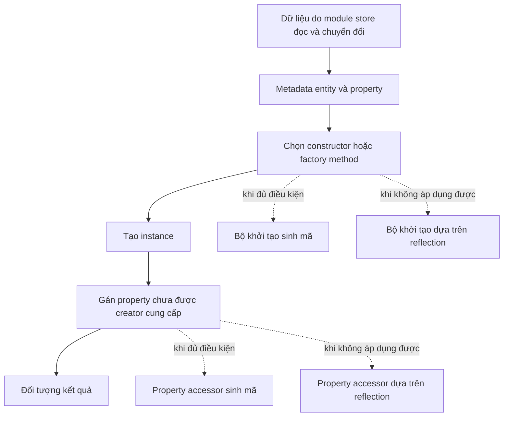

# Điều kiện dùng bộ khởi tạo/accessor sinh tự động và fallback reflection

Khi đọc dữ liệu từ một kho lưu trữ, hạ tầng mapping phải biến dữ liệu đó thành một đối tượng Java. Công việc này thường gồm hai phần: tạo instance qua constructor hoặc factory method, rồi gán những property chưa được cung cấp trong bước tạo đối tượng.

Spring Data Commons có hạ tầng hỗ trợ cả hai phần. Với những kiểu đáp ứng điều kiện, framework có thể sinh lớp hỗ trợ để giảm chi phí truy cập động. Nếu không áp dụng được cơ chế sinh mã, framework có thể dùng đường xử lý dựa trên reflection.

Hai cơ chế tối ưu này có điều kiện khác nhau. Không nên kết luận rằng một entity dùng constructor sinh tự động thì mọi property của nó cũng được truy cập bằng accessor sinh tự động, hoặc reflection fallback sẽ sửa được mọi mô hình đối tượng thiếu thông tin.

## 1. Hai bước materialization và hai điểm tối ưu

Materialization là quá trình tạo đối tượng từ dữ liệu đã đọc. Một mô hình khái quát:



Sơ đồ không quy định mọi store phải thực hiện đúng cùng một chuỗi. Nó mô tả hạ tầng object mapping của Commons và các module sử dụng hạ tầng đó.

| Thành phần | Trách nhiệm | Không có nghĩa là |
| --- | --- | --- |
| Entity instantiator | Gọi creator để tạo instance | Tự động chuyển mọi dữ liệu store thành tham số hợp lệ |
| Property accessor | Đọc, ghi hoặc thay thế instance khi cập nhật property | Mọi field đều có thể sửa, kể cả khi thiết kế không có đường cập nhật |
| Converter của module | Chuyển representation của store sang kiểu Java phù hợp và ngược lại | Đối tượng luôn được tạo bằng reflection |
| Metadata mapping | Mô tả creator, property và cách truy cập | Một ORM hoặc một persistence context hoàn chỉnh |

Trước khi tối ưu lời gọi constructor, framework vẫn cần biết constructor nào được chọn và tham số nào tương ứng với property nào. Trước khi tối ưu ghi property, nó vẫn cần biết property được cập nhật qua field, setter, wither hay cơ chế khác.

## 2. “Sinh tự động” diễn ra ở đâu?

Trong môi trường JVM thông thường, hạ tầng của Spring Data có thể tạo lớp hỗ trợ trong quá trình chạy ứng dụng. Lớp đó phục vụ một kiểu domain nhất định và được dùng lại cho việc mapping.

Một bộ khởi tạo sinh mã có ý tưởng tương tự:

```java
// Mã khái niệm, không phải API hoặc mã được framework sinh chính xác.
Object instantiate(Object[] arguments) {
    return new Customer(
            (Long) arguments[0],
            (String) arguments[1]);
}
```

Đường reflection có ý tưởng tương tự:

```java
// Mã khái niệm; bỏ qua xử lý truy cập và ngoại lệ.
Object instantiate(
        java.lang.reflect.Constructor<?> constructor,
        Object[] arguments) throws ReflectiveOperationException {

    return constructor.newInstance(arguments);
}
```

Cả hai đều phải truyền đúng kiểu và đúng giá trị theo metadata. Chúng khác cách thực hiện lời gọi, không khác hợp đồng nghiệp vụ của constructor.

Lớp hỗ trợ sinh mã không phải:

- Mã nguồn Java bắt buộc xuất hiện trong thư mục dự án.
- Entity class mới thay thế kiểu domain của ứng dụng.
- Proxy repository được dùng để ghép CRUD, derived query và fragment.
- Mã do Lombok sinh lúc biên dịch.
- Bằng chứng mọi lần truy cập field đều là một phép gán trực tiếp.

Đặc biệt, một property accessor sinh mã có thể sử dụng method handle cho những field không thể truy cập trực tiếp. “Không dùng đường reflection accessor” không có nghĩa “không còn bất kỳ cơ chế truy cập động nào”.

## 3. Chọn đúng creator trước khi xét tối ưu

Creator là constructor hoặc factory method mà mapping dùng để tạo đối tượng.

Các trường hợp thường gặp:

| Thiết kế kiểu Java | Điều cần làm rõ |
| --- | --- |
| Có một constructor phù hợp duy nhất | Framework có thể xác định creator theo quy tắc của module và Commons |
| Có nhiều constructor | Cần tránh nhập nhằng; có thể chỉ định creator bằng `@PersistenceCreator` |
| Có static factory dành cho đọc dữ liệu | Có thể dùng `@PersistenceCreator` nếu tích hợp hỗ trợ |
| Có constructor không tham số | Có thể đi theo đường tạo rỗng rồi population theo quy tắc chọn creator |
| Java record | Canonical constructor là điểm tạo đối tượng quan trọng trong tích hợp có hỗ trợ |
| Kotlin data class | Có quy tắc riêng về primary constructor, giá trị mặc định và materialization |

Không nên dùng bảng này như một thứ tự ưu tiên đầy đủ cho mọi ngôn ngữ hoặc mọi phiên bản. Điểm cần giữ là creator phải được xác định hợp lệ trước khi framework chọn chiến lược gọi nhanh hay reflection.

### Ví dụ chỉ định persistence constructor

```java
package com.example.customer;

import java.util.Objects;
import org.springframework.data.annotation.Id;
import org.springframework.data.annotation.PersistenceCreator;

public final class Customer {

    @Id
    private final Long id;

    private final String email;

    @PersistenceCreator
    public Customer(Long id, String email) {
        this.id = id;
        this.email = Objects.requireNonNull(email);
    }

    public Customer(String email) {
        this(null, email);
    }

    public Long getId() {
        return id;
    }

    public String getEmail() {
        return email;
    }

    public Customer withId(Long id) {
        return new Customer(id, email);
    }
}
```

Ví dụ dùng annotation định danh của Commons cho một module có hỗ trợ nó. Đây không phải một entity JPA hoàn chỉnh.

Constructor hai tham số là đường khôi phục trạng thái persistent. Constructor một tham số là tiện ích tạo đối tượng mới trong ứng dụng. `@PersistenceCreator` giúp phân biệt ý định.

Các tham số `id` và `email` phải được liên hệ đúng với persistent property. Với Java, cần giữ metadata tên tham số theo cách framework hỗ trợ, thường bằng tùy chọn biên dịch `-parameters`; `@ConstructorProperties` cũng là một cách mô tả tên tham số trong những trường hợp được hỗ trợ.

Tên tham số là tên property của mô hình Java. Không tự đổi nó thành tên cột hoặc tên field vật lý chỉ vì store dùng representation khác.

Nếu framework không biết tên tham số, việc constructor là `public` vẫn chưa đủ để materialization thành công. Chuyển từ bộ khởi tạo sinh mã sang reflection cũng không tạo ra metadata tên đã bị thiếu.

### Validation vẫn chạy trong creator

Trong ví dụ, `Objects.requireNonNull(email)` được thực thi khi đối tượng được khôi phục. Dữ liệu cũ có email null có thể làm quá trình đọc thất bại dù đọc từ store thành công.

Đường sinh mã và reflection đều không nên được xem là cách bỏ qua quy tắc đó. Khi thiết kế creator, cần tính đến cả dữ liệu mới lẫn dữ liệu đã tồn tại.

## 4. Điều kiện cho bộ khởi tạo sinh mã

Đối với cơ chế khởi tạo sinh mã thông thường của Commons, các giới hạn quan trọng gồm:

| Điều kiện | Lý do liên quan |
| --- | --- |
| Kiểu domain không phải class `private` | Lớp hỗ trợ cần có đường truy cập hợp lệ đến kiểu |
| Không phải inner class không `static` | Inner class này còn cần tham chiếu đến instance bao ngoài |
| Không phải class proxy CGLIB | Kiểu proxy không phải hình dạng domain thông thường mà cơ chế tối ưu hướng đến |
| Constructor được dùng không phải `private` | Lớp sinh mã cần gọi được constructor theo cơ chế hỗ trợ |
| Creator hợp lệ và kiểu có thể được khởi tạo | Sinh mã không làm interface hoặc kiểu không thể tạo instance trở thành đối tượng hợp lệ |
| Runtime cho phép cơ chế sinh và nạp lớp tương ứng | Quyền truy cập và class loading vẫn phải hợp lệ |

Nếu dùng static factory method, khả năng áp dụng đường sinh mã cũng phụ thuộc metadata creator và khả năng truy cập method đó. Một factory `public static` là thiết kế dễ diễn đạt; không mặc định rằng method `private` sẽ được gọi bằng mã trực tiếp.

Các điều kiện về quyền truy cập phải được hiểu cùng package, kiểu bao ngoài, class loader và module. Một nested class có modifier phù hợp nhưng nằm sau một kiểu bao ngoài không truy cập được vẫn có thể gặp giới hạn.

### Mẫu khó tối ưu: inner class không static

```java
public class CustomerContainer {

    public class CustomerRow {

        private final Long id;

        public CustomerRow(Long id) {
            this.id = id;
        }
    }
}
```

`CustomerRow` gắn với một instance `CustomerContainer`. Constructor ở mức JVM còn mang thông tin về instance bao ngoài, nên đây không phải một dạng domain model thuận lợi cho materialization thông thường.

Nếu không có nhu cầu gắn lifecycle với đối tượng bao ngoài, hãy dùng một top-level class hoặc nested class `static`:

```java
public class CustomerContainer {

    public static class CustomerRow {

        private final Long id;

        public CustomerRow(Long id) {
            this.id = id;
        }

        public Long getId() {
            return id;
        }
    }
}
```

Đổi sang `static` giải quyết phụ thuộc instance bao ngoài. Nó chưa tự bảo đảm mọi điều kiện khác về metadata, creator và runtime đều đạt.

### Public là lựa chọn đơn giản, nhưng hai tối ưu có điều kiện khác nhau

Điều kiện của instantiator không đồng nhất với điều kiện của property accessor. Chẳng hạn, “constructor không private” là yêu cầu khác với “kiểu và constructor public” trong điều kiện sinh property accessor được trình bày ở phần tiếp theo.

Không nên suy ngược rằng mọi class không `public` đều không thể dùng bộ khởi tạo sinh mã, hoặc chỉ cần constructor `public` là accessor chắc chắn được sinh.

## 5. Điều kiện cho property accessor sinh mã

Property accessor sinh mã có tập giới hạn riêng, thường chặt hơn về khả năng truy cập và nơi khai báo kiểu.

| Điều kiện của cơ chế accessor sinh mã thông thường | Hướng thiết kế thuận lợi |
| --- | --- |
| Kiểu không nằm trong default package | Khai báo package có tên rõ ràng |
| Kiểu không nằm trong package `java.*` | Dùng package của ứng dụng |
| Kiểu và constructor đáp ứng yêu cầu `public` | Dùng domain type và constructor public khi phù hợp |
| Nested type là `static` | Tránh phụ thuộc instance bao ngoài |
| Runtime cho phép khai báo lớp trong class loader phù hợp | Kiểm tra giới hạn loader, module và môi trường triển khai |

Đây là các điều kiện để đủ tư cách áp dụng cơ chế tối ưu, không phải một cam kết rằng ứng dụng sẽ luôn chọn nó. Module, phiên bản framework, factory accessor được cấu hình và môi trường chạy còn có thể ảnh hưởng quyết định.

Nếu framework phát hiện giới hạn, nó có thể sử dụng property accessor dựa trên reflection. Cần phân biệt “framework đã chọn fallback hỗ trợ được kiểu này” với “mọi hạn chế truy cập của JVM đã được bỏ qua”.

### Vì sao private field không tự loại bỏ accessor sinh mã?

Một domain class thông thường có field `private`. Điều đó không mâu thuẫn với khả năng dùng accessor sinh mã.

Framework có thể kết hợp:

- Lời gọi method trực tiếp khi có method truy cập phù hợp.
- Method handle cho field cần truy cập theo cơ chế hỗ trợ.
- Lời gọi wither để nhận một instance mới.
- Cơ chế khác theo metadata và accessor implementation.

Do đó, mở mọi field thành `public` không phải điều kiện bắt buộc hay một khuyến nghị thiết kế chỉ để có tối ưu.

Ngược lại, một class `private` hoặc một cấu trúc class loader không tương thích có thể là giới hạn ở cấp kiểu, dù một số method bên trong được khai báo `public`.

## 6. Access strategy quyết định hành vi, sinh mã quyết định cách thực hiện

Trong các module dùng property population của Commons, cách cập nhật property phụ thuộc metadata access strategy và tính mutable của mô hình.

Một cách nhìn khái quát:

| Thiết kế property | Đường cập nhật có thể được dùng |
| --- | --- |
| Mutable field, field access | Ghi field bằng cơ chế accessor phù hợp |
| Property access | Gọi setter tương ứng |
| Immutable property có wither được nhận diện | Gọi wither và thay instance hiện tại |
| Property được cung cấp qua creator | Không cần gán lại chỉ vì có một field tương ứng |
| Immutable property không có đường cập nhật trực tiếp | Có thể cần dựng lại qua creator nếu hạ tầng hỗ trợ và metadata đầy đủ |

Fallback reflection phải làm việc trong cùng mô hình mapping được hỗ trợ. Không nên nghĩ rằng nó mặc nhiên thay setter bằng gán field, hoặc được quyền phá vỡ hợp đồng immutable của kiểu.

### Property access và setter

```java
package com.example.delivery;

import java.util.Objects;
import org.springframework.data.annotation.AccessType;
import org.springframework.data.annotation.Id;

public class Delivery {

    @Id
    private Long id;

    @AccessType(AccessType.Type.PROPERTY)
    private String status;

    public Delivery(Long id) {
        this.id = id;
    }

    public Long getId() {
        return id;
    }

    public String getStatus() {
        return status;
    }

    public void setStatus(String status) {
        this.status = Objects.requireNonNull(status);
    }
}
```

Trong module áp dụng metadata này, `id` được cung cấp qua constructor; `status` là property còn lại có thể được population qua setter theo property access.

Nếu `status` cũng đã được creator nhận và gán, không nên mặc định setter sẽ tiếp tục được gọi chỉ để “đi qua validation”. Hãy đặt invariant tại đường khởi tạo và thay đổi thực sự mà thiết kế cho phép.

Setter phục vụ materialization cũng không nên gửi email, xuất domain event hoặc gọi dịch vụ bên ngoài. Một lần đọc dữ liệu không nên vô tình thực hiện lại các tác vụ nghiệp vụ của lần tạo ban đầu.

## 7. Immutable entity, wither và việc instance có thể thay đổi

Đối tượng immutable không có nghĩa framework không thể cung cấp giá trị mới. Thay vì sửa instance cũ, wither tạo một instance mới với một property được thay thế.

Ví dụ `Customer.withId(...)` ở phần trước:

```java
public Customer withId(Long id) {
    return new Customer(id, email);
}
```

Giả sử một module hỗ trợ đường cập nhật này và cần gán identifier sau khi lưu:

```text
Customer A: id = null, email = "an@example.com"
    ↓ withId(42L)
Customer B: id = 42L, email = "an@example.com"
```

A và B có thể là hai instance khác nhau. Accessor cần theo dõi instance hiện tại để các thao tác tiếp theo dùng đúng đối tượng.

### Khi làm việc trực tiếp với abstraction accessor

Đoạn sau minh họa ý nghĩa của `getBean()`. Nó không phải yêu cầu ứng dụng phải tự gán identifier thay cho repository.

```java
import org.springframework.data.mapping.PersistentEntity;
import org.springframework.data.mapping.PersistentProperty;
import org.springframework.data.mapping.PersistentPropertyAccessor;

public final class PropertyUpdateExample {

    private PropertyUpdateExample() {
    }

    public static <T> T assignIdentifier(
            PersistentEntity<T, ?> entity,
            T bean,
            Object identifier) {

        PersistentProperty<?> idProperty = entity.getRequiredIdProperty();

        PersistentPropertyAccessor<T> accessor =
                entity.getPropertyAccessor(bean);

        accessor.setProperty(idProperty, identifier);

        return accessor.getBean();
    }
}
```

Nếu accessor dùng wither hoặc một đường tái tạo instance được hỗ trợ, giá trị trả về từ `getBean()` mới phản ánh đối tượng hiện tại.

Ở mức repository, cũng nên sử dụng đối tượng trả về từ `save` khi cần tiếp tục làm việc với kết quả. Không dựa vào giả định rằng instance truyền vào luôn bị sửa tại chỗ.

### Constructor đầy đủ giảm nhu cầu population

Với immutable model, một creator nhận đủ trạng thái persistent thường làm đường materialization rõ ràng hơn. Hạ tầng không cần tìm cách gán lại các final property đã được creator cung cấp.

Điều này đặc biệt quan trọng với property dẫn xuất. Nếu một field vừa được coi là persistent, vừa chỉ được tính bên trong constructor mà không có tham số hoặc đường cập nhật phù hợp, dữ liệu đọc từ store có thể không có chỗ để gán.

Cần quyết định property đó là:

- Trạng thái thực sự được lưu và phải khôi phục.
- Giá trị dẫn xuất được tính từ trạng thái khác.
- Property bị loại khỏi mapping theo cơ chế của module.

Không dùng reflection fallback làm cách trì hoãn quyết định mô hình này.

## 8. Hai lựa chọn tối ưu có thể độc lập

Một ứng dụng có thể gặp các tổ hợp sau:

| Khởi tạo | Truy cập property | Cách hiểu |
| --- | --- | --- |
| Sinh mã | Sinh mã | Cả hai cơ chế đủ điều kiện và được lựa chọn |
| Sinh mã | Reflection | Kiểu có thể đủ điều kiện gọi creator nhanh nhưng không đạt điều kiện accessor |
| Reflection | Sinh mã hoặc cơ chế accessor khác được hỗ trợ | Quyết định gọi creator và quyết định accessor không phải một lựa chọn duy nhất |
| Reflection | Reflection | Mô hình vẫn có thể hoạt động đúng nếu reflection được hỗ trợ và metadata hợp lệ |
| Không thể tạo instance hoặc cập nhật property | Không áp dụng | Đây là lỗi mapping hoặc truy cập thực sự, không phải một chế độ tối ưu khác |

Bảng mô tả sự tách biệt về trách nhiệm. Nó không khẳng định mọi tổ hợp đều xuất hiện với mọi class hoặc mọi factory trong mọi phiên bản.

Quan sát một property được gán thành công không đủ để biết instantiator nào đã được sử dụng. Tương tự, thấy constructor được gọi không cho biết lời gọi đi qua bytecode sinh ra hay reflection.

Ứng dụng thường không cần phụ thuộc vào class nội bộ cụ thể. Khi điều tra hiệu năng, nên quan sát cấu hình, stack hoặc công cụ profiling trong đúng môi trường đang chạy thay vì suy đoán từ modifier của một field.

## 9. Reflection fallback giải quyết gì và không giải quyết gì?

### Những trường hợp fallback có thể hỗ trợ

Khi cơ chế sinh mã không áp dụng được nhưng framework có thể truy cập creator và property bằng reflection hợp lệ, fallback cho phép mô hình tiếp tục được đọc và ghi.

Các tình huống có thể liên quan đến:

- Creator hoặc kiểu không đáp ứng điều kiện tối ưu.
- Giới hạn tạo hoặc nạp lớp hỗ trợ.
- Hình dạng domain model mà accessor factory mặc định không tối ưu được.
- Cấu hình sử dụng chiến lược reflection phù hợp với môi trường.

Fallback như vậy là một đường thực thi được framework hỗ trợ. Nó không tự đồng nghĩa với dữ liệu sai hoặc một lỗi cần sửa gấp.

### Những việc fallback không thể hứa hẹn

| Vấn đề | Vì sao reflection chưa giải quyết được |
| --- | --- |
| Không xác định được creator | Thiếu quyết định mapping trước cả bước gọi |
| Thiếu tên hoặc binding của tham số | Reflection không tự suy ra đúng ngữ nghĩa dữ liệu |
| Giá trị không chuyển được sang kiểu tham số | Cần converter hoặc dữ liệu phù hợp |
| Constructor ném ngoại lệ vì invariant | Đường gọi khác không loại bỏ validation |
| Interface hoặc abstract type không có cách materialize hợp lệ | Cần kiểu cụ thể hoặc chiến lược được hỗ trợ |
| Final property không có đường khôi phục trạng thái | Cần creator, wither hoặc thiết kế immutable phù hợp |
| Module JVM không cho truy cập member | Reflection cũng chịu kiểm tra và giới hạn của runtime |
| Class phụ thuộc instance bao ngoài | Vẫn thiếu một phần của mô hình khởi tạo |

Không thiết kế dựa trên giả định “reflection sửa được mọi field final”. Hành vi chỉnh sửa final field có nhiều giới hạn và không thay thế các cơ chế immutable mapping được framework hỗ trợ.

Nếu gặp lỗi truy cập module, cần xác định đúng package, module và tích hợp đang bị ảnh hưởng. Không thêm tùy chọn mở toàn bộ package một cách rộng rãi chỉ vì thấy từ “reflection” trong stack trace.

## 10. JVM, module, class loader và native image

### Class loader và quyền truy cập

Lớp hỗ trợ cần được định nghĩa và liên kết trong một ngữ cảnh có thể truy cập kiểu domain. Các môi trường có class loader riêng hoặc ranh giới module chặt có thể khác môi trường chạy trực tiếp trên classpath.

Hai package có cùng tên không tự bảo đảm cùng quyền truy cập nếu lớp nằm trong các ngữ cảnh class loading không tương thích.

Vì vậy, điều kiện “class public” là một phần cần xem xét, không phải lời giải đầy đủ cho mọi lỗi nạp lớp.

### Java module system

Hệ module có thể giới hạn truy cập sâu và việc tạo liên kết đến member. Một cơ chế tối ưu hoặc reflection hoạt động trên classpath chưa chắc hoạt động nguyên trạng trong một ứng dụng module hóa.

Cần dùng cấu hình và khả năng hỗ trợ của phiên bản framework đang triển khai. Chỉ điều chỉnh quyền truy cập sau khi đã xác định đúng nhu cầu.

### AOT và native image

Native image không có cùng điều kiện sinh mã động như một JVM thông thường. Framework và module có thể dùng chiến lược AOT, generated artifacts hoặc metadata truy cập được chuẩn bị trước.

Không nên giả định một trong hai điều sau:

- Runtime sẽ luôn sinh được lớp hỗ trợ giống khi chạy JVM.
- Chỉ cần fallback reflection là mọi kiểu domain tự hoạt động trong native image.

Môi trường native còn cần metadata và hỗ trợ tích hợp tương ứng. Khi triển khai, phải kiểm tra đường materialization trong chính loại artifact sẽ chạy.

## 11. Ranh giới áp dụng theo module lưu trữ

Hạ tầng khởi tạo và accessor của Commons đặc biệt có ý nghĩa với các module dùng mapping engine dựa trên các abstraction này. Tuy nhiên, mỗi module có thể cung cấp converter, entity instantiator hoặc property accessor riêng.

### JPA không tự chuyển quyền tạo entity cho Commons

Trong Spring Data JPA, JPA provider quản lý việc materialize entity, access strategy, persistence context và nhiều dạng proxy hoặc enhancement.

Các điều kiện tối ưu của instantiator Commons không thay thế các quy tắc entity của JPA. Ví dụ:

- `@PersistenceCreator` không tự thay constructor requirements của JPA.
- `@AccessType` của Commons không phải `jakarta.persistence.Access`.
- Khả năng dùng immutable model ở một module document không bảo đảm cùng kiểu đó phù hợp làm entity JPA.
- Một proxy do ORM tạo không phải lý do để sửa domain theo điều kiện CGLIB của một instantiator Commons chưa chắc đang được dùng.

Cần xác định ai đang thực sự tạo instance trước khi áp dụng hướng tối ưu.

### DTO projection là một ngữ cảnh khác

Một query trả về DTO có thể đi qua cơ chế constructor expression, converter hoặc projection của module. Không nên thấy DTO có constructor public rồi kết luận hạ tầng entity accessor của Commons chắc chắn đang sử dụng nó.

Khi phân tích, luôn ghi rõ đang nói đến domain entity, DTO, interface projection hay đối tượng kết quả đặc thù của store.

## 12. Thiết kế thuận lợi mà vẫn giữ đúng mô hình domain

Các lựa chọn thường giúp materialization rõ ràng:

1. Đặt kiểu persistent trong package có tên.
2. Ưu tiên top-level class hoặc nested class `static`.
3. Dùng creator dễ xác định; chỉ định `@PersistenceCreator` khi cần phân biệt ý định.
4. Giữ metadata tham số để liên hệ creator với persistent property.
5. Cung cấp một đường khôi phục đầy đủ trạng thái của immutable model.
6. Dùng wither đúng quy ước nếu module hỗ trợ và cần cập nhật một property bằng cách tạo bản sao.
7. Tách side effect nghiệp vụ khỏi constructor hoặc setter được gọi khi đọc dữ liệu.
8. Tuân thủ mapping và lifecycle của module thực sự dùng để lưu đối tượng.

Đây là hướng thiết kế, không phải yêu cầu mở toàn bộ API thành mutable. Một final field có ý nghĩa vẫn có thể được cung cấp qua constructor. Một constructor không public có thể là lựa chọn domain có chủ đích, chấp nhận đường thực thi khác nếu tích hợp hỗ trợ.

Quyết định điều chỉnh modifier chỉ để tối ưu nên dựa trên nhu cầu thực tế. Giữ invariant của domain quan trọng hơn việc đạt một đường truy cập nhanh mà chưa có bằng chứng là nút thắt.

## 13. Chẩn đoán và đánh giá hiệu năng

| Dấu hiệu | Điều cần phân biệt | Hướng kiểm tra |
| --- | --- | --- |
| Lỗi khi chọn constructor | Creator không hợp lệ hay lời gọi creator bị lỗi? | Xem danh sách constructor/factory và metadata chỉ định |
| Không tìm được tên tham số | Vấn đề binding, không nhất thiết là quyền truy cập | Kiểm tra cấu hình biên dịch và metadata tham số |
| Lỗi invocation hoặc mapping instantiation | Constructor có được gọi và ném lỗi không? | Xem ngoại lệ gốc và dữ liệu đầu vào |
| Không gán được immutable property | Có wither hoặc creator đầy đủ không? | Kiểm tra thiết kế property và khả năng module |
| Lỗi truy cập member | Do modifier hay ranh giới module/loader? | Xác định kiểu, member và runtime cụ thể |
| Setter không được gọi | Property đã được creator cung cấp hay dùng field access? | Kiểm tra access metadata và population path |
| Có đối tượng kết quả mới sau cập nhật | Accessor có dùng wither/copy không? | Sử dụng instance hiện tại hoặc giá trị trả về |
| Mapping đúng nhưng chậm | Chi phí nằm ở materialization hay ở truy vấn/network? | Đo trong luồng đọc thực tế |

Không nên suy ra mức tăng tốc cố định cho ứng dụng từ việc framework có code generation. Tổng thời gian có thể chủ yếu nằm ở I/O, conversion, số object, truy vấn hoặc xử lý nghiệp vụ.

Một phép đo có ý nghĩa cần:

- So sánh cùng dữ liệu và cùng kết quả mapping.
- Tách chi phí khởi tạo metadata ban đầu khỏi chi phí ổn định sau warm-up.
- Dùng đúng JVM hoặc artifact triển khai.
- Quan sát cả CPU, allocation và tổng thời gian của use case.
- Giữ đường correctness trước khi so sánh các lựa chọn tối ưu.

Không dùng một vòng lặp `new Customer(...)` đơn lẻ để kết luận hiệu năng của toàn bộ repository. Nó bỏ qua binding tham số, conversion, property population và chi phí store.

## 14. Bài thực hành củng cố

Trong một module dùng mapping của Commons, chuẩn bị một kiểu domain đơn giản và giải thích các biến thể sau trước khi chạy ứng dụng:

1. Kiểu `public`, constructor public nhận đủ property và giữ tên tham số: điều kiện nào đã thuận lợi cho instantiator và accessor?
2. Giữ creator nhưng chuyển kiểu vào default package: vì sao đây là vấn đề riêng cần xem xét với accessor sinh mã?
3. Đổi nested type từ `static` sang không static: constructor còn phụ thuộc đối tượng nào?
4. Thêm constructor thứ hai: làm sao xác định persistence creator mà không dựa vào thứ tự khai báo?
5. Đổi ID thành final và bổ sung `withId`: vì sao phải sử dụng instance trả về?
6. Chuyển một property từ setter access sang field access: side effect nào trong setter sẽ không còn là giả định hợp lệ?
7. Bỏ metadata tên tham số: vì sao fallback reflection không tự khôi phục binding?
8. Đem cùng class sang JPA: điều kiện nào phải được đánh giá lại theo ORM?

Tiêu chí giải thích là chỉ ra được ba lớp quyết định: metadata chọn hành vi mapping, chiến lược instantiator/accessor chọn cách thực thi, và runtime cùng module quyết định khả năng áp dụng.

Nhờ phân biệt ba lớp đó, có thể thiết kế đối tượng dễ khôi phục, hiểu đúng fallback reflection và tối ưu materialization khi có bằng chứng cần thiết.
