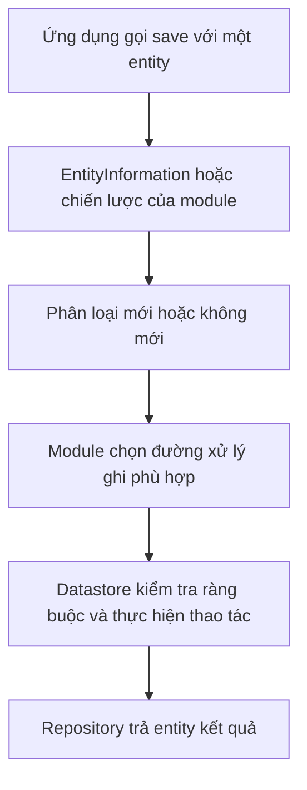

# Phân biệt entity mới với entity đã được lưu

## 1. Hai câu hỏi dễ bị nhầm

Trước khi lưu một entity, Spring Data cần biết nên xem đối tượng đó là **mới** hay **không còn mới**. Quyết định này được gọi là *entity state detection*, thường được biểu diễn bằng câu hỏi `isNew(entity)`.

Tuy nhiên, có hai câu hỏi khác nhau:

1. **Theo trạng thái và metadata hiện tại, framework xem entity là mới hay không?**
2. **Tại thời điểm này, datastore có thực sự chứa bản ghi tương ứng không?**

Câu thứ nhất thường được trả lời bằng ID, version hoặc một chiến lược do entity/module cung cấp. Câu thứ hai liên quan đến trạng thái thật trong datastore và có thể cần một thao tác đọc.

Một entity có ID không tự chứng minh bản ghi đã tồn tại. Một entity được đọc trước đó cũng không chứng minh bản ghi vẫn tồn tại sau khi giao dịch khác xóa nó.

Trong **SPRING_DATA_COMMONS**, phân biệt này giúp hiểu đúng abstraction repository, luồng `save`, metadata của domain và giới hạn của các quy tắc dùng chung. Các module lưu trữ áp dụng kết quả phân loại theo cách riêng; không có quy tắc rằng mọi `save` đều là cùng một loại lệnh ghi.

## 2. “Mới” là trạng thái đối với persistence

### 2.1. Object mới của Java chưa chắc là entity mới theo framework

Lệnh `new` chỉ tạo một instance Java:

```java
Customer customer = new Customer(101L, "an@example.com");
```

Nếu chiến lược đang dùng chỉ kiểm tra ID và coi ID non-null là không mới, object trên bị phân loại là không mới ngay từ đầu. Điều đó đúng với quy tắc phân loại dù ứng dụng chưa từng lưu object này.

Ngược lại, hai object Java khác nhau có thể cùng biểu diễn một entity lưu trữ:

```text
C1: id = 101L, email = "an@example.com"
C2: id = 101L, email = "an.new@example.com"
```

Chúng có thể là hai snapshot của cùng một khách hàng. So sánh tham chiếu `C1 == C2` không giúp xác định nên insert hay update.

### 2.2. Entity được phân loại là không mới chưa chắc đang tồn tại

Một object có thể mang ID vì:

- Nó được đọc từ datastore.
- Nó là kết quả của một lần lưu trước đó.
- Ứng dụng tự cấp ID trước khi lưu.
- Client gửi ID trong request.
- Một builder hoặc mapper gán ID khi dựng object.

Những nguồn này không có cùng mức bảo đảm về sự tồn tại của bản ghi. State detection dựa metadata không tự phân biệt toàn bộ lịch sử đó.

### 2.3. Dùng từ “đã lưu” có điều kiện

Ở tầng ứng dụng, có thể biết entity đã được lưu vì đã nhận kết quả của thao tác lưu thành công trong một giao dịch đã commit. Ở tầng state detection, “không mới” thường chỉ là kết quả của một quy tắc kiểm tra trạng thái.

Trong bài này:

- **Mới:** chiến lược hiện tại trả kết quả mới.
- **Không mới:** chiến lược hiện tại trả kết quả không mới.
- **Đã được lưu:** có thông tin về một thao tác lưu hoặc một lần đọc thực tế, không chỉ suy từ giá trị ID.

Sự phân biệt này giúp tránh viết code coi `isNew() == false` như một phép kiểm tra tồn tại hoặc một xác nhận giao dịch đã hoàn tất.

## 3. State detection nằm ở đâu trong luồng repository?

Một mô hình khái quát:



Trong hạ tầng repository, abstraction `EntityInformation` có thao tác xác định entity mới. Metadata persistent entity và các strategy liên quan có thể tham gia thực hiện quyết định đó. Cách tạo hoặc tùy chỉnh những thành phần này phụ thuộc module.

Repository ứng dụng kế thừa `CrudRepository` không vì thế có một phương thức công khai `isNew(entity)`. Đây thường là trách nhiệm của hạ tầng bên dưới, không phải một query mà bạn gọi qua mọi repository.

Điểm quan trọng là bước phân loại có thể chỉ đọc trạng thái object trong bộ nhớ. Không nên hình dung mọi lần gọi `save` đều bắt đầu bằng `existsById` rồi mới lựa chọn thao tác ghi.

Điều này cũng không khẳng định toàn bộ `save` tuyệt đối không đọc database. Module, provider hoặc thao tác ghi cụ thể có thể thực hiện thêm công việc; chỉ riêng quyết định `isNew` không đồng nghĩa với một truy vấn tồn tại.

## 4. Chiến lược cơ bản: kiểm tra identifier

### 4.1. Quy tắc khi không có version hoặc chiến lược thay thế

Với chiến lược kiểm tra ID thông thường, một entity được coi là mới khi:

- Identifier kiểu tham chiếu có giá trị `null`.
- Identifier kiểu số primitive có giá trị `0`.

Khi giá trị khác điều kiện trên, entity được coi là không mới.

Bảng sau giả định module áp dụng quy tắc ID này, entity không có version được ưu tiên và không dùng `Persistable` hoặc chiến lược tùy chỉnh:

| Kiểu ID | Giá trị | Phân loại |
|---|---|---|
| `Long` | `null` | Mới |
| `Long` | `101L` | Không mới |
| `Long` | `0L` | Không mới vì wrapper vẫn non-null |
| `long` | `0L` | Mới theo quy tắc primitive số |
| `long` | `101L` | Không mới |
| `String` | `null` | Mới |
| `String` | `""` | Không mới theo phép kiểm tra null đơn thuần |
| `UUID` | Một UUID đã tạo | Không mới |

Các quy tắc hợp lệ của identifier trong datastore vẫn áp dụng. Chẳng hạn, việc chuỗi rỗng bị phân loại là không mới không có nghĩa datastore cho phép dùng nó làm khóa.

### 4.2. Vì sao ID wrapper thường dễ diễn đạt trạng thái ban đầu?

```java
private Long id;
```

`null` diễn đạt rõ việc entity chưa có identifier. Trong khi đó:

```java
private long id;
```

luôn có một giá trị số, ban đầu là `0` theo Java. Chiến lược cần hiểu giá trị nào là dấu hiệu chưa có ID.

Chọn `Long` có thể làm mô hình dễ đọc hơn khi datastore cấp ID sau insert. Nhưng lựa chọn kiểu này không tự tạo một sequence, identity column hoặc bộ sinh ID. **Nhận diện ID và sinh ID là hai trách nhiệm khác nhau.**

### 4.3. Không áp dụng quy tắc ID ngoài các giả định của nó

Nếu có version, `Persistable` hoặc `EntityInformation` tùy chỉnh, ID có thể không phải yếu tố quyết định duy nhất. Thấy ID non-null rồi kết luận ngay entity không mới là một cách đọc thiếu metadata.

## 5. Ví dụ entity đơn giản với ID do datastore cấp

### 5.1. Domain minh họa

```java
package com.example.customers;

import org.springframework.data.annotation.Id;
import org.springframework.data.annotation.PersistenceCreator;

public class Customer {

    @Id
    private Long id;

    private String email;

    @PersistenceCreator
    public Customer(Long id, String email) {
        this.id = id;
        changeEmail(email);
    }

    public Long getId() {
        return id;
    }

    public String getEmail() {
        return email;
    }

    public void changeEmail(String email) {
        if (email == null || email.isBlank()) {
            throw new IllegalArgumentException("email must not be blank");
        }
        this.email = email;
    }
}
```

Đây là ví dụ dùng annotation của Spring Data cho module có hỗ trợ mapping tương ứng. Ứng dụng cần cấu hình datastore, metadata tên tham số creator và cơ chế cấp ID phù hợp. Không sao chép nguyên lớp này rồi mặc nhiên xem nó là một JPA entity đã cấu hình đầy đủ.

Repository dùng abstraction chung:

```java
package com.example.customers;

import org.springframework.data.repository.CrudRepository;

public interface CustomerRepository
        extends CrudRepository<Customer, Long> {
}
```

Interface cần module lưu trữ cụ thể tạo implementation. Commons không tự cung cấp database hoặc quyết định kiểu sinh ID cho repository này.

### 5.2. Luồng tạo mới bình thường

```java
Customer draft = new Customer(null, "an@example.com");
Customer saved = customerRepository.save(draft);
```

Trong mô hình đơn giản đang xét:

1. Draft có ID `null`.
2. Chiến lược ID phân loại draft là mới.
3. Module thực hiện đường ghi tương ứng.
4. Nếu datastore và module được cấu hình sinh/trả ID, kết quả lưu chứa identifier.
5. Ứng dụng tiếp tục sử dụng `saved`.

Phải giữ entity mà `save` trả về. Module có thể thay instance hoặc bổ sung trạng thái vào một bản sao, nhất là với entity immutable.

Không dựa vào giả định object đầu vào luôn được sửa tại chỗ. Điều này ảnh hưởng trực tiếp đến lần phân loại tiếp theo nếu biến cũ vẫn giữ ID `null`.

### 5.3. Luồng đọc rồi thay đổi

```java
Customer current = customerRepository.findById(101L)
        .orElseThrow(() -> new IllegalArgumentException("Customer not found"));

current.changeEmail("an.new@example.com");
Customer saved = customerRepository.save(current);
```

Entity được đọc thường có ID và metadata trạng thái phù hợp. Lần lưu sau phân loại nó theo những giá trị đó.

Đoạn code minh họa việc giữ entity và metadata đã đọc. Nó chưa tự bảo đảm chống mọi ghi đồng thời; transaction và optimistic locking cần được thiết kế theo module nếu nghiệp vụ yêu cầu.

## 6. Khi version được ưu tiên hơn ID

### 6.1. Version là một tín hiệu trạng thái

Trong các strategy metadata của Commons có hỗ trợ kiểm tra version, property version được ưu tiên khi có mặt. Với version kiểu tham chiếu, `null` có thể biểu thị entity mới; giá trị non-null biểu thị không mới. Nếu không có version phù hợp, chiến lược quay về kiểm tra ID.

Ví dụ entity có ID được ứng dụng cấp sẵn:

```java
import java.util.UUID;
import org.springframework.data.annotation.Id;
import org.springframework.data.annotation.Version;

public class VersionedCustomer {

    @Id
    private UUID id;

    @Version
    private Long version;

    private String email;

    public VersionedCustomer(UUID id, Long version, String email) {
        this.id = id;
        this.version = version;
        this.email = email;
    }

    public UUID getId() {
        return id;
    }

    public Long getVersion() {
        return version;
    }

    public String getEmail() {
        return email;
    }
}
```

Một object được tạo như sau có ID non-null nhưng version `null`:

```java
VersionedCustomer draft = new VersionedCustomer(
        UUID.randomUUID(), null, "an@example.com");
```

Nếu module áp dụng chiến lược ưu tiên version tương ứng, draft được xem là mới. Đây là ví dụ rõ ràng cho việc không thể chỉ nhìn ID.

### 6.2. Phân biệt wrapper và primitive

Với chiến lược Commons có dùng version primitive số, giá trị `0` có thể được dùng để nhận diện entity mới. Với version wrapper như `Long`, phép kiểm tra là `null`; giá trị `0L` non-null không tương đương `null`.

| Metadata áp dụng | ID | Version | Phân loại theo strategy đang mô tả |
|---|---|---|---|
| `@Version Long` | Non-null | `null` | Mới |
| `@Version Long` | Non-null | `0L` | Không mới |
| `@Version Long` | Non-null | `4L` | Không mới |
| `@Version Long` | `null` | `4L` | Có thể bị phân loại không mới dù trạng thái ID không hợp lệ cho thao tác sau |
| Version primitive số | Non-null | `0` | Mới nếu module dùng quy tắc primitive này |

Dòng ID `null` nhưng version non-null cho thấy state detection không phải bộ validation hoàn chỉnh. Một kết quả phân loại có thể dẫn tới lỗi ở bước ghi sau đó.

### 6.3. JPA có khác biệt quan trọng

Spring Data JPA thông thường ưu tiên property version **không phải primitive** khi xác định trạng thái. Version primitive không thích hợp làm tín hiệu mới theo cách đó, vì giá trị `0` có thể là version ban đầu hợp lệ trong JPA. Khi không có version tham chiếu phù hợp, nó quay về kiểm tra identifier.

Do đó, không lấy quy tắc version primitive của một strategy Commons rồi áp nguyên cho repository JPA.

Annotation mapping cũng phải đúng module: ví dụ entity JPA sử dụng metadata JPA tương ứng như `jakarta.persistence.Id` và `jakarta.persistence.Version`, thay vì mặc nhiên coi annotation cùng tên của Commons là cấu hình JPA.

### 6.4. Không sửa version để ép chọn thao tác

Version còn phục vụ optimistic locking ở module hỗ trợ. Tự đặt version về `null` để ép entity thành mới có thể phá thông tin concurrency hoặc làm sai đường ghi.

Nếu ứng dụng nhận DTO cập nhật nhưng DTO không mang version, dựng một entity mới với version `null` có thể khiến nó bị coi là mới dù ID đã có. Hãy thiết kế luồng cập nhật giữ metadata cần thiết, hoặc đọc entity hiện có rồi áp dụng thay đổi theo yêu cầu nghiệp vụ.

## 7. Entity tự quyết định qua `Persistable`

### 7.1. Khi suy luận từ ID không đủ

Một trường hợp điển hình là identifier được ứng dụng gán ngay lúc tạo. ID non-null nhưng entity chưa được lưu. Trong các module hỗ trợ cơ chế này, entity có thể implement `Persistable` để cung cấp kết quả `isNew()`.

Hai phương thức quan trọng của hợp đồng, viết rút gọn để minh họa:

```java
ID getId();
boolean isNew();
```

Khi hạ tầng của module delegate cho `Persistable.isNew()`, entity tự cung cấp kết quả mới/không mới. Đây là một chiến lược khác, không phải việc framework vẫn cứ kiểm tra ID rồi bỏ qua kết quả bạn trả về.

Nếu implement `isNew()` đơn giản bằng `id == null`, entity dùng ID gán sẵn vẫn gặp đúng vấn đề ban đầu.

### 7.2. Cờ mới phải được quản lý theo lifecycle

Một thiết kế có thể dùng cờ in-memory biểu thị chưa được lưu. Nhưng để đúng, cần giải quyết đầy đủ:

- Entity mới tạo phải có cờ phù hợp.
- Entity được đọc từ datastore phải được đánh dấu không mới.
- Sau thao tác lưu, trạng thái phải chuyển đúng thời điểm theo lifecycle của module.
- Nếu có rollback, không được nhầm cờ trong bộ nhớ với bằng chứng dữ liệu đã commit.
- Khi tạo bản sao immutable hoặc khôi phục từ DTO, cờ không được vô tình quay về giá trị mặc định sai.

Callbacks và điểm mở rộng cụ thể khác nhau giữa các module. Không có một annotation callback duy nhất của Commons tự giải toàn bộ lifecycle cho mọi datastore.

Nếu dùng property access, các property phục vụ `Persistable` có thể bị phát hiện như property mapping. Cần loại phần trạng thái hỗ trợ này khỏi persistence bằng cơ chế transient phù hợp của module; không vô tình lưu cờ hoặc property `isNew` như dữ liệu nghiệp vụ.

### 7.3. Đây là cơ chế cần trách nhiệm, không phải mẹo ép insert

Luôn trả `true` có thể làm mọi lần lưu đi theo đường dành cho entity mới. Luôn trả `false` có thể làm lần tạo đầu tiên bị xử lý như entity không mới. Cả hai đều không diễn đạt đúng vòng đời.

Chỉ dùng chiến lược tự quản lý khi có một quy ước lifecycle rõ ràng và có cách kiểm chứng nó trong module thực tế.

## 8. Kết quả phân loại không quyết định một câu SQL chung

### 8.1. Ví dụ với repository JPA thông thường

Triển khai JPA thông thường dùng kết quả `isNew` để chọn giữa `EntityManager.persist` và `EntityManager.merge`.

Không đồng nhất hai lời gọi này với “chắc chắn ngay lập tức phát đúng một câu INSERT” và “chắc chắn ngay lập tức phát đúng một câu UPDATE”. Persistence provider còn xử lý persistence context, cascade, flush và trạng thái entity.

Đặc biệt, gọi `merge` không phải một API xác nhận bản ghi đã tồn tại trước đó. Hành vi với dữ liệu không còn tồn tại còn phụ thuộc provider, metadata và cơ chế locking.

### 8.2. Các datastore khác có semantics khác

Một module khác có thể chọn đường insert/update, thay thế tài liệu, upsert hoặc một quy trình lưu aggregate. Cách xử lý entity không mới nhưng bản ghi vắng mặt không thống nhất giữa tất cả repository.

Vì vậy, trong module Commons nên giữ hai lớp kiến thức:

| Lớp trách nhiệm | Câu hỏi |
|---|---|
| Phân loại trạng thái | Entity hiện được xem là mới hay không? |
| Thực hiện ghi của module | Từ kết quả đó, thao tác nào được thực hiện và xử lý xung đột ra sao? |

Không suy ra một repository bất kỳ có tính upsert chỉ vì có phương thức tên `save`. Cũng không suy ra mọi entity không mới mà thiếu bản ghi sẽ có cùng exception.

### 8.3. Có thể có chiến lược hạ tầng tùy chỉnh

Một số module cho phép tùy chỉnh `EntityInformation` hoặc repository factory để thay đổi cách cung cấp metadata và state detection. Đây là điểm mở rộng hạ tầng, không phải một phương thức cấu hình chung giống hệt cho mọi store.

Với phần lớn ứng dụng, trước hết nên hiểu quy tắc ID/version và `Persistable` mà module đang dùng. Chưa cần thay factory chỉ để giải thích một ID non-null do DTO mapper tạo ra.

## 9. Vì sao `existsById` không giải quyết toàn bộ vấn đề?

### 9.1. Kết quả tồn tại không tự sửa trạng thái object

```java
boolean exists = customerRepository.existsById(101L);
Customer candidate = new Customer(null, "an@example.com");
```

Dù `exists` là `true`, candidate vẫn có ID `null`. Lần `save(candidate)` tiếp theo vẫn được phân loại theo candidate và metadata của nó, trừ khi ứng dụng có logic khác tác động.

Biến `exists` không tự trở thành một phần của chiến lược state detection.

### 9.2. Đọc trước rồi ghi sau có khoảng trống concurrency

Một luồng có thể kiểm tra bản ghi tồn tại, rồi luồng khác xóa hoặc thay đổi bản ghi trước khi thao tác ghi diễn ra. Chiều ngược lại cũng có thể xảy ra: kiểm tra chưa tồn tại, rồi một giao dịch khác tạo bản ghi cùng khóa.

Do đó, mô hình “`existsById` rồi `save`” không tự tạo một bảo đảm nguyên tử. Cần phối hợp ràng buộc datastore, transaction, locking hoặc API ghi cụ thể nếu nghiệp vụ yêu cầu.

Ví dụ, yêu cầu email duy nhất cần được bảo vệ bằng ràng buộc phù hợp ở datastore; một query kiểm tra trước không đủ để chống hai request tạo đồng thời.

### 9.3. Chọn API theo ý định nghiệp vụ

| Ý định | Cách thiết kế cần xem xét |
|---|---|
| Tạo mới | Tạo domain mới với chính sách ID/state phù hợp; xử lý xung đột khóa |
| Chỉ cập nhật entity đang có | Đọc/kiểm tra theo nghiệp vụ và dùng cơ chế ghi bảo đảm semantics cần thiết |
| Upsert | Chọn API/module thật sự hỗ trợ semantics đó |
| Chống ghi đè snapshot cũ | Dùng version hoặc cơ chế concurrency tương ứng |

`save` là một abstraction hữu ích, nhưng ứng dụng vẫn phải định nghĩa rõ ý định tạo/cập nhật và kết quả mong đợi khi dữ liệu thay đổi đồng thời.

## 10. Những vòng đời có thể làm tín hiệu trạng thái sai lệch

### 10.1. DTO cập nhật bị biến thành entity mới

Giả sử request có ID và email nhưng không có version. Mapper tạo một `VersionedCustomer` có ID non-null, version `null`.

Nếu strategy đang ưu tiên version, entity có thể bị xem là mới. Vấn đề không nằm ở việc framework không nhìn thấy ID; nó đang áp dụng đúng tín hiệu version mà model cung cấp.

Cần kiểm tra cách chuyển request sang domain và chính sách concurrency. Không chỉ sửa annotation ID rồi mong luồng cập nhật tự đúng.

### 10.2. Builder tự sinh ID làm mất dấu hiệu mới

Một builder có thể tự tạo UUID cho mọi object. Nếu entity không có version hoặc chiến lược thay thế và module dùng quy tắc ID, object mới tạo đã bị coi là không mới.

ID do ứng dụng cấp là một thiết kế hợp lệ, nhưng phải đi kèm state detection phù hợp. Không nhầm “ID duy nhất” với “framework tự biết chưa lưu”.

### 10.3. Bỏ kết quả `save` với entity immutable

```java
customerRepository.save(draft);
customerRepository.save(draft);
```

Nếu lần đầu trả một bản sao có ID nhưng draft vẫn có ID `null`, lần thứ hai có thể tiếp tục bị phân loại là mới. Kết quả tùy datastore có thể là thêm bản ghi, lỗi ràng buộc hoặc một xử lý khác.

Luồng đúng phải truyền trạng thái mới nhất:

```java
Customer saved = customerRepository.save(draft);
```

Với entity immutable, các cập nhật tiếp theo cũng cần tạo từ `saved`, không từ draft cũ.

### 10.4. Rollback không tự làm ID trong bộ nhớ biến mất

Tùy cơ chế sinh ID và module, entity có thể đã nhận ID trước khi giao dịch commit. Nếu giao dịch rollback, object trong bộ nhớ vẫn có thể mang một identifier không tương ứng với bản ghi đã commit.

Từ đó, lần phân loại sau có thể là không mới, dù không có bản ghi tồn tại. Không dùng tín hiệu local này để thay cho trạng thái kết thúc giao dịch.

### 10.5. Entity đã đọc có thể trở thành snapshot cũ

Một entity được tải với ID và version đầy đủ là không mới theo metadata. Nếu giao dịch khác sửa hoặc xóa bản ghi sau đó, object vẫn giữ các giá trị cũ.

State detection trả lời về cách phân loại object. Optimistic locking và kết quả thao tác datastore mới giúp phát hiện các xung đột phù hợp. Đây là hai trách nhiệm liên quan nhưng không thay thế nhau.

## 11. Liên hệ với các abstraction khác của Commons

### 11.1. Derived query không xác định trạng thái của object tùy ý

Một query như `findByEmail` có thể trả entity có ID/version được mapping từ datastore. Nhưng framework không dùng tên phương thức query đó để phân loại một object khác mà bạn tự tạo sau này.

State detection vẫn dựa trên chính entity đưa vào thao tác ghi và chiến lược của module.

### 11.2. Projection không tự mang đủ metadata để cập nhật

Một projection chỉ có email hoặc tên hiển thị có thể không chứa ID/version. Chuyển nó thành entity rồi gọi `save` không tự khôi phục metadata bị thiếu.

Nếu cần cập nhật, xác định rõ ID, version và trạng thái được lấy từ đâu. Projection là hợp đồng đọc, không phải mặc nhiên một entity đầy đủ để lưu lại.

### 11.3. Query by Example không phải state detection

Probe trong Query by Example dùng để mô tả tiêu chí đối sánh. Nó có thể có nhiều property `null` theo mục đích tìm kiếm.

Không vì probe có ID `null` mà diễn giải nó là một entity cần insert. Hai abstraction dùng object cho hai mục tiêu khác nhau.

### 11.4. Auditing và timestamps không tự thay version hoặc ID

`createdAt` có giá trị không tự làm entity trở thành không mới, trừ khi ứng dụng chủ động xây dựng chiến lược dựa trên nó. Tương tự, một timestamp `null` không phải tín hiệu mới chung của mọi repository.

State detection mặc định không nên bị suy ra từ tên property nghiệp vụ. Hãy xem metadata ID/version, `Persistable` và chiến lược thật sự đang có hiệu lực.

## 12. Cách chẩn đoán entity bị phân loại sai kỳ vọng

Thực hiện theo thứ tự để tránh sửa nhầm tầng:

1. **Xác định module tạo repository.** JPA, một module relational khác hoặc datastore tài liệu có thể có semantics ghi khác nhau.
2. **Xác định chiến lược state detection.** Entity có implement `Persistable` không? Hạ tầng có tùy chỉnh `EntityInformation` không?
3. **Kiểm tra metadata ID và version.** Annotation thuộc package nào, property có được nhận diện không, kiểu wrapper hay primitive?
4. **Ghi nhận giá trị ngay trước `save`.** Dùng đúng entity đang truyền vào, không nhìn một snapshot khác trong debugger.
5. **Lần theo nguồn tạo object.** Constructor, builder, mapper DTO hoặc wither có làm mất ID/version/cờ lifecycle không?
6. **Giữ kết quả lưu.** Xem entity trả về có thay instance hoặc bổ sung metadata không.
7. **Đối chiếu với datastore và transaction.** Phân biệt lỗi phân loại với lỗi khóa duy nhất, dữ liệu vắng mặt hoặc xung đột version.

Bảng dấu hiệu thường gặp:

| Dấu hiệu | Điểm cần kiểm tra trước |
|---|---|
| Object tạo bằng `new` nhưng không đi theo đường tạo mới | ID đã được gán hoặc chiến lược `isNew` trả false |
| ID non-null nhưng vẫn bị coi là mới | Version `null`, `Persistable` hoặc strategy tùy chỉnh |
| Wrapper ID `0L` không được coi là mới | Nhầm wrapper với primitive |
| Đã lưu nhưng lần sau vẫn bị coi là mới | Bỏ kết quả lưu hoặc cờ lifecycle không chuyển |
| Đọc từ datastore rồi lưu lại bị đi sai đường | Mapper/bản sao làm mất metadata hoặc cờ `Persistable` sai |
| Bị lỗi tồn tại/locking dù `isNew` hợp kỳ vọng | Kiểm tra semantics ghi và trạng thái thật của datastore |
| JPA không theo quy tắc version primitive đã học | JPA không dùng primitive version như tín hiệu mới tương đương wrapper |

Không sửa bằng cách tùy tiện xóa ID hoặc reset version trước mỗi lần lưu. Cách đó thay đổi dữ liệu đầu vào nhưng chưa giải thích được lifecycle cần có.

## 13. Kiểm chứng theo hai cấp

### 13.1. Kiểm chứng quy tắc phân loại

Lập bảng cho model thật của ứng dụng, bao gồm:

- ID `null` và non-null.
- Giá trị `0` nếu dùng primitive hoặc wrapper số.
- Version `null` và non-null nếu có.
- Kết quả `Persistable.isNew()` nếu sử dụng.
- Object mới tạo, object vừa đọc và object sau khi lưu.

Nếu kiểm tra strategy hoặc metadata trực tiếp, cần sử dụng đúng thành phần mà module thực tế áp dụng. Một hàm tự viết chỉ trả `id == null` không chứng minh repository thật dùng cùng chiến lược.

### 13.2. Kiểm chứng hành vi lưu tích hợp

Với datastore thử nghiệm phù hợp, kiểm tra riêng:

1. Lưu một entity mới với chính sách ID của ứng dụng.
2. Giữ entity kết quả, xác nhận ID/version được trả như mong đợi.
3. Thay đổi từ entity đó và lưu tiếp.
4. Kiểm tra số lượng bản ghi và trạng thái nghiệp vụ, không chỉ nhìn log một câu lệnh.
5. Kiểm tra tình huống ID đã được ứng dụng cấp trước lần lưu đầu.
6. Nếu nghiệp vụ cần, kiểm tra xung đột khi bản ghi bị sửa/xóa giữa hai bước.

Mock repository có thể giúp xác nhận service truyền đúng object và dùng kết quả trả về. Nó không xác nhận cách module chọn persist/merge, insert/update hoặc nhận generated key.

Không cần giả định một loại exception chung cho mọi store. Tiêu chí đúng phải bám vào hợp đồng module và ý định nghiệp vụ đã chọn.

## 14. Bài tập tình huống

### Tình huống A: UUID được tạo trước khi lưu

Entity không có version, không implement `Persistable` và dùng chiến lược ID. Constructor tạo UUID ngay khi dựng object.

**Phân tích:** ID non-null nên bị phân loại không mới dù chưa có lịch sử lưu. Cần thiết kế cơ chế nhận diện mới phù hợp với ID gán sẵn và semantics của module.

### Tình huống B: ID có giá trị, version wrapper chưa có

Entity có ID non-null, `@Version Long version = null`, và module áp dụng chiến lược ưu tiên version.

**Phân tích:** entity được coi là mới. Đây không phải mâu thuẫn với việc có ID; version là tín hiệu được ưu tiên.

### Tình huống C: ID wrapper bằng không

Entity có `Long id = 0L`, không có version và dùng chiến lược ID thông thường.

**Phân tích:** wrapper non-null nên không mới. Không dùng quy tắc primitive `long` để suy ra trường hợp này.

### Tình huống D: bản ghi đã bị xóa

Ứng dụng đang giữ entity có ID/version từ một lần đọc thành công. Sau đó một giao dịch khác xóa bản ghi.

**Phân tích:** entity trong bộ nhớ vẫn có thể bị phân loại không mới. Kết quả ghi tiếp theo phụ thuộc module, locking và trạng thái datastore; `isNew` không tự truy vấn để phát hiện việc xóa.

### Tình huống E: `existsById` trả true nhưng entity có ID null

Ứng dụng kiểm tra ID `101L` tồn tại, rồi tạo một candidate khác có ID `null` và gọi `save`.

**Phân tích:** kết quả `existsById` không tự gắn ID cho candidate. Chiến lược ID vẫn xem candidate là mới.

### Tình huống F: lưu entity immutable nhưng giữ draft

Repository trả bản sao có ID, còn code tiếp tục gọi `save` với draft ID null.

**Phân tích:** draft vẫn mang tín hiệu mới. Cần truyền entity kết quả vào các bước tiếp theo, đồng thời giữ version/cờ lifecycle nếu có.

## 15. Các điểm cần nhớ

- “Entity mới theo framework” và “bản ghi đang tồn tại” là hai câu hỏi khác nhau.
- `new` trong Java không quyết định persistence state; giá trị và metadata của entity mới quyết định chiến lược đang áp dụng.
- Quy tắc ID thông thường xem reference `null` hoặc primitive số `0` là mới; wrapper số `0` vẫn non-null.
- Version có thể được ưu tiên, nhưng cần phân biệt quy tắc Commons với cách module như JPA sử dụng version.
- `Persistable` cho entity cung cấp kết quả `isNew`, đi kèm trách nhiệm quản lý lifecycle.
- `save` không có một semantics insert/update/upsert giống nhau cho mọi datastore.
- Luôn dùng entity mà thao tác lưu trả về để giữ ID, version và snapshot mới nhất.
- Kiểm tra tồn tại, transaction và optimistic locking xử lý những câu hỏi mà state detection local không tự giải quyết.