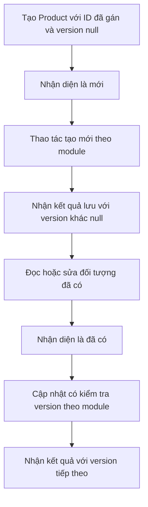

# Vai trò của @Version trong nhận diện trạng thái mới

Trong chương **Phát hiện trạng thái** của Spring Data Commons, `@Version` có một vai trò dễ bị bỏ qua: ngoài việc tham gia optimistic locking ở module có hỗ trợ, thuộc tính version còn có thể giúp Spring Data xác định một đối tượng có phải là entity mới hay không.

Điều này đặc biệt hữu ích khi ứng dụng tự gán ID trước lần lưu đầu tiên. Một đối tượng có ID không đồng nghĩa nó đã tồn tại trong kho dữ liệu. Thuộc tính version chưa được khởi tạo có thể cung cấp dấu hiệu trạng thái tốt hơn việc chỉ kiểm tra ID.

Bài học tập trung vào cơ chế phát hiện trạng thái dựa trên metadata của Spring Data Commons, đồng thời phân biệt với quy tắc riêng của từng module. Ví dụ thực hành dùng Spring Data MongoDB; phần so sánh với JPA được ghi rõ để tránh áp dụng cùng một giả định cho mọi kho dữ liệu.

## 1. “Mới” là kết quả nhận diện trạng thái, không phải truy vấn tồn tại

Khi nhận một entity từ ứng dụng, repository có thể cần quyết định đi theo đường tạo mới hay đường xử lý đối tượng đã có. Thông tin thường được lấy từ trạng thái entity và metadata, thay vì mặc định chạy một truy vấn kiểm tra tồn tại cho từng lần gọi.

Ba câu hỏi sau khác nhau:

| Câu hỏi | Ý nghĩa |
| --- | --- |
| Đối tượng có ID chưa? | Kiểm tra giá trị định danh hiện tại trong bộ nhớ |
| Spring Data nhận diện đối tượng là mới không? | Kết quả của chiến lược phát hiện trạng thái đang được dùng |
| Bản ghi tương ứng đã tồn tại trong kho dữ liệu chưa? | Sự thật tại kho dữ liệu ở một thời điểm cụ thể |

Ví dụ:

```java
String id = UUID.randomUUID().toString();
```

Ứng dụng đã tạo được ID nhưng chưa ghi bản ghi nào. Nếu chiến lược chỉ dựa trên ID không null, nó có thể nhận diện entity này là đối tượng đã có.

Ngược lại, một đối tượng do ứng dụng dựng lại với ID cũ nhưng version bị bỏ mất có thể bị nhận diện là mới dù bản ghi vẫn tồn tại.

Nhận diện trạng thái là đầu vào cho hành vi lưu của module. Nó không phải bằng chứng rằng một truy vấn tồn tại đã chạy hoặc rằng bản ghi chắc chắn có hay không có trong cơ sở dữ liệu.

## 2. Ưu tiên thuộc tính version trong chiến lược dựa trên metadata

Khi sử dụng chiến lược phát hiện trạng thái dựa trên thuộc tính persistent của Commons, một thuộc tính version phù hợp được xét trước ID. Nếu không có thuộc tính version dùng cho chiến lược đó, việc kiểm tra quay về ID.

Có thể diễn đạt ý tưởng bằng mã giả:

```text
Nếu có chiến lược tùy biến được chọn:
    dùng chiến lược đó
Ngược lại, với chiến lược metadata đang xét:
    nếu có thuộc tính version được hỗ trợ:
        nhận diện theo dấu hiệu mới của version
    nếu không:
        nhận diện theo dấu hiệu mới của ID
```

Đây là mô tả khái niệm, không phải một đoạn mã thay thế implementation của mọi module.

Với thuộc tính version kiểu boxed như `Long`:

```text
version == null     → được xem là mới
version != null     → được xem là đã có
```

Khi version được dùng làm dấu hiệu, Spring Data không tiếp tục dùng ID để phủ định kết quả chỉ vì ID đã có giá trị.

Ví dụ trong phạm vi chiến lược này:

| ID | `Long version` | Nhận diện |
| --- | --- | --- |
| `null` | `null` | Mới |
| `"product-42"` | `null` | Mới, dù ID đã được gán |
| `"product-42"` | `0L` | Đã có |
| `"product-42"` | `5L` | Đã có |

Bảng không khẳng định rằng mọi tổ hợp giá trị đều hợp lệ cho thao tác lưu. Nó chỉ mô tả dấu hiệu trạng thái khi version kiểu boxed là thuộc tính được chọn để kiểm tra.

## 3. Vì sao Long thường rõ ràng hơn long

Một version kiểu `Long` có thể biểu diễn trạng thái chưa được khởi tạo bằng `null`:

```java
@Version
private Long version;
```

Một version kiểu `long` không có trạng thái null:

```java
@Version
private long version;
```

Trong chiến lược version của Commons có hỗ trợ version primitive dạng số, giá trị `0` là dấu hiệu entity mới. Khi dùng kiểu boxed, dấu hiệu mới là `null`, không phải mọi giá trị số bằng không.

| Kiểu khai báo | Dấu hiệu mới trong chiến lược version tương ứng của Commons |
| --- | --- |
| `Long` | `null` |
| `Integer` | `null` |
| `long` | `0` |
| `int` | `0` |

Module sử dụng phải hỗ trợ kiểu version đó và áp dụng cơ chế tương ứng. Không dùng bảng để suy ra mọi kiểu có thể đặt cạnh annotation đều là một kiểu version hợp lệ.

Khác biệt quan trọng:

```java
Long boxedVersion = 0L;   // Không phải null.
long primitiveVersion = 0L;
```

Hai giá trị đều in ra số 0, nhưng không mang cùng ý nghĩa nhận diện trong chiến lược này.

Với `Long`, giá trị 0 có thể là version hợp lệ của một bản ghi đã được lưu. Vì thế, không tự kiểm tra entity mới bằng biểu thức `version == 0` nếu hợp đồng mô hình dùng null làm dấu hiệu chưa lưu.

Sử dụng kiểu boxed thường giúp diễn đạt rõ ràng hai trạng thái: chưa có version và đã có một giá trị version. Tuy nhiên, vẫn phải kiểm tra quy tắc module, đặc biệt khi làm việc với JPA.

## 4. Annotation cùng tên không có nghĩa cùng cơ chế ở mọi module

Các module trực tiếp dùng metadata mapping của Spring Data thường sử dụng:

```java
import org.springframework.data.annotation.Version;
```

Entity JPA sử dụng annotation của Jakarta Persistence:

```java
import jakarta.persistence.Version;
```

Cần kiểm tra import trước khi phân tích hành vi. Một annotation được nhận diện bởi module này không tự làm việc tương đương trong một module khác.

| Ngữ cảnh | Annotation điển hình | Điều cần hiểu |
| --- | --- | --- |
| Spring Data MongoDB | `org.springframework.data.annotation.Version` | Kết hợp cơ chế version và phát hiện trạng thái của module |
| Spring Data JDBC | `org.springframework.data.annotation.Version` | Áp dụng theo metadata aggregate và cơ chế ghi của JDBC |
| Spring Data JPA | `jakarta.persistence.Version` | Version do JPA provider quản lý; repository có quy tắc nhận diện riêng |

Commons cung cấp abstraction dùng chung, nhưng không làm các cơ chế ghi của MongoDB, JDBC và JPA trở thành cùng một implementation.

## 5. Ví dụ: sản phẩm tự gán ID với version chưa được khởi tạo

### 5.1. Bối cảnh thực hành

Giả sử ứng dụng dùng Spring Data MongoDB. Mỗi sản phẩm có ID do ứng dụng tạo bằng UUID. Ta muốn phân biệt đối tượng mới với đối tượng đã được lưu mà không phải coi ID không null là bằng chứng đã tồn tại.

Ví dụ giả định ứng dụng đã có cấu hình MongoDB và repository scanning phù hợp. Nó không phải entity JPA.

### 5.2. Mô hình sản phẩm

```java
package com.example.catalog;

import org.springframework.data.annotation.Id;
import org.springframework.data.annotation.PersistenceCreator;
import org.springframework.data.annotation.Version;
import org.springframework.data.mongodb.core.mapping.Document;

import java.util.Objects;
import java.util.UUID;

@Document("products")
public class Product {

    @Id
    private String id;

    private String name;

    @Version
    private Long version;

    @PersistenceCreator
    public Product(String id, String name, Long version) {
        this.id = Objects.requireNonNull(id, "id must not be null");
        this.name = Objects.requireNonNull(
                name, "name must not be null");
        this.version = version;
    }

    public static Product create(String name) {
        return new Product(UUID.randomUUID().toString(), name, null);
    }

    public void rename(String newName) {
        this.name = Objects.requireNonNull(
                newName, "newName must not be null");
    }

    public String getId() {
        return id;
    }

    public String getName() {
        return name;
    }

    public Long getVersion() {
        return version;
    }
}
```

Factory nghiệp vụ `create` tạo ID ngay nhưng giữ `version = null`. Constructor tái tạo nhận cả version để không vô tình làm mất metadata khi đọc dữ liệu.

Việc giữ tên tham số constructor trong metadata biên dịch hoặc cấu hình creator phù hợp vẫn là yêu cầu của đường materialization. Annotation `@Version` không thay thế cơ chế khởi tạo và gán thuộc tính.

### 5.3. Repository

```java
package com.example.catalog;

import org.springframework.data.mongodb.repository.MongoRepository;

public interface ProductRepository
        extends MongoRepository<Product, String> {
}
```

### 5.4. Lần lưu đầu tiên

Trong một service đã được inject `ProductRepository`:

```java
Product draft = Product.create("Spring Data Handbook");

// Trước khi lưu:
// draft.getId() != null
// draft.getVersion() == null

Product saved = productRepository.save(draft);

// Sau khi lưu thành công, sử dụng kết quả trả về:
// saved.getVersion() != null
```

Với cơ chế version của MongoDB trong ví dụ, version null giúp entity được nhận diện là mới dù đã có ID. Module khởi tạo version khi xử lý thao tác lưu tương ứng.

Không nên viết logic nghiệp vụ phụ thuộc một giá trị version khởi đầu chung cho mọi module. Điều quan trọng với `Long` trong ví dụ là chuyển từ chưa có version sang có version, không phải tự gán một số cụ thể trước khi lưu.

Luôn sử dụng đối tượng được thao tác lưu trả về. Các module và mô hình immutable có thể tạo một instance khác để biểu diễn ID hoặc version sau lưu; không xây dựng hợp đồng chung dựa trên giả định đối số luôn được cập nhật tại chỗ.

### 5.5. Cập nhật đối tượng đã đọc

```java
Product existing = productRepository.findById(saved.getId())
        .orElseThrow();

existing.rename("Spring Data Handbook - Revised");

Product updated = productRepository.save(existing);
```

Đối tượng đọc từ kho dữ liệu mang version đã lưu. Nó được nhận diện là đã có và version tham gia cơ chế kiểm tra cập nhật của module.

Nếu version bị bỏ mất trong quá trình ánh xạ sang một đối tượng mới ở giữa đường đọc và ghi, kết quả nhận diện có thể thay đổi. Đây là vấn đề cần chú ý ở các tầng DTO, mapper và API.

## 6. Vòng đời version và kết quả nhận diện

Có thể hình dung một vòng đời bình thường như sau:



Sơ đồ minh họa luồng thành công. Thao tác lưu còn có thể thất bại do ID trùng, dữ liệu không hợp lệ, xung đột version hoặc lỗi kho dữ liệu.

Version không phải một cờ mà ứng dụng bật tắt tùy theo thao tác muốn chạy. Nó là metadata gắn với vòng đời persistence và, ở module có hỗ trợ, với tính đúng đắn của cập nhật đồng thời.

## 7. Nhận diện mới và optimistic locking là hai vai trò khác nhau

Hai vai trò thường cùng dùng thuộc tính version nhưng trả lời hai câu hỏi riêng:

| Vai trò | Câu hỏi |
| --- | --- |
| Nhận diện trạng thái mới | Nên xử lý đối tượng như mới hay đã có? |
| Optimistic locking | Đối tượng đã có còn mang version phù hợp để cập nhật không? |

Ví dụ cập nhật đồng thời trong MongoDB:

```java
Product first = productRepository.findById(id).orElseThrow();
Product second = productRepository.findById(id).orElseThrow();

first.rename("Name from first editor");
Product firstSaved = productRepository.save(first);

second.rename("Name from second editor");
productRepository.save(second);
```

Hai lần đọc ban đầu có thể mang cùng một version. Sau khi lần lưu thứ nhất thành công, version trong kho đã thay đổi. Lần lưu thứ hai dùng version cũ có thể bị từ chối bằng lỗi optimistic locking theo cơ chế của module.

Tại lần lưu thứ hai, `second` vẫn là entity đã có vì version khác null. Nó không trở thành entity mới chỉ vì version đã cũ.

Để quan sát lỗi optimistic locking của MongoDB đúng theo cơ chế này, thao tác ghi cần có write concern được xác nhận phù hợp. Không đánh đồng một cấu hình không kiểm tra kết quả ghi với bảo đảm phát hiện xung đột.

Một version khác null cũng không bảo đảm bản ghi tồn tại. Nếu bản ghi đã bị xóa hoặc không có bản ghi phù hợp với ID và version, thao tác cập nhật vẫn có thể thất bại. Framework không phải chuyển entity sang trạng thái mới rồi tự tạo lại theo ý ứng dụng.

## 8. Khác biệt quan trọng với Spring Data JPA

Trong chiến lược nhận diện mặc định của Spring Data JPA, một thuộc tính version **không phải primitive** được kiểm tra trước. Nếu giá trị của nó là null, entity được xem là mới. Nếu không có thuộc tính version phù hợp để dùng theo cách này, JPA repository kiểm tra ID.

Ví dụ entity JPA có:

```java
import jakarta.persistence.Id;
import jakarta.persistence.Version;

@Id
private String id;

@Version
private Long version;
```

ID do ứng dụng gán kết hợp với `Long version = null` có thể giúp nhận diện entity mới ở đường repository JPA mặc định tương ứng.

Đây chỉ là phần khai báo thuộc tính, không phải một entity JPA hoàn chỉnh. Entity vẫn phải đáp ứng yêu cầu constructor, mapping và vòng đời của JPA provider.

### 8.1. Không dùng quy tắc primitive của Commons một cách máy móc cho JPA

Đối với JPA, version primitive không được dùng để nhận diện entity mới theo cách kiểm tra null nói trên. Giá trị 0 có thể là version hợp lệ của entity sau khi được tạo, nên không đủ để phân biệt mới với đã có.

| Mô hình | Cách hiểu version primitive bằng 0 |
| --- | --- |
| Chiến lược version primitive của Commons ở module áp dụng nó | Có thể là dấu hiệu mới |
| Nhận diện mặc định của Spring Data JPA | Không dùng primitive version như một phép kiểm tra null; quay về chiến lược ID khi không có version phù hợp |

Vì thế, entity JPA có ID đã gán và `long version = 0` không nên được phân tích như entity MongoDB hoặc JDBC chỉ dựa vào sự giống nhau của tên annotation.

### 8.2. Lựa chọn persist và merge không phải kiểm tra tồn tại

Với implementation JPA thông thường, nhận diện entity mới ảnh hưởng đến lựa chọn giữa `EntityManager.persist` và `EntityManager.merge` khi gọi repository `save`.

Không suy ra rằng nhánh `merge` luôn đồng nghĩa một câu SQL `UPDATE`, hoặc rằng framework đã chạy một phép kiểm tra tồn tại theo đúng thứ tự mong đợi. JPA provider quyết định các thao tác cụ thể theo trạng thái và mapping của entity.

Tương tự, một số lỗi chỉ xuất hiện ở flush hoặc commit. Kết quả nhận diện mới không thay thế việc hiểu transaction và vòng đời persistence của JPA.

## 9. Các lỗi khởi tạo version thường gặp

### 9.1. Gán sẵn 0 cho Long ở đối tượng mới

```java
@Version
private Long version = 0L;
```

Nếu đang dùng null làm dấu hiệu mới, giá trị mặc định này làm mất dấu hiệu đó. Một entity có ID tự gán có thể đi vào đường xử lý đối tượng đã có ngay trong lần lưu đầu tiên.

Không sửa bằng cách chọn một số khác như `-1`. Với chiến lược boxed đang xét, mọi giá trị khác null đều không phải dấu hiệu mới.

### 9.2. Reset version về null để ép insert

Nếu đối tượng đã có bị đặt version thành null, nó có thể được nhận diện là mới. Nhưng bản ghi mang ID đó vẫn có thể tồn tại, dẫn đến lỗi trùng định danh thay vì một lần cập nhật hợp lệ.

Nếu nghiệp vụ muốn sao chép một sản phẩm thành sản phẩm mới, hãy tạo một đối tượng mới với định danh và trạng thái được thiết kế cho việc sao chép. Không dùng thao tác xóa version để thay cho một hợp đồng tạo mới rõ ràng.

### 9.3. Tự tăng version trước khi lưu

```java
// Không tự làm nếu version đang do persistence infrastructure quản lý.
version = version + 1;
```

Version trên entity thường biểu thị phiên bản mà thao tác cập nhật đang dựa vào. Tự tăng trước có thể làm điều kiện kiểm tra không còn khớp với dữ liệu đã đọc.

Hãy để module quản lý việc khởi tạo và tăng version theo cơ chế của nó, trừ khi đang triển khai một API cập nhật riêng có hợp đồng version được thiết kế cụ thể.

### 9.4. Dùng timestamp kiểm toán thay cho version

`@CreatedDate` và `@LastModifiedDate` phục vụ auditing. Chúng không tự trở thành thuộc tính version hoặc tạo ra kiểm tra optimistic locking chỉ vì có vẻ phản ánh lịch sử thay đổi.

Một số đường auditing có thể sử dụng thông tin entity mới để phân biệt tạo với cập nhật. Do đó, làm sai trạng thái version còn có thể ảnh hưởng hành vi auditing tương ứng; không nên ép trạng thái mới chỉ để thay đổi timestamp.

## 10. DTO và API có thể làm mất dấu hiệu trạng thái

Một lỗi phổ biến là dựng entity cho cập nhật theo cách:

```java
// Giả sử đây là ID của sản phẩm đã tồn tại.
Product replacement = new Product(existingId, newName, null);
productRepository.save(replacement);
```

Đối tượng có ID đúng nhưng thiếu version. Với mô hình MongoDB trong bài, null vẫn là dấu hiệu mới. Việc đây là một HTTP request cập nhật không tự đổi chiến lược của repository.

Có hai hướng thiết kế thường gặp:

- Service đọc entity hiện có, áp dụng thay đổi rồi lưu, giữ metadata persistence trên entity.
- API cập nhật có hợp đồng version rõ ràng, truyền và kiểm tra version mà thao tác dựa vào.

Nếu service đọc bản mới nhất rồi cập nhật, nó đã giữ được version cho đường repository. Tuy nhiên, nếu người dùng chỉnh sửa từ một màn hình đã cũ, yêu cầu phát hiện dữ liệu cũ từ phía client vẫn cần một expected version hoặc điều kiện tương ứng. Đọc lại bản mới nhất không tự chứng minh dữ liệu trên màn hình người dùng còn mới.

Không nhận một version bất kỳ từ request rồi coi đó là bằng chứng đáng tin rằng cập nhật sẽ thành công. Version là một điều kiện cần được đối chiếu theo hợp đồng concurrency của API và module.

## 11. Dữ liệu cũ khi mới bổ sung @Version

Giả sử hệ thống đã có bản ghi trước khi bổ sung thuộc tính version. Các bản ghi đó có thể không có trường hoặc giá trị version mà mô hình mới yêu cầu.

Nếu đường đọc tạo entity với `Long version = null`, chiến lược đang xét có thể nhận diện nó là mới. Như vậy, một thay đổi tưởng chỉ thêm annotation có thể làm đổi nhánh lưu của dữ liệu đã tồn tại.

Cần thiết kế việc chuyển đổi dữ liệu theo module:

1. Xác định biểu diễn version của bản ghi cũ.
2. Chọn giá trị khởi đầu hợp lệ cho những bản ghi đã tồn tại.
3. Phối hợp migration và phiên bản ứng dụng để không có các writer hiểu trạng thái khác nhau.
4. Kiểm chứng lần cập nhật tiếp theo và tình huống có hai người sửa đồng thời.

Với kiểu boxed, một giá trị không null như 0 có thể biểu thị bản ghi đã có, nhưng không được biến điều đó thành công thức migration chung cho mọi module, kiểu version hoặc cơ chế cập nhật.

Đối với schema SQL có cột version, còn phải xét ràng buộc null, dữ liệu mặc định và cách implementation ghi sử dụng cột đó. Với document store, cần xét bản ghi thiếu trường và cách converter đọc chúng.

## 12. @Version không kiểm soát mọi đường ghi

Các kết luận trong ví dụ dựa trên đường repository và cơ chế version của module. Một thao tác ghi khác có thể có hợp đồng khác:

- API cập nhật trực tiếp theo điều kiện.
- Bulk operation.
- Native SQL hoặc driver của kho dữ liệu.
- Một công cụ quản trị sửa bản ghi bên ngoài ứng dụng.

Một API có thể tăng version mà không diễn đạt cùng điều kiện kiểm tra như thao tác lưu entity. Một API khác có thể yêu cầu ứng dụng tự đưa version vào điều kiện cập nhật. Cần đọc đúng hợp đồng của thao tác đang dùng, không suy từ việc entity có annotation.

Tương tự, gắn annotation không tự tạo version mới cho các writer bên ngoài hoặc ngăn mọi công cụ ghi đè dữ liệu.

Bài học về phát hiện trạng thái cần gắn với đường gọi cụ thể: thuộc tính nào được metadata nhận diện, chiến lược nào được chọn và API ghi nào thực sự sử dụng kết quả đó.

## 13. Khi có Persistable hoặc chiến lược tùy biến

Spring Data hỗ trợ việc entity tham gia xác định trạng thái qua hợp đồng `Persistable`, và một số module cho phép tùy biến metadata hoặc entity information liên quan.

Khi một chiến lược như vậy được chọn, không còn đủ để chỉ nhìn `version == null` rồi kết luận kết quả `isNew` cuối cùng. Cần xác định chiến lược đang được dùng ở đường repository đó.

Đồng thời, tách hai trách nhiệm:

```text
Chiến lược nhận diện mới có thể được tùy biến.
Version vẫn có thể tham gia optimistic locking của module.
```

Tùy biến `isNew` không tự vô hiệu hóa optimistic locking. Ngược lại, có version không đảm bảo một implementation `Persistable.isNew()` sai sẽ được framework tự sửa theo ý định ứng dụng.

Không cần thêm `Persistable` chỉ để xử lý ID tự gán nếu một version kiểu boxed và cơ chế module đã diễn đạt đúng vòng đời mong muốn. Chọn chiến lược đơn giản nhất đủ đáp ứng hợp đồng thực tế.

## 14. Cách kiểm chứng hành vi khi tích hợp

Không chỉ kiểm tra getter của version. Cần kiểm chứng entity đi qua repository và module lưu trữ thật sự được chọn cho ứng dụng.

| Tình huống | Điều cần quan sát |
| --- | --- |
| Entity mới có ID tự gán, `Long version = null` | Được xử lý theo đường tạo mới phù hợp |
| Entity sau lần lưu đầu | Kết quả trả về có version hợp lệ của module |
| Entity có `Long version = 0` đã được lưu | Không bị coi là mới chỉ vì version bằng 0 |
| Entity đọc lại rồi sửa | Giữ version và cập nhật theo cơ chế module |
| Hai bản đọc cùng version | Lần ghi sau dữ liệu cũ được kiểm tra theo optimistic locking |
| ID đã tồn tại nhưng version bị reset null | Không âm thầm coi đây là cập nhật hợp lệ |
| ID không tồn tại nhưng version khác null | Hành vi đúng với đường cập nhật và kiểm tra version của module |
| DTO làm mất version | Phát hiện thay đổi trạng thái ngoài ý định |
| Bản ghi cũ thiếu version | Có chính sách migration và hành vi đọc/ghi rõ ràng |
| Entity JPA dùng primitive version | Không áp dụng máy móc quy tắc primitive của module khác |

Với một lỗi lưu, phân loại nguyên nhân trước khi sửa:

- Nhận diện entity mới sai.
- Mapping không nhận diện đúng annotation hoặc thuộc tính.
- Mất version trong quá trình tạo hoặc sao chép đối tượng.
- Version cũ do cập nhật đồng thời.
- Bản ghi không tồn tại hoặc ID bị trùng.
- API ghi không có cùng hợp đồng với repository `save` đang được giả định.

Không sửa tất cả các lỗi trên bằng cách đổi version về null hoặc gọi thêm `existsById`. Một phép kiểm tra tồn tại tách rời vẫn có thể bị thay đổi bởi thao tác khác trước lúc ghi và không thay thế optimistic locking.

## 15. Bài tập áp dụng

Một ứng dụng MongoDB tự tạo UUID cho `CustomerProfile`. Model có `@Version Long version`, nhưng mapper nhận request cập nhật luôn tạo một đối tượng mới với ID từ request và version null.

Hãy trả lời:

1. Vì sao ID không null chưa đủ để kết luận đối tượng là đã có trong chiến lược đang dùng?
2. Spring Data có thể nhận diện đối tượng được mapper tạo là gì?
3. Vì sao gán mặc định `version = 0L` cho mọi request cũng không phải cách sửa đúng?
4. Làm thế nào giữ version của đối tượng đã tồn tại?
5. Nếu cần phát hiện người dùng sửa từ dữ liệu cũ, API cần biểu đạt thêm điều gì?

Hướng xử lý là giữ rõ ranh giới giữa tạo mới và cập nhật. Với cập nhật, bảo toàn hoặc kiểm tra version theo hợp đồng ứng dụng, thay vì tự dựng một entity thiếu metadata. Để module quản lý version và kiểm chứng bằng đường ghi thực tế.

Khi phân tích một entity, hãy xác định đồng thời **kiểu version, giá trị version, chiến lược nhận diện trạng thái và module thực hiện lưu**. Chỉ nhìn ID hoặc chỉ nhìn số version đều chưa đủ để giải thích hành vi.