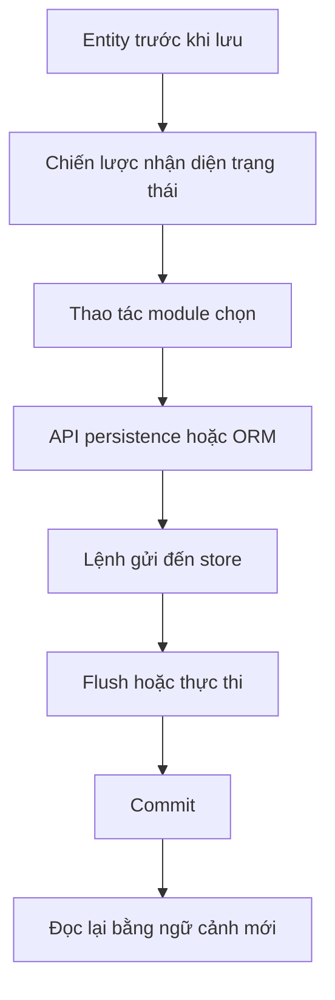

# Kiểm chứng hành vi insert/update/merge ở mô-đun đang dùng

Một phương thức có tên `save` không bảo đảm cùng một hành vi ở mọi repository Spring Data. Tùy module, trạng thái entity và cấu hình mapping, nó có thể đi qua một nhánh insert, update, merge hoặc một thao tác có ngữ nghĩa upsert.

Spring Data Commons cung cấp abstraction repository và hạ tầng nhận diện trạng thái dùng chung. Module tích hợp mới quyết định cách chuyển các abstraction đó thành thao tác persistence. Khi có ORM bên dưới, ORM còn quyết định cách đồng bộ trạng thái và phát sinh SQL.

Vì vậy, kiểm chứng đúng cần nối được ba loại bằng chứng: repository nhận diện trạng thái thế nào, nó chọn thao tác gì, và store thực sự có dữ liệu gì sau ranh giới thực thi phù hợp.

## 1. Phân biệt bốn thuật ngữ trước khi quan sát

| Thuật ngữ | Ý nghĩa cần xác định | Không nên mặc định |
| --- | --- | --- |
| Insert | Tạo bản ghi hoặc document mới theo hợp đồng thao tác | Luôn thành công nếu ứng dụng nghĩ entity là mới |
| Update | Thay đổi dữ liệu đã tồn tại; có thể có điều kiện ID/version | Mọi update đều tự tạo dữ liệu khi không tìm thấy |
| Merge trong JPA | Hợp nhất trạng thái vào một instance managed và trả về instance đó | Một câu SQL UPDATE trực tiếp |
| Upsert | Cập nhật khi khớp điều kiện, tạo mới khi không khớp theo hợp đồng cụ thể | Đồng nghĩa với JPA merge hoặc mọi phương thức `save` |

Đặc biệt, JPA `merge` là thao tác trên trạng thái entity. ORM có thể cần đọc dữ liệu trước, phát hiện thay đổi hoặc báo lỗi do version. Hành vi khi bản ghi đã bị xóa còn phụ thuộc khả năng nhận diện detached entity và hợp đồng của provider.

Không dùng “merge” làm tên chung cho mọi thao tác cập nhật ở JDBC hoặc MongoDB. Một câu lệnh `MERGE` của cơ sở dữ liệu cũng là khái niệm khác với `EntityManager.merge`.

## 2. Ba lớp bằng chứng cần thu thập



Các store không có cùng mô hình flush. Sơ đồ thể hiện những ranh giới cần tìm, không bắt mọi module tuân theo lifecycle JPA.

### Lớp 1: quyết định nhận diện trạng thái

Ghi lại ít nhất:

- Module repository thực sự dùng.
- ID: kiểu khai báo và giá trị.
- Version: kiểu khai báo và giá trị nếu có.
- Entity có triển khai `Persistable` không.
- Có custom repository, callback hoặc chiến lược nhận diện nào thay đổi hành vi không.

Kết quả “mới” hoặc “không mới” thường được tính từ object và metadata. Nó chưa phải kết quả truy vấn sự tồn tại trong store.

### Lớp 2: nhánh persistence

Xác định module gọi API nào. Với repository JPA tiêu chuẩn, mô hình giản lược là:

```java
// Mã khái niệm; lược bỏ chi tiết implementation và transaction.
if (entityInformation.isNew(entity)) {
    entityManager.persist(entity);
    return entity;
}

return entityManager.merge(entity);
```

Không áp dụng đoạn mã này cho mọi module chỉ vì repository cùng kế thừa `CrudRepository`.

### Lớp 3: dữ liệu và transaction

Quan sát lệnh thực tế, buộc những thao tác trì hoãn được thực thi khi cần, rồi đọc lại dữ liệu qua một ngữ cảnh không còn dựa vào instance cũ.

Nếu chỉ thấy `save` trả về mà chưa flush hoặc commit, phép kiểm chứng có thể chưa đi qua thời điểm phát hiện lỗi.

## 3. Chuẩn bị một phép kiểm chứng có thể diễn giải

Trước khi viết assertion, cần mô tả môi trường:

| Thông tin | Vì sao ảnh hưởng kết quả |
| --- | --- |
| Module và implementation repository | Quyết định cách chuyển `save` thành thao tác store |
| Provider hoặc driver | Có thể ảnh hưởng merge, batching, version và lỗi được trả về |
| Loại store và cấu hình schema | Ràng buộc, kiểu ID và câu lệnh thực tế có thể khác |
| Transaction manager | Quyết định ranh giới và loại tài nguyên được quản lý |
| Mapping ID/version | Ảnh hưởng nhận diện entity mới và optimistic locking |
| Callback, auditing, listener | Có thể thay đổi state trong quá trình lưu |
| Cấu hình flush, write concern hoặc acknowledgement tương ứng | Ảnh hưởng thời điểm và mức xác nhận kết quả |

Dùng một store kiểm thử tách biệt và cấu hình đại diện cho môi trường cần xác nhận. Nếu chạy bằng một database khác loại, cần ghi rõ kết quả chỉ chứng minh hành vi trong môi trường đó.

Không coi một repository mock là bằng chứng insert/update đã diễn ra. Mock có thể kiểm tra logic gọi collaborator, nhưng không thực thi mapping, constraint, transaction hay concurrency của store.

## 4. Ma trận tình huống tối thiểu

Một ma trận nên tách dữ liệu trong bộ nhớ khỏi dữ liệu thực tế:

| Tình huống | Dữ liệu trong object | Dữ liệu trong store | Điều cần quan sát |
| --- | --- | --- | --- |
| Tạo mới thông thường | ID/version mang dấu hiệu mới | Chưa có bản ghi | Nhánh tạo mới, ID/version sau lưu |
| ID được gán trước | ID khác null, version tùy thiết kế | Chưa có bản ghi | Chiến lược có nhận diện đúng ý định tạo mới không |
| Cập nhật entity đã tải | ID/version hợp lệ | Có bản ghi | Đường update và dữ liệu thay đổi |
| Lưu detached entity JPA | ID/version từ lần tải trước | Có bản ghi | Merge, instance trả về và version |
| Version cũ | ID đúng, version lạc hậu | Bản ghi có version mới hơn | Optimistic locking khi thực thi |
| Trùng ID ở đường insert | Entity được coi là mới | Đã có bản ghi cùng ID | Constraint hoặc lỗi tương ứng |
| ID có giá trị nhưng bản ghi không còn | Entity được coi là không mới | Không có bản ghi | Lỗi, insert hoặc hành vi khác theo hợp đồng cụ thể |
| Transaction rollback | Object có thể đã đổi ID/version | Không có thay đổi đã commit | Trạng thái store khác trạng thái trong bộ nhớ |
| Lưu lần hai | Dùng kết quả lần lưu trước | Có bản ghi | Cờ new-state, version và hành vi tiếp theo |

Không điền sẵn “mọi hàng save đều thành công”. Một lỗi đúng hợp đồng cũng là kết quả kiểm chứng có giá trị.

## 5. Ví dụ JPA: mô hình dùng cho phép kiểm chứng

Các đoạn sau dành cho ứng dụng Spring Boot đã cấu hình Spring Data JPA, entity scanning và repository scanning. Profile `repository-test` phải trỏ đến database kiểm thử riêng và chuẩn bị schema phù hợp. Ví dụ dùng JUnit Jupiter, Spring Test và namespace `jakarta.persistence`.

Mỗi kiểu public đặt trong file Java cùng tên, cùng package `com.example.stateprobe`.

### Entity

```java
package com.example.stateprobe;

import jakarta.persistence.Column;
import jakarta.persistence.Entity;
import jakarta.persistence.GeneratedValue;
import jakarta.persistence.Id;
import jakarta.persistence.Table;
import jakarta.persistence.Version;

@Entity
@Table(name = "state_probe_item")
public class ProbeItem {

    @Id
    @GeneratedValue
    private Long id;

    @Version
    private Long version;

    @Column(nullable = false, length = 100)
    private String label;

    protected ProbeItem() {
    }

    public ProbeItem(String label) {
        rename(label);
    }

    public void rename(String label) {
        if (label == null || label.isBlank() || label.length() > 100) {
            throw new IllegalArgumentException("Invalid label");
        }

        this.label = label;
    }

    public Long getId() {
        return id;
    }

    public Long getVersion() {
        return version;
    }

    public String getLabel() {
        return label;
    }
}
```

### Repository

```java
package com.example.stateprobe;

import org.springframework.data.jpa.repository.JpaRepository;

public interface ProbeItemRepository
        extends JpaRepository<ProbeItem, Long> {
}
```

ID và version đều dùng wrapper để biểu diễn trạng thái chưa được cấp giá trị. Với nhận diện mặc định của Spring Data JPA, nullable version có thể đóng vai trò quyết định entity mới.

Ví dụ giả định repository dùng implementation JPA tiêu chuẩn, không ghi đè `save` bằng một fragment hoặc custom base class.

## 6. Kiểm chứng tạo mới: lưu, flush, clear, đọc lại

```java
package com.example.stateprobe;

import jakarta.persistence.EntityManager;
import jakarta.persistence.PersistenceContext;
import org.junit.jupiter.api.Test;
import org.springframework.beans.factory.annotation.Autowired;
import org.springframework.boot.test.context.SpringBootTest;
import org.springframework.test.context.ActiveProfiles;
import org.springframework.transaction.annotation.Transactional;

import static org.junit.jupiter.api.Assertions.*;

@SpringBootTest
@ActiveProfiles("repository-test")
@Transactional
class ProbeItemPersistenceIT {

    @Autowired
    private ProbeItemRepository repository;

    @PersistenceContext
    private EntityManager entityManager;

    @Test
    void savesNewItemAndReadsItAfterFlushAndClear() {
        ProbeItem input = new ProbeItem("before");

        assertNull(input.getId());
        assertNull(input.getVersion());

        ProbeItem saved = repository.save(input);

        // Hành vi mong đợi của nhánh persist trong repository JPA tiêu chuẩn.
        assertSame(input, saved);
        assertTrue(entityManager.contains(saved));

        entityManager.flush();

        Long id = saved.getId();
        assertNotNull(id);
        assertNotNull(saved.getVersion());

        entityManager.clear();

        ProbeItem reloaded = repository.findById(id).orElseThrow();

        assertEquals("before", reloaded.getLabel());
        assertNotSame(saved, reloaded);
    }
}
```

Ý nghĩa các bước:

1. Kiểm tra trạng thái đầu vào để tránh mapper hoặc constructor đã gán ID/version ngoài ý định.
2. Lưu qua repository thật.
3. `flush` buộc ORM đồng bộ những thay đổi đang trì hoãn trong persistence context.
4. `clear` loại instance managed cũ khỏi first-level cache.
5. Đọc lại để xác nhận dữ liệu không chỉ tồn tại trong object ban đầu.

`clear` không tự xóa second-level cache của provider. Nếu phép kiểm chứng cần chứng minh có một câu SELECT mới tới database, phải quan sát lệnh hoặc kiểm soát cache tương ứng.

Kiểm thử có `@Transactional` của Spring Test thường rollback khi kết thúc. Vì vậy, ví dụ xác nhận khả năng đồng bộ và đọc lại trong transaction; nó chưa phải bằng chứng dữ liệu đã tồn tại sau commit.

Không assert ID phải là `1L` hoặc version đầu tiên phải là một con số cố định nếu hợp đồng cần kiểm tra không yêu cầu điều đó. Sequence, dữ liệu fixture và provider có thể làm các giả định ấy không còn đúng.

## 7. Kiểm chứng update của managed entity

Thêm phương thức sau vào lớp kiểm thử transactional ở phần trước:

```java
@Test
void updatesManagedItemAndAdvancesVersion() {
    ProbeItem initial = repository.saveAndFlush(new ProbeItem("before"));

    Long id = initial.getId();
    Long oldVersion = initial.getVersion();

    assertNotNull(oldVersion);

    entityManager.clear();

    ProbeItem managed = repository.findById(id).orElseThrow();
    assertTrue(entityManager.contains(managed));

    managed.rename("after");

    // Không gọi save ở đây: đang kiểm chứng dirty checking của JPA.
    entityManager.flush();

    Long newVersion = managed.getVersion();
    assertNotNull(newVersion);
    assertTrue(newVersion.longValue() > oldVersion.longValue());

    entityManager.clear();

    ProbeItem reloaded = repository.findById(id).orElseThrow();

    assertEquals("after", reloaded.getLabel());
    assertEquals(newVersion, reloaded.getVersion());
}
```

Phép kiểm chứng này cho thấy:

- Entity được tải trong transaction vẫn managed.
- ORM có thể nhận ra thay đổi mà không cần gọi lại repository `save`.
- Version số tăng khi cập nhật có thay đổi trong ví dụ.
- Dữ liệu đọc lại khớp với trạng thái đã được flush.

Dirty checking là khả năng của ORM trong ngữ cảnh JPA này. Không chuyển nguyên assertion “không gọi save vẫn lưu” sang aggregate Spring Data JDBC hoặc document thông thường.

Nếu muốn kiểm chứng riêng `repository.save(managed)`, hãy viết một tình huống có tên và mục tiêu khác. Đừng trộn việc chứng minh dirty checking với việc chứng minh nhánh `save` chọn `merge`.

## 8. Kiểm chứng merge của detached entity

Detached entity đã từng được quản lý nhưng hiện không còn thuộc persistence context đang dùng.

Thêm phương thức sau vào cùng lớp kiểm thử:

```java
@Test
void mergesDetachedStateIntoAnotherManagedInstance() {
    ProbeItem detached =
            repository.saveAndFlush(new ProbeItem("before"));

    Long id = detached.getId();
    Long oldVersion = detached.getVersion();

    assertNotNull(oldVersion);

    entityManager.clear();
    assertFalse(entityManager.contains(detached));

    detached.rename("from-detached");

    ProbeItem merged = repository.save(detached);

    assertNotSame(detached, merged);
    assertFalse(entityManager.contains(detached));
    assertTrue(entityManager.contains(merged));

    entityManager.flush();

    assertNotNull(merged.getVersion());
    assertTrue(merged.getVersion().longValue() > oldVersion.longValue());

    entityManager.clear();

    ProbeItem reloaded = repository.findById(id).orElseThrow();

    assertEquals("from-detached", reloaded.getLabel());
    assertEquals(merged.getVersion(), reloaded.getVersion());
}
```

Đối với nhánh merge JPA, đối tượng đầu vào detached không tự trở thành managed. Trạng thái của nó được hợp nhất vào một instance managed khác được trả về.

Do đó, sau:

```java
ProbeItem merged = repository.save(detached);
```

hãy tiếp tục làm việc với `merged` nếu cần thay đổi trong persistence context đó. Không giả định các thay đổi tiếp theo lên `detached` sẽ tự được dirty checking theo dõi.

Assertion về instance kết hợp với trạng thái managed và dữ liệu đọc lại là bằng chứng mạnh hơn việc chỉ nhìn tên `save`. Tuy nhiên, nếu cần xác nhận chính xác API nào được gọi, vẫn phải quan sát tại điểm gọi `EntityManager` hoặc kiểm tra dispatch của implementation đang dùng.

## 9. Khi nào cần kiểm chứng commit thật?

Flush và commit khác nhau:

| Ranh giới | Điều đã xảy ra | Điều chưa được bảo đảm |
| --- | --- | --- |
| `save` trả về | Repository đã thực hiện phần công việc đồng bộ của lời gọi | Mọi SQL đã chạy và transaction đã commit |
| `flush` hoàn tất | Các thay đổi cần đồng bộ đã được gửi theo cơ chế ORM | Transaction không thể rollback nữa |
| Commit hoàn tất | Transaction đã kết thúc thành công theo tài nguyên đang dùng | Mọi hệ thống bên ngoài đều đã nhận hiệu ứng |
| Đọc bằng transaction mới | Quan sát dữ liệu ngoài persistence context ban đầu | Tự loại bỏ mọi ảnh hưởng cache hoặc replica nếu có |

Để kiểm chứng sau commit, có thể dùng một lớp kiểm thử riêng không có transaction bao ngoài và điều khiển từng transaction bằng `TransactionTemplate`.

```java
package com.example.stateprobe;

import org.junit.jupiter.api.Test;
import org.springframework.beans.factory.annotation.Autowired;
import org.springframework.boot.test.context.SpringBootTest;
import org.springframework.test.context.ActiveProfiles;
import org.springframework.transaction.PlatformTransactionManager;
import org.springframework.transaction.support.TransactionTemplate;

import static org.junit.jupiter.api.Assertions.*;

@SpringBootTest
@ActiveProfiles("repository-test")
class ProbeItemCommitIT {

    @Autowired
    private ProbeItemRepository repository;

    @Autowired
    private PlatformTransactionManager transactionManager;

    @Test
    void readsCommittedItemInAnotherTransaction() {
        TransactionTemplate tx =
                new TransactionTemplate(transactionManager);

        Long id = tx.execute(status ->
                repository.saveAndFlush(
                        new ProbeItem("committed")).getId());

        assertNotNull(id);

        try {
            String label = tx.execute(status ->
                    repository.findById(id).orElseThrow().getLabel());

            assertEquals("committed", label);
        } finally {
            tx.executeWithoutResult(status ->
                    repository.deleteById(id));
        }
    }
}
```

Ví dụ giả định `transactionManager` là manager JPA phù hợp. Nếu ứng dụng có nhiều manager, phải chọn rõ bean bằng cấu hình hoặc qualifier tương ứng.

Lớp này không có `@Transactional` bao ngoài. Vì thế, hai lời gọi `TransactionTemplate` tạo các ranh giới độc lập trong điều kiện thông thường của ví dụ.

Nếu thêm một transaction bao ngoài rồi để propagation mặc định, các khối có thể tham gia cùng transaction và làm mất mục tiêu kiểm chứng sau commit.

Dọn dữ liệu bằng ID vừa tạo giúp giữ phép kiểm chứng độc lập. Database và profile phải dành cho kiểm thử vì dữ liệu ở đây được commit thật.

## 10. Kiểm chứng optimistic locking bằng hai phiên bản trạng thái

Một phép kiểm chứng version có ý nghĩa cần tạo ra hai trạng thái không cùng được tự động đồng bộ bởi một persistence context.

Lịch thực thi:

```text
Transaction A: tạo bản ghi và commit, version = v

Transaction B: tải bản ghi thành snapshot S, kết thúc transaction
               S lúc này detached, vẫn mang version v

Transaction C: tải bản ghi, sửa và commit, version tăng thành v'

Transaction D: lưu S với version v
               → kỳ vọng optimistic locking từ chối trạng thái cũ
```

Không dùng hai biến trỏ đến cùng một managed instance rồi gọi đó là “hai người dùng cập nhật đồng thời”. Chúng có thể chỉ là một object trong first-level cache.

Khi viết assertion:

- Buộc thao tác đi tới thời điểm provider/store kiểm tra version.
- Xác định lỗi được bộc lộ tại merge, flush hay commit.
- Với repository Spring đã dịch ngoại lệ, có thể kiểm tra nhóm `OptimisticLockingFailureException` thay vì khóa vào một lỗi SQL của vendor.
- Sau transaction lỗi, đọc lại bằng transaction mới và xác nhận dữ liệu của lần cập nhật thành công vẫn được giữ.
- Không tái sử dụng persistence context đã lỗi để thực hiện các assertion tiếp theo.

Không “sửa” bài kiểm chứng bằng cách xóa version của snapshot cũ. Việc đó có thể thay đổi nhận diện trạng thái hoặc phá mất thông tin cần để phát hiện xung đột.

## 11. Quan sát đúng điểm: log SQL chưa đủ để phân biệt persist và merge

Các loại quan sát cung cấp bằng chứng khác nhau:

| Công cụ hoặc điểm quan sát | Có thể cho biết | Không tự chứng minh |
| --- | --- | --- |
| Log ứng dụng trước `save` | ID, version, cờ trạng thái đầu vào | Repository thực sự gọi thao tác nào |
| Trace hoặc instrumentation tại `EntityManager` | Có lời gọi `persist` hay `merge` | Transaction chắc chắn đã commit |
| SQL logging hoặc datasource instrumentation | SQL được gửi và parameter phù hợp | SQL đó bắt nguồn từ API JPA nào |
| ORM statistics | Một số số liệu entity/statement theo provider | Mọi chi tiết nghiệp vụ và tính đúng của dữ liệu |
| Đọc lại bằng ngữ cảnh mới | Kết quả persistence quan sát được | Không có thao tác thừa hoặc nhánh sai đã bị che khuất |
| Assertion sau commit | Trạng thái đã commit trong phạm vi kiểm chứng | Toàn bộ hệ phân tán cùng nhất quán |

Một câu INSERT không chứng minh repository đã gọi `persist`: một đường merge trong một số tình huống cũng có thể dẫn đến tạo mới. Một câu SELECT trước UPDATE cũng không đủ để kết luận chính xác mọi quyết định nội bộ.

Nếu dùng spy hoặc interceptor, nó phải nằm đúng trên đối tượng mà repository thật sử dụng. Spy một `EntityManager` khác hoặc một instance repository tự tạo ngoài context có thể cho kết quả không liên quan đến đường thực thi thực tế.

Khi chỉ cần bảo đảm hành vi nghiệp vụ, ưu tiên assertion về dữ liệu và lỗi mong đợi. Chỉ khóa vào chính xác số câu SQL khi số lượng đó là yêu cầu hiệu năng cần kiểm soát, đã xét đến provider và cấu hình.

## 12. Điều chỉnh phép kiểm chứng theo module

### 12.1. Spring Data JDBC

Spring Data JDBC quản lý aggregate theo mô hình của module, không dựa vào persistence context và dirty checking kiểu JPA.

Các điểm cần kiểm chứng:

- ID/version quyết định aggregate được xem là mới ra sao.
- `save` của aggregate dẫn đến thao tác nào trên root và các thành phần.
- Trường hợp update không khớp bản ghi được module xử lý thế nào.
- Version có tham gia điều kiện cập nhật và phát hiện xung đột không.
- Toàn bộ thay đổi aggregate có nằm trong transaction phù hợp không.

Không chỉ quan sát một câu UPDATE của bảng root rồi kết luận không có thao tác khác. Một aggregate có collection hoặc thành phần phụ có thể dẫn đến nhiều lệnh theo chiến lược persistence của module.

Nếu dùng API insert/update tường minh của template hoặc aggregate operations, hãy kiểm chứng hợp đồng của API đó riêng với repository `save`.

### 12.2. Spring Data MongoDB

Trong MongoDB, cần xem xét document ID, version, replacement/update và khả năng upsert của đúng đường thao tác.

Một số đường `save` có thể dùng hành vi upsert; khi có version, đường ghi và kiểm tra xung đột có thể khác. Không suy ra “ID đã có nên chỉ update” từ quy tắc JPA.

Các bằng chứng nên gồm:

- Document trong collection trước và sau thao tác.
- Command thực tế nếu cần phân biệt insert, replace hoặc update.
- Có bật upsert cho command đó không.
- Điều kiện version có trong thao tác ghi không.
- Mức acknowledgement/write concern đủ để quan sát lỗi mà bài kiểm chứng kỳ vọng không.

Đọc được object trả về từ repository chưa chắc chứng minh server đã xác nhận theo mức mà ứng dụng cần. Hợp đồng xác nhận của driver/store là một phần của phép kiểm chứng.

### 12.3. Module reactive

Publisher chưa được subscribe thì thao tác reactive có thể chưa chạy.

```java
// Chỉ tạo pipeline chưa phải bằng chứng đã ghi dữ liệu.
Mono<ProbeDocument> result = reactiveRepository.save(document);
```

Trong kiểm thử reactive, phải subscribe và xác nhận tín hiệu kết thúc bằng công cụ phù hợp, chẳng hạn `StepVerifier`. Lỗi có thể đến dưới dạng error signal khi thực thi.

Transaction reactive gắn với execution context của pipeline. Không đặt một transaction imperative bên ngoài rồi mặc định nó bao phủ cùng tài nguyên reactive.

Không thêm `.block()` vào code nghiệp vụ chỉ để làm phép kiểm chứng giống imperative. Hãy kiểm chứng theo mô hình thực thi thật của ứng dụng.

## 13. Những sai lầm làm kết quả kiểm chứng thiếu giá trị

| Sai lầm | Vì sao gây hiểu nhầm | Điều chỉnh |
| --- | --- | --- |
| Chỉ assert `save` trả về khác null | Có thể chưa thực thi thao tác bị trì hoãn | Kiểm tra dữ liệu, flush hoặc hoàn tất pipeline phù hợp |
| Đọc lại trong cùng persistence context mà không xét cache | Có thể nhận lại object cũ | Clear hoặc dùng ngữ cảnh mới và quan sát phù hợp |
| Thấy UPDATE rồi gọi đó là merge | Trộn API entity với lệnh store | Tách quan sát API và SQL |
| Dùng mock repository để kết luận insert thành công | Không có mapping hoặc store thật | Dùng integration test cho persistence |
| Dùng database thay thế rồi khái quát cho môi trường khác | Cú pháp, constraint và provider có thể khác | Ghi rõ phạm vi và kiểm chứng trên cấu hình đại diện |
| Assert lỗi chỉ tại dòng `save` | Lỗi có thể xảy ra lúc flush/commit | Đặt assertion quanh ranh giới thực thi cần thiết |
| Dùng lại object sau rollback mà không đánh giá trạng thái | ID/version/cờ trong bộ nhớ có thể đã đổi | Tạo hoặc tải lại trạng thái theo thiết kế retry |
| Kiểm tra existence rồi cho rằng hết race condition | Dữ liệu có thể đổi giữa hai thao tác | Dùng constraint và cơ chế concurrency của store |
| Khởi tạo entity với wrapper version bằng zero ngoài ý định | Có thể thay đổi nhận diện entity mới | Giữ đúng ngữ nghĩa null/zero và fixture |

Một bài kiểm chứng tốt phải thất bại khi hành vi cần bảo đảm bị thay đổi. Nếu thay nhánh persistence hoặc bỏ version mà các assertion vẫn luôn xanh, cần xem lại bằng chứng đang thu thập.

## 14. Bài thực hành và cách ghi kết quả

Chọn một repository thật trong module đang dùng và thực hiện ba tình huống:

1. Tạo mới với ID/version mang dấu hiệu mới.
2. Cập nhật một đối tượng đã được lưu và tải lại.
3. Ghi bằng một trạng thái cũ sau khi dữ liệu đã được cập nhật bởi một transaction khác.

Với JPA, bổ sung tình huống detached merge và phân biệt instance đầu vào với instance trả về. Với JDBC hoặc MongoDB, chọn thao tác tương ứng theo mô hình của module thay vì gọi nó là merge.

Có thể ghi kết quả theo mẫu:

```text
Module:
Provider/driver và store:
Repository implementation:
Entity và mapping ID/version:

Trạng thái đầu vào:
Dữ liệu store trước thao tác:
Chiến lược nhận diện:
API/thao tác được quan sát:

Ranh giới thực thi: flush / hoàn tất publisher / commit
Dữ liệu đọc lại:
ID/version sau thao tác:
Ngoại lệ hoặc tín hiệu lỗi nếu có:

Kết luận:
Phạm vi chưa được kiểm chứng:
```

Kết luận nên cụ thể, chẳng hạn: “Với repository JPA tiêu chuẩn và mapping này, nullable version dẫn entity mới vào nhánh persist; dữ liệu được flush và đọc lại đúng; kiểm thử transactional vẫn rollback ở cuối.” Không mở rộng thành “mọi `save` đều insert khi ID null”.

Kiểm chứng insert/update/merge có giá trị khi nối được metadata, quyết định của module và kết quả store. Nhờ đó, các abstraction chung của Spring Data có thể được sử dụng đúng mà không che mất khả năng và giới hạn của công nghệ persistence bên dưới.
