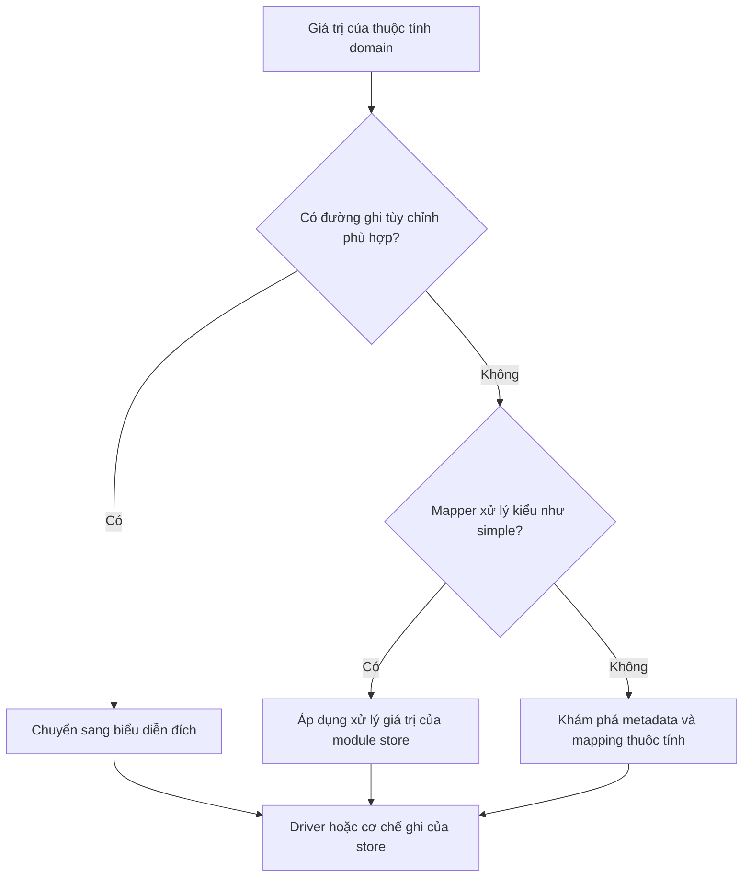

# SimpleTypeHolder và kiểu dữ liệu bản địa của store

## 1. Bài toán: khi nào mapper nên dừng phân tích một kiểu Java?

Trong chương **Chuyển đổi dữ liệu** của **SPRING_DATA_COMMONS**, `SimpleTypeHolder` giúp giải thích một quyết định nền tảng của mapping: một giá trị được xử lý như một đơn vị dữ liệu, hay cần được tiếp tục khám phá thành các thuộc tính?

Xét mô hình sau:

```java
record EmailAddress(String value) {}

class Customer {
    String id;
    EmailAddress email;
    Address address;
}

class Address {
    String street;
    String city;
}
```

Ứng dụng có thể muốn lưu `email` thành một chuỗi, còn `address` thành cấu trúc gồm `street` và `city`. Tuy nhiên, việc `EmailAddress` chỉ có một thuộc tính không tự quyết định rằng nó phải được lưu thành chuỗi. Mapper cần biết ranh giới mapping và cơ chế chuyển đổi tương ứng.

`SimpleTypeHolder` cung cấp thông tin phân loại kiểu cho hạ tầng mapping của Spring Data. Nó không tự biến `EmailAddress` thành `String`, không đăng ký bộ mã hóa cho driver và không quyết định schema của cơ sở dữ liệu.

Sau bài này, bạn cần phân biệt được:

- Kiểu đơn giản đối với mapping và kiểu mà store hoặc driver hỗ trợ trực tiếp.
- Việc khai báo một kiểu là simple với việc cung cấp converter cho kiểu đó.
- Danh sách kiểu dùng chung trong Commons và cấu hình thực tế của từng module store.
- Cách giữ nhất quán giữa mapping context, custom conversions và dữ liệu đã lưu.

## 2. Ba lớp khái niệm cần tách rõ

### 2.1. Kiểu Java của domain

Đây là kiểu mà ứng dụng sử dụng để diễn đạt nghiệp vụ: `EmailAddress`, `Money`, `OrderId`, `Address`, hoặc một aggregate như `Customer`.

Một value object có thể rất nhỏ nhưng vẫn là một kiểu phức hợp đối với mapper. Ngược lại, một đối tượng chứa cấu trúc bên trong có thể được một module coi là một đơn vị dữ liệu vì store có cơ chế xử lý riêng.

Vì vậy, các tiêu chí như “bất biến”, “là record”, “chỉ có một field” hay “không có setter” không đủ để kết luận một kiểu là simple.

### 2.2. Simple type trong hạ tầng mapping

Một simple type là kiểu được cấu hình để xử lý như một giá trị tại ranh giới mapping đang xét. Mapping context thường không cần xây dựng metadata persistent entity cho chính kiểu đó.

`SimpleTypeHolder` trả lời câu hỏi phân loại qua phương thức:

```java
boolean isSimpleType(Class<?> type)
```

Kết quả này là thông tin cho các thành phần khác. Nó không mang theo bản ghi dữ liệu, tên cột, đường dẫn thuộc tính hay hàm chuyển đổi giá trị.

Chữ “simple” mô tả cách hạ tầng mapping đối xử với kiểu, không khẳng định rằng cấu trúc bên trong của giá trị luôn đơn giản.

### 2.3. Kiểu bản địa của store hoặc driver

Kiểu bản địa là biểu diễn mà store, định dạng dữ liệu hoặc driver có thể tiếp nhận theo hợp đồng của chúng. Cần làm rõ tầng đang nói đến:

- Cơ sở dữ liệu quan hệ có các kiểu cột; JDBC driver có các quy tắc binding và đọc giá trị Java.
- MongoDB lưu dữ liệu dưới dạng BSON; driver có tập kiểu và codec tương ứng.
- Redis làm việc với các cấu trúc dữ liệu của Redis; tầng ứng dụng còn cần quy ước mã hóa giá trị và ánh xạ object.

Một kiểu được Commons nhận diện là simple chưa chắc được mọi driver lưu trực tiếp với biểu diễn ứng dụng mong muốn. Ngược lại, một kiểu đặc thù của driver có thể cần module store bổ sung vào tập simple types.

| Khái niệm | Câu hỏi được trả lời | Thành phần thường liên quan |
| --- | --- | --- |
| Kiểu domain | Nghiệp vụ muốn diễn đạt giá trị bằng kiểu nào? | Mô hình ứng dụng |
| Simple type | Mapper có cần khám phá kiểu này thành persistent entity không? | `SimpleTypeHolder`, mapping context |
| Conversion | Đổi giá trị từ kiểu nguồn sang kiểu đích bằng cách nào? | Converter, custom conversions, conversion service |
| Biểu diễn lưu trữ | Dữ liệu cuối cùng được ghi và đọc như thế nào? | Store module, driver, codec hoặc serializer, schema |

Các tầng có liên hệ với nhau, nhưng một cấu hình ở tầng này không tự thay thế hợp đồng của tầng khác.

## 3. `SimpleTypeHolder` cung cấp điều gì?

Lớp nằm trong package:

```java
import org.springframework.data.mapping.model.SimpleTypeHolder;
```

Hai thao tác quan trọng khi học API là dùng holder mặc định và tạo holder có bổ sung kiểu riêng:

```java
import java.util.Set;
import org.springframework.data.mapping.model.SimpleTypeHolder;

class SimpleTypeDemo {

    record EmailAddress(String value) {}

    public static void main(String[] args) {
        SimpleTypeHolder defaults = SimpleTypeHolder.DEFAULT;

        SimpleTypeHolder domainTypes = new SimpleTypeHolder(
                Set.of(EmailAddress.class),
                true
        );

        System.out.println(defaults.isSimpleType(String.class));
        System.out.println(defaults.isSimpleType(EmailAddress.class));
        System.out.println(domainTypes.isSimpleType(EmailAddress.class));
        System.out.println(domainTypes.isSimpleType(String.class));
    }
}
```

Trong ví dụ độc lập này, kết quả mong đợi là:

```text
true
false
true
true
```

`EmailAddress` là kiểu domain do ví dụ định nghĩa; holder mặc định không tự có quy tắc riêng cho nó. Holder thứ hai được bổ sung kiểu này và vẫn giữ các mặc định nhờ đối số `true`.

Ví dụ dùng cú pháp record và `Set.of`; khi áp dụng cần chọn phiên bản Java phù hợp với project. Đây là minh họa cho API phân loại, chưa phải cấu hình persistence hoàn chỉnh.

### 3.1. Ý nghĩa của `registerDefaults`

Với constructor sau:

```java
new SimpleTypeHolder(customTypes, registerDefaults)
```

`customTypes` là tập kiểu bổ sung; `registerDefaults` quyết định có đăng ký tập mặc định của holder hay không.

Trong bài toán mở rộng thông thường, giá trị `true` thể hiện ý định giữ tập mặc định và bổ sung kiểu của ứng dụng. Dùng `false` không có nghĩa là “lấy cấu hình store rồi thêm kiểu của tôi”. Nó cũng không phải cam kết rằng mọi kiểu ngoài tập truyền vào đều sẽ trả về `false`, vì logic nhận diện còn có các quy tắc theo kiểu của lớp.

Không nên dùng `registerDefaults = false` để dựng một holder thay thế cho toàn bộ cấu hình của module store nếu chưa hiểu rõ hợp đồng mà module đó cần.

### 3.2. Holder mặc định không phải danh sách kiểu của mọi database

`SimpleTypeHolder.DEFAULT` là điểm xuất phát dùng chung trong Commons. Nó không phải registry của mọi kiểu BSON, SQL, driver hay kiểu dữ liệu mở rộng của từng hệ quản trị.

Không nên sao chép một danh sách mặc định vào code nghiệp vụ rồi coi đó là hợp đồng cố định cho mọi phiên bản. Với một kiểu cụ thể, hãy kiểm tra holder thực tế của cấu hình đang dùng và đường chuyển đổi tương ứng.

### 3.3. Phân loại kiểu không đồng nghĩa với một phép kiểm tra tên lớp

Việc nhận diện có thể xét quan hệ kiểu và các quy tắc có sẵn, không chỉ so sánh một tên lớp với một danh sách chuỗi. Vì thế, việc khai báo một kiểu cha quá rộng có thể làm nhiều kiểu con cũng được nhận diện là simple.

Ví dụ nguy hiểm:

```java
SimpleTypeHolder tooBroad = new SimpleTypeHolder(
        Set.of(Object.class),
        true
);
```

Khai báo quá rộng làm mất ý nghĩa của ranh giới mapping: nhiều domain object vốn cần được phân tích thuộc tính có thể bị coi là giá trị đơn. Hãy đăng ký kiểu cụ thể mà ứng dụng có chiến lược chuyển đổi rõ ràng.

## 4. Holder tham gia quá trình mapping ở đâu?

Một đường ghi dữ liệu có thể được hiểu qua sơ đồ khái niệm sau:



Đây là mô hình tư duy, không phải thứ tự gọi phương thức được đảm bảo cho mọi module. Mỗi mapper có thể đặt các bước chuyển đổi, xử lý collection, map hoặc giá trị đặc biệt ở vị trí khác nhau.

Hai tác động cần ghi nhớ:

1. **Ở tầng metadata:** kiểu được coi là simple thường không cần trở thành một persistent entity riêng trong mapping context.
2. **Ở tầng giá trị:** mapper vẫn cần biết cách đưa giá trị đến biểu diễn mà cơ chế ghi của store tiếp nhận được.

Một holder có thể giúp mapper quyết định dừng khám phá thuộc tính, nhưng không tạo ra thao tác `email.value()` để lưu dữ liệu. Ngược lại, một converter được tạo thành object Java nhưng chưa được đăng ký vào hạ tầng mapping cũng chưa tạo ra thay đổi trong persistence.

### Collection và map cần được xét theo cấu trúc

Không thể chỉ hỏi “`List` có simple không?” rồi kết luận toàn bộ thuộc tính collection được lưu ra sao. Mapper thường có xử lý riêng cho container và tiếp tục xem xét kiểu hoặc giá trị phần tử.

Với `List<EmailAddress>`, cần xác định cách chuyển đổi từng `EmailAddress`, cách biểu diễn collection và giới hạn của store. Với `Map<String, EmailAddress>`, còn có quy tắc về key, cấu trúc đích và truy vấn.

`SimpleTypeHolder` nhận `Class<?>`; nó không tự mô tả toàn bộ thông tin generic của một thuộc tính hoặc thay thế metadata của container.

## 5. Ví dụ đầy đủ về ý định: lưu `EmailAddress` thành chuỗi

Giả sử hợp đồng lưu trữ của ứng dụng là:

| Hướng | Kiểu nguồn | Kiểu đích | Biểu diễn mong muốn |
| --- | --- | --- | --- |
| Ghi | `EmailAddress` | `String` | Giá trị email trong một trường hoặc cột |
| Đọc | `String` | `EmailAddress` | Khôi phục value object từ dữ liệu đã lưu |

### 5.1. Định nghĩa value object

```java
import java.util.Objects;

public record EmailAddress(String value) {

    public EmailAddress {
        Objects.requireNonNull(value, "email must not be null");

        if (value.isBlank()) {
            throw new IllegalArgumentException("email must not be blank");
        }
    }
}
```

Quy tắc trên chỉ kiểm tra có giá trị và không để trắng; nó không phải bộ kiểm tra đầy đủ định dạng email. Ví dụ giữ nguyên chuỗi đầu vào để tập trung vào hợp đồng chuyển đổi.

### 5.2. Converter theo hướng ghi

```java
import org.springframework.core.convert.converter.Converter;
import org.springframework.data.convert.WritingConverter;

@WritingConverter
public final class EmailAddressWriteConverter
        implements Converter<EmailAddress, String> {

    @Override
    public String convert(EmailAddress source) {
        return source.value();
    }
}
```

Converter nhận value object và trả về chuỗi. Annotation `@WritingConverter` xác định ý định dùng theo hướng từ mô hình ứng dụng đến biểu diễn lưu trữ.

### 5.3. Converter theo hướng đọc

```java
import org.springframework.core.convert.converter.Converter;
import org.springframework.data.convert.ReadingConverter;

@ReadingConverter
public final class EmailAddressReadConverter
        implements Converter<String, EmailAddress> {

    @Override
    public EmailAddress convert(String source) {
        return new EmailAddress(source);
    }
}
```

Mỗi đoạn có lớp `public` cần được đặt trong file Java tương ứng nếu triển khai thành project. Các đoạn code trong bài minh họa nội dung; công việc hiện tại không tạo thêm các file Java đó.

Annotation hướng đọc/ghi giúp tránh suy luận mơ hồ, đặc biệt khi cả kiểu nguồn lẫn kiểu đích đều có thể được xem là kiểu phù hợp cho store. Annotation không tự làm converter được phát hiện và đăng ký ở mọi cấu hình.

### 5.4. Đăng ký vào hạ tầng chuyển đổi của đúng module

Cần đưa hai converter vào cơ chế custom conversions mà module Spring Data đang dùng thực sự tiếp nhận. Các module có API cấu hình riêng; không có một bean duy nhất có thể được giả định là cấu hình đúng cho mọi store.

Quy trình triển khai hợp lý là:

1. Xác định module thực hiện persistence và mapper được repository sử dụng.
2. Đăng ký converter vào cơ chế custom conversions của module đó.
3. Giữ các conversions và simple types do module cung cấp.
4. Để mapping context và mapper sử dụng cấu hình chuyển đổi nhất quán.
5. Kiểm tra dữ liệu ghi thật, đọc lại và giá trị tham số truy vấn.

Không nên mặc định rằng chỉ đưa converter vào conversion service dùng cho HTTP binding hoặc chỉ khai báo một bean `Converter` bất kỳ là đủ để repository sử dụng nó. Việc phát hiện converter phụ thuộc cấu hình và module.

### 5.5. Quan hệ với `CustomConversions`

`CustomConversions` là hạ tầng Commons liên quan trực tiếp đến các cặp chuyển đổi và simple types. Khi có converter ghi từ một kiểu domain sang kiểu lưu trữ phù hợp, hạ tầng custom conversions có thể bổ sung kiểu domain vào tập simple types hiệu lực.

Ý nghĩa là metadata và đường chuyển đổi có thể được xây dựng từ cùng cấu hình. Điều này giảm nguy cơ mapper đi khám phá nội dung của một value object vốn được chủ đích lưu thành một giá trị.

Đoạn sau chỉ minh họa cách quan sát holder từ một đối tượng `CustomConversions` **đã được module cấu hình**:

```java
import org.springframework.data.convert.CustomConversions;
import org.springframework.data.mapping.model.SimpleTypeHolder;

public final class ConversionMetadata {

    public static boolean treatsEmailAsSimple(
            CustomConversions customConversions) {

        SimpleTypeHolder holder = customConversions.getSimpleTypeHolder();
        return holder.isSimpleType(EmailAddress.class);
    }
}
```

Không thể suy ra rằng mọi converter, ở mọi hướng, đều làm kiểu nguồn hoặc kiểu đích trở thành simple. Ví dụ, chỉ có converter đọc `String -> EmailAddress` không cung cấp đường ghi `EmailAddress -> String`.

Kết quả `true` từ phương thức trên cũng chỉ xác nhận phân loại metadata. Nó chưa chứng minh rằng repository đang dùng đúng instance cấu hình, driver tiếp nhận biểu diễn đích hay dữ liệu đọc lại thỏa quy tắc nghiệp vụ.

## 6. Chỉ thêm simple type mà không thêm converter sẽ xảy ra gì?

Xét riêng cấu hình:

```java
SimpleTypeHolder holder = new SimpleTypeHolder(
        java.util.Set.of(EmailAddress.class),
        true
);
```

Cấu hình này nói rằng holder nhận diện `EmailAddress` là simple. Nó không chứa bất kỳ logic nào để lấy `value`, tạo chuỗi hay tái dựng value object.

Nếu driver hoặc mapper không có cách xử lý kiểu đó, lỗi có thể xuất hiện ở giai đoạn chuyển đổi, binding hoặc ghi dữ liệu. Thông báo cụ thể phụ thuộc module. Một số hệ thống có cơ chế fallback hoặc codec bổ sung nên biểu hiện cũng có thể khác.

Có hai chiến lược hợp lệ tùy bối cảnh:

- **Chuyển đổi trong mapping:** cung cấp converter giữa value object và một kiểu mà module/store hỗ trợ.
- **Dùng khả năng xử lý bản địa hoặc codec của driver:** bảo đảm driver xử lý được kiểu và mapper thực sự chuyển giá trị đến đúng cơ chế đó.

Đăng ký driver codec không tự đảm bảo mapping context của Spring Data coi kiểu ấy là simple. Tương tự, đăng ký simple type không tự đăng ký driver codec. Nếu kết hợp hai tầng, phải kiểm tra cả hai.

## 7. Vì sao phải giữ cấu hình của từng store?

Commons cung cấp abstraction chung, còn module store xác định phần ánh xạ cụ thể. Khả năng của một module không thể được suy ra chỉ từ việc module đó cũng dùng `Repository` hoặc `CrudRepository`.

| Bối cảnh | Điều cần xác định trước khi chọn kiểu đích |
| --- | --- |
| Store quan hệ qua module JDBC/R2DBC | Kiểu cột, dialect, driver và hợp đồng binding/reading |
| Store tài liệu như MongoDB | Biểu diễn BSON, mapper, kiểu đặc thù của driver và codec |
| Store key-value như Redis | Quy ước mã hóa, cấu trúc dữ liệu và cách mapper tổ chức thuộc tính |
| Persistence qua JPA | Cơ chế mapping/conversion của JPA provider, chẳng hạn attribute converter khi phù hợp |

Riêng với Spring Data JPA, không nên lấy một công thức cấu hình simple types của module khác rồi mặc định nó sẽ điều khiển mapping thuộc tính của JPA entity. Provider JPA chịu trách nhiệm cho nhiều quyết định chuyển đổi và mapping tại tầng đó.

### 7.1. Kiểu có cấu trúc vẫn có thể là một đơn vị đối với mapper

Một document hoặc giá trị đặc thù do driver cung cấp có thể chứa cấu trúc bên trong. Module store vẫn có thể xử lý nó như một giá trị tại một ranh giới nhất định vì đã biết cách chuyển giao nó cho driver.

Điều này không có nghĩa mọi thuộc tính bên trong đều trở thành persistent property của domain model. Khả năng truy vấn đường dẫn con còn phụ thuộc biểu diễn thực tế, metadata và cơ chế query mapping của module.

### 7.2. Tránh thay thế tập simple types của store bằng tập riêng

Một lỗi cấu hình dễ gặp là tạo holder chỉ từ Commons và vài kiểu ứng dụng, rồi thay toàn bộ holder mà module đang dùng. Cách này có thể làm mất nhận diện đối với kiểu đặc thù của store.

Dấu hiệu có thể là một kiểu driver vốn hoạt động bắt đầu bị khám phá như domain object, xuất hiện metadata không mong muốn hoặc lỗi mapping mới.

Ưu tiên điểm mở rộng mà module cung cấp để bổ sung conversions và giữ cấu hình có sẵn. Nếu tự dựng hạ tầng mapping, phải truyền holder hiệu lực vào mapping context trước khi khởi tạo metadata, đồng thời bảo đảm mapper dùng cùng cấu hình conversions. Thay đổi holder sau khi context đã tạo metadata không phải cách an toàn để đồng bộ lại toàn bộ hệ thống.

## 8. Chọn simple value hay object có cấu trúc?

Quyết định này nên đi từ cách dùng dữ liệu, không chỉ từ việc domain class có ít field.

### 8.1. `EmailAddress`: thường phù hợp với biểu diễn một giá trị

Nếu hệ thống tìm kiếm email theo toàn bộ địa chỉ và không cần lưu thành các phần riêng, một chuỗi có thể là biểu diễn phù hợp. Value object vẫn giữ lợi ích về kiểu dữ liệu trong Java.

Cần quy định rõ cách so sánh, chuẩn hóa, xử lý dữ liệu cũ và lập chỉ mục. Converter không tự tạo quy tắc uniqueness hay index tại store.

### 8.2. `Money`: một value object có thể cần nhiều thành phần lưu trữ

```java
record Money(java.math.BigDecimal amount, String currency) {}
```

Nếu cần lọc theo `amount`, sắp xếp theo giá trị số hoặc kiểm tra `currency`, việc gộp thành chuỗi tùy ý có thể làm truy vấn và index khó hơn. Khi đó, biểu diễn bằng các field/cột có cấu trúc hoặc dùng khả năng đặc thù của store có thể phù hợp hơn.

Đánh dấu `Money` là simple không tự tạo ra hai cột và không giải quyết quy tắc quy đổi tiền tệ.

### 8.3. `Address`: cấu trúc lưu trữ phục vụ truy vấn thành phần

Nếu thường xuyên truy vấn `address.city`, cần một biểu diễn cho phép store và mapper hiểu đường dẫn đó. Gộp toàn bộ `Address` thành chuỗi JSON rồi coi là simple sẽ thay đổi cách truy vấn; nó không bảo toàn tự động ý nghĩa truy vấn thuộc tính lồng nhau.

Một số database hỗ trợ truy vấn JSON hoặc cấu trúc tương tự, nhưng cách khai báo, query và index là khả năng cụ thể của store. `SimpleTypeHolder` không cung cấp một API truy vấn JSON dùng chung cho tất cả module.

| Nhu cầu | Hướng cân nhắc |
| --- | --- |
| Đọc/ghi toàn bộ giá trị, so sánh toàn bộ | Một simple value cùng conversion rõ ràng |
| Lọc, sort, index theo thành phần | Mapping có cấu trúc hoặc kiểu store hỗ trợ truy vấn thành phần |
| Tham chiếu aggregate khác | Cơ chế tham chiếu hoặc quan hệ của module, theo thiết kế aggregate |
| Dùng kiểu đặc thù của driver | Hợp đồng của driver và nhận diện tương ứng tại mapper |

## 9. Ảnh hưởng đến repository và truy vấn

Giả sử repository của module phù hợp khai báo:

```java
interface CustomerRepository extends Repository<Customer, String> {
    java.util.Optional<Customer> findByEmail(EmailAddress email);
}
```

Ví dụ chỉ minh họa chữ ký phương thức, không phải cấu hình repository hoàn chỉnh.

Nếu `email` lưu thành chuỗi, tham số query cũng cần được ánh xạ sang biểu diễn tương ứng. Nhiều module áp dụng conversion khi mapping tham số, nhưng không được suy ra rằng mọi kiểu truy vấn, mọi projection hay mọi biểu thức đều đi qua cùng một đường xử lý.

Khi triển khai cần xác minh ba phần:

1. Ghi `new EmailAddress("an@example.test")` tạo đúng biểu diễn lưu trữ.
2. Đọc biểu diễn đó khôi phục được `EmailAddress`.
3. Truy vấn bằng giá trị domain tìm đúng bản ghi đã lưu.

Các kiểu query riêng của store, native query, aggregation hoặc projection có thể có quy tắc chuyển đổi khác. Hãy kiểm tra đúng đường sử dụng của ứng dụng.

### Không tự hình thành đường dẫn thuộc tính con

Khi `email` được lưu thành một chuỗi, không thể mặc định rằng đường dẫn `email.value` tồn tại trong dữ liệu. Phương thức derived query cố đi sâu vào `value` có thể không được hỗ trợ hoặc không tương ứng với schema đã chọn.

Tương tự, sort phải hướng đến thuộc tính hoặc biểu diễn mà store thực sự có thể sắp xếp. Việc thêm `EmailAddress` vào holder không tự dạy store cách sort theo một quy tắc nghiệp vụ tùy ý.

## 10. Những lỗi thường gặp và cách khoanh vùng

| Hiện tượng | Giả thuyết cần kiểm tra | Hướng xử lý |
| --- | --- | --- |
| Mapper khám phá các field bên trong value object ngoài ý muốn | Kiểu chưa được phân loại đúng; custom conversions chưa được sử dụng | Kiểm tra holder hiệu lực và điểm đăng ký conversions |
| Kiểu đã simple nhưng ghi dữ liệu vẫn lỗi | Thiếu đường ghi hoặc driver không tiếp nhận kiểu đích | Kiểm tra converter, binding, codec và schema |
| Ghi được nhưng không đọc được | Thiếu converter đọc; dữ liệu cũ khác biểu diễn; constructor từ chối dữ liệu | Đối chiếu dữ liệu thực tế và đường đọc |
| Converter tồn tại nhưng không được gọi | Đăng ký vào sai hạ tầng hoặc đường xử lý không dùng converter đó | Xác định mapper/repository đang dùng và cách module chọn conversions |
| Kiểu đặc thù của store hỏng sau khi tùy chỉnh | Holder/conversions của store đã bị thay thế | Bổ sung qua cơ chế mở rộng và giữ cấu hình store |
| Query theo value object không tìm được dữ liệu | Biểu diễn tham số khác dữ liệu lưu, hoặc query dùng đường mapping khác | Kiểm tra giá trị query sau mapping trên đúng loại query |
| Nhiều domain object bỗng bị xem là simple | Đăng ký kiểu cha hoặc interface quá rộng | Thu hẹp tập custom simple types |

Các hiện tượng trên là dấu hiệu khoanh vùng, không phải chẩn đoán chắc chắn cho mọi store. Tránh suy luận rằng tất cả lỗi conversion đều do `SimpleTypeHolder`.

### Trình tự kiểm tra ngắn gọn

1. Xác định kiểu runtime của giá trị, kiểu khai báo của thuộc tính và module store đang xử lý.
2. Quan sát simple types từ cấu hình thực tế, không chỉ từ một holder được tạo riêng để thử.
3. Xác định cặp kiểu nguồn/đích và hướng của converter đã đăng ký.
4. Đối chiếu biểu diễn được ghi với schema hoặc cấu trúc dữ liệu thực tế.
5. Kiểm tra riêng đường ghi, đường đọc và đường query cần dùng.

Việc gọi `SimpleTypeHolder.DEFAULT.isSimpleType(...)` chỉ cho biết kết quả của holder mặc định. Nó không chứng minh cấu hình repository hiện tại đang dùng holder đó.

## 11. Kiểm chứng hợp đồng chuyển đổi khi triển khai

Ví dụ dưới đây kiểm tra riêng cặp converter theo hướng đi-về:

```java
import static org.junit.jupiter.api.Assertions.assertEquals;

import org.junit.jupiter.api.Test;

class EmailAddressConversionTest {

    @Test
    void preservesValueAcrossWriteAndRead() {
        EmailAddress original = new EmailAddress("an@example.test");
        EmailAddressWriteConverter writer = new EmailAddressWriteConverter();
        EmailAddressReadConverter reader = new EmailAddressReadConverter();

        String stored = writer.convert(original);
        EmailAddress restored = reader.convert(stored);

        assertEquals("an@example.test", stored);
        assertEquals(original, restored);
    }
}
```

Bài kiểm tra này xác nhận hai converter phối hợp theo hợp đồng đã chọn. Nó chưa xác nhận việc đăng ký converter, mapping context, driver hoặc repository.

Khi áp dụng vào một module cụ thể, kiểm tra tích hợp có giá trị hơn là chỉ assert `isSimpleType(...) == true`. Một kịch bản thích hợp gồm:

- Lưu aggregate có `EmailAddress` và quan sát biểu diễn lưu trữ.
- Đọc lại aggregate và kiểm tra kiểu cùng giá trị domain.
- Thực hiện đúng truy vấn mà ứng dụng sử dụng, với tham số domain tương ứng.
- Nếu có đổi định dạng, kiểm tra cả dữ liệu đã tồn tại trước thay đổi.

Các đoạn kiểm thử trong bài là ví dụ học tập, không phải kết quả đã chạy trên một store cụ thể.

## 12. Thay đổi biểu diễn dữ liệu cần đi cùng kế hoạch tương thích

Giả sử trước đây `email` được lưu thành object có field `value`, sau đó chuyển sang một chuỗi. Đây là thay đổi hợp đồng lưu trữ, dù domain class Java vẫn giữ nguyên.

Cần xem xét:

- Dữ liệu cũ được đọc bằng cách nào trong giai đoạn chuyển tiếp.
- Có cần migration, backfill hoặc hỗ trợ tạm thời nhiều biểu diễn không.
- Query và index nào đang tham chiếu đường dẫn cũ.
- Các phiên bản ứng dụng cùng chạy có đọc được dữ liệu của nhau không.
- Rollback có khôi phục được khả năng đọc dữ liệu mới không.

Chỉ thay holder hoặc converter không tự chuyển đổi dữ liệu đã lưu. Nếu mapper ngừng khám phá thuộc tính vì kiểu nay là simple, metadata mới cũng không tự sửa schema hoặc cập nhật đường dẫn query cũ.

Với một kiểu đích rộng như `String`, converter đọc toàn cục còn có thể áp dụng cho mọi thuộc tính domain cùng kiểu đích phù hợp. Nếu từng thuộc tính cần quy tắc khác nhau, hãy đánh giá cơ chế conversion theo thuộc tính mà module hỗ trợ, hoặc tách kiểu domain để hợp đồng rõ ràng hơn.

## 13. Tự kiểm tra mức hiểu

**Câu 1. `EmailAddress` là record bất biến, vậy mặc định nó có phải simple type không?**

Không thể kết luận từ việc là record hoặc bất biến. Cần xem holder hiệu lực và cấu hình conversions của module.

**Câu 2. `holder.isSimpleType(EmailAddress.class)` trả về `true`; có thể khẳng định database lưu được nó không?**

Không. Kết quả chỉ xác nhận phân loại tại holder đó. Vẫn cần đường chuyển đổi hoặc hỗ trợ tương ứng ở mapper/driver, cùng biểu diễn lưu trữ hợp lệ.

**Câu 3. Vì sao không chỉ tạo holder có thêm `EmailAddress` rồi kết thúc?**

Vì holder không cung cấp logic chuyển đổi giá trị. Trong trường hợp lưu thành chuỗi, cần cấu hình đường ghi/đọc và tích hợp vào đúng hạ tầng store.

**Câu 4. Có converter `String -> EmailAddress` thì đã đủ cho cả lưu và đọc chưa?**

Chưa. Converter đó mô tả hướng đọc; không tự sinh phép chuyển đổi ngược. Cần đường ghi phù hợp hoặc một cơ chế khác đã được cấu hình.

**Câu 5. Vì sao một kiểu tài liệu có cấu trúc vẫn có thể được xem là simple?**

Vì “simple” diễn tả ranh giới xử lý của mapper. Module có thể chuyển giao cả giá trị cho tầng xử lý của store mà không xây dựng persistent entity cho từng thuộc tính bên trong.

**Câu 6. Nếu đổi `Address` sang một chuỗi, derived query theo `address.city` có tiếp tục hoạt động như trước không?**

Không có bảo đảm đó. Phải đánh giá lại biểu diễn, metadata, khả năng query và index của module đang dùng.

## 14. Các nguyên tắc cần ghi nhớ

`SimpleTypeHolder` là công cụ phân loại kiểu trong hạ tầng mapping của Spring Data Commons. Nó giúp xác định ranh giới xử lý dữ liệu, còn chuyển đổi giá trị và ghi/đọc thực tế thuộc về các thành phần khác.

Khi mở rộng mapping, hãy bắt đầu bằng hợp đồng lưu trữ: value object sẽ được biểu diễn thế nào, có cần truy vấn thành phần không, và dữ liệu cũ được đọc ra sao. Sau đó cấu hình conversions qua điểm mở rộng của đúng module, giữ các kiểu và converters mà store cung cấp.

Một cấu hình thành công cần đồng thời khớp ba điều: **metadata hiểu đúng kiểu domain, conversion tạo đúng biểu diễn, và store đọc/ghi được biểu diễn đó**.