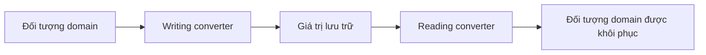

# Chuyển đổi value object, enum, tiền tệ và kiểu ID riêng

## 1. Giữ ý nghĩa trong domain, chọn biểu diễn phù hợp khi lưu

Trong một ứng dụng bán hàng, `CustomerCode`, `OrderStatus`, `Money` và `OrderId` có thể đều được lưu bằng các kiểu dữ liệu quen thuộc như chuỗi, số hoặc UUID. Tuy nhiên, chúng mang những ý nghĩa khác nhau: mã khách hàng có quy tắc riêng, trạng thái chỉ nhận một tập giá trị, tiền luôn đi cùng đơn vị tiền tệ, còn ID đơn hàng không được truyền nhầm thành ID khách hàng.

Bài học thuộc chương **Chuyển đổi dữ liệu** của module **SPRING_DATA_COMMONS**. Mục tiêu là thiết kế chuyển đổi giữa kiểu domain và biểu diễn lưu trữ, sử dụng abstraction dùng chung của Spring Data, đồng thời nhận biết phần tích hợp phụ thuộc từng loại kho dữ liệu. Những quyết định này còn ảnh hưởng đến CRUD, tham số derived query, QBE, projection và cách dữ liệu được phân trang, sắp xếp.

Một hợp đồng chuyển đổi cần trả lời được ba câu hỏi:

1. Giá trị hợp lệ trong domain là gì?
2. Kho dữ liệu thực sự lưu giá trị ấy dưới dạng nào?
3. Khi đọc lại hoặc dùng làm điều kiện truy vấn, cách hiểu có còn nhất quán không?

| Kiểu domain | Biểu diễn có thể chọn | Quyết định cần làm rõ |
| --- | --- | --- |
| `CustomerCode` | Chuỗi chuẩn hóa | Phân biệt hoa thường, khoảng trắng, dữ liệu cũ |
| `OrderStatus` | Mã chuỗi ổn định | Đổi tên enum, mã chưa nhận biết, tương thích nhiều phiên bản |
| `Money` | Số thập phân và mã tiền tệ; hoặc chuỗi có định dạng riêng | Scale, độ chính xác, truy vấn theo giá trị tiền |
| `OrderId` | Chuỗi UUID, UUID native hoặc kiểu ID của store | Kiểu ID của repository, sinh ID, ánh xạ khóa chính |

Không có một biểu diễn chung tối ưu cho mọi store. Ví dụ, lưu tiền bằng chuỗi thuận tiện để minh họa chuyển đổi hai chiều nhưng thường không phù hợp với yêu cầu cộng tổng và lọc theo khoảng số tiền ở database.

## 2. Những abstraction tham gia vào chuyển đổi

### 2.1. Converter và ConversionService

`org.springframework.core.convert.converter.Converter<S, T>` mô tả một chiều chuyển đổi từ `S` sang `T`; `ConversionService` là API gọi các converter đã được đăng ký. Converter nên không giữ trạng thái thay đổi giữa các lần gọi. Khi được hạ tầng chuyển đổi gọi đúng hợp đồng, đối số `source` của `convert` không phải `null`; dữ liệu sai có thể được báo bằng `IllegalArgumentException`. [Spring Framework: Spring Type Conversion](https://docs.spring.io/spring-framework/reference/core/validation/convert.html).



Đọc và ghi là hai chiều độc lập. Có `Converter<CustomerCode, String>` không đồng nghĩa Spring tự suy ra được chiều `String` thành `CustomerCode`.

### 2.2. CustomConversions và hướng đọc, ghi

Spring Data cung cấp `CustomConversions` để quản lý đăng ký theo cặp kiểu. `@ReadingConverter` đánh dấu chiều từ biểu diễn của store về domain; `@WritingConverter` đánh dấu chiều từ domain ra biểu diễn của store. Các annotation chỉ nói rõ ý định, không tự đăng ký converter. [Spring Data Commons: Custom Conversions](https://docs.spring.io/spring-data/commons/reference/custom-conversions.html).

Quy tắc thực hành của bài là dùng một lớp cụ thể cho mỗi chiều và đăng ký rõ ràng vào cấu hình mapping đang sử dụng. Tránh tạo converter quá rộng như `Converter<Object, String>` chỉ để gọi `toString()` cho mọi đối tượng.

Đừng đồng nhất conversion service của Spring MVC, cấu hình JSON và conversion của persistence. Cùng dùng interface `Converter` không có nghĩa các thành phần dùng chung một registry.

### 2.3. Phạm vi của Commons và của store

Các module tự triển khai object mapping như MongoDB, Redis, Cassandra và Relational có cơ chế tích hợp riêng. Spring Data JPA ủy quyền mapping cho JPA provider; không áp dụng nguyên xi cấu hình custom conversion của một module khác cho JPA. [Spring Data Commons: Object Mapping Fundamentals](https://docs.spring.io/spring-data/commons/reference/object-mapping.html).

Các ví dụ dưới đây dùng Java 17 và API chuyển đổi của Spring. Mỗi kiểu `public` được đặt trong tệp Java riêng khi thực hành. Phần gọi `DefaultConversionService` minh họa hành vi chuyển đổi trong bộ nhớ; phần đăng ký MongoDB ở cuối là một ví dụ tích hợp có phạm vi cụ thể.

## 3. Value object một giá trị: mã khách hàng

### 3.1. Đặt quy tắc ở kiểu domain

Giả sử mã khách hàng trong hệ thống này phải gồm tiền tố `CUS-` và đúng sáu chữ số. Domain chấp nhận đầu vào có khoảng trắng ngoài cùng, chuẩn hóa sang chữ hoa và giữ biểu diễn chuẩn để so sánh.

```java
import java.util.Locale;
import java.util.Objects;

public record CustomerCode(String value) {

    public CustomerCode {
        Objects.requireNonNull(value, "value");
        value = value.strip().toUpperCase(Locale.ROOT);

        if (!value.matches("CUS-[0-9]{6}")) {
            throw new IllegalArgumentException("Mã khách hàng không hợp lệ");
        }
    }
}
```

Đây là chính sách của ứng dụng minh họa. Không áp dụng việc đổi sang chữ hoa cho mọi value object; email, tên người hoặc mã do hệ thống bên ngoài cấp có thể cần hợp đồng khác.

Record cung cấp equality dựa trên thành phần `value`. Vì constructor chuẩn hóa dữ liệu, hai giá trị được tạo từ `" cus-000123 "` và `"CUS-000123"` sẽ có cùng biểu diễn domain.

### 3.2. Viết đủ hai chiều

```java
import org.springframework.core.convert.converter.Converter;
import org.springframework.data.convert.ReadingConverter;

@ReadingConverter
public final class CustomerCodeReadConverter
        implements Converter<String, CustomerCode> {

    @Override
    public CustomerCode convert(String source) {
        return new CustomerCode(source);
    }
}
```

```java
import org.springframework.core.convert.converter.Converter;
import org.springframework.data.convert.WritingConverter;

@WritingConverter
public final class CustomerCodeWriteConverter
        implements Converter<CustomerCode, String> {

    @Override
    public String convert(CustomerCode source) {
        return source.value();
    }
}
```

Writer dùng accessor `value()`, không dựa vào `toString()` của record. Biểu diễn phục vụ log có thể thay đổi mà không nên làm thay đổi định dạng dữ liệu đã lưu.

Reader đi qua constructor để khôi phục đúng invariant. Nếu dữ liệu cũ chứa `"CUS-X"`, việc đọc phải thất bại theo hợp đồng này. Không bắt lỗi rồi trả một mã mặc định khiến bản ghi được gắn nhầm khách hàng.

### 3.3. Quan sát một vòng chuyển đổi

```java
import org.springframework.core.convert.support.DefaultConversionService;

var conversions = new DefaultConversionService();
conversions.addConverter(new CustomerCodeReadConverter());
conversions.addConverter(new CustomerCodeWriteConverter());

CustomerCode original = new CustomerCode(" cus-000123 ");
String stored = conversions.convert(original, String.class);
CustomerCode restored = conversions.convert(stored, CustomerCode.class);

System.out.println(stored);                     // CUS-000123
System.out.println(original.equals(restored));  // true
```

Đoạn này chỉ sử dụng registry vừa tạo. Nó chưa cấu hình repository hoặc ghi dữ liệu xuống bất kỳ store nào.

Khi có chuẩn hóa, điều kiện mong muốn là `read(write(domainValue))` bằng giá trị domain ban đầu. Chiều ngược lại có thể tạo biểu diễn chuẩn: `write(read(" cus-000123 "))` trả `"CUS-000123"`, không giữ nguyên chuỗi đầu vào. Vì vậy, cần xác định rõ hệ thống có cho phép chuẩn hóa dữ liệu cũ khi ghi lại hay không.

## 4. Enum: chọn mã lưu trữ độc lập với tên hằng

### 4.1. Không dùng vị trí để biểu diễn nghiệp vụ

Nếu lưu `ordinal()` của enum, việc chèn một hằng vào giữa danh sách có thể làm cùng một số chỉ sang trạng thái khác. Lưu tên hằng bằng `name()` tránh phụ thuộc vị trí nhưng vẫn phụ thuộc quyết định đặt tên trong mã nguồn.

Một lựa chọn của hệ thống minh họa là định nghĩa mã ổn định riêng:

```java
public enum OrderStatus {
    CREATED("N"),
    PAID("P"),
    CANCELLED("C");

    private final String storageCode;

    OrderStatus(String storageCode) {
        this.storageCode = storageCode;
    }

    public String storageCode() {
        return storageCode;
    }

    public static OrderStatus fromStorageCode(String code) {
        return switch (code) {
            case "N" -> CREATED;
            case "P" -> PAID;
            case "C" -> CANCELLED;
            default -> throw new IllegalArgumentException(
                    "Mã trạng thái đơn hàng chưa được hỗ trợ");
        };
    }
}
```

```java
import org.springframework.core.convert.converter.Converter;
import org.springframework.data.convert.ReadingConverter;

@ReadingConverter
public final class OrderStatusReadConverter
        implements Converter<String, OrderStatus> {

    @Override
    public OrderStatus convert(String source) {
        return OrderStatus.fromStorageCode(source);
    }
}
```

```java
import org.springframework.core.convert.converter.Converter;
import org.springframework.data.convert.WritingConverter;

@WritingConverter
public final class OrderStatusWriteConverter
        implements Converter<OrderStatus, String> {

    @Override
    public String convert(OrderStatus source) {
        return source.storageCode();
    }
}
```

Các mã `N`, `P`, `C` trở thành một phần hợp đồng dữ liệu. Đổi `CREATED` thành `PLACED` trong Java không bắt buộc đổi mã `N`; ngược lại, đổi mã `N` thành `NEW` cần kế hoạch tương thích và chuyển dữ liệu.

### 4.2. Quyết định khi gặp mã chưa biết

Ví dụ cố ý báo lỗi cho mã lạ. Một hệ thống khác có thể cần đọc bản ghi do phiên bản mới hơn tạo, nhưng trả về `UNKNOWN` cũng có rủi ro: khi ghi lại, mã gốc có thể bị mất.

Nếu cần bảo toàn mã chưa biết, một wrapper giữ `rawCode` có thể phù hợp hơn enum thuần. Nếu chọn từ chối, cần giám sát lỗi đọc và quy trình xử lý dữ liệu. Không tự đổi mã lạ thành `CREATED`, vì đó là thay đổi trạng thái nghiệp vụ.

Trong triển khai cuốn chiếu, phiên bản đọc mới có thể được đưa vào trước phiên bản bắt đầu ghi mã mới. Khi toàn bộ reader đã hiểu định dạng, writer mới chuyển sang phát sinh dữ liệu mới. Đây là quyết định triển khai của ứng dụng, không phải chức năng tự động của converter.

## 5. Tiền tệ: số tiền và đơn vị phải đi cùng nhau

### 5.1. Xác định hợp đồng Money

`19.95 USD` và `19.95 VND` là hai giá trị khác nhau. Một converter chỉ ghi `amount` đã làm mất thông tin nếu hệ thống có nhiều loại tiền.

Ví dụ sử dụng `BigDecimal` cho số tiền và `Currency` cho mã tiền tệ. `Currency.getCurrencyCode()` cung cấp mã như `USD`; ký hiệu hiển thị như `$` không phải định danh đủ rõ cho hợp đồng lưu trữ. [Java API: Currency](https://docs.oracle.com/en/java/javase/17/docs/api/java.base/java/util/Currency.html).

```java
import java.math.BigDecimal;
import java.math.RoundingMode;
import java.util.Currency;
import java.util.Objects;

public record Money(BigDecimal amount, Currency currency) {

    public Money {
        Objects.requireNonNull(amount, "amount");
        Objects.requireNonNull(currency, "currency");

        int scale = switch (currency.getCurrencyCode()) {
            case "VND", "JPY" -> 0;
            case "USD", "EUR" -> 2;
            default -> throw new IllegalArgumentException(
                    "Loại tiền chưa được ứng dụng hỗ trợ");
        };

        amount = amount.setScale(scale, RoundingMode.UNNECESSARY);
    }
}
```

Bảng scale ở đây là **chính sách minh họa đã chốt của ứng dụng**, không phải danh mục tiền tệ đầy đủ. `Currency.getDefaultFractionDigits()` có thể cung cấp metadata tham khảo, nhưng không thay thế thỏa thuận về scale của sản phẩm, dữ liệu lịch sử hoặc loại tiền được hỗ trợ.

Constructor không tự làm tròn. Ví dụ `USD 19.999` bị từ chối vì biểu diễn với hai chữ số thập phân sẽ mất dữ liệu. Nếu ứng dụng cần làm tròn thuế hoặc chiết khấu, quy tắc đó phải được áp dụng rõ ràng trước khi tạo giá trị dùng để lưu.

`BigDecimal.equals` phân biệt cả giá trị và scale, còn `compareTo` có cách so sánh giá trị số khác. Việc chuẩn hóa scale trong constructor giúp equality của record nhất quán với hợp đồng ví dụ. Khi tạo số thập phân từ hằng, dùng chuỗi như `new BigDecimal("19.95")` để tránh mang vào sai số của số dấu phẩy động nhị phân. [Java API: BigDecimal](https://docs.oracle.com/en/java/javase/17/docs/api/java.base/java/math/BigDecimal.html).

### 5.2. Converter chuỗi để minh họa hợp đồng hai chiều

Giả sử trường lưu trữ dùng đúng định dạng `MÃ_TIỀN|SỐ_TIỀN`, chẳng hạn `USD|19.95`. Định dạng này dành cho dữ liệu máy đọc, không dùng dấu phân nhóm hoặc dấu thập phân theo locale của người dùng.

```java
import java.math.BigDecimal;
import java.util.Currency;
import org.springframework.core.convert.converter.Converter;
import org.springframework.data.convert.ReadingConverter;

@ReadingConverter
public final class MoneyReadConverter implements Converter<String, Money> {

    @Override
    public Money convert(String source) {
        int separator = source.indexOf('|');

        if (separator != 3
                || separator != source.lastIndexOf('|')
                || separator == source.length() - 1) {
            throw new IllegalArgumentException("Sai định dạng tiền lưu trữ");
        }

        String currencyCode = source.substring(0, separator);
        String amountText = source.substring(separator + 1);

        if (!currencyCode.matches("[A-Z]{3}")
                || !amountText.matches("-?[0-9]+(?:[.][0-9]+)?")) {
            throw new IllegalArgumentException("Sai thành phần tiền lưu trữ");
        }

        return new Money(
                new BigDecimal(amountText),
                Currency.getInstance(currencyCode));
    }
}
```

```java
import org.springframework.core.convert.converter.Converter;
import org.springframework.data.convert.WritingConverter;

@WritingConverter
public final class MoneyWriteConverter implements Converter<Money, String> {

    @Override
    public String convert(Money source) {
        return source.currency().getCurrencyCode()
                + "|"
                + source.amount().toPlainString();
    }
}
```

```java
import java.math.BigDecimal;
import java.util.Currency;

Money price = new Money(new BigDecimal("19.95"), Currency.getInstance("USD"));
String stored = new MoneyWriteConverter().convert(price);
Money restored = new MoneyReadConverter().convert(stored);

System.out.println(stored);                  // USD|19.95
System.out.println(price.equals(restored));  // true
```

Reader chỉ nhận một dấu phân cách và cú pháp số thập phân đã xác định. Giá trị như `USD|1,000.00`, `USD|19.999`, `ABC|10.00` hoặc chuỗi thiếu đơn vị tiền tệ bị từ chối theo các bước kiểm tra tương ứng.

Định dạng có dấu phân cách chỉ an toàn ở đây vì hai thành phần được giới hạn rõ. Không suy ra rằng có thể nối tùy ý tên người, địa chỉ hoặc nội dung tự do bằng cùng cách mà không có escaping hay định dạng có cấu trúc.

### 5.3. Khi nào cần biểu diễn có cấu trúc?

Nếu cần lọc `amount >= 100`, cộng doanh thu hoặc tạo index theo currency và amount, ưu tiên thiết kế có trường số riêng cùng trường mã tiền tệ. Cách thực hiện phụ thuộc store:

| Biểu diễn | Cách hiểu và đánh đổi |
| --- | --- |
| Chuỗi `USD|19.95` | Một giá trị đơn giản; so sánh chuỗi không phản ánh thứ tự số tiền |
| `amount` kiểu decimal và `currency` kiểu chuỗi | Giữ được hai thành phần để truy vấn; phải chốt precision, scale và mapping thực tế |
| Số nguyên đơn vị nhỏ nhất cùng mã tiền tệ | Cần quy ước scale; phải kiểm soát tràn số và khả năng biểu diễn |
| Đối tượng lồng trong document | Giữ cấu trúc tiền; tên trường và kiểu số cần được cấu hình, kiểm tra ở store |

Chẳng hạn, thứ tự từ điển của `USD|100.00` và `USD|20.00` không phải thứ tự số học. Việc đăng ký converter không sửa được cách database so sánh chuỗi. Tương tự, không cộng trực tiếp tiền khác đơn vị chỉ vì cả hai amount đều là `BigDecimal`.

Một converter `Money -> String` tạo một giá trị chuỗi, không tự phân phối dữ liệu vào hai cột. Nếu cần hai cột hoặc document có hai trường, dùng mapping cấu trúc hoặc cơ chế converter phù hợp của module. Không giả định `BigDecimal` luôn được driver lưu dưới cùng một kiểu native ở mọi phiên bản và cấu hình.

## 6. Kiểu ID riêng: giữ an toàn kiểu ở ranh giới repository

### 6.1. Tạo wrapper cho UUID

```java
import java.util.Objects;
import java.util.UUID;

public record OrderId(UUID value) {

    public OrderId {
        Objects.requireNonNull(value, "value");
    }

    public static OrderId newId() {
        return new OrderId(UUID.randomUUID());
    }

    public static OrderId parse(String text) {
        UUID parsed = UUID.fromString(text);

        if (!parsed.toString().equalsIgnoreCase(text)) {
            throw new IllegalArgumentException("ID phải có dạng UUID chuẩn");
        }

        return new OrderId(parsed);
    }
}
```

Ví dụ chọn dạng UUID văn bản chuẩn có dấu gạch ngang và chấp nhận chữ hoa hoặc thường khi đọc. Điều kiện so sánh sau parse giúp hợp đồng đầu vào không phụ thuộc vào khả năng chấp nhận dạng rút gọn của bộ phân tích UUID.

Một kiểu `CustomerId(UUID value)` khác vẫn cần là kiểu Java riêng. Nhờ đó, phương thức nhận `OrderId` không nhận nhầm `CustomerId` dù cả hai cùng chứa UUID.

```java
import org.springframework.core.convert.converter.Converter;
import org.springframework.data.convert.ReadingConverter;

@ReadingConverter
public final class OrderIdReadConverter implements Converter<String, OrderId> {

    @Override
    public OrderId convert(String source) {
        return OrderId.parse(source);
    }
}
```

```java
import org.springframework.core.convert.converter.Converter;
import org.springframework.data.convert.WritingConverter;

@WritingConverter
public final class OrderIdWriteConverter implements Converter<OrderId, String> {

    @Override
    public String convert(OrderId source) {
        return source.value().toString();
    }
}
```

Nếu schema dùng UUID native, có thể thiết kế cặp `OrderId <-> UUID` thay cho cặp chuỗi này. Khi ấy phải xác định store và driver thực sự hỗ trợ biểu diễn nào; trong ví dụ hiện tại, hợp đồng được chọn là chuỗi.

### 6.2. Khai báo repository đúng kiểu nhưng vẫn cần mapping

`Repository<T, ID>` ghi nhận kiểu domain và kiểu identifier; các phương thức như `findById` dùng kiểu ID đã khai báo. [Spring Data Commons: Core concepts](https://docs.spring.io/spring-data/commons/reference/repositories/core-concepts.html).

```java
import org.springframework.data.annotation.Id;

public record PurchaseOrder(
        @Id OrderId id,
        CustomerCode customerCode,
        OrderStatus status,
        Money total) {
}
```

```java
import java.util.List;
import org.springframework.data.repository.CrudRepository;

public interface PurchaseOrderRepository
        extends CrudRepository<PurchaseOrder, OrderId> {

    List<PurchaseOrder> findByStatus(OrderStatus status);
}
```

Domain trên minh họa cho module tự triển khai mapping có hỗ trợ tương ứng; cấu hình MongoDB bên dưới là một ví dụ. `@Id` và generic `OrderId` không tự bảo đảm mọi store hỗ trợ wrapper này làm khóa chính.

Có ba việc riêng cần giải quyết: ánh xạ property `id` thành khóa chính, chuyển wrapper sang biểu diễn khóa của store, và xác định ai sinh ID. Reader chỉ khôi phục ID từ dữ liệu, không gọi `newId()` để thay cho ID lỗi hoặc bị thiếu.

Với ID do ứng dụng gán trước khi lưu, còn phải kiểm tra cơ chế nhận biết entity mới. ID khác `null` có thể ảnh hưởng đến việc store chọn insert hay update; converter không tự giải quyết quyết định này. Hãy chọn chiến lược entity mới phù hợp với module thay vì xem việc tạo UUID là toàn bộ cấu hình persistence.

## 7. Đăng ký: từ ví dụ trong bộ nhớ đến cấu hình của store

### 7.1. Registry phục vụ quan sát chuyển đổi

```java
import org.springframework.core.convert.support.DefaultConversionService;

var conversions = new DefaultConversionService();

conversions.addConverter(new CustomerCodeReadConverter());
conversions.addConverter(new CustomerCodeWriteConverter());
conversions.addConverter(new OrderStatusReadConverter());
conversions.addConverter(new OrderStatusWriteConverter());
conversions.addConverter(new MoneyReadConverter());
conversions.addConverter(new MoneyWriteConverter());
conversions.addConverter(new OrderIdReadConverter());
conversions.addConverter(new OrderIdWriteConverter());

System.out.println(conversions.convert(OrderStatus.PAID, String.class)); // P
System.out.println(conversions.convert("P", OrderStatus.class));         // PAID
```

Khi thêm trực tiếp vào `DefaultConversionService`, service xử lý các cặp kiểu; nó không dùng annotation đọc/ghi để quyết định chiều persistence. Các annotation phát huy vai trò khi hạ tầng Spring Data xử lý đăng ký custom conversion.

`canConvert(String.class, Money.class)` chỉ cho biết có đường chuyển đổi phù hợp trong registry; nó không bảo đảm mọi chuỗi đều chuyển được. `USD|abc` vẫn là dữ liệu sai.

### 7.2. Ví dụ tích hợp giới hạn cho MongoDB

Nếu ứng dụng đang dùng cấu hình Java dựa trên `AbstractMongoClientConfiguration`, bổ sung phương thức sau vào lớp cấu hình hiện có. Không tạo thêm một cấu hình kết nối trùng lặp chỉ để đăng ký converter.

```java
import org.springframework.data.mongodb.core.convert.MongoCustomConversions
        .MongoConverterConfigurationAdapter;

@Override
protected void configureConverters(MongoConverterConfigurationAdapter adapter) {
    adapter.registerConverter(new CustomerCodeReadConverter());
    adapter.registerConverter(new CustomerCodeWriteConverter());
    adapter.registerConverter(new OrderStatusReadConverter());
    adapter.registerConverter(new OrderStatusWriteConverter());
    adapter.registerConverter(new MoneyReadConverter());
    adapter.registerConverter(new MoneyWriteConverter());
    adapter.registerConverter(new OrderIdReadConverter());
    adapter.registerConverter(new OrderIdWriteConverter());
}
```

Đây là đoạn phương thức bên trong lớp cấu hình, không phải một tệp Java độc lập. Nó yêu cầu Spring Data MongoDB; chỉ có dependency Commons thì không có `MongoConverterConfigurationAdapter`. Hook `configureConverters` thuộc cấu hình MongoDB và tham gia tạo custom conversions. [API MongoConfigurationSupport](https://docs.spring.io/spring-data/mongodb/docs/current/api/org/springframework/data/mongodb/config/MongoConfigurationSupport.html).

Cấu hình mapping tiêu chuẩn của `AbstractMongoClientConfiguration` sử dụng custom conversions khi tạo `MappingMongoConverter`. Nếu ứng dụng tự tạo mapping converter hoặc có nhiều kết nối, cần bảo đảm registry được đưa vào đúng mapper đang phục vụ repository đó. [API AbstractMongoClientConfiguration](https://docs.spring.io/spring-data/mongodb/docs/current/api/org/springframework/data/mongodb/config/AbstractMongoClientConfiguration.html).

Ở ví dụ này, biểu diễn được chủ động chọn là chuỗi cho cả bốn loại giá trị. Sau tích hợp, vẫn cần quan sát dữ liệu lưu thực tế, đặc biệt trường khóa chính. Không suy từ tên class `UUID` hoặc `OrderId` rằng database chắc chắn lưu UUID binary hay tự sinh khóa cho wrapper.

### 7.3. Đăng ký theo kiểu làm thay đổi cách mapping nhìn kiểu đó

Custom conversions còn liên quan đến tập simple types: một kiểu có writing converter sang kiểu đơn giản được hỗ trợ có thể được coi là một giá trị đơn, thay vì bị tiếp tục phân tích như đối tượng lồng. [API CustomConversions](https://docs.spring.io/spring-data/commons/docs/current/api/org/springframework/data/convert/CustomConversions.html).

Hệ quả thiết kế là không thể vừa đăng ký `Money -> String`, vừa mặc nhiên kỳ vọng mapper tiếp tục lưu `money.amount` và `money.currency` như hai thành phần lồng nhau. Phải chọn hợp đồng mapping nhất quán cho đường xử lý đó.

## 8. Khi cùng một kiểu cần chính sách khác theo thuộc tính

Giả sử hai property đều có kiểu `String`, nhưng chỉ một property cần chuẩn hóa mã. Đăng ký `Converter<String, String>` toàn cục là phạm vi quá rộng: mọi cặp kiểu giống nhau không mang đủ thông tin để phân biệt mục đích hai field.

Các lựa chọn thiết kế gồm:

- Đưa ý nghĩa vào kiểu riêng như `CustomerCode` thay vì giữ tất cả dưới dạng `String`.
- Dùng mapping hoặc adapter riêng cho lớp dữ liệu lưu trữ.
- Nếu module hỗ trợ, sử dụng property value conversion theo từng thuộc tính.

Commons cung cấp `PropertyValueConverter` với các chiều `read`, `write`, ngữ cảnh chuyển đổi và hook riêng `readNull`, `writeNull`. Khả năng hỗ trợ và cách cấu hình thuộc tính phải được kiểm tra ở module sử dụng; không xem annotation thuộc Commons là bảo đảm mọi store đều thực thi nó. [API PropertyValueConverter](https://docs.spring.io/spring-data/commons/docs/current/api/org/springframework/data/convert/PropertyValueConverter.html).

Cũng cần phân biệt converter phục vụ chuẩn hóa với hành vi nghiệp vụ. Chuyển `CustomerCode` thành chuỗi không phải nơi tra cứu khách hàng, kiểm tra hạn mức hay cập nhật tổng doanh thu. Converter nên tập trung vào biến đổi biểu diễn để hành vi đọc và ghi có thể dự đoán được.

## 9. Null, dữ liệu sai và tương thích dữ liệu cũ

| Trường hợp | Hợp đồng cần quyết định |
| --- | --- |
| Property có giá trị `null` | Có được phép không; store giữ null hay bỏ field; domain khôi phục ra sao |
| Chuỗi rỗng | Là dữ liệu sai, giá trị rỗng hợp lệ hay một dạng legacy có chính sách riêng |
| Enum chưa nhận biết | Từ chối, bảo toàn mã gốc hoặc có cách biểu diễn mở rộng |
| Tiền sai scale | Từ chối hoặc thực hiện quy tắc làm tròn rõ ràng trước khi chuyển đổi |
| ID không hợp lệ | Báo lỗi dữ liệu; không sinh ID thay thế trong reader |
| Thiếu một thành phần của Money | Báo lỗi hoặc áp dụng quy trình sửa dữ liệu đã được xác định |

Constructor không chấp nhận `null` chỉ ràng buộc bên trong một value object đã được tạo. Một property `Money` của entity vẫn có thể là `null` nếu entity và mapping cho phép. Không suy ra rằng `Objects.requireNonNull(amount)` đã làm toàn bộ property `total` trở thành bắt buộc ở database.

Không gọi trực tiếp `converter.convert(null)` để suy luận hành vi null của toàn bộ persistence pipeline. Null có thể được hạ tầng xử lý trước converter; trường bị thiếu và trường có null cũng cần được quan sát theo store.

Reader nên thất bại có thể chẩn đoán khi dữ liệu không đáp ứng hợp đồng. Tránh bắt mọi exception rồi trả `null`, `0` hoặc một trạng thái mặc định, vì điều đó làm dữ liệu sai trở thành kết quả có vẻ hợp lệ.

Khi thay định dạng đã tồn tại, cần giữ khả năng đọc dữ liệu cũ trong giai đoạn chuyển tiếp hoặc chuyển dữ liệu trước. Writer mới không làm các bản ghi cũ tự đổi định dạng. Với enum và Money, nên lưu lại mô tả hợp đồng dữ liệu để người vận hành hiểu một mã hoặc một scale có ý nghĩa gì.

## 10. Ảnh hưởng đến truy vấn, QBE, projection và sắp xếp

Một vòng `read(write(value))` thành công trong bộ nhớ chưa chứng minh mọi đường truy vấn đều sử dụng cùng converter.

| Thao tác | Điều cần quan sát sau tích hợp store |
| --- | --- |
| `save` rồi đọc lại | Giá trị native đã lưu, kiểu domain được khôi phục và equality |
| `findById(OrderId)` | Biểu diễn khóa truy vấn có khớp khóa đã lưu không |
| `findByStatus(OrderStatus.PAID)` | Điều kiện gửi xuống store có dùng mã `P` theo hợp đồng không |
| QBE với value object | Matcher, mapping của property và biểu diễn so khớp thực tế |
| Truy vấn viết tay hoặc native | Có đi qua mapping tham số không; literal cần dạng domain hay dạng store |
| Projection | Kiểu kết quả được trả từ đường truy vấn cụ thể có đúng mong đợi không |
| Sort, range query, phân trang | Thứ tự được database áp dụng có phản ánh ý nghĩa domain không |

Các dòng này là tình huống cần kiểm tra theo module, không phải cam kết hành vi giống nhau của mọi repository. Derived query và truy vấn có literal viết tay có thể đi qua những đường xử lý khác nhau.

Ví dụ, nếu `Money` lưu thành chuỗi, sort theo `total` sẽ chịu quy tắc sort chuỗi của store. Thứ tự đó ảnh hưởng đến phần tử xuất hiện trên từng trang. Converter Java không thể biến sort chuỗi của database thành sort số tiền sau khi truy vấn đã hoàn tất.

Nếu `CustomerCode` được chuẩn hóa khi ghi nhưng database cũ còn giá trị có khoảng trắng hoặc chữ thường, truy vấn bằng dạng chuẩn có thể không khớp những bản ghi cũ. Cần kế hoạch chuẩn hóa dữ liệu và index tương ứng thay vì chỉ sửa converter.

Auditing vẫn là trách nhiệm của auditing infrastructure theo module. Việc một value object có converter không tự làm xuất hiện ngày tạo, ngày cập nhật hoặc người sửa bản ghi.

## 11. Thực hành quan sát hợp đồng chuyển đổi

Trong ứng dụng demo đã chọn store, thực hiện theo thứ tự sau:

1. Ghi rõ bảng biểu diễn cho bốn kiểu: `CustomerCode -> String`, `OrderStatus -> String`, `Money -> String`, `OrderId -> String` trong phạm vi ví dụ.
2. Đăng ký đủ tám converter vào registry dùng cho thử nghiệm trong bộ nhớ. Quan sát các vòng khứ hồi với mã khách hàng, từng trạng thái, tiền USD/VND và UUID hợp lệ.
3. Thử dữ liệu không hợp lệ: mã sai mẫu, mã enum lạ, tiền thiếu currency, tiền vượt scale, UUID không đúng dạng chuẩn. Xác định lỗi được báo ở bước nào.
4. Đưa các converter vào cấu hình mapping của store đang dùng. Tạo một đơn hàng và đọc lại bằng repository, sau đó quan sát dữ liệu native đã lưu.
5. Tra cứu bằng `findById`, derived query theo status và một truy vấn viết tay nếu module hỗ trợ. So sánh tham số thực tế với biểu diễn đã chọn.
6. Thử bản ghi có null hoặc field bị thiếu theo khả năng store; giải thích sự khác biệt với một value object tồn tại nhưng có thành phần sai.
7. So sánh sort của tiền lưu bằng chuỗi với một thiết kế dùng trường decimal. Giải thích lựa chọn schema trước khi thêm truy vấn theo khoảng hoặc phân trang theo giá trị tiền.
8. Giả lập đổi tên enum trong mã nguồn nhưng giữ nguyên mã lưu trữ; sau đó thử thêm một mã mới để nhận diện yêu cầu tương thích giữa các phiên bản.

Kết quả cần giải thích được là domain giữ ý nghĩa bằng kiểu riêng, converter thực hiện chuyển đổi có hợp đồng rõ ràng, và store lưu cũng như truy vấn đúng biểu diễn đã chọn. Một cấu hình chỉ hoàn chỉnh khi cả đường đọc, ghi và truy vấn liên quan đều phù hợp với module dữ liệu đang sử dụng.
