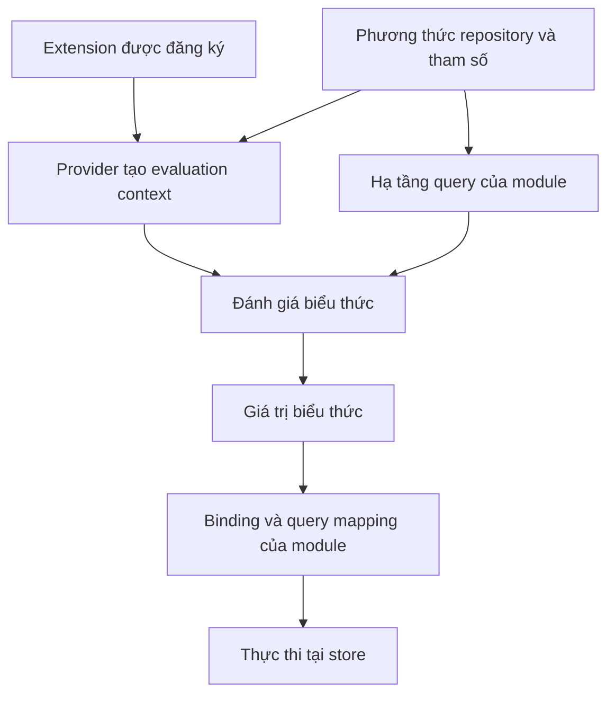

# EvaluationContextExtension và dữ liệu mở rộng cho biểu thức

## 1. Bài toán: biểu thức cần dữ liệu ngoài tham số phương thức

Trong chương **Biểu thức giá trị** của **SPRING_DATA_COMMONS**, `EvaluationContextExtension` là điểm mở rộng giúp bổ sung dữ liệu và hành vi vào ngữ cảnh đánh giá biểu thức của hạ tầng có hỗ trợ nó.

Giả sử ứng dụng quản lý đơn hàng theo tenant. Phương thức repository nhận mã đơn hàng, còn tenant hiện tại được xác định ở tầng ứng dụng. Một truy vấn cần cả hai giá trị:

```text
Mã đơn hàng: đến từ tham số phương thức
Tenant: đến từ ngữ cảnh đã được ứng dụng xác thực
```

Khi module hỗ trợ biểu thức tại vị trí query tương ứng, ứng dụng có thể cung cấp tenant qua một extension thay vì lặp lại thao tác lấy tenant trong nhiều biểu thức khác nhau.

Bài này giải thích:

- Extension đóng góp gì vào evaluation context.
- Cách sử dụng extension ID, properties, root object và functions.
- Cách đăng ký extension và sử dụng trong một ví dụ truy vấn cụ thể.
- Ranh giới giữa dữ liệu biểu thức, tham số query và khả năng thực thi của store.
- Cách xử lý vòng đời, cache, luồng reactive và kiểm chứng cấu hình.

Các abstraction repository và query được chia sẻ trong Spring Data không làm cho mọi store có cùng ngôn ngữ query hoặc cùng điểm tích hợp biểu thức. Ví dụ phải được áp dụng trong đúng module và tập phiên bản đang dùng.

## 2. Phân biệt expression, context và extension

Một biểu thức không tự có mọi thông tin của ứng dụng. Nó được đánh giá trong một context cụ thể.

| Thành phần | Vai trò | Ví dụ |
| --- | --- | --- |
| Expression | Mô tả giá trị cần tính | `appTenant.tenantId` |
| Evaluation context | Cung cấp root, biến, accessor và resolver cho biểu thức | Ngữ cảnh chứa dữ liệu tham số và extension |
| Extension | Đóng góp thêm properties, root object hoặc functions | Tenant hiện tại, thông tin người dùng, helper thuần túy |
| Store query mapping | Đưa giá trị tính được vào truy vấn theo hợp đồng của module | Bind tenant vào tham số query |

Một extension không tự gọi repository và không tự thực thi query. Nó cung cấp các thành phần mà provider nhận biết extensions có thể đưa vào evaluation context.

Luồng khái niệm:



Sơ đồ mô tả trách nhiệm, không khẳng định mọi module đều dùng cùng thứ tự gọi nội bộ hoặc cùng số lần đánh giá.

## 3. Hợp đồng của `EvaluationContextExtension`

Interface nằm trong package:

```java
import org.springframework.data.spel.spi.EvaluationContextExtension;
```

Những điểm mở rộng quan trọng gồm:

| Phương thức | Mục đích |
| --- | --- |
| `getExtensionId()` | Cung cấp tên định danh ổn định cho extension |
| `getProperties()` | Cung cấp các giá trị mở rộng theo tên |
| `getRootObject()` | Cung cấp object để hạ tầng khám phá properties và methods |
| `getFunctions()` | Cung cấp các hàm qua abstraction `Function` của Spring Data |

Một extension có thể chỉ dùng phần cần thiết. Không bắt buộc tạo cả property map, root object và function map cho cùng một dữ liệu.

### 3.1. Extension ID là tên không gian mở rộng

Ví dụ chọn ID `appTenant`. Trong context do provider hỗ trợ extensions tạo ra, ý định truy cập có thể được biểu diễn bằng:

```text
appTenant.tenantId
```

Tên này diễn đạt rõ dữ liệu đến từ extension nào. Nó đặc biệt hữu ích khi nhiều extension có property tên giống nhau, chẳng hạn `id`, `name` hoặc `language`.

ID nên ổn định giữa các lần đánh giá. Không dùng tenant ID động làm extension ID: `appTenant` là tên chức năng, còn tenant hiện tại là một giá trị bên trong extension.

### 3.2. Không đồng nhất extension ID với biến SpEL

Trong SpEL, một biến thường được tham chiếu bằng `#variableName`. Extension ID được provider hỗ trợ extensions đưa vào cơ chế phân giải của context; nó không tự có nghĩa là một biến được đăng ký bằng `setVariable`.

Vì vậy, không tự thay:

```text
appTenant.tenantId
```

bằng:

```text
#appTenant.tenantId
```

và cho rằng chúng luôn tương đương. Nếu ứng dụng tự đăng ký một biến tên `appTenant`, đó là một cấu hình khác cần được xác định rõ.

### 3.3. Tránh phụ thuộc tên không được định danh đầy đủ

Một số thành viên mở rộng có thể được phân giải theo tên trực tiếp trong context hỗ trợ. Tuy nhiên, dùng một tên chung như `tenantId` khiến nguồn dữ liệu kém rõ ràng và dễ xung đột.

Trong ví dụ, ưu tiên `appTenant.tenantId`. Không dựa vào thứ tự đăng ký để giải quyết việc hai extension cùng cung cấp một tên.

## 4. Ví dụ cung cấp tenant bằng properties

### 4.1. Hợp đồng lấy tenant của ứng dụng

Định nghĩa một abstraction nhỏ ở tầng ứng dụng:

```java
public interface CurrentTenantProvider {

    String requireTenantId();
}
```

Implementation của interface này lấy tenant từ cơ chế mà ứng dụng đã chọn. Ví dụ không giả định tenant đến từ một header tùy ý, một biến static hay một framework bảo mật cụ thể.

Hợp đồng của `requireTenantId()` là trả về tenant hợp lệ cho thao tác hiện tại hoặc từ chối khi không có ngữ cảnh phù hợp. Việc xác định và xác thực tenant diễn ra trước khi extension cung cấp giá trị cho biểu thức.

### 4.2. Extension dùng `getProperties()`

```java
import java.util.Map;
import java.util.Objects;

import org.springframework.data.spel.spi.EvaluationContextExtension;

public final class TenantEvaluationContextExtension
        implements EvaluationContextExtension {

    private final CurrentTenantProvider tenantProvider;

    public TenantEvaluationContextExtension(
            CurrentTenantProvider tenantProvider) {

        this.tenantProvider = Objects.requireNonNull(tenantProvider);
    }

    @Override
    public String getExtensionId() {
        return "appTenant";
    }

    @Override
    public Map<String, Object> getProperties() {
        String tenantId = tenantProvider.requireTenantId();

        if (tenantId == null || tenantId.isBlank()) {
            throw new IllegalStateException("Current tenant is required");
        }

        return Map.of("tenantId", tenantId);
    }
}
```

Các lớp `public` trong những đoạn ví dụ cần đặt trong file Java riêng khi triển khai. Cú pháp `Map.of` và `String.isBlank` yêu cầu phiên bản Java phù hợp với project.

Ba quyết định đáng chú ý:

1. Extension giữ một provider, không giữ tenant của một người dùng cụ thể trong field.
2. Giá trị tenant được lấy khi hạ tầng yêu cầu properties, thay vì bị chụp lại khi khởi tạo singleton.
3. Map trả về là dữ liệu của lần cung cấp đó, không phải một map mutable dùng chung được sửa theo từng request.

Nếu không có tenant hợp lệ, ví dụ từ chối thao tác. Nó không tự thay bằng một tenant mặc định có phạm vi dữ liệu rộng hơn.

### 4.3. Đăng ký bean

Trong một cấu hình hỗ trợ việc phát hiện extension beans:

```java
import org.springframework.context.annotation.Bean;
import org.springframework.context.annotation.Configuration;
import org.springframework.data.spel.spi.EvaluationContextExtension;

@Configuration
class ExpressionConfiguration {

    @Bean
    EvaluationContextExtension tenantEvaluationContextExtension(
            CurrentTenantProvider tenantProvider) {

        return new TenantEvaluationContextExtension(tenantProvider);
    }
}
```

Ứng dụng vẫn phải cung cấp implementation của `CurrentTenantProvider`. Đoạn cấu hình này không tự xác định tenant.

Việc có bean là điều kiện đăng ký trong mô hình tích hợp này. Mapper hoặc query infrastructure của module còn phải sử dụng provider nhận biết extensions. Một `StandardEvaluationContext` do ứng dụng tạo riêng không tự có extension chỉ vì bean tồn tại trong container.

## 5. Sử dụng trong query: ví dụ riêng cho Spring Data JPA

Ví dụ sau sử dụng annotation query của **Spring Data JPA**. Nó minh họa điểm tích hợp tại biểu thức tham số trong JPQL; không phải cú pháp dùng chung cho MongoDB, JDBC, R2DBC hay mọi module khác.

Giả sử entity `PurchaseOrder` có các thuộc tính `tenantId` và `externalCode`:

```java
import java.util.Optional;

import org.springframework.data.jpa.repository.Query;
import org.springframework.data.repository.Repository;
import org.springframework.data.repository.query.Param;

interface PurchaseOrderRepository
        extends Repository<PurchaseOrder, Long> {

    @Query("select o from PurchaseOrder o "
            + "where o.tenantId = :#{appTenant.tenantId} "
            + "and o.externalCode = :code")
    Optional<PurchaseOrder> findVisibleOrder(
            @Param("code") String code);
}
```

`PurchaseOrder` ở đây là entity của ứng dụng; ví dụ lược bỏ định nghĩa entity và cấu hình persistence để tập trung vào biểu thức. Kết quả `Optional` giả định mô hình dữ liệu bảo đảm có nhiều nhất một kết quả phù hợp, chẳng hạn qua ràng buộc duy nhất tương ứng.

### 5.1. Đọc từng thành phần của query

| Thành phần | Ý nghĩa |
| --- | --- |
| `o.tenantId` | Thuộc tính entity trong JPQL |
| `:#{appTenant.tenantId}` | Vị trí biểu thức giá trị theo cú pháp query của module |
| `appTenant` | Extension ID được context hỗ trợ phân giải |
| `tenantId` phía sau extension | Property mà extension cung cấp |
| `:code` | Tham số query thông thường |

Nếu tenant hiện tại là `tenant-a` và tham số `code` là `ORD-42`, ý nghĩa truy vấn là tìm đơn có cả hai giá trị tương ứng.

Extension được dùng để tính **giá trị** tại vị trí tham số. Nó không tự đổi toàn bộ query string, tên entity hoặc tên thuộc tính thành dữ liệu do người dùng cung cấp.

### 5.2. Dữ liệu biểu thức không tự mở rộng phạm vi áp dụng của query

Điều kiện tenant chỉ ràng buộc những query thực sự có điều kiện phù hợp. Extension không tự thêm điều kiện vào tất cả phương thức repository.

Các đường như query khác, cập nhật trực tiếp, thao tác driver, tác vụ batch hoặc phương thức đọc theo ID vẫn cần được thiết kế theo hợp đồng truy cập dữ liệu của ứng dụng. Việc một query mẫu hoạt động không chứng minh mọi thao tác đã có cùng giới hạn tenant.

### 5.3. Giá trị tham số khác thành phần cấu trúc query

Một giá trị bind như tenant ID có vai trò khác tên bảng, tên collection, tên cột hoặc đoạn mệnh đề query. Khả năng dùng biểu thức ở các vị trí cấu trúc phụ thuộc module và API cụ thể.

Không lấy một ví dụ `:#{...}` rồi suy ra có thể thay mọi phần của SQL/JPQL bằng cùng cơ chế. Khi cần chọn cấu trúc query, nên sử dụng điểm mở rộng được module hỗ trợ với tập lựa chọn do ứng dụng kiểm soát.

## 6. Dùng root object khi cần một mô hình ngữ cảnh có kiểu

Property map phù hợp với vài giá trị đơn giản. Root object hữu ích khi muốn gom các getters và helper liên quan thành một API rõ ràng.

Ví dụ root bất biến:

```java
import java.util.Objects;

public final class TenantExpressionRoot {

    private final String tenantId;

    public TenantExpressionRoot(String tenantId) {
        Objects.requireNonNull(tenantId, "tenantId");

        if (tenantId.isBlank()) {
            throw new IllegalArgumentException("tenantId must not be blank");
        }

        this.tenantId = tenantId;
    }

    public String getTenantId() {
        return tenantId;
    }

    public String scopedCode(String localCode) {
        Objects.requireNonNull(localCode, "localCode");
        return tenantId + ":" + localCode;
    }
}
```

Một extension thay thế có thể cung cấp root đó:

```java
import java.util.Objects;

import org.springframework.data.spel.spi.EvaluationContextExtension;

public final class RootBasedTenantExtension
        implements EvaluationContextExtension {

    private final CurrentTenantProvider tenantProvider;

    public RootBasedTenantExtension(CurrentTenantProvider tenantProvider) {
        this.tenantProvider = Objects.requireNonNull(tenantProvider);
    }

    @Override
    public String getExtensionId() {
        return "appTenant";
    }

    @Override
    public TenantExpressionRoot getRootObject() {
        return new TenantExpressionRoot(tenantProvider.requireTenantId());
    }
}
```

Đây là **phương án thay thế** cho extension dùng properties, không phải bean thứ hai cần đăng ký đồng thời với cùng ID `appTenant`.

### 6.1. Khai báo kiểu trả về cụ thể

`getRootObject()` trong ví dụ khai báo kiểu trả về `TenantExpressionRoot`. Điều này giúp hạ tầng nhận diện metadata getters và methods của root thay vì chỉ nhìn thấy kiểu `Object` chung chung.

Khi root có interface, proxy hoặc cách khởi tạo đặc biệt, cần kiểm tra cơ chế khám phá metadata của phiên bản đang dùng. Các members muốn đưa vào biểu thức nên có hợp đồng public rõ ràng và dễ kiểm chứng.

### 6.2. Truy cập property và method

Trong context hỗ trợ extension tương ứng:

```text
appTenant.tenantId
appTenant.scopedCode('ORD-42')
```

Biểu thức đầu sử dụng getter của root. Biểu thức sau gọi một helper thuần túy để tạo khóa có tenant, ví dụ `tenant-a:ORD-42`.

Nếu thay literal bằng tham số phương thức repository, cú pháp tham chiếu tham số phải theo cơ chế mà module cung cấp. Không mặc định tên biến, root arguments và biểu thức query của tất cả store giống nhau.

Helper `scopedCode` chỉ tạo một chuỗi theo quy ước ví dụ. Nó không tự chứng minh chuỗi đó duy nhất, không tự tạo index và không thay thế thiết kế khóa của ứng dụng.

### 6.3. Root object không phải bean chứa mọi service

Nên cung cấp dữ liệu và helper cần thiết cho biểu thức bằng một API hẹp. Việc đưa một service lớn hoặc toàn bộ request vào root làm biểu thức phụ thuộc nhiều trạng thái, dễ gây truy cập dữ liệu ngoài ý định và khó kiểm thử.

Với ví dụ tenant, root chỉ chứa một snapshot tenant và phép tạo mã thuần túy. Nó không có method gọi repository, cập nhật dữ liệu hoặc thay đổi tenant hiện tại.

## 7. Khi nào sử dụng `getFunctions()`?

`getFunctions()` cung cấp các hàm thông qua `org.springframework.data.spel.spi.Function`. Cơ chế này thích hợp khi extension muốn xuất bản một tập helper có chủ đích thay vì để hạ tầng khám phá toàn bộ public API của một root object.

Ví dụ về ý định:

```text
Extension: appText
Function được công bố: normalizeCode
Đầu vào: một mã dạng chuỗi
Đầu ra: mã được chuẩn hóa theo quy ước ứng dụng
```

Cách dựng `Function`, chọn method và đăng ký map phải theo API của phiên bản đang dùng. Một lambda Java đặt vào `Map<String, Object>` không tự trở thành một function của extension theo cùng hợp đồng.

Cũng cần phân biệt function do extension công bố với function được ứng dụng đăng ký trực tiếp trên một SpEL context. Cú pháp `#functionName(...)` của một function được đăng ký như biến không tự chứng minh function của extension đã có cùng tên và cùng cách phân giải.

| Cách cung cấp | Phù hợp khi |
| --- | --- |
| `getProperties()` | Có một số giá trị theo tên như tenant ID hoặc locale |
| `getRootObject()` | Muốn có getters và methods được mô hình hóa bằng một lớp có kiểu |
| `getFunctions()` | Muốn công bố có chọn lọc các helper qua abstraction function |

Không nên công bố cùng một tên qua nhiều cơ chế rồi phụ thuộc vào ưu tiên phân giải ngầm. Chọn một hợp đồng tên rõ ràng cho mỗi dữ liệu hoặc thao tác.

## 8. Phân biệt SpEL với placeholder cấu hình

Biểu thức giá trị có thể liên quan đến cả SpEL và placeholder, nhưng chúng lấy dữ liệu qua các cơ chế khác nhau.

```text
#{...}  : biểu thức SpEL trong ngữ cảnh có hỗ trợ
${...}  : placeholder cấu hình trong ngữ cảnh có hỗ trợ
```

Ví dụ `appTenant.tenantId` thuộc logic phân giải SpEL của extension. Nó không tự tạo ra một property cấu hình để `${appTenant.tenantId}` có thể đọc được.

| Nhu cầu | Nguồn dữ liệu phù hợp |
| --- | --- |
| Một tên cấu hình ổn định của ứng dụng | Environment hoặc property source được cấu hình |
| Tenant của thao tác hiện tại | Context ứng dụng được extension cung cấp |
| Tham số phương thức repository | Binding tham số và context query của module |
| Metadata entity hoặc thông tin query đặc thù | Biến/điểm mở rộng mà module công bố |

Cú pháp bao quanh biểu thức cũng phụ thuộc vị trí sử dụng. Ví dụ JPA dùng `:#{...}` để tạo biểu thức tham số; không thể lấy nguyên chuỗi đó đưa vào mọi annotation hoặc API parser.

## 9. Vòng đời extension, snapshot và cache

Một extension bean có thể sống lâu hơn một request. Dữ liệu mà nó cung cấp có thể thay đổi theo người dùng, tenant hoặc thao tác.

### 9.1. Lỗi chụp tenant trong constructor

Một thiết kế dễ sai là:

```text
Khởi tạo singleton extension
  -> đọc tenant hiện tại
  -> lưu tenant vào field
  -> dùng field đó cho mọi lần đánh giá sau
```

Tại thời điểm khởi tạo có thể chưa có request, hoặc tenant chỉ thuộc một thao tác đã kết thúc. Ví dụ trong bài lưu provider trong field và lấy giá trị khi context yêu cầu dữ liệu.

Tuy vậy, cách làm này vẫn cần provider và hạ tầng tạo context có vòng đời đúng. Không thể sửa một context bị tái sử dụng sai phạm vi chỉ bằng việc thêm getter động vào extension.

### 9.2. Phân biệt cache cấu trúc với cache dữ liệu

| Đối tượng có thể được cache | Điều cần xem xét |
| --- | --- |
| Kết quả parse biểu thức | Có thể dùng lại cấu trúc khi API hỗ trợ và không gắn dữ liệu lần gọi |
| Metadata của root và extension | Có thể dùng lại nếu kiểu và hợp đồng tên ổn định |
| Evaluation context | Có thể chứa trạng thái của lần đánh giá; cần quản lý đúng phạm vi |
| Map properties hoặc root snapshot | Có thể chứa tenant/user cụ thể; tránh dùng nhầm cho thao tác khác |
| Giá trị cuối cùng của biểu thức | Chỉ được dùng lại nếu khóa cache mô tả đầy đủ nguồn dữ liệu liên quan |

Không cache kết quả `appTenant.tenantId` chỉ theo chuỗi biểu thức. Cùng một biểu thức có thể tạo giá trị khác nhau trong hai thao tác của hai tenant.

### 9.3. Không dựa vào số lần getter được gọi

Hạ tầng có thể dùng cơ chế lazy, metadata cache hoặc chọn extension dựa trên dependencies của biểu thức. Không nên coi `getProperties()` hoặc `getRootObject()` là callback chắc chắn chạy đúng một lần cho mỗi query.

Các phương thức đó nên có hành vi ổn định khi bị gọi lại, không làm phát sinh cập nhật nghiệp vụ và không dựa vào thứ tự gọi giữa các extensions.

### 9.4. Snapshot cần nhất quán trong một thao tác

Nếu biểu thức cần nhiều giá trị liên quan như tenant ID và vùng dữ liệu, việc lấy từng giá trị từ nguồn có thể thay đổi giữa chừng gây ra một tổ hợp không nhất quán.

Một root bất biến được tạo từ cùng một snapshot có thể giúp diễn đạt hợp đồng đó. Cần bảo đảm nguồn snapshot cũng phù hợp với phạm vi thực thi của ứng dụng.

## 10. Reactive context và tác vụ nền

### 10.1. Không giả định `ThreadLocal` luôn đi cùng thao tác reactive

Trong một luồng reactive, công việc có thể tiếp tục trên thread khác. Provider đọc một `ThreadLocal` có thể không thấy tenant hoặc thấy trạng thái không thuộc thao tác đó.

Spring Data có abstraction `ReactiveEvaluationContextExtension` cho tích hợp reactive ở những module/phiên bản hỗ trợ. Khi sử dụng, cần xác định cách lấy dữ liệu từ reactive context và cách module đưa extension vào quá trình đánh giá.

Không chuyển một nguồn dữ liệu reactive thành blocking call trong getter đồng bộ chỉ để khớp một ví dụ. Chọn đúng cơ chế tích hợp theo pipeline thực tế và kiểm tra việc lan truyền context.

### 10.2. Tác vụ nền cần tenant tường minh

Một job chạy ngoài request có thể không có tenant hiện tại. Cần thiết lập phạm vi tenant theo hợp đồng của job hoặc dùng phương thức repository nhận tenant tường minh khi thích hợp.

Extension không tự suy ra tenant từ entity sắp đọc hay từ một tham số không liên quan. Một lỗi thiếu ngữ cảnh rõ ràng dễ xử lý hơn việc âm thầm chạy với dữ liệu tenant khác.

## 11. Dữ liệu biểu thức và phạm vi tin cậy

Expression text và expression input có vai trò khác nhau. Trong ví dụ, query chứa biểu thức do ứng dụng viết, còn tenant ID là một giá trị được cung cấp cho biểu thức.

Giữ phần expression text trong cấu hình hoặc code do ứng dụng kiểm soát. Nếu cần tìm theo chuỗi người dùng nhập, đưa chuỗi đó vào một giá trị tham số theo API của module, không parse nó thành một biểu thức có khả năng truy cập root methods.

Việc root có nhiều method hoặc dùng context có khả năng phân giải rộng làm hợp đồng biểu thức lớn hơn. Chỉ công bố những dữ liệu và helper mà query cần dùng.

Một helper biểu thức nên dễ dự đoán:

- Không thay đổi dữ liệu hoặc trạng thái người dùng.
- Không thực hiện truy vấn phụ cho mỗi lần đánh giá nếu có thể chuẩn bị dữ liệu trước.
- Không đưa payload request hoặc giá trị nhạy cảm vào thông báo lỗi không cần thiết.
- Có quy tắc rõ khi dữ liệu bắt buộc không tồn tại.

Đây là các lựa chọn trực tiếp liên quan đến ví dụ context động, giúp biểu thức có hành vi dễ kiểm chứng.

## 12. Kiểm chứng từ extension đến query thật

Các tình huống dưới đây hướng dẫn triển khai; bài học không báo cáo kết quả đã chạy trên một module hay database cụ thể.

### 12.1. Kiểm tra dữ liệu extension cung cấp

Với một provider giả lập, xác nhận:

| Tình huống | Kết quả mong đợi |
| --- | --- |
| Provider trả `tenant-a` | Properties có `tenantId = tenant-a` |
| Provider trả `tenant-b` trong thao tác khác | Kết quả mới thuộc `tenant-b` |
| Provider báo thiếu tenant | Thao tác bị từ chối theo hợp đồng |
| Provider trả null hoặc chuỗi trắng | Extension trong ví dụ từ chối |
| Root nhận `tenant-a` | Getter trả `tenant-a` và helper dùng cùng snapshot |

Chỉ kiểm tra `getProperties()` đúng chưa đủ để xác nhận query infrastructure đã dùng extension.

### 12.2. Kiểm tra phân giải biểu thức với provider thực tế

Sử dụng đúng provider/context mà cấu hình của project hỗ trợ, xác nhận:

- `appTenant.tenantId` được phân giải qua extension đã đăng ký.
- Tên ID và tên property khớp giữa cấu hình và biểu thức.
- Root getter và helper public được phát hiện nếu dùng phương án root.
- Các extensions có cùng tên property vẫn được phân biệt qua ID.
- Hai lần đánh giá ở hai phạm vi tenant không dùng lại dữ liệu sai phạm vi.

Một test chỉ tạo `StandardEvaluationContext` rồi tự thêm property có thể kiểm tra SpEL thuần túy nhưng bỏ qua hoàn toàn cơ chế extension mà ứng dụng cần dùng.

### 12.3. Kiểm tra repository tích hợp

Tạo dữ liệu có cùng mã `ORD-42` ở `tenant-a` và `tenant-b`. Sau đó thực hiện phương thức query ở hai phạm vi tenant:

| Ngữ cảnh | Kỳ vọng |
| --- | --- |
| Tenant A | Trả đơn của A |
| Tenant B | Trả đơn của B |
| Không có tenant | Từ chối thao tác theo thiết kế |

Kiểm tra này có ý nghĩa hơn việc chỉ quan sát chuỗi query, vì nó xác nhận extension, context, binding và query thực thi cùng hoạt động.

Nếu ứng dụng dùng count query cho phân trang, projection, update, native query hoặc đường truy cập khác, cần xác nhận hành vi của chính các đường đó. Không suy ra một query thành công sẽ chứng minh toàn bộ repository có cùng cách đánh giá biểu thức.

### 12.4. Kiểm tra các đặc điểm vận hành thực sự sử dụng

Nếu có thực thi bất đồng bộ hoặc reactive, kiểm tra context qua đúng điểm chuyển luồng. Nếu có tác vụ nền, kiểm tra cách job thiết lập tenant. Nếu có cache kết quả query, kiểm tra khóa cache có phân biệt các phạm vi dữ liệu cần thiết.

Chỉ mở rộng kiểm tra theo những đường ứng dụng sử dụng; không cần tạo một tập giả định cho mọi store.

## 13. Lỗi thường gặp và cách khoanh vùng

| Hiện tượng | Nguyên nhân cần kiểm tra | Hướng xử lý |
| --- | --- | --- |
| Không tìm thấy `appTenant` | Bean chưa được phát hiện; ID sai; provider không hỗ trợ extension | Xác định context thực tế và cách đăng ký |
| Đổi thành `#appTenant` rồi nhận null | Đang dùng cú pháp biến nhưng không đăng ký biến tương ứng | Kiểm tra hợp đồng phân giải extension và biến |
| Có extension bean nhưng parser riêng không nhìn thấy | Context được tạo ngoài hạ tầng hỗ trợ extensions | Cấu hình provider phù hợp cho đường parse đó |
| Root có getter nhưng không truy cập được | Metadata kiểu root hoặc public API không được khám phá đúng | Kiểm tra kiểu trả về, proxy và phiên bản API |
| Tenant bị giữ nguyên giữa nhiều request | Snapshot/cache hoặc field singleton có phạm vi sai | Kiểm tra toàn bộ đường tạo context và lấy dữ liệu |
| Query reactive không có tenant | Nguồn ngữ cảnh phụ thuộc thread cũ | Dùng cơ chế lan truyền context phù hợp |
| Query lỗi binding hoặc sai cú pháp | Dùng cú pháp expression của module khác hoặc sai vị trí | Đối chiếu điểm tích hợp query của module hiện tại |
| `${appTenant.tenantId}` không hoạt động | Nhầm placeholder với SpEL extension | Chọn đúng nguồn dữ liệu và cú pháp |
| Helper bị gọi nhiều lần ngoài dự kiến | Phụ thuộc vào số lần đánh giá hoặc có side effect | Làm helper thuần túy và bỏ phụ thuộc số lần gọi |
| Một query có tenant nhưng đường khác vẫn thấy dữ liệu rộng hơn | Giới hạn tenant chỉ có trong query đã viết | Kiểm tra các phương thức và phạm vi truy cập thực tế |

Khi gặp lỗi, cần xác định trước lỗi nằm ở phát hiện extension, tạo context, phân giải thành viên, tính giá trị hay binding query. Các lớp lỗi này có nguyên nhân và cách sửa khác nhau.

## 14. Tự kiểm tra mức hiểu

**Extension ID có nên thay đổi theo tenant hiện tại không?**

Không. ID nhận diện extension như `appTenant`; tenant hiện tại là dữ liệu bên trong extension.

**Có extension bean thì mọi SpEL expression trong ứng dụng đều truy cập được nó chưa?**

Chưa. Context dùng để đánh giá phải được cấu hình qua hạ tầng nhận biết extension đó.

**`appTenant.tenantId` và `#appTenant.tenantId` có tự tương đương không?**

Không. Một tên được phân giải qua extension khác với một biến SpEL. Cách đăng ký và cú pháp phải khớp nhau.

**Khi nào dùng properties, khi nào dùng root object?**

Properties phù hợp với vài giá trị theo tên. Root object phù hợp với một API có kiểu, getters và helper liên quan. Tránh công bố trùng cùng một tên qua nhiều cơ chế.

**Vì sao không lưu tenant hiện tại trong constructor singleton?**

Vì tenant thuộc phạm vi thao tác, còn singleton có vòng đời dài hơn. Giá trị chụp lúc khởi tạo có thể thiếu hoặc thuộc một thao tác khác.

**Một query dùng tenant extension có tự làm toàn bộ repository giới hạn theo tenant không?**

Không. Phải thiết kế và xác nhận từng đường truy cập dữ liệu cần cùng ràng buộc.

**Có thể dùng `${...}` để đọc property do extension cung cấp không?**

Không tự động. Placeholder cấu hình và phân giải SpEL qua extension là hai cơ chế khác nhau.

## 15. Nguyên tắc áp dụng

`EvaluationContextExtension` giúp mở rộng dữ liệu và hành vi mà biểu thức có thể sử dụng trong context hỗ trợ của Spring Data. Hãy chọn ID ổn định, công bố API nhỏ và xác định rõ nguồn dữ liệu theo phạm vi thực thi.

Khi đưa extension vào repository query, kiểm tra riêng cơ chế đăng ký, cách phân giải biểu thức, binding tham số và hành vi của module store. Với dữ liệu động như tenant, tính đúng đắn còn phụ thuộc vòng đời context, cache và cách lan truyền ngữ cảnh qua các đường thực thi.

Một tích hợp hoàn chỉnh cần thống nhất **extension được phát hiện, giá trị đúng phạm vi, biểu thức đúng cú pháp và query được thực thi theo hợp đồng đã chọn**.